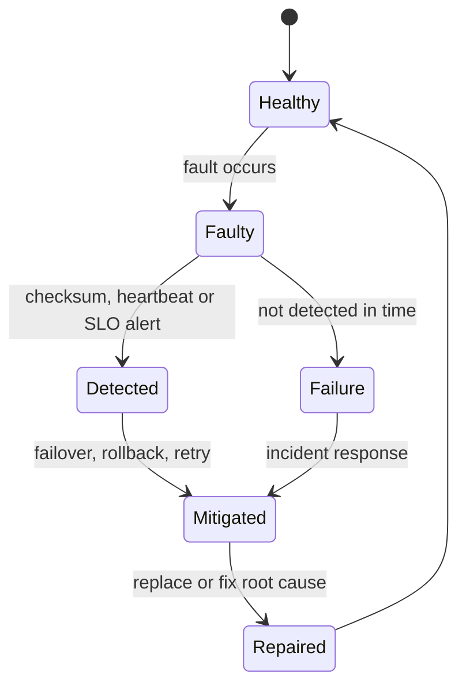

## In one minute
- Reliability is the probability that a system keeps doing the right thing, with correct results and no lost data, over a period of time. Availability asks "can I reach it?"; reliability also asks "can I trust what it did?"
- Faults are inevitable; failures are not. A reliable system detects faults (a dead disk, a bad deploy, a flipped bit) and contains them before they become user-visible failures.
- MTBF (how often things break) and MTTR (how fast you recover) together set availability, and at scale MTTR is the lever you can actually pull.
- At fleet scale, rare events are daily events: 1% annual failure across 30,000 disks is almost one dead disk a day. Design for failure as a normal operating condition.
- Reliability is verified, not assumed: checksums, invariants, reconciliation, canaries and drills.

## How it works

### Faults, errors and failures
A **fault** is a defect or event: a disk sector goes bad, a bug ships, an operator runs a command on the wrong cluster. An **error** is the wrong internal state the fault produces. A **failure** is when the system visibly stops meeting its specification. Reliability engineering lives in the gap between the first and the last: tolerate faults, detect errors, and stop them before they become failures.

Faults come in three families. Hardware faults (disks, memory, power supplies, NICs) are mostly independent and random. Software faults (bugs, leaks, bad config, a leap second) are correlated: the same bug fires on every node at once. Human faults, mostly configuration changes, cause a large share of major outages in published postmortems. Each family needs a different defence: redundancy for hardware, staged rollouts and isolation for software, and guard rails plus automation for humans.

### Measuring reliability
- **MTTF / MTBF:** mean time to (or between) failures. A server with 3-year MTBF in a fleet of 2,000 means about two server failures every day.
- **MTTR:** mean time to recover, which bundles detection, diagnosis, mitigation and repair.
- **Failure rate:** λ = 1 / MTBF. With a constant rate, the chance of surviving time t is `R(t) = e^(−t / MTBF)`.
- **Availability** follows: `MTBF / (MTBF + MTTR)`.

The constant-rate model is a simplification. Hardware follows a bathtub curve: high early failure (infant mortality), a flat middle, then wear-out. Software has its own version: most incidents follow a change. Google's SRE team puts it at roughly 70% of outages ([Google SRE book](https://sre.google/sre-book/introduction/)), which is why change management is a reliability tool.

Treat MTTR as a rough guide, not a precise score. A team has a handful of incidents a quarter and their durations vary wildly, so one long outage moves the mean more than any real improvement. A Monte Carlo study from Google found MTTR-style metrics "poorly suited for decision making or trend analysis" for incidents ([Google SRE](https://sre.google/resources/practices-and-processes/incident-metrics-in-sre/)). DORA has also replaced its old "time to restore service" key with *failed deployment recovery time*, which counts only recovery from bad changes ([DORA](https://dora.dev/guides/dora-metrics-four-keys/)). Use the formula to reason about design, and judge a team on SLO impact and incident trends instead.

### MTBF versus MTTR
You can make failures rarer or recovery faster. Rarer failures come from better components, testing and review, and they hit diminishing returns quickly; you will never make a fleet of disks stop failing. Faster recovery comes from detection, automation and rollback, and it scales. Even preparation counts: Google reports roughly a 3x MTTR improvement when on-call engineers have a written playbook instead of improvising ([Google SRE book](https://sre.google/sre-book/introduction/)). A service that has an incident every 30 days and takes 4 hours to recover is at 99.45%. Cut recovery to 30 minutes and it reaches 99.93% with the same number of incidents.

### Reliability as a budget
An SLO turns reliability into a number the team can spend. At 99.9% over 30 days, the error budget is 0.1% of requests. While budget remains, the team ships; when it is gone, the team spends its time on reliability work ([Google SRE book](https://sre.google/sre-book/embracing-risk/)). This makes the trade-off between velocity and stability explicit instead of a recurring argument. The Alert Monitoring lesson covers how to page on budget burn.

### Trust but verify
The problem shape behind reliability is **trust but verify**: assume every layer can silently corrupt or drop data, and check. A payments system reconciles its ledger against the bank's settlement file every day. A storage system checksums every block and scrubs disks in the background to find rot before a read does. An AI coding agent's output is run against tests and reviewed before merge, because "the tool call returned success" is not evidence that the change is correct. The pattern is the same everywhere: define an invariant, check it independently of the component that claims it, and alert on divergence.

## Down the stack

### Layer 1: The contract
Reliability contracts separate kinds of promise. **Correctness:** an acknowledged write is never lost and reads return what was written. **Durability:** for example, S3 is designed for 99.999999999% annual durability of objects, a design target rather than a refund-backed SLA ([AWS docs](https://docs.aws.amazon.com/AmazonS3/latest/userguide/DataDurability.html)). **Service level:** "99.9% of requests succeed within 300 ms over 30 days." A good contract also states failure semantics: on timeout, is the operation retried, and is it safe to retry? Without that, callers cannot build reliable systems on top.

### Layer 2: The mechanism
Detection is built from checksums and heartbeats. HDFS stores a CRC32C checksum for every 512 bytes of a block and verifies it on every read; a background block scanner re-reads every block, by default once every 504 hours (three weeks), and re-replicates any corrupt replica ([HDFS defaults](https://hadoop.apache.org/docs/stable/hadoop-project-dist/hadoop-hdfs/hdfs-default.xml)). ZFS stores each block's checksum in its parent block pointer, so a block cannot vouch for itself, and `zpool scrub` walks the whole tree ([Zhang et al., FAST 2010](https://www.usenix.org/legacy/event/fast10/tech/full_papers/zhang.pdf)). PostgreSQL keeps a 16-bit `pd_checksum` in each 8 KB page header and reports mismatches instead of returning garbage. Older guides say you must opt in with `initdb --data-checksums`; since PostgreSQL 18, `initdb` enables checksums by default and `--no-data-checksums` turns them off ([PostgreSQL 18 release notes](https://www.postgresql.org/docs/18/release-18.html)). Containment uses idempotency keys so retries are safe, bulkheads so one failing dependency cannot take all threads, and automated rollback when canary error rates rise. Recovery uses replicas, point-in-time backups and runbooks that are exercised, not just written.

### Layer 3: The machine
Hardware fails more often and more quietly than people expect. Consumer drives specify an unrecoverable read error rate around 1 in 10^14 bits, about one bad read per 12.5 TB, so rebuilding a large RAID array can hit one. Google's 2.5-year study of DRAM in its fleet found more than 8% of DIMMs affected by errors each year, orders of magnitude above lab estimates ([Schroeder et al., 2009](https://www.cs.toronto.edu/~bianca/papers/sigmetrics09.pdf)); ECC (SECDED) corrects single-bit errors and detects double-bit ones, which is why servers use it. The 2018 "fsyncgate" discovery showed that when `fsync` fails on Linux, the kernel may drop the dirty pages and clear the error, so a retry of `fsync` "succeeds" while the data is gone; PostgreSQL changed to panic and recover from the WAL instead of retrying, first in version 12 and backpatched as far as 9.4 ([PostgreSQL wiki](https://wiki.postgresql.org/wiki/Fsync_Errors)). Silent corruption also comes from NICs, hosts and switches: in Internet traces, about 1 packet in 30,000 failed the TCP checksum, and the authors estimated the 16-bit checksum lets roughly 1 bad packet in 200 million through ([Stone and Partridge, SIGCOMM 2000](https://conferences2.sigcomm.org/sigcomm/2000/conf/abstract/9-1.htm)). At petabyte scale that is a steady stream, so systems that care add end-to-end checksums at the application layer.

### Why it's built this way
1. Components fail at a fixed rate, and fleets are large, so failure is a continuous condition rather than an exception.
2. Lower layers can fail silently, so each layer that cares about correctness checks data end to end instead of trusting the layer below.
3. Making failures rarer has limits, so the main investment goes into fast detection and automated recovery.
4. Most outages follow a change, so changes are staged, canaried and reversible.
5. Perfect reliability is infinitely expensive, so an explicit budget decides how much reliability work is enough.

## Diagram


## Worked example
A storage service runs 2,500 servers with 12 disks each, 30,000 disks in total. At a 1.2% annual failure rate, close to the 1.36% Backblaze measured across about 344,000 drives in 2025 ([Backblaze](https://www.backblaze.com/blog/backblaze-drive-stats-for-2025/)), it loses about 360 disks a year, roughly one per day, and servers with a 4-year MTBF add about 1.7 server failures a day. Each object has 3 replicas on different racks.

The risk is not a single failure but a second and third before repair. If re-replicating one dead 16 TB disk takes 10 hours at 450 MB per second, the window in which another replica of the same data can fail is short. Spreading each disk's data across many peers (so 500 disks each copy 32 GB in parallel) cuts the window to about 2 minutes, and the chance of losing all three replicas drops by orders of magnitude. The same thinking drives the software side: the team found that 70% of its incidents in the past year followed a deploy, with a median recovery of 50 minutes. Adding automated canary analysis with rollback in under 5 minutes did more for its numbers than any hardware change.

## In the wild
- **GitLab, 2017: the backups that never worked.** While rebuilding a lagging replica, an engineer deleted about 300 GB on the primary instead. The nightly `pg_dump` backups had been failing silently because of a version mismatch, and their failure emails were being rejected by DMARC, so nobody knew. Recovery came from a 6-hour-old staging snapshot, after about 18 hours of downtime, with data lost for roughly 5,000 projects. GitLab added restore tests, WAL archiving, backup monitoring and a named owner for durability ([GitLab](https://about.gitlab.com/blog/2017/02/10/postmortem-of-database-outage-of-january-31/)).
- **Anthropic, 2025: three bugs that only showed up as worse answers.** A routing bug sent some Claude Sonnet 4 requests to servers configured for a coming 1M-token context (16% of requests in the worst hour), a TPU misconfiguration occasionally chose wildly unlikely tokens, and a compiler bug in approximate top-k sometimes dropped the most likely token. Every request "succeeded", and standard evals missed the drop. The fixes included exact top-k and continuous quality checks on production traffic, which is trust but verify applied to model output ([Anthropic](https://www.anthropic.com/engineering/a-postmortem-of-three-recent-issues)).
- **Knight Capital, 2012: one server missed the deploy.** New order-routing code reached seven of eight servers; on the eighth, a reused flag woke retired "Power Peg" logic, and rolling back the other seven made them run it too. In about 45 minutes Knight lost more than $460 million. The SEC found no second-person review of the deploy and no written procedure ([SEC order](https://www.sec.gov/litigation/admin/2013/34-70694.pdf)).

## Trade-offs
| Option | Strengths | Weaknesses | Choose when |
|---|---|---|---|
| Invest in MTBF (testing, review, better parts) | Fewer incidents and less customer pain | Diminishing returns, slows delivery | Failures are costly and hard to undo, such as data loss |
| Invest in MTTR (detection, rollback, automation) | Scales, improves every incident | Users still see brief failures | Most online services |
| End-to-end checksums | Catches silent corruption | CPU and storage overhead | Any system storing data you cannot regenerate |
| Redundancy across failure domains | Survives independent hardware faults | Cost, no help with correlated bugs | Hardware and zone failures |
| Staged rollouts and canaries | Contains software and config faults | Slower rollout | Every change to production |

## Pitfalls in production
- **Trusting success codes.** A write returned OK but landed nowhere, or a retry after a failed `fsync` reported success. Verify with reads, checksums and reconciliation jobs.
- **Correlated failures disguised as independent.** Replicas run the same buggy version and fail together. Stagger deploys and keep version diversity during rollouts.
- **Retries that amplify failure.** Every layer retries three times, so one slow database sees 27x the load. Retry at one layer with backoff, jitter and a retry budget.
- **Backups never restored.** The backup job ran green for a year and the restore fails. Restore regularly and alert on restore tests, not backup jobs.
- **Reliability work that never wins prioritisation.** Without an agreed budget, features always win until an outage. Use SLOs and error budgets to make the call mechanical.

## Leadership lens
- Track SLO impact, change failure rate and recovery time from failed deploys per team, and read MTTR as a trend over many incidents rather than a quarterly score; all of these say more about user pain than raw incident counts.
- Ask of every critical dataset: "How would we know if this were silently wrong?" If there is no answer, fund a reconciliation or checksum.
- Treat postmortem actions as committed work with owners and dates, and check completion monthly.
- Agree the error budget policy with product leadership before an incident, not during one.

## Check yourself
1. Why does adding replicas protect against disk failures but not against most outages?
   **Answer:** Replicas cover independent hardware faults. Most large outages come from software or configuration changes that hit every replica at once, which needs staged rollouts and fast rollback instead.
2. A service fails once a month and takes 2 hours to recover. Which is cheaper to improve, and why?
   **Answer:** Usually recovery time. Better detection, runbooks and automated rollback can cut 2 hours to minutes, while halving incident frequency needs broad changes across code and process.
3. Why does ZFS store a block's checksum in the parent pointer rather than in the block itself?
   **Answer:** A misdirected or phantom write could replace the block and its checksum together, still looking valid. Keeping the checksum in the parent lets an independent record vouch for the data.
4. What is the chance that a component with a 1,000-hour MTBF survives a 100-hour job, assuming a constant failure rate?
   **Answer:** e^(−100/1000) ≈ 90.5%, so roughly one run in ten will see a failure and needs checkpointing or retry.

## Practice
**Task:** Build an incident-log analyzer. Outages are half-open intervals `[start, end)` in minutes with `start < end`. `merge_outages(outages)` returns the outages sorted and merged, joining overlapping or touching intervals. `reliability_report(outages, window)` clips outages to `[0, window)`, drops empty ones, merges them, and returns `(failures, downtime, mttr, mtbf, availability)`: the number of merged outages, total downtime, mean downtime per failure (0 if none), mean uptime per failure (the whole window if none), and uptime divided by the window. `survival(hours, mtbf)` returns `e^(-hours/mtbf)`.

```python starter
def merge_outages(outages):
    # TODO
    raise NotImplementedError

def reliability_report(outages, window):
    # TODO
    raise NotImplementedError

def survival(hours, mtbf):
    # TODO
    raise NotImplementedError
```

```python tests
def test_merge_sorts_and_joins():
    got = merge_outages([(5, 8), (1, 3), (3, 4), (10, 12)])
    assert got == [(1, 4), (5, 8), (10, 12)]

def test_merge_overlapping():
    assert merge_outages([(100, 110), (105, 120), (102, 103)]) == [(100, 120)]
    assert merge_outages([]) == []

def test_report_with_clipping():
    f, down, mttr, mtbf, avail = reliability_report(
        [(100, 110), (105, 120), (500, 530), (990, 1010)], 1000)
    assert (f, down, mttr) == (3, 60, 20)
    assert round(mtbf, 2) == 313.33
    assert avail == 0.94

def test_report_no_outages():
    assert reliability_report([], 1000) == (0, 0, 0, 1000, 1.0)

def test_report_drops_outside_window():
    f, down, mttr, mtbf, avail = reliability_report([(-5, 5), (2000, 2010)], 100)
    assert (f, down, mttr, mtbf, avail) == (1, 5, 5, 95, 0.95)

def test_survival():
    assert round(survival(24, 720), 6) == 0.967216
    assert survival(0, 500) == 1.0
```

```python solution
import math

def merge_outages(outages):
    merged = []
    for start, end in sorted(outages):
        if merged and start <= merged[-1][1]:
            merged[-1] = (merged[-1][0], max(merged[-1][1], end))
        else:
            merged.append((start, end))
    return merged

def reliability_report(outages, window):
    clipped = []
    for start, end in outages:
        s, e = max(start, 0), min(end, window)
        if s < e:
            clipped.append((s, e))
    merged = merge_outages(clipped)
    failures = len(merged)
    downtime = sum(e - s for s, e in merged)
    uptime = window - downtime
    if failures == 0:
        return (0, 0, 0, window, 1.0)
    return (failures, downtime, downtime / failures, uptime / failures, uptime / window)

def survival(hours, mtbf):
    return math.exp(-hours / mtbf)
```

```typescript starter
export type Outage = [number, number];
export interface Report { failures: number; downtime: number; mttr: number; mtbf: number; availability: number; }
export function mergeOutages(outages: Outage[]): Outage[] { throw new Error("TODO"); }
export function reliabilityReport(outages: Outage[], window: number): Report { throw new Error("TODO"); }
export function survival(hours: number, mtbf: number): number { throw new Error("TODO"); }
```

```typescript tests
test("merge sorts and joins", () => {
  assertEqual(mergeOutages([[5, 8], [1, 3], [3, 4], [10, 12]]), [[1, 4], [5, 8], [10, 12]]);
});
test("merge overlapping", () => {
  assertEqual(mergeOutages([[100, 110], [105, 120], [102, 103]]), [[100, 120]]);
  assertEqual(mergeOutages([]), []);
});
test("report with clipping", () => {
  const r = reliabilityReport([[100, 110], [105, 120], [500, 530], [990, 1010]], 1000);
  assertEqual([r.failures, r.downtime, r.mttr], [3, 60, 20]);
  assertEqual(Math.round(r.mtbf * 100) / 100, 313.33);
  assertEqual(r.availability, 0.94);
});
test("report no outages", () => {
  assertEqual(reliabilityReport([], 1000), { failures: 0, downtime: 0, mttr: 0, mtbf: 1000, availability: 1 });
});
test("report drops outside window", () => {
  assertEqual(reliabilityReport([[-5, 5], [2000, 2010]], 100),
    { failures: 1, downtime: 5, mttr: 5, mtbf: 95, availability: 0.95 });
});
test("survival", () => {
  assertEqual(Math.round(survival(24, 720) * 1e6) / 1e6, 0.967216);
  assertEqual(survival(0, 500), 1);
});
```

```typescript solution
export type Outage = [number, number];
export interface Report { failures: number; downtime: number; mttr: number; mtbf: number; availability: number; }
export function mergeOutages(outages: Outage[]): Outage[] {
  const sorted = [...outages].sort((a, b) => a[0] - b[0] || a[1] - b[1]);
  const merged: Outage[] = [];
  for (const [s, e] of sorted) {
    const last = merged[merged.length - 1];
    if (last && s <= last[1]) last[1] = Math.max(last[1], e);
    else merged.push([s, e]);
  }
  return merged;
}
export function reliabilityReport(outages: Outage[], window: number): Report {
  const clipped: Outage[] = [];
  for (const [start, end] of outages) {
    const s = Math.max(start, 0), e = Math.min(end, window);
    if (s < e) clipped.push([s, e]);
  }
  const merged = mergeOutages(clipped);
  const failures = merged.length;
  if (failures === 0) return { failures: 0, downtime: 0, mttr: 0, mtbf: window, availability: 1 };
  const downtime = merged.reduce((acc, [s, e]) => acc + (e - s), 0);
  const uptime = window - downtime;
  return { failures, downtime, mttr: downtime / failures, mtbf: uptime / failures, availability: uptime / window };
}
export function survival(hours: number, mtbf: number): number {
  return Math.exp(-hours / mtbf);
}
```

```go starter
package practice

type Report struct {
	Failures     int
	Downtime     int
	MTTR         float64
	MTBF         float64
	Availability float64
}

func MergeOutages(outages [][2]int) [][2]int { panic("TODO") }

func ReliabilityReport(outages [][2]int, window int) Report { panic("TODO") }

func Survival(hours, mtbf float64) float64 { panic("TODO") }
```

```go tests
package practice

import (
	"math"
	"reflect"
	"testing"
)

func TestMergeSortsAndJoins(t *testing.T) {
	got := MergeOutages([][2]int{{5, 8}, {1, 3}, {3, 4}, {10, 12}})
	want := [][2]int{{1, 4}, {5, 8}, {10, 12}}
	if !reflect.DeepEqual(got, want) {
		t.Fatalf("got %v want %v", got, want)
	}
}

func TestMergeOverlapping(t *testing.T) {
	got := MergeOutages([][2]int{{100, 110}, {105, 120}, {102, 103}})
	if !reflect.DeepEqual(got, [][2]int{{100, 120}}) {
		t.Fatalf("got %v", got)
	}
	if len(MergeOutages(nil)) != 0 {
		t.Fatal("empty input should give empty output")
	}
}

func TestReportWithClipping(t *testing.T) {
	r := ReliabilityReport([][2]int{{100, 110}, {105, 120}, {500, 530}, {990, 1010}}, 1000)
	if r.Failures != 3 || r.Downtime != 60 || r.MTTR != 20 {
		t.Fatalf("got %+v", r)
	}
	if math.Abs(r.MTBF-313.333) > 0.01 || math.Abs(r.Availability-0.94) > 1e-9 {
		t.Fatalf("got %+v", r)
	}
}

func TestReportNoOutages(t *testing.T) {
	r := ReliabilityReport(nil, 1000)
	if r != (Report{0, 0, 0, 1000, 1}) {
		t.Fatalf("got %+v", r)
	}
}

func TestReportDropsOutsideWindow(t *testing.T) {
	r := ReliabilityReport([][2]int{{-5, 5}, {2000, 2010}}, 100)
	if r.Failures != 1 || r.Downtime != 5 || r.MTTR != 5 || r.MTBF != 95 || math.Abs(r.Availability-0.95) > 1e-9 {
		t.Fatalf("got %+v", r)
	}
}

func TestSurvival(t *testing.T) {
	if math.Abs(Survival(24, 720)-0.967216) > 1e-6 || Survival(0, 500) != 1 {
		t.Fatal("survival wrong")
	}
}
```

```go solution
package practice

import (
	"math"
	"sort"
)

type Report struct {
	Failures     int
	Downtime     int
	MTTR         float64
	MTBF         float64
	Availability float64
}

func MergeOutages(outages [][2]int) [][2]int {
	sorted := append([][2]int(nil), outages...)
	sort.Slice(sorted, func(i, j int) bool {
		if sorted[i][0] != sorted[j][0] {
			return sorted[i][0] < sorted[j][0]
		}
		return sorted[i][1] < sorted[j][1]
	})
	merged := [][2]int{}
	for _, o := range sorted {
		if n := len(merged); n > 0 && o[0] <= merged[n-1][1] {
			if o[1] > merged[n-1][1] {
				merged[n-1][1] = o[1]
			}
		} else {
			merged = append(merged, o)
		}
	}
	return merged
}

func ReliabilityReport(outages [][2]int, window int) Report {
	clipped := [][2]int{}
	for _, o := range outages {
		s, e := o[0], o[1]
		if s < 0 {
			s = 0
		}
		if e > window {
			e = window
		}
		if s < e {
			clipped = append(clipped, [2]int{s, e})
		}
	}
	merged := MergeOutages(clipped)
	if len(merged) == 0 {
		return Report{0, 0, 0, float64(window), 1}
	}
	down := 0
	for _, o := range merged {
		down += o[1] - o[0]
	}
	f := float64(len(merged))
	up := float64(window - down)
	return Report{len(merged), down, float64(down) / f, up / f, up / float64(window)}
}

func Survival(hours, mtbf float64) float64 {
	return math.Exp(-hours / mtbf)
}
```

## Mock interview
**Prompt:** You lead the platform for a payments company processing 2,000 transactions per second. Last quarter had 9 incidents with a median recovery time of 70 minutes, and one incident silently double-recorded 4,000 ledger entries that took a week to find. How do you make the system more reliable over the next two quarters?

- Follow-up: How would you have detected the double-recorded entries within minutes instead of a week?
- Follow-up: Seven of the nine incidents followed deploys. What do you change in the release process?
- Follow-up: The product team says reliability work is slowing features. How do you decide how much is enough?

**A strong answer covers:**
- Separating silent correctness failures from availability incidents, and treating the first as more severe.
- Invariants and continuous reconciliation (ledger sums, idempotency key uniqueness, comparison with bank settlement) checked by a component independent of the writer.
- Reducing MTTR through better detection, canaries with automatic rollback, and practised runbooks.
- Idempotent operations so retries are safe, with a single retry layer and retry budgets.
- An SLO and error budget policy agreed with product, plus postmortems whose actions are tracked to completion.

## Sources and further study
**Primary**
- [Schroeder, Pinheiro and Weber, DRAM Errors in the Wild (SIGMETRICS 2009)](https://www.cs.toronto.edu/~bianca/papers/sigmetrics09.pdf): fleet-scale memory error rates and why hard errors dominate.
- [Zhang et al., End-to-end Data Integrity for File Systems: A ZFS Case Study (FAST 2010)](https://www.usenix.org/legacy/event/fast10/tech/full_papers/zhang.pdf): injects corruption into ZFS to test what parent checksums do and do not catch.
- [Stone and Partridge, When the CRC and TCP Checksum Disagree (SIGCOMM 2000)](https://conferences2.sigcomm.org/sigcomm/2000/conf/abstract/9-1.htm): measured evidence for end-to-end checksums.
- [Davidovič, Incident Metrics in SRE (Google)](https://sre.google/resources/practices-and-processes/incident-metrics-in-sre/): why MTTR trends mislead and what to measure instead.

**Systems docs**
- [PostgreSQL: Data Checksums](https://www.postgresql.org/docs/current/checksums.html): how page checksums are verified, enabled and disabled.
- [PostgreSQL wiki: Fsync Errors](https://wiki.postgresql.org/wiki/Fsync_Errors): kernel-by-kernel behaviour after a failed `fsync` and the PANIC change.
- [AWS Well-Architected: Reliability pillar design principles](https://docs.aws.amazon.com/wellarchitected/latest/reliability-pillar/design-principles.html): automatic recovery, tested recovery procedures and change through automation.

**Books**
- *Designing Data-Intensive Applications* (2nd ed.), Kleppmann and Riccomini, chapter 2 "Defining Nonfunctional Requirements": the section on reliability and fault tolerance.
- *Site Reliability Engineering* (Google), chapter 3 "Embracing Risk" and chapter 26 "Data Integrity: What You Read Is What You Wrote": error budgets, and how Google defends against silent data loss.

**Other curricula**
- [donnemartin/system-design-primer](https://github.com/donnemartin/system-design-primer): treats reliability through availability patterns (fail-over, replication, nines in series and parallel) and does not cover silent corruption or verification.
- [Azure Well-Architected Framework: Reliability](https://learn.microsoft.com/en-us/azure/well-architected/reliability/): frames reliability as a checklist of targets, failure mode analysis, redundancy and testing.

## Watch
- [SLIs, SLOs, SLAs, oh my! (Google Cloud Tech)](https://www.youtube.com/watch?v=tEylFyxbDLE): how Google turns reliability into measurable indicators and objectives.
- [Distributed Systems 2.3: System models (Martin Kleppmann)](https://www.youtube.com/watch?v=y8f7ZG_UnGI): the fault models (crash-stop, crash-recovery, Byzantine) that reliability arguments are built on.

## Free resources
- [Google SRE book: Service Level Objectives](https://sre.google/sre-book/service-level-objectives/): choosing indicators and targets that reflect what users need.
- [Failure Trends in a Large Disk Drive Population (Google Research)](https://research.google/pubs/failure-trends-in-a-large-disk-drive-population/): real failure rates from a large fleet, and how poorly SMART data predicts them.
- [How Complex Systems Fail (Richard Cook)](https://how.complexsystems.fail/): a short, influential essay on why failures in complex systems have many causes.
- [AWS Builders' Library: Timeouts, retries and backoff with jitter](https://aws.amazon.com/builders-library/timeouts-retries-and-backoff-with-jitter/): how to make retries help reliability rather than amplify outages.
- [Mean time between failures (Wikipedia)](https://en.wikipedia.org/wiki/Mean_time_between_failures): definitions of MTBF, MTTF and their relation to failure rate.
- [Bathtub curve (Wikipedia)](https://en.wikipedia.org/wiki/Bathtub_curve): why hardware failure rates change over a component's life.
