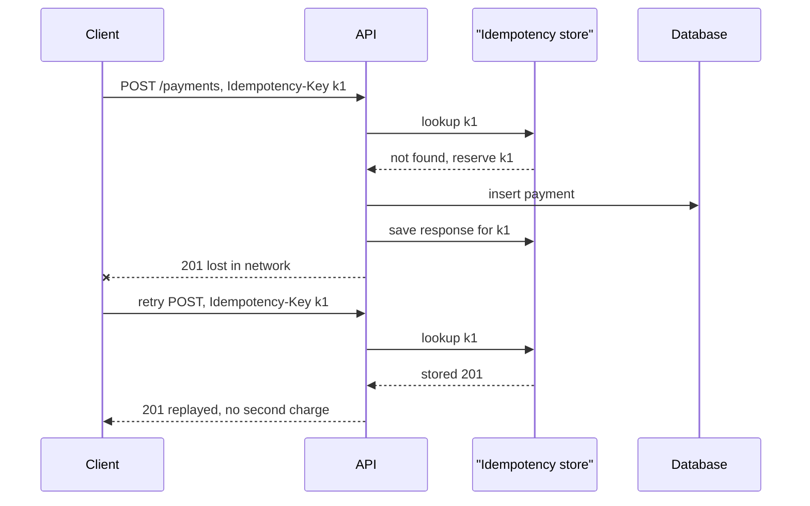

## In one minute
- REST models a system as *resources* named by URLs and manipulated through a small set of HTTP methods with defined semantics.
- Method semantics (safe, idempotent) are a contract that caches, proxies and retry logic rely on, so honour them.
- Good APIs are boring and consistent: plural nouns, predictable status codes, one error shape, one pagination style.
- The hard parts are evolution, pagination over changing data, retries of non-idempotent writes, and long-running operations.
- An API outlives the code behind it; design for the client three versions from now.

## How it works

### Resources and methods
A resource is a noun with an identity: `/orders/8812`, `/orders/8812/items`. Collections take `GET` (list) and `POST` (create). Members take `GET`, `PUT` (replace), `PATCH` (partial update) and `DELETE`. `GET`, `HEAD`, `OPTIONS` and `TRACE` are *safe*: the client asks for no state change, so crawlers and prefetchers can call them. `PUT`, `DELETE` and the safe methods are *idempotent*: repeating them has the same intended effect as doing them once, so clients may retry after a connection drops ([RFC 9110](https://www.rfc-editor.org/rfc/rfc9110.html#section-9.2)). `POST` is neither, which is why creating things needs extra care. `PATCH` is neither by default either ([RFC 5789](https://www.rfc-editor.org/rfc/rfc5789)), and its body format is a choice you must document: JSON Merge Patch (RFC 7396) sends just the changed fields and uses `null` to delete, which breaks if `null` is a real value; JSON Patch (RFC 6902) sends an ordered list of operations ([Azure guide](https://learn.microsoft.com/en-us/azure/architecture/best-practices/api-design)).

Actions that do not fit CRUD ("cancel an order") are modelled either as a state change (`PATCH /orders/8812 {"status":"cancelled"}`) or as a sub-resource (`POST /orders/8812/cancellation`). Pick one convention and use it everywhere.

Searches with large filter objects used to be forced into `POST`, which gave up caching and safe retries. RFC 10008 (June 2026) adds `QUERY`: the filter goes in the body, the request is safe and idempotent, and caches may store the response under a key that includes the body ([RFC 10008](https://www.rfc-editor.org/rfc/rfc10008.html)).

### Status codes and errors
Use the code classes properly: 2xx success, 4xx the client must change something, 5xx the server failed and a retry may help. The distinctions that matter operationally: 400 vs 422 (malformed vs semantically invalid; 422 began in WebDAV and is now part of core HTTP as "Unprocessable Content" in [RFC 9110](https://www.rfc-editor.org/rfc/rfc9110.html#section-15.5.21)), 401 vs 403 (not authenticated vs not allowed), 409 (conflict with current state), 429 (rate limited, with `Retry-After`), 503 (temporarily unavailable). Return a single error body shape everywhere, such as RFC 9457 problem details with a machine-readable `type`, so clients can branch on it.

### Idempotency for POST
A client creating a payment times out. Did it succeed? Without help, retrying may charge twice. The standard fix is an `Idempotency-Key` header: the server stores the key with a fingerprint of the request and the response, and replays the stored response for a repeat. The IETF draft that standardises the header says a missing key gets 400, a reused key with a different body gets 422, and a retry that arrives while the first attempt is still running gets 409; the draft (revision 07, October 2025) expired without becoming an RFC, so treat it as convention ([IETF draft](https://datatracker.ietf.org/doc/html/draft-ietf-httpapi-idempotency-key-header-07)). Stripe prunes keys after 24 hours and saves a result only once the endpoint starts executing, so a request that failed validation can simply be retried ([Stripe docs](https://docs.stripe.com/api/idempotent_requests)). AWS adds a subtle rule: the replay should be semantically the same as the first success, not an "already exists" error that sends the caller down a different code path ([AWS Builders' Library](https://aws.amazon.com/builders-library/making-retries-safe-with-idempotent-APIs/)).

### Pagination
Offset pagination (`?offset=10000&limit=50`) is simple but the database still walks the skipped rows, and inserts shift pages so clients see duplicates or gaps. Cursor pagination returns an opaque token encoding the last seen sort key (`created_at, id`), and the next query uses `WHERE (created_at, id) > (...)`, which uses an index and is stable under inserts. Google's API rules add two details worth copying: tokens must be opaque (base64 of readable JSON does not count), and an oversized page size is quietly capped to the maximum instead of rejected ([AIP-158](https://google.aip.dev/158)).

### Concurrency and caching
`ETag` plus `If-None-Match` lets clients revalidate cheaply (304 Not Modified). `If-Match` on writes gives optimistic concurrency: the update succeeds only if the resource has not changed, otherwise 412 Precondition Failed. This prevents lost updates without locks.

### Long-running operations
Some writes take minutes, such as an export or a bulk refund, and holding the request open hits proxy timeouts. The usual shape is to validate, then answer `202 Accepted` with a `Location` header pointing at a status resource and a `Retry-After` hint. The status resource returns 200 with a state such as `running` or `failed` while work continues, and `303 See Other` to the result when it is done, which forces the client's next request to be a `GET`. A `DELETE` on the status resource cancels ([Azure pattern](https://learn.microsoft.com/en-us/azure/architecture/patterns/asynchronous-request-reply)). Combine it with an idempotency key so a retried submit returns the existing operation rather than starting a second one.

### Versioning
Additive changes (new optional fields, new endpoints) are non-breaking if clients ignore unknown fields. Removing or renaming fields, changing types, or tightening validation are breaking. Version in the URL (`/v2/`), a query string, a header or a media type; URL and query-string versions are the cache-friendly ones because the same URL always means the same representation ([Azure guide](https://learn.microsoft.com/en-us/azure/architecture/best-practices/api-design)). Support old versions with a published deprecation window.

## Down the stack

### Layer 1: The contract
HTTP semantics (RFC 9110) are the contract every client, proxy and cache relies on. `GET` and `HEAD` are safe; `PUT` and `DELETE` are idempotent; a 2xx means the method's effect happened; a 5xx or a timeout means the outcome is unknown. Conditional requests are precise: a write with `If-Match: "v7"` either applies to version 7 or fails with 412 and changes nothing. An idempotency key extends the contract to `POST`: for 24 hours, the same key and the same body produce the same result exactly once, and a different body under that key is rejected.

### Layer 2: The mechanism
A request is a method, a target, header fields and an optional body. The server derives an `ETag` from a version column or a content hash (strong, or weak with a `W/` prefix when only semantic equality is promised). Optimistic concurrency becomes one SQL statement, `UPDATE orders SET ... , version = version + 1 WHERE id = $1 AND version = $2`; zero rows updated means 412. The idempotency store is a table with a unique key column, a request fingerprint, a state (`in_progress` or `complete`), the stored status and body, and a lock timestamp. A second request arriving while the first is in progress gets 409, so the client backs off rather than racing. Cursors are a base64url encoding of the last row's sort key with an HMAC, and the next page runs `WHERE (created_at, id) > ($1, $2) ORDER BY created_at, id LIMIT 100` against a composite index.

### Layer 3: The machine
A new HTTPS connection costs a TCP handshake plus a TLS 1.3 handshake, two round trips before the first byte of the request, so keep-alive and connection pools matter more than payload tuning on high-latency links. HTTP/1.1 headers often run 500 to 800 bytes per request; HTTP/2's HPACK replaces repeated headers with table indexes of a byte or two. On the database side, a Postgres B-tree leaf page is 8 KB and holds a few hundred index entries, so `OFFSET 1500000` walks around 5,000 leaf pages, each a possible 100-microsecond SSD read if not cached. Keyset pagination descends three or four levels of the tree and reads one or two leaf pages, whatever the depth.

### Why it's built this way
1. Networks drop responses, so clients cannot tell failure from success, and retries must be made safe by method semantics or idempotency keys.
2. Caches and proxies sit between clients and servers and know nothing about your app, so a uniform interface with standard meanings lets them help.
3. HTTP requests are stateless and long locks across them are impossible, so concurrency control uses validators like ETags instead.
4. Databases read fixed-size pages and cannot skip to row N, so deep offsets cost linear I/O and cursors use the index directly.
5. Clients upgrade slowly (mobile apps live for years), so APIs evolve additively and version only when they must break.

## Diagram



## Worked example
A marketplace exposes `GET /orders?seller_id=...` to 3,000 sellers, some with 2 million orders.

With offset pagination, a seller exporting all orders at 100 per page makes 20,000 requests; page 15,000 makes the database scan and discard 1.5 million index entries, so late pages take 800 ms instead of 5 ms and the export takes hours while hammering the primary. Switching to a cursor on `(created_at, id)` makes each page an index range scan of 100 rows, around 3 ms regardless of depth. The cursor is base64 of the last key, signed so clients cannot forge it.

For writes, the team adds idempotency keys to `POST /payments`. At 400 payments per second and a 24-hour key retention, the store holds about 35 million keys; at roughly 300 bytes each (key, fingerprint, response) that is about 10 GB, comfortably in a Redis cluster or a database table with a TTL index.

## In the wild
- **T-Mobile, 2023: one API, 37 million accounts.** On 5 January T-Mobile found that an attacker had been pulling data through a single API without authorization since about 25 November 2022. Names, billing addresses, emails, phone numbers, dates of birth, account numbers and plan details for about 37 million accounts were taken; the activity was stopped within a day of detection ([SEC 8-K](https://www.sec.gov/Archives/edgar/data/1283699/000119312523010949/d641142d8k.htm)). Six weeks of bulk reads went unnoticed, which is an argument for per-caller rate and volume alerts on every endpoint.
- **USPS, 2018: any logged-in user could read any account.** An API behind usps.com let any authenticated user query other users' account details, about 60 million in all, and many calls accepted wildcard parameters that returned whole data sets. A researcher's report went unanswered for over a year; USPS fixed the API on 20 November 2018 once a journalist contacted it ([KrebsOnSecurity](https://krebsonsecurity.com/2018/11/usps-site-exposed-data-on-60-million-users/)). Authentication without per-object authorization is the classic REST failure.
- **Stripe, 2017: idempotency keys as a design write-up.** Stripe explains why a charge must happen once even when the network loses the response, and how keys plus exponential backoff with jitter make retries safe; its client libraries generate keys automatically ([Stripe](https://stripe.com/blog/idempotency)).

## Trade-offs

| Option | Strengths | Weaknesses | Choose when |
| --- | --- | --- | --- |
| Offset pagination | Simple, jump to page N | Slow deep pages, unstable under writes | Small admin lists |
| Cursor pagination | Fast at any depth, stable | No random page access | Feeds, exports, large tables |
| URL versioning | Visible, easy to route and cache | Duplicate surface per version | Public APIs with many clients |
| Header versioning | Clean URLs, per-request choice | Harder to test and cache | Internal APIs with capable clients |
| PATCH partial update | Small payloads, fewer conflicts | Merge semantics need defining | Large resources edited piecemeal |

## Pitfalls in production
- **200 with an error body.** Monitoring and clients treat it as success. Use proper status codes.
- **Unbounded list endpoints.** One call returns 500,000 rows and takes down the service. Enforce a maximum page size.
- **Retrying POST blindly.** Duplicate orders and charges. Require idempotency keys on side-effecting creates.
- **Missing object-level authorization.** The endpoint checks that the caller is logged in but not that order 8812 belongs to them, so changing the ID in the URL reads someone else's data. It is number one on the OWASP API Security Top 10 (2023) ([OWASP](https://owasp.org/API-Security/editions/2023/en/0x11-t10/)). Check ownership on every object access and test it with two accounts.
- **Leaking internal models.** Database column names in responses freeze your schema. Map to explicit API types.
- **Silent breaking changes.** Tightened validation rejects requests that worked yesterday. Run contract tests against recorded client traffic.

## Leadership lens
- Publish an API style guide (naming, errors, pagination, versioning) and lint OpenAPI specs in CI.
- Ask in review: is this endpoint safe to retry, and what does the client do on a timeout?
- Decide a deprecation policy up front, with usage metrics per version and client.
- Treat the API spec as the contract and generate clients from it.

## Check yourself
1. Why is `PUT /users/7` safe to retry but `POST /users` not?
   **Answer:** PUT sets the resource to a given state, so repeating it yields the same state. POST creates a new resource each time unless the server deduplicates with an idempotency key.
2. Why does cursor pagination avoid duplicates when new rows are inserted?
   **Answer:** The next page starts strictly after the last seen key, so inserts elsewhere do not shift which rows come next.
3. What does `If-Match` prevent?
   **Answer:** Lost updates: a write based on a stale version fails with 412 instead of overwriting someone else's change.

## Practice
**Task:** Build an idempotency layer for a `POST` endpoint. `IdempotentEndpoint(handler, ttl, clock)` wraps `handler(body)`, which returns a response and may raise. `post(key, body)` returns the handler's response, except: a repeat with the same key and same body within `ttl` seconds returns the stored response without calling the handler; a repeat with the same key but a different body returns the string `"422"`. If the handler raises, nothing is stored and the exception propagates. A `None` key disables deduplication. `clock()` returns the current time in seconds.

```python starter
class IdempotentEndpoint:
    def __init__(self, handler, ttl, clock):
        pass

    def post(self, key, body):
        raise NotImplementedError
```

```python tests
def make():
    calls = []
    now = [0]
    def handler(body):
        calls.append(body)
        if body == "boom":
            raise RuntimeError("fail")
        return "created#" + str(len(calls))
    return IdempotentEndpoint(handler, 60, lambda: now[0]), calls, now

def test_replay_same_key():
    ep, calls, _ = make()
    assert ep.post("k1", "pay 5") == "created#1"
    assert ep.post("k1", "pay 5") == "created#1"
    assert len(calls) == 1

def test_key_reuse_with_different_body():
    ep, _, _ = make()
    ep.post("k1", "pay 5")
    assert ep.post("k1", "pay 9") == "422"

def test_no_key_never_deduplicates():
    ep, calls, _ = make()
    ep.post(None, "x")
    ep.post(None, "x")
    assert len(calls) == 2

def test_failure_not_stored():
    ep, calls, _ = make()
    try:
        ep.post("k2", "boom")
    except RuntimeError:
        pass
    assert ep.post("k2", "ok") == "created#2"

def test_expiry():
    ep, calls, now = make()
    ep.post("k3", "a")
    now[0] = 61
    assert ep.post("k3", "a") == "created#2"
```

```python solution
import hashlib

class IdempotentEndpoint:
    def __init__(self, handler, ttl, clock):
        self.handler, self.ttl, self.clock = handler, ttl, clock
        self.store = {}

    def post(self, key, body):
        if key is None:
            return self.handler(body)
        fp = hashlib.sha256(body.encode()).hexdigest()
        entry = self.store.get(key)
        if entry and self.clock() - entry[0] <= self.ttl:
            return entry[2] if entry[1] == fp else "422"
        resp = self.handler(body)
        self.store[key] = (self.clock(), fp, resp)
        return resp
```

```typescript starter
export class IdempotentEndpoint {
  constructor(handler: (body: string) => string, ttl: number, clock: () => number) {}
  post(key: string | null, body: string): string {
    throw new Error("TODO");
  }
}
```

```typescript tests
function make() {
  const calls: string[] = [];
  const now = { t: 0 };
  const handler = (body: string): string => {
    calls.push(body);
    if (body === "boom") throw new Error("fail");
    return "created#" + calls.length;
  };
  return { ep: new IdempotentEndpoint(handler, 60, () => now.t), calls, now };
}
test("replay same key", () => {
  const { ep, calls } = make();
  assertEqual(ep.post("k1", "pay 5"), "created#1");
  assertEqual(ep.post("k1", "pay 5"), "created#1");
  assertEqual(calls.length, 1);
});
test("key reuse with different body", () => {
  const { ep } = make();
  ep.post("k1", "pay 5");
  assertEqual(ep.post("k1", "pay 9"), "422");
});
test("no key never deduplicates", () => {
  const { ep, calls } = make();
  ep.post(null, "x");
  ep.post(null, "x");
  assertEqual(calls.length, 2);
});
test("failure not stored", () => {
  const { ep } = make();
  try { ep.post("k2", "boom"); } catch (e) { /* expected */ }
  assertEqual(ep.post("k2", "ok"), "created#2");
});
test("expiry", () => {
  const { ep, now } = make();
  ep.post("k3", "a");
  now.t = 61;
  assertEqual(ep.post("k3", "a"), "created#2");
});
```

```typescript solution
export class IdempotentEndpoint {
  private store = new Map<string, { at: number; body: string; resp: string }>();
  constructor(private handler: (body: string) => string, private ttl: number, private clock: () => number) {}
  post(key: string | null, body: string): string {
    if (key === null) return this.handler(body);
    const e = this.store.get(key);
    if (e && this.clock() - e.at <= this.ttl) return e.body === body ? e.resp : "422";
    const resp = this.handler(body);
    this.store.set(key, { at: this.clock(), body, resp });
    return resp;
  }
}
```

```go starter
package practice

type Endpoint struct{}

func NewEndpoint(handler func(body string) (string, error), ttl int64, clock func() int64) *Endpoint {
	return &Endpoint{}
}

// Post with key "" disables deduplication.
func (e *Endpoint) Post(key, body string) (string, error) {
	panic("TODO")
}
```

```go tests
package practice

import (
	"errors"
	"strconv"
	"testing"
)

func setup() (*Endpoint, *[]string, *int64) {
	calls := []string{}
	now := int64(0)
	h := func(body string) (string, error) {
		calls = append(calls, body)
		if body == "boom" {
			return "", errors.New("fail")
		}
		return "created#" + strconv.Itoa(len(calls)), nil
	}
	return NewEndpoint(h, 60, func() int64 { return now }), &calls, &now
}

func TestReplay(t *testing.T) {
	ep, calls, _ := setup()
	a, _ := ep.Post("k1", "pay 5")
	b, _ := ep.Post("k1", "pay 5")
	if a != "created#1" || b != "created#1" || len(*calls) != 1 {
		t.Fatalf("got %s %s %d", a, b, len(*calls))
	}
}

func TestKeyReuse(t *testing.T) {
	ep, _, _ := setup()
	ep.Post("k1", "pay 5")
	if got, _ := ep.Post("k1", "pay 9"); got != "422" {
		t.Fatalf("got %s", got)
	}
}

func TestNoKey(t *testing.T) {
	ep, calls, _ := setup()
	ep.Post("", "x")
	ep.Post("", "x")
	if len(*calls) != 2 {
		t.Fatal("expected two calls")
	}
}

func TestFailureNotStored(t *testing.T) {
	ep, _, _ := setup()
	if _, err := ep.Post("k2", "boom"); err == nil {
		t.Fatal("expected error")
	}
	if got, _ := ep.Post("k2", "ok"); got != "created#2" {
		t.Fatalf("got %s", got)
	}
}

func TestExpiry(t *testing.T) {
	ep, _, now := setup()
	ep.Post("k3", "a")
	*now = 61
	if got, _ := ep.Post("k3", "a"); got != "created#2" {
		t.Fatalf("got %s", got)
	}
}
```

```go solution
package practice

type entry struct {
	at   int64
	body string
	resp string
}

type Endpoint struct {
	handler func(string) (string, error)
	ttl     int64
	clock   func() int64
	store   map[string]entry
}

func NewEndpoint(handler func(body string) (string, error), ttl int64, clock func() int64) *Endpoint {
	return &Endpoint{handler, ttl, clock, map[string]entry{}}
}

// Post with key "" disables deduplication.
func (e *Endpoint) Post(key, body string) (string, error) {
	if key == "" {
		return e.handler(body)
	}
	if en, ok := e.store[key]; ok && e.clock()-en.at <= e.ttl {
		if en.body == body {
			return en.resp, nil
		}
		return "422", nil
	}
	resp, err := e.handler(body)
	if err != nil {
		return "", err
	}
	e.store[key] = entry{e.clock(), body, resp}
	return resp, nil
}
```

## Mock interview
**Prompt:** Design the public REST API for a payments product used by 10,000 merchants, covering creating charges, listing them, and refunds. Merchants call from flaky networks and some export millions of records.

- Follow-up: A merchant's request times out. What should their client do, and what guarantees does your API give?
- Follow-up: Two support agents refund the same charge at once. What prevents a double refund?
- Follow-up: You must rename a field used by 4,000 merchants. How?

**A strong answer covers:**
- Clear resources (`/charges`, `/charges/{id}/refunds`) and correct method semantics.
- Idempotency keys with fingerprinting, retention, and replay behaviour.
- Cursor pagination with a maximum page size.
- Optimistic concurrency via ETag and If-Match, or state checks returning 409.
- A consistent error format and a versioning and deprecation policy backed by usage data.

## Sources and further study
**Primary**
- [RFC 10008: The HTTP QUERY Method](https://www.rfc-editor.org/rfc/rfc10008.html): the new safe, cacheable method for queries with a body.
- [IETF draft: The Idempotency-Key HTTP Header Field](https://datatracker.ietf.org/doc/html/draft-ietf-httpapi-idempotency-key-header-07): the status codes for missing, mismatched and concurrent keys.
- [RFC 5789: PATCH Method for HTTP](https://www.rfc-editor.org/rfc/rfc5789): why PATCH is not idempotent unless you make it so.

**Systems docs**
- [Stripe: Idempotent requests](https://docs.stripe.com/api/idempotent_requests): key length, retention and exactly which results are replayed.
- [Google AIP-158: Pagination](https://google.aip.dev/158): page tokens, page-size caps and consistency rules.
- [OWASP API Security Top 10 (2023)](https://owasp.org/API-Security/editions/2023/en/0x11-t10/): the most common ways real APIs are broken, led by object-level authorization.

**Books**
- *Understanding Distributed Systems* (2nd edition), Roberto Vitillo, chapter "APIs": HTTP, REST and idempotency from a distributed-systems view.
- *Designing Distributed Systems* (2nd edition), Brendan Burns, chapter 2 "Important Distributed System Concepts": APIs and RPCs, latency, reliability and idempotency.

**Other curricula**
- [AWS Builders' Library: Making retries safe with idempotent APIs](https://aws.amazon.com/builders-library/making-retries-safe-with-idempotent-APIs/): how EC2 uses client tokens and why the replay must look like the original success.
- [Azure: Asynchronous Request-Reply pattern](https://learn.microsoft.com/en-us/azure/architecture/patterns/asynchronous-request-reply): the 202, status-resource and 303 flow for long operations.
- [donnemartin/system-design-primer](https://github.com/donnemartin/system-design-primer): a table of methods with their safe, idempotent and cacheable properties, plus REST versus RPC examples.

## Watch
- [REST API Pros and Cons (Hussein Nasser)](https://www.youtube.com/watch?v=M3XQ6yEC51Q): REST constraints and their practical consequences.
- [Top 10 REST API Design Pitfalls (Spring I/O)](https://www.youtube.com/watch?v=u_5JppAExDs): conference talk on common design mistakes.

## Free resources
- [RFC 9110: HTTP Semantics](https://www.rfc-editor.org/rfc/rfc9110): the authoritative definitions of methods, status codes and conditional requests.
- [Google API Design Guide](https://cloud.google.com/apis/design): resource-oriented design at large scale.
- [Azure: Web API design best practices](https://learn.microsoft.com/en-us/azure/architecture/best-practices/api-design): practical guidance on naming, paging and versioning.
- [RFC 9457: Problem Details for HTTP APIs](https://www.rfc-editor.org/rfc/rfc9457): a standard error body.
- [Designing robust APIs with idempotency (Stripe)](https://stripe.com/blog/idempotency): how a payments company uses idempotency keys.
- [Fielding's dissertation, chapter 5](https://ics.uci.edu/~fielding/pubs/dissertation/rest_arch_style.htm): where REST was defined.
