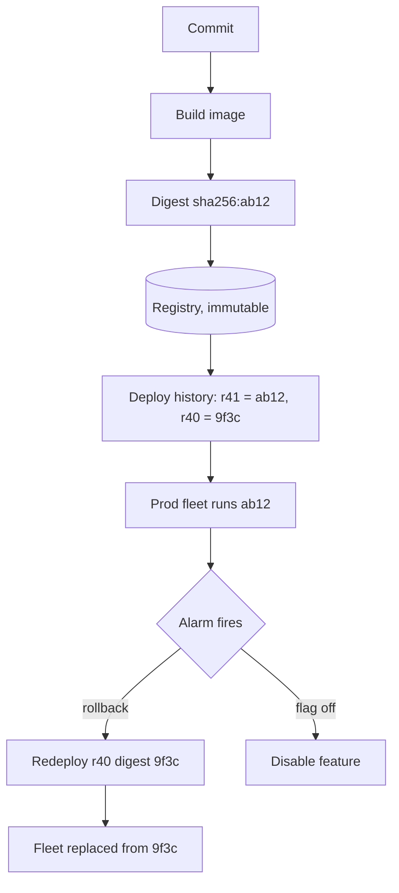

## In one minute
- Immutable infrastructure means servers and containers are never changed in place. Every change produces a new image, and new instances replace old ones.
- Because every release is a distinct, addressable artifact, rollback becomes "deploy the previous artifact", which is fast and predictable.
- Rollback restores code, not data. Anything the new version wrote, migrated, or sent to other systems stays changed.
- Rolling forward with a fix is sometimes safer than rolling back, but only a rehearsed rollback path gives you the choice.
- The target state: any release can be undone within minutes by an automated action that does not require the original author.

## How it works

### Mutable versus immutable
In the mutable model, a configuration tool changes long-lived servers in place. Over months they drift: a hand hotfix on one host, a failed run on another. Rollback means running the untested inverse of every change.

In the immutable model, the build produces an image (container image or VM image) containing the OS layer, runtime, app, and default config. Instances are created from it and never modified. To change anything, you build a new image and replace instances. Drift cannot accumulate, and any instance can be killed and recreated identically.

### Identity by digest
Tags like `api:latest` or even `api:2.4.1` can be moved to point at different content. A content digest (`sha256:...`) cannot. Deploy manifests should pin digests. Then "what is running" has a precise answer, and "roll back to what ran yesterday" is a lookup in deploy history. Kubernetes says this directly: tags can be moved but digests are fixed, and `:latest` in production makes a proper rollback harder ([Kubernetes docs](https://kubernetes.io/docs/concepts/containers/images/)). Registries can also refuse to overwrite tags; Amazon ECR's immutable mode rejects a push to an existing tag with `ImageTagAlreadyExistsException` ([ECR docs](https://docs.aws.amazon.com/AmazonECR/latest/userguide/image-tag-mutability.html)).

### What gets rolled back
A release has several layers with different rollback stories:
1. Code and image: redeploy the previous digest. Fast.
2. Configuration: version it with the release, or store it with history so it can be reverted.
3. Feature flags: flip off. Fastest of all, no deploy.
4. Schema: only reversible if the change was additive. Destructive changes are one-way.
5. Data and side effects: emails sent, payments captured, messages published to other teams. Not reversible; needs compensating actions.

### Making rollback safe
The previous version must understand anything the new version wrote. If v2 starts writing a new message format, v1 consumers must already accept it, or rolling back leaves unreadable messages in queues. The usual technique is a two-phase change: first ship a version that can read the new format but still writes the old one; once that is everywhere, ship the version that writes the new format. Rolling back the second step is then safe. Amazon calls these the prepare and activate phases, leaves a bake of usually a few days between them, and proves the property with upgrade-downgrade tests: deploy to half the fleet, finish, then roll back and check for errors ([AWS Builders' Library](https://builder.aws.com/content/3F04j2yRAAMBuPSPs50xwXZqg01/ensuring-rollback-safety-during-deployments)).

### Roll back or roll forward
Roll back when the cause is unclear or impact is ongoing. Roll forward when the fix is tiny and well understood, or when rollback is unsafe because of data changes. The decision rule should be written down before the incident. Google's canarying guidance shows why the default leans to rollback: a team with no rollback path has to patch and redeploy during the outage, which almost always lengthens user impact ([SRE Workbook](https://sre.google/workbook/canarying-releases/)). A third option is to deploy fresh infrastructure from the last known good configuration ([Azure Well-Architected](https://learn.microsoft.com/en-us/azure/well-architected/operational-excellence/safe-deployments)).

## Down the stack
### Layer 1: The contract
An OCI registry promises that a manifest digest always resolves to the same bytes. The spec makes the digest the content identifier and says clients should verify retrieved bytes against it ([OCI image spec](https://github.com/opencontainers/image-spec/blob/main/descriptor.md)). A tag promises nothing beyond "currently points here", unless the registry enforces immutable tags. A deploy system promises that a release id reproduces exactly one artifact plus one configuration. Rollback promises to restore that pair. It does not promise anything about data, caches, queues, or calls made to other systems.

### Layer 2: The mechanism
An image manifest is a small JSON document listing a config blob and an ordered list of layer descriptors, each with a media type, size, and SHA-256 digest. Multi-architecture images add an index that points to one manifest per platform. A Kubernetes pod spec can reference `registry/api@sha256:...`, and the container runtime checks that pulled content hashes to that value. A Deployment keeps each revision as an old ReplicaSet, 10 by default; `kubectl rollout undo` scales one back up, and once that ReplicaSet is pruned the revision cannot be restored. Kubernetes does not roll back on its own: a stalled rollout only gets a `ProgressDeadlineExceeded` condition, after 600 seconds by default, and some higher-level tool has to act on it ([Kubernetes docs](https://kubernetes.io/docs/concepts/workloads/controllers/deployment/)). Helm stores each release revision by default as a Secret in the release namespace, containing the rendered manifests, so `helm rollback` re-applies an old revision ([Helm docs](https://helm.sh/docs/topics/advanced/)). In GitOps, Argo CD or Flux sync the cluster to a Git commit, so rollback is a `git revert`. For VMs, an image builder such as Packer bakes a machine image, a launch template version points to it, and an instance refresh replaces the fleet. Registry garbage collection deletes blobs no manifest references, so untagged old releases can disappear unless retention rules keep them.

### Layer 3: The machine
containerd keeps pulled layers in a content store on the node's disk. Rolling back to an image the node ran yesterday is fast because its layers are still there, unless kubelet image garbage collection removed them when disk usage crossed its high threshold (85 percent by default, freeing down to 80) ([kubelet config](https://kubernetes.io/docs/reference/config-api/kubelet-config.v1beta1/)). A cold pull of a 500 MB image at 100 MB/s takes 5 seconds, plus single-threaded gzip decompression. When 300 nodes pull at once, the registry's egress becomes the bottleneck, which is why large fleets use pull-through mirrors or peer-to-peer distribution. The container root filesystem is an overlayfs: read-only image layers with a writable upper directory. Anything written there disappears when the container is replaced, which is immutability enforced by the filesystem. `readOnlyRootFilesystem: true` makes the rule explicit.

### Why it's built this way
Hashing gives content a verifiable identity at almost no cost, so immutability can be checked rather than trusted. Commodity machines are cheaper to replace than to repair, so fleets are rebuilt instead of patched. Layers are cached on nodes, so recent releases roll back quickly. Data is shared and stateful, so replacing compute can never undo what the data layer saw.

## Diagram


## Worked example
A service has 80 instances. With mutable deploys via SSH, a release takes 25 minutes and a rollback is a manual revert of packages and config, historically 40 to 60 minutes with mistakes. Mean time to restore across the last 6 incidents was 52 minutes.

After moving to immutable images and digest-pinned manifests, a rollback is a pipeline job that redeploys the previous digest. With images cached on nodes and a surge of 25 percent, replacement completes in about 4 minutes. Alarm to decision takes about 3 minutes with an automatic trigger on error rate. Restore time drops to about 7 minutes.

At 12,000 RPS with 4 percent of requests failing during a bad release, 52 minutes means about 1.5 million failed requests; 7 minutes means about 200,000. Keeping 50 releases of a 400 MB image costs 20 GB of registry, trivial by comparison.

The remaining risk is data: in one incident v2 wrote a cache entry shape v1 could not parse, so the rolled-back v1 crashed. The fix was the two-phase rule.

## In the wild
- **Microsoft Azure, 2014: the revert that could not reach the broken servers.** A storage performance change was switched on across production at once, skipping the usual incremental flighting, and a bug sent some Blob front-ends into an infinite loop. Azure reverted the change globally within 30 minutes, but front-ends already looping could not accept any configuration and had to be restarted, which stretched recovery. The tooling now enforces staged rollout for code and config alike ([Azure RCA](https://azure.microsoft.com/en-us/blog/final-root-cause-analysis-and-improvement-areas-nov-18-azure-storage-service-interruption/)).
- **Stripe, 2019: rolling back to a known good version caused the second outage.** A latent bug in a database minor version stopped a shard electing a primary (16:35 to 17:02 UTC). Engineers rolled the election protocol back to the previous version, deployed in four minutes, but the old version interacted badly with a recently added configuration setting and starved CPU on every affected shard, causing a second outage from 21:14 to 22:47. A substantial majority of API requests failed in both windows ([Stripe RCA](https://stripe.com/rcas/2019-07-10)).
- **CrowdStrike, 2024: a content update with no rings.** A channel file released at 04:09 UTC on 19 July asked the sensor for a 21st input field when the code supplied only 20, crashing Windows hosts that downloaded it before it was remediated at 05:27 UTC ([CrowdStrike](https://www.crowdstrike.com/en-us/blog/falcon-update-for-windows-hosts-technical-details/)). The root cause analysis added staged rings with bake time, so each new template is promoted or rolled back on telemetry, and gave customers control over when such updates land ([RCA](https://www.crowdstrike.com/wp-content/uploads/2024/08/Channel-File-291-Incident-Root-Cause-Analysis-08.06.2024.pdf)).

## Trade-offs
| Option | Strengths | Weaknesses | Choose when |
| --- | --- | --- | --- |
| Immutable images, replace on change | No drift, fast predictable rollback | Image build time, more registry storage | Default for services |
| Mutable config management | Small changes are quick | Drift, untested rollback | Legacy fleets, stateful snowflakes |
| Roll back | Known-good state restored quickly | Does not undo data changes | Cause unclear, impact ongoing |
| Roll forward | Keeps data changes consistent | Fix under pressure, may add risk | Fix is trivial, or rollback is unsafe |
| Flag off | Seconds, no deploy | Only covers flagged code | Feature-level problems |

## Pitfalls in production
- Deploying by tag means rollback may pull a different image than what ran before. Pin digests in manifests and history.
- Garbage-collected images make the previous release unavailable. Retain at least the last N releases and anything in the rollback window.
- New writes the old version cannot read make rollback crash. Ship readers before writers.
- Rollback that has never been exercised fails when needed. Practise it in staging and occasionally in production during calm periods.
- Setting a Deployment's `revisionHistoryLimit` to 0 to tidy up `kubectl get rs` deletes every old ReplicaSet, so the next rollout cannot be undone. Keep enough revisions to cover the rollback window.
- Hand hotfixes on a running container are lost on the next replacement and hide the real fix. Disable shell access in production or alert on it.

## Leadership lens
- Set a target for time to restore and design the rollback path to meet it. DORA renamed this metric "failed deployment recovery time" in 2023 so that it counts only recovery from bad changes, not outside outages such as a data-centre failure ([DORA](https://dora.dev/insights/dora-metrics-history/)).
- Ask of every release: if we roll back an hour after shipping, what data is left behind and can the old version read it?
- Decide who may roll back without approval. The answer should be anyone on call.

## Check yourself
1. Why is a deploy pinned to `api:2.4.1` weaker than one pinned to a digest?
   **Answer:** A tag is a mutable pointer and can be re-pushed to different content. A digest identifies exact bytes, so the rollback target is guaranteed to be what ran before.
2. v2 publishes events with a new required field. Why can rolling back to v1 still fail?
   **Answer:** Events already in the queue use the new shape, and if v1 consumers reject unknown or changed fields they will fail. Readers must accept the new shape before writers emit it.
3. When is rolling forward the better choice?
   **Answer:** When the release made data changes the old version cannot handle, or when the fix is small, understood, and faster than replacing the fleet.
4. How does immutable infrastructure reduce drift?
   **Answer:** Instances are never changed after creation, so every instance from the same image is identical; changes only arrive by replacing instances from a new image.

## Practice
**Task:** Write `is_pinned(ref)` returning True only for references of the form `name@sha256:<64 lowercase hex chars>`. Then write `rollback_target(history, schema)`, where `history` is a list of releases oldest first, each a dict with `ref`, `good` (bool), `schema_min` and `schema_max`. The last entry is the current release. Return the `ref` of the most recent earlier release that is good, pinned, and supports the current `schema` (inclusive range). Return None if there is none.

```python starter
def is_pinned(ref):
    raise NotImplementedError

def rollback_target(history, schema):
    raise NotImplementedError
```

```python tests
D1 = "api@sha256:" + "a" * 64
D2 = "api@sha256:" + "b" * 64
D3 = "api@sha256:" + "c" * 64

def rel(ref, good=True, lo=1, hi=5):
    return {"ref": ref, "good": good, "schema_min": lo, "schema_max": hi}

def test_pinned():
    assert is_pinned(D1)
    assert not is_pinned("api:2.4.1")
    assert not is_pinned("api@sha256:" + "A" * 64)
    assert not is_pinned("api@sha256:" + "a" * 63)

def test_previous_good():
    assert rollback_target([rel(D1), rel(D2), rel(D3)], 3) == D2

def test_skips_bad_release():
    assert rollback_target([rel(D1), rel(D2, good=False), rel(D3)], 3) == D1

def test_skips_incompatible_schema():
    assert rollback_target([rel(D1, hi=6), rel(D2, hi=4), rel(D3, lo=5, hi=6)], 5) == D1

def test_skips_tag_refs():
    assert rollback_target([rel("api:1.0"), rel(D3)], 3) is None

def test_no_history():
    assert rollback_target([rel(D1)], 3) is None
```

```python solution
def is_pinned(ref):
    if "@sha256:" not in ref:
        return False
    name, digest = ref.split("@sha256:", 1)
    if not name or len(digest) != 64:
        return False
    return all(c in "0123456789abcdef" for c in digest)

def rollback_target(history, schema):
    for r in reversed(history[:-1]):
        if not r["good"] or not is_pinned(r["ref"]):
            continue
        if r["schema_min"] <= schema <= r["schema_max"]:
            return r["ref"]
    return None
```

```typescript starter
export interface Release {
  ref: string;
  good: boolean;
  schema_min: number;
  schema_max: number;
}

export function isPinned(ref: string): boolean {
  throw new Error("TODO");
}

export function rollbackTarget(history: Release[], schema: number): string | null {
  throw new Error("TODO");
}
```

```typescript tests
const D1 = "api@sha256:" + "a".repeat(64);
const D2 = "api@sha256:" + "b".repeat(64);
const D3 = "api@sha256:" + "c".repeat(64);

function rel(ref: string, good = true, lo = 1, hi = 5): Release {
  return { ref: ref, good: good, schema_min: lo, schema_max: hi };
}

test("pinned", () => {
  assert(isPinned(D1), "digest ref");
  assert(!isPinned("api:2.4.1"), "tag ref");
  assert(!isPinned("api@sha256:" + "A".repeat(64)), "uppercase");
  assert(!isPinned("api@sha256:" + "a".repeat(63)), "short");
});

test("previous good", () => {
  assertEqual(rollbackTarget([rel(D1), rel(D2), rel(D3)], 3), D2);
});

test("skips bad release", () => {
  assertEqual(rollbackTarget([rel(D1), rel(D2, false), rel(D3)], 3), D1);
});

test("skips incompatible schema", () => {
  assertEqual(rollbackTarget([rel(D1, true, 1, 6), rel(D2, true, 1, 4), rel(D3, true, 5, 6)], 5), D1);
});

test("skips tag refs", () => {
  assertEqual(rollbackTarget([rel("api:1.0"), rel(D3)], 3), null);
});

test("no history", () => {
  assertEqual(rollbackTarget([rel(D1)], 3), null);
});
```

```typescript solution
export interface Release {
  ref: string;
  good: boolean;
  schema_min: number;
  schema_max: number;
}

export function isPinned(ref: string): boolean {
  const i = ref.indexOf("@sha256:");
  if (i <= 0) return false;
  return /^[0-9a-f]{64}$/.test(ref.slice(i + 8));
}

export function rollbackTarget(history: Release[], schema: number): string | null {
  for (let i = history.length - 2; i >= 0; i--) {
    const r = history[i];
    if (!r.good || !isPinned(r.ref)) continue;
    if (r.schema_min <= schema && schema <= r.schema_max) return r.ref;
  }
  return null;
}
```

```go starter
package practice

type Release struct {
	Ref                  string
	Good                 bool
	SchemaMin, SchemaMax int
}

func IsPinned(ref string) bool { panic("TODO") }

func RollbackTarget(history []Release, schema int) (string, bool) { panic("TODO") }
```

```go tests
package practice

import (
	"strings"
	"testing"
)

var (
	d1 = "api@sha256:" + strings.Repeat("a", 64)
	d2 = "api@sha256:" + strings.Repeat("b", 64)
	d3 = "api@sha256:" + strings.Repeat("c", 64)
)

func rel(ref string, good bool, lo, hi int) Release { return Release{ref, good, lo, hi} }

func TestPinned(t *testing.T) {
	if !IsPinned(d1) || IsPinned("api:2.4.1") {
		t.Fatal("basic pinning wrong")
	}
	if IsPinned("api@sha256:"+strings.Repeat("A", 64)) || IsPinned("api@sha256:"+strings.Repeat("a", 63)) {
		t.Fatal("bad digests accepted")
	}
}

func TestPreviousGood(t *testing.T) {
	if r, ok := RollbackTarget([]Release{rel(d1, true, 1, 5), rel(d2, true, 1, 5), rel(d3, true, 1, 5)}, 3); !ok || r != d2 {
		t.Fatalf("got %s", r)
	}
}

func TestSkipsBad(t *testing.T) {
	if r, _ := RollbackTarget([]Release{rel(d1, true, 1, 5), rel(d2, false, 1, 5), rel(d3, true, 1, 5)}, 3); r != d1 {
		t.Fatalf("got %s", r)
	}
}

func TestSkipsIncompatibleSchema(t *testing.T) {
	if r, _ := RollbackTarget([]Release{rel(d1, true, 1, 6), rel(d2, true, 1, 4), rel(d3, true, 5, 6)}, 5); r != d1 {
		t.Fatalf("got %s", r)
	}
}

func TestSkipsTags(t *testing.T) {
	if _, ok := RollbackTarget([]Release{rel("api:1.0", true, 1, 5), rel(d3, true, 1, 5)}, 3); ok {
		t.Fatal("tag accepted")
	}
}

func TestNoHistory(t *testing.T) {
	if _, ok := RollbackTarget([]Release{rel(d1, true, 1, 5)}, 3); ok {
		t.Fatal("expected none")
	}
}
```

```go solution
package practice

import "strings"

type Release struct {
	Ref                  string
	Good                 bool
	SchemaMin, SchemaMax int
}

func IsPinned(ref string) bool {
	i := strings.Index(ref, "@sha256:")
	if i <= 0 {
		return false
	}
	d := ref[i+8:]
	if len(d) != 64 {
		return false
	}
	for _, c := range d {
		if !strings.ContainsRune("0123456789abcdef", c) {
			return false
		}
	}
	return true
}

func RollbackTarget(history []Release, schema int) (string, bool) {
	for i := len(history) - 2; i >= 0; i-- {
		r := history[i]
		if !r.Good || !IsPinned(r.Ref) {
			continue
		}
		if r.SchemaMin <= schema && schema <= r.SchemaMax {
			return r.Ref, true
		}
	}
	return "", false
}
```

## Mock interview
**Prompt:** An e-commerce company deploys 30 services by SSH and config scripts, and its median incident restore time is 50 minutes. Propose a path to immutable deployments and a rollback design that restores service in under 10 minutes.

- Follow-up: What does your deploy history store, and for how long?
- Follow-up: A release added a column and started writing to it. Is rollback safe?
- Follow-up: When would you tell the on-call to roll forward instead?

**A strong answer covers:**
- Image builds per commit, digest-pinned manifests, and retained release history.
- Replacement-based deploys with automated rollback triggers on health metrics.
- Layered rollback: flags first, then image, with config versioned alongside.
- Backward-compatible data changes: readers before writers, additive schema, contract later.
- A written roll back versus roll forward rule and regular rollback drills.

## Sources and further study
**Primary**
- [OCI image spec: descriptors](https://github.com/opencontainers/image-spec/blob/main/descriptor.md): how digests identify content and when clients must verify them.
- [DORA metrics history](https://dora.dev/insights/dora-metrics-history/): why time to restore became failed deployment recovery time and why rework rate was added.

**Systems docs**
- [Kubernetes Deployments](https://kubernetes.io/docs/concepts/workloads/controllers/deployment/): revisions, `rollout undo`, `revisionHistoryLimit` and progress deadlines.
- [Kubernetes container images](https://kubernetes.io/docs/concepts/containers/images/): tags versus digests and why `:latest` hurts rollback.
- [Helm advanced topics: storage backends](https://helm.sh/docs/topics/advanced/): where Helm keeps release history.
- [Amazon ECR tag immutability](https://docs.aws.amazon.com/AmazonECR/latest/userguide/image-tag-mutability.html): enforcing that a tag can never be re-pointed.

**Books**
- *Site Reliability Engineering* (2016), Beyer et al., Ch 8 "Release Engineering": hermetic, reproducible builds and versioned configuration as the basis for rollback.
- *The Site Reliability Workbook* (2018), Beyer et al., Ch 16 "Canarying Releases": catching a bad release early and rolling it back before it reaches everyone.
- *Release It!* (2nd ed.), Michael T. Nygard, Ch 13 "Design for Deployment": automated, phased deployments with no planned downtime.

**Other curricula**
- [Azure Well-Architected: safe deployment practices](https://learn.microsoft.com/en-us/azure/well-architected/operational-excellence/safe-deployments): frames recovery as roll back, roll forward, or redeploy known-good infrastructure, inside a progressive exposure model.

## Watch
- [What is mutable vs. immutable infrastructure? (HashiCorp)](https://www.youtube.com/watch?v=II4PFe9BbmE): a short comparison of both models and their operational effects.
- [Webinar: Immutable Infrastructure in the Age of Kubernetes (CNCF)](https://www.youtube.com/watch?v=AxCuKmlKlyQ): how immutability works with container platforms.

## Free resources
- [ImmutableServer (Martin Fowler)](https://martinfowler.com/bliki/ImmutableServer.html): the definition and motivation for never modifying servers in place.
- [PhoenixServer (Martin Fowler)](https://martinfowler.com/bliki/PhoenixServer.html): why servers should be routinely rebuilt from scratch.
- [Ensuring rollback safety during deployments (AWS Builders' Library)](https://aws.amazon.com/builders-library/ensuring-rollback-safety-during-deployments/): the two-phase deployment technique for safe rollback.
- [Build, release, run (The Twelve-Factor App)](https://12factor.net/build-release-run): separating immutable builds from releases with unique ids.
