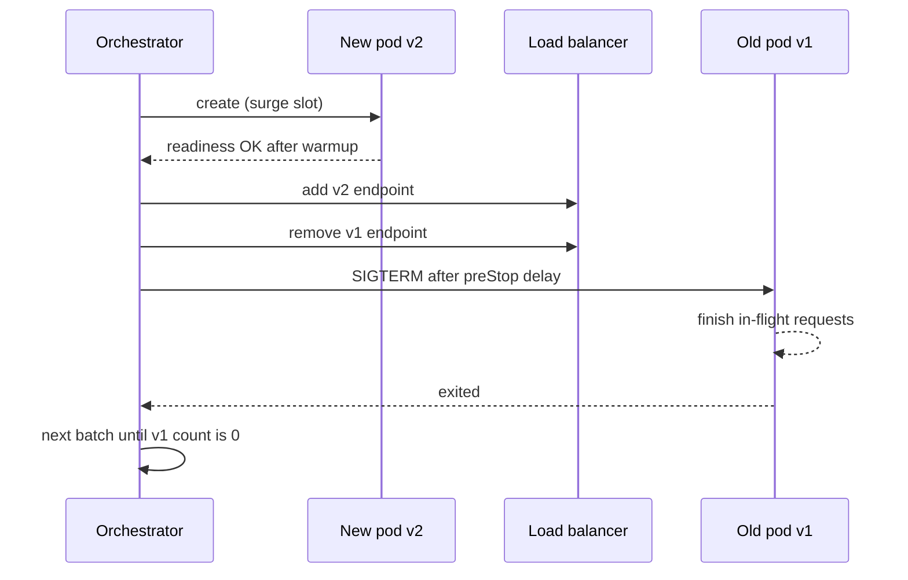

## In one minute
- A rolling deployment replaces instances of the old version with the new one in small batches, so the service never fully goes down and never needs double capacity.
- Two knobs control it: how many extra instances you may add (surge) and how many may be unavailable at once. Together they set speed versus spare capacity.
- Readiness checks decide when a new instance takes traffic and when the next batch may start. Bad checks make rolling deploys unsafe.
- During the rollout both versions serve traffic at the same time, so every change must be backward and forward compatible.
- Rollback is just another rolling deploy in reverse, which takes as long as the rollout did.

## How it works

### The loop
The orchestrator starts new-version instances, waits for readiness, adds them to the load balancer, then drains and terminates old instances, repeating until none remain. Kubernetes expresses this as `maxSurge` (extra pods above desired) and `maxUnavailable` (pods below desired that may be not ready). With 20 replicas, `maxSurge=5` and `maxUnavailable=0`, it runs up to 25 pods and always keeps 20 ready. Outside Kubernetes the same idea holds: Amazon's pipelines typically replace at most a third of a fleet at once, keeping at least two thirds healthy, and some teams go as low as 5% ([AWS Builders' Library](https://builder.aws.com/content/3ErTKQOTKc5NIw031UePBPxTQ6I/automating-safe-hands-off-deployments)).

### Readiness versus liveness
Readiness means "send me traffic". Liveness means "restart me". A readiness probe should check that the process has loaded config, warmed critical caches, and can reach hard dependencies. If readiness returns true too early, the rollout races ahead and users hit cold instances. Add a minimum ready time (for example 30 seconds) so a pod that crashes 10 seconds after start does not count as healthy; Kubernetes' `minReadySeconds` defaults to 0, so this is opt-in ([Kubernetes docs](https://kubernetes.io/docs/concepts/workloads/controllers/deployment/)). Load balancers can help too: an AWS target group's slow start ramps a new target's share of traffic linearly over 30 to 900 seconds instead of giving it a full share at once ([AWS docs](https://docs.aws.amazon.com/elasticloadbalancing/latest/application/load-balancer-target-groups.html)).

### Draining
Terminating an old instance must be graceful. The orchestrator removes it from the load balancer, the instance stops accepting new connections, finishes in-flight requests within a grace period, then exits. Endpoint removal propagates asynchronously, so a short pre-stop delay of a few seconds avoids sending requests to a process that has already closed its listener. Kubernetes now has a built-in `sleep` action for `preStop` hooks, stable since v1.34, so images no longer need a `sleep` binary just for this ([KEP-3960](https://www.kubernetes.dev/resources/keps/3960/)). The grace period clock starts before the hook runs, so the hook and the app's own shutdown must both fit inside `terminationGracePeriodSeconds` ([Kubernetes docs](https://kubernetes.io/docs/concepts/containers/container-lifecycle-hooks/)).

### Progress and halt
A rollout needs a deadline. If new instances do not become ready within, say, 10 minutes, the controller marks the rollout failed and stops creating more. It does not roll back on its own unless your tooling adds that. Better pipelines watch error rates and latency on new instances during the rollout and trigger an automated rollback.

### Mixed versions
For the whole rollout window, some requests hit v1 and some hit v2. A user can bounce between them on consecutive requests. Anything shared, such as the database schema, cache entries, message formats, and session data, must be readable by both versions.

## Down the stack
### Layer 1: The contract
In Kubernetes, the Deployment controller promises two bounds throughout an update: available pods never fall below `replicas - maxUnavailable`, and pods counted toward the rollout never exceed `replicas + maxSurge`. Terminating pods are not counted, so while old pods drain the real pod count and resource use can exceed `replicas + maxSurge` until their grace period ends; since v1.35 (beta) the Deployment reports them in `.status.terminatingReplicas` ([Kubernetes docs](https://kubernetes.io/docs/concepts/workloads/controllers/deployment/)). Percentages round surge up and unavailability down. "Available" means ready for at least `minReadySeconds`. If no progress happens within `progressDeadlineSeconds` (600 by default), the Deployment reports `Progressing=False` with reason `ProgressDeadlineExceeded`. It does not roll back on its own. The contract says nothing about request success: dropping in-flight requests is your problem.

### Layer 2: The mechanism
A Deployment owns ReplicaSets, one per pod template, named with a `pod-template-hash` label. An update creates a new ReplicaSet and the controller's reconcile loop scales it up and the old one down in steps that respect the two bounds. Old ReplicaSets are kept at zero replicas (`revisionHistoryLimit`, default 10), so `rollout undo` simply scales an old one back up; setting the limit to 0 deletes that history and with it the ability to roll back ([Kubernetes docs](https://kubernetes.io/docs/concepts/workloads/controllers/deployment/)). When a pod becomes ready, the EndpointSlice controller adds its IP; when it starts terminating, the IP is removed. Termination runs the `preStop` hook, then sends SIGTERM, then SIGKILL after `terminationGracePeriodSeconds` (30 by default).

### Layer 3: The machine
Endpoint removal is not instantaneous. The change goes from the API server through watches to kube-proxy on every node, which rewrites its packet-forwarding rules: iptables is still the default mode in Kubernetes 1.37, with IPVS and nftables as alternatives and nftables planned as the future default ([Kubernetes docs](https://kubernetes.io/docs/reference/networking/virtual-ips/)). On a 1,000-node cluster with many services, this can take several seconds, and existing TCP connections keep flowing through conntrack entries to the old pod IP. Clients using HTTP keep-alive stay pinned to the old pod until the connection closes, which is why servers send `Connection: close` or an HTTP/2 GOAWAY during drain. A new pod pays for image pull (hundreds of MB at roughly 100 MB/s if layers are not cached on the node), process start, JIT warmup on the JVM, empty CPU caches, and new TLS handshakes to every dependency for its connection pools. Its first requests can be several times slower than a warm pod's.

### Why it's built this way
Controllers reconcile desired state in loops, so a rollout survives controller restarts and is resumable. Pod templates are immutable, so each version gets its own ReplicaSet, and rollback is just scaling. Endpoint state spreads to many nodes asynchronously, so pods need a pre-stop delay to avoid receiving traffic after shutdown. Nodes are shared and bin-packed, so surge capacity is limited by free cluster space, which is why both knobs exist.

## Diagram


## Worked example
A checkout API runs 40 pods at 60 percent CPU at peak, each handling 250 RPS, 10,000 RPS total. Pods take 45 seconds to start and become ready.

With `maxUnavailable=10%` and `maxSurge=0`, the deploy removes 4 pods at a time. The other 36 must absorb 10,000 RPS, about 278 RPS each, roughly 67 percent CPU. That is safe. The rollout needs 10 batches of about 60 seconds each including drain, so about 10 minutes.

With `maxUnavailable=25%`, 30 pods carry 333 RPS each at 80 percent CPU. Latency climbs and autoscaling may fire mid-deploy, adding noise. Faster, but riskier at peak.

With `maxSurge=25%` and `maxUnavailable=0`, the cluster briefly runs 50 pods. No capacity loss, and 4 batches finish in about 4 minutes, but the cluster needs room for 10 extra pods. If the node pool is full, the surge pods stay pending and the rollout stalls. The usual choice is surge-based rolling with spare headroom reserved, or a smaller unavailability budget off-peak.

## In the wild
- **Knight Capital, 2012: a mixed fleet with incompatible meaning.** New order-routing code reached seven of eight servers. The new release reused a flag that, on the eighth server's old code, switched on long-retired "Power Peg" logic, so the two versions read the same signal differently. Removing the new code from the other seven made it worse, because they then ran the old path too. Knight lost more than $460 million in about 45 minutes ([SEC order](https://www.sec.gov/litigation/admin/2013/34-70694.pdf)).
- **Slack, 2022: a gradual agent rollout that emptied the cache.** A Consul agent upgrade rolled through a quarter of the fleet, restarting agents one after another. Each restart briefly deregistered memcached nodes, which were replaced with empty ones, and every miss turned into a query across all database shards. The database overloaded, the cache could not refill, and many users could not load Slack. Slack changed how Consul rollouts proceed and re-sharded the hot table ([Slack](https://slack.engineering/slacks-incident-on-2-22-22/)).
- **Discord, 2026: pods terminated before they could hand off.** A config change made session pods larger and halved their number in one zone. Pods were killed before draining, so 17% of sessions ended ungracefully, and the reconnect storm overran rate limits and gateway memory. Voice and video were badly degraded for about 3h17m. The fix included an admission webhook that blocks scale-down until pods drain ([Discord](https://discord.com/blog/behind-the-scenes-of-the-3-25-26-voice-outage)).

## Trade-offs
| Option | Strengths | Weaknesses | Choose when |
| --- | --- | --- | --- |
| Rolling with surge | No capacity loss, no full duplicate fleet | Needs spare cluster headroom, mixed versions | Default for stateless services |
| Rolling with unavailability | No extra capacity needed | Reduced capacity during deploy | Tight clusters, off-peak deploys |
| Recreate (stop all, start all) | No version mixing | Full downtime | Incompatible changes, dev environments |
| Blue-green | Instant switch and instant rollback | Double capacity, still mixing at the data layer | Rollback speed matters more than cost |

## Pitfalls in production
- Readiness that only checks "process is up" lets the rollout proceed before caches warm. Make readiness reflect real ability to serve and add a minimum ready time.
- A rollout that stalls halfway leaves a mixed fleet for hours. Set a progress deadline and alert on it.
- Long-lived connections (WebSockets, gRPC streams) do not move when a pod is removed from the balancer. Send a goaway or close message and let clients reconnect with jitter.
- Rolling deploys of stateful sets reorder quorum. Roll one replica at a time and wait for it to rejoin and catch up before the next.
- Rollback of 200 pods takes as long as the rollout. If you need seconds, not minutes, use blue-green or flags.

## Leadership lens
- Ask what the capacity budget is during a deploy and whether it holds at peak traffic.
- Require every change to state its compatibility story: can v1 and v2 run together against the same data?
- Decide whether rollouts gate on metrics automatically. A rolling deploy watched by nobody is a slow outage.
- Keep deploy duration visible. A 40-minute rollout discourages small, frequent releases.

## Check yourself
1. With 10 replicas, `maxSurge=0` and `maxUnavailable=0`, what happens?
   **Answer:** The rollout cannot make progress: it may not add a pod and may not remove one. Kubernetes rejects this combination for that reason.
2. Why can a readiness probe that returns 200 as soon as the HTTP server binds make a rolling deploy dangerous?
   **Answer:** Old pods are removed as soon as new ones report ready, so traffic shifts to instances that have not loaded config or warmed caches, causing errors or latency spikes across the whole fleet.
3. Why is rollback with a rolling strategy slower than with blue-green?
   **Answer:** Rolling back replaces instances batch by batch with the same pacing as the rollout, while blue-green keeps the old fleet running and just switches traffic back.
4. A v2 writes a new enum value to a shared table during the rollout. What breaks?
   **Answer:** v1 instances still serving traffic may read the unknown value and fail. The value should only be written after every instance can read it.

## Practice
**Task:** Write `rolling_plan(n, max_surge, max_unavailable)` that simulates a rolling update of `n` replicas, where new pods become ready instantly. Each step first starts as many new pods as allowed (total pods at most `n + max_surge`, new pods at most `n`), then removes as many old pods as allowed (ready pods must stay at least `n - max_unavailable`). Record the state `(old, new)` after each step and stop when old is 0 and new is `n`. Raise `ValueError` if both knobs are 0 or if a step makes no progress.

```python starter
def rolling_plan(n, max_surge, max_unavailable):
    # TODO: return list of (old, new) tuples
    raise NotImplementedError
```

```python tests
def test_surge_only():
    assert rolling_plan(3, 1, 0) == [(2, 1), (1, 2), (0, 3)]

def test_unavailable_only():
    assert rolling_plan(3, 0, 1) == [(2, 0), (1, 1), (0, 2), (0, 3)]

def test_big_surge_finishes_fast():
    assert rolling_plan(4, 4, 0) == [(0, 4)]

def test_never_below_floor():
    for old, new in rolling_plan(10, 2, 1):
        assert old + new >= 9

def test_zero_zero_rejected():
    try:
        rolling_plan(5, 0, 0)
        assert False, "expected ValueError"
    except ValueError:
        pass

def test_ends_fully_new():
    assert rolling_plan(7, 2, 2)[-1] == (0, 7)
```

```python solution
def rolling_plan(n, max_surge, max_unavailable):
    if max_surge == 0 and max_unavailable == 0:
        raise ValueError("no room to make progress")
    old, new = n, 0
    steps = []
    while not (old == 0 and new == n):
        add = min(n + max_surge - (old + new), n - new)
        add = max(add, 0)
        new += add
        kill = min(old, (old + new) - (n - max_unavailable))
        kill = max(kill, 0)
        old -= kill
        if add == 0 and kill == 0:
            raise ValueError("stuck")
        steps.append((old, new))
    return steps
```

```typescript starter
export function rollingPlan(n: number, maxSurge: number, maxUnavailable: number): [number, number][] {
  throw new Error("TODO");
}
```

```typescript tests
test("surge only", () => {
  assertEqual(rollingPlan(3, 1, 0), [[2, 1], [1, 2], [0, 3]]);
});

test("unavailable only", () => {
  assertEqual(rollingPlan(3, 0, 1), [[2, 0], [1, 1], [0, 2], [0, 3]]);
});

test("big surge finishes in one step", () => {
  assertEqual(rollingPlan(4, 4, 0), [[0, 4]]);
});

test("never below floor", () => {
  for (const [o, nw] of rollingPlan(10, 2, 1)) assert(o + nw >= 9, "below floor");
});

test("zero zero rejected", () => {
  let threw = false;
  try { rollingPlan(5, 0, 0); } catch (e) { threw = true; }
  assert(threw, "expected error");
});

test("ends fully new", () => {
  const p = rollingPlan(7, 2, 2);
  assertEqual(p[p.length - 1], [0, 7]);
});
```

```typescript solution
export function rollingPlan(n: number, maxSurge: number, maxUnavailable: number): [number, number][] {
  if (maxSurge === 0 && maxUnavailable === 0) throw new Error("no room to make progress");
  let oldCount = n;
  let newCount = 0;
  const steps: [number, number][] = [];
  while (!(oldCount === 0 && newCount === n)) {
    const add = Math.max(0, Math.min(n + maxSurge - (oldCount + newCount), n - newCount));
    newCount += add;
    const kill = Math.max(0, Math.min(oldCount, oldCount + newCount - (n - maxUnavailable)));
    oldCount -= kill;
    if (add === 0 && kill === 0) throw new Error("stuck");
    steps.push([oldCount, newCount]);
  }
  return steps;
}
```

```go starter
package practice

func RollingPlan(n, maxSurge, maxUnavailable int) ([][2]int, error) {
	panic("TODO")
}
```

```go tests
package practice

import (
	"reflect"
	"testing"
)

func TestSurgeOnly(t *testing.T) {
	got, err := RollingPlan(3, 1, 0)
	want := [][2]int{{2, 1}, {1, 2}, {0, 3}}
	if err != nil || !reflect.DeepEqual(got, want) {
		t.Fatalf("got %v %v", got, err)
	}
}

func TestUnavailableOnly(t *testing.T) {
	got, _ := RollingPlan(3, 0, 1)
	want := [][2]int{{2, 0}, {1, 1}, {0, 2}, {0, 3}}
	if !reflect.DeepEqual(got, want) {
		t.Fatalf("got %v", got)
	}
}

func TestBigSurge(t *testing.T) {
	got, _ := RollingPlan(4, 4, 0)
	if !reflect.DeepEqual(got, [][2]int{{0, 4}}) {
		t.Fatalf("got %v", got)
	}
}

func TestNeverBelowFloor(t *testing.T) {
	got, _ := RollingPlan(10, 2, 1)
	for _, s := range got {
		if s[0]+s[1] < 9 {
			t.Fatalf("below floor: %v", s)
		}
	}
}

func TestZeroZero(t *testing.T) {
	if _, err := RollingPlan(5, 0, 0); err == nil {
		t.Fatal("expected error")
	}
}

func TestEndsFullyNew(t *testing.T) {
	got, _ := RollingPlan(7, 2, 2)
	if len(got) == 0 || got[len(got)-1] != [2]int{0, 7} {
		t.Fatalf("got %v", got)
	}
}
```

```go solution
package practice

import "errors"

func clamp(v, hi int) int {
	if v > hi {
		v = hi
	}
	if v < 0 {
		v = 0
	}
	return v
}

func RollingPlan(n, maxSurge, maxUnavailable int) ([][2]int, error) {
	if maxSurge == 0 && maxUnavailable == 0 {
		return nil, errors.New("no room to make progress")
	}
	oldC, newC := n, 0
	steps := [][2]int{}
	for !(oldC == 0 && newC == n) {
		add := clamp(n+maxSurge-(oldC+newC), n-newC)
		newC += add
		kill := clamp(oldC+newC-(n-maxUnavailable), oldC)
		oldC -= kill
		if add == 0 && kill == 0 {
			return nil, errors.New("stuck")
		}
		steps = append(steps, [2]int{oldC, newC})
	}
	return steps, nil
}
```

## Mock interview
**Prompt:** A payments API runs 120 pods across 3 zones at 70 percent CPU at peak and deploys 15 times a day. Design the rolling deployment policy, including health gating and rollback.

- Follow-up: How do you pick `maxSurge` and `maxUnavailable` for this service?
- Follow-up: The new version leaks memory and fails only after 20 minutes. How does your process catch it?
- Follow-up: When would you switch this service to blue-green or canary instead?

**A strong answer covers:**
- Capacity math: 70 percent CPU leaves little room for unavailability, so prefer surge with reserved headroom.
- Readiness that reflects real serving ability, a minimum ready time, and graceful drain with a pre-stop delay.
- Spreading batches across zones so one zone is never drained at once.
- Metric-based gates during and after the rollout, with a bake period to catch slow failures.
- Compatibility rules for mixed versions and the cost of slow rollback.

## Sources and further study
**Primary**
- [KEP-3960: Pod lifecycle sleep action](https://www.kubernetes.dev/resources/keps/3960/): the design and graduation history of the built-in `preStop` sleep.
- [Slack: incident on 2-22-22](https://slack.engineering/slacks-incident-on-2-22-22/): a rolling restart of infrastructure agents that cascaded into a database overload.

**Systems docs**
- [Kubernetes: container lifecycle hooks](https://kubernetes.io/docs/concepts/containers/container-lifecycle-hooks/): `preStop` handlers and how they share the termination grace period.
- [Kubernetes: virtual IPs and service proxies](https://kubernetes.io/docs/reference/networking/virtual-ips/): kube-proxy modes and why endpoint changes take time to land on every node.
- [AWS: target groups for Application Load Balancers](https://docs.aws.amazon.com/elasticloadbalancing/latest/application/load-balancer-target-groups.html): deregistration delay (300 seconds by default) and slow start.

**Books**
- *Release It!* (2nd edition), Michael T. Nygard, chapter 13 "Design for Deployment": automated deployments and the phases of a rolling change.
- *Site Reliability Engineering*, Beyer et al., chapter 8 "Release Engineering": staged rollouts as part of release automation.
- *Understanding Distributed Systems* (2nd edition), Roberto Vitillo, chapter "Continuous delivery and deployment": incremental rollouts, health gates and rollback.

**Other curricula**
- [Azure Well-Architected: safe deployment practices](https://learn.microsoft.com/en-us/azure/well-architected/operational-excellence/safe-deployments): treats any gradual replacement as progressive exposure, gated by a health model and bake time.
- [donnemartin/system-design-primer](https://github.com/donnemartin/system-design-primer): does not cover rolling updates; deployment appears only as a cost of microservices.

## Watch
- [Top 5 Most-Used Deployment Strategies (ByteByteGo)](https://www.youtube.com/watch?v=AWVTKBUnoIg): places rolling updates next to the alternatives.
- [Kubernetes Deployment Patterns: rolling updates, canary and blue/green (Appsbroker Academy)](https://www.youtube.com/watch?v=-ynSCM1oSyo): demonstrates the Kubernetes rolling update knobs.

## Free resources
- [Kubernetes Deployments](https://kubernetes.io/docs/concepts/workloads/controllers/deployment/): authoritative reference for maxSurge, maxUnavailable, progress deadlines, and rollout history.
- [Liveness, Readiness, and Startup Probes](https://kubernetes.io/docs/concepts/configuration/liveness-readiness-startup-probes/): how each probe affects traffic and restarts.
- [Ensuring rollback safety during deployments (AWS Builders' Library)](https://aws.amazon.com/builders-library/ensuring-rollback-safety-during-deployments/): the two-phase approach to changes that must coexist with the previous version.
- [Pod disruptions](https://kubernetes.io/docs/concepts/workloads/pods/disruptions/): disruption budgets and how voluntary evictions interact with rollouts.
