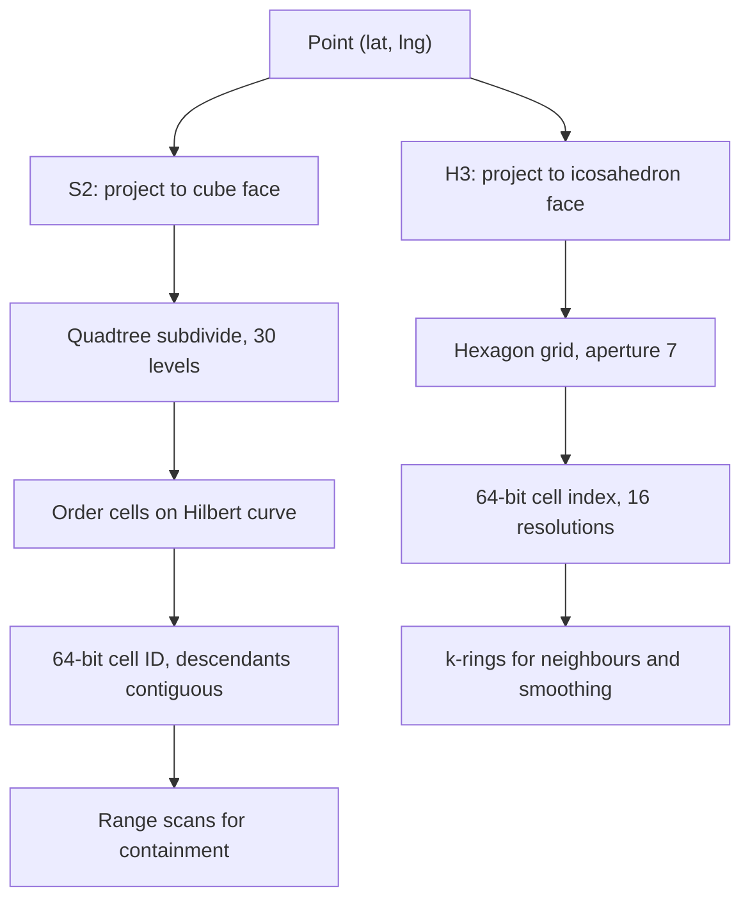

## In one minute
- S2 (from Google) and H3 (from Uber) are hierarchical grids that cover the whole sphere and give every cell a 64-bit integer ID. Both fix geohash's worst problems: severe distortion near the poles and awkward neighbour logic.
- S2 projects the Earth onto the six faces of a cube, divides each face as a quadtree, and orders cells along a Hilbert curve. A cell's descendants form one contiguous ID range, so "inside this cell" is a single range scan.
- H3 projects onto a 20-faced icosahedron and tiles it with hexagons. Every neighbour is the same distance away, which makes it the natural choice for aggregation, smoothing, and movement analysis.
- Rule of thumb: S2 for indexing and exact containment, H3 for bucketing and analytics.

## How it works

### S2: cube, quadtree, Hilbert curve
Each point on the sphere is projected onto one of six faces of a surrounding cube, and a non-linear transform evens out cell sizes so that, at any level, areas differ by only about a factor of two: level-10 cells range from 48.8 to 102.0 square km ([S2 cell statistics](https://s2geometry.io/resources/s2cell_statistics)). Geohash cells, by contrast, shrink to slivers near the poles.

Each face is a quadtree 30 levels deep; a level-30 leaf is under a square centimetre. Cells are numbered along a **Hilbert curve**, which, unlike geohash's Z-order curve, never jumps: consecutive cells are always edge neighbours. The six faces' curves are oriented so that each one ends where the next begins, giving one continuous loop over the whole sphere ([S2 cell hierarchy](https://s2geometry.io/devguide/s2cell_hierarchy)).

The 64-bit cell ID packs the face (3 bits), 2 bits per level, and a trailing 1 bit marking the level. All descendants of a cell therefore occupy one contiguous range of leaf IDs, so containment is `range_min <= id <= range_max`, which any B-tree or sorted key store handles.

Cell area falls 4x per level: level 10 averages about 81 square km, level 16 about 140 m across.

### S2 coverings
The **region coverer** takes a polygon or circle plus limits (min level, max level, max cells) and returns mixed-size cells covering it: big cells inside, small cells along the boundary. The default is 8 cells ([s2region_coverer.h](https://github.com/google/s2geometry/blob/master/src/s2/s2region_coverer.h)), which gives a loose cover; 200 give a tight one at the cost of more lookups. Never go below 4: with at least 4 cells the covering's area is at worst about 10 times the region's, but with fewer it can be astronomically larger ([S2 coverings guide](https://s2geometry.io/devguide/examples/coverings)). The covering is the query plan: one range scan per cell, then an exact geometry test.

### H3: icosahedron and hexagons
H3 projects the sphere onto an icosahedron and lays a hexagonal grid over it. There are 122 base cells at resolution 0. Each finer resolution has about seven times as many cells (aperture 7), over 16 resolutions from 0 to 15. Resolution 7 hexagons average about 5.2 square km, resolution 8 about 0.74 square km, resolution 9 about 0.1 square km, and resolution 15 under one square metre ([H3 resolution table](https://h3geo.org/docs/core-library/restable)).

Hexagons have two consequences. All six neighbours share an edge at the same centre distance, so the ring of cells at distance k (`gridDisk`) is uniform, whereas square grids mix edge and corner neighbours and bias smoothing. But hexagons cannot be split exactly into smaller hexagons, so a parent's seven children only approximate its area, and truncating IDs is not an exact containment test as it is in S2. H3 approximates the seven-way split by rotating the grid between resolutions; containment is exact in the index, but only approximate on the ground ([H3 indexing](https://h3geo.org/docs/highlights/indexing)).

Every resolution also has exactly 12 pentagons, at the icosahedron's vertices, mostly in oceans; some functions return errors when they hit one.

## Down the stack

### Layer 1: The contract
S2 promises an exact hierarchy: every leaf belongs to exactly one cell at each level, and a cell contains a point if and only if the point's leaf ID falls in the cell's ID range. A covering is guaranteed to contain the whole region; an interior covering is guaranteed to lie inside it. H3 promises a deterministic cell for every point at each resolution and exact neighbour relations, but parent-child containment is only approximate, and some grid functions can return errors near pentagons.

### Layer 2: The mechanism
An `S2CellId` is a 64-bit integer: 3 face bits, then 2 bits per level of Hilbert position, then a single 1 bit, then zeros. The lowest set bit encodes the level. If `lsb = id & -id`, the descendants span `[id - lsb + 1, id + lsb - 1]`, and the parent at a coarser level is found by clearing low bits and setting the new lowest bit. Converting a point to a cell uses lookup tables that advance the Hilbert curve 4 levels at a time.

An `H3Index` is also 64 bits: a reserved bit, a 4-bit mode (1 means cell), 3 reserved bits, a 4-bit resolution, a 7-bit base cell (0 to 121), then fifteen 3-bit digits, each 0 to 6, with unused digits set to 7 ([H3 cell index](https://h3geo.org/docs/library/index/cell)). Function names changed in H3 v4: `kRing` became `gridDisk`, `geoToH3` became `latLngToCell`, `h3ToParent` became `cellToParent` and `polyfill` became `polygonToCells`, so tutorials using the old names target v3 ([H3 migration guide](https://h3geo.org/docs/library/migration-3.x/functions)). `cellToParent` lowers the resolution field and sets the trailing digits to 7. Internally, points are projected gnomonically onto an icosahedron face and placed on IJK hexagon coordinates, with the grid rotated between odd and even resolutions.

### Layer 3: The machine
Point-to-cell conversion is dominated by trigonometry: a few `sin`, `cos`, and `atan2` calls at roughly 20 to 50 ns each, so one conversion costs on the order of 100 ns to 1 us. After that, everything is integer work. Parent computation is a few bit operations; comparing two IDs is one instruction.

Storage benefits most. An 8-byte key packs about 400 entries into an 8 KB B-tree leaf page. In LSM stores and Bigtable-style systems that keep rows sorted by key, an S2 covering cell is one contiguous key range, so each cell costs one seek and then sequential block reads. The flip side is that a dense city maps to a narrow key range, which concentrates load on one tablet or shard.

### Why it's built this way
1. A sphere cannot be flattened without distortion, so both systems project onto polyhedron faces where distortion is bounded.
2. Cube faces split cleanly into quadrants, so S2 can use exact quadtree bits and a Hilbert curve for contiguous ranges.
3. Hexagons give equidistant neighbours, but a sphere cannot be tiled by hexagons alone, so H3 must include exactly 12 pentagons.
4. Databases and caches handle integers best, so both encode cells as 64-bit IDs with the hierarchy in the bits.

## Diagram


## Worked example
A ride-hailing company computes surge multipliers every minute for a metro area of about 1,500 square km.

At H3 resolution 8 (0.74 square km per cell) the city has roughly 2,000 cells. Each of 50,000 requests and 300,000 driver pings per minute maps to a cell in about a microsecond, and a streaming job keeps two counters per cell. Per-cell ratios are noisy, so each cell is smoothed with its first ring (`gridDisk(cell, 1)`, 7 cells), weighting neighbours equally because they are equidistant.

For 30,000 airport and stadium pickup geofences, S2 fits better. Each polygon is covered with at most 16 cells between levels 10 and 16, about 480,000 (cell ID, fence ID) rows. A pickup point's ancestor cell at each of those 7 levels is looked up, returning the few fences to check exactly with point-in-polygon, all well under a millisecond in memory.

Covering size is the tuning knob: at 16 cells per fence about 12 percent of lookups yield a false-positive candidate; 64 cells cut that to 3 percent but quadruple the index.

## In the wild
- **Uber, 2018: hexagons chosen over postal codes and hand-drawn zones.** Uber prices surge by measuring supply and demand inside H3 hexagons in each city. Uber weighed the alternatives and set aside postal-code areas, whose shapes and sizes are irregular, and zones drawn by city operations, which need frequent updating. Uber chose hexagons because every neighbour is equidistant, which keeps smoothing and radius approximations simple; compacting one example region cut 10,633 resolution-6 cells to 901 mixed-resolution cells ([Uber](https://www.uber.com/en-DE/blog/h3/)).
- **Tinder, 2019: S2 cells as shard keys.** Tinder's recommendations ran on one Elasticsearch index with five shards, and costs climbed. Because searches are capped at 100 miles, it split users into geoshards: it computed a load score per S2 cell at level 7 (about 45 miles) and level 8 (about 22.5 miles), walked cells in Hilbert order, and cut a new shard whenever a shard's load filled up, so shards stay compact on the map. 40 to 100 geoshards balanced p50 to p99 latency, and the result handled 20 times the computation of the single index. One trap: Node, Java and Go libraries produced different 64-bit IDs for the same cell, so Tinder stored the string token instead ([Tinder Engineering](https://medium.com/tinder/geosharded-recommendations-part-1-sharding-approach-d5d54e0ec77a)).

## Trade-offs
| Option | Strengths | Weaknesses | Choose when |
|---|---|---|---|
| S2 | Exact hierarchy, contiguous descendant ranges, flexible coverings, low distortion | Square cells have unequal neighbour distances, harder to visualise | Indexing regions, containment, range-scan storage |
| H3 | Equidistant neighbours, uniform-looking cells, great for aggregation | Approximate hierarchy, 12 pentagons per level, no exact parent containment | Analytics, heatmaps, smoothing, supply and demand bucketing |
| Geohash | Readable strings, works anywhere | Large distortion near poles, Z-curve jumps, 8-neighbour expansion | Simple proximity search, small scope |
| R-tree on raw geometry | Exact shapes, no discretisation | Needs a spatial engine, hard to shard | Complex polygons in a single database |

## Pitfalls in production
- **Mixing resolutions without a rule.** Teams store H3 resolution 8 in one table and 9 in another and then join them. Pick canonical resolutions per use case and convert explicitly with parent/child functions.
- **Treating H3 parents as exact containers.** Truncating to a parent can misassign points near hexagon edges. Use S2 when containment must be exact.
- **Ignoring pentagons.** `gridDisk` does not fail near a pentagon, but it can leave zero entries in its output, which you must skip. `gridDiskUnsafe`, `gridRingUnsafe`, `gridDistance` and `gridPathCells` return errors when pentagonal distortion gets in the way ([H3 traversal API](https://h3geo.org/docs/api/traversal)). Handle both cases and test with a pentagon cell ID.
- **Coverings that are too coarse or too fine.** Too few cells floods queries with false positives; too many inflates the index. Measure false-positive rate and index size together and tune max cells.

## Leadership lens
- Choose by question type: "what is inside this region" favours S2; "how much happens in each area" favours H3. Many companies use both.
- Make the grid choice and resolutions a documented platform decision. Changing resolution later means backfilling every historical aggregate.
- Cell IDs are a good shard key for spatial data, but dense cells become hot. Plan to split by a finer level in cities.

## Check yourself
1. Why can S2 answer "is this point inside this cell" with a single integer range check?
   **Answer:** Cells are numbered along a Hilbert curve with a level-terminating bit, so all leaf descendants of a cell fall in one contiguous ID range, and the point's leaf ID is inside the cell exactly when it is inside that range.
2. Why do H3 users prefer hexagons for smoothing demand across neighbouring areas?
   **Answer:** All six neighbours share an edge and are equidistant from the centre, so a k-ring is an unbiased neighbourhood; square grids mix edge and corner neighbours at different distances.
3. What do you lose by using H3's parent function as a containment test?
   **Answer:** Exactness. Seven child hexagons only approximate their parent's area, so points near the boundary can belong to a child whose parent ID is not the hexagon that geometrically contains them.

## Practice
**Task:** S2 orders cells along a Hilbert curve. On an `n` by `n` grid (`n` a power of two), implement `xy_to_d(n, x, y)` giving a cell's position along the curve and `d_to_xy(n, d)` inverting it, using the standard orientation where the 2 by 2 curve visits (0,0), (0,1), (1,1), (1,0). Then implement `descendant_range(d, levels)` returning the inclusive `(first, last)` curve positions of all descendants of cell `d` that are `levels` levels finer, which is the trick S2 uses for range scans. TypeScript uses `xyToD`, `dToXy`, `descendantRange`; Go uses `XYToD`, `DToXY`, `DescendantRange`.

```python starter
def xy_to_d(n, x, y):
    raise NotImplementedError

def d_to_xy(n, d):
    raise NotImplementedError

def descendant_range(d, levels):
    raise NotImplementedError
```

```python tests
def test_order_two_curve():
    assert [xy_to_d(2, x, y) for x, y in [(0, 0), (0, 1), (1, 1), (1, 0)]] == [0, 1, 2, 3]

def test_round_trip():
    assert all(xy_to_d(16, *d_to_xy(16, d)) == d for d in range(256))

def test_known_value():
    assert xy_to_d(8, 5, 2) == 55
    assert d_to_xy(8, 40) == (6, 6)

def test_consecutive_cells_are_neighbours():
    for d in range(1023):
        (x1, y1), (x2, y2) = d_to_xy(32, d), d_to_xy(32, d + 1)
        assert abs(x1 - x2) + abs(y1 - y2) == 1

def test_parent_is_d_div_4():
    for d in range(256):
        x, y = d_to_xy(16, d)
        assert d_to_xy(8, d // 4) == (x // 2, y // 2)

def test_descendant_range():
    assert descendant_range(5, 0) == (5, 5)
    assert descendant_range(5, 2) == (80, 95)
```

```python solution
def _rot(n, x, y, rx, ry):
    if ry == 0:
        if rx == 1:
            x, y = n - 1 - x, n - 1 - y
        x, y = y, x
    return x, y

def xy_to_d(n, x, y):
    d, s = 0, n // 2
    while s > 0:
        rx = 1 if x & s else 0
        ry = 1 if y & s else 0
        d += s * s * ((3 * rx) ^ ry)
        x, y = _rot(n, x, y, rx, ry)
        s //= 2
    return d

def d_to_xy(n, d):
    x = y = 0
    s, t = 1, d
    while s < n:
        rx = 1 & (t // 2)
        ry = 1 & (t ^ rx)
        x, y = _rot(s, x, y, rx, ry)
        x, y = x + s * rx, y + s * ry
        t //= 4
        s *= 2
    return (x, y)

def descendant_range(d, levels):
    k = 4 ** levels
    return (d * k, (d + 1) * k - 1)
```

```typescript starter
export function xyToD(n: number, x: number, y: number): number {
  throw new Error("TODO");
}
export function dToXy(n: number, d: number): [number, number] {
  throw new Error("TODO");
}
export function descendantRange(d: number, levels: number): [number, number] {
  throw new Error("TODO");
}
```

```typescript tests
test("order two curve", () => {
  assertEqual([[0, 0], [0, 1], [1, 1], [1, 0]].map(([x, y]) => xyToD(2, x, y)), [0, 1, 2, 3]);
});
test("round trip", () => {
  for (let d = 0; d < 256; d++) { const [x, y] = dToXy(16, d); assertEqual(xyToD(16, x, y), d); }
});
test("known value", () => {
  assertEqual(xyToD(8, 5, 2), 55);
  assertEqual(dToXy(8, 40), [6, 6]);
});
test("consecutive cells are neighbours", () => {
  for (let d = 0; d < 1023; d++) {
    const [x1, y1] = dToXy(32, d), [x2, y2] = dToXy(32, d + 1);
    assertEqual(Math.abs(x1 - x2) + Math.abs(y1 - y2), 1);
  }
});
test("parent is d div 4", () => {
  for (let d = 0; d < 256; d++) {
    const [x, y] = dToXy(16, d);
    assertEqual(dToXy(8, Math.floor(d / 4)), [Math.floor(x / 2), Math.floor(y / 2)]);
  }
});
test("descendant range", () => {
  assertEqual(descendantRange(5, 0), [5, 5]);
  assertEqual(descendantRange(5, 2), [80, 95]);
});
```

```typescript solution
function rot(n: number, x: number, y: number, rx: number, ry: number): [number, number] {
  if (ry === 0) {
    if (rx === 1) { x = n - 1 - x; y = n - 1 - y; }
    return [y, x];
  }
  return [x, y];
}
export function xyToD(n: number, x: number, y: number): number {
  let d = 0;
  for (let s = n / 2; s >= 1; s /= 2) {
    const rx = (x & s) ? 1 : 0, ry = (y & s) ? 1 : 0;
    d += s * s * ((3 * rx) ^ ry);
    [x, y] = rot(n, x, y, rx, ry);
  }
  return d;
}
export function dToXy(n: number, d: number): [number, number] {
  let x = 0, y = 0, t = d;
  for (let s = 1; s < n; s *= 2) {
    const rx = 1 & Math.floor(t / 2), ry = 1 & (t ^ rx);
    [x, y] = rot(s, x, y, rx, ry);
    x += s * rx; y += s * ry;
    t = Math.floor(t / 4);
  }
  return [x, y];
}
export function descendantRange(d: number, levels: number): [number, number] {
  const k = 4 ** levels;
  return [d * k, (d + 1) * k - 1];
}
```

```go starter
package practice

// XYToD returns the Hilbert curve position of cell (x, y) on an n x n grid.
func XYToD(n, x, y int) int { panic("TODO") }

// DToXY inverts XYToD.
func DToXY(n, d int) (int, int) { panic("TODO") }

// DescendantRange returns the first and last positions of descendants levels finer.
func DescendantRange(d, levels int) (int, int) { panic("TODO") }
```

```go tests
package practice

import "testing"

func TestOrderTwoCurve(t *testing.T) {
	for i, p := range [][2]int{{0, 0}, {0, 1}, {1, 1}, {1, 0}} {
		if XYToD(2, p[0], p[1]) != i {
			t.Fatalf("cell %v", p)
		}
	}
}

func TestRoundTrip(t *testing.T) {
	for d := 0; d < 256; d++ {
		if x, y := DToXY(16, d); XYToD(16, x, y) != d {
			t.Fatalf("d=%d", d)
		}
	}
}

func TestKnownValue(t *testing.T) {
	if XYToD(8, 5, 2) != 55 {
		t.Fatal("xy")
	}
	if x, y := DToXY(8, 40); x != 6 || y != 6 {
		t.Fatal("d")
	}
}

func TestConsecutiveAreNeighbours(t *testing.T) {
	abs := func(a int) int {
		if a < 0 {
			return -a
		}
		return a
	}
	for d := 0; d < 1023; d++ {
		x1, y1 := DToXY(32, d)
		x2, y2 := DToXY(32, d+1)
		if abs(x1-x2)+abs(y1-y2) != 1 {
			t.Fatalf("d=%d", d)
		}
	}
}

func TestParentIsDDiv4(t *testing.T) {
	for d := 0; d < 256; d++ {
		x, y := DToXY(16, d)
		if px, py := DToXY(8, d/4); px != x/2 || py != y/2 {
			t.Fatalf("d=%d", d)
		}
	}
}

func TestDescendantRange(t *testing.T) {
	if a, b := DescendantRange(5, 0); a != 5 || b != 5 {
		t.Fatal("level 0")
	}
	if a, b := DescendantRange(5, 2); a != 80 || b != 95 {
		t.Fatal("level 2")
	}
}
```

```go solution
package practice

func rot(n, x, y, rx, ry int) (int, int) {
	if ry == 0 {
		if rx == 1 {
			x, y = n-1-x, n-1-y
		}
		return y, x
	}
	return x, y
}

// XYToD returns the Hilbert curve position of cell (x, y) on an n x n grid.
func XYToD(n, x, y int) int {
	d := 0
	for s := n / 2; s > 0; s /= 2 {
		rx, ry := 0, 0
		if x&s != 0 {
			rx = 1
		}
		if y&s != 0 {
			ry = 1
		}
		d += s * s * ((3 * rx) ^ ry)
		x, y = rot(n, x, y, rx, ry)
	}
	return d
}

// DToXY inverts XYToD.
func DToXY(n, d int) (int, int) {
	x, y, t := 0, 0, d
	for s := 1; s < n; s *= 2 {
		rx := 1 & (t / 2)
		ry := 1 & (t ^ rx)
		x, y = rot(s, x, y, rx, ry)
		x, y = x+s*rx, y+s*ry
		t /= 4
	}
	return x, y
}

// DescendantRange returns the first and last positions of descendants levels finer.
func DescendantRange(d, levels int) (int, int) {
	k := 1 << (2 * levels)
	return d * k, (d+1)*k - 1
}
```

## Mock interview
**Prompt:** A food-delivery company wants a real-time heatmap of demand and courier supply for 40 cities, refreshed every 30 seconds, plus fast "which delivery zone is this address in" checks for 50,000 zone polygons. Choose the spatial grid or grids and justify it.

- Follow-up: Which resolution or level would you pick for the heatmap and why?
- Follow-up: A zone check returns the wrong zone for addresses on a boundary. Where would you look?
- Follow-up: The analytics team wants to change resolution next quarter. What does that cost?

**A strong answer covers:**
- H3 for the heatmap at a resolution near 8, with a sizing estimate of cells per city and k-ring smoothing.
- S2 coverings, or an R-tree, for zone containment, with an exact point-in-polygon refine step.
- Why H3 parent truncation is not an exact containment test, and boundary handling rules.
- Storing 64-bit integer IDs, sharding by a coarse cell, and hot-cell splitting.
- The backfill and dual-write cost of a resolution change, and why to fix canonical resolutions early.

## Sources and further study
**Primary**
- [Moon, Jagadish, Faloutsos and Saltz, Analysis of the Clustering Properties of the Hilbert Space-Filling Curve (IEEE TKDE, 2001)](https://www.cs.cmu.edu/~christos/PUBLICATIONS/ieee-tkde-hilbert.pdf): why S2 picked the Hilbert curve over the Z-order curve.
- [Uber Engineering: H3, Uber's Hexagonal Hierarchical Spatial Index (2018)](https://www.uber.com/en-DE/blog/h3/): the design rationale from H3's authors.

**Systems docs**
- [S2 cell statistics](https://s2geometry.io/resources/s2cell_statistics): minimum, maximum and average cell area at every level from 0 to 30.
- [H3 traversal API](https://h3geo.org/docs/api/traversal): `gridDisk` and friends, with the exact pentagon caveats per function.
- [H3 v3 to v4 migration guide](https://h3geo.org/docs/library/migration-3.x/functions): the full table of renamed functions.

**Books**
- *System Design Interview, Volume 2*, Alex Xu and Sahn Lam, chapter 1 "Proximity Service": Google S2 next to geohash and quadtrees as candidate indexes.
- *System Design Interview, Volume 2*, chapter 2 "Nearby Friends": moving users and high-rate location updates.
- *Designing Data-Intensive Applications* (2nd ed.), Kleppmann and Riccomini, chapter 7 "Sharding": key-range sharding and hot spots, the problems S2 cell IDs inherit as shard keys.

**Other curricula**
- [donnemartin/system-design-primer](https://github.com/donnemartin/system-design-primer): does not cover S2, H3 or spatial grids; geography appears only as a sharding dimension.

## Watch
- [H3: Tiling the Earth with Hexagons (Uber Engineering)](https://www.youtube.com/watch?v=ay2uwtRO3QE): the design reasoning behind hexagons, aperture 7, and the icosahedron projection.
- [Designing a location database: QuadTrees and Hilbert Curves (Gaurav Sen)](https://www.youtube.com/watch?v=OcUKFIjhKu0): why Hilbert curves preserve locality, the idea at the core of S2.

## Free resources
- [S2 Geometry](https://s2geometry.io/): official site with an overview of the library and its design goals.
- [S2 Cell Hierarchy](https://s2geometry.io/devguide/s2cell_hierarchy): the cube projection, Hilbert ordering, cell ID bit layout, and per-level statistics.
- [S2 Region Coverings](https://s2geometry.io/devguide/examples/coverings): how coverer parameters change the shape and size of a covering.
- [H3 documentation](https://h3geo.org/docs/): core concepts, API reference, and the pentagon and hierarchy caveats.
- [H3 resolution table](https://h3geo.org/docs/core-library/restable): average cell area and edge length for every resolution.
- [H3 indexing highlights](https://h3geo.org/docs/highlights/indexing): why hexagons and how the hierarchical index behaves.
