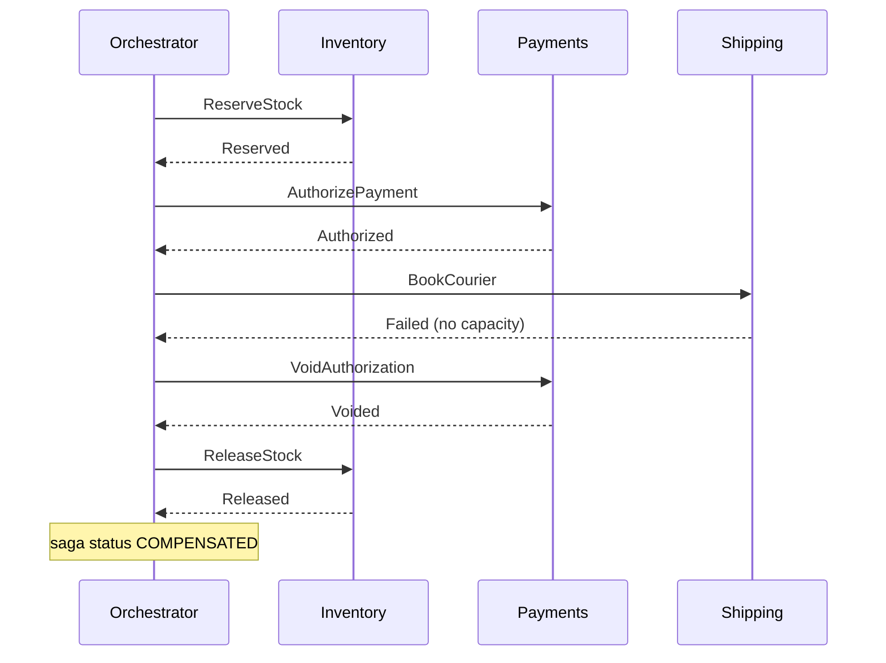

## In one minute
- A saga replaces one distributed transaction with a sequence of local transactions, one per service, each committed on its own.
- If a later step fails, the saga runs **compensating transactions** for the steps that already committed, in reverse order, to undo their business effect.
- Sagas give up isolation: other requests can see intermediate states. You design around that with semantic locks, ordering, and careful choice of which steps can fail.
- Coordination is either **choreography** (services react to each other's events) or **orchestration** (a central workflow tells each service what to do). Orchestration is easier to reason about beyond three or four steps.

## How it works

### Local transactions and compensations
Each step is a normal ACID transaction inside one service: reserve stock, authorize payment, book a courier. Each step that can be followed by a failure needs a compensation: release stock, void the authorization, cancel the booking. A compensation is not a rollback. The original commit happened and may have been observed (an email sent, a hold visible on a card), so the compensation is a new business action that semantically reverses it. Garcia-Molina and Salem, who named the pattern in 1987, said exactly this: a compensating transaction undoes the step "from a semantic point of view" without necessarily restoring the earlier state. Their target was long-lived transactions inside one database, which held locks for hours; microservices later reused the idea across service boundaries ([Garcia-Molina and Salem](https://www.cs.cornell.edu/andru/cs711/2002fa/reading/sagas.pdf)).

### Pivot and retriable steps
Order the steps deliberately. **Compensatable** steps come first. Then a **pivot** step, the point of no return (for example, capturing payment). After the pivot, only **retriable** steps remain: steps that are guaranteed to succeed eventually if retried, such as sending a confirmation. This structure means a saga either compensates fully before the pivot or completes after it, never stranded half way. The original paper calls these two directions backward recovery (compensate) and forward recovery (retry from a save-point), and the Azure Architecture Center uses the compensable, pivot and retryable vocabulary ([Azure](https://learn.microsoft.com/en-us/azure/architecture/patterns/saga)).

### Orchestration and choreography
In orchestration, a saga orchestrator stores the saga's state, sends a command to each service, waits for the reply, and decides the next step or the compensation path. The whole flow is in one place, easy to test and observe. In choreography, each service publishes an event when it finishes ("StockReserved") and the next service subscribes. There is no central component, but the flow is spread across services, and cycles or missing handlers are hard to see.

### Delivery and idempotency
Commands and events travel through a broker with at-least-once delivery, so every step and compensation must be idempotent: keyed by saga id and step, and safe to repeat. Each service must also publish its reply atomically with its local commit, which is what the outbox pattern provides.

### Isolation anomalies
Because each step commits immediately, others can see partial results. A customer might see stock reserved for an order that is about to be cancelled, or two sagas might read the same balance and both proceed. The standard catalogue names three anomalies: lost updates, dirty reads and fuzzy (non-repeatable) reads. Countermeasures include **semantic locks** (a `PENDING` status that other operations respect), **commutative updates** (increments rather than overwrites), **re-reading values** before the pivot, a **pessimistic view** (reorder steps so updates others might read happen in retryable steps, after the pivot), **version files** (record operations so out-of-order ones can be reordered), and choosing the mechanism **by value**, keeping a real distributed transaction for the few high-risk updates ([Azure](https://learn.microsoft.com/en-us/azure/architecture/patterns/saga)). Chris Richardson notes that picking and implementing these takes careful analysis per saga ([microservices.io](https://microservices.io/patterns/data/saga.html)).

## Down the stack

### Layer 1: The contract
A saga promises eventual all-or-nothing at the business level: either every step's effect is applied, or every committed step before the failure has been compensated. It does not promise isolation, so intermediate states are visible. Each step is executed at least once, never exactly once, so the contract to each service is "you may receive this command more than once; produce the same result". Compensations themselves must eventually succeed; if they cannot, the saga ends in a state that needs a human.

### Layer 2: The mechanism
An orchestrator keeps a saga instance row, for example `saga_id`, `type`, `current_step`, `status` (`RUNNING`, `COMPENSATING`, `DONE`, `FAILED`), and serialized data, updated in the same transaction that enqueues the next command into its outbox. Commands carry the `saga_id` as a correlation id; replies are matched back by it. Participants keep a `processed_messages` table keyed by message id to drop duplicates. Workflow engines package this: Temporal records an event history (`WorkflowExecutionStarted`, `ActivityTaskScheduled`, `ActivityTaskCompleted`, `ActivityTaskFailed`) and, after a worker crash, rebuilds workflow state by deterministically replaying the workflow code against that history ([Temporal docs](https://docs.temporal.io/encyclopedia/event-history)). AWS Step Functions expresses steps as states with `Retry` and `Catch` fields that route failures to compensation states. Its retry defaults are worth knowing: 3 attempts, a 1 second first interval, a backoff rate of 2.0, and no jitter unless you set `JitterStrategy` to `FULL` ([AWS docs](https://docs.aws.amazon.com/step-functions/latest/dg/concepts-error-handling.html)).

### Layer 3: The machine
Every step costs at least one local commit with a WAL `fsync` (50 µs to 1 ms on SSD) and one durable message. With Kafka and `acks=all`, the producer default since Kafka 3.0 along with idempotence ([KIP-679](https://cwiki.apache.org/confluence/display/KAFKA/KIP-679%3A+Producer+will+enable+the+strongest+delivery+guarantee+by+default)), a publish waits for the partition leader and in-sync followers to persist the record, typically a few milliseconds in one region. A five-step saga therefore involves about ten commits and ten messages, so 50 to 200 ms end to end before any business logic, plus consumer poll intervals. Duplicates come from physical events: a consumer processes a message, then crashes before committing its offset, and after the rebalance the message is delivered again; an SQS message whose processing exceeds the visibility timeout (30 seconds by default, extendable up to 12 hours from first receipt) reappears to another consumer ([AWS docs](https://docs.aws.amazon.com/AWSSimpleQueueService/latest/SQSDeveloperGuide/sqs-visibility-timeout.html)). Timeouts on a step must be longer than the slowest normal response, or the orchestrator compensates a step that actually succeeded.

### Why it's built this way
1. A distributed transaction would lock data across services and couple their availability, so each service commits locally.
2. Local commits cannot be rolled back after the fact, so failures are handled with compensating business actions.
3. Messages between services can be lost or duplicated, so delivery is at-least-once and every handler is idempotent.
4. Compensations can themselves fail, so steps are ordered with a pivot, leaving only retriable work after it.
5. A flow spread across many services is hard to reason about, so complex sagas centralize state in an orchestrator with a durable log.

## Diagram


## Worked example
An online store handles 300 orders per second at peak. The order saga has five steps: create order as `PENDING` (semantic lock), reserve stock, authorize payment, capture payment (the pivot), and request shipment (retriable).

About 2% of orders fail at payment authorization, so 6 sagas per second compensate: release stock, mark order `REJECTED`. Each step averages 15 ms, so a happy-path saga finishes in about 100 ms including messaging, and the orchestrator holds about 30 in-flight sagas at any moment (Little's law: 300 × 0.1 s).

A bad day: the payment provider's API slows to 20 seconds per call while the step timeout is 10 seconds. The orchestrator times out, assumes failure, and compensates by voiding an authorization that may still succeed. Without an idempotency key on the authorization call, a retry creates a second hold on the customer's card. The fixes: send a stable idempotency key (`saga_id` plus step) to the provider, query the provider's status before compensating, set the timeout above the provider's P99.9, and alert when sagas sit in `COMPENSATING` for more than a minute. A daily report lists sagas in `FAILED` for manual handling; at 300 orders per second, even a 0.01% stuck rate is 2,600 orders per day, so automation of common failures matters.

## In the wild
- **Stripe, 2017: idempotency keys make retried steps safe.** A network failure can leave a client unsure whether a charge never arrived, half ran, or succeeded with the response lost. Stripe's API accepts an `Idempotency-Key` header on every `POST`; a retry with the same key gets the stored result or resumes the work instead of charging twice, and Stripe's client libraries retry with exponential backoff and jitter. This is the contract every saga step that calls a payment provider depends on ([Stripe](https://stripe.com/blog/idempotency)).
- **Uber, 2023: sagas as a platform at 12 billion executions a month.** Uber's open-source Cadence workflow engine reached v1.0 after more than six years in production, running over 12 billion workflow executions and 270 billion actions a month for more than 1,000 services. Workflows are ordinary code with automatic retries, region failover, and resets to rewind executions hit by a bad deploy, which is the orchestrator state, retry and recovery machinery a hand-built saga has to reinvent ([Uber](https://www.uber.com/en/blog/announcing-cadence/)).

## Trade-offs
| Option | Strengths | Weaknesses | Choose when |
|---|---|---|---|
| Orchestrated saga | Flow in one place, easy to observe and change | Orchestrator is a component to run and scale | More than three steps, or complex branching |
| Choreographed saga | No central component, loose coupling | Flow is implicit, hard to debug and change | Two or three steps, stable flow |
| Workflow engine (Temporal, Step Functions) | Durable state, retries, timers built in | New platform dependency, determinism rules | Many sagas across teams |
| 2PC | True atomicity and isolation | Blocking, couples availability | All participants in one database system |
| Single service owns the data | Plain ACID transaction | Larger service boundary | The steps do not really need separate services |

## Pitfalls in production
- **Non-idempotent steps.** Redelivered commands charge twice or ship twice. Key every step by saga id and step name, and pass idempotency keys to external providers, which is how Stripe's API lets a client retry a charge safely ([Stripe](https://stripe.com/blog/idempotency)).
- **Compensating a step that actually succeeded.** A timeout is not a failure. Query the step's real status before compensating, or make compensation safe when nothing happened.
- **Compensations that cannot run.** The item was already shipped, or the refund API is down. Put irreversible steps after the pivot, retry compensations with backoff, and route permanent failures to a human queue. Compensations are themselves steps that can fail and must be idempotent ([Azure: Compensating Transaction](https://learn.microsoft.com/en-us/azure/architecture/patterns/compensating-transaction)).
- **Dirty reads by other flows.** Reporting counts a reservation that is about to be released. Use `PENDING` states and exclude them where it matters.
- **Lost saga state.** An in-memory orchestrator restarts and forgets in-flight sagas. Persist state transitionally with the outbound command, or use a workflow engine.
- **Invisible choreography.** Nobody can say which events drive an order. Trace with a correlation id and keep a flow diagram owned by one team.

## Leadership lens
- Ask for the step list with, for each step, its compensation, whether it is idempotent, and which step is the pivot. Missing answers are design gaps.
- Decide early who owns the orchestrator and the saga's end-to-end SLO; with choreography, ownership of the flow tends to belong to no one.
- Plan for the "stuck" state: dashboards, alerts, and an operations queue with tooling to retry or resolve.
- Push back on splitting data across services that must change atomically; sagas are a cost you pay for service boundaries, not a free pattern.

## Check yourself
1. Why are compensating transactions not the same as rollbacks?
   **Answer:** The original step committed and its effects may have been seen or acted on, so the compensation is a new forward action that semantically cancels it rather than erasing it.
2. Why place a pivot step and only retriable steps after it?
   **Answer:** It guarantees the saga can either fully compensate before the point of no return or complete afterwards by retrying, so it never needs to undo something irreversible.
3. What isolation problem do sagas have, and name one countermeasure?
   **Answer:** Other transactions can see or act on intermediate states; a semantic lock such as a `PENDING` status lets other operations recognise and avoid in-flight data.
4. Why must every saga step be idempotent?
   **Answer:** Messages are delivered at least once and the orchestrator retries after timeouts, so the same command can arrive more than once.

## Practice
**Task:** Write a saga orchestrator. `run_saga(steps, max_retries)` takes a list of `(name, action, compensate)` tuples, where `action()` and `compensate()` return `True` on success and `False` on failure. Run actions in order, logging `"do:<name>"` on success and `"fail:<name>"` on failure. On a failure, compensate every previously completed step in reverse order, logging `"undo:<name>"` on success or `"undo_fail:<name>"` for each failed attempt, retrying up to `max_retries` attempts per compensation. Return `(status, log)` where status is `"completed"`, `"compensated"`, or `"stuck"` (a compensation failed every attempt; stop compensating there). The failed step itself is not compensated.

```python starter
def run_saga(steps, max_retries):
    # TODO
    raise NotImplementedError
```

```python tests
def ok():
    return True

def bad():
    return False

def flaky(times):
    state = {"left": times}
    def f():
        if state["left"] > 0:
            state["left"] -= 1
            return False
        return True
    return f

def test_all_steps_succeed():
    steps = [("a", ok, ok), ("b", ok, ok)]
    assert run_saga(steps, 3) == ("completed", ["do:a", "do:b"])

def test_failure_compensates_in_reverse():
    steps = [("a", ok, ok), ("b", ok, ok), ("c", bad, ok)]
    status, log = run_saga(steps, 3)
    assert status == "compensated"
    assert log == ["do:a", "do:b", "fail:c", "undo:b", "undo:a"]

def test_first_step_failure_needs_no_compensation():
    assert run_saga([("a", bad, ok)], 3) == ("compensated", ["fail:a"])

def test_compensation_retries_then_succeeds():
    steps = [("a", ok, flaky(2)), ("b", bad, ok)]
    status, log = run_saga(steps, 3)
    assert status == "compensated"
    assert log == ["do:a", "fail:b", "undo_fail:a", "undo_fail:a", "undo:a"]

def test_compensation_exhausts_retries_and_sticks():
    steps = [("a", ok, ok), ("b", ok, bad), ("c", bad, ok)]
    status, log = run_saga(steps, 2)
    assert status == "stuck"
    assert log == ["do:a", "do:b", "fail:c", "undo_fail:b", "undo_fail:b"]

def test_empty_saga():
    assert run_saga([], 1) == ("completed", [])
```

```python solution
def run_saga(steps, max_retries):
    log, done = [], []
    for name, action, compensate in steps:
        if action():
            log.append("do:" + name)
            done.append((name, compensate))
            continue
        log.append("fail:" + name)
        for cname, comp in reversed(done):
            for _ in range(max_retries):
                if comp():
                    log.append("undo:" + cname)
                    break
                log.append("undo_fail:" + cname)
            else:
                return ("stuck", log)
        return ("compensated", log)
    return ("completed", log)
```

```typescript starter
export type Step = [name: string, action: () => boolean, compensate: () => boolean];
export type Status = "completed" | "compensated" | "stuck";
export function runSaga(steps: Step[], maxRetries: number): [Status, string[]] {
  throw new Error("TODO");
}
```

```typescript tests
const ok = () => true;
const bad = () => false;
function flaky(times: number): () => boolean {
  let left = times;
  return () => (left-- > 0 ? false : true);
}
test("all steps succeed", () => {
  assertEqual(runSaga([["a", ok, ok], ["b", ok, ok]], 3), ["completed", ["do:a", "do:b"]]);
});
test("failure compensates in reverse", () => {
  assertEqual(runSaga([["a", ok, ok], ["b", ok, ok], ["c", bad, ok]], 3),
    ["compensated", ["do:a", "do:b", "fail:c", "undo:b", "undo:a"]]);
});
test("first step failure needs no compensation", () => {
  assertEqual(runSaga([["a", bad, ok]], 3), ["compensated", ["fail:a"]]);
});
test("compensation retries then succeeds", () => {
  assertEqual(runSaga([["a", ok, flaky(2)], ["b", bad, ok]], 3),
    ["compensated", ["do:a", "fail:b", "undo_fail:a", "undo_fail:a", "undo:a"]]);
});
test("compensation exhausts retries and sticks", () => {
  assertEqual(runSaga([["a", ok, ok], ["b", ok, bad], ["c", bad, ok]], 2),
    ["stuck", ["do:a", "do:b", "fail:c", "undo_fail:b", "undo_fail:b"]]);
});
test("empty saga", () => {
  assertEqual(runSaga([], 1), ["completed", []]);
});
```

```typescript solution
export type Step = [name: string, action: () => boolean, compensate: () => boolean];
export type Status = "completed" | "compensated" | "stuck";
export function runSaga(steps: Step[], maxRetries: number): [Status, string[]] {
  const log: string[] = [];
  const done: [string, () => boolean][] = [];
  for (const [name, action, compensate] of steps) {
    if (action()) {
      log.push("do:" + name);
      done.push([name, compensate]);
      continue;
    }
    log.push("fail:" + name);
    for (const [cname, comp] of [...done].reverse()) {
      let undone = false;
      for (let attempt = 0; attempt < maxRetries && !undone; attempt++) {
        undone = comp();
        log.push((undone ? "undo:" : "undo_fail:") + cname);
      }
      if (!undone) return ["stuck", log];
    }
    return ["compensated", log];
  }
  return ["completed", log];
}
```

```go starter
package practice

type Step struct {
	Name       string
	Action     func() bool
	Compensate func() bool
}

// RunSaga returns "completed", "compensated" or "stuck", plus the event log.
func RunSaga(steps []Step, maxRetries int) (string, []string) {
	panic("TODO")
}
```

```go tests
package practice

import (
	"reflect"
	"testing"
)

func ok() bool  { return true }
func bad() bool { return false }

func flaky(times int) func() bool {
	left := times
	return func() bool {
		if left > 0 {
			left--
			return false
		}
		return true
	}
}

func check(t *testing.T, steps []Step, retries int, wantStatus string, wantLog []string) {
	t.Helper()
	status, log := RunSaga(steps, retries)
	if status != wantStatus || !reflect.DeepEqual(log, wantLog) {
		t.Fatalf("got %s %v", status, log)
	}
}

func TestAllStepsSucceed(t *testing.T) {
	check(t, []Step{{"a", ok, ok}, {"b", ok, ok}}, 3, "completed", []string{"do:a", "do:b"})
}

func TestFailureCompensatesInReverse(t *testing.T) {
	check(t, []Step{{"a", ok, ok}, {"b", ok, ok}, {"c", bad, ok}}, 3, "compensated",
		[]string{"do:a", "do:b", "fail:c", "undo:b", "undo:a"})
}

func TestFirstStepFailure(t *testing.T) {
	check(t, []Step{{"a", bad, ok}}, 3, "compensated", []string{"fail:a"})
}

func TestCompensationRetries(t *testing.T) {
	check(t, []Step{{"a", ok, flaky(2)}, {"b", bad, ok}}, 3, "compensated",
		[]string{"do:a", "fail:b", "undo_fail:a", "undo_fail:a", "undo:a"})
}

func TestCompensationSticks(t *testing.T) {
	check(t, []Step{{"a", ok, ok}, {"b", ok, bad}, {"c", bad, ok}}, 2, "stuck",
		[]string{"do:a", "do:b", "fail:c", "undo_fail:b", "undo_fail:b"})
}

func TestEmptySaga(t *testing.T) {
	status, log := RunSaga(nil, 1)
	if status != "completed" || len(log) != 0 {
		t.Fatalf("got %s %v", status, log)
	}
}
```

```go solution
package practice

type Step struct {
	Name       string
	Action     func() bool
	Compensate func() bool
}

// RunSaga returns "completed", "compensated" or "stuck", plus the event log.
func RunSaga(steps []Step, maxRetries int) (string, []string) {
	var log []string
	var done []Step
	for _, s := range steps {
		if s.Action() {
			log = append(log, "do:"+s.Name)
			done = append(done, s)
			continue
		}
		log = append(log, "fail:"+s.Name)
		for i := len(done) - 1; i >= 0; i-- {
			undone := false
			for attempt := 0; attempt < maxRetries && !undone; attempt++ {
				undone = done[i].Compensate()
				if undone {
					log = append(log, "undo:"+done[i].Name)
				} else {
					log = append(log, "undo_fail:"+done[i].Name)
				}
			}
			if !undone {
				return "stuck", log
			}
		}
		return "compensated", log
	}
	return "completed", log
}
```

## Mock interview
**Prompt:** Design checkout for a food delivery platform: create order, reserve restaurant capacity, authorize payment, assign a courier, capture payment. Peak is 2,000 orders per second, and courier assignment fails for about 5% of orders at dinner time.

- Follow-up: Where is your pivot step, and what happens if courier assignment fails after payment is captured?
- Follow-up: The payment provider times out but actually authorized the card. Walk through how your design avoids double charges and orphaned holds.
- Follow-up: Would you use choreography or orchestration here, and what would change your mind?

**A strong answer covers:**
- Step ordering with compensations, a clear pivot, and only retriable steps after it.
- Idempotency keys per saga step, including on external provider calls.
- Treating timeouts as unknown outcomes and reconciling with the provider before compensating.
- Durable orchestrator state (or a workflow engine), outbox-based messaging, and correlation ids for tracing.
- Handling isolation with `PENDING` states, and an operations path for stuck sagas with metrics and alerts.

## Sources and further study
**Primary**
- [Helland, Life beyond Distributed Transactions (CIDR 2007)](https://www.cidrdb.org/cidr2007/papers/cidr07p15.pdf): why scalable systems coordinate entities with messages and tentative operations rather than shared transactions.

**Systems docs**
- [Temporal: Event History](https://docs.temporal.io/encyclopedia/event-history): the durable log a workflow engine replays to recover orchestrator state.
- [AWS Step Functions: Handling errors](https://docs.aws.amazon.com/step-functions/latest/dg/concepts-error-handling.html): `Retry` and `Catch` semantics and defaults for routing failures to compensation states.
- [Amazon SQS visibility timeout](https://docs.aws.amazon.com/AWSSimpleQueueService/latest/SQSDeveloperGuide/sqs-visibility-timeout.html): where duplicate step deliveries come from in a queue-driven saga.

**Books**
- *Microservices Patterns*, Chris Richardson, chapter 4 (sagas, section 4.3 on isolation countermeasures), as referenced from microservices.io.
- *Building Microservices* (2nd edition), Sam Newman, chapter 6 "Workflow": 2PC, why to say no to distributed transactions, and sagas.
- *Understanding Distributed Systems* (2nd edition), Roberto Vitillo, chapter "Asynchronous transactions": outbox, sagas and isolation.

**Other curricula**
- [Azure Architecture Center: Compensating Transaction pattern](https://learn.microsoft.com/en-us/azure/architecture/patterns/compensating-transaction): treats compensation as a resumable, idempotent workflow and prefers retries or alternative paths before undoing work.
- [roadmap.sh: System Design](https://roadmap.sh/system-design): has separate nodes for compensating transactions and choreography and points to the Azure pattern pages for both ideas rather than teaching sagas as one topic.

## Watch
- [Applying the Saga Pattern (GOTO Conferences)](https://www.youtube.com/watch?v=xDuwrtwYHu8): Caitie McCaffrey on sagas as a practical alternative to distributed transactions.
- [Using sagas to maintain data consistency in a microservice architecture (Devoxx)](https://www.youtube.com/watch?v=YPbGW3Fnmbc): Chris Richardson on orchestration, choreography, and isolation countermeasures.

## Free resources
- [microservices.io: Saga](https://microservices.io/patterns/data/saga.html): the pattern with orchestration and choreography examples.
- [Garcia-Molina and Salem: Sagas (1987)](https://www.cs.cornell.edu/andru/cs711/2002fa/reading/sagas.pdf): the original paper defining sagas and compensation.
- [Azure Architecture Center: Saga pattern](https://learn.microsoft.com/en-us/azure/architecture/reference-architectures/saga/saga): pivot and retriable transactions and data anomalies.
- [AWS Prescriptive Guidance: Saga patterns](https://docs.aws.amazon.com/prescriptive-guidance/latest/cloud-design-patterns/saga.html): implementation with Step Functions.
- [Temporal: Saga pattern made easy](https://temporal.io/blog/saga-pattern-made-easy): sagas on a durable workflow engine, with code.
