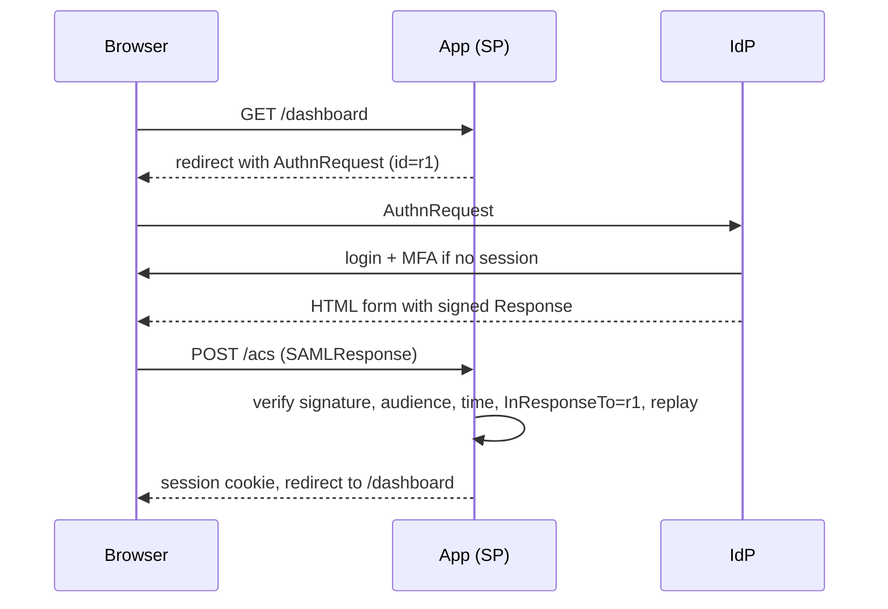

## In one minute
- SAML 2.0 is an XML-based standard for single sign-on: an identity provider (IdP) authenticates the user and sends a signed assertion to a service provider (SP), which logs the user in.
- The browser carries messages between IdP and SP through redirects and auto-submitted forms, so the two servers never need to talk directly at login time.
- Trust comes from exchanged metadata: entity ids, endpoint URLs, and the IdP's signing certificate.
- Security depends almost entirely on the SP validating the assertion correctly: signature, audience, recipient, time window, and replay. Most SAML breaches are validation bugs.
- SAML dominates enterprise workforce SSO. New consumer and mobile integrations usually choose OpenID Connect.

## How it works

### Roles and setup
The IdP (Okta, Entra ID, ADFS, Google Workspace) owns user accounts and authentication, including MFA. The SP is your application. Setup exchanges metadata: the SP gives its entity id and Assertion Consumer Service (ACS) URL; the IdP gives its entity id, SSO URL, and X.509 signing certificate.

### SP-initiated flow
1. The user visits the app. The SP creates an AuthnRequest with a unique id and redirects the browser to the IdP.
2. The IdP authenticates the user, or reuses its own session.
3. The IdP builds a Response containing an Assertion: subject (NameID), attributes (email, groups), conditions (NotBefore, NotOnOrAfter, Audience), and InResponseTo set to the request id. It signs the assertion, the response, or both.
4. The browser POSTs the Response to the ACS URL via an auto-submitting HTML form.
5. The SP validates it and creates its own session.

IdP-initiated flow skips step 1: the user clicks the app tile in the IdP portal. With no request id to match, it is more exposed to injection and replay, so many SPs restrict or disable it.

### Validation checklist
- Verify the XML signature with the configured IdP certificate, never a certificate embedded in the message. Require RSA-SHA256 or stronger and reject SHA-1 signature and digest algorithms ([OWASP SAML cheat sheet](https://cheatsheetseries.owasp.org/cheatsheets/SAML_Security_Cheat_Sheet.html)).
- Make sure the signed element is the one you read. XML signature wrapping attacks add an unsigned assertion alongside a signed one and rely on the SP reading the wrong one. Schema-validate first and select elements with absolute paths, never "find the first Assertion anywhere".
- Check Issuer equals the expected IdP, Audience equals your entity id, and Recipient and the Response's Destination equal your ACS URL.
- Enforce NotBefore and NotOnOrAfter with a small clock skew, for example 2 minutes.
- Match InResponseTo to an outstanding request, and record assertion ids until they expire to block replay. NIST's federation guideline makes audience restriction and replay protection mandatory at every assurance level ([NIST SP 800-63C-4](https://pages.nist.gov/800-63-4/sp800-63c.html)).
- Use a maintained library with safe XML parsing, and patch it quickly: signature-bypass bugs in widely used SAML libraries turned up in 2012, 2018, 2024 and 2025 (see In the wild).

### Provisioning and logout
SAML covers login only. Accounts come from SCIM provisioning or just-in-time creation. Single logout is fragile, so bound SP sessions independently.

## Down the stack
### Layer 1: The contract
The SP's contract is narrow: log a user in only from an assertion that is signed by the configured IdP key, addressed to this SP (Audience) and this endpoint (Recipient), currently within its validity window, never used before, and, for SP-initiated logins, answering a request this SP actually sent. The IdP's side of the contract is that it authenticated the subject at `AuthnInstant` using the method named in `AuthnContextClassRef`, such as password plus MFA. SAML says nothing about how long the SP's own session lasts. A `bearer` assertion is like cash: whoever holds it can present it, which is why NIST allows bearer assertions only up to its second federation level and requires holder-of-key or a bound authenticator at the top level ([NIST SP 800-63C-4](https://pages.nist.gov/800-63-4/sp800-63c.html)).

### Layer 2: The mechanism
The AuthnRequest usually travels with the HTTP-Redirect binding: the XML is compressed with raw DEFLATE (RFC 1951), base64-encoded, URL-encoded into a `SAMLRequest` parameter, and optionally signed with `SigAlg` and `Signature` query parameters. The Response comes back with the HTTP-POST binding as a base64 `SAMLResponse` form field plus `RelayState`. The signature is an enveloped XML-DSig `ds:Signature` element. Its `Reference URI="#_abc"` points at the signed element's ID, its transforms are enveloped-signature and exclusive canonicalisation, its `DigestValue` is a SHA-256 of the canonicalised element, and its `SignatureValue` signs the canonicalised `SignedInfo`. A `SubjectConfirmation` with method `bearer` carries `Recipient`, `NotOnOrAfter`, and `InResponseTo`. Signature wrapping works because the verifier resolves the signed element by ID while the application finds the assertion by a different path, such as the first `Assertion` element in the document. Somorovsky and colleagues found this gap exploitable in 11 of 14 major SAML frameworks in 2012 ([USENIX Security 2012](https://www.usenix.org/conference/usenixsecurity12/technical-sessions/presentation/somorovsky)). A subtler variant is a parser differential: canonicalisation drops XML comments, so `alice@corp.com<!---->.evil.com` is signed as `alice@corp.com.evil.com`, but a library that reads only the first text node sees `alice@corp.com` ([CERT VU#475445](https://www.kb.cert.org/vuls/id/475445)). The fix in every case is the same: read identity only from the exact bytes the signature covered.

### Layer 3: The machine
A signed response is typically 5 to 15 KB of XML, a third larger once base64-encoded into the POST body. Redirect-binding URLs must stay under server limits, often 8 KB, which is why requests are deflated. Canonicalisation builds a DOM, resolves namespaces, and reorders attributes, so it costs far more CPU and allocation than the RSA verification itself, which takes around 30 microseconds for a 2048-bit key with public exponent 65537. XML parsers are an attack surface: nested entity definitions ten levels deep with ten references each expand to a billion entities and exhaust memory, and external entities can read local files, so DTD processing must be disabled. The ACS POST arrives cross-site from the IdP's domain, so a pre-login cookie set with `SameSite=Lax` is not sent with it; SPs correlate the response through `RelayState` or a cookie marked `SameSite=None; Secure`. `RelayState` must not exceed 80 bytes ([SAML 2.0 Bindings](https://docs.oasis-open.org/security/saml/v2.0/saml-bindings-2.0-os.pdf)), so store an opaque key that maps to the return URL server-side rather than the URL itself, which also avoids an open redirect.

### Why it's built this way
Enterprise IdPs often sit behind firewalls the SaaS cannot reach, so the browser carries every message. XML was the enterprise standard when SAML 2.0 became an OASIS Standard in March 2005 ([OASIS technical overview](https://docs.oasis-open.org/security/saml/Post2.0/sstc-saml-tech-overview-2.0.html)), and XML has many equivalent byte representations, so signatures need canonicalisation. Bearer assertions can be intercepted, so they are short-lived and single-use. Signing parts of a document allows flexible processing but creates the gap that wrapping attacks exploit.

## Diagram


## Worked example
A B2B SaaS sells to 1,500 enterprise customers, each with its own IdP. Peak SSO logins are 300 per second at 9 a.m. across time zones.

Per-tenant configuration: each customer has an IdP entity id, SSO URL, and one or two signing certificates. 1,500 tenants x 2 certificates is 3,000 certificates in a small table, cached in memory.

Validation cost: parsing a 10 KB response and verifying an RSA-2048 signature takes 1 to 2 ms of CPU, under one core at 300 logins per second.

Replay cache: assertion ids are kept until their NotOnOrAfter, typically 5 minutes. 300 per second x 300 seconds = 90,000 entries, a few MB in a shared store such as Redis with TTLs. It must be shared across SP instances, or an attacker replays to a different instance.

Certificate expiry: with 1,500 IdPs rotating certificates every 1 to 3 years, 2 to 4 rotations happen per working day. Track each expiry, notify admins 30 days ahead, accept a second certificate during rollover, and poll IdP metadata URLs where available. Entra ID, for example, issues SAML signing certificates valid for three years by default, emails admins 60, 30 and 7 days before expiry, and asks SaaS vendors to hold a primary and a secondary certificate and re-read each tenant's metadata at least every 24 hours ([Microsoft Learn](https://learn.microsoft.com/en-us/entra/identity/enterprise-apps/tutorial-manage-certificates-for-federated-single-sign-on)). At 1,500 tenants that is 1,500 metadata fetches a day, trivial next to the login traffic.

## In the wild
- **CERT/CC and Duo, 2018: XML comments split identities in several SAML libraries.** Affected libraries included OneLogin python-saml and ruby-saml, OmniAuth-SAML, Clever saml2-js and Shibboleth OpenSAML C++; they read a node's text in a way that stopped at a comment, while the signature covered the text with comments removed. An attacker who could register `victim@corp.com<!---->.evil.com` at the IdP could log in as `victim@corp.com`. Vendors shipped patched releases and the note was published on 27 February 2018 ([CERT VU#475445](https://www.kb.cert.org/vuls/id/475445)).
- **GitLab and ruby-saml, 2024 and 2025: forged assertions accepted twice in six months.** CVE-2024-45409, rated critical, was a SAML authentication bypass in the ruby-saml and omniauth-saml dependencies; GitLab shipped fixes in 17.3.3 and four older branches, and warned that turning on MFA at the identity provider did not mitigate it ([GitLab](https://docs.gitlab.com/releases/patches/patch-release-gitlab-17-3-3-released/)). In March 2025 GitHub Security Lab found that ruby-saml read the signature with REXML and the digest with Nokogiri, two parsers that could be made to see different `Signature` elements; CVE-2025-25291 and 25292 were fixed in ruby-saml 1.18.0 and an exploitable instance was found in GitLab ([GitHub Blog](https://github.blog/security/sign-in-as-anyone-bypassing-saml-sso-authentication-with-parser-differentials/)).
- **SolarWinds intrusions, 2020: stolen signing certificate, valid forged tokens.** After gaining high Active Directory privileges, the attackers took the organisation's SAML token-signing certificate and minted tokens that cloud email and file services accepted as genuine, so every SP check passed. CISA told defenders to look for "impossible tokens" (no matching sign-in within about an hour, missing MFA claims, unusual lifetimes) and, once SAML abuse is found, to treat the whole identity trust store as compromised ([CISA AA20-352A](https://www.cisa.gov/news-events/cybersecurity-advisories/aa20-352a)).

## Trade-offs
| Option | Strengths | Weaknesses | Choose when |
| --- | --- | --- | --- |
| SAML 2.0 | Universal enterprise IdP support, mature | XML signature complexity, browser-only flows | Enterprise workforce SSO |
| OpenID Connect | JSON and JWT, works for mobile and APIs, simpler | Some legacy enterprise IdPs lack it | New apps, consumer login, mobile |
| SSO broker service | One integration, many IdPs handled for you | Vendor dependency, cost per connection | Many enterprise customers, small team |
| Build on a SAML library in-house | Full control, no per-connection fees | You own every validation bug and support ticket | Strong security team, unusual needs |

## Pitfalls in production
- XML signature wrapping: validating one element and reading another. Use a library that returns only the verified assertion, and read attributes from that.
- Trusting the certificate inside the message. Pin the IdP certificate from metadata per tenant.
- No replay protection across instances. Store assertion ids in a shared cache until they expire.
- IdP certificate rotation breaks logins for a customer overnight. Support two certificates, monitor expiry, and consume metadata URLs.
- Matching users on a mutable attribute such as email lets an IdP admin take over accounts by changing addresses. Bind accounts to a stable NameID per tenant.
- Treating the SP as the only thing to secure. Whoever holds the IdP's signing key can mint assertions every SP accepts. Keep that key in an HSM or managed IdP, alert on federation trust changes, and correlate SP logins with IdP sign-in logs.

## Leadership lens
- Decide build versus buy early; per-tenant SSO support is an ongoing operational cost, not a one-time feature.
- Ask how deprovisioning works. Without SCIM, removed employees keep sessions and accounts.
- Offer OIDC alongside SAML for new integrations, and keep SP session lifetime bounded independently of the IdP.

## Check yourself
1. Why must the SP check that InResponseTo matches a request it actually sent?
   **Answer:** It ties the response to a login this browser started, which blocks unsolicited assertions and some replay and login-CSRF attacks.
2. How does an XML signature wrapping attack work?
   **Answer:** The attacker keeps a validly signed assertion in the document and adds a forged unsigned one. If the SP verifies the signature on one element but reads identity from another, the forged identity is accepted.
3. Why is the Audience check necessary even with a valid signature?
   **Answer:** The IdP signs assertions for many SPs. Without the audience check, an assertion issued for another app could log the user into yours.
4. Why should account linking use a stable NameID instead of email?
   **Answer:** Emails can be reassigned or edited by IdP admins, letting one person's assertion map to another person's account.

## Practice
**Task:** Write `validate(a, cfg, now, pending, seen)` for an already-parsed assertion dict `a` with keys `id`, `issuer`, `signature_ok`, `audience`, `recipient`, `in_response_to`, `not_before`, `not_on_or_after`, `name_id`. `cfg` has `idp`, `entity_id`, `acs_url`, `skew`. `pending` is a set of outstanding request ids and `seen` a set of used assertion ids. Check, raising `ValueError` on failure: signature, issuer, audience, recipient, time window with skew (`not_before - skew <= now < not_on_or_after + skew`), `in_response_to` in `pending`, and `id` not in `seen`. On success, remove the request id from `pending`, add the assertion id to `seen`, and return `name_id`.

```python starter
def validate(a, cfg, now, pending, seen):
    raise NotImplementedError
```

```python tests
CFG = {"idp": "https://idp.acme", "entity_id": "https://app", "acs_url": "https://app/acs", "skew": 120}

def good(**kw):
    a = {"id": "as1", "issuer": "https://idp.acme", "signature_ok": True, "audience": "https://app",
         "recipient": "https://app/acs", "in_response_to": "r1", "not_before": 1000,
         "not_on_or_after": 1300, "name_id": "u-42"}
    a.update(kw)
    return a

def rejects(a, now=1100, pending=None, seen=None):
    try:
        validate(a, CFG, now, pending if pending is not None else {"r1"}, seen if seen is not None else set())
        return False
    except ValueError:
        return True

def test_happy_path_updates_state():
    pending, seen = {"r1"}, set()
    assert validate(good(), CFG, 1100, pending, seen) == "u-42"
    assert pending == set() and seen == {"as1"}

def test_bad_signature_and_audience():
    assert rejects(good(signature_ok=False))
    assert rejects(good(audience="https://other-app"))
    assert rejects(good(issuer="https://evil"))

def test_time_window_with_skew():
    assert not rejects(good(), now=900)
    assert rejects(good(), now=850)
    assert rejects(good(), now=1420)

def test_unsolicited_rejected():
    assert rejects(good(in_response_to="r9"))

def test_replay_rejected():
    assert rejects(good(), seen={"as1"})
```

```python solution
def validate(a, cfg, now, pending, seen):
    if not a["signature_ok"]:
        raise ValueError("bad signature")
    if a["issuer"] != cfg["idp"]:
        raise ValueError("wrong issuer")
    if a["audience"] != cfg["entity_id"]:
        raise ValueError("wrong audience")
    if a["recipient"] != cfg["acs_url"]:
        raise ValueError("wrong recipient")
    skew = cfg["skew"]
    if not (a["not_before"] - skew <= now < a["not_on_or_after"] + skew):
        raise ValueError("outside validity window")
    if a["in_response_to"] not in pending:
        raise ValueError("unsolicited response")
    if a["id"] in seen:
        raise ValueError("replayed assertion")
    pending.discard(a["in_response_to"])
    seen.add(a["id"])
    return a["name_id"]
```

```typescript starter
export interface Assertion {
  id: string;
  issuer: string;
  signature_ok: boolean;
  audience: string;
  recipient: string;
  in_response_to: string;
  not_before: number;
  not_on_or_after: number;
  name_id: string;
}

export interface SpConfig {
  idp: string;
  entity_id: string;
  acs_url: string;
  skew: number;
}

export function validate(a: Assertion, cfg: SpConfig, now: number, pending: Set<string>, seen: Set<string>): string {
  throw new Error("TODO");
}
```

```typescript tests
const CFG: SpConfig = { idp: "https://idp.acme", entity_id: "https://app", acs_url: "https://app/acs", skew: 120 };

function good(extra: Partial<Assertion> = {}): Assertion {
  return { id: "as1", issuer: "https://idp.acme", signature_ok: true, audience: "https://app",
           recipient: "https://app/acs", in_response_to: "r1", not_before: 1000,
           not_on_or_after: 1300, name_id: "u-42", ...extra };
}

function rejects(a: Assertion, now = 1100, pending = new Set(["r1"]), seen = new Set<string>()): boolean {
  try { validate(a, CFG, now, pending, seen); return false; } catch (e) { return true; }
}

test("happy path updates state", () => {
  const pending = new Set(["r1"]);
  const seen = new Set<string>();
  assertEqual(validate(good(), CFG, 1100, pending, seen), "u-42");
  assert(pending.size === 0 && seen.has("as1"), "state not updated");
});

test("bad signature, audience, issuer", () => {
  assert(rejects(good({ signature_ok: false })), "signature");
  assert(rejects(good({ audience: "https://other-app" })), "audience");
  assert(rejects(good({ issuer: "https://evil" })), "issuer");
});

test("time window with skew", () => {
  assert(!rejects(good(), 900), "inside skew");
  assert(rejects(good(), 850), "too early");
  assert(rejects(good(), 1420), "too late");
});

test("unsolicited rejected", () => {
  assert(rejects(good({ in_response_to: "r9" })), "unsolicited");
});

test("replay rejected", () => {
  assert(rejects(good(), 1100, new Set(["r1"]), new Set(["as1"])), "replay");
});
```

```typescript solution
export interface Assertion {
  id: string;
  issuer: string;
  signature_ok: boolean;
  audience: string;
  recipient: string;
  in_response_to: string;
  not_before: number;
  not_on_or_after: number;
  name_id: string;
}

export interface SpConfig {
  idp: string;
  entity_id: string;
  acs_url: string;
  skew: number;
}

export function validate(a: Assertion, cfg: SpConfig, now: number, pending: Set<string>, seen: Set<string>): string {
  if (!a.signature_ok) throw new Error("bad signature");
  if (a.issuer !== cfg.idp) throw new Error("wrong issuer");
  if (a.audience !== cfg.entity_id) throw new Error("wrong audience");
  if (a.recipient !== cfg.acs_url) throw new Error("wrong recipient");
  if (!(a.not_before - cfg.skew <= now && now < a.not_on_or_after + cfg.skew)) throw new Error("outside validity window");
  if (!pending.has(a.in_response_to)) throw new Error("unsolicited response");
  if (seen.has(a.id)) throw new Error("replayed assertion");
  pending.delete(a.in_response_to);
  seen.add(a.id);
  return a.name_id;
}
```

```go starter
package practice

type Assertion struct {
	ID, Issuer, Audience, Recipient, InResponseTo, NameID string
	SignatureOK                                           bool
	NotBefore, NotOnOrAfter                               int64
}

type SPConfig struct {
	IdP, EntityID, ACSURL string
	Skew                  int64
}

func Validate(a Assertion, cfg SPConfig, now int64, pending, seen map[string]bool) (string, error) {
	panic("TODO")
}
```

```go tests
package practice

import "testing"

var cfg = SPConfig{IdP: "https://idp.acme", EntityID: "https://app", ACSURL: "https://app/acs", Skew: 120}

func good() Assertion {
	return Assertion{ID: "as1", Issuer: "https://idp.acme", Audience: "https://app", Recipient: "https://app/acs",
		InResponseTo: "r1", NameID: "u-42", SignatureOK: true, NotBefore: 1000, NotOnOrAfter: 1300}
}

func rejects(a Assertion, now int64, seen map[string]bool) bool {
	_, err := Validate(a, cfg, now, map[string]bool{"r1": true}, seen)
	return err != nil
}

func TestHappyPath(t *testing.T) {
	pending, seen := map[string]bool{"r1": true}, map[string]bool{}
	id, err := Validate(good(), cfg, 1100, pending, seen)
	if err != nil || id != "u-42" || pending["r1"] || !seen["as1"] {
		t.Fatalf("got %s %v", id, err)
	}
}

func TestBadSignatureAudienceIssuer(t *testing.T) {
	a, b, c := good(), good(), good()
	a.SignatureOK = false
	b.Audience = "https://other-app"
	c.Issuer = "https://evil"
	if !rejects(a, 1100, map[string]bool{}) || !rejects(b, 1100, map[string]bool{}) || !rejects(c, 1100, map[string]bool{}) {
		t.Fatal("expected rejection")
	}
}

func TestTimeWindow(t *testing.T) {
	if rejects(good(), 900, map[string]bool{}) || !rejects(good(), 850, map[string]bool{}) || !rejects(good(), 1420, map[string]bool{}) {
		t.Fatal("time window wrong")
	}
}

func TestUnsolicited(t *testing.T) {
	a := good()
	a.InResponseTo = "r9"
	if !rejects(a, 1100, map[string]bool{}) {
		t.Fatal("expected rejection")
	}
}

func TestReplay(t *testing.T) {
	if !rejects(good(), 1100, map[string]bool{"as1": true}) {
		t.Fatal("expected rejection")
	}
}
```

```go solution
package practice

import "errors"

type Assertion struct {
	ID, Issuer, Audience, Recipient, InResponseTo, NameID string
	SignatureOK                                           bool
	NotBefore, NotOnOrAfter                               int64
}

type SPConfig struct {
	IdP, EntityID, ACSURL string
	Skew                  int64
}

func Validate(a Assertion, cfg SPConfig, now int64, pending, seen map[string]bool) (string, error) {
	switch {
	case !a.SignatureOK:
		return "", errors.New("bad signature")
	case a.Issuer != cfg.IdP:
		return "", errors.New("wrong issuer")
	case a.Audience != cfg.EntityID:
		return "", errors.New("wrong audience")
	case a.Recipient != cfg.ACSURL:
		return "", errors.New("wrong recipient")
	case now < a.NotBefore-cfg.Skew || now >= a.NotOnOrAfter+cfg.Skew:
		return "", errors.New("outside validity window")
	case !pending[a.InResponseTo]:
		return "", errors.New("unsolicited response")
	case seen[a.ID]:
		return "", errors.New("replayed assertion")
	}
	delete(pending, a.InResponseTo)
	seen[a.ID] = true
	return a.NameID, nil
}
```

## Mock interview
**Prompt:** Your B2B product must support SAML SSO for 2,000 enterprise customers, each with its own IdP, at up to 500 logins per second. Design the SP side, including configuration, validation, and operations.

- Follow-up: How do you prevent replay when you run 30 stateless app instances?
- Follow-up: A customer's IdP rotates its signing certificate without telling you. What happens, and how do you avoid it next time?
- Follow-up: When would you push a customer towards OIDC instead?

**A strong answer covers:**
- Per-tenant metadata with pinned certificates, support for two certificates, and expiry monitoring.
- A full validation checklist with a vetted library and protection against signature wrapping.
- A shared replay cache with TTLs and request-id tracking for SP-initiated flows.
- Account binding on stable NameID, SCIM for deprovisioning, bounded SP sessions.
- Build versus broker decision and the support cost of thousands of IdP connections.

## Sources and further study
**Primary**
- [OASIS, Assertions and Protocols for SAML 2.0 (core spec)](https://docs.oasis-open.org/security/saml/v2.0/saml-core-2.0-os.pdf): the normative definition of Assertion, Conditions, SubjectConfirmation and the processing rules.
- [OASIS, Bindings for SAML 2.0](https://docs.oasis-open.org/security/saml/v2.0/saml-bindings-2.0-os.pdf): exactly how messages ride HTTP-Redirect (DEFLATE) and HTTP-POST, including the RelayState limit.
- [Somorovsky et al., On Breaking SAML (USENIX Security 2012)](https://www.usenix.org/system/files/conference/usenixsecurity12/sec12-final91.pdf): the systematic study of signature wrapping across real frameworks.
- [NIST SP 800-63C-4, Federation and Assertions](https://pages.nist.gov/800-63-4/sp800-63c.html): federation assurance levels, bearer versus holder-of-key, and mandatory audience and replay checks.

**Systems docs**
- [Microsoft Entra ID: single sign-on SAML protocol](https://learn.microsoft.com/en-us/entra/identity-platform/single-sign-on-saml-protocol): what one major IdP actually puts in AuthnRequest and Response.
- [GitHub Security Lab: Sign in as anyone](https://github.blog/security/sign-in-as-anyone-bypassing-saml-sso-authentication-with-parser-differentials/): a step-by-step walkthrough of a 2025 parser-differential bypass.

**Books**
- *Building Secure and Reliable Systems*, Adkins et al., chapter 5 "Design for Least Privilege": authentication and authorization decisions as a policy framework, which is the frame for federated login. [Free online](https://google.github.io/building-secure-and-reliable-systems/raw/ch05.html).
- *Building Microservices* (2nd edition), Sam Newman, chapter 11 "Security": implicit trust versus zero trust and how identity flows between services after the SSO login.

**Other curricula**
- [roadmap.sh backend roadmap](https://roadmap.sh/backend): lists SAML as one node among the authentication methods, next to OAuth, OpenID and JWT, without the validation details.
- [donnemartin/system-design-primer](https://github.com/donnemartin/system-design-primer): its security section is four bullets and does not cover federation or SSO at all.

## Watch
- [A Developer's Guide to SAML (OktaDev)](https://www.youtube.com/watch?v=l-6QSEqDJPo): the flows and message structure from the implementer's side.
- [What Is Single Sign-on (SSO)? How It Works (ByteByteGo)](https://www.youtube.com/watch?v=O1cRJWYF-g4): SAML and OIDC side by side.

## Free resources
- [SAML 2.0 Technical Overview (OASIS)](https://docs.oasis-open.org/security/saml/Post2.0/sstc-saml-tech-overview-2.0.html): the standards body's own explanation of profiles, bindings, and assertions.
- [OWASP SAML Security Cheat Sheet](https://cheatsheetseries.owasp.org/cheatsheets/SAML_Security_Cheat_Sheet.html): validation rules and known attacks, including signature wrapping.
- [Fun with SAML SSO vulnerabilities and footguns (WorkOS)](https://workos.com/blog/fun-with-saml-sso-vulnerabilities-and-footguns): real-world implementation bugs and how they were exploited.
- [Understanding SAML (Okta Developer)](https://developer.okta.com/docs/concepts/saml/): a vendor-neutral overview of SP and IdP roles and flows.
