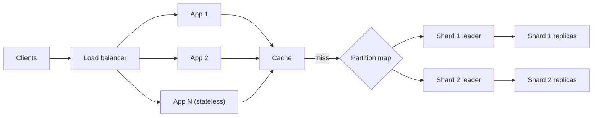

## In one minute
- A system is scalable when adding resources raises capacity roughly in proportion, at a cost per request that stays flat or falls. "It handles a lot of traffic" is not scalability; "doubling nodes gives 1.9x throughput at the same p99" is.
- Vertical scaling (a bigger machine) is simple and has a ceiling. Horizontal scaling (more machines) has no hard ceiling but forces you to split state, coordinate, and route.
- Two forces bend the curve: contention (work that must be done one at a time) and coherency (nodes talking to each other to agree). The Universal Scalability Law puts numbers on both.
- Stateless tiers scale almost for free. The data tier is where scalability is won or lost: replicas scale reads, partitioning scales writes, and hot keys defeat both.
- Measure the curve at 1, 2, 4 and 8 nodes before you trust it at 64.

## How it works

### Load, capacity and the scaling curve
Start by naming the load parameter that matters. A chat server breaks on open connections, a feed service on fan-out per post, a ledger on writes to one account. Capacity is the highest load served within the latency objective; past it, queues form and latency climbs sharply. Werner Vogels' definition is the one most curricula reuse: a service is scalable if adding resources raises performance in proportion ([Vogels](https://www.allthingsdistributed.com/2006/03/a_word_on_scalability.html)). Scalability is the shape of the capacity curve as you add resources: linear is the ideal, sublinear is normal, and retrograde (more nodes, less throughput) is the failure to design against.

### Vertical scaling
A bigger machine is often the best first move. The largest cloud instances now reach 32 TiB of memory and up to 1,920 vCPUs ([AWS EC2 U7i](https://aws.amazon.com/ec2/instance-types/u7i/)), and many companies never outgrow a well-tuned Postgres primary. It keeps transactions local and needs no code changes. Its limits are a hard ceiling, price that rises faster than capacity at the top end, and a single failure domain.

### Horizontal scaling
Horizontal scaling adds machines behind a router. It is cheap for **stateless** services: if any instance can serve any request, you add instances until the next tier saturates. Making a service stateless means moving sessions to a shared store or signed token, uploads to object storage, and treating local caches as optional accelerators.

State is the hard part. Three moves cover most designs:

- **Replicate** read-mostly data so reads spread over copies (see the Database Replication lesson). Writes still funnel through one leader.
- **Partition** (shard) data by key so each node owns a slice of writes. Cross-partition queries and transactions become expensive.
- **Cache** hot reads in front of the store, trading freshness for capacity.

A related map is the scale cube from *The Art of Scalability*: clone instances (X axis), split by function into services (Y axis), and split by data (Z axis) ([microservices.io](https://microservices.io/articles/scalecube.html)). Large systems use all three.

### Why the curve bends
Amdahl's law caps speedup when part of the work is serial: with 5% serial work the limit is 20x. Distributed systems also pay a **coherency** cost for messages that agree on membership, invalidate caches or take locks, and it grows with the number of node pairs, roughly N squared. Neil Gunther's Universal Scalability Law combines both:

`X(N) = λN / (1 + σ(N − 1) + κN(N − 1))`

Here λ is single-node throughput, σ is the contention fraction and κ is the coherency cost. Gunther's own pages write the same law with α for contention and β for coherency ([Gunther, USL](http://www.perfdynamics.com/Manifesto/USLscalability.html)); Azure's scale-out guidance uses the same two words, contention and coherency ([Azure Architecture Center](https://learn.microsoft.com/en-us/azure/architecture/guide/design-principles/scale-out)). With κ above zero, throughput peaks at about `√((1 − σ)/κ)` nodes and then falls. That is why a cluster can get slower when you add nodes: a global lock, a gossip protocol that sends N squared messages, or a cache invalidation that hits every peer.

### The problem shapes behind scalability
Two shapes recur. **Hot spots**: sharding by user spreads load until one celebrity account takes 30% of writes. **Overload**: autoscaled web servers exhaust the database's connection limit. An AI agent platform hits the same two, when one popular prompt template hammers a single cache key and parallel tool calls exceed the model provider's rate limit. The fixes carry across: better partition keys, key splitting, request coalescing, queues and backpressure.

## Down the stack

### Layer 1: The contract
A scalability claim must be testable: "From N to 2N nodes, throughput at p99 under 200 ms rises at least 1.8x, and cost per million requests does not rise." State the data shape too (key distribution, payload size, read/write mix), because a system that scales on uniform keys can collapse on skewed ones. Say what happens past the breaking point: shed load with 429s, queue, or fall over.

### Layer 2: The mechanism
Stateless tiers use a load balancer plus an autoscaler. Kubernetes' Horizontal Pod Autoscaler runs every 15 seconds, computes `desiredReplicas = ceil(currentReplicas × currentMetric / targetMetric)`, ignores changes within a 10% tolerance, and waits out a 300-second stabilization window before scaling down. Scale-up has no window by default: it may add 100% of current pods or 4 pods, whichever is more, every 15 seconds. Older guides say the tolerance is cluster-wide only; since Kubernetes 1.33 each HPA can set its own under `behavior.scaleUp.tolerance` and `behavior.scaleDown.tolerance`, and the field is stable as of 1.37 ([Kubernetes docs](https://kubernetes.io/docs/concepts/workloads/autoscaling/horizontal-pod-autoscale/)). Data tiers use a partition map: key ranges or hash slots assigned to nodes, held in etcd or ZooKeeper or gossiped (Cassandra's token ring), with consistent hashing or many virtual partitions so a new node takes about 1/N of the data. Little's law sizes everything: 20,000 requests per second at 50 ms means 1,000 requests in flight, which sets thread, connection and queue limits.

### Layer 3: The machine
Scaling limits are usually physical and boring. A Postgres connection is its own backend process, spawned by the postmaster for each client ([Postgres docs](https://www.postgresql.org/docs/current/connect-estab.html)) and using several MB, so 5,000 connections from autoscaled pods can exhaust RAM before CPU; PgBouncer multiplexes them onto a few hundred. Linux's default ephemeral port range, 32768 to 60999 or about 28,000 ports ([kernel docs](https://docs.kernel.org/networking/ip-sysctl.html)), caps outbound connections from one IP to one destination address and port, and TIME_WAIT holds each port for 60 seconds. Inside a box, a contended lock bounces its cache line between cores at roughly 50 to 100 ns per transfer across sockets, so a "fast" global counter incremented by 64 cores serializes the whole machine. A 25 Gbps NIC moves about 3 GB per second, which is only 300,000 requests per second at 10 KB each.

### Why it's built this way
1. One machine has finite cores, memory and NIC bandwidth, so large systems must use many machines.
2. Many machines cannot share memory cheaply, so state must be split or copied, and every split adds routing and every copy adds coordination.
3. Coordination costs grow with the number of participants, so designs keep the coordinating group small (a Raft group of 3 or 5) and partition everything else.
4. Load is skewed and bursty, so partition keys, caches and admission control matter more than raw node count.

## Diagram


## Worked example
A checkout API runs on one 16-core node at 1,000 requests per second with p99 of 120 ms. Black Friday needs 8,000. The team load-tests at 1, 2, 4, 8 and 16 nodes and gets 1,000, 1,900, 3,440, 5,690 and 8,040 requests per second. Fitting the USL gives σ ≈ 0.05 and κ ≈ 0.001. The model predicts a peak of about 9,040 requests per second at 31 nodes and a decline after that, so 16 nodes only just meets the target with no headroom, and no amount of autoscaling will ever reach 10,000.

The traces explain both coefficients. σ comes from a single inventory row per SKU locked with `SELECT ... FOR UPDATE`; a popular item serializes all its buyers. κ comes from a cache invalidation that each node broadcasts to every other node. The fixes target the coefficients, not the node count: split hot inventory into 10 sub-counters that are reserved independently (σ falls toward 0.01), and replace peer broadcast with a single pub/sub channel (κ falls toward 0.0001). The refitted model predicts a peak near 99 nodes and about 13,600 requests per second at 16 nodes, so the same hardware now has 70% headroom over the target.

## In the wild
- **AWS Kinesis, 2020: adding servers broke every server.** Each Kinesis front-end server kept OS threads for every other server in the fleet, so threads per server grew with fleet size, the coherency term in its purest form. A capacity add on 25 November pushed every front-end server past the OS thread limit, shard-map caches failed to build, and requests could not be routed. Kinesis was impaired for about 17 hours, along with Cognito, CloudWatch and other dependents. AWS moved to fewer, larger servers, added thread alarms and sped up splitting the front end into cells ([AWS](https://aws.amazon.com/message/11201/)).
- **Roblox, 2021: one shared coordination cluster.** Roblox enabled a new Consul streaming feature, which under heavy load contended on a single Go channel, while BoltDB freelist bloat slowed Raft writes: the log was 4.2 GB with 489 MB live. Many backend services, and the telemetry needed to diagnose the fault, depended on that one Consul cluster, so the platform was down for 73 hours for about 50 million daily players. Roblox moved some critical services onto their own dedicated Consul clusters ([Roblox](https://about.roblox.com/newsroom/2022/01/roblox-return-to-service-10-28-10-31-2021)).
- **Slack, 2021: autoscaling into limits.** A post-holiday surge with cold client caches overloaded an AWS Transit Gateway. Web tiers saturated and autoscaling tried to add about 1,200 servers, most of which failed on open-file and quota limits. Slack planned to request gateway upscaling before holidays and to load-test provisioning ([Slack](https://slack.engineering/slacks-outage-on-january-4th-2021/)).

## Trade-offs
| Option | Strengths | Weaknesses | Choose when |
|---|---|---|---|
| Vertical scaling | No code changes, local transactions, low latency | Hard ceiling, steep price at the top, one failure domain | Early, or the workload fits one large box with headroom |
| Stateless horizontal (X axis) | Near-linear, easy autoscaling | Pushes load onto shared state tiers | Web and API tiers |
| Functional split (Y axis) | Teams and tiers scale independently | Network hops, distributed failures | Distinct workloads with different load shapes |
| Data partitioning (Z axis) | Scales writes and storage | Cross-shard queries, rebalancing, hot keys | Write volume or data size exceeds one node |
| Read replicas and caches | Cheap read capacity | Staleness, invalidation | Read-heavy workloads tolerant of lag |

## Pitfalls in production
- **Autoscaling into the database.** The app tier triples and opens three times as many connections, and the database falls over. Put a connection pooler in front, cap pool size per pod, and scale on the bottleneck metric, not CPU.
- **Linear extrapolation.** A test at 2 nodes "proves" 50 nodes will work. Test at several points, fit a curve, and find where it turns over.
- **Hidden global state.** A shared sequence, a global lock, or a leader that every request touches caps the whole fleet. Find it in traces by looking for one resource on every request's path.
- **Scaling the wrong tier.** Adding web servers when the queue consumer is the bottleneck just grows the backlog. Graph saturation for every tier (utilization, queue depth, errors) side by side.
- **Ignoring scale-in.** The autoscaler removes an instance halfway through a job or with requests still open, and users see errors every evening as traffic falls. Handle the shutdown signal, drain in-flight work, keep jobs on a queue so another instance can pick them up, and make clients retry ([Azure Architecture Center](https://learn.microsoft.com/en-us/azure/architecture/guide/design-principles/scale-out)).
- **Cold scale-out.** New instances take two minutes to warm caches and JIT, so autoscaling reacts too late to a spike. Keep headroom, pre-scale for known events, and warm instances before adding them to the pool.

## Leadership lens
- Ask for the scaling curve, not a single number: "What is throughput at 1, 2, 4 and 8 nodes, and where does it peak?"
- Defer sharding until a measured limit forces it; a large vertical box plus replicas is cheaper to operate than a sharded fleet for most products.
- Make cost per request a tracked metric, so scale-out that costs more per unit of work is visible before the bill arrives.
- Partition keys are close to permanent. Review them as carefully as a public API, with real traffic data.

## Check yourself
1. Why can adding nodes reduce total throughput?
   **Answer:** Coherency costs such as cache invalidation, membership gossip or distributed locks grow roughly with the square of node count, so beyond the peak each new node adds more coordination work than useful capacity.
2. Your API tier is stateless and CPU usage is 30%, yet throughput stopped rising. Where do you look?
   **Answer:** At shared tiers and serial points: database connections and locks, a single queue partition, a rate-limited dependency, or a hot key. Idle CPU with flat throughput means requests are waiting, not working.
3. Why does sharding by user ID not guarantee even load?
   **Answer:** Hashing spreads keys evenly, not traffic. A few users can generate a large share of requests, so a single shard can still saturate.
4. What does Little's law tell you about a service doing 5,000 requests per second at 40 ms?
   **Answer:** About 200 requests are in flight at any moment, which sets the minimum concurrency (threads, connections, pool slots) the service needs to sustain that rate.

## Practice
**Task:** Build a capacity planner on the Universal Scalability Law. `throughput(n, lam, sigma, kappa)` returns predicted throughput for `n` nodes using `lam * n / (1 + sigma*(n-1) + kappa*n*(n-1))`. `peak_nodes(lam, sigma, kappa, max_n)` returns the node count in `1..max_n` with the highest predicted throughput (the smallest such count on a tie). `nodes_for(target, lam, sigma, kappa, max_n)` returns the smallest node count in `1..max_n` whose predicted throughput is at least `target`, or `-1` if none reaches it. All inputs are non-negative and `n`, `max_n` are at least 1.

```python starter
def throughput(n, lam, sigma, kappa):
    # TODO
    raise NotImplementedError

def peak_nodes(lam, sigma, kappa, max_n):
    # TODO
    raise NotImplementedError

def nodes_for(target, lam, sigma, kappa, max_n):
    # TODO
    raise NotImplementedError
```

```python tests
def test_single_node_is_lambda():
    assert throughput(1, 1000, 0.05, 0.001) == 1000

def test_curve_values():
    got = [round(throughput(n, 1000, 0.05, 0.001), 1) for n in (2, 8, 16)]
    assert got == [1901.1, 5689.9, 8040.2]

def test_linear_without_contention():
    assert throughput(8, 1000, 0, 0) == 8000
    assert peak_nodes(1000, 0, 0, 50) == 50

def test_retrograde_peak():
    assert peak_nodes(1000, 0.05, 0.001, 100) == 31
    assert peak_nodes(1000, 0.05, 0.001, 20) == 20

def test_nodes_for_target():
    assert nodes_for(8000, 1000, 0.05, 0.001, 100) == 16
    assert nodes_for(5000, 1000, 0.05, 0.001, 100) == 7
    assert nodes_for(1000, 1000, 0.05, 0.001, 100) == 1

def test_unreachable_target():
    assert nodes_for(9500, 1000, 0.05, 0.001, 100) == -1, "beyond the USL peak"
    assert nodes_for(8000, 1000, 0.05, 0, 10) == -1, "max_n too small"
```

```python solution
def throughput(n, lam, sigma, kappa):
    return lam * n / (1 + sigma * (n - 1) + kappa * n * (n - 1))

def peak_nodes(lam, sigma, kappa, max_n):
    best_n, best_x = 1, throughput(1, lam, sigma, kappa)
    for n in range(2, max_n + 1):
        x = throughput(n, lam, sigma, kappa)
        if x > best_x:
            best_n, best_x = n, x
    return best_n

def nodes_for(target, lam, sigma, kappa, max_n):
    for n in range(1, max_n + 1):
        if throughput(n, lam, sigma, kappa) >= target:
            return n
    return -1
```

```typescript starter
export function throughput(n: number, lam: number, sigma: number, kappa: number): number {
  throw new Error("TODO");
}
export function peakNodes(lam: number, sigma: number, kappa: number, maxN: number): number {
  throw new Error("TODO");
}
export function nodesFor(target: number, lam: number, sigma: number, kappa: number, maxN: number): number {
  throw new Error("TODO");
}
```

```typescript tests
const r1 = (x: number) => Math.round(x * 10) / 10;
test("single node is lambda", () => {
  assertEqual(throughput(1, 1000, 0.05, 0.001), 1000);
});
test("curve values", () => {
  assertEqual([2, 8, 16].map(n => r1(throughput(n, 1000, 0.05, 0.001))), [1901.1, 5689.9, 8040.2]);
});
test("linear without contention", () => {
  assertEqual(throughput(8, 1000, 0, 0), 8000);
  assertEqual(peakNodes(1000, 0, 0, 50), 50);
});
test("retrograde peak", () => {
  assertEqual(peakNodes(1000, 0.05, 0.001, 100), 31);
  assertEqual(peakNodes(1000, 0.05, 0.001, 20), 20);
});
test("nodes for target", () => {
  assertEqual(nodesFor(8000, 1000, 0.05, 0.001, 100), 16);
  assertEqual(nodesFor(5000, 1000, 0.05, 0.001, 100), 7);
  assertEqual(nodesFor(1000, 1000, 0.05, 0.001, 100), 1);
});
test("unreachable target", () => {
  assertEqual(nodesFor(9500, 1000, 0.05, 0.001, 100), -1, "beyond the USL peak");
  assertEqual(nodesFor(8000, 1000, 0.05, 0, 10), -1, "maxN too small");
});
```

```typescript solution
export function throughput(n: number, lam: number, sigma: number, kappa: number): number {
  return (lam * n) / (1 + sigma * (n - 1) + kappa * n * (n - 1));
}
export function peakNodes(lam: number, sigma: number, kappa: number, maxN: number): number {
  let bestN = 1;
  let bestX = throughput(1, lam, sigma, kappa);
  for (let n = 2; n <= maxN; n++) {
    const x = throughput(n, lam, sigma, kappa);
    if (x > bestX) { bestN = n; bestX = x; }
  }
  return bestN;
}
export function nodesFor(target: number, lam: number, sigma: number, kappa: number, maxN: number): number {
  for (let n = 1; n <= maxN; n++) {
    if (throughput(n, lam, sigma, kappa) >= target) return n;
  }
  return -1;
}
```

```go starter
package practice

func Throughput(n int, lam, sigma, kappa float64) float64 { panic("TODO") }

func PeakNodes(lam, sigma, kappa float64, maxN int) int { panic("TODO") }

func NodesFor(target, lam, sigma, kappa float64, maxN int) int { panic("TODO") }
```

```go tests
package practice

import (
	"math"
	"testing"
)

func near(a, b float64) bool { return math.Abs(a-b) < 0.06 }

func TestSingleNodeIsLambda(t *testing.T) {
	if Throughput(1, 1000, 0.05, 0.001) != 1000 {
		t.Fatal("one node should give lambda")
	}
}

func TestCurveValues(t *testing.T) {
	want := map[int]float64{2: 1901.1, 8: 5689.9, 16: 8040.2}
	for n, w := range want {
		if got := Throughput(n, 1000, 0.05, 0.001); !near(got, w) {
			t.Fatalf("n=%d got %.2f want %.1f", n, got, w)
		}
	}
}

func TestLinearWithoutContention(t *testing.T) {
	if Throughput(8, 1000, 0, 0) != 8000 || PeakNodes(1000, 0, 0, 50) != 50 {
		t.Fatal("no contention should scale linearly")
	}
}

func TestRetrogradePeak(t *testing.T) {
	if got := PeakNodes(1000, 0.05, 0.001, 100); got != 31 {
		t.Fatalf("got %d want 31", got)
	}
	if got := PeakNodes(1000, 0.05, 0.001, 20); got != 20 {
		t.Fatalf("got %d want 20", got)
	}
}

func TestNodesForTarget(t *testing.T) {
	cases := [][2]float64{{8000, 16}, {5000, 7}, {1000, 1}}
	for _, c := range cases {
		if got := NodesFor(c[0], 1000, 0.05, 0.001, 100); got != int(c[1]) {
			t.Fatalf("target %.0f got %d want %.0f", c[0], got, c[1])
		}
	}
}

func TestUnreachableTarget(t *testing.T) {
	if NodesFor(9500, 1000, 0.05, 0.001, 100) != -1 {
		t.Fatal("beyond the USL peak")
	}
	if NodesFor(8000, 1000, 0.05, 0, 10) != -1 {
		t.Fatal("maxN too small")
	}
}
```

```go solution
package practice

func Throughput(n int, lam, sigma, kappa float64) float64 {
	f := float64(n)
	return lam * f / (1 + sigma*(f-1) + kappa*f*(f-1))
}

func PeakNodes(lam, sigma, kappa float64, maxN int) int {
	bestN, bestX := 1, Throughput(1, lam, sigma, kappa)
	for n := 2; n <= maxN; n++ {
		if x := Throughput(n, lam, sigma, kappa); x > bestX {
			bestN, bestX = n, x
		}
	}
	return bestN
}

func NodesFor(target, lam, sigma, kappa float64, maxN int) int {
	for n := 1; n <= maxN; n++ {
		if Throughput(n, lam, sigma, kappa) >= target {
			return n
		}
	}
	return -1
}
```

## Mock interview
**Prompt:** An image-sharing service handles 3,000 uploads and 60,000 feed reads per second on a single Postgres primary and a fleet of app servers. Traffic is expected to grow 10x in 18 months. Walk me through how you would scale it and how you would know each step worked.

- Follow-up: After adding 4 read replicas, read throughput rose only 2x. What could explain that?
- Follow-up: You shard by user ID and one creator with 50 million followers melts their shard. What now?
- Follow-up: When would you choose a much larger primary instead of sharding?

**A strong answer covers:**
- Identifying the load parameters (uploads, feed reads, fan-out per post) and which tier each one saturates first.
- Stateless app tier with autoscaling, a connection pooler, and caching for feed reads, before touching the data model.
- Measuring the scaling curve at several sizes and naming the serial points (locks, single leader, hot keys) behind a flattening curve.
- A partitioning plan with a reasoned key, rebalancing strategy, and a specific answer for hot keys such as key splitting or separate handling for celebrity accounts.
- Cost per request and operational complexity as criteria alongside raw throughput.

## Sources and further study
**Primary**
- [Gunther, A General Theory of Computational Scalability Based on Rational Functions (2008)](https://arxiv.org/abs/0808.1431): the Universal Scalability Law derived from a queueing model, with Amdahl's law as a special case.
- [Gunther: How to quantify scalability](http://www.perfdynamics.com/Manifesto/USLscalability.html): the law in practical form, what each coefficient means and how to fit it to load-test data.

**Systems docs**
- [Kubernetes: Horizontal Pod Autoscaling](https://kubernetes.io/docs/concepts/workloads/autoscaling/horizontal-pod-autoscale/): the replica formula, tolerance, stabilization windows and scaling policies.
- [PostgreSQL: How connections are established](https://www.postgresql.org/docs/current/connect-estab.html): the process-per-connection model behind every connection-pooler recommendation.

**Books**
- *Designing Data-Intensive Applications* (2nd ed., 2026), Kleppmann and Riccomini, Ch 2 "Defining Nonfunctional Requirements" (the Scalability section) and Ch 7 "Sharding": load parameters, then how to split data.
- *Systems Performance* (2nd ed., 2020), Brendan Gregg, Ch 2 "Methodologies": the models and concepts used to analyse utilisation, saturation and capacity.
- *System Design Interview, Volume 1*, Alex Xu, Ch 1 "Scale From Zero To Millions Of Users": the standard step-by-step growth story from one server to sharded data.

**Other curricula**
- [Azure Architecture Center: Design to scale out](https://learn.microsoft.com/en-us/azure/architecture/guide/design-principles/scale-out): frames scalability as throughput gain over resource increase, limited by bottlenecks and synchronization points, and stresses designing for scale-in.
- [microservices.io: The scale cube](https://microservices.io/articles/scalecube.html): frames scaling as three axes and places microservices on the Y axis.
- [donnemartin/system-design-primer](https://github.com/donnemartin/system-design-primer): separates a performance problem (slow for one user) from a scalability problem (fast for one, slow under load).

## Watch
- [CS75 Lecture 9: Scalability (Harvard, David Malan)](https://www.youtube.com/watch?v=-W9F__D3oY4): a long, accessible lecture walking from vertical scaling through load balancing, caching, replication and partitioning.
- [Building Software Systems at Google and Lessons Learned (Jeff Dean, Stanford)](https://www.youtube.com/watch?v=modXC5IWTJI): how Google's systems evolved under several orders of magnitude of growth, with real latency and capacity numbers.

## Free resources
- [Werner Vogels: A Word on Scalability](https://www.allthingsdistributed.com/2006/03/a_word_on_scalability.html): a short, precise definition of scalability from Amazon's CTO.
- [Amdahl's law (Wikipedia)](https://en.wikipedia.org/wiki/Amdahl%27s_law): the serial-fraction limit on speedup, with the derivation.
- [Little's law (Wikipedia)](https://en.wikipedia.org/wiki/Little%27s_law): the relation between concurrency, throughput and latency used in every capacity plan.
- [AWS Builders' Library: Workload isolation using shuffle sharding](https://aws.amazon.com/builders-library/workload-isolation-using-shuffle-sharding/): how partitioning customers limits the blast radius of hot or abusive tenants.
- [James Hamilton: On Designing and Deploying Internet-Scale Services](https://www.usenix.org/legacy/event/lisa07/tech/full_papers/hamilton/hamilton.pdf): a classic checklist of practices for services that must grow without heroics.
