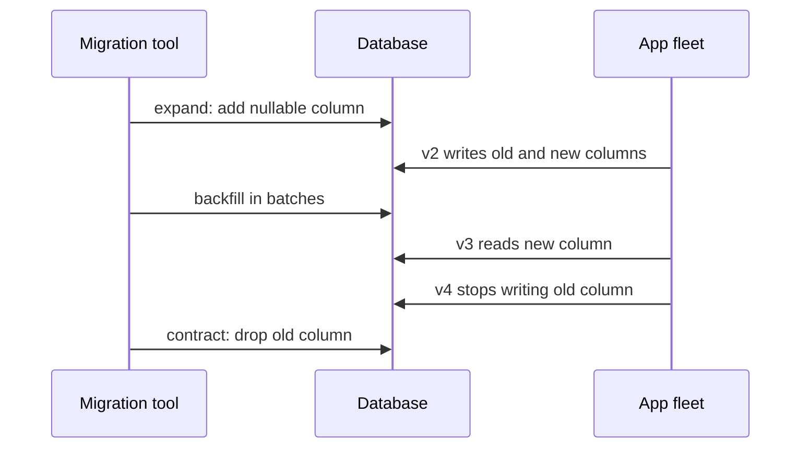

## In one minute
- A schema migration changes the structure of a live database while application code that depends on it keeps running.
- During any deploy, old and new code run side by side, so every schema state must work with at least two app versions.
- The expand and contract pattern splits a breaking change into additive steps, a data backfill, a code switch, and a later removal.
- The dangerous part is locking: some DDL takes an exclusive table lock, and even a brief lock can queue every query behind it.
- Migrations are versioned, ordered, applied by tooling, and recorded in the database so every environment converges to the same state.

## How it works

### Versioned migrations
Each migration is a file with an id and forward SQL. A tool records applied ids and checksums in a history table. On deploy it applies pending ones in order. If someone edits an applied migration, the checksum changes and the tool refuses to run, which catches drift between environments. Flyway, for example, stores a CRC32 checksum for each SQL migration when it runs and fails validation if the file no longer matches ([Flyway docs](https://documentation.red-gate.com/fd/validate-277578898.html)).

### Expand and contract
Renaming `users.fullname` to `users.display_name` in one step breaks whichever app version is running. Instead:
1. Expand: add `display_name` as nullable. Old code ignores it.
2. Dual write: deploy code that writes both columns and reads the old one.
3. Backfill: copy existing rows in batches.
4. Switch reads: deploy code that reads `display_name`.
5. Stop writing the old column.
6. Contract: drop `fullname`, once no running version and no rollback target uses it.

Each step is independently deployable and reversible until the final drop.

### Locks
In PostgreSQL, `ALTER TABLE` takes an `ACCESS EXCLUSIVE` lock unless the docs say otherwise for that subcommand, and a multi-part statement takes the strictest lock any part needs ([PostgreSQL docs](https://www.postgresql.org/docs/current/sql-altertable.html)). Adding a nullable column without a volatile default is a metadata change and finishes in milliseconds, but it still needs the lock. If a long-running transaction holds a weaker lock, the ALTER waits, and every new query on that table queues behind the ALTER. A 2-second wait at 5,000 QPS is 10,000 stalled queries. Always set `lock_timeout` (for example 2 seconds) in the migration session and retry, so a migration fails fast instead of freezing the table. It defaults to 0, which means wait forever, and the docs advise against setting it globally because it would hit every session ([PostgreSQL docs](https://www.postgresql.org/docs/current/runtime-config-client.html)). The usual culprit is a long analytics query or an idle open transaction; GoCardless lost about 15 seconds of API traffic to exactly this queue ([GoCardless](https://gocardless.com/blog/zero-downtime-postgres-migrations-the-hard-parts/)).

Index creation should use `CREATE INDEX CONCURRENTLY`, which does two table scans, waits for older transactions, and takes noticeably longer than a plain build ([PostgreSQL docs](https://www.postgresql.org/docs/current/sql-createindex.html)). Check and foreign key constraints are safest added as `NOT VALID`, which skips checking existing rows, followed by a separate `VALIDATE CONSTRAINT`, which takes only a `SHARE UPDATE EXCLUSIVE` lock so reads and writes continue ([PostgreSQL docs](https://www.postgresql.org/docs/current/sql-altertable.html)). The add step still needs a brief strong lock, and a foreign key also locks the referenced table, so `lock_timeout` still applies.

`NOT NULL` used to be the awkward case, because it could not be `NOT VALID`. The workaround is a validated `CHECK (col IS NOT NULL)`; since PostgreSQL 12, `SET NOT NULL` then skips its full-table scan ([PostgreSQL 12 notes](https://www.postgresql.org/docs/release/12.0/)). PostgreSQL 18, released in September 2025, accepts `NOT VALID` on not-null constraints directly ([PostgreSQL 18 notes](https://www.postgresql.org/docs/release/18.0/)).

### Large-table changes in MySQL
First check whether MySQL can do the change in place. Since 8.0.29, `ALGORITHM=INSTANT` adds or drops a column at any position by changing only metadata; 8.0.12 could add instantly only at the end ([MySQL blog](https://dev.mysql.com/blog-archive/mysql-8-0-instant-add-and-drop-columns/)). INSTANT is the default in 8.4, but each instant change adds a row version and a table allows 64 of them (255 from 9.1) before it must be rebuilt, and changing a column's type still needs a full `ALGORITHM=COPY` ([MySQL manual](https://dev.mysql.com/doc/refman/8.4/en/innodb-online-ddl-operations.html)).

Where DDL rewrites the table, tools such as gh-ost or pt-online-schema-change create a shadow table with the new schema, copy rows in chunks, replay ongoing changes, and swap names at the end. Copy speed is throttled by replication lag. gh-ost reads the binlog instead of using triggers, so throttling truly stops its writes to the primary, and the final table swap can be postponed to a quiet moment ([gh-ost](https://github.com/github/gh-ost/blob/master/README.md)).

### Backfills
Backfills run as batched jobs: update 1,000 to 10,000 rows per transaction by primary key range, sleep briefly, and watch replica lag. One giant `UPDATE` holds locks for minutes and bloats the write-ahead log.

## Down the stack
### Layer 1: The contract
PostgreSQL DDL is transactional: a migration wrapped in a transaction either applies completely or not at all. The exceptions matter, because `CREATE INDEX CONCURRENTLY` cannot run inside a transaction block and can leave an `INVALID` index behind on failure. A migration tool promises each version runs once, in order, and is recorded with its checksum. The lock manager promises that `ACCESS EXCLUSIVE` conflicts with every other lock mode, including the `ACCESS SHARE` taken by a plain `SELECT`.

### Layer 2: The mechanism
Lock requests on a table wait in a queue. When an `ALTER TABLE` is waiting for `ACCESS EXCLUSIVE`, new requests that conflict with it, which is all of them, queue behind it instead of jumping ahead. That is how one blocked migration stalls every reader. Adding a nullable column only inserts a row into `pg_attribute`. Since PostgreSQL 11, a column with a non-volatile default stores that default in `attmissingval` and existing rows are not touched. `CREATE INDEX CONCURRENTLY` scans the table twice and waits for older transactions to finish between phases. Flyway keeps a `flyway_schema_history` table with a CRC32 checksum per script and locks that table while it works so two runners cannot apply migrations at once. gh-ost connects to MySQL as a replica, reads the binlog to replay changes into the ghost table, and finishes with an atomic `RENAME TABLE`.

### Layer 3: The machine
A table rewrite of 180 GB reads and writes every page: at about 500 MB/s that is 6 minutes each way, plus an equal volume of WAL. After each checkpoint, the first change to a page writes the full 8 KB page image to WAL, so WAL volume during a backfill can exceed the data changed. Replicas replay WAL in a single startup process, so a burst that the primary writes in parallel can leave replicas minutes behind. Under MVCC, every `UPDATE` writes a new row version and leaves the old one as a dead tuple, so a full backfill can double the table's size on disk until vacuum reclaims it. Updates can stay on the same page without touching indexes (heap-only tuples) only if no indexed column changes and the page has free space, which is what a lower `fillfactor` reserves.

### Why it's built this way
The catalog is shared by every session, so changing it needs a strong lock. Locks queue in order for fairness, so a waiting DDL blocks everyone and `lock_timeout` is essential. MVCC turns updates into inserts, so backfills must be batched and followed by vacuum. Replication is log shipping with serial replay, so migration speed is limited by replica lag rather than primary capacity.

## Diagram


## Worked example
An `orders` table holds 400 million rows, 180 GB, with 3,000 writes per second at peak. The team needs a `region` column, non-null, derived from `shipping_country`.

Expand: `ALTER TABLE orders ADD COLUMN region text;` with `lock_timeout = '2s'`. It is metadata only, so it completes in milliseconds when it gets the lock.

Dual write: deploy code that sets `region` on every insert and update.

Backfill: batches of 5,000 rows by id range. Each batch takes about 50 ms, so 80,000 batches take about 67 minutes of pure work. Adding a 100 ms pause to protect replicas stretches it to about 3.3 hours. WAL volume is roughly the size of rewritten rows, around 20 to 40 GB, which matters for replica catch-up and backup storage.

Constraint: `ALTER TABLE orders ADD CONSTRAINT region_nn CHECK (region IS NOT NULL) NOT VALID;` then `VALIDATE CONSTRAINT region_nn;`, which scans the table holding only a lock that allows reads and writes. Finally `ALTER COLUMN region SET NOT NULL` skips its scan because the validated check already proves there are no nulls, and the check can then be dropped. On PostgreSQL 18 a `NOT NULL ... NOT VALID` constraint gets there in fewer steps.

The naive alternative, `ADD COLUMN region text NOT NULL DEFAULT compute(...)`, would rewrite the whole table under an exclusive lock. On 180 GB that is many minutes of full outage.

## In the wild
- **GoCardless, undated write-up: a fast ALTER that waited.** A migration renamed tables and recreated foreign keys on tables production code did not even use. A long-running read on the busy referenced table held a lock, the migration queued behind it, and every later query queued behind the migration: about 15 seconds of API timeouts at a payments company. Their advice afterwards: set `lock_timeout`, keep long queries (such as analytics) off the primary, and split changes into small transactions ([GoCardless](https://gocardless.com/blog/zero-downtime-postgres-migrations-the-hard-parts/)).
- **Atlassian Statuspage, 2019: dropping columns at the wrong time.** On 12 August an ad-hoc migration to drop legacy attributes ran while worker jobs were busier than usual. Their locks made the migration queue, and the queued migration then blocked later calls to those tables, timing out requests across services for about 7 minutes. Atlassian committed to hardening the ad-hoc migration process for busy periods ([Statuspage](https://metastatuspage.com/incidents/c666y50f1xr9)).
- **GitHub, 2012: migration load triggers a failover loop.** A schema change through GitHub's zero-downtime migration system loaded the primary MySQL more than similar runs had. Health checks failed, Pacemaker failed over to a node with a cold buffer pool, which also failed its checks, and the role flipped back. Together with a partition the next day, the week cost 1 hour 46 minutes of downtime; failover became human-initiated only ([GitHub](https://github.blog/2012-09-14-github-availability-this-week/)).

## Trade-offs
| Option | Strengths | Weaknesses | Choose when |
| --- | --- | --- | --- |
| Expand and contract | Zero downtime, reversible steps | Several deploys, temporary dual-write code | Any change to a live, shared table |
| Single-step DDL in a maintenance window | Simple | Downtime, no rollback mid-way | Small tables or internal tools |
| Online schema change tool (shadow table) | Handles table rewrites without long locks | Doubles storage temporarily, slow, trigger or binlog complexity | Large MySQL tables needing rewrites |
| Migrations run at app startup | No separate step | Many instances race, failures block startup | Single-instance apps only |

## Pitfalls in production
- An ALTER waiting for a lock blocks all later queries on the table. Set `lock_timeout` and retry with backoff.
- Migrations run by every app instance at boot race and deadlock. Run them once from a pipeline job with a lock.
- Dropping a column the previous release still reads breaks rollback. Contract only after the rollback window has passed.
- Unbatched backfills create replica lag and huge WAL. Batch by key range and throttle on lag.
- ORMs that select `*` or cache column lists fail when columns change. Name columns explicitly.
- Long-running queries and forgotten open transactions are what DDL ends up waiting behind. Send analytics to replicas and turn on `log_lock_waits` so the waits show up in logs.

## Leadership lens
- Require every migration PR to say which app versions it is compatible with and which step of expand and contract it is.
- Review the lock each statement takes, not just the SQL correctness.
- Separate schema deploys from code deploys in the pipeline so each can be rolled back on its own.
- Track pending contract steps as debt with owners; half-finished migrations leave dual-write code forever.

## Check yourself
1. Why can adding a nullable column, a millisecond operation, still cause an outage?
   **Answer:** It needs an exclusive lock. If a long transaction holds a conflicting lock, the ALTER queues, and every subsequent query on the table queues behind it.
2. Why does expand and contract keep the drop step until after the rollback window?
   **Answer:** Rollback means running the previous version, which may still read the old column. Dropping it earlier makes rollback fail.
3. Why use `NOT VALID` followed by `VALIDATE` for a new constraint?
   **Answer:** Adding a validated constraint scans the table under a strong lock. Splitting it enforces the rule for new rows immediately and validates old rows under a weaker lock that allows writes.
4. What does a checksum in the migration history table protect against?
   **Answer:** Edited migration files that were already applied somewhere, which would make environments diverge silently.

## Practice
**Task:** Write `plan(available, applied, fleet_min_version)`. `available` is an ordered list of dicts with `id`, `checksum`, `phase` (`"expand"` or `"contract"`) and `requires_app` (minimum app version that must be running everywhere before a contract step). `applied` maps applied ids to checksums. Raise `ValueError` if an applied id is unknown or its checksum differs. Return the ids to run in order, stopping before the first contract migration whose `requires_app` exceeds `fleet_min_version`, since later steps must not jump ahead of it.

```python starter
def plan(available, applied, fleet_min_version):
    raise NotImplementedError
```

```python tests
def m(i, phase="expand", req=0, cs=None):
    return {"id": i, "checksum": cs or ("c" + i), "phase": phase, "requires_app": req}

def test_runs_pending_in_order():
    av = [m("001"), m("002"), m("003")]
    assert plan(av, {"001": "c001"}, 1) == ["002", "003"]

def test_contract_waits_for_fleet():
    av = [m("001"), m("002", "contract", 5), m("003")]
    assert plan(av, {}, 4) == ["001"]
    assert plan(av, {}, 5) == ["001", "002", "003"]

def test_checksum_drift():
    try:
        plan([m("001")], {"001": "edited"}, 1)
        assert False, "expected ValueError"
    except ValueError:
        pass

def test_unknown_applied():
    try:
        plan([m("001")], {"001": "c001", "009": "x"}, 1)
        assert False, "expected ValueError"
    except ValueError:
        pass

def test_nothing_pending():
    assert plan([m("001")], {"001": "c001"}, 1) == []
```

```python solution
def plan(available, applied, fleet_min_version):
    known = {}
    for mig in available:
        known[mig["id"]] = mig["checksum"]
    for mid, cs in applied.items():
        if mid not in known:
            raise ValueError("applied migration not in repo: " + mid)
        if known[mid] != cs:
            raise ValueError("checksum drift: " + mid)
    out = []
    for mig in available:
        if mig["id"] in applied:
            continue
        if mig["phase"] == "contract" and mig["requires_app"] > fleet_min_version:
            break
        out.append(mig["id"])
    return out
```

```typescript starter
export interface Migration {
  id: string;
  checksum: string;
  phase: string;
  requires_app: number;
}

export function plan(available: Migration[], applied: Record<string, string>, fleetMinVersion: number): string[] {
  throw new Error("TODO");
}
```

```typescript tests
function m(id: string, phase = "expand", req = 0, cs?: string): Migration {
  return { id: id, checksum: cs || "c" + id, phase: phase, requires_app: req };
}

function throws(fn: () => void): boolean {
  try { fn(); return false; } catch (e) { return true; }
}

test("runs pending in order", () => {
  assertEqual(plan([m("001"), m("002"), m("003")], { "001": "c001" }, 1), ["002", "003"]);
});

test("contract waits for fleet", () => {
  const av = [m("001"), m("002", "contract", 5), m("003")];
  assertEqual(plan(av, {}, 4), ["001"]);
  assertEqual(plan(av, {}, 5), ["001", "002", "003"]);
});

test("checksum drift", () => {
  assert(throws(() => plan([m("001")], { "001": "edited" }, 1)), "expected error");
});

test("unknown applied", () => {
  assert(throws(() => plan([m("001")], { "001": "c001", "009": "x" }, 1)), "expected error");
});

test("nothing pending", () => {
  assertEqual(plan([m("001")], { "001": "c001" }, 1), []);
});
```

```typescript solution
export interface Migration {
  id: string;
  checksum: string;
  phase: string;
  requires_app: number;
}

export function plan(available: Migration[], applied: Record<string, string>, fleetMinVersion: number): string[] {
  const known = new Map<string, string>();
  for (const mig of available) known.set(mig.id, mig.checksum);
  for (const id of Object.keys(applied)) {
    if (!known.has(id)) throw new Error("applied migration not in repo: " + id);
    if (known.get(id) !== applied[id]) throw new Error("checksum drift: " + id);
  }
  const out: string[] = [];
  for (const mig of available) {
    if (isApplied(applied, mig.id)) continue;
    if (mig.phase === "contract" && mig.requires_app > fleetMinVersion) break;
    out.push(mig.id);
  }
  return out;
}

function isApplied(applied: Record<string, string>, id: string): boolean {
  return Object.prototype.hasOwnProperty.call(applied, id);
}
```

```go starter
package practice

type Migration struct {
	ID          string
	Checksum    string
	Phase       string
	RequiresApp int
}

func Plan(available []Migration, applied map[string]string, fleetMinVersion int) ([]string, error) {
	panic("TODO")
}
```

```go tests
package practice

import (
	"reflect"
	"testing"
)

func m(id, phase string, req int) Migration {
	return Migration{ID: id, Checksum: "c" + id, Phase: phase, RequiresApp: req}
}

func TestRunsPending(t *testing.T) {
	got, err := Plan([]Migration{m("001", "expand", 0), m("002", "expand", 0), m("003", "expand", 0)}, map[string]string{"001": "c001"}, 1)
	if err != nil || !reflect.DeepEqual(got, []string{"002", "003"}) {
		t.Fatalf("got %v %v", got, err)
	}
}

func TestContractWaits(t *testing.T) {
	av := []Migration{m("001", "expand", 0), m("002", "contract", 5), m("003", "expand", 0)}
	got, _ := Plan(av, map[string]string{}, 4)
	if !reflect.DeepEqual(got, []string{"001"}) {
		t.Fatalf("got %v", got)
	}
	got, _ = Plan(av, map[string]string{}, 5)
	if !reflect.DeepEqual(got, []string{"001", "002", "003"}) {
		t.Fatalf("got %v", got)
	}
}

func TestChecksumDrift(t *testing.T) {
	if _, err := Plan([]Migration{m("001", "expand", 0)}, map[string]string{"001": "edited"}, 1); err == nil {
		t.Fatal("expected error")
	}
}

func TestUnknownApplied(t *testing.T) {
	if _, err := Plan([]Migration{m("001", "expand", 0)}, map[string]string{"001": "c001", "009": "x"}, 1); err == nil {
		t.Fatal("expected error")
	}
}

func TestNothingPending(t *testing.T) {
	got, err := Plan([]Migration{m("001", "expand", 0)}, map[string]string{"001": "c001"}, 1)
	if err != nil || len(got) != 0 {
		t.Fatalf("got %v %v", got, err)
	}
}
```

```go solution
package practice

import "fmt"

type Migration struct {
	ID          string
	Checksum    string
	Phase       string
	RequiresApp int
}

func Plan(available []Migration, applied map[string]string, fleetMinVersion int) ([]string, error) {
	known := map[string]string{}
	for _, mig := range available {
		known[mig.ID] = mig.Checksum
	}
	for id, cs := range applied {
		want, ok := known[id]
		if !ok {
			return nil, fmt.Errorf("applied migration not in repo: %s", id)
		}
		if want != cs {
			return nil, fmt.Errorf("checksum drift: %s", id)
		}
	}
	out := []string{}
	for _, mig := range available {
		if _, done := applied[mig.ID]; done {
			continue
		}
		if mig.Phase == "contract" && mig.RequiresApp > fleetMinVersion {
			break
		}
		out = append(out, mig.ID)
	}
	return out, nil
}
```

## Mock interview
**Prompt:** You must split a `customers.address` text column into structured fields on a PostgreSQL table with 1.2 billion rows and 8,000 writes per second, with no downtime. Walk through the plan.

- Follow-up: What exactly could lock the table, and how do you prevent it?
- Follow-up: Halfway through the backfill, replica lag reaches 90 seconds. What do you do?
- Follow-up: How do you roll back if the read switch shows wrong addresses?

**A strong answer covers:**
- Expand and contract steps mapped to separate deploys, with compatibility at each step.
- `lock_timeout`, concurrent index builds, and `NOT VALID` then `VALIDATE` for constraints.
- Throttled, resumable batched backfill keyed on primary key and gated on replica lag.
- Verification by comparing old and new representations before switching reads.
- Contract only after the rollback window, tracked with an owner.

## Sources and further study
**Primary**
- [PostgreSQL CREATE INDEX](https://www.postgresql.org/docs/current/sql-createindex.html): how concurrent builds work, why they take two scans, and how to recover from an `INVALID` index.
- [PostgreSQL 18 release notes](https://www.postgresql.org/docs/release/18.0/): `NOT VALID` for not-null constraints and other DDL changes in the current major version.
- [PostgreSQL client connection settings](https://www.postgresql.org/docs/current/runtime-config-client.html): `lock_timeout`, `statement_timeout` and `transaction_timeout` semantics.

**Systems docs**
- [MySQL 8.4 online DDL operations](https://dev.mysql.com/doc/refman/8.4/en/innodb-online-ddl-operations.html): which changes are instant, in place, or a full copy.
- [gh-ost README](https://github.com/github/gh-ost/blob/master/README.md): GitHub's triggerless online schema change tool for MySQL.
- [Flyway validate](https://documentation.red-gate.com/fd/validate-277578898.html): how checksums in the schema history table catch edited migrations.
- [PlanetScale: handling table and column renames](https://planetscale.com/docs/learn/handling-table-and-column-renames): the expand and contract steps for a rename, as deploy requests.

**Books**
- *Designing Data-Intensive Applications* (1st ed.), Martin Kleppmann, Ch 4 "Encoding and Evolution": backward and forward compatibility when old and new code share data.
- *Release It!* (2nd ed.), Michael T. Nygard, Ch 13 "Design for Deployment": phased deployments in which schema and code changes roll out separately.

**Other curricula**
- [AWS Builders' Library: ensuring rollback safety](https://builder.aws.com/content/3F04j2yRAAMBuPSPs50xwXZqg01/ensuring-rollback-safety-during-deployments): frames data changes as prepare and activate phases with upgrade-downgrade testing.
- [Azure Well-Architected: safe deployment practices](https://learn.microsoft.com/en-us/azure/well-architected/operational-excellence/safe-deployments): treats schema and stateful changes as the hard part of rollback and asks for written rules for them.

## Watch
- [Expand Contract Pattern for Continuous Delivery of Databases (USENIX LISA19)](https://www.youtube.com/watch?v=Eh05k_O0Jjo): the pattern applied to real delivery pipelines.
- [Zero-downtime migrations (Postgres.FM 048)](https://www.youtube.com/watch?v=mr_J5v398Qo): PostgreSQL lock behaviour and practical safeguards.

## Free resources
- [Evolutionary Database Design (martinfowler.com)](https://martinfowler.com/articles/evodb.html): versioned migrations and refactoring databases incrementally.
- [ParallelChange (Martin Fowler)](https://martinfowler.com/bliki/ParallelChange.html): the expand, migrate, contract pattern in its general form.
- [Online migrations at scale (Stripe)](https://stripe.com/blog/online-migrations): a four-step dual-write migration on a large production dataset.
- [PostgreSQL explicit locking](https://www.postgresql.org/docs/current/explicit-locking.html): which statements take which locks and what they conflict with.
- [PostgreSQL ALTER TABLE](https://www.postgresql.org/docs/current/sql-altertable.html): lock levels per subcommand and notes on table rewrites.
