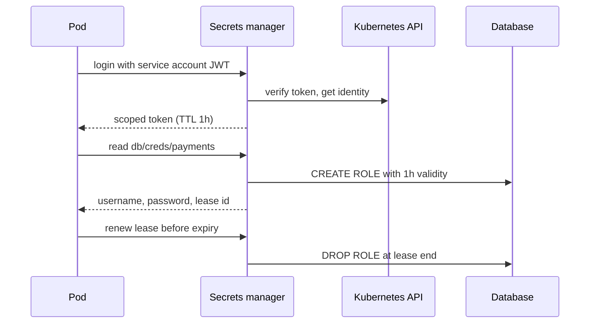

## In one minute
- Secrets are credentials that grant access: database passwords, API keys, signing keys, TLS private keys, OAuth client secrets.
- A secrets manager stores them encrypted, releases them only to authenticated workloads with the right policy, and records every access.
- The strongest pattern is short-lived, dynamically issued credentials, so a leaked secret expires on its own within minutes or hours.
- The hardest problem is "secret zero": how a workload proves its identity to the secrets manager without already holding a secret. Platform identity solves it.
- Most leaks come from source code, CI logs, environment dumps, and tickets, not from the vault itself.

## How it works

### Central store with policy
The manager (Vault, AWS Secrets Manager, GCP Secret Manager, Azure Key Vault) encrypts secrets with keys from a KMS or HSM. Clients authenticate, receive a token scoped by policy, and read only the paths that policy allows: `payments-api` can read `db/payments/*` and nothing else. Every read is logged with caller identity.

### Workload identity instead of secret zero
A workload proves who it is with something the platform vouches for: a Kubernetes service account token signed by the cluster, a cloud instance identity document, or a SPIFFE certificate issued to the pod. The secrets manager verifies that proof with the platform and issues a token. No static bootstrap password is baked into images. Since Kubernetes 1.22 the token in a pod is a bound, audience-scoped token that expires and is rotated by the kubelet, and since 1.24 the old never-expiring token Secrets are no longer created automatically ([Kubernetes service accounts](https://kubernetes.io/docs/concepts/security/service-accounts/)). CI pipelines get the same benefit through OIDC federation: a GitHub Actions job presents a per-job JWT whose `sub` names the repository and environment, and the cloud returns credentials valid only for that job, so no cloud key is stored in CI at all ([GitHub docs](https://docs.github.com/en/actions/concepts/security/openid-connect)).

### Static versus dynamic secrets
A static secret is created once and stored, like a third-party API key. It should be rotated on a schedule, which requires the consumer to handle two valid values during the overlap. A dynamic secret is generated on request: the manager connects to PostgreSQL, creates a user with a 1-hour lease, and hands back the credentials. When the lease expires the manager drops the user. Each instance gets its own credentials, so audit logs show which pod did what and revocation is targeted.

### Leases and renewal
Dynamic secrets have a TTL and a maximum TTL. A sidecar agent renews before expiry, fetches a new credential at the maximum, and the app's pool reconnects with it.

### Delivery to the app
Prefer direct SDK fetch or an agent writing to a tmpfs file. Environment variables are weakest: they leak into crash reports and child processes, and cannot change without a restart. Do not treat a plain Kubernetes Secret as a vault either: it is stored unencrypted in etcd unless encryption at rest is configured, and anyone who can create a pod in the namespace can read every Secret there ([Kubernetes Secrets](https://kubernetes.io/docs/concepts/configuration/secret/)).

## Down the stack
### Layer 1: The contract
A secrets manager promises that a read returns the requested secret version only to an identity whose policy allows that path, and that every read is audited. A dynamic credential is valid until its lease expires or is revoked; revocation means the manager has run the revoke statement against the target system. Rotation of static secrets is versioned: AWS Secrets Manager, for example, moves staging labels `AWSPENDING`, `AWSCURRENT`, and `AWSPREVIOUS` so clients can ask for a specific stage. None of this protects a secret after the application has read it.

### Layer 2: The mechanism
Vault encrypts everything behind a barrier with AES-GCM, using a fresh random 96-bit nonce per object ([Vault security model](https://developer.hashicorp.com/vault/docs/internals/security)), and stores it in an integrated Raft log. The keys form a chain: a keyring of data encryption keys is encrypted by the root key, and the root key is encrypted by an unseal key. On start Vault is sealed: the unseal key is split with Shamir's secret sharing into N shares with a threshold K (5 and 3 by default), or delegated to a cloud KMS or HSM, in which case operators get recovery keys that cannot decrypt the root key ([Vault seal docs](https://developer.hashicorp.com/vault/docs/concepts/seal)). Since August 2023 new Vault releases ship under the Business Source License rather than MPL 2.0 ([HashiCorp](https://www.hashicorp.com/en/blog/hashicorp-adopts-business-source-license)); OpenBao, a Linux Foundation fork, keeps the same API under an open-source licence. Clients log in through auth methods. With Kubernetes auth, Vault sends the pod's service account JWT to the cluster's `TokenReview` API and maps the result to a role and policy. Policies grant capabilities (`read`, `create`, `update`, `list`) on path patterns. The database secrets engine runs a templated statement such as `CREATE ROLE "{{name}}" WITH LOGIN PASSWORD '{{password}}' VALID UNTIL '{{expiration}}'`, returns a lease id, and an expiration manager runs the revocation statement when the lease ends. AWS Secrets Manager rotation runs a function in four steps, `createSecret`, `setSecret`, `testSecret` and `finishSecret`: create the new value under `AWSPENDING`, set it in the target, test it, then move `AWSCURRENT` and keep the old one as `AWSPREVIOUS` ([AWS docs](https://docs.aws.amazon.com/secretsmanager/latest/userguide/rotate-secrets_lambda-functions.html)). AWS warns that the rotation function is a privileged deputy, so it should check that the current and pending values point at the same host and user before changing anything.

### Layer 3: The machine
Kubernetes Secret objects are base64 in etcd and encrypted at rest only if the API server has an encryption configuration. When mounted, they live on a tmpfs volume on the node, not on disk. The kubelet updates mounted files by writing a new directory and atomically swapping a `..data` symlink, typically within a minute; the docs bound the delay by the kubelet sync period plus cache propagation, and a Secret mounted with `subPath` never receives updates at all. Environment variables are copied into the process at `exec`, inherited by every child process, and readable in `/proc/<pid>/environ` by the same user or root. Vault writes need a Raft quorum with an `fsync` on each voter, a few milliseconds on SSDs. A mass restart of 1,200 pods means 1,200 leases and 1,200 `CREATE ROLE` statements, each touching the shared catalog.

### Why it's built this way
Leaks are inevitable over a long enough time, so credentials expire on their own. The root of trust has to live somewhere, so it is split among people or delegated to an HSM. Platforms already authenticate workloads, so secrets managers reuse that identity instead of adding another secret. Files can be swapped atomically while environment variables cannot, so file delivery supports rotation without restarts.

## Diagram


## Worked example
A platform runs 1,200 pods across 80 services, each needing a database credential. Today they share 80 static passwords stored as Kubernetes Secrets, unrotated for two years.

Move to dynamic database credentials with a 1-hour TTL and 24-hour maximum. Each pod starts and requests credentials: at steady state with pods living about 6 hours on average, that is 200 new leases per hour, plus renewals every 40 minutes, about 1,800 renewals per hour. That is under 1 request per second for the manager, trivial load.

The database holds about 1,200 concurrent roles, which is fine, but a mass restart creating 1,200 roles at once should be rate limited.

Blast radius improves sharply. Before: a leaked password grants access until someone notices and rotates it manually, coordinating 15 pods per service. After: a leaked credential works for at most one hour, maps to one pod in the audit log, and can be revoked by lease id in seconds.

If the manager is down, new pods cannot start, so run it highly available across zones.

## In the wild
- **CircleCI, 2023: one stolen session cookie, every customer told to rotate everything.** Malware on an engineer's laptop stole an SSO session cookie that was already 2FA-authenticated. The attacker generated production access tokens, pulled encryption keys from a running process and so could decrypt customers' stored environment variables and tokens. Data was taken on 22 December 2022 and found on 29 December, and on 4 January CircleCI asked every customer to rotate all secrets. Follow-ups included step-up auth, fewer people with production access, and moving customers to OIDC tokens and automatic rotation ([CircleCI](https://circleci.com/blog/jan-4-2023-incident-report/)).
- **Cloudflare, 2023: the four credentials that were not rotated.** After the October 2023 Okta breach, Cloudflare rotated credentials but skipped one service token and three service accounts it wrongly believed were unused. An attacker used them from 14 November to reach Jira, Confluence and Bitbucket. The response rotated more than 5,000 production credentials and reimaged every machine in the global network ([Cloudflare](https://blog.cloudflare.com/thanksgiving-2023-security-incident/)).
- **Microsoft, 2023: a long-lived, account-wide SAS token in a public repo.** A researcher published a storage URL with a shared access signature to share AI models; the overly permissive token exposed storage that held workstation backups and Teams messages. A scanner had marked it benign. Microsoft revoked it two days after Wiz's report, extended secret scanning to flag over-broad or long-expiry SAS tokens and now recommends SAS lifetimes of an hour or less ([MSRC](https://www.microsoft.com/en-us/msrc/blog/2023/09/microsoft-mitigated-exposure-of-internal-information-in-a-storage-account-due-to-overly-permissive-sas-token)).

## Trade-offs
| Option | Strengths | Weaknesses | Choose when |
| --- | --- | --- | --- |
| Static secrets in a manager, scheduled rotation | Simple, works with any third-party API | Long-lived, shared, rotation needs dual values | Third-party keys you cannot issue dynamically |
| Dynamic short-lived credentials | Auto-expiry, per-instance audit, targeted revocation | Manager on the startup path, more moving parts | Databases, cloud credentials, internal services |
| Cloud IAM roles with no secrets | Nothing to leak or rotate | Only works for that cloud's services | Access to cloud-native resources |
| Encrypted secrets in git (sealed or SOPS) | GitOps friendly, reviewable | Rotation and revocation are manual, decryption key is powerful | Small teams, config-heavy secrets |

## Pitfalls in production
- Secrets committed to git live forever in history. Scan pushes and CI with secret detectors, and rotate anything that leaks rather than just deleting the commit. GitGuardian counted about 23.8 million new secrets on public GitHub in 2024, and 70% of those leaked in 2022 were still active ([GitGuardian](https://blog.gitguardian.com/the-state-of-secrets-sprawl-2025/)): detection without revocation does little.
- Rotation that skips the credentials "nobody uses". After a breach, rotate every credential in scope, including service accounts believed dormant, and verify with access logs (see Cloudflare under In the wild).
- Environment variables leak through crash dumps and debug endpoints. Prefer in-memory files or direct fetch.
- One shared credential per service hides which instance misused it. Issue per-instance credentials.
- Rotation that invalidates the old value instantly breaks running clients. Support two valid versions during overlap.
- The manager becomes a single point of failure for deploys. Run it highly available and cache leases sensibly.

## Leadership lens
- Inventory secrets by type and owner, and track mean age; old static secrets are the biggest risk.
- Ask in design review: what identity does this workload use, and what is the TTL of every credential it holds?
- Prefer removing secrets entirely (IAM roles, mTLS identity) over managing them better. AWS's Well-Architected guidance orders it as remove, then replace with short-term credentials, then rotate what is left ([AWS Well-Architected SEC02-BP03](https://docs.aws.amazon.com/wellarchitected/latest/security-pillar/sec_identities_secrets.html)).

## Check yourself
1. What is the "secret zero" problem, and how does workload identity solve it?
   **Answer:** To fetch secrets a workload must authenticate, which seems to need another secret. Workload identity uses a platform-signed token or certificate the workload already has, which the manager verifies with the platform.
2. Why do dynamic credentials make incident response faster?
   **Answer:** Each instance has its own short-lived credential, so audit logs point to one workload and you revoke one lease instead of rotating a shared password everywhere.
3. Why should static secret rotation support two valid values at once?
   **Answer:** Consumers pick up the new value at different times. If the old one dies immediately, any instance that has not reloaded fails.
4. Why is deleting the commit and force-pushing not enough after a secret was pushed?
   **Answer:** Clones, forks, CI caches, and scanners may already have it. Treat it as compromised and rotate it.

## Practice
**Task:** Implement `LeaseManager(ttl, max_ttl)` for dynamic secrets with an injected clock. `issue(role, now)` returns a lease dict with a unique `id` (`"lease-1"`, `"lease-2"`, ...), `role`, `username` (`role + "-" + number`), `issued`, and `expires = now + ttl`. `renew(lease_id, now)` extends expiry to `min(now + ttl, issued + max_ttl)` and returns it, raising `KeyError` for unknown or already expired leases. `revoke(lease_id)` removes a lease. `reap(now)` revokes all leases with `expires <= now` and returns their usernames sorted.

```python starter
class LeaseManager:
    def __init__(self, ttl, max_ttl):
        self.ttl = ttl
        self.max_ttl = max_ttl

    def issue(self, role, now):
        raise NotImplementedError

    def renew(self, lease_id, now):
        raise NotImplementedError

    def revoke(self, lease_id):
        raise NotImplementedError

    def reap(self, now):
        raise NotImplementedError
```

```python tests
def test_issue():
    m = LeaseManager(3600, 86400)
    a = m.issue("payments", 0)
    b = m.issue("payments", 0)
    assert a["id"] != b["id"] and a["username"] != b["username"]
    assert a["expires"] == 3600

def test_renew_extends():
    m = LeaseManager(3600, 86400)
    a = m.issue("payments", 0)
    assert m.renew(a["id"], 3000) == 6600

def test_renew_capped_by_max_ttl():
    m = LeaseManager(3600, 5000)
    a = m.issue("payments", 0)
    assert m.renew(a["id"], 3000) == 5000

def test_renew_expired_fails():
    m = LeaseManager(100, 1000)
    a = m.issue("r", 0)
    try:
        m.renew(a["id"], 100)
        assert False, "expected KeyError"
    except KeyError:
        pass

def test_reap():
    m = LeaseManager(100, 1000)
    a = m.issue("r", 0)
    b = m.issue("r", 50)
    assert m.reap(120) == [a["username"]]
    assert m.reap(200) == [b["username"]]

def test_revoke():
    m = LeaseManager(100, 1000)
    a = m.issue("r", 0)
    m.revoke(a["id"])
    assert m.reap(1000) == []
```

```python solution
class LeaseManager:
    def __init__(self, ttl, max_ttl):
        self.ttl = ttl
        self.max_ttl = max_ttl
        self.leases = {}
        self.counter = 0

    def issue(self, role, now):
        self.counter += 1
        n = str(self.counter)
        lease = {"id": "lease-" + n, "role": role, "username": role + "-" + n,
                 "issued": now, "expires": now + self.ttl}
        self.leases[lease["id"]] = lease
        return lease

    def renew(self, lease_id, now):
        lease = self.leases[lease_id]
        if lease["expires"] <= now:
            raise KeyError(lease_id)
        lease["expires"] = min(now + self.ttl, lease["issued"] + self.max_ttl)
        return lease["expires"]

    def revoke(self, lease_id):
        self.leases.pop(lease_id, None)

    def reap(self, now):
        dead = [l for l in self.leases.values() if l["expires"] <= now]
        for l in dead:
            del self.leases[l["id"]]
        return sorted(l["username"] for l in dead)
```

```typescript starter
export interface Lease {
  id: string;
  role: string;
  username: string;
  issued: number;
  expires: number;
}

export class LeaseManager {
  constructor(private ttl: number, private maxTtl: number) {}
  issue(role: string, now: number): Lease { throw new Error("TODO"); }
  renew(leaseId: string, now: number): number { throw new Error("TODO"); }
  revoke(leaseId: string): void { throw new Error("TODO"); }
  reap(now: number): string[] { throw new Error("TODO"); }
}
```

```typescript tests
test("issue", () => {
  const m = new LeaseManager(3600, 86400);
  const a = m.issue("payments", 0);
  const b = m.issue("payments", 0);
  assert(a.id !== b.id && a.username !== b.username, "ids must differ");
  assertEqual(a.expires, 3600);
});

test("renew extends", () => {
  const m = new LeaseManager(3600, 86400);
  assertEqual(m.renew(m.issue("payments", 0).id, 3000), 6600);
});

test("renew capped by max ttl", () => {
  const m = new LeaseManager(3600, 5000);
  assertEqual(m.renew(m.issue("payments", 0).id, 3000), 5000);
});

test("renew expired fails", () => {
  const m = new LeaseManager(100, 1000);
  const a = m.issue("r", 0);
  let threw = false;
  try { m.renew(a.id, 100); } catch (e) { threw = true; }
  assert(threw, "expected error");
});

test("reap", () => {
  const m = new LeaseManager(100, 1000);
  const a = m.issue("r", 0);
  const b = m.issue("r", 50);
  assertEqual(m.reap(120), [a.username]);
  assertEqual(m.reap(200), [b.username]);
});

test("revoke", () => {
  const m = new LeaseManager(100, 1000);
  m.revoke(m.issue("r", 0).id);
  assertEqual(m.reap(1000), []);
});
```

```typescript solution
export interface Lease {
  id: string;
  role: string;
  username: string;
  issued: number;
  expires: number;
}

export class LeaseManager {
  private leases = new Map<string, Lease>();
  private counter = 0;

  constructor(private ttl: number, private maxTtl: number) {}

  issue(role: string, now: number): Lease {
    this.counter += 1;
    const n = String(this.counter);
    const lease = { id: "lease-" + n, role: role, username: role + "-" + n, issued: now, expires: now + this.ttl };
    this.leases.set(lease.id, lease);
    return lease;
  }

  renew(leaseId: string, now: number): number {
    const lease = this.leases.get(leaseId);
    if (!lease || lease.expires <= now) throw new Error("unknown or expired lease " + leaseId);
    lease.expires = Math.min(now + this.ttl, lease.issued + this.maxTtl);
    return lease.expires;
  }

  revoke(leaseId: string): void {
    this.leases.delete(leaseId);
  }

  reap(now: number): string[] {
    const dead = [...this.leases.values()].filter((l) => l.expires <= now);
    for (const l of dead) this.leases.delete(l.id);
    return dead.map((l) => l.username).sort();
  }
}
```

```go starter
package practice

type Lease struct {
	ID, Role, Username string
	Issued, Expires    int64
}

type LeaseManager struct{}

func NewLeaseManager(ttl, maxTTL int64) *LeaseManager { return &LeaseManager{} }

func (m *LeaseManager) Issue(role string, now int64) Lease             { panic("TODO") }
func (m *LeaseManager) Renew(leaseID string, now int64) (int64, error) { panic("TODO") }
func (m *LeaseManager) Revoke(leaseID string)                          { panic("TODO") }
func (m *LeaseManager) Reap(now int64) []string                        { panic("TODO") }
```

```go tests
package practice

import (
	"reflect"
	"testing"
)

func TestIssue(t *testing.T) {
	m := NewLeaseManager(3600, 86400)
	a, b := m.Issue("payments", 0), m.Issue("payments", 0)
	if a.ID == b.ID || a.Username == b.Username || a.Expires != 3600 {
		t.Fatalf("got %+v %+v", a, b)
	}
}

func TestRenewExtends(t *testing.T) {
	m := NewLeaseManager(3600, 86400)
	if exp, err := m.Renew(m.Issue("payments", 0).ID, 3000); err != nil || exp != 6600 {
		t.Fatalf("got %d %v", exp, err)
	}
}

func TestRenewCapped(t *testing.T) {
	m := NewLeaseManager(3600, 5000)
	if exp, _ := m.Renew(m.Issue("payments", 0).ID, 3000); exp != 5000 {
		t.Fatalf("got %d", exp)
	}
}

func TestRenewExpired(t *testing.T) {
	m := NewLeaseManager(100, 1000)
	if _, err := m.Renew(m.Issue("r", 0).ID, 100); err == nil {
		t.Fatal("expected error")
	}
}

func TestReap(t *testing.T) {
	m := NewLeaseManager(100, 1000)
	a, b := m.Issue("r", 0), m.Issue("r", 50)
	if got := m.Reap(120); !reflect.DeepEqual(got, []string{a.Username}) {
		t.Fatalf("got %v", got)
	}
	if got := m.Reap(200); !reflect.DeepEqual(got, []string{b.Username}) {
		t.Fatalf("got %v", got)
	}
}

func TestRevoke(t *testing.T) {
	m := NewLeaseManager(100, 1000)
	m.Revoke(m.Issue("r", 0).ID)
	if got := m.Reap(1000); len(got) != 0 {
		t.Fatalf("got %v", got)
	}
}
```

```go solution
package practice

import (
	"errors"
	"sort"
	"strconv"
	"sync"
)

type Lease struct {
	ID, Role, Username string
	Issued, Expires    int64
}

type LeaseManager struct {
	mu          sync.Mutex
	ttl, maxTTL int64
	counter     int
	leases      map[string]*Lease
}

func NewLeaseManager(ttl, maxTTL int64) *LeaseManager {
	return &LeaseManager{ttl: ttl, maxTTL: maxTTL, leases: map[string]*Lease{}}
}

func (m *LeaseManager) Issue(role string, now int64) Lease {
	m.mu.Lock()
	defer m.mu.Unlock()
	m.counter++
	n := strconv.Itoa(m.counter)
	l := &Lease{ID: "lease-" + n, Role: role, Username: role + "-" + n, Issued: now, Expires: now + m.ttl}
	m.leases[l.ID] = l
	return *l
}

func (m *LeaseManager) Renew(leaseID string, now int64) (int64, error) {
	m.mu.Lock()
	defer m.mu.Unlock()
	l, ok := m.leases[leaseID]
	if !ok || l.Expires <= now {
		return 0, errors.New("unknown or expired lease")
	}
	l.Expires = min(now+m.ttl, l.Issued+m.maxTTL)
	return l.Expires, nil
}

func (m *LeaseManager) Revoke(leaseID string) {
	m.mu.Lock()
	defer m.mu.Unlock()
	delete(m.leases, leaseID)
}

func (m *LeaseManager) Reap(now int64) []string {
	m.mu.Lock()
	defer m.mu.Unlock()
	dead := []string{}
	for id, l := range m.leases {
		if l.Expires <= now {
			dead = append(dead, l.Username)
			delete(m.leases, id)
		}
	}
	sort.Strings(dead)
	return dead
}
```

## Mock interview
**Prompt:** A fintech runs 150 microservices on Kubernetes across two regions, with database passwords in Kubernetes Secrets and API keys in environment variables. Design a secrets management system that limits the blast radius of any single leak to under one hour.

- Follow-up: How does a new pod authenticate to the secrets manager?
- Follow-up: The secrets manager is unavailable for 20 minutes. What breaks?
- Follow-up: How do you rotate a payment provider's API key that you cannot issue dynamically?

**A strong answer covers:**
- Workload identity login and per-service policies scoped to paths.
- Dynamic database and cloud credentials with short TTLs, renewal by an agent, and per-instance audit.
- High availability across zones, lease TTLs that ride out short outages, and controlled startup bursts.
- Dual-value rotation for static third-party keys and secret scanning in git and CI.
- Delivery through files or SDKs rather than environment variables, and break-glass procedures.

## Sources and further study
**Primary**
- [SPIFFE standard](https://github.com/spiffe/spiffe/blob/main/standards/SPIFFE.md): the normative definition of SPIFFE IDs and SVIDs used for workload identity.
- [NIST SP 800-57 Part 1 Rev. 5, Recommendation for Key Management](https://csrc.nist.gov/pubs/sp/800/57/pt1/r5/final): cryptoperiods, key states and why every key needs a lifetime.
- [GitGuardian, The State of Secrets Sprawl 2025](https://blog.gitguardian.com/the-state-of-secrets-sprawl-2025/): measured leak rates in public and private repos, Slack and Jira.

**Systems docs**
- [AWS Secrets Manager: Lambda rotation functions](https://docs.aws.amazon.com/secretsmanager/latest/userguide/rotate-secrets_lambda-functions.html): the four-step rotation and staging labels in detail.
- [Vault: Seal and unseal](https://developer.hashicorp.com/vault/docs/concepts/seal): the unseal key, root key and keyring chain, and auto-unseal with recovery keys.
- [Kubernetes: Good practices for Secrets](https://kubernetes.io/docs/concepts/security/secrets-good-practices/): encryption at rest, least-privilege RBAC and external stores for cluster secrets.
- [GitHub Actions: OpenID Connect](https://docs.github.com/en/actions/concepts/security/openid-connect): replacing stored cloud keys in CI with per-job federated tokens.

**Books**
- *Building Secure and Reliable Systems*, Adkins et al., chapter 5 "Design for Least Privilege": small blast radius, temporary access and breakglass for credentials. [Free online](https://google.github.io/building-secure-and-reliable-systems/raw/ch05.html).
- *Release It!* (2nd edition), Michael T. Nygard, chapter 11 "Security": its "Configured Passwords" section on keeping service passwords out of config files and code.

**Other curricula**
- [roadmap.sh DevOps roadmap](https://roadmap.sh/devops): treats Secret Management as one node among infrastructure tools such as Vault and cloud secret stores.
- [Azure Architecture Center: External Configuration Store](https://learn.microsoft.com/en-us/azure/architecture/patterns/external-configuration-store): separates ordinary configuration from secrets, which belong in a dedicated store such as Key Vault.

## Watch
- [Secret Management with Hashicorp's Vault (Daniel Bornkessel, GOTO 2018)](https://www.youtube.com/watch?v=C2iUSUtr93E): dynamic secrets, leases, and authentication backends in practice.
- [Secrets management best practices for the modern enterprise (HashiCorp)](https://www.youtube.com/watch?v=yh7A6q2KzVE): organisational patterns for moving away from static secrets.

## Free resources
- [OWASP Secrets Management Cheat Sheet](https://cheatsheetseries.owasp.org/cheatsheets/Secrets_Management_Cheat_Sheet.html): lifecycle, rotation, detection, and CI/CD guidance.
- [What is Vault?](https://developer.hashicorp.com/vault/docs/what-is-vault): the core concepts of a secrets manager with leases and policies.
- [Vault database secrets engine](https://developer.hashicorp.com/vault/docs/secrets/databases): how dynamic database credentials are created and revoked.
- [SPIFFE overview](https://spiffe.io/docs/latest/spiffe-about/overview/): a standard for workload identity that removes secret zero.
