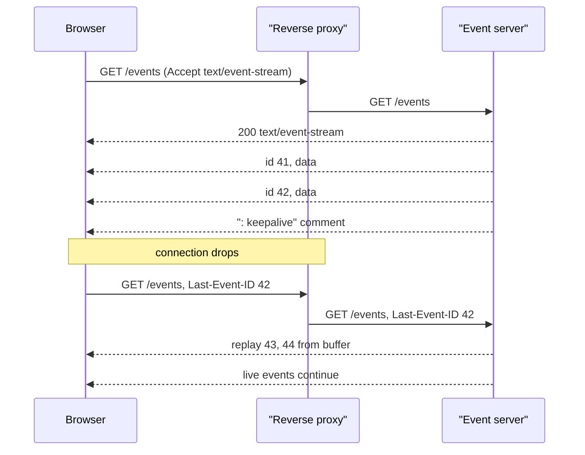

## In one minute
- Server-Sent Events is a one-way push channel: the client makes one ordinary HTTP GET, and the server keeps the response open and writes small text events into it for as long as it likes.
- The wire format is plain UTF-8 lines (`data:`, `event:`, `id:`, `retry:`), with a blank line ending each event, so any HTTP server, proxy or debugging tool already understands it.
- Resumption is built in: the browser remembers the last `id` it saw and sends it back as the `Last-Event-ID` header when it reconnects, so the server can replay what was missed.
- It is the default choice for server-to-client streams such as feeds, dashboards, progress bars and LLM token streaming; use WebSockets only when the client must also send a high rate of messages on the same channel.
- Most production failures are not in the protocol but in the middle: proxies that buffer, idle timeouts that cut quiet streams, and the six-connection limit of HTTP/1.1.

## How it works

### A response that never finishes
A normal HTTP response has a length and an end. An SSE response has neither. The client sends `GET /events` with `Accept: text/event-stream`; the server answers `200 OK` with `Content-Type: text/event-stream` and `Cache-Control: no-cache`, and then simply does not close the body. Each time something happens, it writes a few lines and flushes.

```
event: price
id: 1842
data: {"sym":"ACME","bid":101.25}

: keepalive

data: first line
data: second line

```

The first block is a `price` event with id `1842`. The colon line is a comment, sent every 15 seconds or so (the spec's own suggestion) so idle connections are not killed by proxies ([WHATWG HTML](https://html.spec.whatwg.org/multipage/server-sent-events.html#authoring-notes)). The last block has no type, so it arrives as a `message` event whose data is the two lines joined with a newline.

### The browser side
In a browser, `new EventSource("/events")` opens the stream, parses it, and fires a DOM event per block. `addEventListener("price", fn)` receives typed events; `onmessage` receives untyped ones. If the connection drops, `EventSource` waits the `retry` interval (implementation-defined, "probably in the region of a few seconds" per the spec, and overridable by a `retry:` line from the server ([WHATWG HTML](https://html.spec.whatwg.org/multipage/server-sent-events.html#concept-event-stream-reconnection-time))) and reconnects by itself, adding `Last-Event-ID: 1842`. The server reads that header and replays everything after 1842 before going live. That remember, reconnect and replay loop needs no client code.

Many clients read SSE with `fetch` and a stream reader instead. That is how most LLM APIs are consumed: a `POST` with the prompt, answered with a `text/event-stream` of token deltas. `EventSource` cannot send a body or custom headers (its only option is `withCredentials` for cross-origin cookies), so these clients reimplement the parser and the reconnect loop.

The Model Context Protocol shows where this is heading. Its first remote transport (2024-11-05) was "HTTP+SSE": one long-lived GET stream plus a separate POST endpoint. The 2025-03-26 revision replaced it with Streamable HTTP, a single endpoint where every client message is a POST and the server may answer any POST with either plain JSON or a `text/event-stream`, and may resume a broken stream from `Last-Event-ID` ([MCP spec](https://modelcontextprotocol.io/specification/2025-03-26/basic/transports)). SSE stayed as the framing; the always-open connection became optional.

### What SSE is good at
SSE fits the fan-out problem shape: one producer, many passive readers, messages flowing mostly downward. Live scores, build logs, order status, feature-flag updates and model output all look like this. The client's rare writes (posting a comment, cancelling a job) go over ordinary HTTP requests, which stay stateless and easy to authenticate.

The same shape appears in a second domain: a database change feed (Postgres logical replication, a Kafka consumer) is one long-lived ordered stream with a position the reader stores and resumes from. `Last-Event-ID` is that position, held by the browser instead of a consumer group.

## Down the stack

### Layer 1: The contract
The server promises an ordered stream of events over one HTTP response. Each event has a type (default `message`), a data string, and the last id seen so far. Nothing is promised about delivery: if the TCP connection breaks, events in flight are lost unless the server can replay from `Last-Event-ID`. So the honest contract is at-most-once per connection and, with ids and a replay buffer, at-least-once across reconnects, which means clients should treat events as idempotent or deduplicate by id.

Two status rules matter. A response that is not `200` with the `text/event-stream` type fails the `EventSource` permanently, with no retry ([WHATWG HTML](https://html.spec.whatwg.org/multipage/server-sent-events.html#the-eventsource-interface)). A `204 No Content` is the polite way for a server to say "stop reconnecting". Redirects (`301`, `307`) are followed like any request. Everything else (network errors, a closed stream) triggers reconnection after the retry delay.

### Layer 2: The mechanism
The WHATWG HTML standard defines the parser precisely. Lines end with CRLF, LF or a lone CR. For each line: an empty line dispatches the pending event; a line starting with `:` is a comment; otherwise the text before the first colon is the field name and the rest is the value, with one leading space removed. A line with no colon is a field with an empty value.

Fields update buffers. `data` appends its value plus a newline to the data buffer. `event` sets the type buffer. `id` sets the last-event-id buffer, unless the value contains a NUL. `retry` sets the reconnection time, but only if the value is all ASCII digits. Unknown fields are ignored, which is how the format stays forward compatible.

On dispatch, the parser first copies the last-event-id buffer into the connection's last event id, even if no event will fire. If the data buffer is empty, it resets and fires nothing; so `id: 99` followed by a blank line is a valid way to move the resume point without an event. Otherwise it strips one trailing newline from the data, fires an event with the type (or `message`), and clears the data and type buffers. The id is not cleared; it carries forward until a new `id` line replaces it. If the stream ends in the middle of an event, that partial event is discarded.

### Layer 3: The machine
On HTTP/1.1 each flush becomes a chunk of chunked transfer encoding: the length in hex, CRLF, the bytes, CRLF. A 60-byte event costs about 66 bytes of HTTP framing plus a 40 to 52 byte TCP/IP header, and is usually one segment. With Nagle's algorithm on, a small write can sit in the kernel for up to one round trip waiting for an ACK, so streaming servers set `TCP_NODELAY`. On HTTP/2 each flush is a DATA frame with a 9-byte header on a stream inside one shared connection.

An idle SSE connection on the server is a file descriptor registered with `epoll`, about 1 to 4 KB of kernel socket state, plus whatever the runtime keeps: a 2 to 8 KB goroutine stack in Go, a few hundred bytes of closure in Node, or a whole thread (about 1 MB of reserved stack) in a thread-per-request server. That is why SSE on a thread pool falls over at a few thousand clients while an event-loop server holds hundreds of thousands. Language runtimes add their own cost: LinkedIn measured about 20 KB of JVM heap per TLS connection on its SSE messaging tier, and Linux's old `somaxconn` default of 128 capped how many clients could connect at once until they raised it ([LinkedIn Engineering](https://www.linkedin.com/blog/engineering/archive/instant-messaging-at-linkedin-scaling-to-hundreds-of-thousands-)). Send buffers matter too: if a slow client stops reading, the kernel buffers up to `wmem` bytes (hundreds of KB with autotuning), then `write` blocks or returns `EAGAIN`, and the application must decide whether to queue, drop or disconnect.

### Why it's built this way
1. Browsers and the web's middle boxes already spoke HTTP, so a push channel that was just a slow HTTP response could ship without new ports, new proxies or new firewall rules.
2. Text lines are easy to parse incrementally from a stream that arrives in arbitrary chunks, and easy to read in `curl`, so the format is line-based UTF-8 rather than binary.
3. Networks drop long connections often, so automatic reconnect had to be part of the client, and reconnects lose data, so the id and `Last-Event-ID` resume point came with it.
4. A one-way channel never parses client input on the long-lived connection, which keeps the stateful part small and pushes writes onto stateless requests.

## Diagram



## Worked example
A sports app pushes score updates to 400,000 concurrent viewers during a final. Each update is about 120 bytes with framing, and there are 2 updates per second during play.

Bandwidth is 400,000 x 2 x 120 bytes, about 96 MB/s or 770 Mbit/s of egress before TLS. Keepalives every 20 seconds add about 400 KB/s, which is noise. Memory is the real cost: at about 10 KB per connection across kernel buffers, TLS state and the runtime, 400,000 connections need about 4 GB, so a fleet of eight event-loop servers at 50,000 connections each holds it with headroom for losing one.

Reconnect storms are the dangerous moment. If one server restarts, 50,000 clients come back at once, all with `Last-Event-ID`. With a fixed 3-second retry, they arrive within the same second. The fix is to send `retry:` with a per-client random value between 2,000 and 10,000 ms, spreading the storm over 8 seconds, and to serve replays from an in-memory ring buffer of the last 60 seconds of events (120 events, a few KB) instead of a database query per client.

```python
async def stream(request):
    last = request.headers.get("Last-Event-ID")
    yield f"retry: {random.randint(2000, 10000)}\n\n"
    for ev in ring.since(last):          # replay from memory
        yield f"id: {ev.id}\ndata: {ev.json}\n\n"
    async for ev in hub.subscribe():      # then go live
        yield f"id: {ev.id}\ndata: {ev.json}\n\n"
```

## In the wild
- **Shopify, 2022: dropping WebSockets and polling for SSE.** The 2021 Black Friday Cyber Monday Live Map pushed data over a WebSocket into a mailbox that browsers polled at least every 10 seconds, and trending products could take minutes to update. For 2022 Shopify rebuilt it as a Go SSE server reading Kafka behind nginx, with JWTs sent in an `Authorization` header through an EventSource polyfill. Data reached browsers within milliseconds of being ready and within 21 seconds of the sale end to end, with 100% uptime over the weekend ([Shopify Engineering](https://shopify.engineering/server-sent-events-data-streaming)).
- **LinkedIn, 2016: 100,000 SSE connections per node.** LinkedIn chose SSE over WebSockets for instant messaging because it is plain HTTP and works across members' networks. Load tests hit a 128-connection accept backlog, a per-process file-descriptor limit that capped connections per node, a thread leak from one idle-timeout timer per connection, and about 20 KB of heap per TLS connection; after raising the limits and the heap to 16 GB each node held about 100,000 persistent connections ([LinkedIn Engineering](https://www.linkedin.com/blog/engineering/archive/instant-messaging-at-linkedin-scaling-to-hundreds-of-thousands-)).

## Trade-offs

| Option | Strengths | Weaknesses | Choose when |
|---|---|---|---|
| SSE | Plain HTTP, auto reconnect and resume, works through most proxies, trivial to debug | One-way, text only, `EventSource` cannot set headers | Server pushes, client rarely writes |
| WebSockets | Full duplex, binary frames, low per-message overhead | Own framing and reconnect logic, harder through proxies and to load balance | Chat, games, collaborative editing |
| Long polling | Works everywhere, each response is a normal request | A request per batch, latency spikes between polls | Fallback or very low event rates |
| Short polling | Simplest, cacheable | Wasted requests, latency equals the interval | Updates every minute or slower |

## Pitfalls in production
- A reverse proxy buffers the response and the client sees nothing for minutes. Buffering is on by default in nginx ([nginx docs](https://nginx.org/en/docs/http/ngx_http_proxy_module.html#proxy_buffering)). Turn it off for the route (`proxy_buffering off`, or send `X-Accel-Buffering: no`) and do not gzip the stream unless the compressor flushes per event.
- Load balancer idle timeouts (60 seconds by default on AWS ALB ([AWS docs](https://docs.aws.amazon.com/elasticloadbalancing/latest/application/edit-load-balancer-attributes.html#connection-idle-timeout))) cut quiet streams. Send a comment line well inside the shortest timeout on the path.
- On HTTP/1.1 a browser opens at most six connections per browser and domain, shared across tabs, so a user with seven tabs open hangs; Chrome and Firefox marked this "Won't fix". HTTP/2 negotiates the stream limit instead, 100 by default ([MDN](https://developer.mozilla.org/en-US/docs/Web/API/EventSource)). Serve SSE over HTTP/2, or share one stream across tabs with a `SharedWorker` or `BroadcastChannel`.
- Ids that are not replayable are worse than none: the client sends `Last-Event-ID`, the server cannot find it, and silently starts live. Use monotonically increasing ids backed by a buffer, and send a "resync" event when the id is too old so the client refetches state.
- Auth tokens in query strings leak into access logs. Prefer a cookie, or a short-lived single-use stream ticket obtained by a normal authenticated request.

## Leadership lens
- Default to SSE for server-to-client streams and ask teams proposing WebSockets which client-to-server messages actually need the same connection.
- The cost driver is concurrent connections, not requests per second. Capacity plans, dashboards and alerts should track open streams per node and reconnect rate.
- Decide the replay window as a product decision: how long a client can be offline and still resume, versus a full refetch. Write it down next to the id scheme.
- Every proxy, CDN and balancer in the path is now part of the feature. Name an owner for those settings and test streaming end to end in staging.

## Check yourself
1. A server sends `id: 10\n\n` with no data line. What does the client do, and why is that useful?
   **Answer:** No event fires, because the data buffer is empty, but the client's last event id becomes 10. The server can advance the resume point (for example after events the client does not need) without sending a payload.
2. Why does an LLM API that streams over SSE typically not work with the browser `EventSource` object?
   **Answer:** The API needs a POST body and an `Authorization` header, and `EventSource` only issues a GET with cookies. Clients use `fetch` with a stream reader and their own SSE parser instead.
3. Users report that live updates arrive in large bursts every few minutes in production but stream smoothly locally. What is the likely cause?
   **Answer:** Something in the path is buffering the response, usually a reverse proxy, a CDN or a compression layer. Disable buffering and compression for the stream route.
4. Is SSE delivery exactly-once across reconnects?
   **Answer:** No. Events in flight when the connection drops can be lost, and replay from `Last-Event-ID` can resend events the client already applied. With ids and replay you get at-least-once, so clients must deduplicate or apply idempotently.

## Practice
**Task:** Implement an incremental SSE parser that follows the WHATWG framing rules. `feed(chunk)` takes the next piece of the stream (it can split anywhere, even between a CR and its LF) and returns the list of events completed by that chunk, each with `type`, `data` and `id`. Support CR, LF and CRLF line endings, comments, fields without a colon, one optional space after the colon, multi-line data, the default `message` type, `id` values that persist across events (ignored if they contain NUL), and `retry` values that are all digits. The parser exposes `last_event_id` (updated only when an event block is dispatched, even if it has no data) and `retry` (unset until a valid value arrives). A partial event at the end of the input is held, not emitted.

```python starter
class SSEParser:
    def __init__(self):
        self.last_event_id = ""
        self.retry = None

    def feed(self, chunk):
        # TODO: return a list of {"type", "data", "id"} dicts
        raise NotImplementedError
```

```python tests
def collect(p, chunks):
    out = []
    for c in chunks:
        out.extend(p.feed(c))
    return out

def test_single_event():
    p = SSEParser()
    assert p.feed("data: hello\n\n") == [{"type": "message", "data": "hello", "id": ""}]

def test_type_id_and_multiline_data():
    p = SSEParser()
    evs = p.feed("event: price\nid: 42\ndata: a\ndata: b\n\n")
    assert evs == [{"type": "price", "data": "a\nb", "id": "42"}]
    assert p.last_event_id == "42"

def test_chunks_split_anywhere_including_crlf():
    text = "data: one\r\n\r\nevent: x\rdata: two\r\r"
    whole = SSEParser().feed(text)
    p = SSEParser()
    assert collect(p, list(text)) == whole
    assert whole == [{"type": "message", "data": "one", "id": ""},
                     {"type": "x", "data": "two", "id": ""}]
    q = SSEParser()
    evs = collect(q, ["data: a\r", "\ndata: b\r\n\r\n"])
    assert evs == [{"type": "message", "data": "a\nb", "id": ""}], "CR then LF across chunks is one line end"

def test_comments_and_fields_without_colon():
    p = SSEParser()
    evs = p.feed(": keepalive\n\ndata\n\ndata:x\n\n")
    assert evs == [{"type": "message", "data": "", "id": ""},
                   {"type": "message", "data": "x", "id": ""}]

def test_retry_only_digits():
    p = SSEParser()
    assert p.feed("retry: 2500\n\n") == []
    assert p.retry == 2500
    p.feed("retry: 1s\n\nretry\n\n")
    assert p.retry == 2500

def test_id_persists_resets_and_rejects_nul():
    p = SSEParser()
    evs = p.feed("id: 5\ndata: a\n\ndata: b\n\nid\ndata: c\n\n")
    assert [e["id"] for e in evs] == ["5", "5", ""]
    assert p.feed("id: 9\n\n") == []
    assert p.last_event_id == "9", "id without data still moves the resume point"
    p.feed("id: a\u0000b\n\n")
    assert p.last_event_id == "9"

def test_partial_event_is_held():
    p = SSEParser()
    assert p.feed("id: 3\ndata: partial") == []
    assert p.last_event_id == ""
    assert p.feed("\n\n") == [{"type": "message", "data": "partial", "id": "3"}]
    assert p.last_event_id == "3"

def test_type_resets_after_dispatch():
    p = SSEParser()
    evs = p.feed("event: a\ndata: 1\n\ndata: 2\n\n")
    assert [e["type"] for e in evs] == ["a", "message"]
```

```python solution
class SSEParser:
    def __init__(self):
        self.last_event_id = ""
        self.retry = None
        self._buf = ""
        self._skip_lf = False
        self._data = ""
        self._type = ""
        self._id = ""

    def feed(self, chunk):
        if self._skip_lf and chunk:
            if chunk[0] == "\n":
                chunk = chunk[1:]
            self._skip_lf = False
        self._buf += chunk
        out = []
        while True:
            cut = -1
            for i, ch in enumerate(self._buf):
                if ch == "\r" or ch == "\n":
                    cut = i
                    break
            if cut < 0:
                break
            line = self._buf[:cut]
            rest = self._buf[cut + 1:]
            if self._buf[cut] == "\r":
                if rest == "":
                    self._skip_lf = True
                elif rest[0] == "\n":
                    rest = rest[1:]
            self._buf = rest
            ev = self._line(line)
            if ev is not None:
                out.append(ev)
        return out

    def _line(self, line):
        if line == "":
            return self._dispatch()
        if line[0] == ":":
            return None
        if ":" in line:
            field, value = line.split(":", 1)
            if value.startswith(" "):
                value = value[1:]
        else:
            field, value = line, ""
        if field == "data":
            self._data += value + "\n"
        elif field == "event":
            self._type = value
        elif field == "id":
            if "\u0000" not in value:
                self._id = value
        elif field == "retry":
            if value != "" and all(c in "0123456789" for c in value):
                self.retry = int(value)
        return None

    def _dispatch(self):
        self.last_event_id = self._id
        if self._data == "":
            self._type = ""
            return None
        data = self._data[:-1]
        ev = {"type": self._type or "message", "data": data, "id": self.last_event_id}
        self._data = ""
        self._type = ""
        return ev
```

```typescript starter
export interface SSEEvent {
  type: string;
  data: string;
  id: string;
}

export class SSEParser {
  lastEventId = "";
  retry: number | null = null;

  feed(chunk: string): SSEEvent[] {
    // TODO
    throw new Error("TODO");
  }
}
```

```typescript tests
function collect(p: SSEParser, chunks: string[]): SSEEvent[] {
  const out: SSEEvent[] = [];
  for (const c of chunks) out.push(...p.feed(c));
  return out;
}

test("single event", () => {
  assertEqual(new SSEParser().feed("data: hello\n\n"), [{ type: "message", data: "hello", id: "" }]);
});
test("type, id and multi-line data", () => {
  const p = new SSEParser();
  assertEqual(p.feed("event: price\nid: 42\ndata: a\ndata: b\n\n"), [{ type: "price", data: "a\nb", id: "42" }]);
  assertEqual(p.lastEventId, "42");
});
test("chunks split anywhere including CRLF", () => {
  const text = "data: one\r\n\r\nevent: x\rdata: two\r\r";
  const whole = new SSEParser().feed(text);
  assertEqual(collect(new SSEParser(), text.split("")), whole);
  assertEqual(whole, [{ type: "message", data: "one", id: "" }, { type: "x", data: "two", id: "" }]);
  assertEqual(collect(new SSEParser(), ["data: a\r", "\ndata: b\r\n\r\n"]),
    [{ type: "message", data: "a\nb", id: "" }], "CR then LF across chunks is one line end");
});
test("comments and fields without colon", () => {
  assertEqual(new SSEParser().feed(": keepalive\n\ndata\n\ndata:x\n\n"),
    [{ type: "message", data: "", id: "" }, { type: "message", data: "x", id: "" }]);
});
test("retry only digits", () => {
  const p = new SSEParser();
  assertEqual(p.feed("retry: 2500\n\n"), []);
  assertEqual(p.retry, 2500);
  p.feed("retry: 1s\n\nretry\n\n");
  assertEqual(p.retry, 2500);
});
test("id persists, resets and rejects NUL", () => {
  const p = new SSEParser();
  const evs = p.feed("id: 5\ndata: a\n\ndata: b\n\nid\ndata: c\n\n");
  assertEqual(evs.map((e) => e.id), ["5", "5", ""]);
  assertEqual(p.feed("id: 9\n\n"), []);
  assertEqual(p.lastEventId, "9", "id without data still moves the resume point");
  p.feed("id: a\u0000b\n\n");
  assertEqual(p.lastEventId, "9");
});
test("partial event is held", () => {
  const p = new SSEParser();
  assertEqual(p.feed("id: 3\ndata: partial"), []);
  assertEqual(p.lastEventId, "");
  assertEqual(p.feed("\n\n"), [{ type: "message", data: "partial", id: "3" }]);
  assertEqual(p.lastEventId, "3");
});
test("type resets after dispatch", () => {
  const evs = new SSEParser().feed("event: a\ndata: 1\n\ndata: 2\n\n");
  assertEqual(evs.map((e) => e.type), ["a", "message"]);
});
```

```typescript solution
export interface SSEEvent {
  type: string;
  data: string;
  id: string;
}

export class SSEParser {
  lastEventId = "";
  retry: number | null = null;
  private buf = "";
  private skipLF = false;
  private data = "";
  private type = "";
  private id = "";

  feed(chunk: string): SSEEvent[] {
    if (this.skipLF && chunk.length > 0) {
      if (chunk[0] === "\n") chunk = chunk.slice(1);
      this.skipLF = false;
    }
    this.buf += chunk;
    const out: SSEEvent[] = [];
    for (;;) {
      let cut = -1;
      for (let i = 0; i < this.buf.length; i++) {
        const ch = this.buf[i];
        if (ch === "\r" || ch === "\n") { cut = i; break; }
      }
      if (cut < 0) break;
      const line = this.buf.slice(0, cut);
      let rest = this.buf.slice(cut + 1);
      if (this.buf[cut] === "\r") {
        if (rest === "") this.skipLF = true;
        else if (rest[0] === "\n") rest = rest.slice(1);
      }
      this.buf = rest;
      const ev = this.line(line);
      if (ev) out.push(ev);
    }
    return out;
  }

  private line(line: string): SSEEvent | null {
    if (line === "") return this.dispatch();
    if (line[0] === ":") return null;
    let field = line;
    let value = "";
    const colon = line.indexOf(":");
    if (colon >= 0) {
      field = line.slice(0, colon);
      value = line.slice(colon + 1);
      if (value.startsWith(" ")) value = value.slice(1);
    }
    if (field === "data") this.data += value + "\n";
    else if (field === "event") this.type = value;
    else if (field === "id") { if (value.indexOf("\u0000") < 0) this.id = value; }
    else if (field === "retry") { if (/^[0-9]+$/.test(value)) this.retry = parseInt(value, 10); }
    return null;
  }

  private dispatch(): SSEEvent | null {
    this.lastEventId = this.id;
    if (this.data === "") { this.type = ""; return null; }
    const ev = { type: this.type || "message", data: this.data.slice(0, -1), id: this.lastEventId };
    this.data = "";
    this.type = "";
    return ev;
  }
}
```

```go starter
package practice

type Event struct {
	Type string
	Data string
	ID   string
}

// Parser is an incremental SSE parser. Retry is -1 until a valid retry field arrives.
type Parser struct {
	LastEventID string
	Retry       int
}

func NewParser() *Parser {
	return &Parser{Retry: -1}
}

func (p *Parser) Feed(chunk string) []Event {
	panic("TODO")
}
```

```go tests
package practice

import (
	"reflect"
	"testing"
)

func collect(p *Parser, chunks []string) []Event {
	out := []Event{}
	for _, c := range chunks {
		out = append(out, p.Feed(c)...)
	}
	return out
}

func same(t *testing.T, got, want []Event) {
	t.Helper()
	if len(got) == 0 && len(want) == 0 {
		return
	}
	if !reflect.DeepEqual(got, want) {
		t.Fatalf("got %#v, want %#v", got, want)
	}
}

func TestSingleEvent(t *testing.T) {
	same(t, NewParser().Feed("data: hello\n\n"), []Event{{"message", "hello", ""}})
}

func TestTypeIDAndMultilineData(t *testing.T) {
	p := NewParser()
	same(t, p.Feed("event: price\nid: 42\ndata: a\ndata: b\n\n"), []Event{{"price", "a\nb", "42"}})
	if p.LastEventID != "42" {
		t.Fatalf("last id %q", p.LastEventID)
	}
}

func TestChunksSplitAnywhereIncludingCRLF(t *testing.T) {
	text := "data: one\r\n\r\nevent: x\rdata: two\r\r"
	whole := NewParser().Feed(text)
	chars := []string{}
	for i := 0; i < len(text); i++ {
		chars = append(chars, text[i:i+1])
	}
	same(t, collect(NewParser(), chars), whole)
	same(t, whole, []Event{{"message", "one", ""}, {"x", "two", ""}})
	same(t, collect(NewParser(), []string{"data: a\r", "\ndata: b\r\n\r\n"}), []Event{{"message", "a\nb", ""}})
}

func TestCommentsAndFieldsWithoutColon(t *testing.T) {
	same(t, NewParser().Feed(": keepalive\n\ndata\n\ndata:x\n\n"),
		[]Event{{"message", "", ""}, {"message", "x", ""}})
}

func TestRetryOnlyDigits(t *testing.T) {
	p := NewParser()
	same(t, p.Feed("retry: 2500\n\n"), nil)
	if p.Retry != 2500 {
		t.Fatalf("retry %d", p.Retry)
	}
	p.Feed("retry: 1s\n\nretry\n\n")
	if p.Retry != 2500 {
		t.Fatalf("retry changed to %d", p.Retry)
	}
}

func TestIDPersistsResetsAndRejectsNUL(t *testing.T) {
	p := NewParser()
	evs := p.Feed("id: 5\ndata: a\n\ndata: b\n\nid\ndata: c\n\n")
	ids := []string{}
	for _, e := range evs {
		ids = append(ids, e.ID)
	}
	if !reflect.DeepEqual(ids, []string{"5", "5", ""}) {
		t.Fatalf("ids %v", ids)
	}
	same(t, p.Feed("id: 9\n\n"), nil)
	if p.LastEventID != "9" {
		t.Fatalf("id without data should move the resume point, got %q", p.LastEventID)
	}
	p.Feed("id: a\x00b\n\n")
	if p.LastEventID != "9" {
		t.Fatalf("NUL id accepted: %q", p.LastEventID)
	}
}

func TestPartialEventIsHeld(t *testing.T) {
	p := NewParser()
	same(t, p.Feed("id: 3\ndata: partial"), nil)
	if p.LastEventID != "" {
		t.Fatalf("last id moved early: %q", p.LastEventID)
	}
	same(t, p.Feed("\n\n"), []Event{{"message", "partial", "3"}})
	if p.LastEventID != "3" {
		t.Fatalf("last id %q", p.LastEventID)
	}
}

func TestTypeResetsAfterDispatch(t *testing.T) {
	evs := NewParser().Feed("event: a\ndata: 1\n\ndata: 2\n\n")
	if len(evs) != 2 || evs[0].Type != "a" || evs[1].Type != "message" {
		t.Fatalf("got %#v", evs)
	}
}
```

```go solution
package practice

import (
	"strconv"
	"strings"
)

type Event struct {
	Type string
	Data string
	ID   string
}

// Parser is an incremental SSE parser. Retry is -1 until a valid retry field arrives.
type Parser struct {
	LastEventID string
	Retry       int
	buf         string
	skipLF      bool
	data        strings.Builder
	hasData     bool
	typ         string
	id          string
}

func NewParser() *Parser {
	return &Parser{Retry: -1}
}

func (p *Parser) Feed(chunk string) []Event {
	if p.skipLF && len(chunk) > 0 {
		if chunk[0] == '\n' {
			chunk = chunk[1:]
		}
		p.skipLF = false
	}
	p.buf += chunk
	out := []Event{}
	for {
		cut := strings.IndexAny(p.buf, "\r\n")
		if cut < 0 {
			break
		}
		line := p.buf[:cut]
		rest := p.buf[cut+1:]
		if p.buf[cut] == '\r' {
			if rest == "" {
				p.skipLF = true
			} else if rest[0] == '\n' {
				rest = rest[1:]
			}
		}
		p.buf = rest
		if ev, ok := p.line(line); ok {
			out = append(out, ev)
		}
	}
	return out
}

func (p *Parser) line(line string) (Event, bool) {
	if line == "" {
		return p.dispatch()
	}
	if line[0] == ':' {
		return Event{}, false
	}
	field, value := line, ""
	if i := strings.IndexByte(line, ':'); i >= 0 {
		field, value = line[:i], strings.TrimPrefix(line[i+1:], " ")
	}
	switch field {
	case "data":
		p.data.WriteString(value)
		p.data.WriteByte('\n')
		p.hasData = true
	case "event":
		p.typ = value
	case "id":
		if !strings.ContainsRune(value, 0) {
			p.id = value
		}
	case "retry":
		if value != "" && strings.Trim(value, "0123456789") == "" {
			if n, err := strconv.Atoi(value); err == nil {
				p.Retry = n
			}
		}
	}
	return Event{}, false
}

func (p *Parser) dispatch() (Event, bool) {
	p.LastEventID = p.id
	if !p.hasData {
		p.typ = ""
		return Event{}, false
	}
	data := p.data.String()
	typ := p.typ
	if typ == "" {
		typ = "message"
	}
	p.data.Reset()
	p.hasData = false
	p.typ = ""
	return Event{Type: typ, Data: data[:len(data)-1], ID: p.LastEventID}, true
}
```

## Mock interview
**Prompt:** You run a delivery app with 2 million daily users. Design the channel that pushes order status and courier position to the customer's phone and web browser, about one update every 5 seconds per active order, with up to 300,000 active orders at the dinner peak.

- Follow-up: The customer's phone switches from Wi-Fi to cellular mid-delivery. Walk through exactly what the client and server do and what the customer sees.
- Follow-up: A deploy restarts one of your stream servers holding 40,000 connections. What happens to the rest of the fleet?
- Follow-up: Product now wants customers to chat with the courier in the same screen. Do you switch to WebSockets?

**A strong answer covers:**
- SSE over HTTP/2 for the push path, with ordinary HTTP requests for the customer's writes, and why that keeps the stateful tier small.
- Monotonic per-order event ids, `Last-Event-ID` replay from a short in-memory or Redis buffer, and a resync event when the id is too old.
- Connection capacity in memory per connection and open streams per node, plus heartbeats inside the balancer idle timeout and buffering disabled at every proxy.
- Reconnect storm control: randomized `retry`, gradual drain on deploy, and admission limits on replay work.
- A pub/sub fan-out layer between producers and stream servers, keyed by order id, so any server can hold any client.
- A reasoned answer on chat: message rates are low, so posting messages over HTTP and receiving them on the existing stream is usually enough.

## Sources and further study
**Primary**
- [WHATWG HTML: Parsing an event stream](https://html.spec.whatwg.org/multipage/server-sent-events.html#parsing-an-event-stream): the ABNF for the format and the exact dispatch algorithm.
- [MCP: Streamable HTTP transport (2025-03-26)](https://modelcontextprotocol.io/specification/2025-03-26/basic/transports#streamable-http): a current protocol that uses SSE per request with resumable ids.
- [RFC 9113, section 6.5.2: SETTINGS_MAX_CONCURRENT_STREAMS](https://www.rfc-editor.org/rfc/rfc9113#section-6.5.2): why many SSE streams can share one HTTP/2 connection.

**Systems docs**
- [OpenAI: Streaming API responses](https://developers.openai.com/api/docs/guides/streaming-responses): another LLM API that streams typed semantic events over SSE.
- [AWS: ALB connection idle timeout](https://docs.aws.amazon.com/elasticloadbalancing/latest/application/edit-load-balancer-attributes.html#connection-idle-timeout): the default that decides how often heartbeats must go out.

**Books**
- *High Performance Browser Networking*, Ilya Grigorik, chapter 16 "Server-Sent Events (SSE)": the EventSource API, the event stream protocol and its performance limits ([read free](https://hpbn.co/server-sent-events-sse/)).
- *Designing Data-Intensive Applications* (1st ed.), Martin Kleppmann, chapter 11 "Stream Processing": consumer offsets, the same idea as `Last-Event-ID`.

**Other curricula**
- [Azure Architecture Center: Asynchronous Request-Reply](https://learn.microsoft.com/en-us/azure/architecture/patterns/async-request-reply): recommends SSE over polling when responses must stream in real time.
- [roadmap.sh: Backend](https://roadmap.sh/backend): lists Server Sent Events alongside WebSockets and long/short polling under "Real-Time Data".

## Watch
- [Server-Sent Events Crash Course (Hussein Nasser)](https://www.youtube.com/watch?v=4HlNv1qpZFY): builds an SSE server and client and discusses the trade-offs against WebSockets and polling.

## Free resources
- [Server-sent events (WHATWG HTML Standard)](https://html.spec.whatwg.org/multipage/server-sent-events.html): the normative parsing and reconnection rules this lesson's practice implements.
- [Using server-sent events (MDN)](https://developer.mozilla.org/en-US/docs/Web/API/Server-sent_events/Using_server-sent_events): field-by-field format reference with client and server examples.
- [EventSource (MDN)](https://developer.mozilla.org/en-US/docs/Web/API/EventSource): the browser API, its ready states and its limits.
- [Stream Server-Sent Events updates (web.dev)](https://web.dev/articles/eventsource-basics): a practical walkthrough of ids, retry and reconnection.
- [Streaming Messages (Anthropic docs)](https://platform.claude.com/docs/en/build-with-claude/streaming): a real LLM API that streams typed events over SSE.
- [ngx_http_proxy_module (nginx)](https://nginx.org/en/docs/http/ngx_http_proxy_module.html): `proxy_buffering`, `X-Accel-Buffering` and read timeouts that decide whether a stream gets through.
