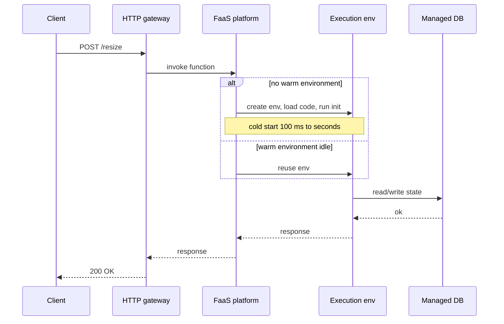

## In one minute
- Serverless means you deploy functions or managed services and the provider handles servers, scaling, and patching. You pay per request and per unit of execution time, not for idle capacity.
- Functions as a Service (FaaS) such as AWS Lambda run your code in short-lived, stateless execution environments that the platform creates on demand and reuses while warm.
- The big wins are zero ops for spiky or low-traffic workloads and scale-to-zero cost. The big costs are cold starts, execution limits, per-request pricing at high steady load, and vendor coupling.
- State lives in managed services (object storage, key-value stores, queues), so a serverless design is really a design of events flowing between managed components.

## How it works

### Execution environments
When an event arrives and no idle environment exists, the platform creates one: allocate a micro-VM, download the code package, start the runtime, and run your initialisation code. This is the **cold start**, typically 100 to 500 ms for small Node or Python functions and 1 to several seconds for large JVM packages. AWS says cold starts typically affect under 1% of invocations, more often in rarely called dev and test functions, and range from under 100 ms to over a second ([Lambda docs](https://docs.aws.amazon.com/lambda/latest/dg/lambda-runtime-environment.html)). Afterwards the environment handles one request at a time and stays warm for an unspecified idle period, often minutes, though Lambda still recycles environments every few hours even under constant traffic. A second concurrent request gets a second environment, so concurrency equals the number of environments.

### Scaling and limits
Concurrency is roughly arrival rate times average duration. At 500 requests per second and 200 ms average duration you need about 100 concurrent environments. Accounts and functions have concurrency quotas (1,000 per Region by default on Lambda), and scale-up is rate limited: each function can add at most 1,000 execution environments every 10 seconds, and requests beyond that get a 429 ([Lambda scaling docs](https://docs.aws.amazon.com/lambda/latest/dg/scaling-behavior.html)). A sudden 50x burst can therefore be throttled. Functions also have maximum durations (15 minutes on Lambda), memory caps, and payload size limits, which rule out long-running or stateful work.

### Triggers and state
Functions are invoked by HTTP gateways, queue messages, object-store events, stream records, or schedules. Each trigger has its own retry behaviour: an async invocation that errors is retried twice, one and then two minutes apart, and a throttled one is retried for up to 6 hours; a queue redelivers until the message is deleted or sent to a dead-letter queue. AWS also warns that the async queue can deliver an event twice even when nothing failed ([Lambda docs](https://docs.aws.amazon.com/lambda/latest/dg/invocation-async-error-handling.html)). That means handlers must be idempotent. Because environments are disposable, anything that must survive goes to a database, cache, or object store. Connection-heavy databases are a classic mismatch: 1,000 concurrent functions each opening a Postgres connection will exhaust the server, so use a connection proxy or an HTTP-native datastore.

### Pricing model
You pay per invocation plus GB-seconds of execution: on Lambda in us-east-1, $0.20 per million requests and about $0.0000167 per GB-second on x86 ([AWS Lambda pricing](https://aws.amazon.com/lambda/pricing/)). Since 1 August 2025 the Init phase of on-demand ZIP functions on managed runtimes is billed too, so a slow cold start now costs money as well as latency ([AWS Compute Blog](https://aws.amazon.com/blogs/compute/aws-lambda-standardizes-billing-for-init-phase/)). This is cheap for bursty traffic and expensive for constant high load, where a container fleet at 60% utilisation usually wins.

The line between serverless and servers is blurring. Lambda Managed Instances run functions on EC2 instances in your account at EC2 prices plus a 15% management fee; one environment serves many requests at once, and the fleet scales to a configured minimum instead of to zero ([Lambda docs](https://docs.aws.amazon.com/lambda/latest/dg/lambda-managed-instances.html)). Lambda durable functions checkpoint progress so a workflow can run for up to a year, well past the 15-minute limit of one invocation.

## Down the stack

### Layer 1: The contract
The platform promises to run your handler for each event, eventually, with bounded resources. On AWS Lambda that means a maximum of 15 minutes per invocation, a configured memory size from 128 MB to 10,240 MB, request and response payloads up to 6 MB for synchronous calls (200 MB for a streamed response) and 1 MB for asynchronous ones, and one request at a time per execution environment on the default compute type ([Lambda quotas](https://docs.aws.amazon.com/lambda/latest/dg/gettingstarted-limits.html)). It does not promise that an environment will be reused, that anything in memory or `/tmp` survives, or that an asynchronous event runs exactly once: async invocations are retried twice on error, then sent to a dead-letter queue or failure destination.

### Layer 2: The mechanism
Each execution environment is a Firecracker microVM. Inside it, the language runtime runs a loop against the Runtime API: `GET /2018-06-01/runtime/invocation/next` blocks until an event arrives, the handler runs, and the runtime posts the result to `/runtime/invocation/{request-id}/response`. Before the first invoke, the Init phase loads the runtime and your code and runs initialisation outside the handler, limited to 10 seconds. Asynchronous events go into an internal queue first, so the caller gets a 202 immediately while a poller invokes the function. SnapStart takes a Firecracker snapshot of an initialised environment when you publish a version and restores it on demand, skipping most of Init. It now covers Java 11+, Python 3.12+ and .NET 8+, and code that generates unique IDs or random seeds during Init must move them after restore, because every environment starts from the same snapshot ([SnapStart docs](https://docs.aws.amazon.com/lambda/latest/dg/snapstart.html)).

### Layer 3: The machine
Firecracker boots a minimal microVM in under 125 ms with less than 5 MiB of memory overhead per VM, and a host can create up to 150 microVMs per second ([Firecracker](https://firecracker-microvm.github.io/)), which is what makes dense multi-tenant packing affordable. A cold start adds downloading and unpacking your package, starting the runtime, and running init code. For a JVM that means class loading and interpreting code before the JIT warms up, which is why Java cold starts reach seconds. CPU is allocated in proportion to memory: at 1,769 MB a function gets the equivalent of one vCPU, so a 128 MB function also gets a small CPU slice and runs slower. Between invocations the environment is frozen, so background threads stop and timers drift; work started after returning a response may never finish.

### Why it's built this way
1. Customers' code is untrusted and shares hardware, so isolation must be VM-strength, not just containers.
2. Full VMs boot too slowly and waste memory, so a stripped-down microVM monitor trades features for speed and density.
3. Even a fast boot plus runtime start is too slow for every request, so environments are kept warm and reused.
4. Billing is per millisecond of memory-time, so CPU is tied to memory to keep pricing one-dimensional.
5. Reclaiming idle environments at will is what makes scale-to-zero pricing possible, so handlers must be stateless.

## Diagram


## Worked example
An image-thumbnail service receives uploads to object storage. Traffic is 2 million images a month, heavily concentrated in business hours, with peaks of 150 uploads per second.

Each thumbnail function uses 1 GB of memory and runs 400 ms. Monthly compute is 2,000,000 x 0.4 s x 1 GB = 800,000 GB-seconds. At roughly $0.0000167 per GB-second that is about $13, plus about $0.40 for requests. Peak concurrency is 150 x 0.4 = 60 environments, well within default quotas. A container alternative sized for the peak would need several always-on instances costing hundreds of dollars a month, mostly idle overnight.

Now compare an internal API at a steady 3,000 requests per second, 50 ms each, 512 MB. That is about 7.8 billion requests a month. Request charges alone are around $1,500 and compute around $3,200. A small autoscaled container fleet doing the same work might cost under $1,000. The break-even point depends on utilisation: serverless wins when average load is far below peak.

## In the wild
- **Amazon Prime Video, 2023: Step Functions per frame.** A stream-quality monitor built from Step Functions, Lambda and S3 hit a hard scaling limit at about 5% of expected load: it made several state transitions for every second of video, hitting account limits and paying per transition, and passed frames through S3 with many Tier-1 calls. Moving the same components into one ECS process cut infrastructure cost by over 90% ([Prime Video Tech, archived](http://web.archive.org/web/20240805183535/https://www.primevideotech.com/video-streaming/scaling-up-the-prime-video-audio-video-monitoring-service-and-reducing-costs-by-90)).
- **AWS, 2023: Lambda frontend cell crosses an untested size.** On 13 June the Lambda Frontend fleet in us-east-1 scaled up for normal growth, and one cell passed a capacity level never reached before, waking a latent bug that left new execution environments unused. Invocations failed for about two hours, and STS, console sign-in, EventBridge and Amazon Connect were degraded with it. AWS fixed the bug and committed to bounding all cells to well-tested sizes ([AWS](https://aws.amazon.com/message/061323/)).

## Trade-offs
| Option | Strengths | Weaknesses | Choose when |
|---|---|---|---|
| FaaS functions | No servers, scale to zero, per-request billing | Cold starts, duration and memory limits, vendor APIs | Spiky, event-driven, or glue workloads |
| Serverless containers | Bring any container, scale to zero, longer requests | Still cold starts, less control than a cluster | You need custom runtimes but want managed scaling |
| FaaS on managed instances | Function model at EC2 prices, many requests per environment | No scale to zero, thread safety now your problem | Steady, high-volume functions you do not want to rewrite |
| Container cluster | Full control, predictable latency, cheap at steady load | You run capacity planning, patching, and scaling | High steady traffic or long-lived connections |

## Pitfalls in production
- **Cold starts on the user path.** Large packages and heavy initialisation push p99 into seconds. Trim dependencies, initialise lazily, and use provisioned concurrency or snapshot-based start for latency-critical functions.
- **Database connection exhaustion.** Scale-out opens thousands of connections. Put a connection pooler or proxy in front, or use a datastore with an HTTP API.
- **Non-idempotent handlers.** Platform retries cause duplicate charges or emails. Deduplicate on an idempotency key stored in a database with a conditional write.
- **Runaway recursion and cost.** A function that writes to the bucket that triggers it loops forever. Lambda now stops a chain after about 16 invocations, but only for loops through SQS, S3, SNS and EventBridge with a recent AWS SDK; a loop through DynamoDB, for example, is not caught ([Lambda docs](https://docs.aws.amazon.com/lambda/latest/dg/invocation-recursion.html)). Separate input and output locations, and set billing alarms and concurrency caps.
- **Throttling during bursts.** Account-wide concurrency is shared, so one noisy function starves the rest. Reserve concurrency per critical function and buffer bursts with a queue.

## Leadership lens
- Model cost at expected and peak load before committing. Serverless is a pricing decision as much as an architecture decision.
- Ask how each function behaves on retry and what the dead-letter path is. The trigger semantics are part of the design.
- Decide how much provider lock-in is acceptable, and keep business logic in plain modules so the handler is a thin adapter.
- Invest in observability early: distributed traces across functions and queues are harder to get than in a single service.

## Check yourself
1. A function averages 300 ms and receives 2,000 requests per second. Roughly how many concurrent environments are needed?
   **Answer:** About 600, because concurrency is arrival rate times duration (2,000 x 0.3).
2. Why are serverless handlers expected to be idempotent?
   **Answer:** Triggers deliver at least once and retry on errors or timeouts, so the same event can run the handler more than once.
3. When does a container fleet beat FaaS on cost?
   **Answer:** At high, steady utilisation, where per-request and per-GB-second pricing exceeds the cost of always-on instances that stay busy.

## Practice
**Task:** Simulate a FaaS platform. Write `simulate(requests, idle_timeout)` where `requests` is a list of `(arrival, duration)` tuples sorted by arrival time (integers, milliseconds). Each environment serves one request at a time. On arrival, reuse a free environment whose last request finished at or before the arrival and no more than `idle_timeout` ms earlier, choosing the most recently freed one; otherwise create a new environment (a cold start). Environments idle longer than `idle_timeout` are reclaimed. Return a tuple `(cold_starts, peak_concurrency)`.

```python starter
def simulate(requests, idle_timeout):
    # TODO: track environments and count cold starts
    raise NotImplementedError
```

```python tests
def test_single_request():
    assert simulate([(0, 100)], 1000) == (1, 1)

def test_sequential_reuse():
    assert simulate([(0, 100), (200, 100), (400, 100)], 1000) == (1, 1)

def test_overlap_needs_second_env():
    assert simulate([(0, 100), (50, 100)], 1000) == (2, 2)

def test_idle_timeout_reclaims():
    assert simulate([(0, 100), (2000, 100)], 1000) == (2, 1)

def test_boundary_exactly_at_timeout_is_warm():
    assert simulate([(0, 100), (1100, 100)], 1000) == (1, 1)

def test_empty():
    assert simulate([], 1000) == (0, 0)
```

```python solution
def simulate(requests, idle_timeout):
    envs = []  # busy-until time for each live environment
    cold = 0
    peak = 0
    for arrival, duration in requests:
        envs = [b for b in envs if b > arrival or arrival - b <= idle_timeout]
        free = [i for i, b in enumerate(envs) if b <= arrival]
        if free:
            best = max(free, key=lambda i: envs[i])
            envs[best] = arrival + duration
        else:
            cold += 1
            envs.append(arrival + duration)
        busy = sum(1 for b in envs if b > arrival)
        peak = max(peak, busy)
    return (cold, peak)
```

```typescript starter
export function simulate(requests: [number, number][], idleTimeout: number): [number, number] {
  throw new Error("TODO");
}
```

```typescript tests
test("single request", () => {
  assertEqual(simulate([[0, 100]], 1000), [1, 1]);
});
test("sequential reuse", () => {
  assertEqual(simulate([[0, 100], [200, 100], [400, 100]], 1000), [1, 1]);
});
test("overlap needs second env", () => {
  assertEqual(simulate([[0, 100], [50, 100]], 1000), [2, 2]);
});
test("idle timeout reclaims", () => {
  assertEqual(simulate([[0, 100], [2000, 100]], 1000), [2, 1]);
});
test("boundary exactly at timeout is warm", () => {
  assertEqual(simulate([[0, 100], [1100, 100]], 1000), [1, 1]);
});
test("empty", () => {
  assertEqual(simulate([], 1000), [0, 0]);
});
```

```typescript solution
export function simulate(requests: [number, number][], idleTimeout: number): [number, number] {
  let envs: number[] = []; // busy-until time per live environment
  let cold = 0;
  let peak = 0;
  for (const [arrival, duration] of requests) {
    envs = envs.filter((b) => b > arrival || arrival - b <= idleTimeout);
    let best = -1;
    envs.forEach((b, i) => {
      if (b <= arrival && (best < 0 || b > envs[best])) best = i;
    });
    if (best >= 0) {
      envs[best] = arrival + duration;
    } else {
      cold++;
      envs.push(arrival + duration);
    }
    peak = Math.max(peak, envs.filter((b) => b > arrival).length);
  }
  return [cold, peak];
}
```

```go starter
package practice

// Request is one invocation: arrival time and duration in milliseconds.
type Request struct {
	Arrival  int
	Duration int
}

// Simulate returns the number of cold starts and the peak concurrency.
func Simulate(requests []Request, idleTimeout int) (int, int) {
	panic("TODO")
}
```

```go tests
package practice

import "testing"

func check(t *testing.T, reqs []Request, wantCold, wantPeak int) {
	t.Helper()
	cold, peak := Simulate(reqs, 1000)
	if cold != wantCold || peak != wantPeak {
		t.Fatalf("got (%d,%d), want (%d,%d)", cold, peak, wantCold, wantPeak)
	}
}

func TestSingle(t *testing.T) { check(t, []Request{{0, 100}}, 1, 1) }

func TestSequentialReuse(t *testing.T) {
	check(t, []Request{{0, 100}, {200, 100}, {400, 100}}, 1, 1)
}

func TestOverlap(t *testing.T) { check(t, []Request{{0, 100}, {50, 100}}, 2, 2) }

func TestIdleTimeout(t *testing.T) { check(t, []Request{{0, 100}, {2000, 100}}, 2, 1) }

func TestBoundaryWarm(t *testing.T) { check(t, []Request{{0, 100}, {1100, 100}}, 1, 1) }

func TestEmpty(t *testing.T) { check(t, nil, 0, 0) }
```

```go solution
package practice

// Request is one invocation: arrival time and duration in milliseconds.
type Request struct {
	Arrival  int
	Duration int
}

// Simulate returns the number of cold starts and the peak concurrency.
func Simulate(requests []Request, idleTimeout int) (int, int) {
	var envs []int // busy-until time per live environment
	cold, peak := 0, 0
	for _, r := range requests {
		live := envs[:0]
		for _, b := range envs {
			if b > r.Arrival || r.Arrival-b <= idleTimeout {
				live = append(live, b)
			}
		}
		envs = live
		best := -1
		for i, b := range envs {
			if b <= r.Arrival && (best < 0 || b > envs[best]) {
				best = i
			}
		}
		if best >= 0 {
			envs[best] = r.Arrival + r.Duration
		} else {
			cold++
			envs = append(envs, r.Arrival+r.Duration)
		}
		busy := 0
		for _, b := range envs {
			if b > r.Arrival {
				busy++
			}
		}
		if busy > peak {
			peak = busy
		}
	}
	return cold, peak
}
```

## Mock interview
**Prompt:** Design a serverless backend for a ticketing site that is idle most of the week but receives 40,000 requests per second for 10 minutes when a popular event goes on sale. Purchases write to a relational database.

- Follow-up: How do you stop 40,000 concurrent functions from overwhelming the database?
- Follow-up: The payment step occasionally times out and the platform retries it. What happens, and how do you prevent double charges?
- Follow-up: At what traffic profile would you move this to containers?

**A strong answer covers:**
- Concurrency math (rate times duration) checked against account quotas and scale-up rate limits.
- A queue between the burst and the database, with consumers capped to what the database can absorb.
- Idempotency keys and conditional writes so retries are safe.
- Pre-warming or provisioned concurrency for the sale window, and a waiting-room or admission control at the edge.
- A cost comparison against containers using real utilisation numbers.

## Sources and further study
**Primary**
- [Agache et al., Firecracker: Lightweight Virtualization for Serverless Applications (NSDI 2020)](https://www.usenix.org/conference/nsdi20/presentation/agache): why AWS built its own VMM for Lambda and Fargate.
- [Summary of the AWS Lambda service event in us-east-1 (June 2023)](https://aws.amazon.com/message/061323/): a FaaS control plane failure and the services that depended on it.

**Systems docs**
- [Lambda quotas](https://docs.aws.amazon.com/lambda/latest/dg/gettingstarted-limits.html): timeouts, payload sizes, memory, scaling rate and the newer compute types in one table.
- [Lambda: error handling for asynchronous invocation](https://docs.aws.amazon.com/lambda/latest/dg/invocation-async-error-handling.html): retry counts, intervals and why duplicates happen anyway.
- [Lambda recursive loop detection](https://docs.aws.amazon.com/lambda/latest/dg/invocation-recursion.html): what is detected, what is not, and how to respond.
- [Lambda Managed Instances](https://docs.aws.amazon.com/lambda/latest/dg/lambda-managed-instances.html): the multi-concurrency, EC2-priced variant and how it differs from default Lambda.

**Books**
- *Building Microservices* (2nd edition), Sam Newman, chapter 8 "Deployment": compares deployment options, function as a service among them, against the principles of isolated, automated deployment.

**Other curricula**
- [Azure Architecture Center: architecture styles](https://learn.microsoft.com/en-us/azure/architecture/guide/architecture-styles/): has no separate serverless style; it places functions inside Web-Queue-Worker and event-driven designs, which matches the view that serverless is a deployment model, not a shape.
- [donnemartin/system-design-primer](https://github.com/donnemartin/system-design-primer): does not cover serverless; its queue and asynchronism sections describe the same producer-queue-worker shape that most function designs use.

## Watch
- [Serverless Architectural Patterns and Best Practices (GOTO 2018)](https://www.youtube.com/watch?v=psIgCzFOqj8): common patterns for building on functions and managed services.
- [Serverless Architecture Patterns, Lynn Langit (NDC)](https://www.youtube.com/watch?v=od4mrgJ9wW8): practical architectures and where they fit.

## Free resources
- [Serverless Architectures (martinfowler.com)](https://martinfowler.com/articles/serverless.html): a careful definition with benefits and drawbacks.
- [Cloud Programming Simplified: A Berkeley View on Serverless Computing](https://www2.eecs.berkeley.edu/Pubs/TechRpts/2019/EECS-2019-3.pdf): research perspective on limits and open problems.
- [AWS Lambda: Understanding concurrency](https://docs.aws.amazon.com/lambda/latest/dg/lambda-concurrency.html): how concurrency, quotas, and reserved capacity work.
- [AWS Lambda execution environment lifecycle](https://docs.aws.amazon.com/lambda/latest/dg/lambda-runtime-environment.html): the init, invoke, and shutdown phases behind cold starts.
- [AWS Lambda best practices](https://docs.aws.amazon.com/lambda/latest/dg/best-practices.html): concrete advice on initialisation, idempotency, and limits.
