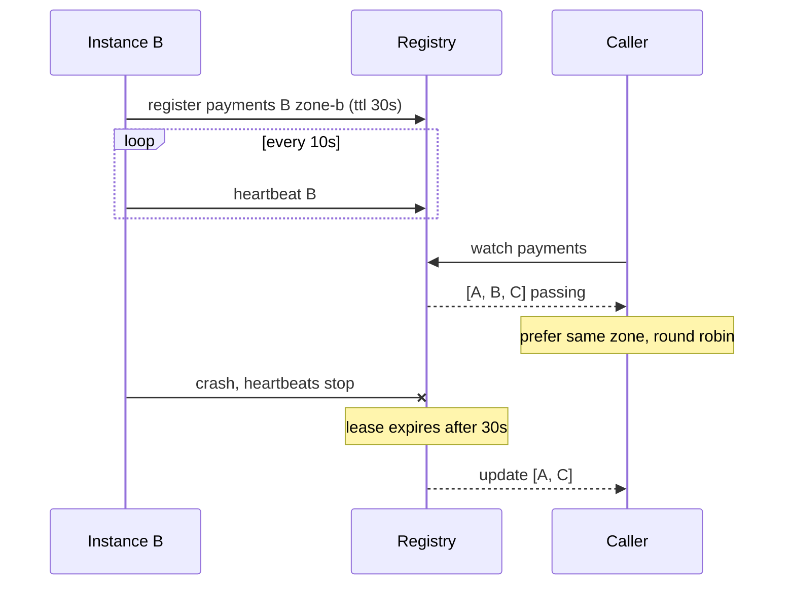

## In one minute
- Service discovery answers "where are the healthy instances of service X right now?" in a fleet where instances start, die and move every few minutes.
- It has three parts: registration (how instances get listed), health (how dead ones get removed), and lookup (how callers get the list and pick one).
- Lookup is either server-side (call a stable name or VIP and let a proxy pick) or client-side (fetch the instance list and balance in the caller).
- Registries keep instances alive with leases: an entry expires unless it is renewed, so a crashed instance disappears without saying goodbye.
- Every discovery system is eventually consistent. Callers always work from a slightly stale list, so they must cope with dead endpoints anyway.

## How it works

### Why a config file stops working
A config file of addresses works for three fixed servers. With autoscaling, rolling deploys and containers that get a new IP every restart, the list changes many times a day. This is the **finding things fast** problem shape combined with **partial failure**: the answer has to be fresh, cheap to read millions of times a second, and correct enough when some instances are half-dead. The same shape appears in a second domain: a ride-hailing app finding nearby available drivers is service discovery with geography, where drivers register, heartbeat their availability, and expire if the app goes silent.

### Registration
In **self-registration** the instance calls the registry on startup ("I am `payments`, at 10.2.3.4:8443, zone b") and renews periodically; Netflix's Eureka clients work this way. In **third-party registration** something else watches the platform and registers on the instance's behalf: in Kubernetes, the EndpointSlice controller lists every pod that matches a Service's selector and passes its readiness probe. Third-party registration cannot be forgotten by a buggy instance, but it only knows what the platform knows.

### Health and expiry
A registry needs to remove instances that crash without deregistering. The common tool is a **lease** with a TTL: the entry lives until `now + ttl` and each heartbeat pushes the expiry forward. Eureka clients renew every 30 seconds and the server evicts an instance after 90 seconds without a renewal ([Netflix Eureka wiki](https://github.com/Netflix/eureka/wiki/Understanding-eureka-client-server-communication)). Consul runs an agent on every node, which runs health checks locally (HTTP, TCP, script, or a TTL check the app must refresh) and reports a status of `passing`, `warning` or `critical`; liveness of the agents themselves is tracked with gossip. A health status lets an instance be listed but excluded from traffic, for example during warm-up or graceful shutdown.

### Lookup: server-side or client-side
**Server-side discovery**: the caller sends to a stable name or virtual IP, and something in the middle picks an instance, so callers stay simple. A Kubernetes ClusterIP Service works this way: kube-proxy programs iptables or nftables rules on every node that rewrite the VIP to a pod IP. If you learned this with IPVS mode, note that it has been deprecated since Kubernetes 1.35, will be off by default from 1.40 and removed in 1.43; iptables is still the default, and the docs say nftables will become the default in a future release ([Kubernetes docs](https://kubernetes.io/docs/reference/networking/virtual-ips/)). Cloud load balancers with target groups are the same idea.

**Client-side discovery**: the caller fetches the instance list and chooses itself, using its own balancing algorithm, retries and zone preference. gRPC's name resolvers, Eureka with a client-side balancer, and Envoy (fed by the xDS endpoint discovery service) work this way. Netflix put its original balancer, Ribbon, into maintenance mode ([Ribbon README](https://github.com/Netflix/ribbon)); Spring applications now use Spring Cloud LoadBalancer, which defaults to round robin ([Spring Cloud docs](https://docs.spring.io/spring-cloud-commons/reference/spring-cloud-commons/loadbalancer.html)). There is no extra hop, at the price of a discovery library in every language, or a sidecar next to every process, which is what a service mesh is.

DNS sits in between. `payments.prod.svc.cluster.local` in Kubernetes, or Consul's DNS interface, returns instance IPs; SRV records (RFC 2782) add port, priority and weight. DNS is universal, but caches and TTLs make it slow to react, and most clients just take the first address.

## Down the stack

### Layer 1: The contract
A registry promises that a registered instance stays listed until it deregisters, fails its health check, or misses renewals for one full TTL. It does not promise that a listed instance is alive; it promises that a dead one is removed within a bounded time: roughly TTL plus the caller's cache refresh interval. With Eureka's defaults that worst case is 90 seconds of lease, plus up to 30 seconds of server response cache, plus 30 seconds of client cache refresh: about two and a half minutes. Netflix's own docs warn that a change can take up to 2 minutes to reach all clients ([Netflix Eureka wiki](https://github.com/Netflix/eureka/wiki/Understanding-eureka-client-server-communication)). Lookups are eventually consistent and may differ between callers. Registries built on consensus (Consul servers on Raft, etcd behind Kubernetes) give a linearizable write path, while reads are often served from caches or followers for scale.

### Layer 2: The mechanism
etcd models leases directly: `LeaseGrant(TTL)` returns a lease ID, keys written with that lease are deleted when it expires, and `LeaseKeepAlive` is a long-lived gRPC stream that renews it. Watchers on a key prefix get a stream of put and delete events, so clients learn about changes without polling. Consul gives the same effect through blocking queries: the client sends `?index=N`, the server holds the request open (5 minutes by default, 10 at most, plus up to wait/16 of random jitter so clients do not all wake together) until the catalog's `X-Consul-Index` passes N, then returns the new list ([Consul docs](https://developer.hashicorp.com/consul/api-docs/features/blocking)). Eureka clients fetch deltas every 30 seconds. Kubernetes splits each Service's endpoints into EndpointSlice objects of up to 100 endpoints by default (configurable up to 1,000), so one pod change rewrites a small object instead of the whole list; each endpoint carries `ready`, `serving` and `terminating` conditions, and its zone ([Kubernetes docs](https://kubernetes.io/docs/concepts/services-networking/endpoint-slices/)). Envoy receives endpoints as `ClusterLoadAssignment` messages over EDS, grouped by locality with weights, which is how it prefers same-zone endpoints.

### Layer 3: The machine
Heartbeats are writes. 20,000 instances renewing every 10 seconds is 2,000 writes per second; on a Raft-backed store each write is an `fsync`ed log append replicated to a quorum, which is why Consul does health checking on local agents and only sends changes to the servers, and why etcd leases are renewed by one keep-alive stream rather than per-key writes. Fan-out is the larger cost. Before EndpointSlices, a Service with 5,000 pods had a single Endpoints object of about 1.5 MB, and every pod change sent it to every node's kube-proxy; on 3,000 nodes, that is about 4.5 GB per change. Caches at every layer trade freshness for this cost: OpenJDK caches successful DNS lookups for 30 seconds unless `networkaddress.cache.ttl` says otherwise ([OpenJDK source](https://github.com/openjdk/jdk/blob/master/src/java.base/share/classes/sun/net/InetAddressCachePolicy.java)), glibc does not cache at all without `nscd` or `systemd-resolved`, and each client library holds its own list. A long-lived HTTP/2 or gRPC connection also hides changes: the client keeps using the endpoint it connected to until the connection breaks or hits a max-age.

### Why it's built this way
1. Instances crash without notice, so entries must expire on their own, which means leases and heartbeats.
2. Heartbeats from a large fleet are a heavy write load, so health checking moves close to the instance (local agents, platform controllers) and only changes travel upward.
3. Lookups vastly outnumber changes, so callers cache lists and subscribe to changes instead of querying per request.
4. Caching makes every view stale, so callers must still handle dead endpoints with timeouts, retries and outlier ejection.
5. A registry outage would stop all traffic, so clients keep using their last known list when the registry is unreachable.

## Diagram


## Worked example
A company runs 400 services and 12,000 instances across three zones on Consul. Each instance has an HTTP health check every 10 seconds, run by the local agent, so the servers see only status changes: a few hundred per minute during deploys. Callers use blocking queries, so a change reaches them in well under a second. A `payments` instance that crashes outright is caught by gossip within a few seconds, because its node agent stops responding; one that hangs while its agent stays up is caught by the HTTP check after its 10-second interval and timeout, and removed from the next blocking query response.

Now compare a DNS-only design with a 60-second TTL. A deploy replaces all 30 `payments` instances over 5 minutes. Callers that cached the old addresses keep sending to drained instances for up to a minute after each replacement, and JVM callers that cache longer stay wrong even after that. With roughly 4,000 requests per second to `payments` and 1/30 of them going to a stale address at any moment during the deploy, that is over 100 failed requests per second unless callers retry. The fix is either client-side discovery with watches, or a stable VIP whose proxy tier updates in seconds.

Zone preference matters for cost and latency. If `checkout` sends 2 Gbps to `payments` spread evenly across three zones, two thirds of it, about 430 TB a month, crosses zones; at a typical $0.01 per GB in each direction that is roughly $8,600 a month that zone-aware routing mostly removes. Always fall back to other zones when the local one has no healthy instances.

## In the wild
- **Discord, 2020: one empty registry value crash-loops discovery.** On 16 March a new API node's announce request reached etcd's v2 API with headers but no body, and etcd stored an empty value. Elixir watchers crashed parsing it, their supervisors hit restart limits, and about half the nodes watching for API nodes went down across clusters. Most users could not use Discord for about an hour. The fixes: send each announce as a single packet, and skip corrupt entries instead of crashing ([Discord](https://discordstatus.com/incidents/62gt9cgjwdgf)).
- **Roblox, 2021: the registry was a single point of failure.** Roblox ran every backend service, and its own monitoring, against one Consul cluster. After a new Consul streaming feature was enabled, contention on a single Go channel blocked writes, and BoltDB freelist growth (a 4.2 GB log holding 489 MB of live data) made Raft slow. The platform was down for 73 hours. Roblox split critical services onto dedicated Consul clusters and removed the telemetry dependency on Consul ([Roblox](https://about.roblox.com/newsroom/2022/01/roblox-return-to-service-10-28-10-31-2021)).
- **Slack, 2022: deregistration empties a cache tier.** A Consul agent upgrade rolled out to 25% of the fleet. Restarting agents on memcached hosts removed those nodes from the catalog, and the control loop replaced them with empty caches. Cache misses triggered a query on every database shard, retries piled on, and the cache could not refill. Slack changed the rollout process and moved the query to a channel-sharded table ([Slack Engineering](https://slack.engineering/slacks-incident-on-2-22-22/)).

## Trade-offs
| Option | Strengths | Weaknesses | Choose when |
|---|---|---|---|
| Static config | Nothing to run | Wrong after every change | A handful of fixed hosts |
| DNS (A or SRV records) | Universal, every language supports it | TTL caching, slow reaction, weak balancing | Coarse discovery, legacy clients, across regions |
| Server-side (VIP or load balancer) | Simple callers, central policy | Extra hop, proxy tier to run | Polyglot callers, external clients |
| Client-side library | No extra hop, smart balancing and zone awareness | Library per language, harder upgrades | Uniform stack, latency-sensitive internal calls |
| Sidecar or mesh (xDS) | Client-side benefits without app changes | Proxy per pod, control plane to run | Many services in many languages |

## Pitfalls in production
- **Registry as a hard dependency.** If callers clear their list when the registry is unreachable, a registry outage takes everything down. Keep serving the last known list, and alert on its age.
- **Mass expiry from a network blip.** A partition between instances and the registry makes healthy instances miss renewals and all expire at once. Eureka's self-preservation mode stops evicting when more than 15% of the registry has missed renewals ([Netflix Eureka wiki](https://github.com/Netflix/eureka/wiki/Server-Self-Preservation-Mode)); Envoy's panic threshold plays the same role, sending to all hosts once fewer than 50% are healthy by default ([Envoy docs](https://www.envoyproxy.io/docs/envoy/latest/intro/arch_overview/upstream/load_balancing/panic_threshold)). Use a similar guard.
- **Registered before ready.** An instance registers on process start, before caches warm or connections open, and takes errors for 20 seconds. Register, or report passing, only after a readiness check succeeds.
- **No deregistration on shutdown.** Instances that stop without deregistering stay listed for a full TTL. Deregister first, wait for callers to refresh, then drain and exit.
- **Long-lived connections ignore updates.** gRPC clients keep using old endpoints and new instances get no traffic. Set a connection max-age, or use a balancer that rebalances on endpoint updates.
- **Zone-local routing without fallback.** Strict same-zone preference turns one zone's outage into a total outage for that zone's callers. Fall back to other zones when local health drops below a threshold. In Kubernetes, `trafficDistribution: PreferSameZone` does this for you, routing cluster-wide when the client's zone has no endpoints; the older value `PreferClose` is now a deprecated alias for it ([Kubernetes docs](https://kubernetes.io/docs/reference/networking/virtual-ips/)).

## Leadership lens
- Ask for the worst-case time from an instance dying to callers no longer sending to it, broken down into lease, check interval and cache layers. That number drives error budgets during deploys.
- Decide on one discovery mechanism per platform. Mixing DNS, a registry and a mesh means every incident starts by working out which one a caller used.
- Treat the registry as tier-zero infrastructure with its own SLO, capacity plan and failure drills, and test what happens when it is completely unavailable.

## Check yourself
1. Why do registries use leases instead of asking instances to deregister when they stop?
   **Answer:** Crashed, frozen or partitioned instances cannot deregister. A lease expires on its own unless renewed, so the registry converges without the instance's cooperation.
2. A caller uses DNS with a 30-second TTL, yet keeps hitting a removed instance for 10 minutes. Name two likely causes.
   **Answer:** A runtime or library caching DNS longer than the TTL, or a long-lived connection (HTTP/2, gRPC, a pool) opened before the change and never re-resolved.
3. What does Eureka's self-preservation mode protect against, and what does it cost?
   **Answer:** It stops mass eviction when many renewals go missing at once, which usually signals a network problem, not mass death. The cost is that genuinely dead instances stay listed until renewals recover, so callers must handle failures.
4. When is server-side discovery a better choice than client-side?
   **Answer:** When callers are written in many languages or are outside your control, or when you want policy changed centrally without client upgrades. You pay an extra hop and a proxy tier to operate.

## Practice
**Task:** Build a service registry with leases, health status and client-side lookup. `Registry(ttl, clock)` takes a lease length and a function returning the current time as an integer. `register(service, instance, zone)` adds or replaces an instance with status `"passing"` and expiry `clock() + ttl`. An instance is live while `clock() < expiry`. `heartbeat(service, instance)` renews a live instance and returns true; for an unknown or expired one it removes any entry and returns false (the instance must register again). `set_status(service, instance, status)` sets `"passing"`, `"warning"` or `"critical"` on a live instance and returns true, or false like `heartbeat`. `deregister(service, instance)` removes it. `healthy(service)` returns live instances whose status is not `"critical"`, sorted by name. `pick(service, zone)` takes the healthy instances in that zone, or all healthy instances if the zone has none, and returns them round robin using a counter kept per `(service, zone)`: the counter selects `pool[counter % len(pool)]` and then increments; with no healthy instances it returns nothing (None, null, or `ok == false`) and leaves the counter alone.

```python starter
class Registry:
    def __init__(self, ttl, clock):
        self.ttl = ttl
        self.clock = clock

    def register(self, service, instance, zone):
        # TODO
        raise NotImplementedError

    def heartbeat(self, service, instance):
        # TODO
        raise NotImplementedError

    def set_status(self, service, instance, status):
        # TODO
        raise NotImplementedError

    def deregister(self, service, instance):
        # TODO
        raise NotImplementedError

    def healthy(self, service):
        # TODO
        raise NotImplementedError

    def pick(self, service, zone):
        # TODO
        raise NotImplementedError
```

```python tests
class FakeClock:
    def __init__(self):
        self.t = 0
    def __call__(self):
        return self.t

def make():
    c = FakeClock()
    r = Registry(30, c)
    r.register("pay", "p1", "a")
    r.register("pay", "p2", "b")
    r.register("pay", "p3", "a")
    return r, c

def test_register_and_healthy_sorted():
    r, _ = make()
    assert r.healthy("pay") == ["p1", "p2", "p3"]
    assert r.healthy("other") == []

def test_lease_expires_without_heartbeat():
    r, c = make()
    c.t = 20
    assert r.heartbeat("pay", "p1")
    c.t = 30
    assert r.healthy("pay") == ["p1"], "p2 and p3 expired at 30"
    assert not r.heartbeat("pay", "p2"), "expired instance must re-register"
    r.register("pay", "p2", "b")
    assert r.healthy("pay") == ["p1", "p2"]

def test_status_excludes_critical_only():
    r, _ = make()
    assert r.set_status("pay", "p1", "warning")
    assert r.set_status("pay", "p3", "critical")
    assert r.healthy("pay") == ["p1", "p2"]
    assert not r.set_status("pay", "nope", "passing")

def test_pick_prefers_zone_round_robin():
    r, _ = make()
    assert [r.pick("pay", "a") for _ in range(3)] == ["p1", "p3", "p1"]
    assert r.pick("pay", "b") == "p2"

def test_pick_falls_back_to_all_zones():
    r, _ = make()
    r.deregister("pay", "p2")
    assert [r.pick("pay", "b") for _ in range(3)] == ["p1", "p3", "p1"]

def test_pick_none_when_nothing_healthy():
    r, c = make()
    c.t = 100
    assert r.pick("pay", "a") is None
    r.register("pay", "p9", "a")
    assert r.pick("pay", "a") == "p9"

def test_reregister_resets_status():
    r, _ = make()
    r.set_status("pay", "p2", "critical")
    r.register("pay", "p2", "b")
    assert r.healthy("pay") == ["p1", "p2", "p3"]
```

```python solution
class Registry:
    def __init__(self, ttl, clock):
        self.ttl = ttl
        self.clock = clock
        self.services = {}
        self.cursors = {}

    def register(self, service, instance, zone):
        self.services.setdefault(service, {})[instance] = {
            "zone": zone, "status": "passing", "expiry": self.clock() + self.ttl}

    def _live(self, service, instance):
        entry = self.services.get(service, {}).get(instance)
        if entry is None:
            return None
        if self.clock() >= entry["expiry"]:
            del self.services[service][instance]
            return None
        return entry

    def heartbeat(self, service, instance):
        entry = self._live(service, instance)
        if entry is None:
            return False
        entry["expiry"] = self.clock() + self.ttl
        return True

    def set_status(self, service, instance, status):
        entry = self._live(service, instance)
        if entry is None:
            return False
        entry["status"] = status
        return True

    def deregister(self, service, instance):
        self.services.get(service, {}).pop(instance, None)

    def _healthy_entries(self, service):
        out = []
        for name in sorted(self.services.get(service, {})):
            entry = self._live(service, name)
            if entry is not None and entry["status"] != "critical":
                out.append((name, entry))
        return out

    def healthy(self, service):
        return [name for name, _ in self._healthy_entries(service)]

    def pick(self, service, zone):
        entries = self._healthy_entries(service)
        local = [name for name, e in entries if e["zone"] == zone]
        pool = local or [name for name, _ in entries]
        if not pool:
            return None
        key = (service, zone)
        n = self.cursors.get(key, 0)
        self.cursors[key] = n + 1
        return pool[n % len(pool)]
```

```typescript starter
export class Registry {
  constructor(public ttl: number, public clock: () => number) {}
  register(service: string, instance: string, zone: string): void {
    throw new Error("TODO");
  }
  heartbeat(service: string, instance: string): boolean {
    throw new Error("TODO");
  }
  setStatus(service: string, instance: string, status: string): boolean {
    throw new Error("TODO");
  }
  deregister(service: string, instance: string): void {
    throw new Error("TODO");
  }
  healthy(service: string): string[] {
    throw new Error("TODO");
  }
  pick(service: string, zone: string): string | null {
    throw new Error("TODO");
  }
}
```

```typescript tests
function setup(): { r: Registry; now: { t: number } } {
  const now = { t: 0 };
  const r = new Registry(30, () => now.t);
  r.register("pay", "p1", "a");
  r.register("pay", "p2", "b");
  r.register("pay", "p3", "a");
  return { r, now };
}

test("register and healthy sorted", () => {
  const { r } = setup();
  assertEqual(r.healthy("pay"), ["p1", "p2", "p3"]);
  assertEqual(r.healthy("other"), []);
});
test("lease expires without heartbeat", () => {
  const { r, now } = setup();
  now.t = 20;
  assert(r.heartbeat("pay", "p1"));
  now.t = 30;
  assertEqual(r.healthy("pay"), ["p1"], "p2 and p3 expired at 30");
  assert(!r.heartbeat("pay", "p2"), "expired instance must re-register");
  r.register("pay", "p2", "b");
  assertEqual(r.healthy("pay"), ["p1", "p2"]);
});
test("status excludes critical only", () => {
  const { r } = setup();
  assert(r.setStatus("pay", "p1", "warning"));
  assert(r.setStatus("pay", "p3", "critical"));
  assertEqual(r.healthy("pay"), ["p1", "p2"]);
  assert(!r.setStatus("pay", "nope", "passing"));
});
test("pick prefers zone round robin", () => {
  const { r } = setup();
  assertEqual([r.pick("pay", "a"), r.pick("pay", "a"), r.pick("pay", "a")], ["p1", "p3", "p1"]);
  assertEqual(r.pick("pay", "b"), "p2");
});
test("pick falls back to all zones", () => {
  const { r } = setup();
  r.deregister("pay", "p2");
  assertEqual([r.pick("pay", "b"), r.pick("pay", "b"), r.pick("pay", "b")], ["p1", "p3", "p1"]);
});
test("pick null when nothing healthy", () => {
  const { r, now } = setup();
  now.t = 100;
  assertEqual(r.pick("pay", "a"), null);
  r.register("pay", "p9", "a");
  assertEqual(r.pick("pay", "a"), "p9");
});
test("reregister resets status", () => {
  const { r } = setup();
  r.setStatus("pay", "p2", "critical");
  r.register("pay", "p2", "b");
  assertEqual(r.healthy("pay"), ["p1", "p2", "p3"]);
});
```

```typescript solution
type Entry = { zone: string; status: string; expiry: number };

export class Registry {
  private services = new Map<string, Map<string, Entry>>();
  private cursors = new Map<string, number>();

  constructor(public ttl: number, public clock: () => number) {}

  register(service: string, instance: string, zone: string): void {
    if (!this.services.has(service)) this.services.set(service, new Map());
    this.services.get(service)!.set(instance, { zone, status: "passing", expiry: this.clock() + this.ttl });
  }

  private live(service: string, instance: string): Entry | null {
    const svc = this.services.get(service);
    const entry = svc?.get(instance);
    if (!svc || !entry) return null;
    if (this.clock() >= entry.expiry) {
      svc.delete(instance);
      return null;
    }
    return entry;
  }

  heartbeat(service: string, instance: string): boolean {
    const entry = this.live(service, instance);
    if (!entry) return false;
    entry.expiry = this.clock() + this.ttl;
    return true;
  }

  setStatus(service: string, instance: string, status: string): boolean {
    const entry = this.live(service, instance);
    if (!entry) return false;
    entry.status = status;
    return true;
  }

  deregister(service: string, instance: string): void {
    this.services.get(service)?.delete(instance);
  }

  private healthyEntries(service: string): [string, Entry][] {
    const names = Array.from(this.services.get(service)?.keys() ?? []).sort();
    const out: [string, Entry][] = [];
    for (const name of names) {
      const entry = this.live(service, name);
      if (entry && entry.status !== "critical") out.push([name, entry]);
    }
    return out;
  }

  healthy(service: string): string[] {
    return this.healthyEntries(service).map(([name]) => name);
  }

  pick(service: string, zone: string): string | null {
    const entries = this.healthyEntries(service);
    const local = entries.filter(([, e]) => e.zone === zone).map(([name]) => name);
    const pool = local.length > 0 ? local : entries.map(([name]) => name);
    if (pool.length === 0) return null;
    const key = service + "\u0000" + zone;
    const n = this.cursors.get(key) ?? 0;
    this.cursors.set(key, n + 1);
    return pool[n % pool.length];
  }
}
```

```go starter
package practice

type Registry struct {
	ttl   int
	clock func() int
}

func NewRegistry(ttl int, clock func() int) *Registry { return &Registry{ttl: ttl, clock: clock} }

func (r *Registry) Register(service, instance, zone string)              { panic("TODO") }
func (r *Registry) Heartbeat(service, instance string) bool              { panic("TODO") }
func (r *Registry) SetStatus(service, instance, status string) bool      { panic("TODO") }
func (r *Registry) Deregister(service, instance string)                  { panic("TODO") }
func (r *Registry) Healthy(service string) []string                      { panic("TODO") }
func (r *Registry) Pick(service, zone string) (string, bool)             { panic("TODO") }
```

```go tests
package practice

import (
	"reflect"
	"testing"
)

func setup() (*Registry, *int) {
	now := 0
	r := NewRegistry(30, func() int { return now })
	r.Register("pay", "p1", "a")
	r.Register("pay", "p2", "b")
	r.Register("pay", "p3", "a")
	return r, &now
}

func names(t *testing.T, got, want []string) {
	t.Helper()
	if len(got) == 0 && len(want) == 0 {
		return
	}
	if !reflect.DeepEqual(got, want) {
		t.Fatalf("got %v, want %v", got, want)
	}
}

func picks(r *Registry, zone string, n int) []string {
	out := []string{}
	for i := 0; i < n; i++ {
		name, ok := r.Pick("pay", zone)
		if !ok {
			name = "<none>"
		}
		out = append(out, name)
	}
	return out
}

func TestRegisterAndHealthySorted(t *testing.T) {
	r, _ := setup()
	names(t, r.Healthy("pay"), []string{"p1", "p2", "p3"})
	names(t, r.Healthy("other"), nil)
}

func TestLeaseExpiresWithoutHeartbeat(t *testing.T) {
	r, now := setup()
	*now = 20
	if !r.Heartbeat("pay", "p1") {
		t.Fatal("p1 is live")
	}
	*now = 30
	names(t, r.Healthy("pay"), []string{"p1"})
	if r.Heartbeat("pay", "p2") {
		t.Fatal("expired instance must re-register")
	}
	r.Register("pay", "p2", "b")
	names(t, r.Healthy("pay"), []string{"p1", "p2"})
}

func TestStatusExcludesCriticalOnly(t *testing.T) {
	r, _ := setup()
	if !r.SetStatus("pay", "p1", "warning") || !r.SetStatus("pay", "p3", "critical") {
		t.Fatal("set status on live instances")
	}
	names(t, r.Healthy("pay"), []string{"p1", "p2"})
	if r.SetStatus("pay", "nope", "passing") {
		t.Fatal("unknown instance")
	}
}

func TestPickPrefersZoneRoundRobin(t *testing.T) {
	r, _ := setup()
	names(t, picks(r, "a", 3), []string{"p1", "p3", "p1"})
	names(t, picks(r, "b", 1), []string{"p2"})
}

func TestPickFallsBackToAllZones(t *testing.T) {
	r, _ := setup()
	r.Deregister("pay", "p2")
	names(t, picks(r, "b", 3), []string{"p1", "p3", "p1"})
}

func TestPickNoneWhenNothingHealthy(t *testing.T) {
	r, now := setup()
	*now = 100
	names(t, picks(r, "a", 1), []string{"<none>"})
	r.Register("pay", "p9", "a")
	names(t, picks(r, "a", 1), []string{"p9"})
}

func TestReregisterResetsStatus(t *testing.T) {
	r, _ := setup()
	r.SetStatus("pay", "p2", "critical")
	r.Register("pay", "p2", "b")
	names(t, r.Healthy("pay"), []string{"p1", "p2", "p3"})
}
```

```go solution
package practice

import (
	"sort"
	"sync"
)

type entry struct {
	zone   string
	status string
	expiry int
}

type Registry struct {
	mu       sync.Mutex
	ttl      int
	clock    func() int
	services map[string]map[string]*entry
	cursors  map[[2]string]int
}

func NewRegistry(ttl int, clock func() int) *Registry {
	return &Registry{ttl: ttl, clock: clock,
		services: map[string]map[string]*entry{}, cursors: map[[2]string]int{}}
}

func (r *Registry) Register(service, instance, zone string) {
	r.mu.Lock()
	defer r.mu.Unlock()
	if r.services[service] == nil {
		r.services[service] = map[string]*entry{}
	}
	r.services[service][instance] = &entry{zone, "passing", r.clock() + r.ttl}
}

func (r *Registry) live(service, instance string) *entry {
	e, ok := r.services[service][instance]
	if !ok {
		return nil
	}
	if r.clock() >= e.expiry {
		delete(r.services[service], instance)
		return nil
	}
	return e
}

func (r *Registry) Heartbeat(service, instance string) bool {
	r.mu.Lock()
	defer r.mu.Unlock()
	e := r.live(service, instance)
	if e == nil {
		return false
	}
	e.expiry = r.clock() + r.ttl
	return true
}

func (r *Registry) SetStatus(service, instance, status string) bool {
	r.mu.Lock()
	defer r.mu.Unlock()
	e := r.live(service, instance)
	if e == nil {
		return false
	}
	e.status = status
	return true
}

func (r *Registry) Deregister(service, instance string) {
	r.mu.Lock()
	defer r.mu.Unlock()
	delete(r.services[service], instance)
}

func (r *Registry) healthyLocked(service string) ([]string, []string) {
	all := []string{}
	for name := range r.services[service] {
		all = append(all, name)
	}
	sort.Strings(all)
	names, zones := []string{}, []string{}
	for _, name := range all {
		if e := r.live(service, name); e != nil && e.status != "critical" {
			names = append(names, name)
			zones = append(zones, e.zone)
		}
	}
	return names, zones
}

func (r *Registry) Healthy(service string) []string {
	r.mu.Lock()
	defer r.mu.Unlock()
	names, _ := r.healthyLocked(service)
	return names
}

func (r *Registry) Pick(service, zone string) (string, bool) {
	r.mu.Lock()
	defer r.mu.Unlock()
	names, zones := r.healthyLocked(service)
	local := []string{}
	for i, name := range names {
		if zones[i] == zone {
			local = append(local, name)
		}
	}
	pool := local
	if len(pool) == 0 {
		pool = names
	}
	if len(pool) == 0 {
		return "", false
	}
	key := [2]string{service, zone}
	n := r.cursors[key]
	r.cursors[key] = n + 1
	return pool[n%len(pool)], true
}
```

## Mock interview
**Prompt:** Design service discovery for 300 microservices with 15,000 instances across three availability zones and two regions, written in Java, Go and Python. Deploys happen hundreds of times a day, and the goal is fewer than 0.01% failed requests during deploys.

- Follow-up: Walk through the timeline from an instance being killed to the last caller stopping sending to it. Where do the seconds go?
- Follow-up: The registry cluster loses quorum for ten minutes. What do callers do?
- Follow-up: Would you use DNS, a client library, or a mesh sidecar here, and what would change your mind?

**A strong answer covers:**
- Third-party or platform registration tied to readiness, with deregistration and draining before shutdown.
- Leases with explicit TTLs and health checks run close to the instance, and a worst-case staleness budget broken down by layer.
- Push-based updates (watches, blocking queries or xDS) instead of polling, with a fallback to the last known list when the registry is down.
- Zone-aware balancing with fallback, plus outlier ejection and retries in callers to absorb stale entries.
- Protection against mass expiry (self-preservation or panic thresholds) and a registry run as tier-zero infrastructure.

## Sources and further study
**Primary**
- [RFC 2782: A DNS RR for specifying the location of services (DNS SRV)](https://www.rfc-editor.org/rfc/rfc2782): port, priority and weight in DNS-based discovery.
- [Netflix Eureka wiki: Server self-preservation mode](https://github.com/Netflix/eureka/wiki/Server-Self-Preservation-Mode): when and why the registry stops evicting.

**Systems docs**
- [Kubernetes: EndpointSlices](https://kubernetes.io/docs/concepts/services-networking/endpoint-slices/): slice size limits and the ready, serving and terminating conditions.
- [Kubernetes: Virtual IPs and service proxies](https://kubernetes.io/docs/reference/networking/virtual-ips/): kube-proxy modes, the IPVS deprecation and `trafficDistribution`.
- [Envoy: panic threshold](https://www.envoyproxy.io/docs/envoy/latest/intro/arch_overview/upstream/load_balancing/panic_threshold): what a client-side balancer does when most endpoints look unhealthy.

**Books**
- *Release It!* (2nd ed.), Michael T. Nygard, Ch 9 "Interconnect" (DNS, load balancing) and Ch 10 "Control Plane".
- *Understanding Distributed Systems* (2nd ed.), Roberto Vitillo, chapter "Discovery" (DNS resolution and its caching).

**Other curricula**
- [donnemartin/system-design-primer: Service discovery](https://github.com/donnemartin/system-design-primer#service-discovery): one paragraph naming Consul, etcd and ZooKeeper with HTTP health checks; nothing on leases, caching or staleness.
- [roadmap.sh: System Design](https://roadmap.sh/system-design): a one-paragraph Service Discovery node that links back to the primer.

## Watch
- [Introduction to HashiCorp Consul with Armon Dadgar (HashiCorp)](https://www.youtube.com/watch?v=mxeMdl0KvBI): whiteboard walkthrough of why static addresses fail and how a registry with health checks replaces them.

## Free resources
- [Pattern: Client-side service discovery (microservices.io)](https://microservices.io/patterns/client-side-discovery.html): the client-side model with its benefits and drawbacks.
- [Pattern: Server-side service discovery (microservices.io)](https://microservices.io/patterns/server-side-discovery.html): the router-based alternative.
- [Understanding Eureka client-server communication (Netflix)](https://github.com/Netflix/eureka/wiki/Understanding-eureka-client-server-communication): registration, 30-second renewals, 90-second eviction and client caching.
- [Consul blocking queries (HashiCorp)](https://developer.hashicorp.com/consul/api-docs/features/blocking): how clients long-poll the catalog for changes using an index.
- [Scaling Kubernetes Networking With EndpointSlices (Kubernetes blog)](https://kubernetes.io/blog/2020/09/02/scaling-kubernetes-networking-with-endpointslices/): why one big endpoint list broke at scale, with the numbers.
- [etcd API: leases and watches](https://etcd.io/docs/v3.5/learning/api/): the lease and watch primitives many registries are built on.
