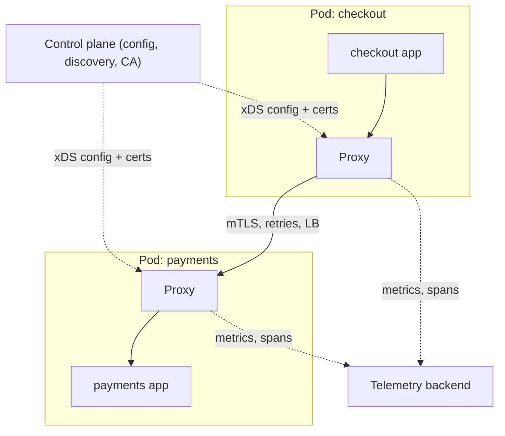

## In one minute
- A service mesh is an infrastructure layer that handles service-to-service communication: mutual TLS, load balancing, retries, timeouts, traffic shifting, and telemetry, without changes to application code.
- It has a **data plane** of proxies (sidecars next to each workload, or shared node-level proxies) that carry the traffic, and a **control plane** that pushes configuration, certificates, and service discovery to those proxies.
- It gives uniform security and observability across a polyglot fleet and lets platform teams change traffic policy centrally.
- It costs CPU, memory, latency per hop, and significant operational complexity. A mesh is a platform product, not a library you add on a Friday.

## How it works

### Data plane
In the classic sidecar model, every pod gets a proxy (commonly Envoy, or Linkerd's Rust proxy). Iptables rules redirect the pod's inbound and outbound traffic through it. When service A calls service B, A's proxy resolves B's healthy endpoints, picks one with a load-balancing algorithm (round robin, least requests, or a peak-EWMA latency-aware choice), opens an mTLS connection to B's proxy, applies timeouts and retries, and records metrics and trace spans. B's proxy terminates mTLS, checks authorisation policy, and forwards to B over localhost.

Newer **sidecarless** designs (Istio ambient mode, eBPF-based meshes) move layer 4 work (mTLS, basic telemetry) into a per-node component and run layer 7 proxies only where needed, cutting per-pod overhead. In Istio's ambient mode, generally available since 1.24 in November 2024 ([Istio](https://istio.io/latest/blog/2024/ambient-reaches-ga/)), a Rust per-node proxy called ztunnel handles mTLS and L4 policy and tunnels traffic over HBONE, an HTTP CONNECT-based protocol; optional per-namespace Envoy "waypoint" proxies add L7 routing and policy ([Istio docs](https://istio.io/latest/docs/ambient/overview/)). Istio's benchmark at 1,000 requests per second measures ztunnel at about 0.06 vCPU and 12 MB against 0.20 vCPU and 60 MB for a sidecar Envoy ([Istio performance](https://istio.io/latest/docs/ops/deployment/performance-and-scalability/)).

### Control plane
The control plane watches the cluster for services and endpoints, compiles routing and policy into proxy configuration, and streams it to every proxy (Envoy's xDS APIs). It also runs a certificate authority that issues short-lived workload certificates, often valid for hours, tied to a workload identity such as a Kubernetes service account. The identity is written as a SPIFFE ID, a URI of the form `spiffe://<trust domain>/<workload path>` ([SPIFFE](https://spiffe.io/docs/latest/spiffe-about/spiffe-concepts/)). Proxies rotate certificates automatically, which is what makes mesh-wide mTLS practical.

### What you get
- **Security.** Encrypted, mutually authenticated traffic by default, plus identity-based authorisation ("only `checkout` may call `payments` on `POST /charge`").
- **Reliability controls.** Timeouts, retries with budgets, circuit breaking, and outlier detection that ejects misbehaving endpoints.
- **Traffic management.** Weighted routing for canaries, header-based routing for testing, mirroring for shadow traffic, and fault injection for chaos tests.
- **Observability.** Golden metrics (rate, errors, latency) per service pair, and trace spans, without instrumenting each service.

### What it does not do
The mesh cannot make a non-idempotent call safe to retry, cannot propagate trace context unless the application forwards the headers, and does not replace application-level authorisation on data.

## Down the stack

### Layer 1: The contract
The mesh promises that traffic between workloads is encrypted and mutually authenticated with an identity tied to the workload, not its IP; that authorisation policy is enforced on every request; that configuration changes reach all proxies eventually; and that if the control plane is unavailable, proxies keep serving with their last accepted configuration and certificates until those expire. Envoy's xDS protocol states this directly: the last known configuration persists until the connection to the management server is re-established ([Envoy xDS protocol](https://www.envoyproxy.io/docs/envoy/latest/api-docs/xds_protocol)).

### Layer 2: The mechanism
Envoy-based meshes use the xDS APIs over long-lived gRPC streams: LDS for listeners, RDS for routes, CDS for clusters, EDS for endpoints, and SDS for secrets, often multiplexed on one ADS stream. Each response carries a `version_info` and `nonce`; the proxy ACKs by echoing the new version, or NACKs by sending back the previous version plus an `error_detail`, so a bad config is rejected without replacing the good one. Workload identity follows SPIFFE: the control plane's CA signs a short-lived X.509 certificate whose URI SAN is a SPIFFE ID like `spiffe://cluster.local/ns/payments/sa/payments-api`, delivered over SDS by the local Istio agent and rotated before expiry (the agent requests 24-hour certificates by default, `SECRET_TTL=24h`; [Istio docs](https://istio.io/latest/docs/reference/commands/pilot-agent/)). Authorisation policies match on that peer identity plus method and path.

### Layer 3: The machine
A TLS 1.3 handshake costs one round trip and, on each side, an ECDHE key exchange and an ECDSA signature or verification, tens to low hundreds of microseconds of CPU. Bulk encryption with AES-GCM runs at several GB per second per core on CPUs with AES-NI, so encrypting the data itself is cheap; handshakes are the expensive part, and pooled connections between proxies amortise them. Proxy memory scales with the config it holds, roughly clusters times endpoints, so a full mesh view of thousands of endpoints in every proxy wastes gigabytes fleet-wide unless scoped. Each endpoint change triggers EDS pushes to every interested proxy; a rolling deploy of a large service can generate thousands of pushes per second, so control planes debounce and batch.

### Why it's built this way
1. Pod IPs change constantly, so identity is bound to a service account through certificates rather than to addresses.
2. Long-lived keys are dangerous if leaked, so certificates are short-lived and rotated automatically, which requires automation.
3. Thousands of proxies need consistent config without restarts, so it is streamed with versions and ACK or NACK.
4. Handshakes are costly while bulk encryption is cheap, so proxies keep connections open and reuse them.

## Diagram


## Worked example
A fintech runs 220 services on Kubernetes across 2,500 pods, in Go, Java, and Python. Auditors require encryption in transit and proof of which services can reach the card vault. Today, each language has its own TLS setup, and retry behaviour differs by team.

They adopt a sidecar mesh. Measured overhead per proxy: about 40 MB memory and 0.1 vCPU at their median load, so roughly 100 GB of memory and 250 vCPU fleet-wide, about 7% of cluster cost. Each hop adds two proxy traversals: 0.6 ms at p50 and 2.5 ms at p99. A checkout request crossing 6 services gains about 4 ms at p50.

In return, mTLS reaches 100% of traffic within two months, authorisation policy restricts the card vault to 3 caller identities, and every service pair has latency and error dashboards. A canary of a new pricing service at 5% weighted traffic catches a 2% error regression, rolled back by changing one routing resource.

Two incidents follow. A control plane upgrade pushes a malformed config that breaks routing for 6 minutes, so they add config validation and a staged rollout per namespace. And a mesh-level retry policy of 3 attempts amplifies load on a struggling service; they switch to retry budgets capping retries at 20% of requests.

## In the wild
- **Monzo, 2017: the mesh proxies take the bank down.** Monzo routed calls between several hundred microservices through Linkerd, which learned endpoints from the Kubernetes API. A Kubernetes and etcd client bug, set up by an etcd resize two weeks earlier, made Linkerd miss updates, so a payments deploy at 14:10 on 27 October started failing. Engineers restarted all several hundred Linkerd instances, which exposed a second bug: the Linkerd version in use threw a `NullPointerException` on a Kubernetes service with no endpoints, left over from a scale-down the day before. By 15:13 the whole platform was down; deleting the empty service at 15:31 restored traffic. Monzo listed the restart-everything decision as a mistake and upgraded Linkerd ([Monzo](https://community.monzo.com/t/resolved-current-account-payments-may-fail-major-outage-27-10-2017/26296/95)).
- **Spotify, 2022: a managed xDS control plane fails, and clients fail with it.** Most Spotify services used DNS-based discovery, but some used Google Cloud's Traffic Director, an xDS control plane. On 8 March Traffic Director had an outage, which, combined with a bug in the gRPC client library (grpc-java issue 8950), broke discovery for the services that depended on it. Logged-out users worldwide could not log back in for about 2 h 23 min, until Spotify moved those services back to DNS discovery ([Spotify](https://engineering.atspotify.com/2022/03/incident-report-spotify-outage-on-march-8/)).

## Trade-offs
| Option | Strengths | Weaknesses | Choose when |
|---|---|---|---|
| Libraries in each service | Lowest latency, no extra infrastructure | Per-language implementations, upgrades need redeploys | Few languages, small number of services |
| Sidecar mesh | Uniform policy and telemetry, per-workload control | Per-pod resource cost, extra hops, operational complexity | Large polyglot fleets with security requirements |
| Sidecarless or ambient mesh | Lower overhead, simpler pod lifecycle, GA in Istio since 1.24 | L7 features need separately run waypoint proxies; shared per-node L4 proxy | Large fleets where sidecar cost dominates |
| No mesh, gateway only | Simple, controls only north-south traffic | No east-west security or visibility | Small systems or a monolith with few services |

## Pitfalls in production
- **Control plane as a single point of failure.** A bad push breaks routing everywhere. Validate configs, roll out per namespace, and confirm proxies keep their last good config if the control plane is down.
- **Retry amplification.** Mesh retries stack with application retries. Use retry budgets and pick one layer to own retries. Envoy's retry budget defaults to 20% of active requests, with a floor of 3 concurrent retries ([Envoy docs](https://www.envoyproxy.io/docs/envoy/latest/api-v3/config/cluster/v3/circuit_breaker.proto)).
- **Mystery 503s.** Proxy-generated errors are confused with application errors. Log proxy response flags and teach teams to read them.
- **Certificate expiry and clock skew.** Short-lived certs fail when rotation breaks or clocks drift. Alert on certificate age and rotation errors.
- **Adopting everything at once.** Enabling every feature on every namespace causes a pile of hard-to-attribute incidents. Start with mTLS and telemetry, then add traffic policy gradually.

## Leadership lens
- Ask which concrete problem the mesh solves: mTLS mandate, polyglot reliability, or observability. If only one, a lighter tool may suffice.
- Staff it like a product: a platform team, upgrade cadence, runbooks, and on-call.
- Check the supply chain, not just the features. AWS ended support for App Mesh on 30 September 2026, removing console and resource access ([AWS docs](https://docs.aws.amazon.com/app-mesh/latest/userguide/what-is-app-mesh.html)), and since February 2024 the Linkerd open source project ships only edge releases, leaving stable builds to vendors ([Linkerd](https://linkerd.io/releases/)). Ask who provides patched, stable releases for the next five years.
- Quantify the resource and latency tax and get agreement before rollout.
- Define ownership boundaries: the platform team owns mesh defaults; service teams own their routes and policies through reviewed config.

## Check yourself
1. What is the difference between the data plane and the control plane?
   **Answer:** The data plane is the proxies that carry and act on every request; the control plane computes configuration, discovery, and certificates and distributes them to the proxies, without sitting on the request path.
2. Why can a mesh not fully implement distributed tracing on its own?
   **Answer:** Proxies see separate inbound and outbound requests and cannot link them unless the application copies trace headers from the incoming request to its outgoing calls.
3. Why is mesh-level retry configuration risky?
   **Answer:** Retries at the mesh multiply with application and client retries, so a struggling service can receive several times its normal load. Retry budgets and a single owning layer prevent this.

## Practice
**Task:** Implement a mesh proxy's load balancer with outlier detection. `Balancer(endpoints, consecutive_errors, eject_ms, max_eject_fraction)` has `pick(now)`, which returns endpoints in round-robin order (cycling through the original list) while skipping ejected ones, and `report(endpoint, ok, now)`. After `consecutive_errors` failures in a row, an endpoint is ejected until `now + eject_ms`, unless that would make the number of ejected endpoints exceed `max_eject_fraction * len(endpoints)`. A success resets the endpoint's failure count, and so does an ejection. If every endpoint is ejected, `pick` ignores ejection (panic mode) so traffic still flows.

```python starter
class Balancer:
    def __init__(self, endpoints, consecutive_errors, eject_ms, max_eject_fraction):
        # TODO
        raise NotImplementedError

    def pick(self, now):
        raise NotImplementedError

    def report(self, endpoint, ok, now):
        raise NotImplementedError
```

```python tests
def fail(b, ep, n, now=0):
    for _ in range(n):
        b.report(ep, False, now)

def test_round_robin():
    b = Balancer(["a", "b", "c"], 3, 1000, 0.5)
    assert [b.pick(0) for _ in range(4)] == ["a", "b", "c", "a"]

def test_ejects_after_consecutive_errors():
    b = Balancer(["a", "b", "c"], 3, 1000, 0.5)
    fail(b, "b", 3)
    assert [b.pick(10) for _ in range(4)] == ["a", "c", "a", "c"]

def test_ejection_expires():
    b = Balancer(["a", "b"], 2, 1000, 0.5)
    fail(b, "a", 2, now=0)
    assert b.pick(999) == "b"
    assert sorted([b.pick(1000), b.pick(1000)]) == ["a", "b"]

def test_success_resets_count():
    b = Balancer(["a", "b"], 3, 1000, 0.5)
    fail(b, "a", 2)
    b.report("a", True, 0)
    fail(b, "a", 2)
    assert [b.pick(0) for _ in range(2)] == ["a", "b"]

def test_max_eject_fraction():
    b = Balancer(["a", "b", "c"], 1, 1000, 0.34)
    fail(b, "a", 1)
    fail(b, "b", 1)
    assert sorted(set(b.pick(0) for _ in range(6))) == ["b", "c"]

def test_panic_mode_when_all_ejected():
    b = Balancer(["a", "b"], 1, 1000, 1.0)
    fail(b, "a", 1)
    fail(b, "b", 1)
    assert [b.pick(0) for _ in range(2)] == ["a", "b"]
```

```python solution
class Balancer:
    def __init__(self, endpoints, consecutive_errors, eject_ms, max_eject_fraction):
        self.eps = list(endpoints)
        self.limit = consecutive_errors
        self.eject_ms = eject_ms
        self.max_fraction = max_eject_fraction
        self.fails = {e: 0 for e in self.eps}
        self.until = {e: 0 for e in self.eps}
        self.i = 0

    def _ejected(self, e, now):
        return now < self.until[e]

    def pick(self, now):
        healthy = [e for e in self.eps if not self._ejected(e, now)]
        if not healthy:
            healthy = self.eps
        while True:
            e = self.eps[self.i % len(self.eps)]
            self.i += 1
            if e in healthy:
                return e

    def report(self, endpoint, ok, now):
        if ok:
            self.fails[endpoint] = 0
            return
        self.fails[endpoint] += 1
        if self.fails[endpoint] >= self.limit:
            ejected = sum(1 for e in self.eps if self._ejected(e, now))
            if ejected + 1 <= self.max_fraction * len(self.eps):
                self.until[endpoint] = now + self.eject_ms
                self.fails[endpoint] = 0
```

```typescript starter
export class Balancer {
  constructor(endpoints: string[], consecutiveErrors: number, ejectMs: number, maxEjectFraction: number) {}
  pick(now: number): string {
    throw new Error("TODO");
  }
  report(endpoint: string, ok: boolean, now: number): void {
    throw new Error("TODO");
  }
}
```

```typescript tests
function fail(b: Balancer, ep: string, n: number, now = 0): void {
  for (let i = 0; i < n; i++) b.report(ep, false, now);
}
function picks(b: Balancer, n: number, now: number): string[] {
  return Array.from({ length: n }, () => b.pick(now));
}
test("round robin", () => {
  assertEqual(picks(new Balancer(["a", "b", "c"], 3, 1000, 0.5), 4, 0), ["a", "b", "c", "a"]);
});
test("ejects after consecutive errors", () => {
  const b = new Balancer(["a", "b", "c"], 3, 1000, 0.5);
  fail(b, "b", 3);
  assertEqual(picks(b, 4, 10), ["a", "c", "a", "c"]);
});
test("ejection expires", () => {
  const b = new Balancer(["a", "b"], 2, 1000, 0.5);
  fail(b, "a", 2, 0);
  assertEqual(b.pick(999), "b");
  assertEqual(picks(b, 2, 1000).sort(), ["a", "b"]);
});
test("success resets count", () => {
  const b = new Balancer(["a", "b"], 3, 1000, 0.5);
  fail(b, "a", 2);
  b.report("a", true, 0);
  fail(b, "a", 2);
  assertEqual(picks(b, 2, 0), ["a", "b"]);
});
test("max eject fraction", () => {
  const b = new Balancer(["a", "b", "c"], 1, 1000, 0.34);
  fail(b, "a", 1);
  fail(b, "b", 1);
  assertEqual([...new Set(picks(b, 6, 0))].sort(), ["b", "c"]);
});
test("panic mode", () => {
  const b = new Balancer(["a", "b"], 1, 1000, 1.0);
  fail(b, "a", 1);
  fail(b, "b", 1);
  assertEqual(picks(b, 2, 0), ["a", "b"]);
});
```

```typescript solution
export class Balancer {
  private fails = new Map<string, number>();
  private until = new Map<string, number>();
  private i = 0;
  constructor(private eps: string[], private limit: number, private ejectMs: number,
              private maxFraction: number) {
    for (const e of eps) { this.fails.set(e, 0); this.until.set(e, 0); }
  }
  private ejected(e: string, now: number): boolean {
    return now < this.until.get(e)!;
  }
  pick(now: number): string {
    let healthy = this.eps.filter((e) => !this.ejected(e, now));
    if (healthy.length === 0) healthy = this.eps;
    for (;;) {
      const e = this.eps[this.i % this.eps.length];
      this.i++;
      if (healthy.includes(e)) return e;
    }
  }
  report(endpoint: string, ok: boolean, now: number): void {
    if (ok) { this.fails.set(endpoint, 0); return; }
    const f = this.fails.get(endpoint)! + 1;
    this.fails.set(endpoint, f);
    if (f >= this.limit) {
      const ejected = this.eps.filter((e) => this.ejected(e, now)).length;
      if (ejected + 1 <= this.maxFraction * this.eps.length) {
        this.until.set(endpoint, now + this.ejectMs);
        this.fails.set(endpoint, 0);
      }
    }
  }
}
```

```go starter
package practice

type Balancer struct{}

func NewBalancer(endpoints []string, consecutiveErrors int, ejectMs int64, maxEjectFraction float64) *Balancer {
	return &Balancer{}
}

func (b *Balancer) Pick(now int64) string { panic("TODO") }

func (b *Balancer) Report(endpoint string, ok bool, now int64) { panic("TODO") }
```

```go tests
package practice

import (
	"reflect"
	"sort"
	"testing"
)

func failN(b *Balancer, ep string, n int, now int64) {
	for i := 0; i < n; i++ {
		b.Report(ep, false, now)
	}
}

func picks(b *Balancer, n int, now int64) []string {
	var out []string
	for i := 0; i < n; i++ {
		out = append(out, b.Pick(now))
	}
	return out
}

func TestRoundRobin(t *testing.T) {
	got := picks(NewBalancer([]string{"a", "b", "c"}, 3, 1000, 0.5), 4, 0)
	if !reflect.DeepEqual(got, []string{"a", "b", "c", "a"}) {
		t.Fatal(got)
	}
}

func TestEjects(t *testing.T) {
	b := NewBalancer([]string{"a", "b", "c"}, 3, 1000, 0.5)
	failN(b, "b", 3, 0)
	if got := picks(b, 4, 10); !reflect.DeepEqual(got, []string{"a", "c", "a", "c"}) {
		t.Fatal(got)
	}
}

func TestEjectionExpires(t *testing.T) {
	b := NewBalancer([]string{"a", "b"}, 2, 1000, 0.5)
	failN(b, "a", 2, 0)
	if b.Pick(999) != "b" {
		t.Fatal("a should be ejected")
	}
	got := picks(b, 2, 1000)
	sort.Strings(got)
	if !reflect.DeepEqual(got, []string{"a", "b"}) {
		t.Fatal(got)
	}
}

func TestSuccessResets(t *testing.T) {
	b := NewBalancer([]string{"a", "b"}, 3, 1000, 0.5)
	failN(b, "a", 2, 0)
	b.Report("a", true, 0)
	failN(b, "a", 2, 0)
	if got := picks(b, 2, 0); !reflect.DeepEqual(got, []string{"a", "b"}) {
		t.Fatal(got)
	}
}

func TestMaxFraction(t *testing.T) {
	b := NewBalancer([]string{"a", "b", "c"}, 1, 1000, 0.34)
	failN(b, "a", 1, 0)
	failN(b, "b", 1, 0)
	seen := map[string]bool{}
	for _, p := range picks(b, 6, 0) {
		seen[p] = true
	}
	if seen["a"] || !seen["b"] || !seen["c"] {
		t.Fatal(seen)
	}
}

func TestPanicMode(t *testing.T) {
	b := NewBalancer([]string{"a", "b"}, 1, 1000, 1.0)
	failN(b, "a", 1, 0)
	failN(b, "b", 1, 0)
	if got := picks(b, 2, 0); !reflect.DeepEqual(got, []string{"a", "b"}) {
		t.Fatal(got)
	}
}
```

```go solution
package practice

type Balancer struct {
	eps         []string
	limit       int
	ejectMs     int64
	maxFraction float64
	fails       map[string]int
	until       map[string]int64
	i           int
}

func NewBalancer(endpoints []string, consecutiveErrors int, ejectMs int64, maxEjectFraction float64) *Balancer {
	return &Balancer{eps: endpoints, limit: consecutiveErrors, ejectMs: ejectMs,
		maxFraction: maxEjectFraction, fails: map[string]int{}, until: map[string]int64{}}
}

func (b *Balancer) ejected(e string, now int64) bool { return now < b.until[e] }

func (b *Balancer) Pick(now int64) string {
	anyHealthy := false
	for _, e := range b.eps {
		if !b.ejected(e, now) {
			anyHealthy = true
		}
	}
	for {
		e := b.eps[b.i%len(b.eps)]
		b.i++
		if !anyHealthy || !b.ejected(e, now) {
			return e
		}
	}
}

func (b *Balancer) Report(endpoint string, ok bool, now int64) {
	if ok {
		b.fails[endpoint] = 0
		return
	}
	b.fails[endpoint]++
	if b.fails[endpoint] < b.limit {
		return
	}
	ejected := 0
	for _, e := range b.eps {
		if b.ejected(e, now) {
			ejected++
		}
	}
	if float64(ejected+1) <= b.maxFraction*float64(len(b.eps)) {
		b.until[endpoint] = now + b.ejectMs
		b.fails[endpoint] = 0
	}
}
```

## Mock interview
**Prompt:** You run 400 services on Kubernetes in five languages. Security mandates mTLS and identity-based access control for all internal traffic within a year, and SREs want consistent golden metrics per service pair. Would you adopt a service mesh, and how would you roll it out?

- Follow-up: The mesh control plane goes down for 20 minutes. What still works?
- Follow-up: p99 latency on a hot path rose by 5 ms after injection. What are your options?
- Follow-up: How do you prevent mesh retries from causing a retry storm?

**A strong answer covers:**
- Data plane versus control plane, and proxies continuing on last known config when the control plane is down.
- Certificate issuance and rotation tied to workload identity.
- Phased rollout: telemetry and permissive mTLS first, then strict mTLS, then authorisation policy, then traffic management.
- Quantified overhead, with sidecarless or exemption options for hot paths.
- Retry budgets, outlier detection, and one layer owning retries.
- Platform ownership, upgrade strategy, and config validation.

## Sources and further study
**Primary**
- [Envoy: xDS REST and gRPC protocol](https://www.envoyproxy.io/docs/envoy/latest/api-docs/xds_protocol): the ACK/NACK, versioning and ADS rules every Envoy-based control plane implements.
- [SPIFFE concepts](https://spiffe.io/docs/latest/spiffe-about/spiffe-concepts/): SPIFFE IDs, X.509 and JWT SVIDs, and the Workload API.

**Systems docs**
- [Istio: ambient mode reaches GA](https://istio.io/latest/blog/2024/ambient-reaches-ga/): what was declared stable in 1.24 and the claimed savings over sidecars.
- [Istio: performance and scalability](https://istio.io/latest/docs/ops/deployment/performance-and-scalability/): measured cost of sidecars, ztunnel and waypoints.
- [Linkerd: releases and versions](https://linkerd.io/releases/): the edge-only release model of the open source project.
- [Envoy: circuit breaker and retry budget config](https://www.envoyproxy.io/docs/envoy/latest/api-v3/config/cluster/v3/circuit_breaker.proto): the defaults behind mesh retry budgets.

**Books**
- *Seeking SRE*, ed. David N. Blank-Edelman, chapter 26 "The Service Mesh: Wrangler of Your Microservices?": the operational case for a mesh and what it looks like in practice.
- *Understanding Distributed Systems* (2nd edition), Roberto Vitillo, chapter "Control planes and data planes": the split every mesh is built on, seen as a general systems pattern.
- *Building Microservices* (2nd edition), Sam Newman, chapter 5 "Implementing Microservice Communication": its "Service Meshes" section, read next to the one on API gateways.

**Other curricula**
- [roadmap.sh Software Architect](https://roadmap.sh/software-architect): lists Service Mesh as a node among architecture tools; the System Design roadmap covers only its building blocks, such as Sidecar.
- [donnemartin/system-design-primer](https://github.com/donnemartin/system-design-primer): has no mesh coverage; service-to-service concerns stop at service discovery with Consul, etcd or ZooKeeper.

## Watch
- [Istio & Service Mesh, simply explained in 15 mins (TechWorld with Nana)](https://www.youtube.com/watch?v=16fgzklcF7Y): architecture of a sidecar mesh and what each part does.
- [Istio Service Mesh Explained (IBM Technology)](https://www.youtube.com/watch?v=6zDrLvpfCK4): a short overview of mesh capabilities.

## Free resources
- [What is a service mesh? (Linkerd)](https://linkerd.io/what-is-a-service-mesh/): a clear explanation from one of the first meshes.
- [What is Istio?](https://istio.io/latest/docs/concepts/what-is-istio/): architecture, features, and deployment modes.
- [Istio ambient mode overview](https://istio.io/latest/docs/ambient/overview/): the sidecarless design and its trade-offs.
- [Envoy outlier detection](https://www.envoyproxy.io/docs/envoy/latest/intro/arch_overview/upstream/outlier): how proxies eject unhealthy endpoints.
- [SPIFFE overview](https://spiffe.io/docs/latest/spiffe-about/overview/): the workload identity standard behind mesh mTLS.
