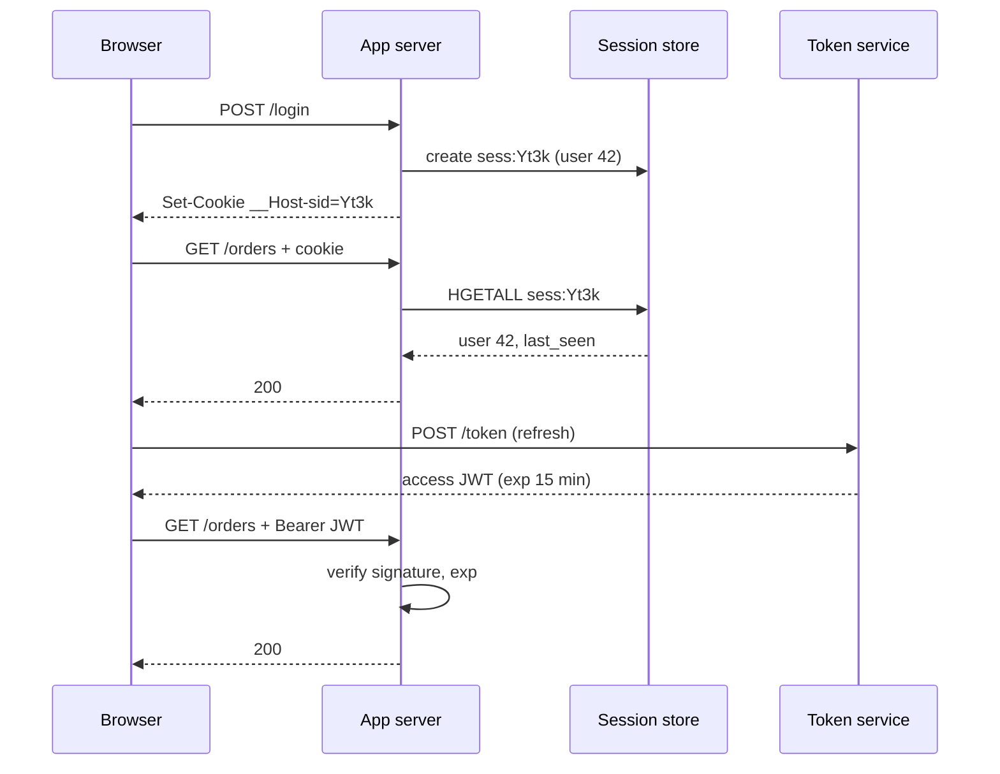

## In one minute
- After login, a server must recognise the same user on every later request. It can either keep the state itself and hand out an opaque reference (a *session*), or hand the state to the client in a signed, self-describing *token*.
- Sessions make every request pay a lookup but make logout, revocation and permission changes take effect on the next request.
- Tokens remove the lookup from the hot path but cannot be taken back before they expire, so real systems keep them short-lived and pair them with a refresh token, which is server-side state again.
- The choice is less "stateful versus stateless" than "where does the check happen, and how stale may the answer be".
- Transport is a separate decision: an `HttpOnly` cookie protects against script theft but needs CSRF defences; an `Authorization` header avoids CSRF but needs somewhere safe to keep the token.

## How it works

### The problem both solve
HTTP is stateless. Checking a password or a passkey on every request would be slow and would spread credentials everywhere, so login is done once and its result is turned into a *credential for this session*: something cheaper to check, scoped to one device, and expiring on its own.

There are two ways to make that credential. Either it is a random name for a record the server keeps, or it is the record itself, signed so the server can trust it without remembering it. Everything else in this lesson follows from that one difference.

### Server-side sessions
At login the server generates 128 or more random bits, stores a record such as `{user_id: 42, created: 09:00, last_seen: 09:00, mfa: true, csrf: "..."}` under that ID in a store, and sends the ID back, usually in a cookie: `Set-Cookie: __Host-sid=Yt3k...; Path=/; Secure; HttpOnly; SameSite=Lax`. On each request the server reads the cookie, looks up the record, checks the idle and absolute timeouts, and loads the user.

The ID means nothing on its own. Logout deletes the record. "Sign out of all devices" deletes every record for that user. Demoting an admin takes effect at once, because permissions are read from the record or from the database on every request.

### Self-contained tokens
At login the server builds a set of claims, `{sub: 42, roles: ["editor"], exp: 09:15}`, signs it, and returns the result, most often as a JWT. On each request any server that holds the verification key checks the signature and the expiry, and trusts the claims without asking anyone.

That removes the shared store from the request path, which matters when there are many services, many regions, or third parties verifying tokens. The cost is that the token is a cached copy of the user's authority. If the user is banned at 09:01, the token still says `editor` until 09:15.

### The hybrid everyone ends up with
Because of that cost, token systems issue two credentials. A short-lived *access token* (5 to 15 minutes) is checked locally on every request. A long-lived *refresh token* is checked by the auth server, which keeps a record of it, every time a new access token is minted. Revocation means deleting the refresh token record and waiting at most one access-token lifetime. In other words: a session store, consulted every 15 minutes instead of every request.

Large sites often go further. The browser holds an ordinary session cookie, an edge gateway looks it up once, and the gateway attaches a short-lived internal token for the services behind it. The browser never sees a token, and the services never touch the session store. Two named patterns cover this. In the *backend for frontend* (BFF), a server-side component is the OAuth client, keeps tokens in a cookie-based session and proxies API calls. The IETF's browser-apps best practice, published in August 2026 as RFC 10017, lists it first among its patterns in decreasing order of security and recommends it for business and sensitive applications ([RFC 10017](https://www.rfc-editor.org/rfc/rfc10017)). In Curity's *phantom token* pattern, the client holds an opaque token and the gateway swaps it for a JWT through introspection, caching the result until it expires ([Curity](https://curity.io/resources/learn/phantom-token-pattern/)).

### The problem shape: trusting a cached answer
This is the cache invalidation problem in an auth costume. A token is a cached answer to "who is this and what may they do?", and its `exp` is a TTL. TLS certificates have the identical trade-off: revocation lists and OCSP are the "look it up" design, and short-lived certificates are the "keep the cache short" design. The industry is choosing the second. Let's Encrypt turned off its OCSP responders in August 2025, partly because every OCSP query tells the CA which site a user is visiting ([Let's Encrypt](https://letsencrypt.org/2024/12/05/ending-ocsp/)), and the CA/Browser Forum voted in April 2025 to cut the maximum certificate lifetime from 398 days to 47 by March 2029 ([CA/B Forum SC-081v3](https://cabforum.org/2025/04/11/ballot-sc081v3-introduce-schedule-of-reducing-validity-and-data-reuse-periods/)). DNS TTLs are the same decision again. Whenever you see a signed, self-contained artifact, ask what happens between the moment the truth changes and the moment the artifact expires.

## Down the stack

### Layer 1: The contract
A session system promises that a request is accepted only if a matching record exists, `now - last_seen < idle_timeout` and `now - created < absolute_timeout`; logout and revocation take effect on the very next request. A token system promises that a request is accepted if the signature verifies with a trusted key and `now < exp` (within a skew allowance); revocation takes effect after at most the token lifetime, unless a denylist is also consulted. Both promise that a credential issued to one user cannot be forged by another: for sessions because the ID space is too large to guess (OWASP asks for at least 64 bits of entropy, and 128 or more from a CSPRNG when you generate IDs yourself ([OWASP Session Management](https://cheatsheetseries.owasp.org/cheatsheets/Session_Management_Cheat_Sheet.html))), for tokens because forging needs the signing key.

### Layer 2: The mechanism
Django stores sessions in a `django_session` table with `session_key`, `session_data` and `expire_date`, or in a cache backend. A typical Redis design stores `sess:<id>` as a hash and calls `EXPIRE` on each touch to implement sliding idle expiry, plus a set `user_sessions:<user_id>` so "log out everywhere" is one `SMEMBERS` and a multi-key `DEL`. On login and on any privilege change the server *rotates* the ID: it copies the record to a new ID and deletes the old one, which defeats session fixation, where an attacker plants a known ID in a victim's browser before login.

Rails' default `CookieStore` shows the boundary is blurry: it puts the whole session, encrypted and authenticated, inside the cookie. That is a self-contained token delivered as a cookie, with the same revocation problem. The Rails security guide spells out the replay version: a user who saves an old cookie can restore an old credit balance, and tracking nonces in a table "would defeat the entire purpose" of the cookie store, so such state belongs on the server ([Rails guide](https://guides.rubyonrails.org/security.html)).

On the token side, RFC 6750 defines `Authorization: Bearer <token>`, and RFC 9068 profiles JWT access tokens with required claims `iss`, `exp`, `aud`, `sub`, `client_id`, `iat` and `jti` ([RFC 9068 §2.2](https://www.rfc-editor.org/rfc/rfc9068)). Revocation before expiry is done with a denylist of `jti` values, kept only until each token's `exp`, which keeps it small.

### Layer 3: The machine
A session ID is 32 bytes read from the kernel CSPRNG with `getrandom(2)`, about 43 characters once base64url-encoded. A same-zone Redis `HGETALL` costs one network round trip, roughly 0.2 to 0.5 ms, and a single Redis core serves on the order of 100,000 such reads per second. A JWT costs no network, but verifying an ES256 signature takes roughly 50 to 100 us of CPU, and an HMAC-SHA256 check about 1 to 2 us. Bytes matter too: a session cookie adds about 60 bytes per request, while a JWT carrying roles and a few claims is often 800 to 1,500 bytes, sent on every request, and browsers cap a single cookie at about 4 KB, the minimum the cookie RFC asks them to support ([RFC 6265 §6.1](https://www.rfc-editor.org/rfc/rfc6265#section-6.1)). HTTP/2's HPACK can index a repeated header so later requests on the same connection send only a small reference, but every new connection pays the full size again.

### Why it's built this way
1. Checking primary credentials on every request is slow and risky, so login mints a cheaper, narrower credential.
2. A random ID needs a lookup, and lookups across services and regions cost latency and couple everything to one store, so tokens carry their own claims.
3. Claims carried by the client go stale, and the server cannot reach into the client to fix them, so tokens must expire quickly.
4. Short expiry means frequent re-issue without re-login, so a refresh token is introduced, and it needs a server-side record to be revocable.
5. The result is the same state in fewer places on fewer requests: the lookup moves from every request to every refresh.

## Diagram


## Worked example
A B2B dashboard has 400,000 daily users, peaks at 30,000 requests per second, and keeps about 1.2 million live sessions (users with several devices, 30-day "remember me").

**Sessions.** Each record is about 300 bytes plus Redis overhead, say 500 bytes, so 1.2 million sessions use about 600 MB: one small primary with a replica. 30,000 lookups per second is well within one Redis instance, and adds about 0.3 ms per request. The risk is availability: if Redis is down, nobody is logged in. Run it replicated and decide in advance whether the app fails closed (everyone gets a 401) or serves read-only pages.

**Tokens.** With 15-minute access tokens and 400,000 users active for an average of 3 hours, refreshes are 400,000 x 12 = 4.8 million per day, about 56 per second on average and a few hundred at peak. The auth service and its refresh-token table carry that load; the 30,000 requests per second touch only CPU. The cost: when a customer's admin removes an employee, the employee keeps access for up to 15 minutes, and a 1.2 KB token adds about 36 MB/s of upstream header traffic at peak, compared with under 2 MB/s for a 60-byte cookie.

The team picks sessions at the edge and internal tokens behind it. The gateway does the 30,000 lookups per second, mints a 60-second internal token per request, and 14 backend services verify it locally. Revocation is immediate for the user, and no service shares the session store.

## In the wild
- **Okta, 2023: session tokens leaked through support files.** Customers uploaded HAR browser traces to support cases, and those files held live session tokens. An attacker who got into the support system through a service account read files from 134 customers and hijacked sessions at 5 of them. The attacker had access from 28 September to 17 October 2023, and Okta missed suspicious downloads for about 14 days. Okta then shipped admin session binding to network location, so a copied token alone no longer works from elsewhere ([Okta](https://sec.okta.com/articles/2023/11/unauthorized-access-oktas-support-case-management-system-root-cause)).
- **CircleCI, 2023: a stolen session cookie skipped 2FA.** Malware on an engineer's laptop stole an SSO session cookie that was already 2FA-authenticated, so the attacker simply became that engineer, minted production tokens and pulled encryption keys for customer secrets. Every customer was told to rotate all secrets. Follow-ups included step-up authentication and a much smaller group with production access ([CircleCI](https://circleci.com/blog/jan-4-2023-incident-report/)).

## Trade-offs
| Option | Strengths | Weaknesses | Choose when |
|---|---|---|---|
| Server-side session + cookie | Instant revocation, tiny cookie, simple mental model | Lookup per request, shared store is a dependency, CSRF defences needed | One web app or a gateway in front of many services |
| Self-contained access token only | No lookup, verifiable by any service or third party | Cannot revoke before `exp`, large headers, claims go stale | Very short lifetimes, machine-to-machine calls |
| Short access token + refresh token | Lookups only on refresh, revocation bounded by token lifetime | Two credentials to store and rotate, more moving parts | Mobile apps, public APIs, many services |
| Session at edge, internal tokens behind (BFF / phantom token) | Browser never holds a token, services stay stateless | Gateway becomes critical, more infrastructure | Larger web products with many services |

## Pitfalls in production
- **Tokens in `localStorage`.** Any XSS can read and exfiltrate them to be replayed from anywhere. Keep browser credentials in `HttpOnly` cookies, or use a BFF so the browser never holds a bearer token.
- **No rotation on login.** Reusing the pre-login session ID allows session fixation. Issue a new ID on login, on MFA step-up and on role changes, and delete the old one.
- **Only idle timeouts.** An attacker who keeps a stolen session busy keeps it alive forever. Enforce an absolute lifetime as well, and require re-authentication for sensitive actions. For calibration, OWASP cites idle timeouts of 2 to 5 minutes for high-value apps and 15 to 30 for low-risk ones, and NIST's AAL2 asks for re-authentication after at most 1 hour idle and 24 hours overall ([NIST SP 800-63B-4](https://pages.nist.gov/800-63-4/sp800-63b.html)).
- **Long-lived access tokens "for convenience".** A 24-hour token means a 24-hour revocation window. Keep access tokens to minutes and put the long lifetime on the revocable refresh token.
- **Putting authorization into the token and forgetting it.** Roles copied into a token at login stay there after a demotion. Keep coarse identity in the token and check fine-grained permissions at the resource, or keep lifetimes short enough that staleness is acceptable.
- **Cookie scoping mistakes.** A cookie set with `Domain=example.com` is sent to every subdomain, including the forgotten marketing site. Use the `__Host-` prefix, which forces `Secure`, `Path=/` and no `Domain` attribute ([MDN](https://developer.mozilla.org/en-US/docs/Web/HTTP/Headers/Set-Cookie)).

## Leadership lens
- Ask for the revocation number: how many seconds from "disable this user" to "every request from that user fails"? Security and sales teams will ask; have a measured answer.
- The session store or token service is on the path of every login and often every request. Give it an owner, an SLO and a documented failure mode before it is needed.
- Avoid letting each service invent its own auth. One edge that converts browser sessions to internal tokens is cheaper to audit than 15 teams each parsing cookies.
- Budget for the migration cost: moving from sessions to tokens or back touches every client, so choose with mobile, partner APIs and multi-region plans in view.

## Check yourself
1. Why does a refresh-token design not make the system truly stateless?
   **Answer:** The refresh token must be revocable, so the auth server keeps a record of it and checks that record on every refresh. State still exists; it is consulted every few minutes instead of every request.
2. A user changes their password. With pure JWT access tokens of 30 minutes, what happens to their other logged-in devices, and how would you fix it?
   **Answer:** They keep working for up to 30 minutes, and longer if refresh tokens are not revoked. Revoke all refresh tokens for the user, and either shorten access tokens or have services check a per-user "tokens issued before T are invalid" timestamp.
3. Why do cookie-based sessions need CSRF protection while bearer tokens in a header do not?
   **Answer:** Browsers attach cookies to cross-site requests automatically, so a malicious page can trigger authenticated requests. A header must be set by script on the page itself, which another origin cannot do.
4. What attack does rotating the session ID at login prevent?
   **Answer:** Session fixation: an attacker who planted a known ID in the victim's browser before login would otherwise share the victim's authenticated session.

## Practice
**Task:** Implement a server-side session store with sliding and absolute expiry. `SessionStore(idle, absolute, new_id)` takes the idle timeout and absolute lifetime in seconds and a function that returns a fresh unique ID each call. `create(user, now)` stores a session and returns its ID. `touch(sid, now)` returns the user if the session exists, `now - last_seen < idle` and `now - created < absolute`, and then sets `last_seen = now`; otherwise it deletes the session (if present) and returns `None` (TypeScript `null`, Go `"", false`). `rotate(sid, now)` validates like `touch`, then moves the session to a new ID that keeps the original `created` time, deletes the old ID, and returns the new ID, or `None` if invalid. `revoke(sid)` deletes one session, and `revoke_user(user)` deletes every session of that user and returns how many it deleted.

```python starter
class SessionStore:
    def __init__(self, idle, absolute, new_id):
        self.new_id = new_id

    def create(self, user, now):
        # TODO
        raise NotImplementedError

    def touch(self, sid, now):
        # TODO
        raise NotImplementedError

    def rotate(self, sid, now):
        # TODO
        raise NotImplementedError

    def revoke(self, sid):
        # TODO
        raise NotImplementedError

    def revoke_user(self, user):
        # TODO
        raise NotImplementedError
```

```python tests
def counter():
    n = [0]
    def nxt():
        n[0] += 1
        return "s" + str(n[0])
    return nxt

def test_create_and_touch():
    s = SessionStore(60, 3600, counter())
    sid = s.create("alice", 0)
    assert sid == "s1"
    assert s.touch(sid, 30) == "alice"

def test_idle_timeout_slides():
    s = SessionStore(60, 3600, counter())
    sid = s.create("alice", 0)
    assert s.touch(sid, 50) == "alice"
    assert s.touch(sid, 100) == "alice", "activity at 50 extended the idle window"
    assert s.touch(sid, 160) is None, "60 idle seconds expires it"
    assert s.touch(sid, 161) is None, "expired session was deleted"

def test_absolute_timeout():
    s = SessionStore(60, 100, counter())
    sid = s.create("alice", 0)
    for t in (40, 80, 99):
        assert s.touch(sid, t) == "alice"
    assert s.touch(sid, 100) is None

def test_rotate_keeps_created_and_kills_old_id():
    s = SessionStore(60, 100, counter())
    old = s.create("alice", 0)
    new = s.rotate(old, 50)
    assert new == "s2"
    assert s.touch(old, 51) is None
    assert s.touch(new, 99) == "alice"
    assert s.touch(new, 100) is None, "rotation must not reset the absolute lifetime"

def test_rotate_invalid():
    s = SessionStore(60, 3600, counter())
    sid = s.create("alice", 0)
    assert s.rotate(sid, 60) is None
    assert s.rotate("nope", 0) is None

def test_revoke_and_revoke_user():
    s = SessionStore(60, 3600, counter())
    a1 = s.create("alice", 0)
    a2 = s.create("alice", 0)
    b1 = s.create("bob", 0)
    s.revoke(a1)
    assert s.touch(a1, 1) is None
    assert s.revoke_user("alice") == 1
    assert s.touch(a2, 2) is None
    assert s.touch(b1, 2) == "bob"
    assert s.revoke_user("alice") == 0
```

```python solution
class SessionStore:
    def __init__(self, idle, absolute, new_id):
        self.idle = idle
        self.absolute = absolute
        self.new_id = new_id
        self.sessions = {}

    def create(self, user, now):
        sid = self.new_id()
        self.sessions[sid] = {"user": user, "created": now, "last": now}
        return sid

    def _valid(self, sid, now):
        rec = self.sessions.get(sid)
        if rec is None:
            return None
        if now - rec["last"] >= self.idle or now - rec["created"] >= self.absolute:
            del self.sessions[sid]
            return None
        return rec

    def touch(self, sid, now):
        rec = self._valid(sid, now)
        if rec is None:
            return None
        rec["last"] = now
        return rec["user"]

    def rotate(self, sid, now):
        rec = self._valid(sid, now)
        if rec is None:
            return None
        del self.sessions[sid]
        new = self.new_id()
        self.sessions[new] = {"user": rec["user"], "created": rec["created"], "last": now}
        return new

    def revoke(self, sid):
        self.sessions.pop(sid, None)

    def revoke_user(self, user):
        doomed = [k for k, v in self.sessions.items() if v["user"] == user]
        for k in doomed:
            del self.sessions[k]
        return len(doomed)
```

```typescript starter
export class SessionStore {
  constructor(public idle: number, public absolute: number, public newId: () => string) {}
  create(user: string, now: number): string {
    throw new Error("TODO");
  }
  touch(sid: string, now: number): string | null {
    throw new Error("TODO");
  }
  rotate(sid: string, now: number): string | null {
    throw new Error("TODO");
  }
  revoke(sid: string): void {
    throw new Error("TODO");
  }
  revokeUser(user: string): number {
    throw new Error("TODO");
  }
}
```

```typescript tests
function counter(): () => string {
  let n = 0;
  return () => "s" + String(++n);
}

test("create and touch", () => {
  const s = new SessionStore(60, 3600, counter());
  const sid = s.create("alice", 0);
  assertEqual(sid, "s1");
  assertEqual(s.touch(sid, 30), "alice");
});
test("idle timeout slides", () => {
  const s = new SessionStore(60, 3600, counter());
  const sid = s.create("alice", 0);
  assertEqual(s.touch(sid, 50), "alice");
  assertEqual(s.touch(sid, 100), "alice", "activity at 50 extended the idle window");
  assertEqual(s.touch(sid, 160), null, "60 idle seconds expires it");
  assertEqual(s.touch(sid, 161), null, "expired session was deleted");
});
test("absolute timeout", () => {
  const s = new SessionStore(60, 100, counter());
  const sid = s.create("alice", 0);
  for (const t of [40, 80, 99]) assertEqual(s.touch(sid, t), "alice");
  assertEqual(s.touch(sid, 100), null);
});
test("rotate keeps created and kills old id", () => {
  const s = new SessionStore(60, 100, counter());
  const old = s.create("alice", 0);
  const nw = s.rotate(old, 50);
  assertEqual(nw, "s2");
  assertEqual(s.touch(old, 51), null);
  assertEqual(s.touch(nw as string, 99), "alice");
  assertEqual(s.touch(nw as string, 100), null, "rotation must not reset the absolute lifetime");
});
test("rotate invalid", () => {
  const s = new SessionStore(60, 3600, counter());
  const sid = s.create("alice", 0);
  assertEqual(s.rotate(sid, 60), null);
  assertEqual(s.rotate("nope", 0), null);
});
test("revoke and revokeUser", () => {
  const s = new SessionStore(60, 3600, counter());
  const a1 = s.create("alice", 0);
  const a2 = s.create("alice", 0);
  const b1 = s.create("bob", 0);
  s.revoke(a1);
  assertEqual(s.touch(a1, 1), null);
  assertEqual(s.revokeUser("alice"), 1);
  assertEqual(s.touch(a2, 2), null);
  assertEqual(s.touch(b1, 2), "bob");
  assertEqual(s.revokeUser("alice"), 0);
});
```

```typescript solution
interface Rec {
  user: string;
  created: number;
  last: number;
}

export class SessionStore {
  private sessions = new Map<string, Rec>();

  constructor(public idle: number, public absolute: number, public newId: () => string) {}

  create(user: string, now: number): string {
    const sid = this.newId();
    this.sessions.set(sid, { user, created: now, last: now });
    return sid;
  }

  private valid(sid: string, now: number): Rec | null {
    const rec = this.sessions.get(sid);
    if (!rec) return null;
    if (now - rec.last >= this.idle || now - rec.created >= this.absolute) {
      this.sessions.delete(sid);
      return null;
    }
    return rec;
  }

  touch(sid: string, now: number): string | null {
    const rec = this.valid(sid, now);
    if (!rec) return null;
    rec.last = now;
    return rec.user;
  }

  rotate(sid: string, now: number): string | null {
    const rec = this.valid(sid, now);
    if (!rec) return null;
    this.sessions.delete(sid);
    const nw = this.newId();
    this.sessions.set(nw, { user: rec.user, created: rec.created, last: now });
    return nw;
  }

  revoke(sid: string): void {
    this.sessions.delete(sid);
  }

  revokeUser(user: string): number {
    let n = 0;
    for (const [k, v] of Array.from(this.sessions.entries())) {
      if (v.user === user) {
        this.sessions.delete(k);
        n++;
      }
    }
    return n;
  }
}
```

```go starter
package practice

type SessionStore struct {
	newID func() string
}

func NewSessionStore(idle, absolute int64, newID func() string) *SessionStore {
	return &SessionStore{newID: newID}
}

func (s *SessionStore) Create(user string, now int64) string           { panic("TODO") }
func (s *SessionStore) Touch(sid string, now int64) (string, bool)     { panic("TODO") }
func (s *SessionStore) Rotate(sid string, now int64) (string, bool)    { panic("TODO") }
func (s *SessionStore) Revoke(sid string)                              { panic("TODO") }
func (s *SessionStore) RevokeUser(user string) int                     { panic("TODO") }
```

```go tests
package practice

import (
	"strconv"
	"testing"
)

func counter() func() string {
	n := 0
	return func() string {
		n++
		return "s" + strconv.Itoa(n)
	}
}

func expectUser(t *testing.T, s *SessionStore, sid string, now int64, want string) {
	t.Helper()
	got, ok := s.Touch(sid, now)
	if want == "" {
		if ok {
			t.Fatalf("touch(%s, %d) = %q, want invalid", sid, now, got)
		}
		return
	}
	if !ok || got != want {
		t.Fatalf("touch(%s, %d) = %q, %v; want %q", sid, now, got, ok, want)
	}
}

func TestCreateAndTouch(t *testing.T) {
	s := NewSessionStore(60, 3600, counter())
	sid := s.Create("alice", 0)
	if sid != "s1" {
		t.Fatalf("got %s", sid)
	}
	expectUser(t, s, sid, 30, "alice")
}

func TestIdleTimeoutSlides(t *testing.T) {
	s := NewSessionStore(60, 3600, counter())
	sid := s.Create("alice", 0)
	expectUser(t, s, sid, 50, "alice")
	expectUser(t, s, sid, 100, "alice")
	expectUser(t, s, sid, 160, "")
	expectUser(t, s, sid, 161, "")
}

func TestAbsoluteTimeout(t *testing.T) {
	s := NewSessionStore(60, 100, counter())
	sid := s.Create("alice", 0)
	for _, now := range []int64{40, 80, 99} {
		expectUser(t, s, sid, now, "alice")
	}
	expectUser(t, s, sid, 100, "")
}

func TestRotateKeepsCreatedAndKillsOldID(t *testing.T) {
	s := NewSessionStore(60, 100, counter())
	old := s.Create("alice", 0)
	nw, ok := s.Rotate(old, 50)
	if !ok || nw != "s2" {
		t.Fatalf("rotate = %q, %v", nw, ok)
	}
	expectUser(t, s, old, 51, "")
	expectUser(t, s, nw, 99, "alice")
	expectUser(t, s, nw, 100, "")
}

func TestRotateInvalid(t *testing.T) {
	s := NewSessionStore(60, 3600, counter())
	sid := s.Create("alice", 0)
	if _, ok := s.Rotate(sid, 60); ok {
		t.Fatal("idle session must not rotate")
	}
	if _, ok := s.Rotate("nope", 0); ok {
		t.Fatal("unknown session must not rotate")
	}
}

func TestRevokeAndRevokeUser(t *testing.T) {
	s := NewSessionStore(60, 3600, counter())
	a1 := s.Create("alice", 0)
	a2 := s.Create("alice", 0)
	b1 := s.Create("bob", 0)
	s.Revoke(a1)
	expectUser(t, s, a1, 1, "")
	if n := s.RevokeUser("alice"); n != 1 {
		t.Fatalf("revoked %d, want 1", n)
	}
	expectUser(t, s, a2, 2, "")
	expectUser(t, s, b1, 2, "bob")
	if n := s.RevokeUser("alice"); n != 0 {
		t.Fatalf("revoked %d, want 0", n)
	}
}
```

```go solution
package practice

import "sync"

type rec struct {
	user          string
	created, last int64
}

type SessionStore struct {
	mu             sync.Mutex
	idle, absolute int64
	newID          func() string
	sessions       map[string]*rec
}

func NewSessionStore(idle, absolute int64, newID func() string) *SessionStore {
	return &SessionStore{idle: idle, absolute: absolute, newID: newID, sessions: map[string]*rec{}}
}

func (s *SessionStore) Create(user string, now int64) string {
	s.mu.Lock()
	defer s.mu.Unlock()
	sid := s.newID()
	s.sessions[sid] = &rec{user: user, created: now, last: now}
	return sid
}

func (s *SessionStore) valid(sid string, now int64) *rec {
	r, ok := s.sessions[sid]
	if !ok {
		return nil
	}
	if now-r.last >= s.idle || now-r.created >= s.absolute {
		delete(s.sessions, sid)
		return nil
	}
	return r
}

func (s *SessionStore) Touch(sid string, now int64) (string, bool) {
	s.mu.Lock()
	defer s.mu.Unlock()
	r := s.valid(sid, now)
	if r == nil {
		return "", false
	}
	r.last = now
	return r.user, true
}

func (s *SessionStore) Rotate(sid string, now int64) (string, bool) {
	s.mu.Lock()
	defer s.mu.Unlock()
	r := s.valid(sid, now)
	if r == nil {
		return "", false
	}
	delete(s.sessions, sid)
	nw := s.newID()
	s.sessions[nw] = &rec{user: r.user, created: r.created, last: now}
	return nw, true
}

func (s *SessionStore) Revoke(sid string) {
	s.mu.Lock()
	defer s.mu.Unlock()
	delete(s.sessions, sid)
}

func (s *SessionStore) RevokeUser(user string) int {
	s.mu.Lock()
	defer s.mu.Unlock()
	n := 0
	for k, r := range s.sessions {
		if r.user == user {
			delete(s.sessions, k)
			n++
		}
	}
	return n
}
```

## Mock interview
**Prompt:** You are designing authentication for a SaaS product with a web app, iOS and Android apps, a public partner API, and 20 backend services in two regions. Peak load is 40,000 requests per second, and enterprise customers require that a disabled employee loses access within 60 seconds.

- Follow-up: The session store in one region goes down. What do logged-in users see, and what would you prefer they see?
- Follow-up: A security review finds access tokens in the web app's `localStorage`. What is the risk and how do you migrate away?
- Follow-up: Would you put the user's roles and tenant ID into the access token? What breaks if you do, and what breaks if you don't?

**A strong answer covers:**
- Different transports per client: `HttpOnly`, `Secure`, `SameSite` cookies (ideally via a BFF) for the browser; bearer tokens with secure platform storage for mobile and partners.
- The 60-second requirement as a design input: access tokens of 60 seconds or less, or a gateway session lookup, plus refresh-token revocation and a per-user "revoked before" timestamp.
- Session store sizing, replication across regions, and an explicit fail-open or fail-closed decision.
- Rotation on login and privilege change, idle plus absolute timeouts, and step-up auth for sensitive actions.
- Keeping coarse identity in tokens and fine-grained authorization at the resource, so stale claims cannot grant access.

## Sources and further study
**Primary**
- [RFC 6265: HTTP State Management Mechanism](https://www.rfc-editor.org/rfc/rfc6265): cookie semantics and browser limits; its draft successor, 6265bis (in final RFC Editor review in 2026), adds `SameSite` and cookie prefixes.
- [RFC 9068: JWT Profile for OAuth 2.0 Access Tokens](https://www.rfc-editor.org/rfc/rfc9068): required claims and the `at+jwt` type.
- [NIST SP 800-63B-4 (2025)](https://pages.nist.gov/800-63-4/sp800-63b.html): reauthentication and session timeouts per assurance level.

**Systems docs**
- [Ruby on Rails Security Guide: Sessions](https://guides.rubyonrails.org/security.html): cookie-stored sessions, replay attacks and session fixation.
- [Django: How to use sessions](https://docs.djangoproject.com/en/stable/topics/http/sessions/): database, cache and signed-cookie backends side by side.

**Books**
- *Designing Distributed Systems* (2nd ed.), Brendan Burns, Ch 6 "Replicated Load-Balanced Services": stateless services versus session-tracked services behind a load balancer.
- *Building Microservices* (2nd ed.), Sam Newman, Ch 11 "Security": human authentication, single sign-on gateways and JSON Web Tokens between services.

**Other curricula**
- [donnemartin/system-design-primer](https://github.com/donnemartin/system-design-primer): recommends keeping sessions in a central database or cache so web servers stay stateless; it does not discuss tokens.
- [Azure Architecture Center: Valet Key pattern](https://learn.microsoft.com/en-us/azure/architecture/patterns/valet-key): the same self-contained, time-limited grant idea applied to storage access.

## Watch
- [Session Vs JWT: The Differences You May Not Know! (ByteByteGo)](https://www.youtube.com/watch?v=fyTxwIa-1U0): side-by-side walk through of both designs and where each breaks.
- [Session vs Token Authentication in 100 Seconds (Fireship)](https://www.youtube.com/watch?v=UBUNrFtufWo): a fast refresher on the two flows.

## Free resources
- [OWASP Session Management Cheat Sheet](https://cheatsheetseries.owasp.org/cheatsheets/Session_Management_Cheat_Sheet.html): ID entropy, cookie attributes, timeouts and rotation, all in one place.
- [MDN: Set-Cookie](https://developer.mozilla.org/en-US/docs/Web/HTTP/Headers/Set-Cookie): exact semantics of `HttpOnly`, `SameSite`, `Domain` and the `__Host-` prefix.
- [OWASP CSRF Prevention Cheat Sheet](https://cheatsheetseries.owasp.org/cheatsheets/Cross-Site_Request_Forgery_Prevention_Cheat_Sheet.html): what cookie-based sessions need in addition to `SameSite`.
- [RFC 10017: OAuth 2.0 for Browser-Based Applications (BCP 212, 2026)](https://www.rfc-editor.org/rfc/rfc10017): why the BFF pattern keeps tokens out of the browser; this replaces the long-running IETF draft.
- [The Phantom Token Pattern (Curity)](https://curity.io/resources/learn/phantom-token-pattern/): opaque tokens outside, JWTs inside, translated at the gateway.
- [Stop using JWT for sessions (joepie91)](http://cryto.net/~joepie91/blog/2016/06/13/stop-using-jwt-for-sessions/): a sharp argument against tokens as browser sessions, worth reading even if you disagree.
