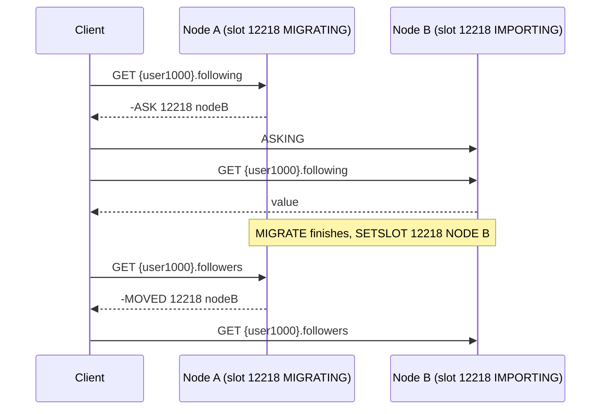

## In one minute
- Sharding spreads one dataset across several independent database servers, each holding a disjoint subset of rows, so write throughput, storage and memory scale with the number of machines.
- Every sharded system has three parts: a shard key, a function from key to shard, and a routing layer that knows which machine holds which shard right now.
- Good shard keys keep most queries on one shard; bad ones turn every request into a scatter-gather and every transaction into a distributed one.
- Map keys to many small logical shards (Redis Cluster's 16,384 slots, Notion's 480 schemas), then place logical shards on physical machines. Resharding becomes moving whole shards, not rehashing rows.
- The hard parts are not the hash function. They are cross-shard queries, uniqueness and joins, hot tenants, and moving data online without losing writes. The problem shapes are "hot spots", "fan-out" and "multi-step consistency".

## How it works

### When one machine stops being enough
Partitioning inside one server (previous lesson) still shares one CPU, one WAL and one disk, and replicas add read capacity but take every write. When the primary's write rate, working set or disk outgrows the largest instance you can buy, different rows need different primaries. That is sharding: each partition lives on its own server with its own replicas.

### Choosing the shard key
A shard key should have high cardinality (millions of values, not 50 countries), even frequency (no single value with 30% of traffic), and, most important, it should be present in almost every query. For a SaaS product that is usually `tenant_id`: one tenant's data lives together, joins and transactions within a tenant stay local, and tenants spread across shards. For a social app it might be `user_id`, which keeps a user's posts together but makes "all comments on this post" a cross-shard question if comments are keyed by commenter.

Monotonic keys like timestamps are poor shard keys under range placement, because all new writes hit the newest shard.

### Placement strategies
- **Hash:** `slot = hash(key) mod S` with S fixed and large, then a table maps slots to servers. Even spread, no range locality.
- **Range:** contiguous key ranges per shard, split as they grow. Good for scans; needs care with hot tails. MongoDB's balancer, for example, aims for equal data per shard and moves ranges only when two shards differ by three times the range size, 384 MB at the default 128 MB ([MongoDB docs](https://www.mongodb.com/docs/manual/core/sharding-balancer-administration/)).
- **Directory (lookup):** a table maps each key, or each tenant, to a shard. Fully flexible, so a big tenant can get a dedicated shard, at the cost of a lookup on every request and a directory that must be highly available.
- **Geographic:** shard by region for latency and data residency, usually combined with one of the above inside each region.

### Routing
In **client-side routing** the application library holds the shard map (Instagram's and Notion's Postgres sharding work this way). In **proxy routing** a tier such as Vitess `vtgate`, MongoDB `mongos` or the Citus coordinator parses the query, finds the shard key in the `WHERE` clause and forwards the query, or fans it out and merges results when it cannot. In **server-side redirection** any node accepts a request and either serves it or tells the client where to go, as Redis Cluster does with `MOVED` ([Redis Cluster spec](https://redis.io/docs/latest/operate/oss_and_stack/reference/cluster-spec/)).

### What you give up
Within one shard you keep transactions, foreign keys and joins; across shards you lose them by default. The shard key itself is hard to change later. MongoDB only gained online resharding to a new key in 5.0 ([MongoDB docs](https://www.mongodb.com/docs/manual/sharding/)), and most hand-built systems never get it. Unique non-key columns need a global table, queries without the key fan out, and multi-shard writes need two-phase commit or a saga. Sequences must become globally unique IDs, for example Instagram's 64-bit layout of 41 bits of milliseconds, 13 bits of logical shard and 10 bits of per-shard sequence, which also lets you find a row's shard from its ID.

## Down the stack

### Layer 1: The contract
A statement whose shard key resolves to one shard gets that shard's full guarantees: transactions, constraints, fast index lookups. A statement touching several shards gets weaker promises: Vitess's default `transaction_mode` is `MULTI`, which commits multi-shard writes shard by shard with no atomicity guarantee; `TWOPC` makes them atomic but needs semi-sync replication and adds commit latency ([Vitess docs](https://vitess.io/docs/reference/features/distributed-transaction/)); a scatter read sees each shard at a slightly different moment, not one global snapshot. During resharding the contract is that no committed write is lost and that each key has exactly one writable owner at any instant, with a brief window where writes to moving keys block or fail and are retried.

### Layer 2: The mechanism
Redis Cluster computes `HASH_SLOT = CRC16(key) mod 16384` using CRC16-XMODEM ([Redis Cluster spec](https://redis.io/docs/latest/operate/oss_and_stack/reference/cluster-spec/)). If the key contains a non-empty `{...}` section, only that hash tag is hashed, so `{user1000}.following` and `{user1000}.followers` share a slot and can be used together in one multi-key command. Nodes gossip bitmaps of the slots they own. To move a slot, the operator marks it `MIGRATING` on the source and `IMPORTING` on the target and runs `MIGRATE` on its keys in batches. Meanwhile a request for an already moved key gets `-ASK <slot> <host:port>`, and the client sends `ASKING` plus the command to the target for that one request. `CLUSTER SETSLOT <slot> NODE <id>` then makes the move permanent, and clients get `-MOVED` and update their slot map.

Vitess maps each row through its primary vindex to a 64-bit keyspace ID, and names shards by keyspace ID ranges: `-80` and `80-` split the space in half. Resharding `-80` into `-40` and `40-80` runs a VReplication workflow ([Vitess docs](https://vitess.io/docs/user-guides/configuration-advanced/resharding/)): a copy phase streams rows to the new shards, then the workflow tails the source's binlog by GTID to catch up. VDiff compares source and target row by row. `SwitchTraffic` moves reads first, then writes: it stops writes on the source, waits for the target to reach the final GTID, flips the routing in the topology server, and starts reverse replication so you can switch back if the new shards misbehave.

### Layer 3: The machine
Scatter queries pay for tail latency. If each shard answers in under 20 ms 99% of the time, a query over 64 shards waits for the slowest: the chance that at least one is slow is `1 - 0.99^64`, about 47%, so the fan-out query's median is near a single shard's p99. Dean and Barroso's version: with a 1-in-100 slow server, a request that fans out to 100 servers is slow 63% of the time ([The Tail at Scale](https://www.barroso.org/publications/TheTailAtScale.pdf)). Connections multiply too. Two hundred application pods, each with a pool of 10 to each of 32 shards, hold 64,000 server connections; at a few MB of memory per Postgres backend that is hundreds of GB, which is why sharded Postgres nearly always runs a pooler such as PgBouncer. Notion hit exactly this when it tripled its shard count: it had to shard its PgBouncer layer too, because old and new shards would otherwise have exceeded the connection limits during the migration ([Notion](https://www.notion.com/blog/the-great-re-shard)).

Copying a 2 TB shard at a throttled 200 MB/s takes about 3 hours while the source keeps serving and its binlog grows. The cutover is short: stop writes, apply the last few MB of binlog in well under a second, update routing, resume. If you turn on `vtgate` buffering (`--enable-buffer`, off by default), it holds queries for up to `--buffer-window` (10 seconds) during the switch, so clients see added latency instead of errors ([Vitess docs](https://vitess.io/docs/reference/features/vtgate-buffering/)).

### Why it's built this way
1. A single primary's write path is limited by one log device and one CPU set, so writes must be split across primaries.
2. Rehashing every row when a server is added is too expensive, so keys map to a fixed, large set of logical shards and only the shard-to-server map changes.
3. Clients cannot all learn a new map at the same instant, so servers redirect stale clients (`MOVED`, `ASK`) or a proxy owns the map.
4. Copying a large shard takes hours and the source must stay online, so moves are copy plus change-log catch-up, with a short write freeze only at the end.
5. A bad cutover is costly, so systems verify with a diff and keep reverse replication running for a cheap rollback.

## Diagram


## Worked example
A B2B messaging product stores 18 TB of messages and peaks at 60,000 writes per second. Its largest practical Postgres primary sustains about 8,000 writes per second with headroom and holds 4 TB comfortably. Writes need at least 8 primaries and storage needs at least 5, so plan 16 physical shards for growth.

The shard key is `workspace_id`, since every message query is scoped to a workspace. Keys hash into 1,024 logical shards, 64 per server. One 40,000-employee customer generates 6% of writes, 3,600 per second, half a server's capacity, so the directory pins its logical shard to a server of its own: a config change, not a code change.

A year later traffic doubles and the team adds 16 servers. Each old server hands 32 of its 64 logical shards to a new one, moving half the data, 9 TB, which is the minimum for an even spread. The next step, from 32 to 40 servers, shows the real benefit: with logical shards only one fifth of the data moves, while rehashing rows from `mod 32` to `mod 40` would relocate about 80% of them. At 200 MB/s per stream and 8 parallel moves, 9 TB copies in under 2 hours, followed by one short cutover per logical shard.

## In the wild
- **Slack, 2022: a cache keyed one way, a database sharded another.** A gradual Consul agent upgrade removed memcached nodes, and Slack's cache control plane replaced them with empty ones. Group DM membership was cached by channel ID, but the Vitess table was sharded by user, so every miss became a scatter query across all shards. The database overloaded and could not refill the cache, retries piled on, and many users could not load Slack. The fix moved the query to a table sharded by channel and audited other cache-fronted scatter queries ([Slack](https://slack.engineering/slacks-incident-on-2-22-22/)).
- **Stripe, 2019: one shard without a primary stalls the whole API.** A latent bug from a database upgrade meant one shard could not elect a new primary when its old one failed, and it rejected writes. API workers blocked on that shard, so the API was severely degraded for about 27 minutes, and rolling back the election protocol then clashed with a recent config change and caused a second, 93-minute outage. Stripe's fixes included shard fault isolation and circuit breaking so one bad shard cannot take the fleet with it ([Stripe](https://stripe.com/rcas/2019-07-10)).
- **Notion, 2023: re-sharding from 32 to 96 machines.** By late 2022 some shards ran above 90% CPU at peak and PgBouncer was near its connection limits. Notion spread its 480 logical shards from 15 per machine to 5, copied them with Postgres logical replication (3 days cut to 12 hours by building indexes afterwards), validated with dark reads, and cut over by updating PgBouncer mappings with reverse replication ready. Peak CPU dropped to about 20% with no observed downtime ([Notion](https://www.notion.com/blog/the-great-re-shard)).

## Trade-offs
| Option | Strengths | Weaknesses | Choose when |
|---|---|---|---|
| Hash into logical slots | Even spread, cheap rebalancing by moving slots | No range locality; scatter for range queries | Point lookups by key, many similar tenants |
| Range shards | Range scans and ordered pagination stay local | Hot tail with monotonic keys; needs splitting | Time-ordered or lexicographic access |
| Directory per tenant | Isolate or move any tenant; heterogeneous shard sizes | Directory lookup on every request; must be highly available | Multi-tenant SaaS with very uneven tenants |
| Proxy routing (vtgate, mongos) | Apps see one database; central control of resharding | Extra hop, proxy tier to run and scale | Many services, many languages |
| Client-side routing | No extra hop, simple infrastructure | Every client must update its map; harder to evolve | One codebase, small team, few clients |

## Pitfalls in production
- **Sharding too early.** A sharded database costs every future feature a cross-shard question. Exhaust vertical scaling, read replicas, partitioning and caching first, and shard when one primary's write or storage limit is a year away, not ten.
- **A shard key absent from hot queries.** If the inbox query filters by `recipient_id` but the key is `sender_id`, every inbox load is a 64-way scatter. Model the top queries before choosing, and maintain a second copy keyed the other way if needed.
- **One tenant outgrows a shard.** Hashing cannot split a single key. Plan for it with a directory that can place a giant tenant alone, or a compound key (`tenant_id`, `bucket`) for the few tenants that need it.
- **Global uniqueness lost silently.** Two shards each accept the same email address. Keep a small global table for unique columns, or reserve uniqueness with a write there first.
- **Big-bang resharding.** Moving everything in one weekend with writes stopped turns a routine operation into an outage. Move logical shards one at a time with copy, catch-up, verify and a fast cutover, and keep a reverse stream for rollback.

## Leadership lens
- Ask what percentage of production queries will touch more than one shard; above a few percent the design needs a second index or a different key.
- Sharding is an organisational commitment: tooling for moves, a shard-aware migration process and on-call who understand it. Budget a platform team, or buy it (Vitess, Citus, a distributed SQL database).
- Decide early whether resharding is routine or exceptional. Routine needs automated, verified, reversible moves; exceptional means you are betting on not growing.
- Make the noisy-tenant plan explicit before the largest customer signs; placing them alone on day one beats moving them during an incident.

## Check yourself
1. Why do production systems hash keys into thousands of logical shards instead of directly onto N servers?
   **Answer:** Adding servers then moves whole logical shards, the minimum needed for balance, with only the shard-to-server map changing. Hashing directly onto N servers changes most keys' owners whenever N changes.
2. In Redis Cluster, what is the difference between `-ASK` and `-MOVED`?
   **Answer:** `ASK` is a one-request redirect while a slot is mid-migration, and the client must not update its slot map. `MOVED` means the slot has permanently changed owner, so the client updates its map.
3. Why does Vitess switch reads before writes during resharding?
   **Answer:** Reads on the new shards can be validated while the source is still authoritative and writes are unaffected; if they misbehave you switch reads back. Writes switch last, behind a brief freeze, because that is the irreversible step.

## Practice
**Task:** Implement Redis Cluster key-to-slot hashing and a minimal-move slot rebalancer. `key_slot(key)` returns `CRC16(key) mod 16384` with CRC16-XMODEM (polynomial `0x1021`, initial value 0, no reflection) over the key's UTF-8 bytes; if the key contains `{` and a later `}` with at least one character between the first `{` and the first `}` after it, only those characters are hashed. `plan_rebalance(assignment, nodes)` takes a list where `assignment[slot]` is the owning node name and the new list of node names, and returns moves `(slot, from, to)` sorted by slot so that every node in `nodes` ends with `S // N` or `S // N + 1` slots using the fewest moves. Nodes get the larger target in order of current slot count descending, then name ascending. Slots of nodes not in `nodes` all move; an overfull node gives up its highest-numbered slots. Freed slots, lowest first, go to receivers in name order, each filled to its target before the next. Raise an error (`ValueError`, a thrown `Error`, or a Go `error`) if `nodes` is empty.

```python starter
def key_slot(key):
    # TODO
    raise NotImplementedError


def plan_rebalance(assignment, nodes):
    # TODO
    raise NotImplementedError
```

```python tests
def test_crc16_reference_vector():
    assert key_slot("123456789") == 0x31C3
    assert key_slot("") == 0

def test_hash_tags():
    assert key_slot("{user1000}.following") == key_slot("user1000")
    assert key_slot("{user1000}.followers") == key_slot("{user1000}.following")
    assert key_slot("foo{}{bar}") == 8363, "empty first tag hashes the whole key"
    assert key_slot("foo{{bar}}") == key_slot("{bar")

def test_balanced_needs_no_moves():
    assert plan_rebalance(["A", "B", "A", "B"], ["A", "B"]) == []

def test_add_node_moves_one_slot():
    assert plan_rebalance(["A", "A", "B", "B"], ["A", "B", "C"]) == [(3, "B", "C")]

def test_remove_node():
    moves = plan_rebalance(["A", "B", "C", "A", "B", "C"], ["A", "B"])
    assert moves == [(2, "C", "A"), (5, "C", "B")]

def test_scale_out_from_one_node():
    moves = plan_rebalance(["A"] * 12, ["C", "B", "A"])
    assert len(moves) == 8
    assert all(m[0] >= 4 and m[1] == "A" for m in moves), "A keeps its lowest slots"
    assert [m[2] for m in moves] == ["B"] * 4 + ["C"] * 4

def test_larger_target_goes_to_fuller_node():
    moves = plan_rebalance(["A", "B", "B", "B", "B"], ["A", "B"])
    assert moves == [(4, "B", "A")], "B keeps 3, A gets 2"

def test_empty_nodes_is_error():
    try:
        plan_rebalance(["A"], [])
        assert False, "expected ValueError"
    except ValueError:
        pass
```

```python solution
def key_slot(key):
    start = key.find("{")
    if start != -1:
        end = key.find("}", start + 1)
        if end != -1 and end > start + 1:
            key = key[start + 1:end]
    crc = 0
    for b in key.encode("utf-8"):
        crc ^= b << 8
        for _ in range(8):
            if crc & 0x8000:
                crc = ((crc << 1) ^ 0x1021) & 0xFFFF
            else:
                crc = (crc << 1) & 0xFFFF
    return crc % 16384


def plan_rebalance(assignment, nodes):
    if not nodes:
        raise ValueError("no nodes")
    total, n = len(assignment), len(nodes)
    owned = {name: [] for name in nodes}
    freed = []
    for slot, owner in enumerate(assignment):
        if owner in owned:
            owned[owner].append(slot)
        else:
            freed.append((slot, owner))
    order = sorted(nodes, key=lambda x: (-len(owned[x]), x))
    target = {}
    for i, name in enumerate(order):
        target[name] = total // n + (1 if i < total % n else 0)
    for name in nodes:
        extra = len(owned[name]) - target[name]
        if extra > 0:
            for slot in owned[name][-extra:]:
                freed.append((slot, name))
    freed.sort()
    moves, k = [], 0
    for name in sorted(nodes):
        need = target[name] - len(owned[name])
        for _ in range(max(need, 0)):
            slot, src = freed[k]
            k += 1
            moves.append((slot, src, name))
    return sorted(moves)
```

```typescript starter
export function keySlot(key: string): number {
  throw new Error("TODO");
}

export function planRebalance(assignment: string[], nodes: string[]): [number, string, string][] {
  throw new Error("TODO");
}
```

```typescript tests
test("crc16 reference vector", () => {
  assertEqual(keySlot("123456789"), 0x31c3);
  assertEqual(keySlot(""), 0);
});
test("hash tags", () => {
  assertEqual(keySlot("{user1000}.following"), keySlot("user1000"));
  assertEqual(keySlot("{user1000}.followers"), keySlot("{user1000}.following"));
  assertEqual(keySlot("foo{}{bar}"), 8363, "empty first tag hashes the whole key");
  assertEqual(keySlot("foo{{bar}}"), keySlot("{bar"));
});
test("balanced needs no moves", () => {
  assertEqual(planRebalance(["A", "B", "A", "B"], ["A", "B"]), []);
});
test("add node moves one slot", () => {
  assertEqual(planRebalance(["A", "A", "B", "B"], ["A", "B", "C"]), [[3, "B", "C"]]);
});
test("remove node", () => {
  assertEqual(planRebalance(["A", "B", "C", "A", "B", "C"], ["A", "B"]), [
    [2, "C", "A"],
    [5, "C", "B"],
  ]);
});
test("scale out from one node", () => {
  const moves = planRebalance(new Array(12).fill("A"), ["C", "B", "A"]);
  assertEqual(moves.length, 8);
  assert(moves.every((m) => m[0] >= 4 && m[1] === "A"), "A keeps its lowest slots");
  assertEqual(moves.map((m) => m[2]), ["B", "B", "B", "B", "C", "C", "C", "C"]);
});
test("larger target goes to fuller node", () => {
  assertEqual(planRebalance(["A", "B", "B", "B", "B"], ["A", "B"]), [[4, "B", "A"]], "B keeps 3, A gets 2");
});
test("empty nodes is error", () => {
  let threw = false;
  try {
    planRebalance(["A"], []);
  } catch (e) {
    threw = true;
  }
  assert(threw, "expected an error");
});
```

```typescript solution
function utf8(s: string): number[] {
  const out: number[] = [];
  for (const ch of s) {
    const c = ch.codePointAt(0) ?? 0;
    if (c < 0x80) out.push(c);
    else if (c < 0x800) out.push(0xc0 | (c >> 6), 0x80 | (c & 63));
    else if (c < 0x10000) out.push(0xe0 | (c >> 12), 0x80 | ((c >> 6) & 63), 0x80 | (c & 63));
    else out.push(0xf0 | (c >> 18), 0x80 | ((c >> 12) & 63), 0x80 | ((c >> 6) & 63), 0x80 | (c & 63));
  }
  return out;
}

export function keySlot(key: string): number {
  const start = key.indexOf("{");
  if (start !== -1) {
    const end = key.indexOf("}", start + 1);
    if (end !== -1 && end > start + 1) key = key.slice(start + 1, end);
  }
  let crc = 0;
  for (const b of utf8(key)) {
    crc ^= b << 8;
    for (let i = 0; i < 8; i++) {
      crc = crc & 0x8000 ? ((crc << 1) ^ 0x1021) & 0xffff : (crc << 1) & 0xffff;
    }
  }
  return crc % 16384;
}

export function planRebalance(assignment: string[], nodes: string[]): [number, string, string][] {
  if (nodes.length === 0) throw new Error("no nodes");
  const total = assignment.length;
  const n = nodes.length;
  const owned = new Map<string, number[]>();
  for (const name of nodes) owned.set(name, []);
  const freed: [number, string][] = [];
  assignment.forEach((owner, slot) => {
    const list = owned.get(owner);
    if (list) list.push(slot);
    else freed.push([slot, owner]);
  });
  const count = (x: string) => (owned.get(x) ?? []).length;
  const order = [...nodes].sort((a, b) => count(b) - count(a) || (a < b ? -1 : a > b ? 1 : 0));
  const target = new Map<string, number>();
  order.forEach((name, i) => target.set(name, Math.floor(total / n) + (i < total % n ? 1 : 0)));
  for (const name of nodes) {
    const list = owned.get(name) ?? [];
    const extra = list.length - (target.get(name) ?? 0);
    if (extra > 0) for (const slot of list.slice(list.length - extra)) freed.push([slot, name]);
  }
  freed.sort((a, b) => a[0] - b[0]);
  const moves: [number, string, string][] = [];
  let k = 0;
  for (const name of [...nodes].sort()) {
    const need = (target.get(name) ?? 0) - count(name);
    for (let i = 0; i < need; i++) {
      const [slot, src] = freed[k++];
      moves.push([slot, src, name]);
    }
  }
  return moves.sort((a, b) => a[0] - b[0]);
}
```

```go starter
package practice

type Move struct {
	Slot int
	From string
	To   string
}

func KeySlot(key string) int { panic("TODO") }

func PlanRebalance(assignment []string, nodes []string) ([]Move, error) { panic("TODO") }
```

```go tests
package practice

import (
	"reflect"
	"testing"
)

func TestCRC16ReferenceVector(t *testing.T) {
	if KeySlot("123456789") != 0x31C3 || KeySlot("") != 0 {
		t.Fatal("crc16 mismatch")
	}
}

func TestHashTags(t *testing.T) {
	if KeySlot("{user1000}.following") != KeySlot("user1000") {
		t.Fatal("tag should hash user1000")
	}
	if KeySlot("{user1000}.followers") != KeySlot("{user1000}.following") {
		t.Fatal("same tag, same slot")
	}
	if KeySlot("foo{}{bar}") != 8363 {
		t.Fatal("empty first tag hashes the whole key")
	}
	if KeySlot("foo{{bar}}") != KeySlot("{bar") {
		t.Fatal("tag is {bar")
	}
}

func plan(t *testing.T, a, n []string) []Move {
	t.Helper()
	m, err := PlanRebalance(a, n)
	if err != nil {
		t.Fatal(err)
	}
	return m
}

func TestBalancedNeedsNoMoves(t *testing.T) {
	if m := plan(t, []string{"A", "B", "A", "B"}, []string{"A", "B"}); len(m) != 0 {
		t.Fatalf("got %v", m)
	}
}

func TestAddNodeMovesOneSlot(t *testing.T) {
	got := plan(t, []string{"A", "A", "B", "B"}, []string{"A", "B", "C"})
	if !reflect.DeepEqual(got, []Move{{3, "B", "C"}}) {
		t.Fatalf("got %v", got)
	}
}

func TestRemoveNode(t *testing.T) {
	got := plan(t, []string{"A", "B", "C", "A", "B", "C"}, []string{"A", "B"})
	if !reflect.DeepEqual(got, []Move{{2, "C", "A"}, {5, "C", "B"}}) {
		t.Fatalf("got %v", got)
	}
}

func TestScaleOutFromOneNode(t *testing.T) {
	a := make([]string, 12)
	for i := range a {
		a[i] = "A"
	}
	got := plan(t, a, []string{"C", "B", "A"})
	if len(got) != 8 {
		t.Fatalf("got %d moves", len(got))
	}
	for i, m := range got {
		want := "B"
		if i >= 4 {
			want = "C"
		}
		if m.Slot < 4 || m.From != "A" || m.To != want {
			t.Fatalf("bad move %v", m)
		}
	}
}

func TestLargerTargetGoesToFullerNode(t *testing.T) {
	got := plan(t, []string{"A", "B", "B", "B", "B"}, []string{"A", "B"})
	if !reflect.DeepEqual(got, []Move{{4, "B", "A"}}) {
		t.Fatalf("got %v", got)
	}
}

func TestEmptyNodesIsError(t *testing.T) {
	if _, err := PlanRebalance([]string{"A"}, nil); err == nil {
		t.Fatal("expected error")
	}
}
```

```go solution
package practice

import (
	"errors"
	"sort"
	"strings"
)

type Move struct {
	Slot int
	From string
	To   string
}

func KeySlot(key string) int {
	if start := strings.Index(key, "{"); start != -1 {
		if end := strings.Index(key[start+1:], "}"); end > 0 {
			key = key[start+1 : start+1+end]
		}
	}
	var crc uint16
	for _, b := range []byte(key) {
		crc ^= uint16(b) << 8
		for i := 0; i < 8; i++ {
			if crc&0x8000 != 0 {
				crc = crc<<1 ^ 0x1021
			} else {
				crc <<= 1
			}
		}
	}
	return int(crc) % 16384
}

type freedSlot struct {
	slot  int
	owner string
}

func PlanRebalance(assignment []string, nodes []string) ([]Move, error) {
	if len(nodes) == 0 {
		return nil, errors.New("no nodes")
	}
	total, n := len(assignment), len(nodes)
	owned := map[string][]int{}
	for _, name := range nodes {
		owned[name] = []int{}
	}
	freed := []freedSlot{}
	for slot, owner := range assignment {
		if _, ok := owned[owner]; ok {
			owned[owner] = append(owned[owner], slot)
		} else {
			freed = append(freed, freedSlot{slot, owner})
		}
	}
	order := append([]string{}, nodes...)
	sort.Slice(order, func(i, j int) bool {
		ci, cj := len(owned[order[i]]), len(owned[order[j]])
		if ci != cj {
			return ci > cj
		}
		return order[i] < order[j]
	})
	target := map[string]int{}
	for i, name := range order {
		target[name] = total / n
		if i < total%n {
			target[name]++
		}
	}
	for _, name := range nodes {
		list := owned[name]
		if extra := len(list) - target[name]; extra > 0 {
			for _, slot := range list[len(list)-extra:] {
				freed = append(freed, freedSlot{slot, name})
			}
		}
	}
	sort.Slice(freed, func(i, j int) bool { return freed[i].slot < freed[j].slot })
	byName := append([]string{}, nodes...)
	sort.Strings(byName)
	moves := []Move{}
	k := 0
	for _, name := range byName {
		for need := target[name] - len(owned[name]); need > 0; need-- {
			moves = append(moves, Move{freed[k].slot, freed[k].owner, name})
			k++
		}
	}
	sort.Slice(moves, func(i, j int) bool { return moves[i].Slot < moves[j].Slot })
	return moves, nil
}
```

## Mock interview
**Prompt:** A multi-tenant project management SaaS runs on one 64-core Postgres primary at 70% CPU and 9 TB, growing 4% a month, peaking at 15,000 writes per second. Design the move to sharding: key, routing and migration.

- Follow-up: your largest customer is 12% of all traffic and growing faster than everyone else. What happens to them?
- Follow-up: during a shard move the target falls 40 seconds behind on binlog catch-up right when you planned to cut over. What do you do?
- Follow-up: why not move to a distributed SQL database such as CockroachDB or Spanner instead?

**A strong answer covers:**
- `tenant_id` as the shard key, with evidence that nearly all queries are tenant-scoped, and CDC to a warehouse for cross-tenant analytics.
- Many logical shards on fewer physical servers, a directory or slot map, and a routing layer (proxy or library) with a cache and redirection on stale maps.
- Global concerns: ID generation, unique columns, and which multi-shard operations become sagas or are disallowed.
- Online migration per logical shard: copy, catch-up, verification, a short write freeze, reverse replication for rollback; cut over only when lag is near zero.
- Noisy-tenant isolation by placing a large tenant on dedicated hardware, and a compound key for any single tenant that outgrows a machine.
- Distributed SQL trades less application change and automatic rebalancing for consensus write latency, migration risk and cost.

## Sources and further study
**Primary**
- [Corbett et al., Spanner (OSDI 2012)](https://static.googleusercontent.com/media/research.google.com/en//archive/spanner-osdi2012.pdf): a database that shards across Paxos groups and reshards automatically, the alternative to hand-built sharding.
- [Dean and Barroso, The Tail at Scale (CACM 2013)](https://www.barroso.org/publications/TheTailAtScale.pdf): why fan-out queries inherit the slowest shard's latency, and hedged requests as a fix.

**Systems docs**
- [Vitess: Distributed transactions](https://vitess.io/docs/reference/features/distributed-transaction/): `SINGLE`, `MULTI` and `TWOPC` modes and what each promises.
- [Vitess: VTGate buffering](https://vitess.io/docs/reference/features/vtgate-buffering/): holding queries during failovers and resharding cutovers.
- [MongoDB: Balancer](https://www.mongodb.com/docs/manual/core/sharding-balancer-administration/): data-size-based balancing, migration thresholds and range size.
- [Citus: Concepts](https://docs.citusdata.com/en/stable/get_started/concepts.html): distributed, reference and local tables, and co-location by distribution column.

**Books**
- *Designing Data-Intensive Applications*, Martin Kleppmann, chapter 6 "Partitioning" (1st edition) or chapter 7 "Sharding" (2nd edition), which adds sharding for multitenancy.
- *Designing Distributed Systems*, Brendan Burns, chapter 6 "Sharded Services" and chapter 7 "Scatter/Gather".
- *System Design Interview, Volume 1*, Alex Xu, chapter 1 "Scale From Zero To Millions Of Users": sharding as the last step after replicas and caching, with resharding, celebrity and join problems.

**Other curricula**
- [Azure Architecture Center: Sharding pattern](https://learn.microsoft.com/en-us/azure/architecture/patterns/sharding): lookup, range, hash and geographic strategies, with virtual shards over physical ones and a clear "when not to shard" list.
- [donnemartin/system-design-primer](https://github.com/donnemartin/system-design-primer): lists sharding with its costs (joins, rebalancing, hot users) and points to consistent hashing, at an overview level.

## Watch
- [PlanetScale: Query Planning for a Sharded System like Vitess (CMU Database Group)](https://www.youtube.com/watch?v=TZb6m5ACIsA): Sugu Sougoumarane on how vtgate routes and plans queries across shards.
- [The ONE thing you lose when sharding a database (PlanetScale)](https://www.youtube.com/watch?v=faGZzx2DuYk): a short look at what cross-shard operations cost.
- [Good and bad sharding keys (Ben Dicken)](https://www.youtube.com/watch?v=HoPzGAGNHhE): how shard key choice decides hot spots and fan-out.

## Free resources
- [Redis Cluster specification](https://redis.io/docs/latest/operate/oss_and_stack/reference/cluster-spec/): hash slots, hash tags, `MOVED` and `ASK` redirection, and live slot migration.
- [Vitess: Vindexes](https://vitess.io/docs/reference/features/vindexes/): how a column maps to a keyspace ID, including lookup vindexes for secondary keys.
- [Vitess: Resharding](https://vitess.io/docs/user-guides/configuration-advanced/resharding/): the copy, catch-up, verify and switch-traffic workflow step by step.
- [Herding elephants: lessons learned from sharding Postgres at Notion](https://www.notion.com/blog/sharding-postgres-at-notion): 480 logical shards over 32 databases, and how the migration ran.
- [How Figma's databases team lived to tell the scale](https://www.figma.com/blog/how-figmas-databases-team-lived-to-tell-the-scale/): horizontal sharding of Postgres with a query proxy and logical shards.
