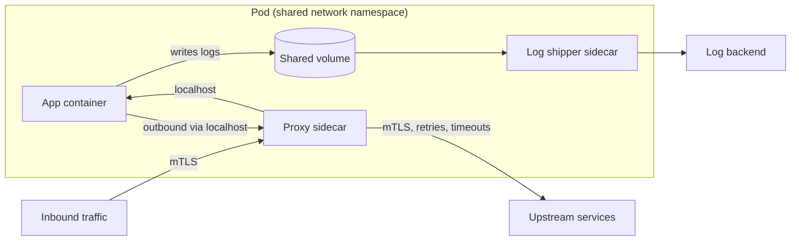

## In one minute
- A sidecar is a helper process deployed next to each instance of an application, sharing its lifecycle, network namespace, and often its filesystem, to provide cross-cutting capabilities.
- Typical sidecars handle traffic (proxying, mTLS, retries), telemetry (log shipping, metrics), configuration and secrets, or protocol adaptation.
- The application stays focused on business logic and can be written in any language, because the capability lives in a separate process, not a library.
- You pay in resources (memory and CPU per instance), latency (an extra local hop), and operational complexity (startup ordering, upgrades of thousands of copies).

## How it works

### Co-location
In Kubernetes, a pod holds multiple containers that share a network namespace (the same `localhost` and IP) and can share volumes. The sidecar runs as one of those containers. On VMs, it is a second process managed by the same supervisor. Co-location gives the sidecar cheap, local access to the app: a loopback TCP call costs tens of microseconds, and a shared volume lets a log shipper read files the app writes.

### Common roles
- **Proxy sidecar.** Intercepts inbound and outbound traffic (often via iptables redirection) to add mTLS, retries, timeouts, circuit breaking, and metrics. This is the data plane of a classic service mesh, usually Envoy.
- **Telemetry sidecar.** Tails log files or receives metrics and traces on localhost, buffers them, and ships them to a backend, so the app never blocks on a remote collector.
- **Config and secrets sidecar.** Fetches secrets from a vault, writes them to a shared in-memory volume, and refreshes them before expiry.
- **Adapter sidecar.** Exposes a legacy app's custom stats in a standard format, or translates protocols.
- **Runtime sidecar.** Replaces language-specific client libraries with a local API for state, pub/sub, secrets and service calls. Dapr's `daprd` is the common example: an injector adds it to any pod annotated `dapr.io/enabled`, and the app calls it on localhost ([Dapr docs](https://docs.dapr.io/concepts/dapr-services/sidecar/)).

### Library versus sidecar
The alternative is a shared library in every service. A library has no extra hop and no extra container, but must exist for every language, and upgrading it requires rebuilding and redeploying every service. A sidecar is language-agnostic and can be upgraded by the platform team on its own schedule, at the cost of resources and an extra process to fail. Microsoft's pattern guide adds two cases where a sidecar is the wrong call: when the component must scale independently of the app (make it a separate service), and when the platform or a sidecarless mesh already provides the capability ([Azure Architecture Center](https://learn.microsoft.com/en-us/azure/architecture/patterns/sidecar)).

### Lifecycle
Ordering matters. If the app starts before the proxy sidecar is ready, its first outbound calls fail. If the sidecar exits first during shutdown, in-flight requests break. Kubernetes added native sidecar support (init containers with `restartPolicy: Always`) so sidecars start before and stop after the main container. It arrived in v1.28, has been on by default since v1.29, and is stable since v1.33 ([Kubernetes docs](https://kubernetes.io/docs/concepts/workloads/pods/sidecar-containers/)); older guides that tell you to script around the ordering problem predate it. Jobs are a special case: a sidecar that never exits keeps a batch pod running forever unless it is a native sidecar, which does not block the Job from completing ([Kubernetes docs](https://kubernetes.io/docs/concepts/workloads/pods/sidecar-containers/)).

## Down the stack

### Layer 1: The contract
A proxy sidecar promises transparency: the application talks plain HTTP or TCP to the address it always used, and the sidecar adds encryption, policy, and telemetry without the app noticing. It also promises lifecycle ordering when deployed as a native sidecar: it is running before the app container starts and keeps running until the app has exited. A telemetry sidecar promises at-least-once shipping of what the app writes to a shared volume, with buffering if the backend is slow.

### Layer 2: The mechanism
Transparent interception is done with iptables in the pod's network namespace. In Istio, an init container or CNI plugin installs NAT rules: inbound TCP is redirected to the proxy on port 15006, outbound TCP to port 15001, and packets from the proxy's own user ID (1337) are excluded so the proxy's outbound connections do not loop back into itself. That is why Istio tells you never to run an application as UID 1337 ([Istio docs](https://istio.io/latest/docs/ops/deployment/application-requirements/)). The proxy recovers the original destination address with the `SO_ORIGINAL_DST` socket option, which the kernel sets on connections redirected by an iptables `REDIRECT` (or `TPROXY`) rule, and routes accordingly ([Envoy docs](https://www.envoyproxy.io/docs/envoy/latest/configuration/listeners/listener_filters/original_dst_filter)). Kubernetes native sidecars are init containers with `restartPolicy: Always`: the kubelet starts them in order before regular containers, waits for their startup probe, and terminates them after the main containers have fully stopped, in the reverse of their declared order. Shared volumes such as an `emptyDir` (optionally `medium: Memory`, a tmpfs) let a log shipper read the app's files.

### Layer 3: The machine
Every intercepted request crosses the kernel networking stack extra times: app to proxy over loopback, then proxy to the real destination, and the reverse on the receiving side. Each loopback hop costs syscalls, two copies, context switches, and conntrack lookups, roughly 10 to 50 microseconds, plus the proxy's own parsing and TLS work. Istio's own benchmark puts a sidecar Envoy at about 0.20 vCPU and 60 MB per 1,000 requests per second ([Istio performance](https://istio.io/latest/docs/ops/deployment/performance-and-scalability/)), but memory is mostly configuration: by default every sidecar is programmed to reach every workload in the mesh, so an Envoy holding routes and endpoints for hundreds of services can use far more unless a `Sidecar` resource scopes it to the services the pod actually calls ([Google Cloud docs](https://docs.cloud.google.com/service-mesh/docs/troubleshooting/troubleshoot-sidecar-proxies)). Multiplied by thousands of pods, that is the dominant cost, which is why meshes offer per-namespace scoping and node-level alternatives.

### Why it's built this way
1. Platform teams cannot modify every application in every language, so capabilities are attached from outside the process.
2. Every Linux network namespace already supports packet redirection, so iptables can intercept without app cooperation.
3. Redirection hides the original destination, so the proxy reads it back from the socket, and excludes its own UID to avoid loops.
4. A second process in the same pod has its own failure and startup timing, so Kubernetes added explicit sidecar lifecycle ordering.

## Diagram


## Worked example
A company runs 1,200 pods across 150 services in four languages. They want mTLS between all services, uniform retry policies, and per-route metrics.

With a proxy sidecar per pod: each Envoy uses about 50 MB of memory and 0.05 vCPU at idle, rising to 0.2 vCPU under load. Across 1,200 pods that is 60 GB of memory and 60 to 240 vCPU, roughly 8% of cluster capacity. Each request crosses two proxies (client side and server side), adding about 0.5 to 1 ms at p50 and 2 to 3 ms at p99.

Against that, the platform team rolled out mTLS in three weeks without touching any service code, and the language-specific retry libraries (four implementations, all slightly different) were deleted. When a CVE hit the proxy, they upgraded all 1,200 sidecars in a day with a rolling restart, without asking 40 teams to rebuild.

They also hit the startup race: about 0.3% of pods failed their first database call because the app started before the proxy. Switching to native sidecars fixed it.

## In the wild
- **Monzo, 2019: moving the proxy from the node into the pod (engineering write-up).** Monzo ran Linkerd 1 as a Kubernetes DaemonSet, one shared proxy per node, and found it the main contributor to p99 latency and too costly in CPU as traffic grew. In Monzo's load tests Envoy performed significantly better than Linkerd 1 while needing less CPU and memory, so Monzo replaced it, first in the same per-node DaemonSet layout and then by moving toward an Envoy sidecar beside every service. The sidecar placement mattered for security: with one proxy per pod, Calico network policies could restrict sensitive services to approved callers. Envoy had no Kubernetes awareness, so Monzo wrote a small control plane that pushes endpoint changes to it ([Monzo](https://monzo.com/blog/2019/04/03/deploying-envoy-proxy)).
- **Netflix, 2014: Prana, a sidecar for non-JVM services (engineering write-up).** Netflix's platform libraries for discovery (Eureka), dynamic config (Archaius) and resilient calls (Hystrix, Ribbon) were Java-only. Rather than port them, Netflix shipped Prana, a second process beside each Python, Node.js or other non-JVM service that exposes those features over a local HTTP API ([InfoQ](https://www.infoq.com/news/2014/12/netflix-prana/)).

## Trade-offs
| Option | Strengths | Weaknesses | Choose when |
|---|---|---|---|
| Shared library | No extra hop or process, lowest overhead | One implementation per language, upgrades need redeploys | One or two languages, tight latency budgets |
| Sidecar per instance | Language-agnostic, independent upgrades, strong isolation | Per-pod CPU and memory, extra hop, lifecycle issues | Polyglot fleets, platform-managed capabilities |
| Per-node agent (DaemonSet) | One copy per node, lower total resources | Shared failure domain per node, weaker tenant isolation | Log and metric collection, node-level networking |
| Sidecarless mesh (eBPF or node proxies) | Lower overhead, no pod injection; Istio ambient is GA since 1.24 ([Istio](https://istio.io/latest/blog/2024/ambient-reaches-ga/)) | Shared per-node L4 proxy, L7 needs separate waypoints | Large fleets where sidecar cost dominates |

## Pitfalls in production
- **Startup and shutdown ordering.** The app calls out before the proxy is ready, or the proxy dies before the app drains. Use native sidecars, readiness gates, and a pre-stop hook that drains the app first.
- **Jobs that never finish.** A sidecar keeps a completed batch pod alive. Use native sidecar semantics or have the job signal the sidecar to exit.
- **Resource limits ignored.** Sidecars without requests and limits get OOM-killed under load or starve the app. Set and tune them like any container, and scope proxy config so memory does not grow with the size of the whole mesh.
- **Debugging opacity.** Engineers do not know whether the proxy or the app returned a 503. Add proxy response flags to logs and teach teams to read them.
- **Version skew.** Thousands of sidecars on different versions behave differently. Track versions in a dashboard and automate rolling upgrades.

## Leadership lens
- Choose sidecars when the capability must be uniform across languages and upgraded independently. Choose a library when latency or resource overhead dominates.
- Account for the resource tax explicitly in capacity planning and cost reports.
- Agree on who owns the sidecar: the platform team operates and upgrades it; service teams need clear docs on its behaviour.
- Ask how failures in the sidecar surface in the app's metrics and alerts.

## Check yourself
1. Why can a sidecar be upgraded without rebuilding the application?
   **Answer:** It is a separate container image with its own release cycle, and it interacts with the app only through local network calls or shared files.
2. What problem do Kubernetes native sidecars solve?
   **Answer:** They guarantee the sidecar starts before and stops after the main container, and they do not keep batch jobs alive after the main container exits.
3. When is a per-node agent better than a per-pod sidecar?
   **Answer:** For capabilities like log or metric collection where per-workload isolation is not needed and running one copy per node saves substantial resources.

## Practice
**Task:** A proxy sidecar retries failed upstream calls. Write `call_with_retry(fn, max_attempts, base, cap, rand, retryable)`. `fn()` returns an HTTP status code; if it is in the set `retryable` and attempts remain, wait before the next attempt using full jitter: `rand() * min(cap, base * 2 ** n)`, where `n` is the zero-based index of the attempt that just failed. Do not actually sleep; collect the computed waits. Return `(final_status, waits)`. Make at most `max_attempts` calls in total and never wait after the last one.

```python starter
def call_with_retry(fn, max_attempts, base, cap, rand, retryable):
    # TODO
    raise NotImplementedError
```

```python tests
def seq(*codes):
    it = iter(codes)
    return lambda: next(it)

def half():
    return 0.5

def test_success_first_try():
    assert call_with_retry(seq(200), 3, 100, 1000, half, {503}) == (200, [])

def test_retries_then_success():
    assert call_with_retry(seq(503, 503, 200), 5, 100, 1000, half, {503}) == (200, [50.0, 100.0])

def test_gives_up_after_max_attempts():
    status, waits = call_with_retry(seq(503, 503, 503, 200), 3, 100, 1000, half, {503})
    assert status == 503 and waits == [50.0, 100.0]

def test_cap_applies():
    status, waits = call_with_retry(seq(503, 503, 503, 503, 200), 5, 100, 250, half, {503})
    assert waits == [50.0, 100.0, 125.0, 125.0]

def test_non_retryable_returns_immediately():
    assert call_with_retry(seq(400, 200), 3, 100, 1000, half, {503}) == (400, [])

def test_zero_jitter():
    assert call_with_retry(seq(429, 200), 3, 100, 1000, lambda: 0.0, {429, 503}) == (200, [0.0])
```

```python solution
def call_with_retry(fn, max_attempts, base, cap, rand, retryable):
    waits = []
    status = None
    for n in range(max_attempts):
        status = fn()
        if status not in retryable or n == max_attempts - 1:
            break
        waits.append(rand() * min(cap, base * 2 ** n))
    return (status, waits)
```

```typescript starter
export function callWithRetry(
  fn: () => number, maxAttempts: number, base: number, cap: number,
  rand: () => number, retryable: Set<number>,
): [number, number[]] {
  throw new Error("TODO");
}
```

```typescript tests
function seq(...codes: number[]): () => number {
  let i = 0;
  return () => codes[i++];
}
const half = () => 0.5;
test("success first try", () => {
  assertEqual(callWithRetry(seq(200), 3, 100, 1000, half, new Set([503])), [200, []]);
});
test("retries then success", () => {
  assertEqual(callWithRetry(seq(503, 503, 200), 5, 100, 1000, half, new Set([503])), [200, [50, 100]]);
});
test("gives up after max attempts", () => {
  assertEqual(callWithRetry(seq(503, 503, 503, 200), 3, 100, 1000, half, new Set([503])), [503, [50, 100]]);
});
test("cap applies", () => {
  const [, waits] = callWithRetry(seq(503, 503, 503, 503, 200), 5, 100, 250, half, new Set([503]));
  assertEqual(waits, [50, 100, 125, 125]);
});
test("non-retryable returns immediately", () => {
  assertEqual(callWithRetry(seq(400, 200), 3, 100, 1000, half, new Set([503])), [400, []]);
});
test("zero jitter", () => {
  assertEqual(callWithRetry(seq(429, 200), 3, 100, 1000, () => 0, new Set([429, 503])), [200, [0]]);
});
```

```typescript solution
export function callWithRetry(
  fn: () => number, maxAttempts: number, base: number, cap: number,
  rand: () => number, retryable: Set<number>,
): [number, number[]] {
  const waits: number[] = [];
  let status = 0;
  for (let n = 0; n < maxAttempts; n++) {
    status = fn();
    if (!retryable.has(status) || n === maxAttempts - 1) break;
    waits.push(rand() * Math.min(cap, base * 2 ** n));
  }
  return [status, waits];
}
```

```go starter
package practice

// CallWithRetry returns the final status and the computed full-jitter waits.
func CallWithRetry(fn func() int, maxAttempts int, base, cap float64,
	rand func() float64, retryable map[int]bool) (int, []float64) {
	panic("TODO")
}
```

```go tests
package practice

import (
	"reflect"
	"testing"
)

func seq(codes ...int) func() int {
	i := 0
	return func() int { c := codes[i]; i++; return c }
}

func half() float64 { return 0.5 }

var r503 = map[int]bool{503: true}

func TestFirstTry(t *testing.T) {
	s, w := CallWithRetry(seq(200), 3, 100, 1000, half, r503)
	if s != 200 || len(w) != 0 {
		t.Fatalf("got %d %v", s, w)
	}
}

func TestRetriesThenSuccess(t *testing.T) {
	s, w := CallWithRetry(seq(503, 503, 200), 5, 100, 1000, half, r503)
	if s != 200 || !reflect.DeepEqual(w, []float64{50, 100}) {
		t.Fatalf("got %d %v", s, w)
	}
}

func TestGivesUp(t *testing.T) {
	s, w := CallWithRetry(seq(503, 503, 503, 200), 3, 100, 1000, half, r503)
	if s != 503 || !reflect.DeepEqual(w, []float64{50, 100}) {
		t.Fatalf("got %d %v", s, w)
	}
}

func TestCap(t *testing.T) {
	_, w := CallWithRetry(seq(503, 503, 503, 503, 200), 5, 100, 250, half, r503)
	if !reflect.DeepEqual(w, []float64{50, 100, 125, 125}) {
		t.Fatalf("got %v", w)
	}
}

func TestNonRetryable(t *testing.T) {
	s, w := CallWithRetry(seq(400, 200), 3, 100, 1000, half, r503)
	if s != 400 || len(w) != 0 {
		t.Fatalf("got %d %v", s, w)
	}
}
```

```go solution
package practice

import "math"

// CallWithRetry returns the final status and the computed full-jitter waits.
func CallWithRetry(fn func() int, maxAttempts int, base, cap float64,
	rand func() float64, retryable map[int]bool) (int, []float64) {
	waits := []float64{}
	status := 0
	for n := 0; n < maxAttempts; n++ {
		status = fn()
		if !retryable[status] || n == maxAttempts-1 {
			break
		}
		waits = append(waits, rand()*math.Min(cap, base*math.Pow(2, float64(n))))
	}
	return status, waits
}
```

## Mock interview
**Prompt:** Your organisation runs 200 services in Go, Java, Python, and Node. Security requires mTLS everywhere within six months, and SRE wants uniform timeouts and retries. Would you use sidecars, libraries, or something else?

- Follow-up: After rollout, p99 latency rose by 4 ms on a latency-critical path. What do you investigate and what are your options?
- Follow-up: Batch jobs started hanging after sidecar injection. Why?
- Follow-up: How do you upgrade 3,000 sidecars safely?

**A strong answer covers:**
- Library versus sidecar versus node-level or sidecarless options, with the polyglot argument.
- Quantified resource and latency overhead, and exemptions or tuning for hot paths.
- Startup and shutdown ordering, native sidecars, and the batch job problem.
- Staged, automated rollouts with version tracking and quick rollback.
- Clear ownership split between platform and service teams.

## Sources and further study
**Primary**
- [Kubernetes KEP-753: sidecar containers](https://github.com/kubernetes/enhancements/tree/master/keps/sig-node/753-sidecar-containers): the design behind `restartPolicy: Always` init containers and their ordering rules.

**Systems docs**
- [Istio: application requirements](https://istio.io/latest/docs/ops/deployment/application-requirements/): the ports the sidecar claims and the reserved UID 1337.
- [Envoy: original destination listener filter](https://www.envoyproxy.io/docs/envoy/latest/configuration/listeners/listener_filters/original_dst_filter): how a transparent proxy recovers where a redirected connection was going.
- [Istio: performance and scalability](https://istio.io/latest/docs/ops/deployment/performance-and-scalability/): measured CPU and memory for sidecars, ztunnel and waypoints.
- [Dapr: the Dapr sidecar](https://docs.dapr.io/concepts/dapr-services/sidecar/): a runtime sidecar that replaces client libraries, including native-sidecar injection.

**Books**
- *Designing Distributed Systems* (2nd edition), Brendan Burns, chapters 3-5 "The Sidecar Pattern", "Ambassadors" and "Adapters": the three single-node container patterns, with worked examples such as adding HTTPS to a legacy service.

**Other curricula**
- [roadmap.sh System Design](https://roadmap.sh/system-design): lists Sidecar and Ambassador as separate nodes in its cloud design patterns, following the Azure catalogue.
- [donnemartin/system-design-primer](https://github.com/donnemartin/system-design-primer): does not cover sidecars; its closest material is the reverse proxy section.

## Watch
- [The Kubernetes SideCar Pattern explained (That DevOps Guy)](https://www.youtube.com/watch?v=6bVlL9pwKn8): a hands-on look at sidecars in pods.
- [Sidecar Pattern to SIMPLIFY services or just more COMPLEXITY? (CodeOpinion)](https://www.youtube.com/watch?v=9zAjtcf9Wyo): a critical look at when the pattern pays off.

## Free resources
- [Sidecar pattern (Azure Architecture Center)](https://learn.microsoft.com/en-us/azure/architecture/patterns/sidecar): the pattern, its issues, and when not to use it.
- [Sidecar Containers (Kubernetes docs)](https://kubernetes.io/docs/concepts/workloads/pods/sidecar-containers/): native sidecar semantics, ordering, and lifecycle.
- [Kubernetes v1.28: Introducing native sidecar containers](https://kubernetes.io/blog/2023/08/25/native-sidecar-containers/): the problems native sidecars were built to fix.
- [What is Envoy](https://www.envoyproxy.io/docs/envoy/latest/intro/what_is_envoy): the most common proxy sidecar and its design goals.
- [Ambassador pattern (Azure Architecture Center)](https://learn.microsoft.com/en-us/azure/architecture/patterns/ambassador): a specialised sidecar for outbound connectivity.
