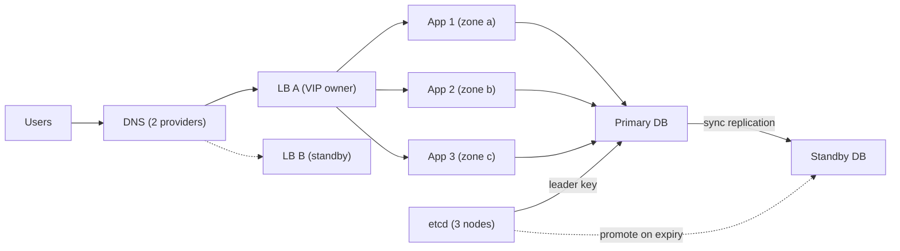

## In one minute
- A single point of failure is any component, link, person or process whose failure alone stops the whole service. If removing one thing breaks everything, that thing is a SPOF.
- Availability multiplies along a chain of required parts, so one 99.9% component caps the whole system at 99.9% no matter how good everything else is.
- Redundancy only removes a SPOF if the copies fail independently and something reliably switches to the survivor. Two servers on one power strip are still one failure.
- The obvious SPOFs (one database, one load balancer) are easy to find. The ones that cause real outages hide in shared dependencies: DNS, certificates, config stores, deploy pipelines, a single region's control plane, or the one engineer who knows how failover works.

## How it works

### Finding the SPOFs
Draw the request path from the user to the data, then ask of every box and arrow: if this disappears for an hour, does the request still succeed? Repeat for the paths that keep it running: deploys, secrets, monitoring, paging. In graph terms, a SPOF is a node that every path from the user to the data passes through.

### Removing them
There are three standard moves. **Replicate** the component, so there are N copies and the system needs only some of them (N+1 for stateless services, a quorum of 3 or 5 for stateful ones). **Partition** it, so a failure takes out a slice of users rather than all of them (cells, shards). **Decouple** from it, so the system can keep working without it for a while (caches, queues, static stability where the data plane keeps running on the last known config when the control plane is down).

Replicas only help if the survivors can carry the load. Two nodes at 60% each become one node at 120% when either fails ([Azure Well-Architected](https://learn.microsoft.com/en-us/azure/well-architected/reliability/redundancy)). AWS sizes services across three zones with 50% extra capacity, so each zone runs at about two-thirds of its tested limit and losing one needs no new launches ([AWS Builders' Library](https://aws.amazon.com/builders-library/static-stability-using-availability-zones/)). N+1 means the remaining N can carry the full peak, not N+1 copies that all run hot.

### Independence is the whole game
Redundancy assumes the copies fail independently. They often don't. Two replicas in one rack share a top-of-rack switch and a power feed. Two regions running the same binary share the same bug and fail together on the same bad deploy. Two DNS providers configured by one script share the script. Correlated failure is why a team can have "three of everything" and still go down. Spread copies across failure domains (host, rack, availability zone, region, vendor, release train) chosen to match the failures you actually expect.

### The switch is a SPOF too
Redundancy needs something that notices failure and moves traffic: a health check, a floating IP, a leader election. That mechanism can fail, flap, or make the wrong call, and a failover that has never been exercised usually fails when first needed. Test it on purpose, regularly.

### The problem shape
This is the *partial failure* shape: one part breaks and you must decide whether the whole stops. In payments, a single acquiring bank is a SPOF for checkout, so merchants add a second acquirer. In AI agent systems, one model provider is a SPOF for every agent; a fallback model plays the role of the standby replica.

## Down the stack

### Layer 1: The contract
For components in series (all required), system availability is the product: `A = A1 x A2 x ... x An`. For N independent replicas where any one suffices, `A = 1 - (1 - a)^N`. A SPOF-free design promises that no single failure in a stated set of failure domains (one host, one rack, one zone) drops availability below the target, and that failover completes within a stated time, such as 30 seconds, without losing acknowledged writes (RPO 0) or with a bounded loss.

### Layer 2: The mechanism
Stateless tiers use health checks: HAProxy, by default, probes every 2 seconds, marks a server down after 3 consecutive failures and back up after 2 successes ([HAProxy docs](https://docs.haproxy.org/3.2/configuration.html)). A pair of load balancers shares a virtual IP with VRRP (keepalived). The current spec, VRRPv3 in [RFC 9568](https://www.rfc-editor.org/rfc/rfc9568) (2024), replaced RFC 5798 and renamed the "master" to the *Active Router*: it advertises every second by default, and a backup takes over after three missed adverts plus a priority-based skew. Stateful tiers need consensus to avoid two primaries: Patroni holds a leader key in etcd with a default TTL of 30 seconds ([Patroni docs](https://patroni.readthedocs.io/en/latest/dynamic_configuration.html)). The replica that wins the key runs an optional `pre_promote` fencing script and then `pg_ctl promote` ([Patroni source](https://github.com/patroni/patroni/blob/master/patroni/postgresql/__init__.py)), and a watchdog resets the old leader's machine if Patroni hangs, timed to fire before the TTL lets anyone else take over ([Patroni watchdog](https://patroni.readthedocs.io/en/latest/watchdog.html)). DNS failover uses health-checked records (Route 53 failover routing) whose effect is bounded by the record's TTL. Route 53 checks every 10 or 30 seconds from many locations and calls an endpoint healthy while more than 18% of checkers agree, so one isolated checker cannot fail it over ([Route 53 docs](https://docs.aws.amazon.com/Route53/latest/DeveloperGuide/dns-failover-determining-health-of-endpoints.html)). Health checks run on Route 53's data plane, while editing records is a control-plane call, so AWS advises failover designs that never need a record change mid-incident ([AWS blog](https://aws.amazon.com/blogs/networking-and-content-delivery/creating-disaster-recovery-mechanisms-using-amazon-route-53)). At the edge, anycast advertises one prefix from many sites, so BGP withdraws a dead site within seconds.

### Layer 3: The machine
Hardware SPOFs are concrete. A server with one PSU, one NIC and one uplink has three. Bonded NICs (LACP, still often called 802.3ad, although the standard moved to IEEE 802.1AX in 2008 ([Wikipedia](https://en.wikipedia.org/wiki/Link_aggregation))) and dual PSUs on separate A and B power feeds remove them. A disk with an annual failure rate near 1% sounds safe until you have 10,000 of them: that is about two failures a week, which is why RAID and replicated storage exist. When a floating IP moves, the new holder sends a gratuitous ARP so switches update their tables; until they do, packets go to the dead host. Clients keep pooled TCP connections to the old address and only notice after a timeout or a TCP keepalive (Linux waits `tcp_keepalive_time`, 2 hours by default, then sends 9 probes 75 seconds apart ([kernel docs](https://docs.kernel.org/networking/ip-sysctl.html))), so failover time is often set by client timeouts rather than by the failover system itself.

### Why it's built this way
1. Every physical part eventually fails, and at fleet scale "eventually" means daily, so failures must be routine events rather than outages.
2. Availability multiplies along a chain, so the weakest required part sets the ceiling, and that part gets the redundancy budget first.
3. Copies only help if their failures are independent, so they are spread across racks, zones and regions that do not share power, network or software rollout.
4. Two copies of state that both accept writes will diverge, so stateful failover is gated by consensus and fencing rather than by a simple health check.
5. Detection takes time and moving clients takes more, so systems that need fast recovery keep the standby warm and the clients' timeouts short.

## Diagram


## Worked example
A checkout service needs DNS (99.99%), a load balancer (99.99%), an app tier, and a Postgres database. The app runs on three instances, each 99.5% available. The database is a single instance at 99.9%.

The app tier is three parallel copies: `1 - 0.005^3 = 0.999999875`. The chain is `0.9999 x 0.9999 x 0.999999875 x 0.999 ≈ 0.99880`, or 99.88%. That is about 10.5 hours of downtime a year, and almost all of it is the database. Adding a fourth app instance changes nothing visible; the app tier was never the problem.

Now add a synchronous standby with Patroni. Two independent 99.9% databases give a theoretical `1 - 0.001^2 = 0.999999`, but real failovers take about 30 seconds and a small fraction fail and need a human. Measured over a year, the team sees the database tier at about 99.99%. The chain becomes `0.9999 x 0.9999 x 0.9999 ≈ 0.9997`, roughly 2.6 hours a year. Now DNS and the load balancer are the biggest contributors, so the next step is a second DNS provider and a VRRP pair of load balancers.

A later game day finds one more: the app reads its database password from a secrets service at startup, so during a secrets outage autoscaling cannot start new instances. Caching the secret locally with a long expiry fixes it.

## In the wild
- **Cloudflare, 2023: a facility the control plane secretly needed.** The PDX-04 data centre lost utility power and its generators, and the UPS ran out after about 4 minutes. The control plane was meant to survive losing a facility, but some services depended on Kafka and ClickHouse clusters that ran only there, and a full-facility shutdown had never been tested. The control plane and analytics were impaired for about 40 hours. Cloudflare now requires generally available products to run on its high-availability cluster and tests removing whole facilities ([Cloudflare](https://blog.cloudflare.com/post-mortem-on-cloudflare-control-plane-and-analytics-outage/)).
- **Meta, 2021: the recovery tools shared the failure.** A maintenance command disconnected every backbone link, and a bug in the audit tool failed to stop it. Meta's DNS servers, unable to reach the data centres, withdrew their BGP routes, so the world could not resolve Facebook's domains. Engineers' remote tools depended on the same DNS, and physical security slowed access on site. The out-of-band path was itself a dependency of the thing that broke ([Meta](https://engineering.fb.com/2021/10/05/networking-traffic/outage-details/)).
- **AWS, 2025: one DNS record under many services.** A race between two automation workers in DynamoDB's DNS system left `dynamodb.us-east-1.amazonaws.com` with an empty record. DynamoDB errors lasted about 2 hours 52 minutes, but EC2's lease manager depended on DynamoDB and fell into congestive collapse, and the whole event ran about 14.5 hours. AWS disabled the automation worldwide and added rate limits to failover in its load balancers ([AWS](https://aws.amazon.com/message/101925/)).

## Trade-offs
| Option | Strengths | Weaknesses | Choose when |
|---|---|---|---|
| Active-active (N+1) | No failover step, capacity is used | Needs stateless design or multi-writer conflict handling | Stateless services, read paths |
| Active-passive (hot standby) | Simple writes, fast failover | Standby capacity idle, failover can fail | Single-writer databases, queues |
| Cold standby or backup restore | Cheap | Recovery takes minutes to hours | Internal tools, non-critical data |
| Cells or shards | Limits blast radius of any failure, including bad deploys | Routing layer, cross-cell operations, cost | Large multi-tenant platforms |
| Multi-region or multi-vendor | Survives regional and provider outages | Cost, latency, data consistency, operational complexity | Revenue-critical paths with strict targets |

## Pitfalls in production
- **Redundant in name only.** Replicas in one zone or behind one switch fail together. Map each copy to its failure domain and require at least two domains.
- **Untested failover.** The standby has stale config, missing permissions or a full disk. Fail over on a schedule (monthly is common) and alert when it has not happened.
- **Hidden shared dependencies.** DNS, certificate renewal, an identity provider, a config service or a single region's control plane sit under everything. List dependencies of the dependencies.
- **Clients that never move.** Long-lived connections and cached DNS keep traffic pointed at a dead node. Set client timeouts, keepalives and DNS TTLs to match the failover target.
- **Split brain after failover.** An old primary that comes back and accepts writes creates two sources of truth. Use consensus for leadership and fence the old leader.
- **Human SPOFs.** One person holds the runbook or the credentials. Write it down, rotate on-call, and run failovers with someone new driving.

## Leadership lens
- In design review, ask "what single failure takes this down?" for every box, arrow and out-of-band dependency, and keep the answers in a living dependency list.
- Spend redundancy budget on the weakest required link first; the availability math tells you where, so ask for it.
- Make failover an exercised feature with an owner and a schedule, not a diagram claim.
- Some SPOFs are acceptable. Record the decision, the expected downtime and the recovery plan, so the risk is chosen rather than discovered.
- Watch for organisational SPOFs: one team owning a shared platform with no on-call depth is as risky as one database.

## Check yourself
1. Three replicas each 99% available sit behind a single 99.95% load balancer. What is the approximate availability, and what should you improve first?
   **Answer:** The replicas give `1 - 0.01^3 = 0.999999`, so the total is about 99.95%, set entirely by the load balancer. Make the load balancer redundant first.
2. Why might two replicas in two regions still count as a SPOF?
   **Answer:** If they run the same code and receive the same deploy at the same time, a bad release takes out both. Independence requires staggered rollouts, not just separate locations.
3. A database fails over in 10 seconds, but users see errors for 5 minutes. What is the likely cause?
   **Answer:** Clients are still holding connections or cached DNS pointing at the old primary. Client timeouts, keepalives and TTLs bound the real recovery time.
4. Why is a simple health check not enough to promote a database standby?
   **Answer:** A partition can make a healthy primary look dead, and promoting the standby then gives two writers. Promotion needs consensus and fencing so only one primary can accept writes.

## Practice
**Task:** Write `find_spofs(edges, source, target)`. `edges` is a list of directed `(from, to)` pairs describing which component calls which, `source` is where requests enter and `target` is where the data lives. Return the sorted list of nodes, excluding `source` and `target`, whose removal leaves no path from `source` to `target`. If `target` is not reachable from `source` at all, raise `ValueError`. Graphs have at most a few hundred nodes, so trying each removal with a BFS is fine.

```python starter
def find_spofs(edges, source, target):
    # TODO
    raise NotImplementedError
```

```python tests
def test_chain_every_middle_node_is_spof():
    edges = [("user", "dns"), ("dns", "lb"), ("lb", "app"), ("app", "db")]
    assert find_spofs(edges, "user", "db") == ["app", "dns", "lb"]

def test_redundant_app_tier_removes_spof():
    edges = [("user", "lb"), ("lb", "app1"), ("lb", "app2"), ("app1", "db"), ("app2", "db")]
    assert find_spofs(edges, "user", "db") == ["lb"]

def test_fully_redundant_has_none():
    edges = [("u", "a"), ("u", "b"), ("a", "d"), ("b", "d")]
    assert find_spofs(edges, "u", "d") == []

def test_shared_dependency_hidden_behind_replicas():
    edges = [("u", "a1"), ("u", "a2"), ("a1", "cfg"), ("a2", "cfg"), ("cfg", "db")]
    assert find_spofs(edges, "u", "db") == ["cfg"]

def test_direct_edge_means_no_spof():
    edges = [("u", "db"), ("u", "x"), ("x", "db")]
    assert find_spofs(edges, "u", "db") == []

def test_unreachable_raises():
    try:
        find_spofs([("u", "a"), ("b", "db")], "u", "db")
        assert False, "expected ValueError"
    except ValueError:
        pass

def test_direction_matters():
    edges = [("u", "a"), ("a", "db"), ("db", "b"), ("b", "u")]
    assert find_spofs(edges, "u", "db") == ["a"]
```

```python solution
from collections import defaultdict, deque

def _reachable(adj, source, target, removed):
    seen = {source}
    queue = deque([source])
    while queue:
        node = queue.popleft()
        if node == target:
            return True
        for nxt in adj[node]:
            if nxt != removed and nxt not in seen:
                seen.add(nxt)
                queue.append(nxt)
    return False

def find_spofs(edges, source, target):
    adj = defaultdict(list)
    nodes = set()
    for a, b in edges:
        adj[a].append(b)
        nodes.add(a)
        nodes.add(b)
    if not _reachable(adj, source, target, None):
        raise ValueError("target not reachable from source")
    result = []
    for node in nodes:
        if node in (source, target):
            continue
        if not _reachable(adj, source, target, node):
            result.append(node)
    return sorted(result)
```

```typescript starter
export function findSpofs(edges: [string, string][], source: string, target: string): string[] {
  throw new Error("TODO");
}
```

```typescript tests
test("chain: every middle node is a SPOF", () => {
  const edges: [string, string][] = [["user", "dns"], ["dns", "lb"], ["lb", "app"], ["app", "db"]];
  assertEqual(findSpofs(edges, "user", "db"), ["app", "dns", "lb"]);
});
test("redundant app tier", () => {
  const edges: [string, string][] = [["user", "lb"], ["lb", "app1"], ["lb", "app2"], ["app1", "db"], ["app2", "db"]];
  assertEqual(findSpofs(edges, "user", "db"), ["lb"]);
});
test("fully redundant", () => {
  const edges: [string, string][] = [["u", "a"], ["u", "b"], ["a", "d"], ["b", "d"]];
  assertEqual(findSpofs(edges, "u", "d"), []);
});
test("shared dependency behind replicas", () => {
  const edges: [string, string][] = [["u", "a1"], ["u", "a2"], ["a1", "cfg"], ["a2", "cfg"], ["cfg", "db"]];
  assertEqual(findSpofs(edges, "u", "db"), ["cfg"]);
});
test("direct edge", () => {
  const edges: [string, string][] = [["u", "db"], ["u", "x"], ["x", "db"]];
  assertEqual(findSpofs(edges, "u", "db"), []);
});
test("unreachable throws", () => {
  let threw = false;
  try { findSpofs([["u", "a"], ["b", "db"]], "u", "db"); } catch (e) { threw = true; }
  assert(threw, "expected error");
});
test("direction matters", () => {
  const edges: [string, string][] = [["u", "a"], ["a", "db"], ["db", "b"], ["b", "u"]];
  assertEqual(findSpofs(edges, "u", "db"), ["a"]);
});
```

```typescript solution
function reachable(adj: Map<string, string[]>, source: string, target: string, removed: string | null): boolean {
  const seen = new Set<string>([source]);
  const queue: string[] = [source];
  while (queue.length > 0) {
    const node = queue.shift() as string;
    if (node === target) return true;
    for (const next of adj.get(node) || []) {
      if (next !== removed && !seen.has(next)) {
        seen.add(next);
        queue.push(next);
      }
    }
  }
  return false;
}

export function findSpofs(edges: [string, string][], source: string, target: string): string[] {
  const adj = new Map<string, string[]>();
  const nodes = new Set<string>();
  for (const [a, b] of edges) {
    if (!adj.has(a)) adj.set(a, []);
    (adj.get(a) as string[]).push(b);
    nodes.add(a);
    nodes.add(b);
  }
  if (!reachable(adj, source, target, null)) throw new Error("target not reachable from source");
  const result: string[] = [];
  for (const node of nodes) {
    if (node === source || node === target) continue;
    if (!reachable(adj, source, target, node)) result.push(node);
  }
  return result.sort();
}
```

```go starter
package practice

// FindSpofs returns the sorted nodes (excluding source and target) whose removal
// disconnects target from source. It returns an error if target is unreachable.
func FindSpofs(edges [][2]string, source, target string) ([]string, error) {
	panic("TODO")
}
```

```go tests
package practice

import (
	"reflect"
	"testing"
)

func check(t *testing.T, edges [][2]string, s, d string, want []string) {
	t.Helper()
	got, err := FindSpofs(edges, s, d)
	if err != nil {
		t.Fatalf("unexpected error: %v", err)
	}
	if len(got) == 0 && len(want) == 0 {
		return
	}
	if !reflect.DeepEqual(got, want) {
		t.Fatalf("got %v want %v", got, want)
	}
}

func TestChain(t *testing.T) {
	check(t, [][2]string{{"user", "dns"}, {"dns", "lb"}, {"lb", "app"}, {"app", "db"}}, "user", "db", []string{"app", "dns", "lb"})
}

func TestRedundantAppTier(t *testing.T) {
	check(t, [][2]string{{"user", "lb"}, {"lb", "app1"}, {"lb", "app2"}, {"app1", "db"}, {"app2", "db"}}, "user", "db", []string{"lb"})
}

func TestFullyRedundant(t *testing.T) {
	check(t, [][2]string{{"u", "a"}, {"u", "b"}, {"a", "d"}, {"b", "d"}}, "u", "d", nil)
}

func TestSharedDependency(t *testing.T) {
	check(t, [][2]string{{"u", "a1"}, {"u", "a2"}, {"a1", "cfg"}, {"a2", "cfg"}, {"cfg", "db"}}, "u", "db", []string{"cfg"})
}

func TestDirectEdge(t *testing.T) {
	check(t, [][2]string{{"u", "db"}, {"u", "x"}, {"x", "db"}}, "u", "db", nil)
}

func TestUnreachable(t *testing.T) {
	if _, err := FindSpofs([][2]string{{"u", "a"}, {"b", "db"}}, "u", "db"); err == nil {
		t.Fatal("expected error")
	}
}

func TestDirection(t *testing.T) {
	check(t, [][2]string{{"u", "a"}, {"a", "db"}, {"db", "b"}, {"b", "u"}}, "u", "db", []string{"a"})
}
```

```go solution
package practice

import (
	"errors"
	"sort"
)

func reachable(adj map[string][]string, source, target, removed string) bool {
	seen := map[string]bool{source: true}
	queue := []string{source}
	for len(queue) > 0 {
		node := queue[0]
		queue = queue[1:]
		if node == target {
			return true
		}
		for _, next := range adj[node] {
			if next != removed && !seen[next] {
				seen[next] = true
				queue = append(queue, next)
			}
		}
	}
	return false
}

// FindSpofs returns the sorted nodes (excluding source and target) whose removal
// disconnects target from source. It returns an error if target is unreachable.
func FindSpofs(edges [][2]string, source, target string) ([]string, error) {
	adj := map[string][]string{}
	nodes := map[string]bool{}
	for _, e := range edges {
		adj[e[0]] = append(adj[e[0]], e[1])
		nodes[e[0]] = true
		nodes[e[1]] = true
	}
	if !reachable(adj, source, target, "\x00none") {
		return nil, errors.New("target not reachable from source")
	}
	result := []string{}
	for n := range nodes {
		if n == source || n == target {
			continue
		}
		if !reachable(adj, source, target, n) {
			result = append(result, n)
		}
	}
	sort.Strings(result)
	return result, nil
}
```

## Mock interview
**Prompt:** You inherit a ticketing platform that sells 50,000 tickets per minute at on-sale peaks. It runs in one AWS region with a single Postgres primary, one Redis node for seat holds, and a payment provider integration. Last year a Redis restart during an on-sale cost two hours of sales. Find and remove the single points of failure.

- Follow-up: How do you fail over the seat-hold store without double-selling a seat?
- Follow-up: The payment provider is down for 20 minutes during an on-sale. What does the user experience, and what does the system do?
- Follow-up: Leadership asks for multi-region. What does it cost, and what would you do first instead?

**A strong answer covers:**
- A dependency walk of the request path and the support paths (deploys, secrets, DNS, certificates), with availability math showing which part sets the ceiling.
- Replicated seat holds with a consensus-backed leader or a primary-replica setup with fencing, and why a lost hold must fail closed rather than double-sell.
- A second payment provider or a queued "pending payment" state with a hold extension, treating the provider as a dependency that will fail.
- Multi-zone before multi-region, with failover drills and client timeouts sized to the failover target.
- Explicit acceptance of residual SPOFs with their expected downtime and owners.

## Sources and further study
**Primary**
- [RFC 9568: VRRP Version 3](https://www.rfc-editor.org/rfc/rfc9568): the current virtual-IP failover protocol, its timers and the Active Router election.
- [AWS: Summary of the DynamoDB service disruption, October 2025](https://aws.amazon.com/message/101925/): a detailed look at how one shared dependency spread across a region.
- [AWS whitepaper: Reducing the Scope of Impact with Cell-Based Architecture](https://docs.aws.amazon.com/wellarchitected/latest/reducing-scope-of-impact-with-cell-based-architecture/reducing-scope-of-impact-with-cell-based-architecture.html): partitioning a service so no failure reaches every customer.

**Systems docs**
- [Patroni: Watchdog support](https://patroni.readthedocs.io/en/latest/watchdog.html): how Patroni fences a primary that loses its leader lock.
- [HAProxy configuration manual](https://docs.haproxy.org/3.2/configuration.html): `inter`, `fall`, `rise` and the other health-check knobs.
- [Amazon Route 53: How health checks determine health](https://docs.aws.amazon.com/Route53/latest/DeveloperGuide/dns-failover-determining-health-of-endpoints.html): checker locations, thresholds and the 18% rule.

**Books**
- *Release It!* (2nd ed.), Michael Nygard, chapter 4 "Stability Antipatterns" and chapter 5 "Stability Patterns": integration points, cascading failures, bulkheads and fail fast.
- *Site Reliability Engineering* (Google), chapter 23 "Managing Critical State: Distributed Consensus for Reliability": why leader election needs consensus rather than heartbeats ([read free](https://sre.google/sre-book/managing-critical-state/)).
- *Designing Data-Intensive Applications* (2nd ed.), Kleppmann and Riccomini, chapter 6 "Replication": leader failover, split brain and fencing.

**Other curricula**
- [donnemartin/system-design-primer](https://github.com/donnemartin/system-design-primer): covers active-passive and active-active fail-over and the in-series and in-parallel availability formulas, without correlated failure or hidden dependencies.
- [Azure Well-Architected: Designing for redundancy](https://learn.microsoft.com/en-us/azure/well-architected/reliability/redundancy): redundancy per critical flow, deployment stamps, and active-active versus warm and cold spares.

## Watch
- [Single Point of Failure (SPOF) in System Design (Hayk Simonyan)](https://www.youtube.com/watch?v=Iy2YqgjXtRM): finding SPOFs in a typical web architecture and the usual ways to remove them.
- [High Availability: Eliminate Single Points of Failure (Shiran Afergan)](https://www.youtube.com/watch?v=USCCqS9MbHs): a beginner-friendly walk from one server to a redundant setup.

## Free resources
- [Static stability using Availability Zones (AWS Builders' Library)](https://aws.amazon.com/builders-library/static-stability-using-availability-zones/): how AWS designs systems to keep running when a zone or a control plane disappears.
- [Summary of the Amazon S3 Service Disruption, February 2017 (AWS)](https://aws.amazon.com/message/41926/): a real outage where removing too much capacity forced a full restart of shared subsystems.
- [Embracing Risk (Google SRE book)](https://sre.google/sre-book/embracing-risk/): how to choose an availability target and spend the error budget.
- [Failure mode analysis (Azure Well-Architected Framework)](https://learn.microsoft.com/en-us/azure/well-architected/reliability/failure-mode-analysis): a structured method for listing dependencies and their failure modes.
- [Single point of failure (Wikipedia)](https://en.wikipedia.org/wiki/Single_point_of_failure): background and examples beyond software.
