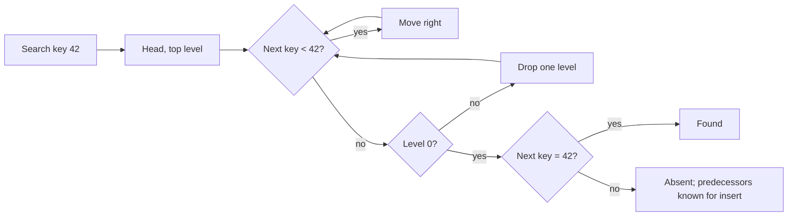

## In one minute
- A skip list is a sorted linked list with extra "express lane" pointers. Each node is promoted to higher levels by coin flips, so searches skip over long runs of nodes.
- It gives expected O(log n) search, insert, and delete, the same as a balanced tree, without any rotation or rebalancing logic.
- Because updates touch only a few neighbouring pointers, skip lists are much easier to make concurrent than balanced trees. That is why they back LSM-tree memtables (LevelDB, RocksDB), Java's `ConcurrentSkipListMap`, and Redis sorted sets.
- The costs are extra pointers per node, poor cache locality compared with B-trees, and only probabilistic, not worst-case, guarantees.

## How it works

### Levels
Level 0 is an ordinary sorted linked list of every element. Each node also appears at level 1 with probability `p`, at level 2 with probability `p^2`, and so on, up to a maximum level. A head sentinel has pointers at every level. With `p = 1/2`, level 1 holds about half the nodes, level 2 a quarter, and the top level a handful. The tallest level is about `log_(1/p)(n)`: 20 levels for a million elements at `p = 1/2`, 10 at `p = 1/4`.

A node's level is decided once, at insert, by flipping a biased coin until it fails. That is the whole balancing scheme: randomness keeps the structure balanced in expectation regardless of insertion order. The tail is thin: Pugh showed that once a list holds more than 250 elements, the chance a search takes over three times the expected time is below one in a million ([Pugh 1990](https://15721.courses.cs.cmu.edu/spring2018/papers/08-oltpindexes1/pugh-skiplists-cacm1990.pdf)).

### Search
Start at the head on the top level and move right while the next key is less than the target; otherwise drop a level. At level 0 the next node is the target or proof it is absent. Each level costs about `1/p` steps, roughly `2 log2(n)` comparisons in total at `p = 1/2`.

### Insert and delete
Search for the key, recording the last node visited at each level: the predecessors. Choose a random level and splice the new node in after its predecessor at each of its levels. Deletion unlinks the node using the same predecessors. Nothing else moves.

### Choosing p
Expected pointers per node are `1 / (1 - p)`: 2 at `p = 1/2`, 1.33 at `p = 1/4`, which trades memory for slightly longer searches. Pugh's own advice was `p = 1/4` unless the variability of running times matters most, and production engines follow it: Redis (`ZSKIPLIST_P 0.25`, [server.h](https://github.com/redis/redis/blob/8.6/src/server.h)), LevelDB (`kBranching = 4`, [skiplist.h](https://github.com/google/leveldb/blob/main/db/skiplist.h)) and RocksDB (branching factor 4, max height 12, [inlineskiplist.h](https://github.com/facebook/rocksdb/blob/main/memtable/inlineskiplist.h)). LevelDB and RocksDB cap height at 12 because a memtable is small; Redis caps it at 32.

### Ranges and ranks
Range queries are natural: search for the lower bound, then walk level 0 until the upper bound. Redis extends each forward pointer with a **span**, the number of level-0 nodes it skips, so it can compute a member's rank or jump to the k-th element in O(log n). That is how `ZRANK` and `ZRANGE ... LIMIT` stay fast on sorted sets with millions of members.

### Concurrency
Inserting into a skip list is a sequence of independent single-pointer updates from the bottom level up. Each can be done with a compare-and-swap, and a node is logically present as soon as it is linked at level 0. Readers never block and see either the old or new pointer. Deletion first marks the node, then unlinks it. Java's implementation does the marking by CAS-ing a special marker node in after the victim, so no concurrent insert can slip in behind it, a technique it credits to Tim Harris and Keir Fraser's lock-free list work ([OpenJDK source](https://github.com/openjdk/jdk/blob/master/src/java.base/share/classes/java/util/concurrent/ConcurrentSkipListMap.java)). Balanced trees need rotations that touch several nodes at once, which is why lock-free trees are rare and lock-free skip lists are common.

## Down the stack

### Layer 1: The contract
A skip list is an ordered map: point lookups, inserts, and deletes in expected `O(log n)`, and in-order iteration from any key. The bounds are probabilistic, so a specific operation can be slower, though large deviations are vanishingly rare. Java's `ConcurrentSkipListMap` adds lock-free thread safety with weakly consistent iterators, which never throw but may or may not reflect concurrent changes ([Java 21 docs](https://docs.oracle.com/en/java/javase/21/docs/api/java.base/java/util/concurrent/ConcurrentSkipListMap.html)). Older material says its `size()` walks the list in `O(n)`; that was true in Java 8, but current JDKs keep a `LongAdder` counter, so `size()` is cheap. It is still only a moment-in-time estimate while other threads write.

### Layer 2: The mechanism
Redis's `zskiplistNode` holds a `double` score, a backward pointer for reverse iteration, and a variable-length array of levels, each a forward pointer plus a `span`. `ZSKIPLIST_MAXLEVEL` is 32 and `ZSKIPLIST_P` is 0.25. Up to Redis 8.4 the node also held a pointer to a separately allocated member string. Redis 8.6 embeds the member string in the same allocation, after the level array, and reuses the unused level-0 span for bookkeeping, one of the "unified score/value structures" behind its sorted-set memory savings ([Redis 8.6 notes](https://redis.io/docs/latest/develop/whats-new/8-6/)). A sorted set also keeps a hash table from member to score for O(1) score lookups. Small sorted sets skip all of this and use a compact listpack until they exceed 128 entries or 64-byte members (`zset-max-listpack-entries` and `zset-max-listpack-value` in [redis.conf](https://github.com/redis/redis/blob/unstable/redis.conf); Redis before 7.0 called the encoding ziplist).

RocksDB's default memtable is an `InlineSkipList`. Each node stores its next pointers immediately before the key bytes in one allocation from the memtable's arena, so a node is a single contiguous block. Concurrent writers insert by compare-and-swap on each level's pointer, bottom up. This is on by default (`allow_concurrent_memtable_write = true`), and only the skip-list memtable supports it; the hash-based and vector memtables do not ([RocksDB wiki](https://github.com/facebook/rocksdb/wiki/MemTable)). Nothing is ever removed from it: deletes are written as tombstone entries, and the whole memtable is freed after it is flushed.

### Layer 3: The machine
Each step to a node not in cache is a dependent load costing 80 to 100 ns from DRAM, so a 10-level search with 40 node visits can reach a few microseconds when cold. Arena allocation helps: nodes inserted close in time are close in memory, and inlining the key avoids a second miss to compare it.

Concurrency relies on the memory model. A writer fully initialises a node, then publishes it with a release store or CAS; readers use acquire loads, so they never see a half-built node. On x86 ordinary stores are already ordered, so release costs almost nothing; on ARM it needs barrier instructions. An uncontended CAS costs about 10 to 20 ns, while a contended one forces the cache line to move between cores. In Redis everything runs on one thread, so no atomics are needed, and an average node at `p = 1/4` carries about 1.33 levels of 16 bytes each plus 16 bytes of score and backward pointer. Before 8.6 it also paid an 8-byte member pointer and a second allocation for the string, which meant a likely extra cache miss on every comparison that tied on score.

### Why it's built this way
1. Balanced trees keep their bounds by restructuring several nodes at once, which is hard to make concurrent.
2. Random levels keep the structure balanced in expectation while every change stays local to a few pointers.
3. Local single-pointer changes map directly onto compare-and-swap, which makes lock-free versions practical.
4. Pointer chasing is slow on real CPUs, so engines inline keys, use arenas, and defer freeing memory until a whole memtable is dropped.

## Diagram


## Worked example
A storage engine uses an LSM tree. Writes go to an in-memory memtable that must accept 200,000 inserts per second from 16 writer threads while point reads and range scans run concurrently. When it reaches 64 MB it becomes immutable and is flushed to a sorted file.

With 100-byte entries, a 64 MB memtable holds about 600,000 keys. At `p = 1/4` the expected height is about `log4(600,000)`, roughly 10 levels, and each node carries 1.33 pointers on average, about 11 bytes of pointer overhead per entry on a 64-bit machine. A lookup costs about 4 steps per level over 10 levels, around 40 key comparisons, each a likely cache miss: on the order of 2 to 4 microseconds.

A balanced tree needs about 20 comparisons with similar cache misses, so it is not much faster single-threaded. The difference is concurrency: 16 writers insert in parallel with compare-and-swap, and readers never lock, whereas a red-black tree would serialise writers behind locks around rotations.

Flushing is a single walk along level 0, already in key order.

Pointer chasing is cache-unfriendly, so engines store keys inline in each node and allocate nodes from a contiguous arena.

## In the wild
- **Discord, 2019: a skip-list-style sorted set for guild member lists.** Discord's member list needs a sorted structure with indices for guilds of hundreds of thousands of members. Appending to a 250,000-item Erlang `ordsets` took 27,000 µs; chaining small ordsets into cells, an express-lane idea borrowed from skip lists, cut that to 5,000 µs but made front inserts cost 19,000 µs. Splitting cells fixed the cascade, and a Rust NIF finally held inserts between 0.61 and 3.68 µs from 5,000 to 1,000,000 items. It now runs every guild ([Discord](https://discord.com/blog/using-rust-to-scale-elixir-for-11-million-concurrent-users)).
- **Redis, 2021: the compact sorted-set encoding becomes a heap overflow.** CVE-2021-32628 (CVSS 7.5) let a user who could raise `zset-max-ziplist-entries` or `-value` with `CONFIG SET` build huge ziplists, overflow a size calculation and corrupt the heap. Fixes shipped in 6.2.6, 6.0.16 and 5.0.14, and the advice was to block `CONFIG SET` with ACLs. The thresholds that pick between listpack and skip list are a safety boundary, not just a tuning knob ([Redis advisory](https://github.com/redis/redis/security/advisories/GHSA-vw22-qm3h-49pr)).

## Trade-offs
| Option | Strengths | Weaknesses | Choose when |
|---|---|---|---|
| Skip list | Simple, no rebalancing, easy lock-free concurrency, cheap ordered scans | Probabilistic bounds, pointer overhead, cache-unfriendly | Concurrent in-memory ordered maps, memtables |
| Balanced BST (red-black, AVL) | Worst-case O(log n), compact | Rotations make concurrency hard | Single-threaded ordered maps |
| B-tree / B+tree | Cache and disk friendly, high fanout | More complex code, splits and merges | On-disk indexes and large in-memory indexes |
| Hash map | O(1) lookups | No ordering, no range scans | Point lookups only |

## Pitfalls in production
- **Bad randomness.** A poorly seeded or correlated random source produces skewed levels and degenerate searches. Use a fast, well-distributed generator per thread.
- **Too low a level cap.** A cap of 16 with `p = 1/2` limits efficient size to about 65,000 elements; beyond that the top level gets crowded. Size the cap from the maximum expected element count.
- **Memory overhead surprises.** Small values with several pointers per node can double memory use. Measure bytes per entry, and consider `p = 1/4`.
- **Unsafe memory reclamation.** In lock-free versions, freeing a deleted node while a reader still holds a pointer to it crashes the process. Use epoch-based reclamation, hazard pointers, or a garbage-collected runtime, or never free nodes until the whole memtable is dropped, as LSM engines do.

## Leadership lens
- Ask whether the workload is concurrent and ordered. If it is only point lookups, a hash map is simpler; if it is mostly read-only, a sorted array or B-tree wins.
- Prefer a library implementation (`ConcurrentSkipListMap`, crossbeam-skiplist, RocksDB's) over writing a lock-free one; the reclamation and memory-ordering details are hard to review.
- For memtables, the skip list is usually not the bottleneck; flush, compaction, and write-ahead logging are. Profile before tuning it.

## Check yourself
1. Why does a skip list stay balanced without any rebalancing step?
   **Answer:** Each node's height is chosen independently at random when it is inserted, so the expected number of nodes per level halves (or quarters) regardless of key order, and no operation can push the structure into a bad shape except through bad luck.
2. Why are lock-free skip lists common but lock-free balanced trees rare?
   **Answer:** A skip-list insert is a series of independent single-pointer updates that can each be done with compare-and-swap, while tree rotations must change several pointers atomically.
3. What does lowering `p` from 1/2 to 1/4 trade?
   **Answer:** Fewer pointers per node (1.33 instead of 2), so less memory, at the cost of more horizontal steps per level and slightly longer searches.

## Practice
**Task:** Implement a skip list map with integer keys and string values. The constructor takes `rng`, a function returning floats in `[0, 1)`, plus `p` and `max_level`. A new node's level starts at 1 and increases while `rng() < p` and the level is below `max_level`. Provide `insert(key, value)` (overwrites existing keys without changing levels), `get(key)` (returns `None` when absent), `delete(key)` returning whether it removed something, `range(lo, hi)` returning keys in `[lo, hi]` in order, and `height()` for the tallest level in use (0 when empty). TypeScript uses `null` for missing values; Go uses `Get(key) (string, bool)` and `Range(lo, hi) []int`.

```python starter
class SkipList:
    def __init__(self, rng, p=0.5, max_level=16):
        pass

    def insert(self, key, value):
        raise NotImplementedError

    def get(self, key):
        raise NotImplementedError

    def delete(self, key):
        raise NotImplementedError

    def range(self, lo, hi):
        raise NotImplementedError

    def height(self):
        raise NotImplementedError
```

```python tests
def lcg(seed):
    state = [seed]
    def rnd():
        state[0] = (state[0] * 1103515245 + 12345) % 2147483648
        return state[0] / 2147483648
    return rnd

def test_empty():
    s = SkipList(lcg(1))
    assert s.get(5) is None and s.height() == 0 and s.range(0, 10) == []

def test_insert_get_overwrite():
    s = SkipList(lcg(2))
    s.insert(3, "c")
    s.insert(1, "a")
    s.insert(3, "C")
    assert s.get(3) == "C" and s.get(1) == "a" and s.get(2) is None

def test_range_in_order():
    s = SkipList(lcg(3))
    for i in range(100):
        k = (i * 37) % 100
        s.insert(k, str(k))
    assert s.range(10, 20) == list(range(10, 21))

def test_delete():
    s = SkipList(lcg(4))
    for k in (5, 1, 9):
        s.insert(k, str(k))
    assert s.delete(5) and not s.delete(5)
    assert s.get(5) is None and s.range(0, 10) == [1, 9]

def test_levels_follow_rng():
    flat = SkipList(lambda: 0.99)
    tall = SkipList(lambda: 0.0, max_level=7)
    for k in range(10):
        flat.insert(k, "")
        tall.insert(k, "")
    assert flat.height() == 1 and tall.height() == 7

def test_matches_dict_after_random_ops():
    rnd, s, ref = lcg(9), SkipList(lcg(10)), {}
    for _ in range(600):
        k = int(rnd() * 50)
        if rnd() < 0.7:
            s.insert(k, "v%d" % k)
            ref[k] = "v%d" % k
        else:
            assert s.delete(k) == (k in ref)
            ref.pop(k, None)
    assert s.range(0, 49) == sorted(ref)
```

```python solution
class _Node:
    def __init__(self, key, value, level):
        self.key, self.value, self.next = key, value, [None] * level

class SkipList:
    def __init__(self, rng, p=0.5, max_level=16):
        self.rng, self.p, self.max_level = rng, p, max_level
        self.head = _Node(None, None, max_level)
        self.level = 0

    def _preds(self, key):
        preds, x = [self.head] * self.max_level, self.head
        for i in range(self.level - 1, -1, -1):
            while x.next[i] is not None and x.next[i].key < key:
                x = x.next[i]
            preds[i] = x
        return preds

    def insert(self, key, value):
        preds = self._preds(key)
        nxt = preds[0].next[0]
        if nxt is not None and nxt.key == key:
            nxt.value = value
            return
        lvl = 1
        while self.rng() < self.p and lvl < self.max_level:
            lvl += 1
        self.level = max(self.level, lvl)
        node = _Node(key, value, lvl)
        for i in range(lvl):
            node.next[i], preds[i].next[i] = preds[i].next[i], node

    def get(self, key):
        nxt = self._preds(key)[0].next[0]
        return nxt.value if nxt is not None and nxt.key == key else None

    def delete(self, key):
        preds = self._preds(key)
        node = preds[0].next[0]
        if node is None or node.key != key:
            return False
        for i in range(len(node.next)):
            preds[i].next[i] = node.next[i]
        while self.level > 0 and self.head.next[self.level - 1] is None:
            self.level -= 1
        return True

    def range(self, lo, hi):
        out, x = [], self._preds(lo)[0].next[0]
        while x is not None and x.key <= hi:
            out.append(x.key)
            x = x.next[0]
        return out

    def height(self):
        return self.level
```

```typescript starter
export class SkipList {
  constructor(rng: () => number, p = 0.5, maxLevel = 16) {}
  insert(key: number, value: string): void { throw new Error("TODO"); }
  get(key: number): string | null { throw new Error("TODO"); }
  delete(key: number): boolean { throw new Error("TODO"); }
  range(lo: number, hi: number): number[] { throw new Error("TODO"); }
  height(): number { throw new Error("TODO"); }
}
```

```typescript tests
function lcg(seed: number): () => number {
  let s = seed;
  return () => { s = (s * 1103515245 + 12345) % 2147483648; return s / 2147483648; };
}
test("empty", () => {
  const s = new SkipList(lcg(1));
  assertEqual([s.get(5), s.height(), s.range(0, 10)], [null, 0, []]);
});
test("insert get overwrite", () => {
  const s = new SkipList(lcg(2));
  s.insert(3, "c"); s.insert(1, "a"); s.insert(3, "C");
  assertEqual([s.get(3), s.get(1), s.get(2)], ["C", "a", null]);
});
test("range in order", () => {
  const s = new SkipList(lcg(3));
  for (let i = 0; i < 100; i++) { const k = (i * 37) % 100; s.insert(k, String(k)); }
  assertEqual(s.range(10, 20), Array.from({ length: 11 }, (_, i) => 10 + i));
});
test("delete", () => {
  const s = new SkipList(lcg(4));
  for (const k of [5, 1, 9]) s.insert(k, String(k));
  assert(s.delete(5) && !s.delete(5), "delete once");
  assertEqual([s.get(5), s.range(0, 10)], [null, [1, 9]]);
});
test("levels follow rng", () => {
  const flat = new SkipList(() => 0.99), tall = new SkipList(() => 0, 0.5, 7);
  for (let k = 0; k < 10; k++) { flat.insert(k, ""); tall.insert(k, ""); }
  assertEqual([flat.height(), tall.height()], [1, 7]);
});
test("matches map after random ops", () => {
  const rnd = lcg(9), s = new SkipList(lcg(10)), ref = new Map<number, string>();
  for (let i = 0; i < 600; i++) {
    const k = Math.floor(rnd() * 50);
    if (rnd() < 0.7) { s.insert(k, "v" + k); ref.set(k, "v" + k); }
    else { assertEqual(s.delete(k), ref.has(k)); ref.delete(k); }
  }
  assertEqual(s.range(0, 49), [...ref.keys()].sort((a, b) => a - b));
});
```

```typescript solution
class SNode {
  next: (SNode | null)[];
  constructor(public key: number, public value: string, level: number) { this.next = new Array(level).fill(null); }
}
export class SkipList {
  private head: SNode;
  private level = 0;
  constructor(private rng: () => number, private p = 0.5, private maxLevel = 16) {
    this.head = new SNode(-Infinity, "", maxLevel);
  }
  private preds(key: number): SNode[] {
    const preds: SNode[] = new Array(this.maxLevel).fill(this.head);
    let x = this.head;
    for (let i = this.level - 1; i >= 0; i--) {
      while (x.next[i] !== null && x.next[i]!.key < key) x = x.next[i]!;
      preds[i] = x;
    }
    return preds;
  }
  insert(key: number, value: string): void {
    const preds = this.preds(key), nxt = preds[0].next[0];
    if (nxt && nxt.key === key) { nxt.value = value; return; }
    let lvl = 1;
    while (this.rng() < this.p && lvl < this.maxLevel) lvl++;
    this.level = Math.max(this.level, lvl);
    const node = new SNode(key, value, lvl);
    for (let i = 0; i < lvl; i++) { node.next[i] = preds[i].next[i]; preds[i].next[i] = node; }
  }
  get(key: number): string | null {
    const nxt = this.preds(key)[0].next[0];
    return nxt && nxt.key === key ? nxt.value : null;
  }
  delete(key: number): boolean {
    const preds = this.preds(key), node = preds[0].next[0];
    if (!node || node.key !== key) return false;
    for (let i = 0; i < node.next.length; i++) preds[i].next[i] = node.next[i];
    while (this.level > 0 && this.head.next[this.level - 1] === null) this.level--;
    return true;
  }
  range(lo: number, hi: number): number[] {
    const out: number[] = [];
    for (let x = this.preds(lo)[0].next[0]; x && x.key <= hi; x = x.next[0]) out.push(x.key);
    return out;
  }
  height(): number { return this.level; }
}
```

```go starter
package practice

// SkipList is an ordered map from int to string.
type SkipList struct{}

// New creates a skip list using rng for level choice.
func New(rng func() float64, p float64, maxLevel int) *SkipList { return &SkipList{} }

func (s *SkipList) Insert(key int, value string) { panic("TODO") }
func (s *SkipList) Get(key int) (string, bool)   { panic("TODO") }
func (s *SkipList) Delete(key int) bool          { panic("TODO") }
func (s *SkipList) Range(lo, hi int) []int       { panic("TODO") }
func (s *SkipList) Height() int                  { panic("TODO") }
```

```go tests
package practice

import (
	"reflect"
	"sort"
	"testing"
)

func lcg(seed int64) func() float64 {
	s := seed
	return func() float64 {
		s = (s*1103515245 + 12345) % 2147483648
		return float64(s) / 2147483648
	}
}

func TestEmpty(t *testing.T) {
	s := New(lcg(1), 0.5, 16)
	if _, ok := s.Get(5); ok || s.Height() != 0 || len(s.Range(0, 10)) != 0 {
		t.Fatal("not empty")
	}
}

func TestInsertGetOverwrite(t *testing.T) {
	s := New(lcg(2), 0.5, 16)
	s.Insert(3, "c")
	s.Insert(1, "a")
	s.Insert(3, "C")
	v3, _ := s.Get(3)
	v1, _ := s.Get(1)
	_, ok2 := s.Get(2)
	if v3 != "C" || v1 != "a" || ok2 {
		t.Fatal(v3, v1, ok2)
	}
}

func TestRangeInOrder(t *testing.T) {
	s := New(lcg(3), 0.5, 16)
	for i := 0; i < 100; i++ {
		s.Insert((i*37)%100, "")
	}
	want := []int{10, 11, 12, 13, 14, 15, 16, 17, 18, 19, 20}
	if got := s.Range(10, 20); !reflect.DeepEqual(got, want) {
		t.Fatal(got)
	}
}

func TestDelete(t *testing.T) {
	s := New(lcg(4), 0.5, 16)
	for _, k := range []int{5, 1, 9} {
		s.Insert(k, "")
	}
	if !s.Delete(5) || s.Delete(5) {
		t.Fatal("delete once")
	}
	if _, ok := s.Get(5); ok || !reflect.DeepEqual(s.Range(0, 10), []int{1, 9}) {
		t.Fatal("still present")
	}
}

func TestLevelsFollowRng(t *testing.T) {
	flat := New(func() float64 { return 0.99 }, 0.5, 16)
	tall := New(func() float64 { return 0 }, 0.5, 7)
	for k := 0; k < 10; k++ {
		flat.Insert(k, "")
		tall.Insert(k, "")
	}
	if flat.Height() != 1 || tall.Height() != 7 {
		t.Fatal(flat.Height(), tall.Height())
	}
}

func TestMatchesMap(t *testing.T) {
	rnd, s, ref := lcg(9), New(lcg(10), 0.5, 16), map[int]bool{}
	for i := 0; i < 600; i++ {
		k := int(rnd() * 50)
		if rnd() < 0.7 {
			s.Insert(k, "v")
			ref[k] = true
		} else {
			if s.Delete(k) != ref[k] {
				t.Fatal("delete mismatch")
			}
			delete(ref, k)
		}
	}
	want := []int{}
	for k := range ref {
		want = append(want, k)
	}
	sort.Ints(want)
	if got := s.Range(0, 49); !reflect.DeepEqual(got, want) {
		t.Fatal(got, want)
	}
}
```

```go solution
package practice

type node struct {
	key   int
	value string
	next  []*node
}

// SkipList is an ordered map from int to string.
type SkipList struct {
	rng      func() float64
	p        float64
	maxLevel int
	level    int
	head     *node
}

// New creates a skip list using rng for level choice.
func New(rng func() float64, p float64, maxLevel int) *SkipList {
	return &SkipList{rng: rng, p: p, maxLevel: maxLevel, head: &node{next: make([]*node, maxLevel)}}
}

func (s *SkipList) preds(key int) []*node {
	preds := make([]*node, s.maxLevel)
	for i := range preds {
		preds[i] = s.head
	}
	x := s.head
	for i := s.level - 1; i >= 0; i-- {
		for x.next[i] != nil && x.next[i].key < key {
			x = x.next[i]
		}
		preds[i] = x
	}
	return preds
}

func (s *SkipList) Insert(key int, value string) {
	preds := s.preds(key)
	if n := preds[0].next[0]; n != nil && n.key == key {
		n.value = value
		return
	}
	lvl := 1
	for s.rng() < s.p && lvl < s.maxLevel {
		lvl++
	}
	if lvl > s.level {
		s.level = lvl
	}
	n := &node{key: key, value: value, next: make([]*node, lvl)}
	for i := 0; i < lvl; i++ {
		n.next[i], preds[i].next[i] = preds[i].next[i], n
	}
}

func (s *SkipList) Get(key int) (string, bool) {
	if n := s.preds(key)[0].next[0]; n != nil && n.key == key {
		return n.value, true
	}
	return "", false
}

func (s *SkipList) Delete(key int) bool {
	preds := s.preds(key)
	n := preds[0].next[0]
	if n == nil || n.key != key {
		return false
	}
	for i := range n.next {
		preds[i].next[i] = n.next[i]
	}
	for s.level > 0 && s.head.next[s.level-1] == nil {
		s.level--
	}
	return true
}

func (s *SkipList) Range(lo, hi int) []int {
	out := []int{}
	for x := s.preds(lo)[0].next[0]; x != nil && x.key <= hi; x = x.next[0] {
		out = append(out, x.key)
	}
	return out
}

func (s *SkipList) Height() int { return s.level }
```

## Mock interview
**Prompt:** Design a real-time leaderboard for a mobile game with 50 million players, 20,000 score updates per second, and queries for a player's global rank and the 100 players around them. Explain the data structure behind the ranking.

- Follow-up: How does the structure return a player's rank in O(log n) rather than walking the list?
- Follow-up: One Redis instance cannot hold or serve this. How do you shard while keeping global rank queries correct?
- Follow-up: Why would you choose a skip list over a balanced tree for this structure if you were building it yourself?

**A strong answer covers:**
- A sorted set (skip list plus hash map) keyed by score, with span counts on forward pointers giving rank and k-th element in O(log n).
- Memory sizing: tens of millions of members at roughly 100 bytes each, and the consequences for a single node.
- Sharding options: score-range partitions with per-shard counts, or approximate global rank from score histograms, with clear accuracy trade-offs.
- Tie-breaking rules for equal scores, such as time achieved or player ID, encoded into the sort key.
- Concurrency and simplicity arguments for skip lists, plus the cache-locality cost.

## Sources and further study
**Primary**
- [Keir Fraser, Practical lock-freedom (Cambridge TR-579, 2004)](https://www.cl.cam.ac.uk/techreports/UCAM-CL-TR-579.pdf): the lock-free skip list design, with mark-then-unlink deletion and memory reclamation, that later libraries built on.
- [Herlihy, Lev, Luchangco and Shavit, A Simple Optimistic Skiplist Algorithm (2007)](https://people.csail.mit.edu/shanir/publications/LazySkipList.pdf): a lock-based alternative that is far easier to prove correct.

**Systems docs**
- [RocksDB wiki: MemTable](https://github.com/facebook/rocksdb/wiki/MemTable): memtable types, which support concurrent inserts, and the 64 MB default size.
- [OpenJDK ConcurrentSkipListMap source](https://github.com/openjdk/jdk/blob/master/src/java.base/share/classes/java/util/concurrent/ConcurrentSkipListMap.java): a long design comment on marker nodes, index levels and the size counter.
- [LevelDB skiplist.h](https://github.com/google/leveldb/blob/main/db/skiplist.h): under 400 lines: writes need an external mutex while reads run without locks, with clear memory-ordering comments.

**Books**
- *Database Internals* (1st ed.), Alex Petrov, chapter 7 "Log-Structured Storage": memtables, flushes and the sorted in-memory structures behind them.
- *Designing Data-Intensive Applications* (2nd ed.), Kleppmann and Riccomini, chapter 4 "Storage and Retrieval": where the memtable sits in an LSM storage engine.
- *System Design Interview, Volume 2*, Alex Xu and Sahn Lam, chapter 10 "Real-time Gaming Leaderboard": Redis sorted sets and their skip lists as the ranking engine.

**Other curricula**
- [CMU 15-721 Advanced Database Systems (Spring 2018)](https://15721.courses.cs.cmu.edu/spring2018/): treats skip lists as an OLTP in-memory index next to the Bw-tree, with an eye on latch-free design and cache misses.
- [MIT 6.046 lecture 7: Randomization, Skip Lists](https://ocw.mit.edu/courses/6-046j-design-and-analysis-of-algorithms-spring-2015/resources/lecture-7-randomization-skip-lists/): frames skip lists as a randomized algorithm and proves the high-probability `O(log n)` bound.

## Watch
- [Randomization: Skip Lists (MIT OpenCourseWare)](https://www.youtube.com/watch?v=2g9OSRKJuzM): an MIT 6.046 lecture deriving the expected search cost and high-probability bounds.

## Free resources
- [Pugh: Skip Lists, A Probabilistic Alternative to Balanced Trees (1990)](https://15721.courses.cs.cmu.edu/spring2018/papers/08-oltpindexes1/pugh-skiplists-cacm1990.pdf): the original paper, short and readable, hosted by CMU's database course.
- [Wikipedia: Skip list](https://en.wikipedia.org/wiki/Skip_list): analysis, indexable skip lists, and concurrent variants.
- [Java ConcurrentSkipListMap](https://docs.oracle.com/javase/8/docs/api/java/util/concurrent/ConcurrentSkipListMap.html): API and guarantees of a production lock-free skip list.
- [Redis: Sorted sets](https://redis.io/docs/latest/develop/data-types/sorted-sets/): the operations a skip list with spans makes cheap.
- [Skip Lists: Done Right (ticki)](https://ticki.github.io/blog/skip-lists-done-right/): practical engineering of fast skip lists, including memory layout.
