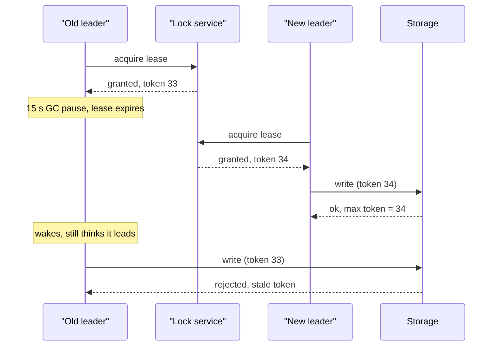

## In one minute
- Split brain is when two nodes both believe they are the single leader or primary, and both accept writes. The data diverges and some of it is usually lost.
- It happens because leadership is decided from incomplete information: a partition or a long pause makes a live leader look dead.
- Prevention has two layers: elect leaders only with a majority quorum, and stop a deposed leader from doing damage with leases and fencing tokens.
- A lease alone is not enough, because the old leader's clock or process can stall past expiry. The resource being protected must reject stale leaders.

## How it works

### How it happens
Take a primary and a standby database with a heartbeat link. The link drops. The standby sees no heartbeats for 10 seconds, promotes itself, and the virtual IP or DNS record moves. But the old primary never crashed. Clients with cached connections keep writing to it. Orders now land on two databases with overlapping IDs, and merging them is manual and lossy.

The root cause is that "I cannot reach the leader" was treated as "the leader is dead". With two nodes there is no tiebreaker: each side sees the same silence.

### Quorum: only one side may win
With a majority quorum, a node becomes leader only if more than half the cluster votes for it in a given term. Two disjoint majorities cannot exist, so at most one leader is elected per term. Raft and ZooKeeper's Zab work this way. A two-node pair can get the same property by adding a third vote: a witness node, a quorum disk, or a cloud lock service.

Quorum guarantees one *elected* leader per term. It does not stop the *previous* leader from still acting. That old leader may be paused, partitioned, or simply slow to notice it lost.

### Leases: the old leader steps down
A leader holds a lease, for example 10 seconds, renewed by acks from a majority. If it cannot renew, it must stop serving before the lease ends. Followers wait longer than the lease before electing a replacement. This works only if clocks advance at roughly the same rate and the process is not frozen. A 15-second GC pause right after a successful renewal breaks it: the process wakes up still believing it holds the lease.

### Fencing: the resource rejects the stale leader
Every time leadership changes, the coordinator issues a monotonically increasing number: a term, epoch or fencing token. The leader attaches it to every write. The storage layer remembers the highest token it has accepted and rejects anything lower. A paused leader that wakes with token 33 is refused once the new leader has written with token 34. Fencing moves the safety check to the place where damage happens, so it holds even when clocks and pauses misbehave ([Kleppmann](https://martin.kleppmann.com/2016/02/08/how-to-do-distributed-locking.html)).

When the resource cannot check tokens, clusters use STONITH: power off the old node out of band before promoting the new one ([Pacemaker docs](https://clusterlabs.org/projects/pacemaker/doc/2.1/Pacemaker_Explained/html/fencing.html)).

Fencing writes is not the whole job. A deposed primary can keep answering *reads* from its stale copy until it next tries to write. HDFS keeps a fencing method configured even though its JournalNodes already refuse a second writer, for exactly this reason ([HDFS docs](https://hadoop.apache.org/docs/stable/hadoop-project-dist/hadoop-hdfs/HDFSHighAvailabilityWithQJM.html)).

## Down the stack

### Layer 1: The contract
A coordination service promises less than people assume. An etcd lease promises that if no `LeaseKeepAlive` arrives within the TTL, the lease is revoked and every key attached to it is deleted, and that every change gets a cluster-wide, strictly increasing revision. ZooKeeper promises that an ephemeral znode disappears when its session expires and that every transaction gets a unique, ordered `zxid`. Neither promises that the old holder *learns* it lost the lock before someone else gets it. The holder finds out asynchronously, on its next round trip.

The contract that actually prevents split brain lives at the resource: a write carrying token `t` is applied only if `t` is at least the highest token accepted so far, and that comparison is atomic with the write. Without that, the lock is advisory. Jepsen showed this is not academic: etcd's lock let two holders in at once even on a healthy cluster, and about 18% of acknowledged updates to a lock-guarded set were lost; the fix it recommends is to use the lock key's revision as the fencing token ([Jepsen](https://jepsen.io/analyses/etcd-3.4.3)).

### Layer 2: The mechanism
Raft makes election safe with two persisted fields, `currentTerm` and `votedFor` ([Raft paper](https://raft.github.io/raft.pdf)). A node grants at most one `RequestVote` per term, and only to a candidate whose log is at least as up to date (compared by `lastLogTerm`, then `lastLogIndex`). Every RPC carries the sender's term, and any node that sees a higher term immediately reverts to follower. That gives one leader per term; the term itself is the fencing token inside the cluster.

Real systems push the same idea outward. HDFS NameNode HA uses the Quorum Journal Manager: a newly active NameNode asks a majority of JournalNodes to promise a new, higher epoch, and each JournalNode persists its last promised epoch and rejects edit-log writes from any lower one. Kafka attaches a leader epoch to replication fetches, and transactional producers get a producer epoch so a zombie instance fails with a fenced error. Since Kafka 4.0 (March 2025) the controller is itself a Raft quorum (KRaft) whose leader epoch fences stale controllers, and ZooKeeper is no longer used at all ([Apache Kafka](https://kafka.apache.org/blog/2025/03/18/apache-kafka-4.0.0-release-announcement/)). ZooKeeper's 64-bit `zxid` packs the leader epoch in the high 32 bits and a counter in the low 32, so ordering by `zxid` also orders by leadership ([ZooKeeper internals](https://zookeeper.apache.org/doc/current/zookeeperInternals.html)). Pacemaker clusters that cannot fence at the resource use STONITH agents that cut power through IPMI or a cloud API before promotion.

### Layer 3: The machine
Leases fail because a process can stop while its view of time does not update. Stop-the-world GC on a large JVM heap can pause for seconds. A container hitting its CFS CPU quota is throttled until the next period (100 ms by default) and can be throttled repeatedly ([kernel docs](https://docs.kernel.org/scheduler/sched-bwc.html)). Swapping, `SIGSTOP`, and hypervisor pauses during VM live migration add more. Clock drift is a smaller effect: a crystal oscillator off by 50 ppm drifts only 0.5 ms over a 10 s lease. So the lease holder should measure with `CLOCK_MONOTONIC` (read through the vDSO in tens of nanoseconds, immune to NTP steps), start its lease clock *before* sending the renewal, and stop serving some margin before expiry.

Votes and epochs must hit disk before the reply. If a node replies "yes" and crashes before `fsync`, it can restart and vote again in the same term, producing two leaders. That makes `fsync` latency part of election latency: tens of microseconds on an SSD with power-loss protection, several milliseconds on many cloud volumes. etcd's guidance is to keep p99 WAL fsync under 10 ms, because disk latency is part of leader liveness: slow disks delay heartbeats and trigger spurious elections ([etcd FAQ](https://etcd.io/docs/v3.6/faq/)).

### Why it's built this way
1. A node cannot distinguish a dead peer from a partition or a pause, so leadership is always decided on incomplete information.
2. Majority votes stop two leaders being *elected* in one term, but cannot stop an old leader that has not yet heard the news.
3. Pauses and clock behaviour are outside the process's control, so time-based leases can be broken by events the leader cannot detect.
4. The only component guaranteed to see both writes is the resource itself, so the final check, a monotonic token compared atomically, belongs there.

## Diagram


## Worked example
A job scheduler runs 3 instances and must have exactly one active, which dispatches about 400 billing jobs per minute. Leadership uses a lease in a coordination service: TTL 10 s, renewed every 3 s.

Without fencing: the leader pauses for 12 s. At 10 s its lease expires and instance B takes over with a new lease. At 12 s the old leader resumes and, in the 3 s before its next renewal fails, dispatches 20 jobs that B also dispatches. Twenty customers are billed twice.

With fencing: the coordination service returns a revision number with each lease grant. On takeover, B first raises a single fence row to its token, `UPDATE fence SET token = 34 WHERE token < 34`. Every dispatch then runs in one transaction that locks the fence row (`SELECT token FROM fence FOR SHARE`), aborts if the stored token is higher than its own, and claims the job with `UPDATE dispatch SET owner_token = :t WHERE job_id = :id AND owner_token IS NULL`. The old leader wakes with 33, sees 34 in the fence and stops. A per-row check such as `WHERE owner_token < :t` would not be enough: a job the old leader claimed first would later be overwritten by B's higher token and dispatched twice. Duplicates fall to zero, at the cost of one short transaction per job.

## In the wild
- **GitHub, 2012: a Pacemaker crash runs two elections at once.** On 11 September, taking the MySQL cluster out of maintenance mode crashed Pacemaker and partitioned the three nodes. The two-node side and the one-node side each ran a master election without coordinating, and node c was promoted at 8:19 AM. Because MySQL and Redis data had drifted apart, 16 private repositories were visible to non-collaborators for 7 minutes until operators powered off the out-of-date node at 8:26 AM, taking the site down. Afterwards, failover of the active database role required a human to start it ([GitHub](https://github.blog/news-insights/the-library/github-availability-this-week/)).
- **Jepsen, 2020: etcd locks without fencing.** Testing etcd 3.4.3, Jepsen found key-value operations strict serializable under every fault it tried, but locks did not give mutual exclusion even on healthy clusters with synchronized clocks. With 2-second lease TTLs and periodic process pauses, about 18% of acknowledged updates to a lock-guarded set were lost. The recommended fix is fencing with the lock key's revision, and etcd updated its documentation on what its locks guarantee ([Jepsen](https://jepsen.io/analyses/etcd-3.4.3)).

## Trade-offs
| Option | Strengths | Weaknesses | Choose when |
|---|---|---|---|
| Majority quorum election | At most one leader per term | Needs 3+ voters; minority side stalls | Any replicated state machine |
| Witness or quorum disk | Gives two nodes a tiebreaker | Witness becomes a dependency | Two-site or two-node clusters |
| Time-based lease | Fast local reads on leader | Unsafe under pauses or clock jumps | Combined with fencing |
| Fencing tokens | Safe even if old leader runs | Resource must check tokens | Storage you control |
| STONITH | Works with dumb resources | Needs out-of-band power control | Shared disks, legacy HA pairs |

## Pitfalls in production
- Two-node active-passive pairs with automatic failover and no third vote. Fix: add a witness, or make failover manual with a runbook.
- Leases checked against wall-clock time that NTP can step backwards. Fix: use a monotonic clock for lease timers and leave a safety margin of a few hundred milliseconds.
- Fencing tokens issued but not checked by every writer path, such as a batch job or admin script. Fix: enforce the check in the storage layer, not in the client library.
- Treating a distributed lock with only a TTL as a correctness guarantee. Fix: use it for efficiency only, or add fencing.

## Leadership lens
- Classify each lock or leader as "efficiency" (duplicate work is wasteful) or "correctness" (duplicate work corrupts data). Only the second needs fencing, and it always needs it.
- Ask in review: what happens if the leader pauses for 30 seconds right after renewing? If the answer depends on timing, the design is not safe.
- Automatic failover is cheaper in downtime but costlier in split-brain risk. Decide which you prefer for each datastore and write it down.

## Check yourself
1. Why does a majority quorum not, on its own, prevent two nodes from acting as leader?
   **Answer:** It ensures only one leader is elected per term, but the previous leader may not know it was replaced and can keep acting until it learns the new term.
2. What makes fencing tokens safe when leases are not?
   **Answer:** The check happens at the resource, which compares a monotonically increasing number and rejects stale ones. It does not depend on the old leader's clock or on it noticing its lease expired.
3. A two-node database pair loses its heartbeat link. Why can't either node decide safely on its own?
   **Answer:** Each sees the same silence and cannot tell a dead peer from a broken link. Without a third vote, both promoting or both waiting are equally likely outcomes.

## Practice
**Task:** Implement `FencedStore`, a key-value store that protects itself from stale leaders. `write(key, value, token)` applies the write only if `token` is greater than or equal to the highest token the store has ever accepted, then records it, and returns True; otherwise it returns False and changes nothing. `read(key)` returns the value or None. The highest token is global to the store, not per key, because a token represents a leadership epoch.

```python starter
class FencedStore:
    def __init__(self):
        pass

    def write(self, key, value, token):
        # TODO
        raise NotImplementedError

    def read(self, key):
        # TODO
        raise NotImplementedError
```

```python tests
def test_first_write():
    s = FencedStore()
    assert s.write("x", 1, 5) is True
    assert s.read("x") == 1

def test_stale_token_rejected():
    s = FencedStore()
    s.write("x", 1, 34)
    assert s.write("x", 2, 33) is False
    assert s.read("x") == 1

def test_same_token_allowed():
    s = FencedStore()
    s.write("x", 1, 7)
    assert s.write("y", 2, 7) is True

def test_epoch_is_global():
    s = FencedStore()
    s.write("a", 1, 10)
    assert s.write("b", 2, 9) is False
    assert s.read("b") is None

def test_missing_key():
    assert FencedStore().read("nope") is None
```

```python solution
class FencedStore:
    def __init__(self):
        self.data = {}
        self.max_token = None

    def write(self, key, value, token):
        if self.max_token is not None and token < self.max_token:
            return False
        self.max_token = token
        self.data[key] = value
        return True

    def read(self, key):
        return self.data.get(key)
```

```typescript starter
export class FencedStore {
  write(key: string, value: number, token: number): boolean {
    // TODO
    throw new Error("TODO");
  }

  read(key: string): number | null {
    // TODO
    throw new Error("TODO");
  }
}
```

```typescript tests
test("first write", () => {
  const s = new FencedStore();
  assertEqual(s.write("x", 1, 5), true);
  assertEqual(s.read("x"), 1);
});

test("stale token rejected", () => {
  const s = new FencedStore();
  s.write("x", 1, 34);
  assertEqual(s.write("x", 2, 33), false);
  assertEqual(s.read("x"), 1);
});

test("same token allowed", () => {
  const s = new FencedStore();
  s.write("x", 1, 7);
  assertEqual(s.write("y", 2, 7), true);
});

test("epoch is global", () => {
  const s = new FencedStore();
  s.write("a", 1, 10);
  assertEqual(s.write("b", 2, 9), false);
  assertEqual(s.read("b"), null);
});

test("missing key", () => {
  assertEqual(new FencedStore().read("nope"), null);
});
```

```typescript solution
export class FencedStore {
  private data = new Map<string, number>();
  private maxToken: number | null = null;

  write(key: string, value: number, token: number): boolean {
    if (this.maxToken !== null && token < this.maxToken) return false;
    this.maxToken = token;
    this.data.set(key, value);
    return true;
  }

  read(key: string): number | null {
    const v = this.data.get(key);
    return v === undefined ? null : v;
  }
}
```

```go starter
package practice

// FencedStore rejects writes from stale leadership epochs.
type FencedStore struct{}

func NewFencedStore() *FencedStore {
	return &FencedStore{}
}

// Write applies the write if token >= the highest accepted token.
func (s *FencedStore) Write(key string, value int, token int64) bool {
	// TODO
	panic("TODO")
}

// Read returns the value and whether the key exists.
func (s *FencedStore) Read(key string) (int, bool) {
	// TODO
	panic("TODO")
}
```

```go tests
package practice

import "testing"

func TestFirstWrite(t *testing.T) {
	s := NewFencedStore()
	if !s.Write("x", 1, 5) {
		t.Fatal("first write should succeed")
	}
	if v, ok := s.Read("x"); !ok || v != 1 {
		t.Fatalf("got %v %v", v, ok)
	}
}

func TestStaleTokenRejected(t *testing.T) {
	s := NewFencedStore()
	s.Write("x", 1, 34)
	if s.Write("x", 2, 33) {
		t.Fatal("stale token accepted")
	}
	if v, _ := s.Read("x"); v != 1 {
		t.Fatalf("value changed to %v", v)
	}
}

func TestSameTokenAllowed(t *testing.T) {
	s := NewFencedStore()
	s.Write("x", 1, 7)
	if !s.Write("y", 2, 7) {
		t.Fatal("equal token should be allowed")
	}
}

func TestEpochIsGlobal(t *testing.T) {
	s := NewFencedStore()
	s.Write("a", 1, 10)
	if s.Write("b", 2, 9) {
		t.Fatal("lower epoch accepted on a different key")
	}
	if _, ok := s.Read("b"); ok {
		t.Fatal("b should not exist")
	}
}

func TestMissingKey(t *testing.T) {
	if _, ok := NewFencedStore().Read("nope"); ok {
		t.Fatal("missing key reported present")
	}
}
```

```go solution
package practice

import "sync"

// FencedStore rejects writes from stale leadership epochs.
type FencedStore struct {
	mu       sync.Mutex
	data     map[string]int
	maxToken int64
	hasToken bool
}

func NewFencedStore() *FencedStore {
	return &FencedStore{data: make(map[string]int)}
}

// Write applies the write if token >= the highest accepted token.
func (s *FencedStore) Write(key string, value int, token int64) bool {
	s.mu.Lock()
	defer s.mu.Unlock()
	if s.hasToken && token < s.maxToken {
		return false
	}
	s.maxToken, s.hasToken = token, true
	s.data[key] = value
	return true
}

// Read returns the value and whether the key exists.
func (s *FencedStore) Read(key string) (int, bool) {
	s.mu.Lock()
	defer s.mu.Unlock()
	v, ok := s.data[key]
	return v, ok
}
```

## Mock interview
**Prompt:** Design leader election for a cron-like service that triggers 2 million scheduled webhooks per day across 5 instances. Each webhook must fire at most once, and the service must fail over within 30 seconds.

- Follow-up: The leader's VM is live-migrated and freezes for 20 seconds. Walk through what happens.
- Follow-up: The webhook targets are third-party HTTP endpoints you cannot change. How do you fence?
- Follow-up: Would you shard leadership instead of using one leader?

**A strong answer covers:**
- Lease-based election through a quorum-backed store, with lease TTL and renewal interval tied to the 30-second target.
- Fencing tokens checked by a conditional write in your own dispatch table before calling out.
- Idempotency keys sent to third parties, since you cannot fence their side.
- Monotonic timers and a step-down margin before lease expiry.
- Sharding by key range with one lease per shard to limit blast radius and spread load.

## Sources and further study
**Primary**
- [Jepsen: etcd 3.4.3](https://jepsen.io/analyses/etcd-3.4.3): measured lock violations and why the revision should be the fencing token.
- [Ongaro, Consensus: Bridging Theory and Practice (PhD thesis)](https://web.stanford.edu/~ouster/cgi-bin/papers/OngaroPhD.pdf): leader step-down without a quorum, PreVote, and leases for reads.

**Systems docs**
- [HDFS High Availability with the Quorum Journal Manager](https://hadoop.apache.org/docs/stable/hadoop-project-dist/hadoop-hdfs/HDFSHighAvailabilityWithQJM.html): epoch-based single-writer journals, and why fencing is still configured.
- [Pacemaker Explained: Fencing](https://clusterlabs.org/projects/pacemaker/doc/2.1/Pacemaker_Explained/html/fencing.html): STONITH devices, power and fabric fencing in classic HA clusters.
- [ZooKeeper internals](https://zookeeper.apache.org/doc/current/zookeeperInternals.html): how the epoch inside every `zxid` orders leadership.
- [etcd FAQ](https://etcd.io/docs/v3.6/faq/): disk latency as part of leader liveness, with concrete fsync targets.

**Books**
- *Designing Data-Intensive Applications* (1st ed.), Martin Kleppmann, Ch 8 "The Trouble with Distributed Systems": process pauses, "the truth is defined by the majority", and fencing tokens.
- *Designing Distributed Systems* (2nd ed.), Brendan Burns, Ch 10 "Ownership Election": when you need a leader, and handling concurrent data manipulation.

**Other curricula**
- [donnemartin/system-design-primer](https://github.com/donnemartin/system-design-primer): describes active-passive fail-over where the standby takes over on missed heartbeats, without discussing the split-brain risk that design carries.
- [Patterns of Distributed Systems: Lease](https://martinfowler.com/articles/patterns-of-distributed-systems/lease.html): frames leadership as a time-bound lease kept alive by heartbeats, alongside its Generation Clock pattern.

## Watch
- [Understanding the split brain problem in distributed systems (Stripe Developers)](https://www.youtube.com/watch?v=mGVCIg-QmH4): a practitioner explanation of how split brain occurs and is prevented.
- [Distributed Systems 6.2: Raft (Martin Kleppmann)](https://www.youtube.com/watch?v=uXEYuDwm7e4): how terms and majority votes give one leader per term.

## Free resources
- [How to do distributed locking (Kleppmann)](https://martin.kleppmann.com/2016/02/08/how-to-do-distributed-locking.html): the clearest argument for fencing tokens over TTL-only locks.
- [Generation Clock (Patterns of Distributed Systems)](https://martinfowler.com/articles/patterns-of-distributed-systems/generation.html): the epoch number that lets nodes detect a stale leader.
- [Leader election in distributed systems (AWS Builders' Library)](https://aws.amazon.com/builders-library/leader-election-in-distributed-systems/): leases, fencing and operational lessons from AWS.
- [Split-brain (Wikipedia)](https://en.wikipedia.org/wiki/Split-brain_(computing)): background and classic HA cluster approaches.
- [In Search of an Understandable Consensus Algorithm (Raft paper)](https://raft.github.io/raft.pdf): the term and voting rules in full.
