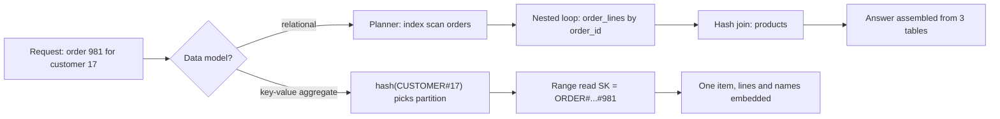

## In one minute
- "SQL versus NoSQL" is really four separate choices: data model (tables or aggregates), query model (ad hoc or designed per access pattern), consistency scope (many rows or one item), and scaling model (scale up and replicate, or partition from day one).
- Relational databases optimise for questions you have not thought of yet: normalized data, joins, constraints and multi-row transactions. You pay with harder horizontal scaling.
- Most NoSQL stores optimise for questions you know in advance: data shaped as the reader wants it, keyed so every request hits one partition. You pay when the questions change.
- The labels have blurred: Postgres stores indexed JSON, DynamoDB and MongoDB offer multi-item transactions, and distributed SQL databases shard relational tables. Choose on the four axes, not the label.

## How it works

### Where the split came from
By the mid-2000s web companies had outgrown single relational servers. Google's Bigtable ([OSDI 2006](https://static.googleusercontent.com/media/research.google.com/en//archive/bigtable-osdi06.pdf)) and Amazon's Dynamo ([SOSP 2007](https://www.allthingsdistributed.com/files/amazon-dynamo-sosp2007.pdf)) papers described stores that dropped joins, cross-row transactions and fixed schemas to get predictable latency at scale and stay writable during failures. Cassandra, HBase, MongoDB and others followed, and "NoSQL" began as a 2009 meetup hashtag. It names a set of trade-offs, not a technology.

### Axis 1: data model
A relational schema is normalized: order, lines, customer and products are four tables joined at read time. A document or key-value store keeps an *aggregate* (a term from domain-driven design): the order with its lines and copies of product names and prices, stored and fetched as one unit. Reading the aggregate is one lookup; reading across aggregates ("all orders containing product 42") needs a secondary index, another copy, or a scan.

Schemas still exist in NoSQL; they move into the code that reads the data ("schema on read"). Adding a field is trivial, and old records with missing fields become every reader's problem.

### Axis 2: query model
SQL lets you write a new query tomorrow and the planner works out how to run it. DynamoDB and Cassandra expect you to list access patterns first and design keys so each is one request to one partition: a partition key grouping what is read together and a sort key ordering it (`PK = CUSTOMER#17`, `SK = ORDER#2026-10-01#981`). A new pattern means a new index or copy, backfilled. MongoDB sits between: rich queries and secondary indexes, but queries without the shard key go to every shard.

### Axis 3: consistency scope
Relational databases give multi-row transactions with chosen isolation (see ACID Transactions). Classic NoSQL stores made one item or document the unit of atomicity, which works when the aggregate boundary matches the transaction boundary. MongoDB later added multi-document transactions (4.0 for replica sets, 4.2 for sharded clusters) ([MongoDB docs](https://www.mongodb.com/docs/manual/core/transactions/)) and DynamoDB added `TransactWriteItems` (up to 100 items and 4 MB). They work, but cost more and conflict more: DynamoDB does two underlying writes per item, one to prepare and one to commit, charges for them even when the transaction is cancelled, and gives no atomicity across Regions in a global table ([AWS docs](https://docs.aws.amazon.com/amazondynamodb/latest/developerguide/transaction-apis.html)). Reads are often eventually consistent by default: a DynamoDB `GetItem` is unless you set `ConsistentRead`, which costs twice the read capacity ([AWS docs](https://docs.aws.amazon.com/amazondynamodb/latest/developerguide/HowItWorks.ReadConsistency.html)).

### Axis 4: scaling model
A relational primary scales up (a 64-core machine handles a great deal), then out for reads with replicas, then by sharding through the application or a layer such as Vitess or Citus. Partitioned NoSQL stores shard from the first row, so growth is adding nodes. The constraint moves into key design: each partition has a throughput ceiling, so hot keys hurt.

### Convergence
Postgres has `jsonb` with GIN indexes. Going the other way, Bigtable now accepts read-only GoogleSQL queries, though without joins ([Google Cloud docs](https://docs.cloud.google.com/bigtable/docs/googlesql-overview)), and DynamoDB global tables can run in a multi-Region strong consistency mode that replicates each write to another Region before acknowledging it ([AWS docs](https://docs.aws.amazon.com/amazondynamodb/latest/developerguide/HowItWorks.ReadConsistency.html)). Distributed SQL systems (Spanner, CockroachDB, YugabyteDB, TiDB) shard relational tables and run serializable transactions across them, paying a consensus round trip per write. The useful question is which axis binds for this data.

### The same shape elsewhere
This is "finding things fast" versus "multi-step consistency": precompute the answer's shape, or keep facts once and assemble answers on demand. A frontend's normalized Redux store versus a per-screen view model is the same trade-off in a browser.

## Down the stack

### Layer 1: The contract
Postgres promises a correct answer to any SQL query whatever indexes exist; only speed varies. DynamoDB promises single-digit-millisecond requests addressed by key, item atomicity, optional strongly consistent reads on the base table, and conditional writes (`ConditionExpression`). Items are capped at 400 KB, attribute names included ([AWS docs](https://docs.aws.amazon.com/amazondynamodb/latest/developerguide/Constraints.html)), and each physical partition at about 3,000 read units and 1,000 write units per second ([AWS docs](https://docs.aws.amazon.com/amazondynamodb/latest/developerguide/bp-partition-key-design.html)). MongoDB caps documents at 16 MB, with atomic updates within one document.

### Layer 2: The mechanism
In Postgres, the order join might be an index scan on `orders`, a nested loop into `order_lines` and a hash join to `products`, each reading B-tree and heap pages from the buffer pool. A `jsonb` value is a parsed binary tree; a GIN index maps keys and values to rows for `@>` queries. Changing one field rewrites the whole value and takes a lock on the whole row, so two sessions updating different keys of one document still queue behind each other ([Postgres docs](https://www.postgresql.org/docs/current/datatype-json.html)).

In DynamoDB, the partition key is hashed to choose a partition; each partition is a B-tree ordered by sort key, replicated to three storage nodes across availability zones with a Multi-Paxos leader that alone serves writes and strongly consistent reads ([DynamoDB paper, ATC 2022](https://www.usenix.org/system/files/atc22-elhemali.pdf)). A `Query` on `PK = CUSTOMER#17` with `begins_with(SK, "ORDER#")` is one range read on one partition. A global secondary index is a separate partitioned table that writes propagate to asynchronously, which is why it is only eventually consistent.

In sharded MongoDB, `mongos` routes by the shard key's chunk ranges; a query without the shard key is scatter-gather across all shards.

### Layer 3: The machine
A three-table join for one order might touch a dozen 8 KB pages, microseconds each from RAM but about 100 microseconds each from NVMe on a miss. A contiguous document is one read, so aggregates win when the working set exceeds memory: random I/Os per request drop from many to one.

Scatter-gather costs at the tail. If each of 20 shards answers within 10 ms 99% of the time, a query that waits for all 20 exceeds 10 ms with probability 1 - 0.99^20, about 18%. A sorted `limit 20` across 20 shards also fetches up to 400 rows.

Denormalized writes cost bytes. Renaming a product embedded in 2 million documents rewrites 2 million documents; in Postgres it is one row update.

### Why it's built this way
1. A single machine has a ceiling, and cross-machine coordination costs network round trips, so stores that must scale out make the common request touch one machine.
2. One machine per request means the data a request needs must live together, so data is grouped by access pattern into aggregates, and the schema follows the queries.
3. Grouping by one pattern disadvantages every other pattern, so secondary indexes and copies are added, maintained asynchronously to avoid cross-partition coordination on every write.
4. Asynchronous copies are eventually consistent, so applications get conditional writes and, later, opt-in transactions for the cases where that is not enough.
5. Relational engines made the opposite bet: keep each fact once and let a planner assemble answers, which is unbeatable for changing questions and integrity, and hardest to spread across machines.

## Diagram


## Worked example
An e-commerce order-history feature serves 20,000 reads per second at peak and 500 order writes per second. An order averages 3 KB with its lines.

**On Postgres.** "Show order 981" is a three-table join over indexes, well under a millisecond with the working set cached. Spread over a primary and three replicas, that is 5,000 reads per second per node, comfortable for 16-core machines; 500 writes per second is trivial. When finance asks for "revenue by category, last 30 days", it is one SQL query on a replica.

**On DynamoDB.** Each order is one item keyed `PK = CUSTOMER#id`, `SK = ORDER#date#id`, with product names and prices copied in. A read is one `GetItem` at 0.5 read capacity units (one per 4 KB, halved for eventual reads), 10,000 RCU per second in total; writes cost 3 WCU each (one per 1 KB), 1,500 per second. Latency stays flat to tens of terabytes with no shard management. But finance's question has no key: the team streams changes into a warehouse, one more pipeline to own. Copied product names are correct here, since an order should keep the name at purchase time.

**The decision.** Postgres handles this load on four machines and keeps ad hoc queries. DynamoDB wins with 20 times the growth, multi-region active writes, or a mandate for zero database operations. Many teams do both: Postgres for orders and payments, a key-value store for single-key session or cart data.

## In the wild
- **Slack, 2022: a cache keyed one way over a database sharded another.** A Consul agent rollout emptied memcached nodes. Group DM membership was cached by channel ID, but the Vitess tables behind it were sharded by user, so every cache miss became a scatter query across all shards. The database overloaded, could not refill the cache, and many users could not load Slack that morning. The fix moved the query to a table sharded by channel ([Slack](https://slack.engineering/slacks-incident-on-2-22-22/)).
- **AWS, 2015: DynamoDB's own metadata outgrows its timeouts.** After a short network blip, many storage servers asked the metadata service for their partition membership at once. Fast adoption of global secondary indexes had made those lists much larger, so responses ran past the servers' timeout, and the retries overloaded the service further. Error rates peaked around 55% and most recovery took about 4 hours 50 minutes ([AWS](https://aws.amazon.com/message/5467D2/)).
- **Uber, 2016: relational engine, NoSQL-style layer.** Uber described Postgres limits at its scale: an update to one row wrote new entries to every index, physical WAL replication shipped all of that across data centers, and a replica bug surfaced duplicate rows. Most databases moved to MySQL, usually behind Schemaless, Uber's own key-addressed sharding layer: the choice was not SQL or NoSQL but which engine sat under which data model ([Uber](https://www.uber.com/en-US/blog/postgres-to-mysql-migration/)).

## Trade-offs
| Option | Strengths | Weaknesses | Choose when |
|---|---|---|---|
| Relational (Postgres, MySQL) | Ad hoc queries, joins, constraints, multi-row transactions | Scale-out is manual work; schema changes need migrations | Most systems of record, until a measured limit |
| Key-value or wide-column (DynamoDB, Cassandra) | Flat latency at any size, partitioned from day one | Every access pattern designed up front; no joins | Known patterns, very high volume, multi-region writes |
| Document (MongoDB, Firestore) | Natural aggregates, flexible fields, rich queries | Cross-document integrity is the app's job; scatter-gather without the shard key | Aggregate-shaped data with varied fields |
| Distributed SQL (Spanner, CockroachDB) | SQL and transactions across shards and regions | Consensus latency per write, cost, operational depth | Relational needs beyond one primary |
| Relational with `jsonb` | One store, flexible attributes beside strict columns | Large documents rewrite fully; weaker statistics on JSON | A few flexible fields in a relational model |

## Pitfalls in production
- **Choosing NoSQL for scale you do not have.** One Postgres primary handles tens of thousands of simple transactions per second. Estimate the load first; the migration cost of choosing wrong is large in both directions.
- **Modelling NoSQL like SQL.** One table per entity in DynamoDB, then joining in application code, gives N+1 requests and the worst of both. Design keys around access patterns, or use a relational store.
- **Unbounded aggregates.** Embedding every comment in a post document hits the 16 MB or 400 KB limit and rewrites the whole document on each comment. Embed bounded, co-read data; reference unbounded data.
- **Assuming secondary indexes are consistent.** A DynamoDB GSI read right after a write can miss it. Read your own writes from the base table, or design for the lag.
- **Schema on read without versioning.** Old documents lack new fields and crash readers years later. Store a `schema_version` and migrate lazily or in backfills.

## Leadership lens
- Ask for the list of access patterns with their rates before any database is chosen; if the team cannot write it, it is not ready for a store that needs it.
- Count the pipelines: every denormalized copy, secondary store or analytics export is a system someone owns, monitors and repairs.
- Weigh team skill as a real cost. A store nobody can debug at 3 a.m. is riskier than a slower one everybody knows.
- Make the choice per dataset, not per company; mixing stores is normal, provided each dataset has exactly one source of truth.

## Check yourself
1. Why does a DynamoDB global secondary index only offer eventually consistent reads?
   **Answer:** It is a separate partitioned table updated asynchronously from the base table's changes, so keeping it synchronous would need cross-partition coordination on every write.
2. A MongoDB query filters on `email` but the collection is sharded by `user_id`. What happens, and why does p99 suffer?
   **Answer:** The router sends it to every shard and waits for all of them, so the query's latency is the slowest shard's, and the chance of hitting some shard's tail grows with the shard count.
3. When is copying a product's name into each order document correct, not a consistency bug?
   **Answer:** When the order should record the name at time of purchase. The copy is then historical fact, not a cache of the current name.
4. What single question best decides between relational and key-value for a new service?
   **Answer:** Whether all access patterns are known and stable. If new questions will keep arriving, a query planner over normalized data is worth its scaling cost.

## Practice
**Task:** Build an access-pattern fit scorer. Each pattern has a `name`, a `kind` (`"read"` or `"write"`), a list of `entities` (duplicates count once) and a `qps`. `placement` maps each entity to the aggregates (document collections) that hold a copy of it; an aggregate *contains* every entity whose list names it. Relational cost of a pattern is `qps` times its number of distinct entities (one table touched per entity). Document cost of a read is `qps` times the smallest number of aggregates whose contents together cover its entities; of a write, `qps` times the number of distinct aggregates holding any of its entities, and a write touching more than one aggregate is a *multi-document write*. `evaluate(patterns, placement, tolerance)` returns the two totals, the sorted names of multi-document writes, and a verdict: `"document"` if the document total is strictly lower and the qps of multi-document writes is at most `tolerance` times the total write qps, otherwise `"relational"`. An entity missing from `placement` is an error.

```python starter
def evaluate(patterns, placement, tolerance=0.0):
    # TODO: return {"relational": int, "document": int,
    #               "multi_doc_writes": [names], "verdict": str}
    raise NotImplementedError
```

```python tests
PLACEMENT = {
    "customer": ["customers"],
    "order": ["orders"],
    "line_item": ["orders"],
    "product": ["products", "orders"],
}

PATTERNS = [
    {"name": "view_order", "kind": "read", "entities": ["order", "line_item", "product"], "qps": 1000},
    {"name": "place_order", "kind": "write", "entities": ["order", "line_item"], "qps": 100},
    {"name": "rename_product", "kind": "write", "entities": ["product"], "qps": 1},
    {"name": "profile", "kind": "read", "entities": ["customer", "order"], "qps": 50},
]

def test_totals():
    r = evaluate(PATTERNS, PLACEMENT)
    assert r["relational"] == 3301
    assert r["document"] == 1202

def test_multi_doc_write_blocks_document_by_default():
    r = evaluate(PATTERNS, PLACEMENT)
    assert r["multi_doc_writes"] == ["rename_product"]
    assert r["verdict"] == "relational"

def test_tolerance_allows_rare_multi_doc_writes():
    assert evaluate(PATTERNS, PLACEMENT, 0.05)["verdict"] == "document"
    assert evaluate(PATTERNS, PLACEMENT, 0.005)["verdict"] == "relational"

def test_read_uses_minimum_cover():
    placement = {"a": ["x", "y"], "b": ["y"], "c": ["z", "y"]}
    r = evaluate([{"name": "r", "kind": "read", "entities": ["a", "b", "c"], "qps": 10}], placement)
    assert r["document"] == 10, "aggregate y alone covers a, b and c"
    assert r["relational"] == 30

def test_duplicate_entities_count_once():
    r = evaluate([{"name": "w", "kind": "write", "entities": ["order", "order"], "qps": 7}], PLACEMENT)
    assert (r["relational"], r["document"]) == (7, 7)

def test_empty_is_a_relational_tie():
    assert evaluate([], PLACEMENT) == {"relational": 0, "document": 0, "multi_doc_writes": [], "verdict": "relational"}

def test_unknown_entity_raises():
    try:
        evaluate([{"name": "r", "kind": "read", "entities": ["ghost"], "qps": 1}], PLACEMENT)
        assert False, "expected ValueError"
    except ValueError:
        pass
```

```python solution
from itertools import combinations

def evaluate(patterns, placement, tolerance=0.0):
    relational = 0
    document = 0
    multi = []
    multi_qps = 0
    write_qps = 0
    for p in patterns:
        ents = sorted(set(p["entities"]))
        for e in ents:
            if e not in placement:
                raise ValueError("unknown entity: " + e)
        relational += p["qps"] * len(ents)
        if p["kind"] == "write":
            aggs = set()
            for e in ents:
                aggs.update(placement[e])
            document += p["qps"] * len(aggs)
            write_qps += p["qps"]
            if len(aggs) > 1:
                multi.append(p["name"])
                multi_qps += p["qps"]
        else:
            candidates = sorted({a for e in ents for a in placement[e]})
            need = set(ents)
            best = 0
            for k in range(1, len(candidates) + 1):
                found = False
                for combo in combinations(candidates, k):
                    covered = {e for e in ents if any(a in placement[e] for a in combo)}
                    if covered == need:
                        found = True
                        break
                if found:
                    best = k
                    break
            document += p["qps"] * best
    ok = document < relational and multi_qps <= tolerance * write_qps
    return {"relational": relational, "document": document,
            "multi_doc_writes": sorted(multi), "verdict": "document" if ok else "relational"}
```

```typescript starter
export interface Pattern { name: string; kind: string; entities: string[]; qps: number; }
export interface FitResult { relational: number; document: number; multiDocWrites: string[]; verdict: string; }

export function evaluate(patterns: Pattern[], placement: Record<string, string[]>, tolerance: number = 0): FitResult {
  throw new Error("TODO");
}
```

```typescript tests
const PLACEMENT: Record<string, string[]> = {
  customer: ["customers"],
  order: ["orders"],
  line_item: ["orders"],
  product: ["products", "orders"],
};

const PATTERNS: Pattern[] = [
  { name: "view_order", kind: "read", entities: ["order", "line_item", "product"], qps: 1000 },
  { name: "place_order", kind: "write", entities: ["order", "line_item"], qps: 100 },
  { name: "rename_product", kind: "write", entities: ["product"], qps: 1 },
  { name: "profile", kind: "read", entities: ["customer", "order"], qps: 50 },
];

test("totals", () => {
  const r = evaluate(PATTERNS, PLACEMENT);
  assertEqual(r.relational, 3301);
  assertEqual(r.document, 1202);
});

test("multi doc write blocks document by default", () => {
  const r = evaluate(PATTERNS, PLACEMENT);
  assertEqual(r.multiDocWrites, ["rename_product"]);
  assertEqual(r.verdict, "relational");
});

test("tolerance allows rare multi doc writes", () => {
  assertEqual(evaluate(PATTERNS, PLACEMENT, 0.05).verdict, "document");
  assertEqual(evaluate(PATTERNS, PLACEMENT, 0.005).verdict, "relational");
});

test("read uses minimum cover", () => {
  const placement = { a: ["x", "y"], b: ["y"], c: ["z", "y"] };
  const r = evaluate([{ name: "r", kind: "read", entities: ["a", "b", "c"], qps: 10 }], placement);
  assertEqual(r.document, 10, "aggregate y alone covers a, b and c");
  assertEqual(r.relational, 30);
});

test("duplicate entities count once", () => {
  const r = evaluate([{ name: "w", kind: "write", entities: ["order", "order"], qps: 7 }], PLACEMENT);
  assertEqual([r.relational, r.document], [7, 7]);
});

test("empty is a relational tie", () => {
  assertEqual(evaluate([], PLACEMENT), { relational: 0, document: 0, multiDocWrites: [], verdict: "relational" });
});

test("unknown entity throws", () => {
  let threw = false;
  try {
    evaluate([{ name: "r", kind: "read", entities: ["ghost"], qps: 1 }], PLACEMENT);
  } catch (e) {
    threw = true;
  }
  assert(threw, "expected an error");
});
```

```typescript solution
export interface Pattern { name: string; kind: string; entities: string[]; qps: number; }
export interface FitResult { relational: number; document: number; multiDocWrites: string[]; verdict: string; }

function minCover(ents: string[], placement: Record<string, string[]>): number {
  const candidates = [...new Set(ents.flatMap((e) => placement[e]))].sort();
  let best = 0;
  for (let mask = 1; mask < 1 << candidates.length; mask++) {
    const chosen = candidates.filter((_, i) => mask & (1 << i));
    if (best && chosen.length >= best) continue;
    if (ents.every((e) => placement[e].some((a) => chosen.includes(a)))) best = chosen.length;
  }
  return best;
}

export function evaluate(patterns: Pattern[], placement: Record<string, string[]>, tolerance: number = 0): FitResult {
  let relational = 0, document = 0, multiQps = 0, writeQps = 0;
  const multi: string[] = [];
  for (const p of patterns) {
    const ents = [...new Set(p.entities)].sort();
    for (const e of ents) if (!(e in placement)) throw new Error("unknown entity: " + e);
    relational += p.qps * ents.length;
    if (p.kind === "write") {
      const aggs = new Set(ents.flatMap((e) => placement[e]));
      document += p.qps * aggs.size;
      writeQps += p.qps;
      if (aggs.size > 1) { multi.push(p.name); multiQps += p.qps; }
    } else {
      document += p.qps * minCover(ents, placement);
    }
  }
  const ok = document < relational && multiQps <= tolerance * writeQps;
  return { relational, document, multiDocWrites: multi.sort(), verdict: ok ? "document" : "relational" };
}
```

```go starter
package practice

type Pattern struct {
	Name     string
	Kind     string
	Entities []string
	QPS      int
}

type FitResult struct {
	Relational     int
	Document       int
	MultiDocWrites []string
	Verdict        string
}

func Evaluate(patterns []Pattern, placement map[string][]string, tolerance float64) (FitResult, error) {
	panic("TODO")
}
```

```go tests
package practice

import (
	"reflect"
	"testing"
)

var placement = map[string][]string{
	"customer":  {"customers"},
	"order":     {"orders"},
	"line_item": {"orders"},
	"product":   {"products", "orders"},
}

var patterns = []Pattern{
	{"view_order", "read", []string{"order", "line_item", "product"}, 1000},
	{"place_order", "write", []string{"order", "line_item"}, 100},
	{"rename_product", "write", []string{"product"}, 1},
	{"profile", "read", []string{"customer", "order"}, 50},
}

func mustEval(t *testing.T, ps []Pattern, pl map[string][]string, tol float64) FitResult {
	t.Helper()
	r, err := Evaluate(ps, pl, tol)
	if err != nil {
		t.Fatalf("unexpected error: %v", err)
	}
	return r
}

func TestTotals(t *testing.T) {
	r := mustEval(t, patterns, placement, 0)
	if r.Relational != 3301 || r.Document != 1202 {
		t.Fatalf("got %d / %d", r.Relational, r.Document)
	}
}

func TestMultiDocWriteBlocksDocumentByDefault(t *testing.T) {
	r := mustEval(t, patterns, placement, 0)
	if !reflect.DeepEqual(r.MultiDocWrites, []string{"rename_product"}) || r.Verdict != "relational" {
		t.Fatalf("got %+v", r)
	}
}

func TestToleranceAllowsRareMultiDocWrites(t *testing.T) {
	if v := mustEval(t, patterns, placement, 0.05).Verdict; v != "document" {
		t.Fatalf("got %s", v)
	}
	if v := mustEval(t, patterns, placement, 0.005).Verdict; v != "relational" {
		t.Fatalf("got %s", v)
	}
}

func TestReadUsesMinimumCover(t *testing.T) {
	pl := map[string][]string{"a": {"x", "y"}, "b": {"y"}, "c": {"z", "y"}}
	r := mustEval(t, []Pattern{{"r", "read", []string{"a", "b", "c"}, 10}}, pl, 0)
	if r.Document != 10 || r.Relational != 30 {
		t.Fatalf("got %d / %d", r.Relational, r.Document)
	}
}

func TestDuplicateEntitiesCountOnce(t *testing.T) {
	r := mustEval(t, []Pattern{{"w", "write", []string{"order", "order"}, 7}}, placement, 0)
	if r.Relational != 7 || r.Document != 7 {
		t.Fatalf("got %d / %d", r.Relational, r.Document)
	}
}

func TestEmptyIsARelationalTie(t *testing.T) {
	r := mustEval(t, nil, placement, 0)
	if r.Relational != 0 || r.Document != 0 || len(r.MultiDocWrites) != 0 || r.Verdict != "relational" {
		t.Fatalf("got %+v", r)
	}
}

func TestUnknownEntityErrors(t *testing.T) {
	if _, err := Evaluate([]Pattern{{"r", "read", []string{"ghost"}, 1}}, placement, 0); err == nil {
		t.Fatal("expected error")
	}
}
```

```go solution
package practice

import (
	"fmt"
	"sort"
)

type Pattern struct {
	Name     string
	Kind     string
	Entities []string
	QPS      int
}

type FitResult struct {
	Relational     int
	Document       int
	MultiDocWrites []string
	Verdict        string
}

func distinct(xs []string) []string {
	seen := map[string]bool{}
	out := []string{}
	for _, x := range xs {
		if !seen[x] {
			seen[x] = true
			out = append(out, x)
		}
	}
	sort.Strings(out)
	return out
}

func minCover(ents []string, placement map[string][]string) int {
	var all []string
	for _, e := range ents {
		all = append(all, placement[e]...)
	}
	cands := distinct(all)
	best := 0
	for mask := 1; mask < 1<<len(cands); mask++ {
		chosen := map[string]bool{}
		for i, c := range cands {
			if mask&(1<<i) != 0 {
				chosen[c] = true
			}
		}
		if best != 0 && len(chosen) >= best {
			continue
		}
		covered := true
		for _, e := range ents {
			hit := false
			for _, a := range placement[e] {
				if chosen[a] {
					hit = true
				}
			}
			if !hit {
				covered = false
				break
			}
		}
		if covered {
			best = len(chosen)
		}
	}
	return best
}

func Evaluate(patterns []Pattern, placement map[string][]string, tolerance float64) (FitResult, error) {
	res := FitResult{MultiDocWrites: []string{}}
	multiQPS, writeQPS := 0, 0
	for _, p := range patterns {
		ents := distinct(p.Entities)
		for _, e := range ents {
			if _, ok := placement[e]; !ok {
				return FitResult{}, fmt.Errorf("unknown entity: %s", e)
			}
		}
		res.Relational += p.QPS * len(ents)
		if p.Kind == "write" {
			var all []string
			for _, e := range ents {
				all = append(all, placement[e]...)
			}
			aggs := distinct(all)
			res.Document += p.QPS * len(aggs)
			writeQPS += p.QPS
			if len(aggs) > 1 {
				res.MultiDocWrites = append(res.MultiDocWrites, p.Name)
				multiQPS += p.QPS
			}
		} else {
			res.Document += p.QPS * minCover(ents, placement)
		}
	}
	sort.Strings(res.MultiDocWrites)
	res.Verdict = "relational"
	if res.Document < res.Relational && float64(multiQPS) <= tolerance*float64(writeQPS) {
		res.Verdict = "document"
	}
	return res, nil
}
```

## Mock interview
**Prompt:** A fitness app has 30 million users: 15,000 workout writes and 60,000 history reads per second at peak, plus a coach dashboard filtering athletes by many attributes. The team proposes MongoDB for everything because "workouts are documents". Evaluate it.

- Follow-up: What shard key would you choose for workouts, and which query becomes scatter-gather?
- Follow-up: The coach dashboard needs filters nobody has listed yet. How do you serve it?
- Follow-up: Billing and subscriptions are also in scope. Same store or a different one?

**A strong answer covers:**
- Workouts are aggregate-shaped, single-user and append-heavy: a good fit for a store partitioned by user.
- `user_id` as shard key, time in the sort order, and the queries that become scatter-gather.
- Ad hoc coach filters served from a search index or relational read model fed by change streams.
- Billing in a relational database for transactions and constraints; one source of truth per dataset.
- 15,000 writes per second fits one large Postgres primary, so the NoSQL case rests on growth, operations and data shape.

## Sources and further study
**Primary**
- [Chang et al., Bigtable: A Distributed Storage System for Structured Data (OSDI 2006)](https://static.googleusercontent.com/media/research.google.com/en//archive/bigtable-osdi06.pdf): the other founding NoSQL paper, which kept single-row atomicity and dropped the rest.
- [Elhemali et al., Amazon DynamoDB (USENIX ATC 2022)](https://www.usenix.org/system/files/atc22-elhemali.pdf): how the managed service differs from the 2007 Dynamo design, with Multi-Paxos leaders instead of leaderless quorums.
- [Jepsen: MongoDB 4.2.6](https://jepsen.io/analyses/mongodb-4.2.6): what "multi-document ACID" meant in practice under the default settings.

**Systems docs**
- [DynamoDB: read consistency](https://docs.aws.amazon.com/amazondynamodb/latest/developerguide/HowItWorks.ReadConsistency.html): eventual versus strong reads, why GSIs are eventual only, and the two global-table modes.
- [DynamoDB: transactions](https://docs.aws.amazon.com/amazondynamodb/latest/developerguide/transaction-apis.html): limits, isolation per operation type, and the doubled capacity cost.

**Books**
- *Designing Data-Intensive Applications* (2nd ed.), Martin Kleppmann and Chris Riccomini, Ch 3 "Data Models and Query Languages" and Ch 7 "Sharding": the model choice and the sharding and secondary-index costs behind it.

**Other curricula**
- [donnemartin/system-design-primer](https://github.com/donnemartin/system-design-primer): gives two bullet lists of reasons for SQL and for NoSQL and describes NoSQL as BASE; written before DynamoDB and MongoDB transactions blurred the line.
- [roadmap.sh: System Design](https://roadmap.sh/system-design): its "SQL vs NoSQL" node contrasts fixed schemas and joins with flexible formats traded for horizontal scale.

## Watch
- [Relational vs document databases, data locality, and p99 (Ben Dicken)](https://www.youtube.com/watch?v=LfZnVlW2lT0): how the two models trade locality against flexibility, with a focus on tail latency.
- [DynamoDB deep dive: Advanced design patterns (AWS Events)](https://www.youtube.com/watch?v=xfxBhvGpoa0): what designing keys around access patterns looks like in practice.
- [SQL vs. NoSQL: What's the difference? (IBM Technology)](https://www.youtube.com/watch?v=Q5aTUc7c4jg): a short, clear overview of the main differences.

## Free resources
- [Dynamo: Amazon's Highly Available Key-value Store (SOSP 2007)](https://www.allthingsdistributed.com/files/amazon-dynamo-sosp2007.pdf): the paper that explains which relational guarantees were dropped and why.
- [NoSQL design for DynamoDB (AWS docs)](https://docs.aws.amazon.com/amazondynamodb/latest/developerguide/bp-general-nosql-design.html): the official case for designing from access patterns.
- [Data modeling introduction (MongoDB docs)](https://www.mongodb.com/docs/manual/core/data-modeling-introduction/): embedding versus referencing, from the vendor.
- [PostgreSQL: JSON Types](https://www.postgresql.org/docs/current/datatype-json.html): how `jsonb` is stored and indexed inside a relational database.
- [Spanner: Google's Globally-Distributed Database (OSDI 2012)](https://static.googleusercontent.com/media/research.google.com/en//archive/spanner-osdi2012.pdf): how relational semantics were rebuilt on a sharded, replicated store.
- [Polyglot Persistence (Martin Fowler)](https://martinfowler.com/bliki/PolyglotPersistence.html): the argument for choosing a store per dataset.
