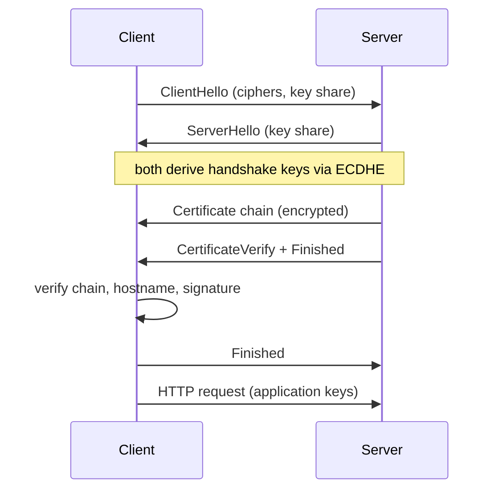

## In one minute
- TLS gives a connection three properties: confidentiality (encryption), integrity (tamper detection), and server authentication (you are talking to the holder of the certificate's private key).
- The handshake uses asymmetric cryptography to agree on fresh symmetric keys, then all data is encrypted with fast authenticated ciphers such as AES-GCM or ChaCha20-Poly1305.
- Certificates bind a domain name to a public key and are signed by a chain of CAs that clients already trust.
- TLS 1.3 needs one round trip for a new connection, supports zero round trip resumption with replay caveats, and removed the weak options of older versions. SSL and TLS 1.0 and 1.1 are obsolete. The current TLS 1.3 spec is RFC 9846 (2026), which replaced RFC 8446 without changing the version number.
- Most production TLS incidents are operational: expired certificates, broken chains, and weak or mismatched configuration.

## How it works

### The TLS 1.3 handshake
The client sends ClientHello with supported cipher suites, a random value, and a key share: an ephemeral elliptic curve public key, usually X25519. The server replies with ServerHello containing its own key share. Both sides now compute the same shared secret with ECDHE, and every following handshake message is encrypted. The server sends its certificate chain and a CertificateVerify signature over the handshake transcript, proving it holds the private key. It finishes with a Finished MAC. The client checks the chain, the signature, and the hostname, sends its own Finished, and application data flows. Total: one round trip. The protocol was respecified in July 2026 as RFC 9846, a cleanup that obsoletes RFC 8446 and keeps the wire format compatible ([RFC 9846](https://datatracker.ietf.org/doc/rfc9846/)). TLS 1.0 and 1.1 are formally deprecated and must not be negotiated at all ([RFC 8996](https://www.rfc-editor.org/rfc/rfc8996.html)).

### Forward secrecy
Because the key exchange uses ephemeral keys discarded after the handshake, stealing the server's long-term private key later does not decrypt recorded past traffic. TLS 1.3 made this mandatory by removing static RSA key exchange.

### Certificate validation
The client builds a path from the leaf certificate through intermediates to a root in its trust store. For each link it checks the signature, the validity period, and that the issuer is allowed to act as a CA. For the leaf it checks that the hostname matches a Subject Alternative Name; the old Common Name field must not be used for this. Wildcards must be the whole leftmost label and cover exactly one label: `*.example.com` matches `api.example.com` but not `example.com` or `a.b.example.com` ([RFC 9525](https://www.rfc-editor.org/rfc/rfc9525.html), which replaced RFC 6125 in 2023).

Revocation is the weak spot, and the industry is moving away from it. Let's Encrypt stopped putting OCSP URLs in certificates in May 2025 and turned its OCSP responders off in August 2025, citing the privacy leak of telling a CA which sites each visitor opens; revocation is now published only as CRLs ([Let's Encrypt](https://letsencrypt.org/2024/12/05/ending-ocsp/)). The other answer is short lifetimes. CA/Browser Forum ballot SC-081 cut the maximum public certificate lifetime from 398 days to 200 days on 15 March 2026, then 100 days in 2027 and 47 days in March 2029 ([CA/B Forum](https://cabforum.org/2025/04/11/ballot-sc081v3-introduce-schedule-of-reducing-validity-and-data-reuse-periods/), [DigiCert](https://www.digicert.com/blog/tls-certificate-lifetimes-will-officially-reduce-to-47-days)).

### Resumption and 0-RTT
A server can issue a session ticket. On reconnect the client presents it and skips certificate work. With 0-RTT the client sends application data in its first flight, but that data can be replayed by an attacker, so only idempotent requests should be allowed. In HTTP, a proxy that forwards early data adds `Early-Data: 1`, and a backend that won't risk a replay answers `425 Too Early` so the client retries after the handshake ([RFC 8470](https://www.rfc-editor.org/rfc/rfc8470.html)).

### Mutual TLS
In mTLS the client also presents a certificate. Service meshes use it for workload identity, rotating certificates every few hours.

## Down the stack
### Layer 1: The contract
TLS promises confidentiality and integrity of an ordered byte stream, and that the server holds the private key for a certificate valid for the requested hostname. It does not hide the server's IP address, the size and timing of messages, or the SNI hostname unless Encrypted Client Hello is used. ECH became a Proposed Standard in March 2026; it encrypts the inner ClientHello, including SNI and ALPN, to a key the client gets from DNS ([RFC 9849](https://www.rfc-editor.org/rfc/rfc9849.html)). Data sent as 0-RTT early data has no replay protection. Truncation is detected only because each side sends a `close_notify` alert before closing.

### Layer 2: The mechanism
Data travels in records of at most 16 KB plaintext. Each record has a 5-byte header (content type 23 for application data, legacy version `0x0303`, length) and a 16-byte AEAD tag. The per-record nonce is a static IV XORed with a 64-bit sequence number, so a reordered or replayed record fails authentication. Keys come from a schedule built on HKDF: an early secret, then a handshake secret mixed with the ECDHE output, then a master secret, from which client and server traffic secrets are derived. A `KeyUpdate` message ratchets traffic keys forward on long connections. Certificates are DER-encoded X.509 with a Subject Alternative Name extension for hostnames and `basicConstraints CA:TRUE` on issuers. The client's SNI extension tells the server which certificate to present, and the `status_request` extension asks for a stapled OCSP response.

### Layer 3: The machine
A ClientHello is typically 250 to 500 bytes, but a hybrid post-quantum key share such as X25519MLKEM768 adds about 1.2 KB and can push it over one TCP segment. That is now the common case, not an edge case: about 70% of browser traffic reaching Cloudflare uses hybrid ML-KEM key exchange ([Cloudflare](https://blog.cloudflare.com/post-quantum-visibility/)), so middleboxes that assume a one-packet ClientHello break. The server's first flight with a certificate chain is often 3 to 5 KB. A new TCP connection starts with an initial congestion window of 10 segments, about 14 KB ([RFC 6928](https://www.rfc-editor.org/rfc/rfc6928.html)), so a bloated chain with an extra intermediate can cost an additional round trip. AES-GCM with AES-NI and carry-less multiply instructions runs at several GB/s per core. Kernel TLS lets the kernel encrypt records, so a server can `sendfile` straight from the page cache without copying data into user space. Record size matters for latency: a 16 KB record cannot be decrypted until all of it arrives, so servers use small records early in a connection and grow them later.

### Why it's built this way
Asymmetric cryptography is slow and symmetric cryptography is fast, so the handshake uses the former only to agree on keys for the latter. Traffic gets recorded and keys get stolen later, so key exchange is ephemeral. TCP slow start penalises large first flights, so chains and certificates should be small. Middleboxes broke on new version numbers, so TLS 1.3 disguises its handshake as a TLS 1.2 session resumption.

## Diagram


## Worked example
A public API terminates TLS on a fleet of proxies handling 40,000 new connections per second at peak.

Cost per full handshake: one X25519 key agreement on each side and one signature by the server. With an ECDSA P-256 certificate, a signature costs roughly 30 to 50 microseconds of CPU; an RSA-2048 signature costs around 1 ms. At 40,000 handshakes per second, RSA needs about 40 CPU cores just for signing, while ECDSA needs 1 to 2. Switching to ECDSA certificates (keeping an RSA cert for very old clients) saves dozens of cores.

Latency: on a 100 ms round trip, TLS 1.2 adds 200 ms before the request and TLS 1.3 adds 100 ms; 0-RTT removes even that for safe requests.

Bulk AES-GCM runs at several GB per second per core with hardware support, so the handshake, not bulk encryption, is where TLS CPU goes.

Certificate operations: with 90-day certificates on 300 domains, there are about 3 renewals a day. Let's Encrypt plans to move its default from 90 to 45 days, and public certificates cap at 47 days from 2029, so plan for about 7 renewals a day on the same fleet. Renewal must be automated through ACME, with alerts driven by the fraction of lifetime used rather than a fixed day count, since "14 days left" is a third of a 45-day certificate.

## In the wild
- **Mozilla, 2019: one expired intermediate disables Firefox add-ons.** The intermediate that signed every add-on certificate expired just after 01:00 UTC on 4 May. Firefox rechecks add-on signatures about every 24 hours, so extensions switched off user by user around the world. Mozilla shipped a replacement certificate with the same subject and key through its Studies system under nine hours after it learned of the problem, then dot releases for everyone else ([Mozilla](https://hacks.mozilla.org/2019/05/technical-details-on-the-recent-firefox-add-on-outage/)).
- **Let's Encrypt, 2021: the DST Root CA X3 cross-sign expires.** On 30 September 2021 the old root that vouched for Let's Encrypt expired. Devices that never received ISRG Root X1 started failing, and OpenSSL 1.0.x clients failed even when they did trust the new root, because of a quirk in how they built chains. Old Android kept working only because of a special cross-sign that runs past the root's expiry ([Let's Encrypt](https://letsencrypt.org/docs/dst-root-ca-x3-expiration-september-2021/)).
- **PyPI, 2021: internal certificates expire, then the CRL overflows.** One-year internal certificates for Vault expired at about 14:00 UTC on 5 April, so deploy tooling could not start pods or read secrets. Reissuing them failed because a backlog of revoked 30-day certificates made the revocation list bigger than the storage backend allowed, and Vault crashed on taking leadership. Uploads and uncached requests failed for about two hours; the fix added alerts at 75% of certificate lifetime ([PyPI status](https://status.python.org/incidents/rw171ylf8jw3)).

## Trade-offs
| Option | Strengths | Weaknesses | Choose when |
| --- | --- | --- | --- |
| Terminate at edge load balancer | Central cert management, offloads CPU | Internal traffic plaintext unless re-encrypted | Trusted internal network, simple setups |
| End-to-end TLS or mTLS mesh | Encrypted and authenticated everywhere | Cert issuance and rotation at scale, proxy overhead | Zero-trust networks, compliance |
| ECDSA certificates | Faster handshakes, smaller certs | A few very old clients lack support | Default today |
| Short-lived certificates (days) | Limits damage of key theft without revocation | Requires reliable automation | Internal PKI, meshes, and public sites via Let's Encrypt's opt-in 160-hour profile ([Let's Encrypt](https://letsencrypt.org/2026/01/15/6day-and-ip-general-availability/)) |

## Pitfalls in production
- Expired certificates cause total outages. Automate renewal and alert when a certificate has used a set share of its lifetime (PyPI chose 75% after its 2021 outage), not at fixed day counts that stop working as lifetimes shrink.
- Missing intermediate certificates work in browsers that cache them and fail in API clients. Serve the full chain and test with a strict client.
- Disabling verification in internal clients (`verify=False`) removes authentication entirely. Use a private CA and distribute its root.
- Allowing 0-RTT on non-idempotent endpoints permits replayed requests. Restrict early data to safe methods.
- Private keys copied around in plain files leak. Keep them in a secrets manager or HSM-backed service and restrict access.

## Leadership lens
- Inventory every certificate, owner, and expiry. Unknown certificates are tomorrow's outage.
- Decide where TLS terminates for each hop and document whether internal hops are encrypted.
- Prefer a managed or automated PKI over hand-issued certificates for internal services.

## Check yourself
1. Why does stealing a server's private key not let an attacker decrypt past TLS 1.3 sessions they recorded?
   **Answer:** Session keys come from ephemeral ECDHE shares that were discarded after each handshake. The long-term key only signed the handshake; it never encrypted the session keys.
2. Does `*.example.com` cover `v2.api.example.com`?
   **Answer:** No. A wildcard matches exactly one label in the leftmost position, so it covers `api.example.com` but not deeper subdomains.
3. Why are many teams moving to short-lived certificates instead of relying on revocation?
   **Answer:** Revocation checking is unreliable and often soft-fails, so a stolen key stays usable. A certificate that expires in days limits exposure without depending on revocation.
4. Where does most TLS CPU cost go on a busy proxy, and how do you reduce it?
   **Answer:** In handshake signatures and key exchange. Use ECDSA certificates, session resumption, and connection reuse to cut full handshakes.

## Practice
**Task:** Write `host_matches(pattern, host)` implementing single-label leftmost wildcard matching, case-insensitive. Then write `verify(chain, roots, host, now)`. `chain` is a list of cert dicts starting with the leaf, each with `subject`, `issuer`, `not_before`, `not_after`, `is_ca`, and `sans` (list of names). `roots` is a set of trusted subject names. Check every cert is valid at `now`, each cert's issuer equals the next cert's subject, every non-leaf cert has `is_ca` true, the last cert's issuer is in `roots`, and some SAN of the leaf matches `host`. Return True, or raise `ValueError` naming the failure.

```python starter
def host_matches(pattern, host):
    raise NotImplementedError

def verify(chain, roots, host, now):
    raise NotImplementedError
```

```python tests
def cert(subject, issuer, ca=False, sans=(), nb=0, na=100):
    return {"subject": subject, "issuer": issuer, "not_before": nb, "not_after": na, "is_ca": ca, "sans": list(sans)}

LEAF = cert("api", "Inter", sans=["*.example.com"])
INTER = cert("Inter", "Root", ca=True)

def expect_error(fn):
    try:
        fn()
        assert False, "expected ValueError"
    except ValueError:
        pass

def test_wildcard_rules():
    assert host_matches("*.example.com", "API.example.com")
    assert not host_matches("*.example.com", "example.com")
    assert not host_matches("*.example.com", "a.b.example.com")
    assert host_matches("example.com", "example.com")

def test_valid_chain():
    assert verify([LEAF, INTER], {"Root"}, "api.example.com", 50) is True

def test_expired():
    expect_error(lambda: verify([LEAF, INTER], {"Root"}, "api.example.com", 150))

def test_untrusted_root():
    expect_error(lambda: verify([LEAF, INTER], {"Other"}, "api.example.com", 50))

def test_intermediate_not_ca():
    bad = cert("Inter", "Root", ca=False)
    expect_error(lambda: verify([LEAF, bad], {"Root"}, "api.example.com", 50))

def test_hostname_mismatch():
    expect_error(lambda: verify([LEAF, INTER], {"Root"}, "evil.com", 50))
```

```python solution
def host_matches(pattern, host):
    p, h = pattern.lower().split("."), host.lower().split(".")
    if len(p) != len(h):
        return False
    if p[0] == "*":
        return p[1:] == h[1:]
    return p == h

def verify(chain, roots, host, now):
    if not chain:
        raise ValueError("empty chain")
    for i, c in enumerate(chain):
        if not (c["not_before"] <= now <= c["not_after"]):
            raise ValueError("expired or not yet valid: " + c["subject"])
        if i > 0 and not c["is_ca"]:
            raise ValueError("issuer is not a CA: " + c["subject"])
        if i + 1 < len(chain) and c["issuer"] != chain[i + 1]["subject"]:
            raise ValueError("broken chain at " + c["subject"])
    if chain[-1]["issuer"] not in roots:
        raise ValueError("untrusted root")
    if not any(host_matches(s, host) for s in chain[0]["sans"]):
        raise ValueError("hostname mismatch")
    return True
```

```typescript starter
export interface Cert {
  subject: string;
  issuer: string;
  not_before: number;
  not_after: number;
  is_ca: boolean;
  sans: string[];
}

export function hostMatches(pattern: string, host: string): boolean {
  throw new Error("TODO");
}

export function verify(chain: Cert[], roots: Set<string>, host: string, now: number): boolean {
  throw new Error("TODO");
}
```

```typescript tests
function cert(subject: string, issuer: string, ca = false, sans: string[] = [], nb = 0, na = 100): Cert {
  return { subject: subject, issuer: issuer, not_before: nb, not_after: na, is_ca: ca, sans: sans };
}

const LEAF = cert("api", "Inter", false, ["*.example.com"]);
const INTER = cert("Inter", "Root", true);

function throws(fn: () => void): boolean {
  try { fn(); return false; } catch (e) { return true; }
}

test("wildcard rules", () => {
  assert(hostMatches("*.example.com", "API.example.com"), "one label");
  assert(!hostMatches("*.example.com", "example.com"), "apex");
  assert(!hostMatches("*.example.com", "a.b.example.com"), "two labels");
  assert(hostMatches("example.com", "example.com"), "exact");
});

test("valid chain", () => {
  assertEqual(verify([LEAF, INTER], new Set(["Root"]), "api.example.com", 50), true);
});

test("expired", () => {
  assert(throws(() => verify([LEAF, INTER], new Set(["Root"]), "api.example.com", 150)), "expected error");
});

test("untrusted root", () => {
  assert(throws(() => verify([LEAF, INTER], new Set(["Other"]), "api.example.com", 50)), "expected error");
});

test("intermediate not CA", () => {
  const bad = cert("Inter", "Root", false);
  assert(throws(() => verify([LEAF, bad], new Set(["Root"]), "api.example.com", 50)), "expected error");
});

test("hostname mismatch", () => {
  assert(throws(() => verify([LEAF, INTER], new Set(["Root"]), "evil.com", 50)), "expected error");
});
```

```typescript solution
export interface Cert {
  subject: string;
  issuer: string;
  not_before: number;
  not_after: number;
  is_ca: boolean;
  sans: string[];
}

export function hostMatches(pattern: string, host: string): boolean {
  const p = pattern.toLowerCase().split(".");
  const h = host.toLowerCase().split(".");
  if (p.length !== h.length) return false;
  const start = p[0] === "*" ? 1 : 0;
  for (let i = start; i < p.length; i++) if (p[i] !== h[i]) return false;
  return true;
}

export function verify(chain: Cert[], roots: Set<string>, host: string, now: number): boolean {
  if (chain.length === 0) throw new Error("empty chain");
  chain.forEach((c, i) => {
    if (now < c.not_before || now > c.not_after) throw new Error("expired or not yet valid: " + c.subject);
    if (i > 0 && !c.is_ca) throw new Error("issuer is not a CA: " + c.subject);
    if (i + 1 < chain.length && c.issuer !== chain[i + 1].subject) throw new Error("broken chain at " + c.subject);
  });
  if (!roots.has(chain[chain.length - 1].issuer)) throw new Error("untrusted root");
  if (!chain[0].sans.some((s) => hostMatches(s, host))) throw new Error("hostname mismatch");
  return true;
}
```

```go starter
package practice

type Cert struct {
	Subject, Issuer     string
	NotBefore, NotAfter int64
	IsCA                bool
	SANs                []string
}

func HostMatches(pattern, host string) bool { panic("TODO") }

func Verify(chain []Cert, roots map[string]bool, host string, now int64) error { panic("TODO") }
```

```go tests
package practice

import "testing"

var (
	leaf  = Cert{"api", "Inter", 0, 100, false, []string{"*.example.com"}}
	inter = Cert{"Inter", "Root", 0, 100, true, nil}
	roots = map[string]bool{"Root": true}
)

func TestWildcard(t *testing.T) {
	if !HostMatches("*.example.com", "API.example.com") || !HostMatches("example.com", "example.com") {
		t.Fatal("should match")
	}
	if HostMatches("*.example.com", "example.com") || HostMatches("*.example.com", "a.b.example.com") {
		t.Fatal("should not match")
	}
}

func TestValidChain(t *testing.T) {
	if err := Verify([]Cert{leaf, inter}, roots, "api.example.com", 50); err != nil {
		t.Fatal(err)
	}
}

func TestExpired(t *testing.T) {
	if Verify([]Cert{leaf, inter}, roots, "api.example.com", 150) == nil {
		t.Fatal("expected error")
	}
}

func TestUntrustedRoot(t *testing.T) {
	if Verify([]Cert{leaf, inter}, map[string]bool{"Other": true}, "api.example.com", 50) == nil {
		t.Fatal("expected error")
	}
}

func TestIntermediateNotCA(t *testing.T) {
	bad := Cert{"Inter", "Root", 0, 100, false, nil}
	if Verify([]Cert{leaf, bad}, roots, "api.example.com", 50) == nil {
		t.Fatal("expected error")
	}
}

func TestHostnameMismatch(t *testing.T) {
	if Verify([]Cert{leaf, inter}, roots, "evil.com", 50) == nil {
		t.Fatal("expected error")
	}
}
```

```go solution
package practice

import (
	"errors"
	"strings"
)

type Cert struct {
	Subject, Issuer     string
	NotBefore, NotAfter int64
	IsCA                bool
	SANs                []string
}

func HostMatches(pattern, host string) bool {
	p := strings.Split(strings.ToLower(pattern), ".")
	h := strings.Split(strings.ToLower(host), ".")
	if len(p) != len(h) {
		return false
	}
	for i := range p {
		if i == 0 && p[0] == "*" {
			continue
		}
		if p[i] != h[i] {
			return false
		}
	}
	return true
}

func Verify(chain []Cert, roots map[string]bool, host string, now int64) error {
	if len(chain) == 0 {
		return errors.New("empty chain")
	}
	for i, c := range chain {
		if now < c.NotBefore || now > c.NotAfter {
			return errors.New("expired or not yet valid: " + c.Subject)
		}
		if i > 0 && !c.IsCA {
			return errors.New("issuer is not a CA: " + c.Subject)
		}
		if i+1 < len(chain) && c.Issuer != chain[i+1].Subject {
			return errors.New("broken chain at " + c.Subject)
		}
	}
	if !roots[chain[len(chain)-1].Issuer] {
		return errors.New("untrusted root")
	}
	for _, s := range chain[0].SANs {
		if HostMatches(s, host) {
			return nil
		}
	}
	return errors.New("hostname mismatch")
}
```

## Mock interview
**Prompt:** You run edge infrastructure terminating TLS for 2,000 customer domains at 100,000 new connections per second. Design certificate management and TLS configuration for this fleet.

- Follow-up: How do you make sure no certificate ever expires unnoticed?
- Follow-up: A private key may have leaked from one proxy. What do you do in the first hour?
- Follow-up: Would you enable 0-RTT, and for which requests?

**A strong answer covers:**
- ACME automation, a certificate inventory, and expiry alerts at multiple thresholds.
- ECDSA certificates with RSA fallback, TLS 1.3 preferred, and session resumption to cut handshake CPU.
- Keys held in a secrets manager or HSM-backed service, never on disk in plain files.
- Leak response: reissue with new keys, revoke the old certificate, rotate everywhere, review access.
- 0-RTT only for idempotent requests, with replay protection.

## Sources and further study
**Primary**
- [RFC 9846: TLS 1.3](https://www.rfc-editor.org/rfc/rfc9846.html): the current TLS 1.3 spec, including the key schedule, record layer and 0-RTT replay analysis.
- [RFC 9525: Service identity in TLS](https://www.rfc-editor.org/rfc/rfc9525.html): the current hostname and wildcard matching rules.
- [RFC 9849: TLS Encrypted Client Hello](https://www.rfc-editor.org/rfc/rfc9849.html): how SNI is hidden and what ECH still leaks.

**Systems docs**
- [Let's Encrypt: Ending OCSP support](https://letsencrypt.org/2024/12/05/ending-ocsp/): why the largest CA dropped OCSP for CRLs.
- [CA/Browser Forum ballot SC-081v3](https://cabforum.org/2025/04/11/ballot-sc081v3-introduce-schedule-of-reducing-validity-and-data-reuse-periods/): the vote that sets the 47-day lifetime schedule.
- [Cloudflare: post-quantum visibility](https://blog.cloudflare.com/post-quantum-visibility/): how widely hybrid ML-KEM is deployed and how to check your own traffic.

**Books**
- *High Performance Browser Networking*, Ilya Grigorik, chapter 4 "Transport Layer Security (TLS)": handshake round trips, resumption and certificate chain size as performance problems.
- *Computer Networking: A Top-Down Approach* (8th ed.), Kurose and Ross, chapter 8 "Security in Computer Networks": the cryptography under TLS, from signatures to the handshake.
- *Understanding Distributed Systems*, Roberto Vitillo, chapter "Secure links": encryption, authentication and integrity as the three things a link needs.

**Other curricula**
- [donnemartin/system-design-primer](https://github.com/donnemartin/system-design-primer): mentions TLS only as SSL termination on load balancers and reverse proxies, with no handshake or certificate detail.
- [Azure Architecture Center: Gateway Offloading](https://learn.microsoft.com/en-us/azure/architecture/patterns/gateway-offloading): treats TLS termination as a shared concern for a gateway, and insists the gateway re-encrypts to the backend rather than forwarding plain HTTP.

## Watch
- [Transport Layer Security, TLS 1.2 and 1.3 (Explained by Example) (Hussein Nasser)](https://www.youtube.com/watch?v=AlE5X1NlHgg): walks through both handshakes and what changed.
- [SSL, TLS, HTTPS Explained (ByteByteGo)](https://www.youtube.com/watch?v=j9QmMEWmcfo): a compact overview of certificates and the handshake.

## Free resources
- [The Illustrated TLS 1.3 Connection](https://tls13.xargs.org/): every byte of a real handshake, annotated.
- [Mozilla SSL Configuration Generator](https://ssl-config.mozilla.org/): vetted server configurations for common servers.
- [High Performance Browser Networking: TLS](https://hpbn.co/transport-layer-security-tls/): performance costs of TLS and how to reduce them.
- [How Certificate Transparency Works](https://certificate.transparency.dev/howctworks/): public logs that expose misissued certificates.
