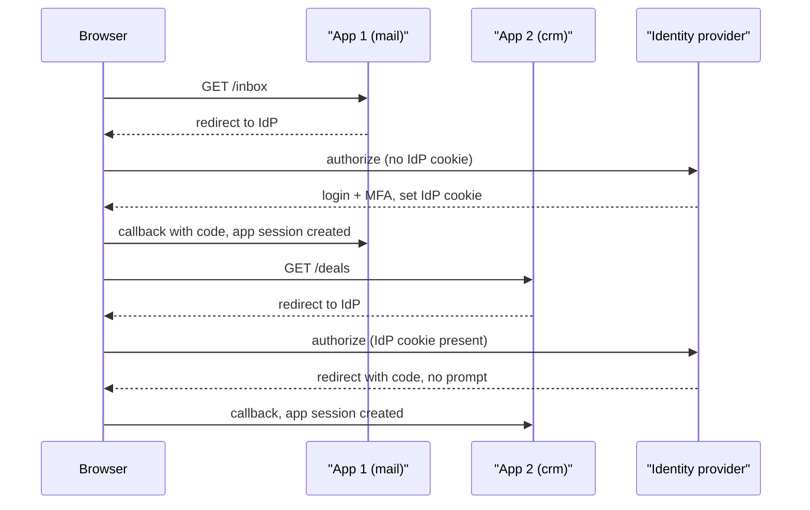

## In one minute
- SSO lets a user authenticate once at an *identity provider* (IdP) and then access many applications (*service providers*, SPs) without logging in again.
- It works because the IdP keeps its own session; each app redirects to the IdP, which silently issues a signed assertion for that app.
- The two dominant protocols are SAML 2.0 (XML assertions, enterprise) and OpenID Connect (JWT ID tokens on top of OAuth 2.0, modern apps).
- Every app still has its own local session; SSO only automates how that session gets created.
- Logout, session lifetime and account provisioning are the hard parts, not login.

## How it works

### Three sessions, not one
After SSO, a user has an IdP session (a cookie on the IdP's domain) and one local session per app (cookies on each app's domain). Browsers do not share cookies across domains, so the apps never see the IdP cookie. Instead each app sends the browser to the IdP, the IdP recognises its own cookie, and it sends the browser back with a signed statement of who the user is.

### SP-initiated login with OIDC
1. The user opens `crm.example.com` with no session. The app redirects to the IdP's authorize endpoint with `scope=openid`, a `nonce` and `state`.
2. If the IdP session exists, there is no login prompt; the IdP immediately redirects back with an authorization code. If not, it authenticates the user (password, MFA, passkey) first.
3. The app exchanges the code for an *ID token*, a JWT with `iss`, `sub` (stable user id), `aud` (this app), `exp`, `nonce` and `auth_time`.
4. The app validates signature, issuer, audience, expiry and nonce, then creates its own session ([OIDC Core §3.1.3.7](https://openid.net/specs/openid-connect-core-1_0.html#IDTokenValidation)).

OIDC Core and eight companion specs were also published as ISO/IEC standards in October 2024 (Core is ISO/IEC 26131:2024), which matters in procurement where only treaty-body standards count ([OpenID Foundation](https://www.openid.net/10-years-on-openidconnect-published-as-iso-spec/)).

SAML follows the same shape with different encoding: the IdP posts a signed XML `Response` containing an `Assertion` to the SP's assertion consumer service URL, with `Audience`, `NotBefore` and `NotOnOrAfter` conditions. Its XML signature handling is error-prone, one reason new systems prefer OIDC.

### Logout
Logging out of one app ends only that app's session. Single logout needs the IdP to tell every app. Front-channel logout loads each app's logout URL in hidden frames, and those frames need the app's cookie in a third-party context. Safari has blocked third-party cookies by default since March 2020 ([WebKit](https://webkit.org/blog/10218/full-third-party-cookie-blocking-and-more/)), while Chrome dropped its deprecation plan in April 2025 and kept them under user control ([Google](https://privacysandbox.google.com/blog/privacy-sandbox-next-steps)), so the same logout works in one browser and silently fails in another. The front-channel spec itself tells apps to detect this and warn the user ([OIDC Front-Channel Logout §4.1](https://openid.net/specs/openid-connect-frontchannel-1_0.html)). Back-channel logout has the IdP POST a signed *logout token* directly to each app's server, which then deletes sessions for that `sub` or session id. This requires apps to index sessions by user, which many do not.

### Provisioning
SSO answers "who is this?", not "does this person have an account here, and in which groups?". Just-in-time provisioning creates the account on first login from token claims. SCIM lets the IdP push creates, updates and, crucially, deactivations, so a departing employee loses access everywhere even if an app session is still open ([RFC 7644](https://www.rfc-editor.org/rfc/rfc7644)). A newer channel goes further: the OpenID Shared Signals Framework and its CAEP profile, final since 2025, let the IdP stream events such as `session-revoked` and `credential-change` to apps in near real time ([CAEP 1.0](https://openid.net/specs/openid-caep-1_0-final.html)).

## Down the stack

### Layer 1: The contract
The IdP asserts, with its signature, that a subject authenticated at a given time, for one named audience, valid within a short window. The SP promises to create a session only from an assertion that is correctly signed by the expected issuer, addressed to itself, within its time window (plus a small clock skew), and not seen before. Login is therefore strongly specified. Logout is not: front-channel logout is best effort, and only back-channel logout or deprovisioning gives a server-to-server guarantee that sessions end.

### Layer 2: The mechanism
In SAML, the SP sends an `AuthnRequest`, deflated and base64-encoded into a query string (HTTP-Redirect binding, which every endpoint must support with DEFLATE ([SAML Bindings §3.4.4](https://docs.oasis-open.org/security/saml/v2.0/saml-bindings-2.0-os.pdf))). The IdP answers with an auto-submitting HTML form that POSTs a base64 `SAMLResponse` to the SP's assertion consumer service URL (HTTP-POST binding). Inside, the `Assertion` carries `Issuer`, `Subject/NameID`, `Conditions` with `NotBefore`, `NotOnOrAfter` and `AudienceRestriction`, an `AuthnStatement`, attributes, and `InResponseTo` linking it to the request. The XML signature uses exclusive canonicalisation and a `Reference URI` pointing at the signed element's ID; signature wrapping attacks exploit code that verifies one element but reads another. A 2025 variant hit ruby-saml, which parsed the same response with two XML parsers that disagreed about which `Signature` element counted (see In the wild). OIDC replaces all this with a JWT `id_token` and a discovery document at `/.well-known/openid-configuration`. Back-channel logout POSTs a signed logout token with an `events` claim and a `sid` identifying the IdP session, or a `sub`, or both. The token must not carry a `nonce`, so it can never pass as an ID token, and the app answers `200` or `400` ([OIDC Back-Channel Logout §2.4](https://openid.net/specs/openid-connect-backchannel-1_0.html)).

### Layer 3: The machine
A SAML response is often 5 to 15 KB once base64-encoded, too big for a URL (many servers cap request lines near 8 KB), which is why responses are POSTed while requests are deflated. Parsing, canonicalising and verifying XML costs milliseconds and needs a parser with external entities disabled. Every silent SSO hop is a chain of full browser navigations: two redirects, possibly a fresh TLS handshake to the IdP, and a token exchange, so 200 to 400 ms on a mobile network. Cookies matter at the byte level too: a browser cookie is limited to about 4 KB, and `SameSite=Lax` cookies are not sent on the cross-site POST back from the IdP, so an SP that keeps its pre-login state in such a cookie loses it unless it marks that cookie `SameSite=None; Secure`.

### Why it's built this way
1. Browsers isolate cookies per site, so apps cannot share a session and must bounce through the IdP.
2. The browser is an untrusted courier between IdP and app, so assertions are signed, audience-bound, time-limited and replay-checked.
3. Enterprises standardised on XML web services in the mid-2000s, giving SAML; the JSON and mobile era layered OIDC onto OAuth.
4. Apps keep their own sessions for speed and to survive IdP blips, which turns revocation into a distributed problem solved by back-channel logout and SCIM.
5. Centralising identity makes the IdP the single gate to everything, so it must be run as tier-zero infrastructure.

## Diagram



## Worked example
A company of 8,000 employees uses 60 internal and SaaS applications behind one IdP.

Logins: each employee starts the day with one interactive login (password plus push MFA), then touches about 12 apps. That is 8,000 interactive logins and about 96,000 silent SSO redirects per day, peaking around 9 a.m. at perhaps 150 per second. Each silent redirect costs the user about 300 ms (two redirects and a token exchange), which is why apps keep local sessions for hours rather than re-checking every page.

Session lifetimes: IdP session 10 hours, app sessions 8 hours, ID token 5 minutes (used only to establish the session). If HR deactivates a user at 14:00, the IdP blocks new logins immediately, but open app sessions survive until they expire, up to 8 hours later. With SCIM deactivation pushed to the 25 apps that support it, and back-channel logout to the 30 that support that, exposure drops to the 5 apps that support neither, which the security team either replaces or puts behind a proxy that checks the IdP session every 15 minutes.

Availability: the IdP is now on the critical path for every new session. A 30-minute IdP outage at 9 a.m. blocks everyone who has not yet logged in, so the IdP needs multi-region deployment and its own incident runbook. Azure's Federated Identity pattern makes the same point: authentication becomes a single point of failure, so deploy identity in the same regions as the apps ([Azure Architecture Center](https://learn.microsoft.com/en-us/azure/architecture/patterns/federated-identity)).

## In the wild
- **Cloudflare, 2025: the identity store went down and Access failed closed.** A third-party storage provider behind Workers KV failed, and because Cloudflare Access reads application, policy and identity data from KV, 100% of identity-based Access logins failed from 17:52 to 20:28 UTC. Access is designed to deny when it cannot decide, so the outage blocked logins rather than letting everyone in. Service-token, mTLS and IP-based access kept working. Cloudflare is removing KV's dependence on a single backing store ([Cloudflare](https://blog.cloudflare.com/cloudflare-service-outage-june-12-2025/)).
- **ruby-saml and GitLab, 2025: sign in as anyone.** ruby-saml up to 1.17.0 parsed SAML responses with both REXML and Nokogiri, and crafted XML made them pick different `Signature` elements, disconnecting the digest check from the signature check. One validly signed document from the target IdP, such as another user's assertion, was enough to forge assertions for any user. Reported in November 2024, fixed in 1.18.0 on 12 March 2025, with an exploitable GitLab instance found and a coordinated release planned ([GitHub Security Lab](https://github.blog/security/sign-in-as-anyone-bypassing-saml-sso-authentication-with-parser-differentials/)).

## Trade-offs

| Option | Strengths | Weaknesses | Choose when |
| --- | --- | --- | --- |
| OIDC | JSON/JWT, mobile-friendly, simpler libraries | Fewer legacy enterprise integrations | New apps, consumer and workforce |
| SAML 2.0 | Universal in enterprise SaaS | XML signatures, complex, browser-only | Integrating with enterprise customers and legacy SaaS |
| Long app sessions | Fewer redirects, resilient to IdP blips | Slow revocation | Low-risk internal tools |
| Short app sessions | Fast revocation | More IdP load and latency | Admin and finance systems |
| Back-channel logout | Reliable, server-to-server | Apps must index sessions by user | Workforce SSO with offboarding risk |

## Pitfalls in production
- **Accepting assertions for another app.** Skipping `aud` checks lets a token minted for one SP log into another. Validate audience and issuer always.
- **XML signature wrapping.** Validating one signed element but reading claims from an unsigned one. Use a maintained SAML library, keep it patched (ruby-saml needed critical bypass fixes in 2024 for CVE-2024-45409 and again in March 2025), and never parse assertions by hand ([OWASP SAML Security](https://cheatsheetseries.owasp.org/cheatsheets/SAML_Security_Cheat_Sheet.html)).
- **Matching users by email.** Emails change and can be reused. Key accounts on the IdP's immutable `sub` or NameID.
- **Orphaned sessions after offboarding.** Long app sessions outlive deactivation. Use SCIM and back-channel logout, and cap session length.

## Leadership lens
- Treat the IdP as tier-zero infrastructure: multi-region, monitored, with break-glass accounts.
- Require SSO plus SCIM in vendor evaluations; "SSO tax" pricing tiers are a real budget line.
- Ask in review: when a user is deactivated, how many minutes until every session in this app is dead?
- Standardise on one protocol and library per stack so validation is done once and done right.

## Check yourself
1. Why does the second app not show a login prompt?
   **Answer:** The browser still holds the IdP's session cookie, so when the second app redirects there the IdP recognises the user and immediately issues a new assertion.
2. Why does disabling a user at the IdP not immediately log them out of apps?
   **Answer:** Each app has its own local session that does not consult the IdP until it expires, unless the IdP pushes logout or deprovisioning.
3. Why key users on `sub` rather than email?
   **Answer:** `sub` is stable and unique per issuer, while emails change and can be reassigned to a different person.

## Practice
**Task:** Implement the service-provider side of SSO. `ServiceProvider(issuer, audience, clock, skew=60)` has `accept(a)`, where `a` is a dict with `id`, `iss`, `aud`, `sub`, `not_before`, `not_after` and `sig_ok`. Return the first failing reason from `"bad_signature"`, `"wrong_issuer"`, `"wrong_audience"`, `"not_yet_valid"`, `"expired"`, `"replay"` (in that order), allowing `skew` seconds on both time checks; otherwise record the assertion id, create a session for `sub`, and return `"ok"`. `backchannel_logout(sub)` ends that user's sessions and returns how many it ended, and `logged_in(sub)` reports whether any remain.

```python starter
class ServiceProvider:
    def __init__(self, issuer, audience, clock, skew=60):
        pass

    def accept(self, a):
        raise NotImplementedError

    def backchannel_logout(self, sub):
        raise NotImplementedError

    def logged_in(self, sub):
        raise NotImplementedError
```

```python tests
def mk(**kw):
    a = {"id": "a1", "iss": "idp", "aud": "crm", "sub": "u7",
         "not_before": 100, "not_after": 400, "sig_ok": True}
    a.update(kw)
    return a

def sp(t=200):
    return ServiceProvider("idp", "crm", lambda: t)

def test_valid_creates_session():
    s = sp()
    assert s.accept(mk()) == "ok"
    assert s.logged_in("u7")

def test_audience_and_signature_checked():
    assert sp().accept(mk(aud="mail")) == "wrong_audience"
    assert sp().accept(mk(sig_ok=False, aud="mail")) == "bad_signature"

def test_skew_tolerance():
    assert sp(t=50).accept(mk()) == "ok"
    assert sp(t=30).accept(mk()) == "not_yet_valid"
    assert sp(t=470).accept(mk()) == "expired"

def test_replay_rejected():
    s = sp()
    s.accept(mk())
    assert s.accept(mk()) == "replay"

def test_backchannel_logout():
    s = sp()
    s.accept(mk(id="x1"))
    s.accept(mk(id="x2"))
    assert s.backchannel_logout("u7") == 2
    assert not s.logged_in("u7")
    assert s.backchannel_logout("u7") == 0
```

```python solution
class ServiceProvider:
    def __init__(self, issuer, audience, clock, skew=60):
        self.issuer, self.audience, self.clock, self.skew = issuer, audience, clock, skew
        self.seen = set()
        self.sessions = {}

    def accept(self, a):
        now = self.clock()
        if not a["sig_ok"]:
            return "bad_signature"
        if a["iss"] != self.issuer:
            return "wrong_issuer"
        if a["aud"] != self.audience:
            return "wrong_audience"
        if now + self.skew < a["not_before"]:
            return "not_yet_valid"
        if now - self.skew >= a["not_after"]:
            return "expired"
        if a["id"] in self.seen:
            return "replay"
        self.seen.add(a["id"])
        self.sessions[a["sub"]] = self.sessions.get(a["sub"], 0) + 1
        return "ok"

    def backchannel_logout(self, sub):
        return self.sessions.pop(sub, 0)

    def logged_in(self, sub):
        return self.sessions.get(sub, 0) > 0
```

```typescript starter
export interface Assertion {
  id: string; iss: string; aud: string; sub: string;
  notBefore: number; notAfter: number; sigOk: boolean;
}

export class ServiceProvider {
  constructor(issuer: string, audience: string, clock: () => number, skew = 60) {}
  accept(a: Assertion): string {
    throw new Error("TODO");
  }
  backchannelLogout(sub: string): number {
    throw new Error("TODO");
  }
  loggedIn(sub: string): boolean {
    throw new Error("TODO");
  }
}
```

```typescript tests
function mk(o: Partial<Assertion> = {}): Assertion {
  return { id: "a1", iss: "idp", aud: "crm", sub: "u7", notBefore: 100, notAfter: 400, sigOk: true, ...o };
}
const sp = (t = 200) => new ServiceProvider("idp", "crm", () => t);
test("valid creates session", () => {
  const s = sp();
  assertEqual(s.accept(mk()), "ok");
  assert(s.loggedIn("u7"), "logged in");
});
test("audience and signature checked", () => {
  assertEqual(sp().accept(mk({ aud: "mail" })), "wrong_audience");
  assertEqual(sp().accept(mk({ sigOk: false, aud: "mail" })), "bad_signature");
});
test("skew tolerance", () => {
  assertEqual(sp(50).accept(mk()), "ok");
  assertEqual(sp(30).accept(mk()), "not_yet_valid");
  assertEqual(sp(470).accept(mk()), "expired");
});
test("replay rejected", () => {
  const s = sp();
  s.accept(mk());
  assertEqual(s.accept(mk()), "replay");
});
test("backchannel logout", () => {
  const s = sp();
  s.accept(mk({ id: "x1" }));
  s.accept(mk({ id: "x2" }));
  assertEqual(s.backchannelLogout("u7"), 2);
  assert(!s.loggedIn("u7"), "logged out");
  assertEqual(s.backchannelLogout("u7"), 0);
});
```

```typescript solution
export interface Assertion {
  id: string; iss: string; aud: string; sub: string;
  notBefore: number; notAfter: number; sigOk: boolean;
}

export class ServiceProvider {
  private seen = new Set<string>();
  private sessions = new Map<string, number>();
  constructor(private issuer: string, private audience: string, private clock: () => number, private skew = 60) {}
  accept(a: Assertion): string {
    const now = this.clock();
    if (!a.sigOk) return "bad_signature";
    if (a.iss !== this.issuer) return "wrong_issuer";
    if (a.aud !== this.audience) return "wrong_audience";
    if (now + this.skew < a.notBefore) return "not_yet_valid";
    if (now - this.skew >= a.notAfter) return "expired";
    if (this.seen.has(a.id)) return "replay";
    this.seen.add(a.id);
    this.sessions.set(a.sub, (this.sessions.get(a.sub) ?? 0) + 1);
    return "ok";
  }
  backchannelLogout(sub: string): number {
    const n = this.sessions.get(sub) ?? 0;
    this.sessions.delete(sub);
    return n;
  }
  loggedIn(sub: string): boolean {
    return (this.sessions.get(sub) ?? 0) > 0;
  }
}
```

```go starter
package practice

type Assertion struct {
	ID, Iss, Aud, Sub   string
	NotBefore, NotAfter int64
	SigOK               bool
}

type ServiceProvider struct{}

func NewServiceProvider(issuer, audience string, clock func() int64, skew int64) *ServiceProvider {
	return &ServiceProvider{}
}

func (s *ServiceProvider) Accept(a Assertion) string { panic("TODO") }

func (s *ServiceProvider) BackchannelLogout(sub string) int { panic("TODO") }

func (s *ServiceProvider) LoggedIn(sub string) bool { panic("TODO") }
```

```go tests
package practice

import "testing"

func mk() Assertion {
	return Assertion{ID: "a1", Iss: "idp", Aud: "crm", Sub: "u7", NotBefore: 100, NotAfter: 400, SigOK: true}
}

func sp(t int64) *ServiceProvider {
	return NewServiceProvider("idp", "crm", func() int64 { return t }, 60)
}

func expect(t *testing.T, got, want string) {
	t.Helper()
	if got != want {
		t.Fatalf("got %s, want %s", got, want)
	}
}

func TestValid(t *testing.T) {
	s := sp(200)
	expect(t, s.Accept(mk()), "ok")
	if !s.LoggedIn("u7") {
		t.Fatal("not logged in")
	}
}

func TestAudienceAndSignature(t *testing.T) {
	a := mk()
	a.Aud = "mail"
	expect(t, sp(200).Accept(a), "wrong_audience")
	a.SigOK = false
	expect(t, sp(200).Accept(a), "bad_signature")
}

func TestSkew(t *testing.T) {
	expect(t, sp(50).Accept(mk()), "ok")
	expect(t, sp(30).Accept(mk()), "not_yet_valid")
	expect(t, sp(470).Accept(mk()), "expired")
}

func TestReplay(t *testing.T) {
	s := sp(200)
	s.Accept(mk())
	expect(t, s.Accept(mk()), "replay")
}

func TestBackchannelLogout(t *testing.T) {
	s := sp(200)
	a, b := mk(), mk()
	a.ID, b.ID = "x1", "x2"
	s.Accept(a)
	s.Accept(b)
	if s.BackchannelLogout("u7") != 2 || s.LoggedIn("u7") || s.BackchannelLogout("u7") != 0 {
		t.Fatal("logout failed")
	}
}
```

```go solution
package practice

type Assertion struct {
	ID, Iss, Aud, Sub   string
	NotBefore, NotAfter int64
	SigOK               bool
}

type ServiceProvider struct {
	issuer, audience string
	clock            func() int64
	skew             int64
	seen             map[string]bool
	sessions         map[string]int
}

func NewServiceProvider(issuer, audience string, clock func() int64, skew int64) *ServiceProvider {
	return &ServiceProvider{issuer, audience, clock, skew, map[string]bool{}, map[string]int{}}
}

func (s *ServiceProvider) Accept(a Assertion) string {
	now := s.clock()
	switch {
	case !a.SigOK:
		return "bad_signature"
	case a.Iss != s.issuer:
		return "wrong_issuer"
	case a.Aud != s.audience:
		return "wrong_audience"
	case now+s.skew < a.NotBefore:
		return "not_yet_valid"
	case now-s.skew >= a.NotAfter:
		return "expired"
	case s.seen[a.ID]:
		return "replay"
	}
	s.seen[a.ID] = true
	s.sessions[a.Sub]++
	return "ok"
}

func (s *ServiceProvider) BackchannelLogout(sub string) int {
	n := s.sessions[sub]
	delete(s.sessions, sub)
	return n
}

func (s *ServiceProvider) LoggedIn(sub string) bool { return s.sessions[sub] > 0 }
```

## Mock interview
**Prompt:** Design SSO for a company with 8,000 employees and 60 applications, a mix of in-house services and SaaS. Security wants offboarding to cut all access within 15 minutes.

- Follow-up: Walk through what happens on the wire when an already-logged-in user opens a second app.
- Follow-up: An app supports SAML login but neither SCIM nor logout. How do you meet the 15-minute goal?
- Follow-up: The IdP is down for 20 minutes. Who is affected and how do you reduce that?

**A strong answer covers:**
- IdP session versus per-app sessions and how redirects connect them.
- OIDC for in-house apps, SAML where SaaS requires it, with strict assertion validation.
- SCIM deprovisioning and back-channel logout, plus session length caps.
- An identity-aware proxy for apps that cannot honour revocation.
- IdP high availability and the trade-off between session length and IdP dependency.

## Sources and further study
**Primary**
- [OpenID Connect Front-Channel Logout 1.0](https://openid.net/specs/openid-connect-frontchannel-1_0.html): the iframe-based logout and its documented failure under third-party cookie blocking.
- [SAML 2.0 Bindings (OASIS)](https://docs.oasis-open.org/security/saml/v2.0/saml-bindings-2.0-os.pdf): exactly how HTTP-Redirect and HTTP-POST carry requests and responses.
- [OpenID CAEP 1.0](https://openid.net/specs/openid-caep-1_0-final.html): session and credential change events pushed from IdP to apps.
- [RFC 7643: SCIM Core Schema](https://www.rfc-editor.org/rfc/rfc7643): the User and Group resources, including the `active` attribute used for deactivation.

**Systems docs**
- [Keycloak Server Administration Guide: SSO protocols](https://www.keycloak.org/docs/latest/server_admin/index.html#sso-protocols): one open-source IdP's OIDC and SAML 2.0 support, configured side by side.

**Books**
- *Building Microservices* (2nd ed.), Sam Newman, Ch 11 "Security": common single sign-on implementations and the single sign-on gateway pattern.
- *Building Secure and Reliable Systems*, Adkins et al. (Google, 2020), Ch 9 "Design for Recovery": emergency access when the normal identity path is down ([read free](https://google.github.io/building-secure-and-reliable-systems/raw/ch09.html)).

**Other curricula**
- [Azure Architecture Center: Federated Identity pattern](https://learn.microsoft.com/en-us/azure/architecture/patterns/federated-identity): SSO as claims-based access with an STS, including home realm discovery and the IdP as a single point of failure.
- [OWASP SAML Security Cheat Sheet](https://cheatsheetseries.owasp.org/cheatsheets/SAML_Security_Cheat_Sheet.html): validation steps and the signature wrapping family of attacks.

## Watch
- [What Is Single Sign-on (SSO)? How It Works (ByteByteGo)](https://www.youtube.com/watch?v=O1cRJWYF-g4): animated overview of SAML and OIDC flows.
- [SSO Explained in 10 Minutes: SAML, OIDC and SCIM (ByteMonk)](https://www.youtube.com/watch?v=5KChrGWFcpk): ties login, protocols and provisioning together.

## Free resources
- [OpenID Connect Core 1.0](https://openid.net/specs/openid-connect-core-1_0.html): ID token contents and validation rules.
- [OpenID Connect Back-Channel Logout](https://openid.net/specs/openid-connect-backchannel-1_0.html): server-to-server logout tokens.
- [SAML 2.0 Technical Overview (OASIS)](https://docs.oasis-open.org/security/saml/Post2.0/sstc-saml-tech-overview-2.0.html): official description of SAML profiles and bindings.
- [RFC 7644: SCIM Protocol](https://www.rfc-editor.org/rfc/rfc7644): the provisioning API used for deactivation.
