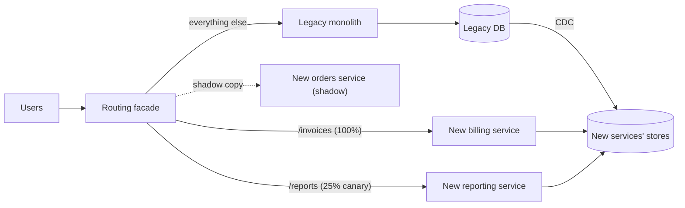

## In one minute
- The strangler fig pattern replaces a legacy system gradually: put a routing facade in front of it, build new functionality piece by piece, and shift traffic route by route until the old system handles nothing and can be switched off.
- It avoids the big-bang rewrite, which is notorious for running years late, missing undocumented behaviour, and delivering no value until the end.
- Each slice can be released, measured, and rolled back on its own, so risk stays small and value arrives early.
- The hard parts are data (two systems needing the same data during transition), the facade becoming a permanent fixture, and the long tail of rarely used features nobody wants to migrate.

## How it works

### The facade
Everything starts with an interception point that all traffic passes through: a reverse proxy, API gateway, or a routing layer inside the monolith. At first it sends 100% of traffic to the legacy system. Then, route by route, it sends selected requests to the new implementation. Routing can be by path (`/invoices/*`), by tenant, by user cohort, or by percentage, which allows canary releases of each slice. The name is Martin Fowler's, after the strangler figs of Queensland that grow around a host tree until they replace it; the 2024 version of his article makes the point that the facade and sync code are *transitional architecture*, built to be thrown away, and still worth it for the earlier value and lower risk ([martinfowler.com](https://martinfowler.com/bliki/StranglerFigApplication.html)). Managed facades come and go: AWS Migration Hub Refactor Spaces, which set up API Gateway as a strangler proxy, closed to new customers on 7 November 2025 ([AWS Prescriptive Guidance](https://docs.aws.amazon.com/prescriptive-guidance/latest/cloud-design-patterns/strangler-fig.html)), so keep the routing rules in config you own.

### Choosing slices
Good first slices have clear boundaries, few writes into shared tables, and visible value: a read-only catalogue page, a new reporting feature, a self-contained workflow. Bad first slices sit at the centre of the data model (core order processing) or have many hidden callers. Event storming or a dependency map of the monolith helps find seams.

### Data during the transition
This is where most strangler projects get stuck. Options, roughly from easiest to hardest:

- **New reads from legacy data.** The new service reads the legacy database (ideally through an anti-corruption layer) while writes stay in the monolith. Fast to start, but couples you to the old schema.
- **Change data capture.** Stream changes from the legacy database into the new service's own store. Reads are decoupled; writes still happen in one place.
- **Ownership transfer.** The new service becomes the writer of record for its data, and the monolith reads through the new service's API or a synced copy. This is the real finish line for a slice.

Avoid dual writes from application code into both databases; they diverge on partial failure.

Calls also cross the boundary in both directions. Unmigrated code in the monolith still calls features that have moved out, and new services still call features that have not. Put an anti-corruption layer at each crossing: inside the monolith, a small adapter (say `UserServiceFacade`) keeps the old interface and forwards to the new service, so existing callers do not change ([AWS Prescriptive Guidance](https://docs.aws.amazon.com/prescriptive-guidance/latest/cloud-design-patterns/strangler-fig.html)).

### Verifying behaviour
Legacy systems encode years of edge cases. Before switching a route, run the new implementation in **shadow mode**: the facade sends real requests to both, returns the legacy response, and logs differences. Fix discrepancies until the diff rate is near zero, then ramp traffic with a percentage split. Keep the legacy path ready for instant rollback until the slice has run cleanly for a while.

### Finishing
The pattern is complete only when the legacy system is decommissioned. Track remaining routes and traffic share as a burn-down. Budget for the long tail explicitly, or the organisation will run two systems forever.

Two finishing details are easy to miss. Rollback stays cheap only while the legacy tables and sync jobs still exist; once you drop them, going back means restoring objects and replaying changes, so drop them as a deliberate last step per domain. And the facade itself is usually removed at the end, with clients pointed straight at the new system, unless you keep it as an adapter for legacy clients ([Azure Architecture Center](https://learn.microsoft.com/en-us/azure/architecture/patterns/strangler-fig)).

## Down the stack

### Layer 1: The contract
The facade promises that every request is served by exactly one primary implementation, chosen deterministically from the current routing rules, and that a user's assignment is sticky for a given rule. Changing a rule is a config change that takes effect within seconds and can be reverted just as fast. Shadowed requests never influence the response the user sees, and mirrored writes never reach production data. For data, each item has exactly one writer at any time.

### Layer 2: The mechanism
In NGINX, routing is `location` blocks with `proxy_pass` to different upstreams, and percentage splits use `split_clients`, which hashes a stable value such as a user ID with MurmurHash2 and maps hash ranges to percentages, so a user keeps the same variant ([NGINX docs](https://nginx.org/en/docs/http/ngx_http_split_clients_module.html)). The `mirror` directive (since 1.13.4) sends background copies of requests and ignores their responses ([NGINX docs](https://nginx.org/en/docs/http/ngx_http_mirror_module.html)). In Envoy, a route can use `weighted_clusters` or a `runtime_fraction`, and `request_mirror_policies` sends a copy of each request to a shadow cluster, fire-and-forget, with the `Host` header suffixed with `-shadow` so the receiver knows; a `runtime_fraction` on the policy samples a share of traffic instead of all of it ([Envoy docs](https://www.envoyproxy.io/docs/envoy/latest/api-v3/config/route/v3/route_components.proto)). A comparison service collects legacy and new responses keyed by request ID, normalises fields that legitimately differ (timestamps, IDs), and records diffs. Data moves with CDC from the legacy database's redo or binary log into the new service's store. For MySQL that means reading the binlog; for Oracle, Debezium's connector uses LogMiner by default and can instead read redo logs through OpenLogReplicator or the commercial XStream API ([Debezium docs](https://debezium.io/documentation/reference/stable/connectors/oracle.html)).

### Layer 3: The machine
The facade adds a proxy hop of roughly 0.2 to 1 ms inside a data centre, mostly connection handling and parsing. Mirroring 100% of a route doubles the outbound bandwidth and upstream CPU for that route, so shadowing usually samples a percentage. CDC readers parse redo or binlog files, adding sequential read I/O and CPU on the legacy database host, which on an old, saturated machine can be the real constraint. A freshly cut-over service starts with cold caches and empty connection pools, so the first minutes at a new traffic share run slower than steady state; ramps should be gradual.

### Why it's built this way
1. Risk grows with the size of a change, so migration is cut into slices that can be shipped and reverted alone.
2. Legacy behaviour is incompletely documented, so the new code is checked against real production traffic in shadow.
3. Two writers for one record diverge on partial failure, so data has one owner and other copies follow via CDC.
4. Reverting must not require a deploy of either system, so the switch lives in a separate routing layer.

## Diagram


## Worked example
An insurer's 15-year-old policy administration system handles quoting, policy changes, claims, and billing. A rewrite estimate came back at 3 years with no releases in between. Instead they put an NGINX-based facade in front of it.

Slice 1 is quote retrieval, read-only, 1,200 requests per second at peak. The new service reads policy data from its own Postgres, populated by CDC from the legacy Oracle database with lag under 2 seconds. In shadow mode for two weeks, the comparator finds a 0.8% mismatch rate, traced to three undocumented rounding rules and a timezone quirk. After fixes the rate is 0.01%, all explained. Traffic ramps 5%, 25%, 50%, 100% over ten days, and p95 latency drops from 900 ms to 120 ms.

Slice 2, policy changes, involves writes. The new service becomes the owner of endorsements, and a reverse sync writes summary rows back to Oracle so the legacy claims module keeps working. Eighteen months in, 85% of traffic runs on new services. The final 15% includes a rarely used reinsurance module with two users. The team decides to wrap it, not rewrite it, and schedule its retirement with a vendor product.

## In the wild
- **GitHub, 2015: shadow-testing a rewrite of the Merge button (engineering write-up).** GitHub replaced the code behind the pull-request Merge button, a shell script around Git's merge on a temporary checkout, with in-memory merges through libgit2. Using its Scientist library, both paths ran on live requests, starting at 1%: users always got the old result, candidate exceptions were swallowed, and mismatches were logged. The diffs found bugs in both implementations, including a Git exit-code overflow at exactly 768 conflicts, and conflict detection that took over 8 s in libgit2 against about 3 ms in Git until fixed. After 24 hours at 100% with no mismatches across tens of millions of merges, the new path went live, with its p99 close to the old p95 ([GitHub](https://github.blog/engineering/engineering-principles/move-fast/)).
- **TSB, 2018: the big-bang alternative.** In April 2018 TSB moved its customer and corporate data to a new platform in one migration. The data moved, but the platform failed at once, disrupting branch, telephone, online and mobile banking for a significant share of its 5.2 million customers, and normal service did not return until December. Regulators fined TSB £48.65m in 2022 for failing to organise and control the programme and its outsourcing risk; TSB paid £32.7m in customer redress ([FCA](https://www.fca.org.uk/news/press-releases/tsb-fined-ps4865m-operational-resilience-failings)).

## Trade-offs
| Option | Strengths | Weaknesses | Choose when |
|---|---|---|---|
| Big-bang rewrite | Clean design, no transition complexity | Long delay before value, high risk of missed behaviour | Small systems or fully understood behaviour |
| Strangler fig | Incremental value, reversible steps, early learning | Long transition with two systems and sync | Large, business-critical legacy systems |
| Refactor in place | No new infrastructure, keeps one system | Constrained by legacy platform and coupling | The platform is sound but the code is messy |
| Wrap and retain | Cheap, minimal risk | Legacy stays forever | Stable, rarely changing functionality |

## Pitfalls in production
- **Starting at the core.** The first slice is the most coupled part, and the project stalls for a year. Start at the edges with low-coupling, visible features.
- **Dual writes.** Application code writes to both databases and they drift. Use one writer per data item, with CDC or an outbox to sync.
- **Permanent facade.** Routing rules accumulate and nobody owns them, and every request now depends on one more hop. Treat the facade as product infrastructure with tests, ownership, redundancy so it is not a single point of failure, and a plan to remove it after migration ([Azure Architecture Center](https://learn.microsoft.com/en-us/azure/architecture/patterns/strangler-fig)).
- **Hidden callers.** Batch jobs, reports, and partner integrations hit the legacy database directly and break when ownership moves. Inventory all access paths, including database users, before moving data.
- **Never finishing.** The last 10% is boring and gets deprioritised. Make decommissioning a funded goal with a date and a burn-down.

## Leadership lens
- Define what "done" means for each slice: traffic moved, data ownership moved, legacy code deleted.
- Invest early in the facade and the comparison tooling; they make every later slice faster and safer.
- Keep a visible burn-down of legacy routes and traffic for stakeholders, so the long tail stays funded.
- Decide explicitly which features will be retired or wrapped instead of migrated.

## Check yourself
1. Why is shadow traffic so useful when strangling a legacy system?
   **Answer:** It reveals undocumented behaviour by comparing new and legacy responses on real production requests, without exposing users to the new implementation.
2. Why are application-level dual writes risky during migration?
   **Answer:** A failure between the two writes leaves the stores inconsistent, and there is no transaction spanning both systems, so drift accumulates silently.
3. When is a slice truly finished?
   **Answer:** When all its traffic goes to the new service, the new service owns the data, and the legacy code and data paths for it have been removed.

## Practice
**Task:** Build the routing decision for a strangler facade. `StranglerRouter(hash_fn)` has `set_rule(prefix, percent)`, which sends `percent` (0 to 100, otherwise `ValueError`) of users for paths under `prefix` to the new system, and `route(path, user_id)`, which returns `"new"` or `"legacy"`. Use the longest matching prefix on whole path segments; paths with no rule go to `"legacy"`. A user goes to `"new"` when `hash_fn(user_id) % 100 < percent`, which keeps each user's assignment sticky and means users already on the new system stay there as the percentage ramps up.

```python starter
class StranglerRouter:
    def __init__(self, hash_fn):
        # TODO
        raise NotImplementedError

    def set_rule(self, prefix, percent):
        raise NotImplementedError

    def route(self, path, user_id):
        raise NotImplementedError
```

```python tests
def ident(u):
    return u

def test_default_is_legacy():
    r = StranglerRouter(ident)
    assert r.route("/orders/1", 5) == "legacy"

def test_percentage_split():
    r = StranglerRouter(ident)
    r.set_rule("/invoices", 30)
    assert r.route("/invoices/9", 29) == "new"
    assert r.route("/invoices/9", 30) == "legacy"
    assert r.route("/invoices", 129) == "new"

def test_ramp_is_monotonic():
    r = StranglerRouter(ident)
    r.set_rule("/reports", 10)
    early = [u for u in range(100) if r.route("/reports", u) == "new"]
    r.set_rule("/reports", 50)
    assert all(r.route("/reports", u) == "new" for u in early)
    assert sum(1 for u in range(100) if r.route("/reports", u) == "new") == 50

def test_longest_prefix_and_segments():
    r = StranglerRouter(ident)
    r.set_rule("/billing", 100)
    r.set_rule("/billing/legacy-export", 0)
    assert r.route("/billing/x", 1) == "new"
    assert r.route("/billing/legacy-export/2", 1) == "legacy"
    assert r.route("/billingx", 1) == "legacy"

def test_invalid_percent():
    r = StranglerRouter(ident)
    for bad in (-1, 101):
        try:
            r.set_rule("/a", bad)
            assert False, "expected ValueError"
        except ValueError:
            pass
```

```python solution
class StranglerRouter:
    def __init__(self, hash_fn):
        self.hash_fn = hash_fn
        self.rules = {}

    def set_rule(self, prefix, percent):
        if percent < 0 or percent > 100:
            raise ValueError("percent must be 0..100")
        self.rules[prefix] = percent

    def route(self, path, user_id):
        best = None
        for prefix in self.rules:
            if path == prefix or path.startswith(prefix.rstrip("/") + "/"):
                if best is None or len(prefix) > len(best):
                    best = prefix
        if best is None:
            return "legacy"
        return "new" if self.hash_fn(user_id) % 100 < self.rules[best] else "legacy"
```

```typescript starter
export class StranglerRouter {
  constructor(hashFn: (userId: number) => number) {}
  setRule(prefix: string, percent: number): void {
    throw new Error("TODO");
  }
  route(path: string, userId: number): "new" | "legacy" {
    throw new Error("TODO");
  }
}
```

```typescript tests
const ident = (u: number) => u;
test("default is legacy", () => {
  assertEqual(new StranglerRouter(ident).route("/orders/1", 5), "legacy");
});
test("percentage split", () => {
  const r = new StranglerRouter(ident);
  r.setRule("/invoices", 30);
  assertEqual(r.route("/invoices/9", 29), "new");
  assertEqual(r.route("/invoices/9", 30), "legacy");
  assertEqual(r.route("/invoices", 129), "new");
});
test("ramp is monotonic", () => {
  const r = new StranglerRouter(ident);
  r.setRule("/reports", 10);
  const users = Array.from({ length: 100 }, (_, i) => i);
  const early = users.filter((u) => r.route("/reports", u) === "new");
  r.setRule("/reports", 50);
  assert(early.every((u) => r.route("/reports", u) === "new"), "early users stay on new");
  assertEqual(users.filter((u) => r.route("/reports", u) === "new").length, 50);
});
test("longest prefix and segments", () => {
  const r = new StranglerRouter(ident);
  r.setRule("/billing", 100);
  r.setRule("/billing/legacy-export", 0);
  assertEqual(r.route("/billing/x", 1), "new");
  assertEqual(r.route("/billing/legacy-export/2", 1), "legacy");
  assertEqual(r.route("/billingx", 1), "legacy");
});
test("invalid percent", () => {
  const r = new StranglerRouter(ident);
  for (const bad of [-1, 101]) {
    let threw = false;
    try { r.setRule("/a", bad); } catch (e) { threw = true; }
    assert(threw, "expected error for " + bad);
  }
});
```

```typescript solution
export class StranglerRouter {
  private rules = new Map<string, number>();
  constructor(private hashFn: (userId: number) => number) {}
  setRule(prefix: string, percent: number): void {
    if (percent < 0 || percent > 100) throw new Error("percent must be 0..100");
    this.rules.set(prefix, percent);
  }
  route(path: string, userId: number): "new" | "legacy" {
    let best: string | null = null;
    for (const prefix of this.rules.keys()) {
      const hit = path === prefix || path.startsWith(prefix.replace(/\/$/, "") + "/");
      if (hit && (best === null || prefix.length > best.length)) best = prefix;
    }
    if (best === null) return "legacy";
    return this.hashFn(userId) % 100 < this.rules.get(best)! ? "new" : "legacy";
  }
}
```

```go starter
package practice

type StranglerRouter struct{}

func NewStranglerRouter(hash func(userID int) int) *StranglerRouter { return &StranglerRouter{} }

// SetRule returns an error if percent is outside 0..100.
func (r *StranglerRouter) SetRule(prefix string, percent int) error { panic("TODO") }

// Route returns "new" or "legacy".
func (r *StranglerRouter) Route(path string, userID int) string { panic("TODO") }
```

```go tests
package practice

import "testing"

func ident(u int) int { return u }

func TestDefaultLegacy(t *testing.T) {
	if NewStranglerRouter(ident).Route("/orders/1", 5) != "legacy" {
		t.Fatal("expected legacy")
	}
}

func TestPercentSplit(t *testing.T) {
	r := NewStranglerRouter(ident)
	r.SetRule("/invoices", 30)
	if r.Route("/invoices/9", 29) != "new" || r.Route("/invoices/9", 30) != "legacy" || r.Route("/invoices", 129) != "new" {
		t.Fatal("split wrong")
	}
}

func TestRampMonotonic(t *testing.T) {
	r := NewStranglerRouter(ident)
	r.SetRule("/reports", 10)
	var early []int
	for u := 0; u < 100; u++ {
		if r.Route("/reports", u) == "new" {
			early = append(early, u)
		}
	}
	r.SetRule("/reports", 50)
	for _, u := range early {
		if r.Route("/reports", u) != "new" {
			t.Fatalf("user %d moved back", u)
		}
	}
	n := 0
	for u := 0; u < 100; u++ {
		if r.Route("/reports", u) == "new" {
			n++
		}
	}
	if n != 50 {
		t.Fatalf("n=%d", n)
	}
}

func TestLongestPrefix(t *testing.T) {
	r := NewStranglerRouter(ident)
	r.SetRule("/billing", 100)
	r.SetRule("/billing/legacy-export", 0)
	if r.Route("/billing/x", 1) != "new" || r.Route("/billing/legacy-export/2", 1) != "legacy" || r.Route("/billingx", 1) != "legacy" {
		t.Fatal("prefix matching wrong")
	}
}

func TestInvalidPercent(t *testing.T) {
	r := NewStranglerRouter(ident)
	if r.SetRule("/a", -1) == nil || r.SetRule("/a", 101) == nil {
		t.Fatal("expected errors")
	}
}
```

```go solution
package practice

import (
	"errors"
	"strings"
)

type StranglerRouter struct {
	hash  func(int) int
	rules map[string]int
}

func NewStranglerRouter(hash func(userID int) int) *StranglerRouter {
	return &StranglerRouter{hash: hash, rules: map[string]int{}}
}

// SetRule returns an error if percent is outside 0..100.
func (r *StranglerRouter) SetRule(prefix string, percent int) error {
	if percent < 0 || percent > 100 {
		return errors.New("percent must be 0..100")
	}
	r.rules[prefix] = percent
	return nil
}

// Route returns "new" or "legacy".
func (r *StranglerRouter) Route(path string, userID int) string {
	best, found := "", false
	for p := range r.rules {
		hit := path == p || strings.HasPrefix(path, strings.TrimSuffix(p, "/")+"/")
		if hit && (!found || len(p) > len(best)) {
			best, found = p, true
		}
	}
	if found && r.hash(userID)%100 < r.rules[best] {
		return "new"
	}
	return "legacy"
}
```

## Mock interview
**Prompt:** A bank runs a 20-year-old monolith for retail accounts: 2 million lines, one Oracle database with 1,400 tables, and 30 batch jobs. Leadership wants to move to cloud-native services within three years without a freeze on new features. Present a migration plan.

- Follow-up: How do you move ownership of customer contact details when 12 other modules read those tables directly?
- Follow-up: How do you prove the new statement service produces identical statements?
- Follow-up: Two years in, 20% of functionality remains on the monolith. What do you do?

**A strong answer covers:**
- A routing facade first, with path, cohort, and percentage routing and instant rollback.
- Slice selection from the edges using dependency analysis, with a defined "done" per slice.
- Data strategy: CDC, single writer, anti-corruption layers, and an inventory of all direct database consumers.
- Shadow traffic and response diffing before ramping.
- A decommissioning burn-down and explicit retire, wrap, or migrate decisions for the long tail.

## Sources and further study
**Primary**
- [Martin Fowler: Strangler Fig Application](https://martinfowler.com/bliki/StranglerFigApplication.html): the 2024 version of the original article, framing the facade as transitional architecture.
- [GitHub: Move Fast and Fix Things](https://github.blog/engineering/engineering-principles/move-fast/): a detailed account of comparing old and new code paths on production traffic.

**Systems docs**
- [Envoy: route components (weighted clusters, request mirroring)](https://www.envoyproxy.io/docs/envoy/latest/api-v3/config/route/v3/route_components.proto): the routing primitives behind percentage cut-overs and shadow traffic.
- [NGINX: mirror module](https://nginx.org/en/docs/http/ngx_http_mirror_module.html): fire-and-forget request mirroring in a plain reverse proxy.
- [Debezium: Oracle connector](https://debezium.io/documentation/reference/stable/connectors/oracle.html): CDC from a legacy Oracle database, and the trade-offs between its log-reading adapters.

**Books**
- *Building Microservices* (2nd edition), Sam Newman, chapter 3 "Splitting the Monolith": incremental migration, what to split first, and the strangler fig pattern.
- *Software Engineering at Google*, Winters, Manshreck and Wright, chapter 15 "Deprecation": why turning old systems off is hard and has to be planned and staffed like any other project.

**Other curricula**
- [AWS Prescriptive Guidance: strangler fig pattern](https://docs.aws.amazon.com/prescriptive-guidance/latest/cloud-design-patterns/strangler-fig.html): frames it as monolith-to-microservices, with an anti-corruption layer inside the monolith and a queue-based sync agent for data.
- [roadmap.sh System Design](https://roadmap.sh/system-design): lists Strangler fig next to Anti-Corruption Layer as cloud design pattern nodes.

## Watch
- [Monolith Decomposition Patterns, Sam Newman (GOTO 2019)](https://www.youtube.com/watch?v=9I9GdSQ1bbM): strangler fig and related patterns for incremental migration.

## Free resources
- [StranglerFigApplication (martinfowler.com)](https://martinfowler.com/bliki/StranglerFigApplication.html): the origin of the name and the core idea.
- [Strangler Fig pattern (Azure Architecture Center)](https://learn.microsoft.com/en-us/azure/architecture/patterns/strangler-fig): facade-based migration with issues to consider.
- [Patterns of Legacy Displacement (martinfowler.com)](https://martinfowler.com/articles/patterns-legacy-displacement/): a catalogue of techniques for incremental replacement.
- [How to break a Monolith into Microservices](https://martinfowler.com/articles/break-monolith-into-microservices.html): guidance on choosing what to extract and in what order.
- [Refactoring Legacy Code with the Strangler Fig Pattern (Shopify Engineering)](https://shopify.engineering/refactoring-legacy-code-strangler-fig-pattern): a real migration with shadowing and data moves.
