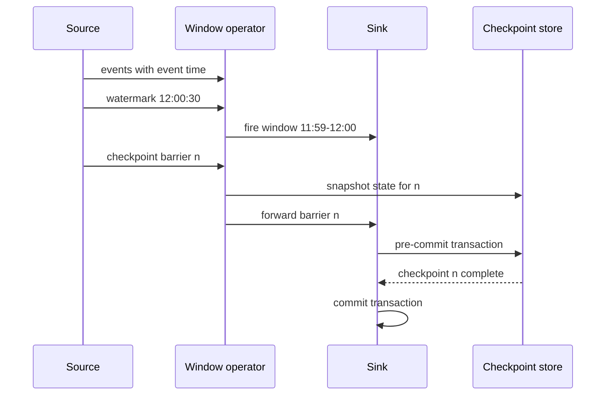

## In one minute
- A streaming engine (Flink, Kafka Streams, Spark Structured Streaming, Google Dataflow) runs long-lived, stateful computations over unbounded event streams.
- Results are grouped into **windows** by **event time**, and **watermarks** tell the engine when a window is probably complete so it can emit a result.
- State (counts, joins, sessions) lives next to the computation, partitioned by key, and is periodically **checkpointed** together with input offsets.
- Exactly-once results come from replaying input from the last consistent checkpoint plus transactional or idempotent sinks, not from never failing.
- The hard operational problems are state size, backpressure, skewed keys, and late data.

## How it works

### Dataflow graph and parallelism
A job is a graph of operators, each running as N parallel tasks. `keyBy(user_id)` hash-partitions records so every event for a key reaches the same task, which owns that key's state. Rescaling moves state in units of key groups, a fixed set of hash buckets assigned to tasks in ranges. The number of key groups is the job's max parallelism, which caps how far it can ever scale out without discarding state ([Flink config](https://nightlies.apache.org/flink/flink-docs-stable/docs/deployment/config/)).

### Event time, windows, and watermarks
Events carry the time they happened, which differs from arrival time when phones go offline or partitions lag. A **tumbling** window groups fixed, non-overlapping intervals (every minute); a **sliding** window overlaps (5 minutes every minute); a **session** window closes after a gap of inactivity. A watermark W(t) is a claim that no more events with timestamps at or before t are expected. Sources usually generate it as "max seen timestamp minus allowed out-of-orderness", for example 30 seconds. An operator with several inputs takes the minimum of their watermarks ([Flink docs](https://nightlies.apache.org/flink/flink-docs-stable/docs/dev/datastream/event-time/generating_watermarks/)). When the watermark passes a window's end, the window fires. Events arriving after that are **late**: they can update the result within an allowed-lateness period, go to a side output, or be dropped.

### State and checkpoints
State lives in memory (Flink's default heap backend) or in an embedded RocksDB store on local disk, which handles terabytes per job. Flink 2.0 (March 2025) added a third option, the ForSt backend, which keeps its SST files on remote storage such as S3 and uses local disk only as a cache, so state is no longer bounded by a node's disk and rescaling moves less data ([Flink 2.0](https://flink.apache.org/2025/03/24/apache-flink-2.0.0-a-new-era-of-real-time-data-processing/)). The docs still mark it experimental and warn about network latency when hot state is remote ([Flink docs](https://nightlies.apache.org/flink/flink-docs-stable/docs/ops/state/state_backends/)). Flink takes consistent snapshots using **barriers**: the source injects a marker into the stream; each operator, on receiving the barrier from all inputs, snapshots its state to durable storage and forwards the barrier. When all sinks acknowledge, the checkpoint is complete and includes source offsets. On failure, every task restores the last checkpoint and sources rewind to its offsets.

### Exactly-once end to end
Replay alone produces duplicates in external systems. Sinks therefore either write idempotently (upsert by key) or use two-phase commit: write into a transaction during the checkpoint interval and commit only when the checkpoint completes. The latter adds output latency equal to the checkpoint interval.

## Down the stack

### Layer 1: The contract
With checkpointing enabled and a replayable source, the engine promises that operator state reflects each input record exactly once after recovery. With a transactional or idempotent sink, that extends end to end. Window results are emitted once the watermark passes the window end, and the engine promises nothing about records that arrive after the allowed lateness except that they will not silently change already-final results. Latency is bounded by the watermark delay plus processing time, and with transactional sinks also by the checkpoint interval.

### Layer 2: The mechanism
In Flink, keyed state is split into **key groups**, the number set by `maxParallelism`. Unless you set it, Flink derives it as roughly 1.5 times the operator's parallelism rounded up to a power of two, with a floor of 128 and a ceiling of 32,768 ([Flink docs](https://nightlies.apache.org/flink/flink-docs-stable/docs/dev/datastream/execution/parallel/)); set it explicitly, because changing it later breaks state compatibility. Each key maps to `murmurHash(key) % maxParallelism`, and each task owns a contiguous range of key groups, so rescaling moves whole ranges. With the RocksDB backend, each state entry is stored under a composite key of key group, key, and namespace (the window), so all state for one window can be found and cleared by prefix. Timers for window ends live in a priority queue per task, ordered by timestamp; when a watermark arrives, the task pops every timer at or before it and fires those windows. A checkpoint barrier carries a checkpoint ID; an operator with several inputs **aligns** by buffering inputs that already delivered barrier n until all inputs have, then snapshots. Unaligned checkpoints skip that wait by including in-flight buffers in the snapshot. Incremental RocksDB checkpoints upload only new SST files since the last checkpoint, but they are off by default (`execution.checkpointing.incremental: false`) ([Flink config](https://nightlies.apache.org/flink/flink-docs-stable/docs/deployment/config/)), so large-state jobs must turn them on.

### Layer 3: The machine
RocksDB is a log-structured merge tree: writes go to an in-memory memtable (64 MB by default) and a write-ahead log, flush to immutable SST files, and are merged by background compaction. Point reads that miss the block cache cost an SSD read of about 100 microseconds, so a job doing random state reads at 100,000 per second per task needs either a large block cache or fast local NVMe; network-attached disks with 1 to 2 ms latency will backpressure the job. Snapshots are cheap because SST files are immutable: the checkpoint hard-links current SST files and uploads them asynchronously, so processing barely pauses. Records cross tasks through network buffers of 32 KB (`taskmanager.memory.segment-size`); when the receiver has no free buffers, credit-based flow control stops the sender, which is how backpressure propagates without dropping data.

### Why it's built this way
1. Events arrive out of order, so results are defined by event time and a watermark estimates completeness.
2. State is too large for memory and must survive failure, so it lives in an embedded LSM store and is snapshotted to durable storage.
3. Pausing the world to snapshot would add latency, so barriers flow with the data and snapshots are asynchronous.
4. External systems cannot be rolled back, so end-to-end exactly-once needs idempotent or two-phase-commit sinks.

## Diagram


## Worked example
A ride-hailing service computes surge pricing per geohash cell every minute from driver and rider pings.

Input: 400,000 pings per second, keyed by roughly 250,000 active cells. Each cell keeps a one-minute window of about 200 bytes, so live state is around 50 MB. The real load is update rate: 400,000 updates per second over 48 tasks is about 8,300 per task, comfortable for RocksDB.

Lateness: 99 percent of pings arrive within 5 seconds, 99.9 percent within 20 seconds. With a 20-second out-of-orderness bound, a window ending at 12:01:00 fires around 12:01:20, so surge prices are about 20 seconds stale. A 5-second bound is fresher but makes 1 percent of events late; those go to a side output and prices are not revised.

Checkpoints every 30 seconds write about 200 MB incrementally to object storage in 2 seconds. A task failure costs at most 30 seconds of reprocessing plus restore, around 45 seconds total, during which prices hold their last value. The sink upserts by `(cell, window_start)`, so replayed results overwrite rather than duplicate.

## In the wild
- **Jepsen, 2024: the two-phase-commit sink is only as good as the broker.** Testing Bufstream, a Kafka-compatible broker, Jepsen found that Kafka's transaction protocol has no sequence number on commit and abort messages. A delayed `EndTxn` from one transaction could commit or abort the producer's next transaction, giving lost writes, aborted reads and torn transactions, and Jepsen reproduced it in Kafka itself under process pauses (KAFKA-17754). KIP-890, which bumps the producer epoch on every transaction, is the expected fix. Engines that rely on Kafka transactions for exactly-once output inherit this ([Jepsen](https://jepsen.io/analyses/bufstream-0.1.0)).
- **Cloudflare, 2024: per-key buffers meet a 40x fan-out.** A bug produced a blank Logpush configuration and was reverted within five minutes, but Logfwdr treated "no config" as a reason to fail open and forwarded logs for every customer. Buftee, which keeps one buffer per customer, saw about 40 times its usual buffer count; its overload protections had never been configured, it stopped responding, and about 55% of customer logs were lost over roughly 3.5 hours. Cloudflare added misconfiguration alerts and regular overload tests ([Cloudflare](https://blog.cloudflare.com/cloudflare-incident-on-november-14-2024-resulting-in-lost-logs/)).

## Trade-offs

| Option | Strengths | Weaknesses | Choose when |
|---|---|---|---|
| Apache Flink | Event-at-a-time, rich windows, large state, mature checkpoints | Cluster to operate, steep learning curve | Complex stateful jobs at high volume |
| Kafka Streams | A library in your service, no cluster | Kafka-only; slow state rebuild from changelog | Stateful microservices on Kafka |
| Spark Structured Streaming | Same API as Spark batch; micro-batches | Latency typically 100 ms to seconds (Real-time Mode in 4.1 goes lower, stateless queries only); less flexible windows | Teams already on Spark, seconds-level latency fine |
| Managed (Google Dataflow, Amazon Managed Service for Apache Flink) | No cluster ops, autoscaling | Cost, vendor lock-in, less tuning control | Small platform teams |

Amazon Managed Service for Apache Flink is the August 2023 name for what AWS called Kinesis Data Analytics; the APIs did not change, so older guides and IAM policies still use the old name ([AWS](https://aws.amazon.com/blogs/aws/announcing-amazon-managed-service-for-apache-flink-renamed-from-amazon-kinesis-data-analytics/)).

## Pitfalls in production
- **Stuck watermarks.** One idle Kafka partition has no events, so the minimum watermark never advances and no window fires. Configure idle-source timeouts (`withIdleness` in Flink) so idle partitions are excluded, and watermark alignment so one fast source cannot run far ahead and bloat downstream buffers ([Flink docs](https://nightlies.apache.org/flink/flink-docs-stable/docs/dev/datastream/event-time/generating_watermarks/)).
- **Unbounded state.** A join or dedupe without TTL keeps every key forever until disks fill. Set state TTL and use windowed joins.
- **Hot keys.** A single key (a big customer, a null key) overloads one task and backpressures the job. Pre-aggregate with a salted key and merge, or filter bad keys at the source.
- **Checkpoints timing out.** Under backpressure, barriers queue behind data and checkpoints fail, so recovery points grow old. Fix the bottleneck, enable unaligned checkpoints, or reduce state per checkpoint with incremental snapshots.
- **Non-idempotent sinks.** Restarts create duplicate rows in the database. Upsert by deterministic keys or use transactional sinks.

## Leadership lens
- Ask for the lateness distribution of the input before accepting a watermark setting. The bound is a product decision about freshness versus completeness.
- Require state size estimates and TTLs in design docs, plus a plan for upgrading jobs with savepoints.
- Monitor consumer lag, checkpoint duration, and watermark delay as first-class SLOs.
- Prefer the simplest engine that meets the latency target; a library may avoid running a cluster.

## Check yourself
1. Why does one idle partition stop all windows from firing?
   **Answer:** The operator's watermark is the minimum across its inputs, and an idle partition never advances its watermark, so the minimum stays stuck.
2. How do barriers produce a consistent snapshot without pausing the whole job?
   **Answer:** Each operator snapshots its state when the barrier passes, so every snapshot reflects exactly the events before that barrier, and together with source offsets they form a consistent cut.
3. What does a shorter out-of-orderness bound trade away?
   **Answer:** Results arrive sooner, but more events become late and are either dropped, handled separately, or cause revisions to emitted results.

## Practice
**Task:** Implement event-time tumbling windows with watermarks. `process(events, size, max_delay)` receives `(timestamp, key)` tuples in arrival order. Track the watermark as `max_seen_timestamp - max_delay`. A window `[start, start + size)` fires once the watermark is at or past its end, emitting `(start, key, count)`. Events whose window has already fired are late and are counted in a separate list. At the end of input, flush all open windows. Return `(fired, late)` where `fired` is the list of emissions in firing order (within one firing, sort by start then key) and `late` is the list of late events.

```python starter
def process(events, size, max_delay):
    # TODO
    raise NotImplementedError
```

```python tests
def test_in_order_single_window():
    fired, late = process([(1, "a"), (2, "a"), (3, "b")], 10, 0)
    assert fired == [(0, "a", 2), (0, "b", 1)] and late == []

def test_window_fires_on_watermark():
    fired, _ = process([(1, "a"), (12, "a")], 10, 0)
    assert fired[0] == (0, "a", 1)

def test_out_of_order_within_delay_is_counted():
    fired, late = process([(8, "a"), (11, "a"), (9, "a"), (25, "a")], 10, 3)
    assert (0, "a", 2) in fired and late == []

def test_late_event_goes_to_side_output():
    fired, late = process([(1, "a"), (15, "a"), (2, "a")], 10, 0)
    assert late == [(2, "a")]
    assert fired[0] == (0, "a", 1)

def test_empty():
    assert process([], 10, 5) == ([], [])
```

```python solution
def process(events, size, max_delay):
    open_w = {}
    fired, late = [], []
    wm = None
    closed_until = None
    for ts, key in events:
        start = ts - ts % size
        if closed_until is not None and start + size <= closed_until:
            late.append((ts, key))
            continue
        open_w[(start, key)] = open_w.get((start, key), 0) + 1
        m = ts - max_delay
        wm = m if wm is None else max(wm, m)
        ready = sorted(k for k in open_w if k[0] + size <= wm)
        for k in ready:
            fired.append((k[0], k[1], open_w.pop(k)))
        if ready:
            closed_until = max(closed_until or 0, max(k[0] + size for k in ready))
    for k in sorted(open_w):
        fired.append((k[0], k[1], open_w[k]))
    return fired, late
```

```typescript starter
export type Emit = [number, string, number];
export function processEvents(events: [number, string][], size: number, maxDelay: number):
    [Emit[], [number, string][]] {
  throw new Error("TODO");
}
```

```typescript tests
const has = (xs: Emit[], x: Emit) => xs.some(y => JSON.stringify(y) === JSON.stringify(x));
test("in-order single window", () => {
  assertEqual(processEvents([[1, "a"], [2, "a"], [3, "b"]], 10, 0), [[[0, "a", 2], [0, "b", 1]], []]);
});
test("window fires on watermark", () => {
  assertEqual(processEvents([[1, "a"], [12, "a"]], 10, 0)[0][0], [0, "a", 1]);
});
test("out of order within delay is counted", () => {
  const [fired, late] = processEvents([[8, "a"], [11, "a"], [9, "a"], [25, "a"]], 10, 3);
  assert(has(fired, [0, "a", 2]), "window 0 should count 2");
  assertEqual(late, []);
});
test("late event goes to side output", () => {
  const [fired, late] = processEvents([[1, "a"], [15, "a"], [2, "a"]], 10, 0);
  assertEqual(late, [[2, "a"]]);
  assertEqual(fired[0], [0, "a", 1]);
});
test("empty", () => assertEqual(processEvents([], 10, 5), [[], []]));
```

```typescript solution
export type Emit = [number, string, number];
export function processEvents(events: [number, string][], size: number, maxDelay: number):
    [Emit[], [number, string][]] {
  const open = new Map<string, [number, string, number]>();
  const fired: Emit[] = [];
  const late: [number, string][] = [];
  let wm = -Infinity;
  let closedUntil = -Infinity;
  const cmp = (x: Emit, y: Emit) => x[0] - y[0] || (x[1] < y[1] ? -1 : x[1] > y[1] ? 1 : 0);
  for (const [ts, key] of events) {
    const start = ts - (ts % size);
    if (start + size <= closedUntil) { late.push([ts, key]); continue; }
    const id = start + "|" + key;
    const cur = open.get(id) ?? [start, key, 0];
    open.set(id, [start, key, cur[2] + 1]);
    wm = Math.max(wm, ts - maxDelay);
    const ready = [...open.entries()].filter(([, w]) => w[0] + size <= wm);
    ready.sort((x, y) => cmp(x[1], y[1]));
    for (const [id2, w] of ready) {
      fired.push(w);
      open.delete(id2);
      closedUntil = Math.max(closedUntil, w[0] + size);
    }
  }
  fired.push(...[...open.values()].sort(cmp));
  return [fired, late];
}
```

```go starter
package practice

type Event struct {
	TS  int
	Key string
}

type Emit struct {
	Start int
	Key   string
	Count int
}

func Process(events []Event, size, maxDelay int) ([]Emit, []Event) {
	panic("TODO")
}
```

```go tests
package practice

import (
	"reflect"
	"testing"
)

func TestInOrderSingleWindow(t *testing.T) {
	fired, late := Process([]Event{{1, "a"}, {2, "a"}, {3, "b"}}, 10, 0)
	if !reflect.DeepEqual(fired, []Emit{{0, "a", 2}, {0, "b", 1}}) || len(late) != 0 {
		t.Fatalf("got %v %v", fired, late)
	}
}

func TestFiresOnWatermark(t *testing.T) {
	fired, _ := Process([]Event{{1, "a"}, {12, "a"}}, 10, 0)
	if fired[0] != (Emit{0, "a", 1}) {
		t.Fatalf("got %v", fired)
	}
}

func TestOutOfOrderWithinDelay(t *testing.T) {
	fired, late := Process([]Event{{8, "a"}, {11, "a"}, {9, "a"}, {25, "a"}}, 10, 3)
	if fired[0] != (Emit{0, "a", 2}) || len(late) != 0 {
		t.Fatalf("got %v %v", fired, late)
	}
}

func TestLateToSideOutput(t *testing.T) {
	_, late := Process([]Event{{1, "a"}, {15, "a"}, {2, "a"}}, 10, 0)
	if !reflect.DeepEqual(late, []Event{{2, "a"}}) {
		t.Fatalf("got %v", late)
	}
}

func TestEmpty(t *testing.T) {
	fired, late := Process(nil, 10, 5)
	if len(fired) != 0 || len(late) != 0 {
		t.Fatalf("got %v %v", fired, late)
	}
}
```

```go solution
package practice

import "sort"

type Event struct {
	TS  int
	Key string
}

type Emit struct {
	Start int
	Key   string
	Count int
}

type wkey struct {
	start int
	key   string
}

func sortEmits(xs []Emit) {
	sort.Slice(xs, func(i, j int) bool {
		if xs[i].Start != xs[j].Start {
			return xs[i].Start < xs[j].Start
		}
		return xs[i].Key < xs[j].Key
	})
}

func Process(events []Event, size, maxDelay int) ([]Emit, []Event) {
	open := map[wkey]int{}
	fired, late := []Emit{}, []Event{}
	haveWM, wm, closedUntil := false, 0, 0
	for _, e := range events {
		start := e.TS - e.TS%size
		if haveWM && start+size <= closedUntil {
			late = append(late, e)
			continue
		}
		open[wkey{start, e.Key}]++
		if m := e.TS - maxDelay; !haveWM || m > wm {
			wm, haveWM = m, true
		}
		ready := []Emit{}
		for k, c := range open {
			if k.start+size <= wm {
				ready = append(ready, Emit{k.start, k.key, c})
				delete(open, k)
				if k.start+size > closedUntil {
					closedUntil = k.start + size
				}
			}
		}
		sortEmits(ready)
		fired = append(fired, ready...)
	}
	rest := []Emit{}
	for k, c := range open {
		rest = append(rest, Emit{k.start, k.key, c})
	}
	sortEmits(rest)
	return append(fired, rest...), late
}
```

## Mock interview
**Prompt:** Build a fraud signal that flags a card if it has more than 5 transactions in any 10-minute window, across 30,000 transactions per second, with alerts within 2 seconds.

- Follow-up: Transactions from some terminals arrive up to 3 minutes late. What do you do?
- Follow-up: The job restarts. How do you avoid duplicate alerts?
- Follow-up: Why not poll a database every second?

**A strong answer covers:**
- Keyed state per card with sliding windows or a per-card sorted buffer with TTL.
- An explicit choice of out-of-orderness bound, with late events triggering corrective alerts.
- Checkpointing with source offsets and an idempotent alert sink keyed by card and window.
- Hot-key and state-size estimates, including TTL to bound memory.
- Why polling a database fails at this rate and latency.

## Sources and further study
**Primary**
- [Akidau et al., MillWheel (VLDB 2013)](https://research.google/pubs/millwheel-fault-tolerant-stream-processing-at-internet-scale/): persistent state, logical time and framework-managed fault tolerance in Google's production engine.
- [Armbrust et al., Structured Streaming (SIGMOD 2018)](https://people.eecs.berkeley.edu/~matei/papers/2018/sigmod_structured_streaming.pdf): the declarative, incrementalised-query alternative to building an operator graph by hand.

**Systems docs**
- [Flink: generating watermarks](https://nightlies.apache.org/flink/flink-docs-stable/docs/dev/datastream/event-time/generating_watermarks/): bounded out-of-orderness, idleness and watermark alignment.
- [Flink: state backends](https://nightlies.apache.org/flink/flink-docs-stable/docs/ops/state/state_backends/): heap, RocksDB and ForSt, and when each fits.
- [Kafka Streams documentation](https://kafka.apache.org/documentation/streams/): the library model, with state stores backed by changelog topics instead of a cluster.

**Books**
- *Streaming Systems*, Tyler Akidau, Slava Chernyak and Reuven Lax, chapters 3 "Watermarks", 5 "Exactly-Once and Side Effects" and 7 "The Practicalities of Persistent State".
- *Stream Processing with Apache Flink*, Fabian Hueske and Vasiliki Kalavri, chapters 3 "The Architecture of Apache Flink" and 7 "Stateful Operators and Applications".
- *Designing Data-Intensive Applications*, Martin Kleppmann, chapter 11 "Stream Processing", section "Processing Streams" (chapter 12 in the 2026 second edition).

**Other curricula**
- [Azure Architecture Center: big data architectures](https://learn.microsoft.com/en-us/azure/architecture/databases/guide/big-data-architectures): places stream processing as the hot path behind a buffering ingestion layer such as Event Hubs or Kafka.

## Watch
- [Fundamentals of stream processing with Apache Beam (Tyler Akidau)](https://www.youtube.com/watch?v=_lne0yuTHCw): windows, watermarks, and triggers from one of the Dataflow authors.
- [Event Time and Watermarks (Apache Flink 101, Confluent)](https://www.youtube.com/watch?v=sdhwpUAjqaI): a concise explanation of how Flink tracks event time.

## Free resources
- [The Dataflow Model (VLDB 2015)](https://www.vldb.org/pvldb/vol8/p1792-Akidau.pdf): the paper defining windowing, triggers, and watermarks as used by modern engines.
- [Streaming 102 (Tyler Akidau)](https://www.oreilly.com/radar/the-world-beyond-batch-streaming-102/): worked examples of watermarks, triggers, and accumulation modes.
- [Lightweight Asynchronous Snapshots for Distributed Dataflows](https://arxiv.org/abs/1506.08603): the barrier-based checkpointing algorithm behind Flink.
- [Flink stateful stream processing concepts](https://nightlies.apache.org/flink/flink-docs-stable/docs/concepts/stateful-stream-processing/): keyed state, checkpoints, and exactly-once in the official docs.
