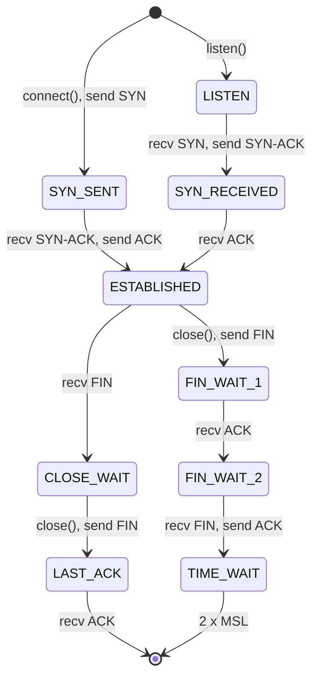

## In one minute
- The real question is not "reliable or fast". It is who owns reliability, ordering and congestion control: the kernel's TCP, your own code on top of UDP, or a user-space transport such as QUIC.
- TCP gives one ordered byte stream per connection. That ordering is also its main cost: a single lost segment stalls every byte behind it, including unrelated HTTP/2 streams (head-of-line blocking).
- Congestion control decides throughput far more than link speed. Loss-based algorithms (Reno, CUBIC) and model-based ones (BBR) behave very differently on long, lossy paths.
- UDP is not "TCP without the slow parts". Using it means taking on rate control, amplification risk, NAT keepalives and MTU handling yourself.
- QUIC is the modern answer for clients: UDP underneath, with streams that do not block each other, TLS 1.3 built in, and connections that survive a change of IP address. The problem shapes are ordering (per-stream versus global) and overload (congestion control is backpressure for the shared network).

## How it works

### The TCP state machine in production
The state machine is specified in [RFC 9293](https://www.rfc-editor.org/rfc/rfc9293), which in 2022 replaced the original RFC 793 and folded in decades of updates. The side that sends `FIN` first passes through `FIN_WAIT_1` and `FIN_WAIT_2` into `TIME_WAIT`. The other side sits in `CLOSE_WAIT` until *its application* calls `close()`. Thousands of `CLOSE_WAIT` sockets therefore mean your code leaks connections. A large `TIME_WAIT` count is normal on the closing side: it lasts 2×MSL (60 seconds on Linux), so stray segments cannot corrupt a new connection with the same 4-tuple.

Handshakes queue twice: half-open connections in the SYN queue, completed ones in the accept queue, bounded by the `listen()` backlog and `net.core.somaxconn` (4,096 by default since Linux 5.4, 128 before). When the accept queue overflows, the kernel drops packets and the client's initial RTO of one second starts. Classic exponential backoff resends the SYN at 1, 3 and 7 seconds; since Linux 6.5 the first four retries are linear, one second apart, copying macOS and iOS ([kernel ip-sysctl](https://docs.kernel.org/networking/ip-sysctl.html), [commit](https://github.com/torvalds/linux/commit/ccce324dabfe)). Either way, a slow `accept()` loop becomes one-second latency spikes. Under a SYN flood, SYN cookies encode state in the initial sequence number so the server stores nothing.

### Congestion control
At most `min(cwnd, rwnd)` bytes may be unacknowledged. Reno uses additive increase, multiplicative decrease: slow start adds one segment per ACK (doubling per round trip) up to `ssthresh`, congestion avoidance adds about one segment per round trip, three duplicate ACKs trigger fast retransmit and halve the window, and a timeout resets `cwnd` to one.

CUBIC, the Linux default ([RFC 9438](https://www.rfc-editor.org/rfc/rfc9438)), grows the window as a cubic function of time since the last loss: fast back towards the old peak, careful near it, then accelerating. Both treat loss as the signal, so they fill router buffers first, and deep buffers add hundreds of milliseconds of delay (bufferbloat). BBR instead estimates bottleneck bandwidth and minimum RTT and paces at that rate. It keeps queues short and tolerates random loss: in Google's illustration on a 10 Gbps, 100 ms path with 1% loss, CUBIC managed about 3.3 Mbps and BBR over 9,100 Mbps ([Google Cloud](https://cloud.google.com/blog/products/networking/tcp-bbr-congestion-control-comes-to-gcp-your-internet-just-got-faster)). It can take more than its share against CUBIC.

### Head-of-line blocking
If segment 41 is lost, segments 42 to 80 wait in the kernel for at least one more round trip. HTTP/2 multiplexes many requests over one TCP connection, so one lost packet stalls *every* stream. At 2% loss on a mobile link, HTTP/1.1 with six connections can beat HTTP/2 with one. A related stall is Nagle's algorithm (hold small writes until earlier data is ACKed) meeting delayed ACKs (wait up to about 40 ms): a request written in two pieces waits 40 ms for nothing, which is why RPC frameworks set `TCP_NODELAY`.

### What you take on with UDP
UDP keeps datagram boundaries and adds nothing else. You own congestion control ([RFC 8085](https://www.rfc-editor.org/rfc/rfc8085) requires it; an unthrottled sender starves every TCP flow on the link). You own amplification defence: a small spoofed request that triggers a large response is a DDoS weapon, and a 15-byte memcached request over UDP drew a 750 KB response, about 51,000x ([Cloudflare](https://blog.cloudflare.com/memcrashed-major-amplification-attacks-from-port-11211/)). Keep payloads near 1,200 bytes to avoid fragmentation, and send keepalives. NATs are required to hold UDP mappings for at least two minutes, but many expire them sooner, so RFC 8085 allows keepalives as often as every 15 seconds, and no more often. Raw UDP fits when late data is worthless: game snapshots, voice and video over RTP, DNS, StatsD metrics.

### QUIC: a transport in user space
QUIC (RFC 9000) implements reliability, congestion control and multiplexed streams in a library over UDP. Loss on one stream stalls only that stream. TLS 1.3 is built in, so a new connection is ready after one round trip and a resumed one can send immediately (0-RTT), which can be replayed, so 0-RTT must carry only idempotent requests. Connection IDs, not the 4-tuple, name the connection, so a phone moving from Wi-Fi to LTE keeps it. Packet numbers are never reused, so RTT samples are unambiguous, and the encrypted header stops middleboxes from ossifying the protocol. The costs: more CPU per byte than kernel TCP with offloads, and networks that block UDP, so clients keep a TCP fallback.

## Down the stack

### Layer 1: The contract
TCP: bytes in order exactly once, or an error; `write()` returning means only "copied to the kernel", not "processed by the peer". UDP: a delivered datagram is whole, with no promise of arrival, uniqueness or order. QUIC: TCP-like guarantees *within each stream*, none across streams, plus optional unreliable datagrams ([RFC 9221](https://www.rfc-editor.org/rfc/rfc9221)). Fairness between flows is a convention of congestion control, not something the network enforces.

### Layer 2: The mechanism
TCP options carry most of the modern machinery. MSS is negotiated on SYN. Window scaling shifts the 16-bit window by up to 14 bits, allowing windows up to 1 GB. SACK blocks report up to four received ranges, or three when timestamps share the 40 bytes of option space, so the sender retransmits only the holes ([RFC 2018](https://www.rfc-editor.org/rfc/rfc2018)). Timestamps support RTT measurement and PAWS. Linux detects loss with RACK-TLP: it marks a segment lost when a later one is ACKed and a reordering window (starting at a quarter of the minimum RTT) has passed, and sends a tail-loss probe after about two smoothed RTTs instead of waiting for the full RTO ([RFC 8985](https://www.rfc-editor.org/rfc/rfc8985)). The RTO itself follows [RFC 6298](https://www.rfc-editor.org/rfc/rfc6298), with a Linux floor of 200 ms.

QUIC packets carry frames: `STREAM` (stream ID, offset, data), `ACK` (ranges plus delay), `CRYPTO`, `MAX_DATA`/`MAX_STREAM_DATA` for flow control, and `PATH_CHALLENGE` for migration. Lost *frames* are resent in new packets, never the same packet.

### Layer 3: The machine
Throughput on one TCP flow is bounded by window ÷ RTT. Filling 1 Gbps over a 150 ms path needs a bandwidth-delay product of 18.75 MB in flight. For over a decade Linux's default maximum receive buffer (`tcp_rmem` max) was 6 MB, which caps such a flow at about 320 Mbps whatever the link speed. Linux 6.16 (2025) raised the default to 32 MB, but older kernels are still everywhere, so check before you assume ([kernel ip-sysctl](https://docs.kernel.org/networking/ip-sysctl.html), [commit](https://github.com/torvalds/linux/commit/572be9bf9d0d)). Kernel TCP is cheap per byte because TSO and GRO move 64 KB per stack traversal. UDP paid a syscall per datagram until `sendmmsg`/`recvmmsg` and UDP GSO (`UDP_SEGMENT`); QUIC servers still spend noticeably more CPU per gigabit than TCP+TLS. Dropped UDP datagrams show up as `RcvbufErrors` in `netstat -su` when the application reads more slowly than the socket buffer fills.

### Why it's built this way
1. IP drops and reorders packets, and most applications want a clean stream, so TCP put reliability in the kernel, shared by every program.
2. Routers give no explicit congestion signal, so TCP inferred congestion from loss, which works but fills buffers, so delay-aware algorithms like BBR followed.
3. One ordered stream per connection was simple, but multiplexing many requests on it created head-of-line blocking.
4. Kernels and middleboxes made TCP slow to change, so the new transport was built on UDP in user space, encrypted so the network cannot ossify it again.

## Diagram



## Worked example
A team replicates a database from Frankfurt to Singapore: 160 ms RTT, a 1 Gbps link, 0.01% random packet loss on one leg.

**Window limit.** Bandwidth-delay product = 125 MB/s × 0.16 s = 20 MB. With `tcp_rmem` max at 6 MB, the default on kernels before 6.16, one connection tops out at 6 MB ÷ 0.16 s ≈ 37.5 MB/s, about 300 Mbps.

**Loss limit.** For Reno-style AIMD, the Mathis approximation gives throughput ≈ (MSS ÷ RTT) × 1.22 ÷ √p. With MSS 1,448 bytes, that is 9,050 bytes/s × 122 ≈ 1.1 MB/s, about 9 Mbps. CUBIC does better on this path but is still loss-limited to tens of Mbps. Replication lag grows all day.

**Fixes, compared.**

- Raise `tcp_rmem`/`tcp_wmem` max to 32 MB on both ends (the receive default from Linux 6.16): removes the window limit, not the loss limit.
- Switch to BBR with the `fq` qdisc: random loss no longer cuts the rate, and the flow reaches 600 to 800 Mbps.
- Use 8 parallel streams: about 8x, at the cost of fairness and reassembly.

The team picks BBR plus larger buffers and verifies with `ss -ti` (`cwnd`, `rtt`, `retrans`, `delivery_rate`).

**Head-of-line blocking at the edge.** A mobile page loads 80 resources (about 120 packets) over one HTTP/2 connection with 100 ms RTT and 2% loss: 2 to 3 losses, each stalling every stream for a round trip or a 200 ms+ timeout, roughly 300 to 600 ms added. Over HTTP/3 each loss delays only the streams in that packet.

## In the wild
- **GitHub, 2018: UDP amplification at 1.35 Tbps.** On 28 February, attackers sent spoofed requests to memcached servers exposed on UDP, which answered GitHub with up to 51 KB for every byte sent. Traffic peaked at 1.35 Tbps and 126.9 million packets per second from tens of thousands of endpoints. GitHub was down for five minutes and recovered about nine minutes after detection by moving its BGP announcements to Akamai's scrubbing network ([GitHub](https://github.blog/news-insights/company-news/ddos-incident-report/)).
- **Netflix, 2019: SACK Panic.** Netflix disclosed that a crafted sequence of SACK blocks could trigger an integer overflow in Linux's TCP stack and panic the kernel remotely (CVE-2019-11477, affecting kernels from 2.6.29), with related bugs that fragmented the queue or forced 8-byte segments. Mitigations were kernel patches, a new `tcp_min_snd_mss` sysctl, or disabling SACK until patched ([Netflix advisory](https://github.com/Netflix/security-bulletins/blob/master/advisories/third-party/2019-001.md)).

## Trade-offs

| Option | Strengths | Weaknesses | Choose when |
| --- | --- | --- | --- |
| TCP (kernel) | Universal, cheap per byte with offloads, mature tooling | HOL blocking, 4-tuple-bound connections, slow to evolve | Server-to-server RPC, databases, bulk transfer |
| TCP + BBR and tuned buffers | High throughput on long or lossy paths | Can be unfair to CUBIC flows, needs pacing | Cross-region replication and backups |
| Raw UDP + app logic | Lowest latency, app decides what to drop | You build rate control, security and NAT handling | Games, real-time media, DNS, telemetry |
| QUIC / HTTP/3 | No cross-stream HOL, 1-RTT/0-RTT setup, migration | More CPU, UDP blocked on some networks, newer tooling | Mobile and web clients on variable networks |
| Several TCP connections | Isolates loss per connection, simple | More handshakes, unfair, more server state | HTTP/1.1 clients, parallel bulk downloads |

## Pitfalls in production
- **`CLOSE_WAIT` pile-up.** The peer closed but your code never called `close()`, often on an error path. File descriptors run out. Fix the leak; there is no kernel tunable for it.
- **The 40 ms Nagle and delayed-ACK stall.** Small request/response protocols show p50 latency of exactly 40 ms. Set `TCP_NODELAY`, or write each message in one call.
- **UDP without rate control.** A logging or metrics client floods a congested link and starves TCP traffic, or a public UDP service becomes a reflector. Pace sends, require a handshake or cookie before large responses, and rate-limit per source.
- **0-RTT replay.** A resumed QUIC or TLS 1.3 client resends a POST in early data, and an attacker can replay it. Allow only idempotent methods in 0-RTT, or reject early data for state-changing endpoints.

## Leadership lens
- Default to TCP for internal services and QUIC for public client edges. Ask anyone proposing raw UDP for business traffic to show their congestion control, security and NAT plan.
- Cross-region data movement is usually a transport-tuning problem before it is a bandwidth purchase. Ask for `ss -ti` output before approving a bigger link.
- Put socket health on standard dashboards: retransmits, `CLOSE_WAIT`, listen overflows, UDP receive errors.
- HTTP/3 is a platform decision: edge CPU, UDP-capable load balancers, observability and a TCP fallback.

## Check yourself
1. Why can HTTP/2 be slower than HTTP/1.1 on a lossy mobile network?
   **Answer:** HTTP/2 puts every stream on one TCP connection, so each lost segment stalls all streams until it is retransmitted. HTTP/1.1 spreads requests over several connections, so a loss stalls only one.
2. A service shows 20,000 sockets in `CLOSE_WAIT`. Whose bug is it?
   **Answer:** Usually your own. `CLOSE_WAIT` means the peer sent `FIN` and the local application has not closed the socket, so a code path is leaking connections.
3. Doubling link bandwidth did not speed up a cross-region transfer. Name two transport limits that could explain it.
   **Answer:** The window, where throughput is at most window ÷ RTT so small buffers cap it, and loss-based congestion control, where random loss keeps cutting `cwnd`. Larger buffers and BBR address each.
4. What does QUIC's connection ID give you that TCP's 4-tuple cannot?
   **Answer:** The connection survives a change of client IP or port, such as Wi-Fi to cellular or a NAT rebinding, because packets are matched by ID rather than by addresses.

## Practice
**Task:** Implement a Reno congestion controller that counts in whole segments. `RenoSender(initial_cwnd, ssthresh)` starts in slow start. `on_ack()` handles a new cumulative ACK. In fast recovery it sets `cwnd = ssthresh` and leaves recovery. In slow start (`cwnd < ssthresh`) it adds 1. In congestion avoidance it adds 1 after every `cwnd` ACKs, using a counter. `on_dup_ack()` counts duplicates. The third triggers fast recovery: `ssthresh = max(cwnd // 2, 2)` and `cwnd = ssthresh + 3`. Each further duplicate during recovery adds 1. A new ACK resets the duplicate count. `on_timeout()` sets `ssthresh = max(cwnd // 2, 2)` and `cwnd = 1`, and leaves recovery. `state()` returns `"fast_recovery"`, `"slow_start"` or `"congestion_avoidance"`.

```python starter
class RenoSender:
    def __init__(self, initial_cwnd=10, ssthresh=64):
        # TODO
        self.cwnd = initial_cwnd
        self.ssthresh = ssthresh

    def on_ack(self):
        raise NotImplementedError

    def on_dup_ack(self):
        raise NotImplementedError

    def on_timeout(self):
        raise NotImplementedError

    def state(self):
        raise NotImplementedError
```

```python tests
def acks(s, n):
    for _ in range(n):
        s.on_ack()

def test_starts_in_slow_start():
    s = RenoSender()
    assert s.cwnd == 10 and s.state() == "slow_start"

def test_slow_start_doubles_per_window():
    s = RenoSender(10, 64)
    acks(s, 10)
    assert s.cwnd == 20

def test_congestion_avoidance_is_linear():
    s = RenoSender(10, 12)
    acks(s, 2)
    assert s.cwnd == 12 and s.state() == "congestion_avoidance"
    acks(s, 12)
    assert s.cwnd == 13
    acks(s, 12)
    assert s.cwnd == 13, "needs 13 acks at cwnd 13"
    s.on_ack()
    assert s.cwnd == 14

def test_triple_dup_ack_fast_recovery():
    s = RenoSender(20, 64)
    s.on_dup_ack(); s.on_dup_ack()
    assert s.cwnd == 20 and s.state() == "slow_start"
    s.on_dup_ack()
    assert (s.ssthresh, s.cwnd, s.state()) == (10, 13, "fast_recovery")
    s.on_dup_ack()
    assert s.cwnd == 14
    s.on_ack()
    assert (s.cwnd, s.state()) == (10, "congestion_avoidance")

def test_new_ack_resets_dup_count():
    s = RenoSender(20, 64)
    s.on_dup_ack(); s.on_dup_ack(); s.on_ack(); s.on_dup_ack(); s.on_dup_ack()
    assert s.state() == "slow_start" and s.cwnd == 21

def test_timeout_resets_window():
    s = RenoSender(20, 64)
    s.on_timeout()
    assert (s.ssthresh, s.cwnd, s.state()) == (10, 1, "slow_start")
    acks(s, 9)
    assert (s.cwnd, s.state()) == (10, "congestion_avoidance")

def test_ssthresh_floor():
    s = RenoSender(3, 64)
    s.on_timeout()
    assert s.ssthresh == 2
```

```python solution
class RenoSender:
    def __init__(self, initial_cwnd=10, ssthresh=64):
        self.cwnd = initial_cwnd
        self.ssthresh = ssthresh
        self.dups = 0
        self.acked = 0
        self.recovering = False

    def on_ack(self):
        self.dups = 0
        if self.recovering:
            self.recovering = False
            self.cwnd = self.ssthresh
            self.acked = 0
        elif self.cwnd < self.ssthresh:
            self.cwnd += 1
        else:
            self.acked += 1
            if self.acked >= self.cwnd:
                self.cwnd += 1
                self.acked = 0

    def on_dup_ack(self):
        self.dups += 1
        if self.recovering:
            self.cwnd += 1
        elif self.dups == 3:
            self.ssthresh = max(self.cwnd // 2, 2)
            self.cwnd = self.ssthresh + 3
            self.recovering = True

    def on_timeout(self):
        self.ssthresh = max(self.cwnd // 2, 2)
        self.cwnd = 1
        self.dups = 0
        self.acked = 0
        self.recovering = False

    def state(self):
        if self.recovering:
            return "fast_recovery"
        return "slow_start" if self.cwnd < self.ssthresh else "congestion_avoidance"
```

```typescript starter
export class RenoSender {
  cwnd: number;
  ssthresh: number;
  constructor(initialCwnd = 10, ssthresh = 64) {
    this.cwnd = initialCwnd;
    this.ssthresh = ssthresh;
  }
  onAck(): void { throw new Error("TODO"); }
  onDupAck(): void { throw new Error("TODO"); }
  onTimeout(): void { throw new Error("TODO"); }
  state(): string { throw new Error("TODO"); }
}
```

```typescript tests
function acks(s: RenoSender, n: number): void { for (let i = 0; i < n; i++) s.onAck(); }

test("starts in slow start", () => {
  const s = new RenoSender();
  assertEqual([s.cwnd, s.state()], [10, "slow_start"]);
});
test("slow start doubles per window", () => {
  const s = new RenoSender(10, 64);
  acks(s, 10);
  assertEqual(s.cwnd, 20);
});
test("congestion avoidance is linear", () => {
  const s = new RenoSender(10, 12);
  acks(s, 2);
  assertEqual([s.cwnd, s.state()], [12, "congestion_avoidance"]);
  acks(s, 12);
  assertEqual(s.cwnd, 13);
  acks(s, 12);
  assertEqual(s.cwnd, 13, "needs 13 acks at cwnd 13");
  s.onAck();
  assertEqual(s.cwnd, 14);
});
test("triple dup ack fast recovery", () => {
  const s = new RenoSender(20, 64);
  s.onDupAck(); s.onDupAck();
  assertEqual([s.cwnd, s.state()], [20, "slow_start"]);
  s.onDupAck();
  assertEqual([s.ssthresh, s.cwnd, s.state()], [10, 13, "fast_recovery"]);
  s.onDupAck();
  assertEqual(s.cwnd, 14);
  s.onAck();
  assertEqual([s.cwnd, s.state()], [10, "congestion_avoidance"]);
});
test("new ack resets dup count", () => {
  const s = new RenoSender(20, 64);
  s.onDupAck(); s.onDupAck(); s.onAck(); s.onDupAck(); s.onDupAck();
  assertEqual([s.cwnd, s.state()], [21, "slow_start"]);
});
test("timeout resets window", () => {
  const s = new RenoSender(20, 64);
  s.onTimeout();
  assertEqual([s.ssthresh, s.cwnd, s.state()], [10, 1, "slow_start"]);
  acks(s, 9);
  assertEqual([s.cwnd, s.state()], [10, "congestion_avoidance"]);
});
test("ssthresh floor", () => {
  const s = new RenoSender(3, 64);
  s.onTimeout();
  assertEqual(s.ssthresh, 2);
});
```

```typescript solution
export class RenoSender {
  cwnd: number;
  ssthresh: number;
  private dups = 0;
  private acked = 0;
  private recovering = false;

  constructor(initialCwnd = 10, ssthresh = 64) {
    this.cwnd = initialCwnd;
    this.ssthresh = ssthresh;
  }

  onAck(): void {
    this.dups = 0;
    if (this.recovering) {
      this.recovering = false;
      this.cwnd = this.ssthresh;
      this.acked = 0;
    } else if (this.cwnd < this.ssthresh) {
      this.cwnd += 1;
    } else if (++this.acked >= this.cwnd) {
      this.cwnd += 1;
      this.acked = 0;
    }
  }

  onDupAck(): void {
    this.dups += 1;
    if (this.recovering) {
      this.cwnd += 1;
    } else if (this.dups === 3) {
      this.ssthresh = Math.max(Math.floor(this.cwnd / 2), 2);
      this.cwnd = this.ssthresh + 3;
      this.recovering = true;
    }
  }

  onTimeout(): void {
    this.ssthresh = Math.max(Math.floor(this.cwnd / 2), 2);
    this.cwnd = 1;
    this.dups = 0;
    this.acked = 0;
    this.recovering = false;
  }

  state(): string {
    if (this.recovering) return "fast_recovery";
    return this.cwnd < this.ssthresh ? "slow_start" : "congestion_avoidance";
  }
}
```

```go starter
package practice

type RenoSender struct {
	Cwnd     int
	Ssthresh int
}

func NewRenoSender(initialCwnd, ssthresh int) *RenoSender {
	return &RenoSender{Cwnd: initialCwnd, Ssthresh: ssthresh}
}

func (s *RenoSender) OnAck()        { panic("TODO") }
func (s *RenoSender) OnDupAck()     { panic("TODO") }
func (s *RenoSender) OnTimeout()    { panic("TODO") }
func (s *RenoSender) State() string { panic("TODO") }
```

```go tests
package practice

import "testing"

func acks(s *RenoSender, n int) {
	for i := 0; i < n; i++ {
		s.OnAck()
	}
}

func check(t *testing.T, s *RenoSender, cwnd int, state string) {
	t.Helper()
	if s.Cwnd != cwnd || s.State() != state {
		t.Fatalf("got cwnd=%d state=%s, want %d %s", s.Cwnd, s.State(), cwnd, state)
	}
}

func TestSlowStart(t *testing.T) {
	s := NewRenoSender(10, 64)
	check(t, s, 10, "slow_start")
	acks(s, 10)
	check(t, s, 20, "slow_start")
}

func TestCongestionAvoidance(t *testing.T) {
	s := NewRenoSender(10, 12)
	acks(s, 2)
	check(t, s, 12, "congestion_avoidance")
	acks(s, 12)
	check(t, s, 13, "congestion_avoidance")
	acks(s, 12)
	check(t, s, 13, "congestion_avoidance")
	s.OnAck()
	check(t, s, 14, "congestion_avoidance")
}

func TestFastRecovery(t *testing.T) {
	s := NewRenoSender(20, 64)
	s.OnDupAck()
	s.OnDupAck()
	check(t, s, 20, "slow_start")
	s.OnDupAck()
	check(t, s, 13, "fast_recovery")
	if s.Ssthresh != 10 {
		t.Fatalf("ssthresh %d", s.Ssthresh)
	}
	s.OnDupAck()
	check(t, s, 14, "fast_recovery")
	s.OnAck()
	check(t, s, 10, "congestion_avoidance")
}

func TestNewAckResetsDups(t *testing.T) {
	s := NewRenoSender(20, 64)
	s.OnDupAck()
	s.OnDupAck()
	s.OnAck()
	s.OnDupAck()
	s.OnDupAck()
	check(t, s, 21, "slow_start")
}

func TestTimeout(t *testing.T) {
	s := NewRenoSender(20, 64)
	s.OnTimeout()
	check(t, s, 1, "slow_start")
	acks(s, 9)
	check(t, s, 10, "congestion_avoidance")
	small := NewRenoSender(3, 64)
	small.OnTimeout()
	if small.Ssthresh != 2 {
		t.Fatalf("floor: got %d", small.Ssthresh)
	}
}
```

```go solution
package practice

type RenoSender struct {
	Cwnd       int
	Ssthresh   int
	dups       int
	acked      int
	recovering bool
}

func NewRenoSender(initialCwnd, ssthresh int) *RenoSender {
	return &RenoSender{Cwnd: initialCwnd, Ssthresh: ssthresh}
}

func half(n int) int {
	if n/2 < 2 {
		return 2
	}
	return n / 2
}

func (s *RenoSender) OnAck() {
	s.dups = 0
	switch {
	case s.recovering:
		s.recovering = false
		s.Cwnd = s.Ssthresh
		s.acked = 0
	case s.Cwnd < s.Ssthresh:
		s.Cwnd++
	default:
		s.acked++
		if s.acked >= s.Cwnd {
			s.Cwnd++
			s.acked = 0
		}
	}
}

func (s *RenoSender) OnDupAck() {
	s.dups++
	if s.recovering {
		s.Cwnd++
	} else if s.dups == 3 {
		s.Ssthresh = half(s.Cwnd)
		s.Cwnd = s.Ssthresh + 3
		s.recovering = true
	}
}

func (s *RenoSender) OnTimeout() {
	s.Ssthresh = half(s.Cwnd)
	s.Cwnd = 1
	s.dups = 0
	s.acked = 0
	s.recovering = false
}

func (s *RenoSender) State() string {
	if s.recovering {
		return "fast_recovery"
	}
	if s.Cwnd < s.Ssthresh {
		return "slow_start"
	}
	return "congestion_avoidance"
}
```

## Mock interview
**Prompt:** You are designing the transport for a real-time collaboration app: 2 million concurrent mobile clients sending cursor positions 20 times a second and document edits that must never be lost, plus nightly 5 TB backups from Europe to Asia. Which transports do you use for each, and why?

- Follow-up: Users on trains complain that edits stall for seconds and then arrive in a burst. What is happening at the transport layer?
- Follow-up: Your backup job uses 15% of a 10 Gbps link. How do you find out why?
- Follow-up: Someone proposes sending edits over raw UDP with retries in the app. What would you ask them?

**A strong answer covers:**
- Separating traffic by its needs: cursor updates are loss-tolerant, latest-wins datagrams (QUIC datagrams or UDP), while edits need reliable, ordered delivery per document (a QUIC stream or TCP with sequence numbers and idempotent apply).
- Head-of-line blocking and connection migration on mobile, and why QUIC streams per document avoid one lost packet freezing everything.
- Bandwidth-delay product, buffer sizing, loss-based versus model-based congestion control, and `ss -ti` to diagnose the backup.
- What raw UDP takes on: congestion control, amplification and auth, NAT keepalives, MTU, and replay or idempotency on retries.

## Sources and further study
**Primary**
- [RFC 9293: Transmission Control Protocol](https://www.rfc-editor.org/rfc/rfc9293): the current TCP specification, replacing RFC 793 in 2022.
- [RFC 8985: The RACK-TLP Loss Detection Algorithm](https://www.rfc-editor.org/rfc/rfc8985): time-based loss detection and tail-loss probes, as used by Linux.
- [RFC 9221: An Unreliable Datagram Extension to QUIC](https://www.rfc-editor.org/rfc/rfc9221): latest-wins data inside a congestion-controlled QUIC connection.

**Systems docs**
- [Linux ip-sysctl](https://docs.kernel.org/networking/ip-sysctl.html): defaults for `tcp_rmem`, `somaxconn`, SYN retries and RACK, which change between kernel versions.
- [TCP BBR comes to GCP (Google Cloud)](https://cloud.google.com/blog/products/networking/tcp-bbr-congestion-control-comes-to-gcp-your-internet-just-got-faster): how BBR models the path, with YouTube production results.

**Books**
- *Computer Networking: A Top-Down Approach*, Kurose and Ross, chapter 3 "Transport Layer": reliable data transfer built up step by step, then TCP and congestion control.
- *TCP/IP Illustrated, Volume 1* (2nd edition), Fall and Stevens, chapter 13 "TCP Connection Management" and chapter 16 "TCP Congestion Control".
- [*High Performance Browser Networking*, Ilya Grigorik, chapter 2 "Building Blocks of TCP"](https://hpbn.co/building-blocks-of-tcp/): free online; slow start, head-of-line blocking and the bandwidth-delay product from a latency point of view.

**Other curricula**
- [donnemartin/system-design-primer](https://github.com/donnemartin/system-design-primer): frames the choice as reliability versus latency with "use X when" lists; no congestion control, head-of-line blocking or QUIC.
- [roadmap.sh: System Design](https://roadmap.sh/system-design): TCP and UDP as two short nodes that link back to the primer.

## Watch
- [TCP Congestion Control, Section 3.7 (Jim Kurose)](https://www.youtube.com/watch?v=cIHiSR4j3g4): slow start, AIMD and fast recovery, from the co-author of the standard textbook.
- [HTTP/2 Critical Limitation that led to HTTP/3 & QUIC (Hussein Nasser)](https://www.youtube.com/watch?v=GriONb4EfPY): head-of-line blocking over TCP, shown by example.
- [TCP vs. QUIC: Evolution of the Internet Transport Layer (Epic Networks Lab)](https://www.youtube.com/watch?v=3P2PCCNavCM): how QUIC rebuilds transport features over UDP.

## Free resources
- [RFC 9000: QUIC](https://www.rfc-editor.org/rfc/rfc9000): streams, connection IDs, frames and migration, from the specification.
- [RFC 5681: TCP Congestion Control](https://www.rfc-editor.org/rfc/rfc5681) and [RFC 9438: CUBIC](https://www.rfc-editor.org/rfc/rfc9438): the standard algorithms behind most TCP traffic.
- [RFC 8085: UDP Usage Guidelines](https://www.rfc-editor.org/rfc/rfc8085): what every UDP application must handle, including congestion and MTU.
- [The Road to QUIC (Cloudflare blog)](https://blog.cloudflare.com/the-road-to-quic/): why QUIC exists and how it fixes head-of-line blocking.
- [This is strictly a violation of the TCP specification (Cloudflare blog)](https://blog.cloudflare.com/this-is-strictly-a-violation-of-the-tcp-specification/): a deep dive into `CLOSE_WAIT` and Linux TCP edge cases.
- [Coping with the TCP TIME-WAIT state on busy Linux servers (Vincent Bernat)](https://vincent.bernat.ch/en/blog/2014-tcp-time-wait-state-linux): what `TIME_WAIT` protects and which tunables are safe.
