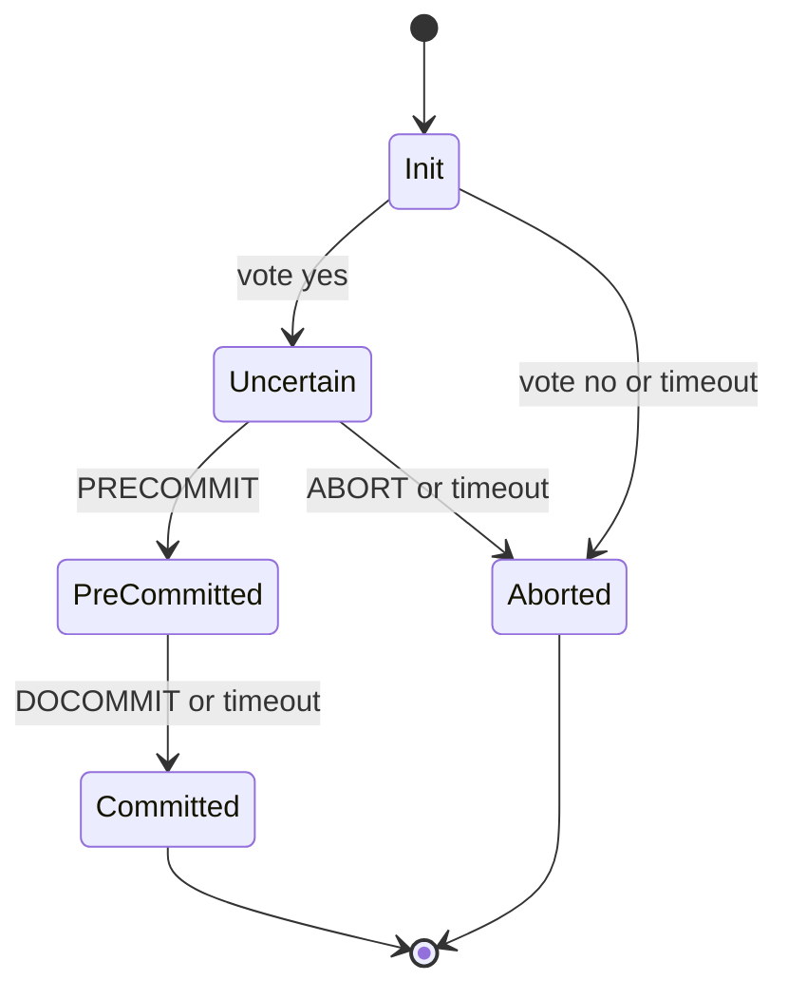

## In one minute
- Three-phase commit adds a *pre-commit* phase between voting and committing so that participants can finish a transaction without the coordinator.
- The key invariant: no participant commits while any other participant could still be undecided about whether everyone voted yes.
- It is non-blocking only if failures are clean crashes and message delays are bounded. With network partitions or unbounded delays it can produce split outcomes, which is worse than 2PC's blocking.
- In practice, systems get non-blocking atomic commit by replicating the 2PC coordinator with consensus instead. 3PC matters mostly for understanding why.

## How it works

### The problem it targets
In 2PC, a participant that voted yes and then lost the coordinator is *uncertain*. It cannot commit, because someone may have voted no. It cannot abort, because the coordinator may have decided commit and some participant may already have committed. The root cause is that a participant can go straight from "I voted yes" to "committed", so a survivor in the uncertain state cannot rule out that someone else committed.

### The three phases
Dale Skeen introduced the protocol in 1981 as a fix for exactly this uncertainty ([Skeen 1981](https://www.cs.cornell.edu/courses/cs614/2004sp/papers/Ske81.pdf)).

1. **CanCommit:** the coordinator asks each participant whether it can commit. Each replies yes (entering *uncertain*) or no (aborting).
2. **PreCommit:** if all voted yes, the coordinator sends `PRECOMMIT`. Each participant enters *pre-committed*, durably records it, and acknowledges. If any voted no or timed out, the coordinator sends `ABORT`.
3. **DoCommit:** once enough participants acknowledge the pre-commit, the coordinator sends `DOCOMMIT` and they commit.

The pre-committed state means "everyone voted yes and the decision is commit, but I have not committed yet". No participant ever commits while another is still uncertain, because commit is only sent after pre-commits are acknowledged.

### Recovery without the coordinator
If the coordinator fails, surviving participants elect a new coordinator, which collects their states and applies a termination rule:

- If anyone has committed, commit.
- If anyone has aborted, or anyone never voted, abort.
- If anyone is pre-committed, move all to pre-committed, then commit.
- If everyone reachable is uncertain, abort. This is safe because nobody can have committed: committing requires that everyone first reached pre-committed.

Timeouts follow the same logic: a participant waiting for `PRECOMMIT` that hears nothing aborts; a participant waiting for `DOCOMMIT` that hears nothing commits.

### Where it breaks
The rule "all reachable are uncertain, so abort" assumes the unreachable ones are crashed, not alive on the other side of a partition. Suppose the coordinator sends `PRECOMMIT` to participant A, then the network splits A from B and C. A's side sees a pre-committed node and commits. B and C's side sees only uncertain nodes and aborts. The transaction is now committed on one side and aborted on the other, which violates atomicity. 3PC is correct in a synchronous system with crash failures, but real networks are asynchronous: you cannot distinguish a crashed node from a slow or partitioned one. Skeen's original analysis explicitly assumed the network never fails ([Skeen 1981](https://www.cs.cornell.edu/courses/cs614/2004sp/papers/Ske81.pdf)), and Kleppmann's Cambridge course skips 3PC altogether because it depends on the unrealistic synchronous model ([Cambridge notes](https://www.cl.cam.ac.uk/teaching/2122/ConcDisSys/dist-sys-notes.pdf)). Consensus protocols escape the trap by deciding with majorities rather than by guessing who has failed.

Quorum variants close the split-outcome hole. Skeen's 1982 quorum-based commit protocol only lets a side that holds a quorum commit or abort, so the minority side waits instead of guessing. It can still get stuck with a connected quorum that cannot make progress, which Keidar and Dolev's Enhanced 3PC (E3PC, 1998) fixes so that any connected quorum can always finish ([Wikipedia](https://en.wikipedia.org/wiki/Three-phase_commit_protocol)). Note the price: a partitioned minority blocks again, which is exactly 2PC's behaviour for those nodes.

### Cost
3PC adds a full round trip and an extra durable write per participant compared with 2PC, raising lock hold time by roughly 50%, in exchange for a guarantee that holds only under assumptions most deployments do not meet.

## Down the stack

### Layer 1: The contract
3PC promises atomicity plus non-blocking termination, but only under a stated failure model: nodes fail by crashing and stay down (fail-stop), message delay is bounded by a known Δ, and a timeout therefore means the peer really crashed. Under those assumptions, any group of surviving participants can reach the outcome without waiting for the failed ones. Outside them (partitions, long pauses, unbounded delays) the contract offers no safety at all.

### Layer 2: The mechanism
The message flow is `CanCommit?` answered by `Yes` or `No`, then `PreCommit` answered by `Ack`, then `DoCommit` answered by `HaveCommitted`. Every state change is written to the participant's log before it replies, so a restarted participant knows whether it was uncertain or pre-committed. Skeen's analysis gives the design rule behind the extra phase: a protocol is non-blocking if and only if no local state is "adjacent" to both commit and abort, meaning no state from which another participant could already be committed while this one might still abort, and no state that is not yet committable sits adjacent to a commit state ([Skeen 1981](https://www.cs.cornell.edu/courses/cs614/2004sp/papers/Ske81.pdf)). In 2PC the prepared state violates this rule; 3PC's pre-committed state exists to fix it. On coordinator failure, survivors elect a backup coordinator (for example, the lowest live id), which polls states, applies the termination rule, and drives everyone to the result. Timeouts are derived from Δ, typically waiting about 2Δ for a reply.

### Layer 3: The machine
The bounded-delay assumption fails on real hardware in ordinary ways. A JVM full garbage collection can pause a process for hundreds of milliseconds to several seconds. Hypervisors steal CPU and live-migrate VMs with pauses of similar size. Linux TCP retransmission timeouts start around 200 ms on a live connection and back off exponentially; the standard sets the initial timeout before any measurement at 1 second and requires it to double on each expiry ([RFC 6298](https://www.rfc-editor.org/rfc/rfc6298)), so one lost packet can delay a message by seconds. A failed top-of-rack switch leaves every node healthy but unreachable, which no timeout can tell apart from a crash. The extra phase also has a hardware cost: three forced log writes per participant instead of two, and six one-way messages per participant instead of four, so lock hold time rises by about half.

### Why it's built this way
1. 2PC blocks because an uncertain participant cannot rule out that someone already committed.
2. Inserting a pre-commit state ensures nobody commits until everybody has left the uncertain state, so survivors can decide by looking at each other.
3. Deciding without the failed nodes requires knowing they really failed, which only timing can tell.
4. Timing is reliable only in synchronous networks, and real networks are asynchronous, so 3PC's safety rests on a false premise.
5. Majority-based protocols do not need to know who failed, which is why Paxos Commit and consensus-replicated coordinators replaced 3PC in practice. Paxos Commit matches 2PC's disk-write delay in the normal case and only adds messages ([Gray and Lamport](https://www.microsoft.com/en-us/research/wp-content/uploads/2016/02/tr-2003-96.pdf)).

## Diagram


## Worked example
Three inventory shards (A, B, C) take part in a reservation across warehouses. Network round trips are 1 ms and each durable write is 2 ms.

- **2PC:** prepare round trip plus write (3 ms) and commit round trip plus write (3 ms), about 6 ms of lock hold. If the coordinator dies after prepare, locks stay until it recovers, perhaps 30 seconds for a process restart, or much longer if the host is gone.
- **3PC:** add a pre-commit round trip plus write, about 9 ms of lock hold. If the coordinator dies, survivors elect a new one and finish within a timeout of, say, 500 ms. Throughput on a hot row drops from about 166 to 111 transactions per second.
- **Partition case:** a switch failure isolates shard A just after it received `PRECOMMIT`. A times out waiting for `DOCOMMIT` and commits. B and C, still uncertain, elect a coordinator, see no pre-committed node, and abort. Inventory is reserved in one warehouse and released in the others, and nothing in the protocol detects it.
- **Replicated 2PC:** run the coordinator's log on a 3-node Raft group. Each decision write costs a majority round trip (about 2 ms), lock hold is about 8 ms, and a coordinator crash is covered by a new Raft leader within a second, with no split outcome under partitions because only a majority can decide. Production systems shave this further; CockroachDB's parallel commits overlap the transaction record write with the data writes, saving one consensus round ([Cockroach Labs](https://www.cockroachlabs.com/blog/parallel-commits/)).

## In the wild
- **GitHub, 2012: a failure detector that guessed wrong, twice.** Heavy migration load failed a health check, so Pacemaker moved the active MySQL role to a node with a cold buffer pool, which then performed badly and triggered another failover. The next day a Pacemaker segfault partitioned the cluster and both nodes declared themselves master. Over two days there was 1 hour 46 minutes of downtime, and because MySQL and Redis IDs drifted apart, 16 private repositories were briefly visible to non-collaborators. GitHub made failover of the active role require a human ([GitHub](https://github.blog/news-insights/the-library/github-availability-this-week/)). This is 3PC's flaw in miniature: acting on "it timed out, so it is dead".
- **GitHub, 2018: 43 seconds of partition, 24 hours of repair.** Maintenance cut the US East hub off from the primary data center for 43 seconds. Orchestrator promoted West Coast MySQL primaries during the gap, so writes landed on both coasts and could not simply be merged back; one cluster had 954 writes to reconcile, and service was degraded for 24 hours 11 minutes. GitHub then stopped cross-region promotion ([GitHub](https://github.blog/news-insights/company-news/oct21-post-incident-analysis/)). A partition that each side read as the other's failure produced divergent outcomes, the same shape as the 3PC partition case.

## Trade-offs
| Option | Strengths | Weaknesses | Choose when |
|---|---|---|---|
| 2PC | Simple, safe under partitions | Blocks if coordinator fails | Coordinator is reliable or replicated |
| 3PC | Non-blocking under crash-only, bounded-delay failures | Unsafe under partitions, extra round trip | Synchronous networks with fail-stop nodes, which is rare |
| 2PC with consensus-replicated coordinator | Safe and practically non-blocking | Needs a consensus layer | Distributed databases |
| Paxos Commit | Non-blocking with majority fault tolerance | Complex, more messages | Research-grade or custom transaction layers |
| Sagas | No distributed locks | Eventual consistency, compensations | Cross-service business workflows |

## Pitfalls in production
- **Trusting timeouts as failure detectors.** A long GC pause looks like a crash, and the termination rule acts on a false assumption. Assume asynchrony and use majority-based decisions.
- **Implementing 3PC to "fix" 2PC blocking.** It trades blocking for possible inconsistency. Replicate the coordinator instead.
- **Ignoring the extra latency.** A third durable write per participant increases lock hold time and contention. Measure before adding phases.
- **Recovery logic tested only for crashes.** Partitions, message reordering, and duplicate messages are the real failure modes. Test with fault injection that includes partitions.
- **Missing durable state for pre-commit.** If the pre-committed state is not persisted, a restarted participant reports uncertain and the termination rule may abort a committed transaction. Persist every state transition.

## Leadership lens
- When someone proposes 3PC, ask what failure model they assume and whether the network actually provides bounded delays.
- Steer atomic commit toward proven implementations: database-native distributed transactions, or a coordinator replicated by Raft or Paxos.
- Use 3PC as a teaching tool in design reviews: it shows why availability during partitions requires majorities, not more phases.
- Weigh whether cross-shard atomicity is needed at all; co-locating data that changes together avoids the whole problem.

## Check yourself
1. Why is it safe for survivors that are all uncertain to abort in 3PC, but not in 2PC?
   **Answer:** In 3PC nobody can commit until everyone has reached pre-committed, so all-uncertain proves no one committed; in 2PC a participant may already have received commit.
2. How does a network partition break 3PC?
   **Answer:** Each side applies the termination rule to the nodes it can see, so a side with a pre-committed node commits while a side with only uncertain nodes aborts.
3. Why do real systems replicate the 2PC coordinator instead of using 3PC?
   **Answer:** Consensus decides with a majority, which stays safe under partitions and asynchrony, while 3PC's safety depends on timing assumptions that real networks violate.

## Practice
**Task:** Implement the 3PC participant state machine and termination rule. States are `"init"`, `"uncertain"`, `"precommitted"`, `"committed"`, `"aborted"`. `step(state, msg)` handles `"vote_yes"` and `"vote_no"` (from init), `"precommit"` (from uncertain), `"docommit"` (from precommitted) and `"abort"` (from init or uncertain), raising `ValueError` for any other transition. `on_timeout(state)` aborts from init or uncertain, commits from precommitted, and leaves final states alone. `terminate(states)` returns `"commit"` or `"abort"` for the reachable participants' states using the rules in this lesson (an empty list aborts). `partition_outcomes(groups)` returns the termination result for each group.

```python starter
def step(state, msg):
    raise NotImplementedError

def on_timeout(state):
    raise NotImplementedError

def terminate(states):
    raise NotImplementedError

def partition_outcomes(groups):
    raise NotImplementedError
```

```python tests
def test_happy_path():
    s = "init"
    for m in ("vote_yes", "precommit", "docommit"):
        s = step(s, m)
    assert s == "committed"

def test_invalid_transition_raises():
    try:
        step("uncertain", "docommit")
    except ValueError:
        return
    assert False, "expected ValueError"

def test_timeouts():
    assert on_timeout("init") == "aborted"
    assert on_timeout("uncertain") == "aborted"
    assert on_timeout("precommitted") == "committed"
    assert on_timeout("committed") == "committed"

def test_termination_rules():
    assert terminate(["uncertain", "committed"]) == "commit"
    assert terminate(["uncertain", "aborted"]) == "abort"
    assert terminate(["uncertain", "init"]) == "abort"
    assert terminate(["uncertain", "precommitted"]) == "commit"
    assert terminate(["uncertain", "uncertain"]) == "abort"
    assert terminate([]) == "abort"

def test_partition_splits_outcome():
    out = partition_outcomes([["precommitted"], ["uncertain", "uncertain"]])
    assert out == ["commit", "abort"]
```

```python solution
TRANSITIONS = {
    ("init", "vote_yes"): "uncertain",
    ("init", "vote_no"): "aborted",
    ("init", "abort"): "aborted",
    ("uncertain", "precommit"): "precommitted",
    ("uncertain", "abort"): "aborted",
    ("precommitted", "docommit"): "committed",
}

def step(state, msg):
    if (state, msg) not in TRANSITIONS:
        raise ValueError("bad transition %s on %s" % (state, msg))
    return TRANSITIONS[(state, msg)]

def on_timeout(state):
    if state in ("init", "uncertain"):
        return "aborted"
    if state == "precommitted":
        return "committed"
    return state

def terminate(states):
    if "committed" in states:
        return "commit"
    if "aborted" in states or "init" in states:
        return "abort"
    if "precommitted" in states:
        return "commit"
    return "abort"

def partition_outcomes(groups):
    return [terminate(g) for g in groups]
```

```typescript starter
export type State = "init" | "uncertain" | "precommitted" | "committed" | "aborted";
export type Msg = "vote_yes" | "vote_no" | "precommit" | "docommit" | "abort";
export function step(state: State, msg: Msg): State { throw new Error("TODO"); }
export function onTimeout(state: State): State { throw new Error("TODO"); }
export function terminate(states: State[]): "commit" | "abort" { throw new Error("TODO"); }
export function partitionOutcomes(groups: State[][]): ("commit" | "abort")[] { throw new Error("TODO"); }
```

```typescript tests
test("happy path", () => {
  let s: State = "init";
  for (const m of ["vote_yes", "precommit", "docommit"] as Msg[]) s = step(s, m);
  assertEqual(s, "committed");
});
test("invalid transition throws", () => {
  let threw = false;
  try { step("uncertain", "docommit"); } catch (e) { threw = !(e instanceof Error && e.message === "TODO"); }
  assert(threw, "expected an error for an invalid transition");
});
test("timeouts", () => {
  assertEqual((["init", "uncertain", "precommitted", "committed"] as State[]).map(onTimeout),
    ["aborted", "aborted", "committed", "committed"]);
});
test("termination rules", () => {
  assertEqual(terminate(["uncertain", "committed"]), "commit");
  assertEqual(terminate(["uncertain", "aborted"]), "abort");
  assertEqual(terminate(["uncertain", "init"]), "abort");
  assertEqual(terminate(["uncertain", "precommitted"]), "commit");
  assertEqual(terminate(["uncertain", "uncertain"]), "abort");
  assertEqual(terminate([]), "abort");
});
test("partition splits outcome", () => {
  assertEqual(partitionOutcomes([["precommitted"], ["uncertain", "uncertain"]]), ["commit", "abort"]);
});
```

```typescript solution
export type State = "init" | "uncertain" | "precommitted" | "committed" | "aborted";
export type Msg = "vote_yes" | "vote_no" | "precommit" | "docommit" | "abort";
const TRANSITIONS: Record<string, State> = {
  "init/vote_yes": "uncertain",
  "init/vote_no": "aborted",
  "init/abort": "aborted",
  "uncertain/precommit": "precommitted",
  "uncertain/abort": "aborted",
  "precommitted/docommit": "committed",
};
export function step(state: State, msg: Msg): State {
  const next = TRANSITIONS[state + "/" + msg];
  if (!next) throw new Error("bad transition " + state + " on " + msg);
  return next;
}
export function onTimeout(state: State): State {
  if (state === "init" || state === "uncertain") return "aborted";
  if (state === "precommitted") return "committed";
  return state;
}
export function terminate(states: State[]): "commit" | "abort" {
  if (states.includes("committed")) return "commit";
  if (states.includes("aborted") || states.includes("init")) return "abort";
  if (states.includes("precommitted")) return "commit";
  return "abort";
}
export function partitionOutcomes(groups: State[][]): ("commit" | "abort")[] {
  return groups.map(terminate);
}
```

```go starter
package practice

// States: "init", "uncertain", "precommitted", "committed", "aborted".
// Messages: "vote_yes", "vote_no", "precommit", "docommit", "abort".

func Step(state, msg string) (string, error) { panic("TODO") }

func OnTimeout(state string) string { panic("TODO") }

func Terminate(states []string) string { panic("TODO") }

func PartitionOutcomes(groups [][]string) []string { panic("TODO") }
```

```go tests
package practice

import (
	"reflect"
	"testing"
)

func TestHappyPath(t *testing.T) {
	s := "init"
	for _, m := range []string{"vote_yes", "precommit", "docommit"} {
		var err error
		if s, err = Step(s, m); err != nil {
			t.Fatal(err)
		}
	}
	if s != "committed" {
		t.Fatalf("got %s", s)
	}
}

func TestInvalidTransition(t *testing.T) {
	if _, err := Step("uncertain", "docommit"); err == nil {
		t.Fatal("expected an error")
	}
}

func TestTimeouts(t *testing.T) {
	want := map[string]string{"init": "aborted", "uncertain": "aborted",
		"precommitted": "committed", "committed": "committed"}
	for in, out := range want {
		if got := OnTimeout(in); got != out {
			t.Fatalf("%s: got %s", in, got)
		}
	}
}

func TestTerminationRules(t *testing.T) {
	cases := []struct {
		states []string
		want   string
	}{
		{[]string{"uncertain", "committed"}, "commit"},
		{[]string{"uncertain", "aborted"}, "abort"},
		{[]string{"uncertain", "init"}, "abort"},
		{[]string{"uncertain", "precommitted"}, "commit"},
		{[]string{"uncertain", "uncertain"}, "abort"},
		{nil, "abort"},
	}
	for _, c := range cases {
		if got := Terminate(c.states); got != c.want {
			t.Fatalf("%v: got %s", c.states, got)
		}
	}
}

func TestPartitionSplitsOutcome(t *testing.T) {
	got := PartitionOutcomes([][]string{{"precommitted"}, {"uncertain", "uncertain"}})
	if !reflect.DeepEqual(got, []string{"commit", "abort"}) {
		t.Fatalf("got %v", got)
	}
}
```

```go solution
package practice

import "fmt"

// States: "init", "uncertain", "precommitted", "committed", "aborted".
// Messages: "vote_yes", "vote_no", "precommit", "docommit", "abort".

var transitions = map[[2]string]string{
	{"init", "vote_yes"}:         "uncertain",
	{"init", "vote_no"}:          "aborted",
	{"init", "abort"}:            "aborted",
	{"uncertain", "precommit"}:   "precommitted",
	{"uncertain", "abort"}:       "aborted",
	{"precommitted", "docommit"}: "committed",
}

func Step(state, msg string) (string, error) {
	next, ok := transitions[[2]string{state, msg}]
	if !ok {
		return state, fmt.Errorf("bad transition %s on %s", state, msg)
	}
	return next, nil
}

func OnTimeout(state string) string {
	switch state {
	case "init", "uncertain":
		return "aborted"
	case "precommitted":
		return "committed"
	}
	return state
}

func Terminate(states []string) string {
	has := map[string]bool{}
	for _, s := range states {
		has[s] = true
	}
	switch {
	case has["committed"]:
		return "commit"
	case has["aborted"] || has["init"]:
		return "abort"
	case has["precommitted"]:
		return "commit"
	}
	return "abort"
}

func PartitionOutcomes(groups [][]string) []string {
	out := make([]string, 0, len(groups))
	for _, g := range groups {
		out = append(out, Terminate(g))
	}
	return out
}
```

## Mock interview
**Prompt:** A teammate proposes replacing 2PC with 3PC in your sharded order system, because last quarter a coordinator host died and locks on 40,000 rows were held for 25 minutes. Evaluate the proposal and recommend a design.

- Follow-up: Walk through what happens under 3PC if the coordinator crashes right after sending `PRECOMMIT` to one of three participants.
- Follow-up: Now make it a network partition instead of a crash. What changes?
- Follow-up: What would you build instead, and what does it cost in latency?

**A strong answer covers:**
- The uncertain state in 2PC and how pre-commit removes it under crash failures.
- The termination rule and why all-uncertain implies no one committed.
- The partition scenario producing split outcomes, and the asynchrony assumption behind it.
- Recommending a consensus-replicated coordinator (or the database's native distributed transactions) instead.
- Latency arithmetic for each option and operational fixes such as in-doubt transaction monitoring.

## Sources and further study
**Primary**
- [Corbett et al., Spanner (OSDI 2012)](https://research.google/pubs/spanner-googles-globally-distributed-database-2/): non-blocking commit in practice, by running 2PC between Paxos-replicated groups instead of adding a phase.
- [RFC 6298: Computing TCP's Retransmission Timer](https://www.rfc-editor.org/rfc/rfc6298): why message delay on a real network has no useful upper bound.

**Systems docs**
- [Parallel Commits (Cockroach Labs)](https://www.cockroachlabs.com/blog/parallel-commits/): a production non-blocking commit built on consensus rather than an extra phase.
- [Wikipedia: Two-phase commit protocol](https://en.wikipedia.org/wiki/Two-phase_commit_protocol): the baseline 3PC modifies, with its blocking cases spelled out.

**Books**
- *Database Internals*, Alex Petrov, chapter 13 "Distributed Transactions": 3PC next to 2PC, including the split-brain scenario.
- *Database Internals*, Alex Petrov, chapter 9 "Failure Detection": why heartbeats and timeouts can only suspect failures.
- *Designing Data-Intensive Applications* (1st edition), Martin Kleppmann, chapter 8 "The Trouble with Distributed Systems": unbounded delays, process pauses and unreliable clocks.

**Other curricula**
- [Kleppmann, Cambridge Concurrent and Distributed Systems notes](https://www.cl.cam.ac.uk/teaching/2122/ConcDisSys/dist-sys-notes.pdf): mentions 3PC only to dismiss it for assuming a synchronous system, then teaches fault-tolerant 2PC.
- [MIT 6.5840 lecture notes: Distributed Transactions](https://pdos.csail.mit.edu/6.824/notes/l-2pc.txt): covers 2PC and its blocking, and moves on to replicated participants rather than 3PC.

## Watch
- [Virtual Synchrony, 2-Phase and 3-Phase Commit Protocols (Smruti R. Sarangi)](https://www.youtube.com/watch?v=LbqczsRwAgQ): a university lecture covering both commit protocols and their failure handling.
- [Basic 2-Phase and 3-phase commit protocol (NPTEL)](https://www.youtube.com/watch?v=Qab0d7rwWhI): an IIT lecture stepping through the state machines.

## Free resources
- [Wikipedia: Three-phase commit protocol](https://en.wikipedia.org/wiki/Three-phase_commit_protocol): the protocol and its partition weakness.
- [Skeen: Nonblocking Commit Protocols (1981)](https://www.cs.cornell.edu/courses/cs614/2004sp/papers/Ske81.pdf): the original paper defining non-blocking commit.
- [The Paper Trail: Three-Phase Commit](https://www.the-paper-trail.org/post/2008-11-29-consensus-protocols-three-phase-commit/): a careful explanation of why 3PC works and where it fails.
- [Gray and Lamport: Consensus on Transaction Commit](https://www.microsoft.com/en-us/research/wp-content/uploads/2016/02/tr-2003-96.pdf): Paxos Commit, the majority-based alternative.
