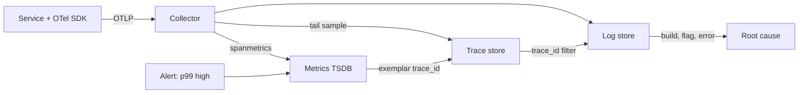

## In one minute
- Metrics, logs and traces store the same events with different amounts of pre-aggregation. Metrics drop identity to stay cheap, logs keep the detail of one process, traces keep the shape of one request across processes.
- Metrics tell you *that* something is wrong and how badly, traces tell you *where* in the request path, logs tell you *why* at the line of code.
- The value is in moving between them in one click. Shared resource attributes, a trace ID on every log line, and exemplars on latency histograms are the joins.
- Cost scales differently: metrics by series, logs by bytes, traces by spans kept after sampling.
- "Three pillars" is a useful inventory and a poor architecture. Treat them as views over well-structured events, not three tools owned by three teams.

## How it works

### One event, three shapes
Take one checkout request that fails because the payment provider timed out after 2 seconds. There are three classic shapes for recording it.

A **metric** turns it into increments: `http_server_requests_total{route="/checkout",status="502"}` goes up by one, and the 2.1 second duration lands in the `le="2.5"` bucket of a latency histogram. The request ID, the customer and the error message are gone. What remains is tiny and fast to query over months.

A **log** line keeps what the code chose to say at one point in one process: `{"level":"error","msg":"payment authorise failed","provider":"acme","timeout_ms":2000,"trace_id":"4bf9..."}`. It is rich but local, blind to the 11 other services on the same request unless they share an ID.

A **trace** keeps the request's shape: a tree of timed spans. It shows that `checkout` waited on `payments.authorise`, which waited 2,000 ms on an outbound call, while inventory and pricing finished in 15 ms. It is sampled, so most requests have no trace at all. Google's Dapper sampled about one trace in 1,024 and found that still gave enough data for high-volume services, while sampling every request added 16 percent to average latency in their test ([Dapper paper](https://static.googleusercontent.com/media/research.google.com/en//archive/papers/dapper-2010-1.pdf)).

A database analogy: logs are the raw table, metrics are a materialised view with `GROUP BY route, status` already applied, and traces are a precomputed join across services on `trace_id`. This is the *finding things fast* problem shape: every observability backend is an index chosen in advance for the queries you expect at 3 a.m.

### What each pillar is good at
**Metrics** are for detection and trend: the only signal cheap enough to cover every request, so alerts, SLOs and capacity plans live here (see the Metrics and Instrumentation and Alert Monitoring lessons). Google's four golden signals, latency, traffic, errors and saturation, are all metrics ([Google SRE book](https://sre.google/sre-book/monitoring-distributed-systems/)). They cannot explain an outlier, because it was summed into a bucket.

**Traces** are for localisation: which hop grew, whether calls ran in sequence or in parallel, where retries stacked up. The Distributed Tracing lesson covers propagation and sampling.

**Logs** are for explanation: the exception, the SQL that timed out, the flag value, the config version. They are also all most third-party software emits, so they never go away. Amazon's guidance is one request log entry per unit of work, carrying the timings and dependency results for that request, which makes a log line behave like a small wide event ([AWS Builders' Library](https://builder.aws.com/content/3EuxPBdIiiUhB5IK47p3O3fxhy7/instrumenting-distributed-systems-for-operational-visibility)).

### The joins are the product
Three disconnected tools give you an engineer comparing timestamps by eye. The links that matter:

- **Resource attributes.** Every series, log record and span from a process carries the same `service.name`, `service.version`, `k8s.pod.name` and `deployment.environment`.
- **Trace context in logs.** The logger reads the active span and stamps `trace_id` and `span_id` on every record, so one click from a span lists its log lines across services.
- **Exemplars.** A histogram bucket keeps one sample observation with its trace ID, so a dot on the p99 panel opens a real slow trace.
- **Span-derived metrics.** The collector's `spanmetrics` connector computes rate, errors and duration from spans before sampling, emitted as `traces.span.metrics.calls` and `traces.span.metrics.duration`, so traces and RED dashboards agree ([spanmetrics connector](https://github.com/open-telemetry/opentelemetry-collector-contrib/blob/main/connector/spanmetricsconnector/README.md)).

### Beyond the pillars
Charity Majors and Ben Sigelman argue that the pillars framing confuses data types with capabilities. Their alternative is **wide structured events**: one record per request per service with dozens of fields (route, user tier, build ID, cache hit, flag values) in a columnar store that can group by any field at query time. Metrics become queries over events and traces become events with parent IDs. That answers high-cardinality questions ("only beta-build customers in `ap-southeast-1` on Safari?") that pre-aggregated metrics cannot. The cost is more bytes per request than a counter, so most organisations keep metrics for alerting and long retention, and sampled traces plus structured logs (ideally one wide line per request) for investigation. Majors later named the split-silo approach "observability 1.0" and the single store of wide events "observability 2.0", arguing that 1.0 costs grow as a multiple of traffic because every signal stores the event again ([charity.wtf](https://charity.wtf/p/is-it-time-to-version-observability-signs-point-to-yes)).

The list of signals is also growing. OpenTelemetry's continuous profiling signal entered public alpha in 2026, and profile samples carry `trace_id` and `span_id`, so a slow span can open a flame graph of the code that ran during it ([OpenTelemetry blog](https://opentelemetry.io/blog/2026/profiles-alpha/)).

The same trade appears in a bank: account balances (aggregate), a transaction ledger (raw), and fraud case files that stitch transactions across accounts (the trace). The questions decide the shapes; the IDs that join them decide whether investigation takes minutes or days.

## Down the stack

### Layer 1: The contract
None of the three signals promises completeness. Metrics promise monotonic counters per process; a missed scrape or a restart loses resolution, not totals, because `rate()` handles resets. Resolution is the scrape interval (10 to 60 seconds), so a 3 second spike is invisible in a gauge. Log agents such as Fluent Bit and Vector checkpoint file offsets and deliver at least once: duplicates after a crash, loss when the disk buffer overflows. A sampled trace is *probably* complete: SDK queues drop spans under pressure, and tail samplers decide on partial data if a span is late. The correlation contract is weakest: a log line has a trace ID only if it ran inside an active span, and an exemplar may point at a trace that was sampled out.

### Layer 2: The mechanism
OpenTelemetry defines one data model for all three. Each OTLP batch is grouped as `ResourceSpans` / `ResourceMetrics` / `ResourceLogs`, then by `InstrumentationScope`, then records. A span carries `trace_id` (16 bytes), `span_id` (8 bytes), `parent_span_id`, `kind`, start and end in Unix nanoseconds, attributes and status. A log record carries `Timestamp`, `SeverityNumber` (17 to 20 is ERROR), `Body`, attributes, optional `TraceId` and `SpanId`, and an optional `EventName` that marks the record as a named event ([OTel logs data model](https://opentelemetry.io/docs/specs/otel/logs/data-model/)). A histogram data point carries bounds, counts, sum and a list of `Exemplar` messages, each with a value, a timestamp and trace and span IDs. In OpenMetrics text, an exemplar follows a bucket line as `# {trace_id="4bf9..."} 2.1 1760000000.123` ([OpenMetrics spec](https://github.com/prometheus/OpenMetrics/blob/main/specification/OpenMetrics.md)). Prometheus keeps exemplars in a separate in-memory circular buffer rather than in TSDB chunks, and only when started with `--enable-feature=exemplar-storage`, which is still off by default ([Prometheus feature flags](https://prometheus.io/docs/prometheus/latest/feature_flags/)). Exporters send OTLP on port 4317 (gRPC) or 4318 (HTTP), and the spec makes `http/protobuf` the default transport ([OTLP exporter spec](https://opentelemetry.io/docs/specs/otel/protocol/exporter/)).

The Collector runs pipelines of receivers (OTLP, Prometheus scrape, filelog), processors (`memory_limiter`, `batch`, `k8sattributes`, `tail_sampling`) and exporters, with the `spanmetrics` connector turning spans into RED metrics. `k8sattributes` keeps resource attributes consistent by mapping the sender's pod IP to pod, namespace and deployment.

### Layer 3: The machine
Per-event cost differs by three orders of magnitude. A counter increment is an atomic add: 2 to 5 ns uncontended, 50 to 100 ns when 32 cores bounce the same cache line, which is why fast libraries shard counters per CPU. A histogram observation is about 20 to 50 ns. A JSON log line costs 1 to 5 microseconds to format plus a `write(2)` into the page cache, and if stdout is a pipe to a slow container runtime that write blocks the request thread. A span costs 0.5 to 2 microseconds and a few hundred bytes of allocation. On disk, a Prometheus sample compresses to 1 to 2 bytes ([Prometheus storage](https://prometheus.io/docs/prometheus/latest/storage/)); Facebook's Gorilla paper, which introduced the delta-of-delta and XOR scheme, measured 1.37 bytes against 16 raw ([Gorilla, VLDB 2015](https://www.vldb.org/pvldb/vol8/p1816-teller.pdf)); a JSON log line is 300 to 800 bytes before compression, and an OTLP span 400 to 1,000 bytes. One request costs almost nothing in metrics, a kilobyte or two of logs, and several kilobytes of trace if sampled.

### Why it's built this way
1. Storage and query cost scale with what you keep, so the cheapest signal must be pre-aggregated: metrics discard identity.
2. Pre-aggregation hides outliers, so a second signal must keep individual events: logs and traces.
3. Individual events across 20 services are useless without a join key, so trace context is propagated in headers and stamped on everything.
4. Keeping every span is too expensive, so traces are sampled, which breaks some joins; exemplars and tail sampling exist to bias what is kept toward what someone will click.
5. Three pipelines tripled the agents and formats, so OpenTelemetry unified the data model and the collector while leaving storage specialised.

## Diagram


## Worked example
A checkout flow runs at 5,000 requests per second. Each request touches 12 services (12 spans), and each service writes about 3 log lines per request.

Metrics: 40 pods times 1,500 series is 60,000 series. At one sample per 15 seconds and 1.3 bytes per sample, that is about 450 MB per day; thirteen months fits on one disk.

Logs: 5,000 times 12 times 3 lines times 500 bytes is 90 MB per second, 7.8 TB per day raw, about 1 TB compressed. Logs are the largest line item by far, and dropping debug lines plus the two chattiest info lines halves it.

Traces: 60,000 spans per second at 700 bytes is 42 MB per second unsampled. Tail sampling keeps all errors (0.4 percent of requests), all requests over 1 second (0.8 percent) and 1 percent of the rest: about 2.2 percent of traces, 80 GB per day.

The incident: the p99 alert fires at 1.9 seconds against an 800 ms SLO, only on `/checkout`, from 14:05. An exemplar in the 2.5 second bucket opens a trace where `payments.authorise` spends 1,850 ms in an outbound call with three retry spans. Filtering logs by that trace ID shows `retry attempt=3 provider=acme status=503` and `payments.timeout_ms=600` from a deploy at 14:04. Alert to cause: 6 minutes, against 50 minutes the previous quarter when the team grepped logs by timestamp across 40 pods.

## In the wild
- **Roblox, 2021: the telemetry depended on the system that failed.** A 73-hour outage began in Roblox's Consul cluster, and the monitoring stack used that same Consul. The postmortem says the team lacked the telemetry that would have shown what was wrong, which badly slowed triage. Afterwards telemetry was made independent of the systems it watches, extended to cover Consul and BoltDB internals, and given targeted alerts for the same warning signs ([Roblox](https://about.roblox.com/newsroom/2022/01/roblox-return-to-service-10-28-10-31-2021/)).
- **Anthropic, 2025: aggregate signals hid three overlapping bugs.** A routing bug sent 0.8 percent of Sonnet 4 requests to the wrong server pool at first and 16 percent in the worst hour, and about 30 percent of Claude Code users hit it at least once. Two other bugs corrupted token selection. Evaluations and summary signals did not show the drop, privacy controls limited access to individual interactions, and each bug looked different on each platform. The fixes included continuous quality evaluations on production traffic and better tooling to debug from user reports ([Anthropic](https://www.anthropic.com/engineering/a-postmortem-of-three-recent-issues)).

## Trade-offs
| Option | Strengths | Weaknesses | Choose when |
| --- | --- | --- | --- |
| Metrics | Cheap, long retention, fast queries, ideal for alerting | No identity, cardinality limits, outliers averaged away | Detection, SLOs, capacity, trends |
| Logs | Richest detail, works for any software, ad hoc text search | Expensive per byte, local to one process without IDs | Explaining a specific failure, audit trails |
| Traces | Request shape across services, latency attribution | Sampling gaps, instrumentation effort, large spans | Localising latency and errors in distributed calls |
| Wide events | Arbitrary high-cardinality group-by after the fact | Higher per-request cost, needs a columnar backend | Debugging unknown failure modes in complex systems |
| Separate vendor per pillar | Best-of-breed tools | Broken joins, triple agents, triple bills | Rarely; only when migration cost dominates |

## Pitfalls in production
- Logs without trace IDs because the code logs outside the request context. Fix: a logging filter or the OpenTelemetry log bridge that reads the active span, and a dashboard of the share of error logs carrying a trace ID.
- Different service names per signal (`checkout`, `checkout-svc`). Fix: set `OTEL_SERVICE_NAME` once in the deployment.
- Exemplars pointing at traces that sampling dropped. Fix: attach exemplars only for sampled spans, or tail-sample slow and failed traces.
- Logs used as metrics: counting `"payment failed"` lines per minute costs 100x a counter and breaks when the message is reworded. Fix: emit a counter alongside the log.
- User or order IDs added as metric labels "for debugging". Fix: keep them on spans and logs.
- A gateway collector with no queue that drops all three signals during the incident. Fix: per-node agents with persistent queues and a scaled gateway tier.

## Leadership lens
- Budget by signal and by team. Showing each team its log and trace cost per million requests changes the debug-logging conversation.
- Make correlation a review standard: `service.name`, W3C trace context, trace IDs on logs. Cheap at birth, expensive to retrofit.
- Ask in design review: "When this fails at 3 a.m., which metric turns red first, and how many clicks to the log line that explains it?" If the answer involves grep and timestamps, the design is not done.
- Standardise instrumentation on OpenTelemetry even if backends differ, so vendor choice stays reversible.
- Agents writing instrumentation tend to log everything at info and put user IDs in metric labels. Put the house rules in the prompt and the lint.

## Check yourself
1. Why can a metric not tell you which customer had the slowest request, even if it is a histogram with fine buckets?
   **Answer:** Observations are summed into bucket counters at write time, so identity is discarded. Only an exemplar or a log or span with that customer's ID can point back to the request.
2. Your p99 panel has exemplars, but clicking them often shows "trace not found". What is the most likely cause?
   **Answer:** The exemplar was recorded for a request whose trace was dropped by sampling. Record exemplars only for sampled spans, or bias sampling to keep the slow traces that exemplars land on.
3. Why do span-derived metrics have to be computed before tail sampling rather than after?
   **Answer:** After sampling, the remaining spans are biased toward errors and slow requests, so rates and percentiles computed from them would overstate both.
4. A team proposes logging every request at info level instead of adding tracing. What do they lose?
   **Answer:** Cross-service structure: parent-child timing, parallel versus sequential calls, and where time went. They also pay per byte for every request instead of sampling, and still need IDs to join lines across services.

## Practice
**Task:** Build a small telemetry hub that links a latency histogram to logs through exemplars. `Telemetry(bounds)` takes sorted finite upper bounds in milliseconds; there is one extra overflow bucket after them. `observe(ts, value, trace_id)` counts `value` in the first bucket whose bound is `>= value` (or the overflow bucket), and if `trace_id` is non-empty records `(trace_id, value, ts)` as that bucket's exemplar, replacing the old one only when `ts` is at least the old exemplar's `ts` (late arrivals must not overwrite newer exemplars). `log(ts, trace_id, level, msg)` stores a log record. `counts()` returns per-bucket (not cumulative) counts, `exemplar(i)` returns bucket `i`'s exemplar or nothing. `drill_down(threshold)` visits buckets whose lower bound (0 for the first bucket, otherwise the previous bound) is `>= threshold`, slowest bucket first, and for each one with an exemplar returns the trace ID, the value and that trace's log lines formatted `"LEVEL msg"`, ordered by `ts` with ties in insertion order.

```python starter
class Telemetry:
    def __init__(self, bounds):
        self.bounds = list(bounds)

    def observe(self, ts, value, trace_id):
        # TODO
        raise NotImplementedError

    def log(self, ts, trace_id, level, msg):
        # TODO
        raise NotImplementedError

    def counts(self):
        # TODO
        raise NotImplementedError

    def exemplar(self, i):
        # TODO: (trace_id, value, ts) or None
        raise NotImplementedError

    def drill_down(self, threshold):
        # TODO: list of (trace_id, value, [ "LEVEL msg", ... ])
        raise NotImplementedError
```

```python tests
def make():
    return Telemetry([100, 500, 1000])

def test_bucket_counts_inclusive_bounds():
    t = make()
    for v in [5, 100, 101, 500, 999, 1000, 1001, 5000]:
        t.observe(1, v, "")
    assert t.counts() == [2, 2, 2, 2]

def test_exemplar_latest_wins_and_empty_ignored():
    t = make()
    t.observe(10, 700, "a")
    t.observe(20, 800, "b")
    t.observe(30, 900, "")
    assert t.exemplar(2) == ("b", 800, 20)
    assert t.exemplar(0) is None

def test_late_arrival_does_not_overwrite():
    t = make()
    t.observe(50, 2000, "new")
    t.observe(40, 3000, "old")
    assert t.exemplar(3) == ("new", 2000, 50)
    t.observe(50, 2500, "same-ts")
    assert t.exemplar(3) == ("same-ts", 2500, 50), "equal ts replaces"

def test_drill_down_slowest_first_with_logs():
    t = make()
    t.observe(1, 50, "fast")
    t.observe(2, 700, "mid")
    t.observe(3, 4000, "slow")
    t.log(9, "slow", "ERROR", "payment timeout")
    t.log(5, "slow", "WARN", "retry 1")
    t.log(6, "mid", "INFO", "cache miss")
    t.log(7, "fast", "INFO", "ok")
    assert t.drill_down(500) == [
        ("slow", 4000, ["WARN retry 1", "ERROR payment timeout"]),
        ("mid", 700, ["INFO cache miss"]),
    ]

def test_drill_down_threshold_uses_lower_bound():
    t = make()
    t.observe(1, 700, "mid")
    assert t.drill_down(501) == [], "bucket (500,1000] starts below 501"
    assert t.drill_down(0)[0][0] == "mid"

def test_ties_keep_insertion_order_and_missing_logs():
    t = make()
    t.observe(1, 20, "x")
    t.log(5, "x", "INFO", "first")
    t.log(5, "x", "INFO", "second")
    t.observe(1, 300, "nolog")
    assert t.drill_down(0) == [("nolog", 300, []), ("x", 20, ["INFO first", "INFO second"])]
```

```python solution
class Telemetry:
    def __init__(self, bounds):
        self.bounds = list(bounds)
        self._counts = [0] * (len(self.bounds) + 1)
        self._exemplars = [None] * (len(self.bounds) + 1)
        self._logs = {}

    def _bucket(self, value):
        for i, b in enumerate(self.bounds):
            if value <= b:
                return i
        return len(self.bounds)

    def observe(self, ts, value, trace_id):
        i = self._bucket(value)
        self._counts[i] += 1
        if trace_id:
            old = self._exemplars[i]
            if old is None or ts >= old[2]:
                self._exemplars[i] = (trace_id, value, ts)

    def log(self, ts, trace_id, level, msg):
        self._logs.setdefault(trace_id, []).append((ts, level + " " + msg))

    def counts(self):
        return list(self._counts)

    def exemplar(self, i):
        return self._exemplars[i]

    def drill_down(self, threshold):
        out = []
        for i in range(len(self._counts) - 1, -1, -1):
            lower = 0 if i == 0 else self.bounds[i - 1]
            ex = self._exemplars[i]
            if lower < threshold or ex is None:
                continue
            lines = sorted(self._logs.get(ex[0], []), key=lambda r: r[0])
            out.append((ex[0], ex[1], [line for _, line in lines]))
        return out
```

```typescript starter
export interface Exemplar { traceId: string; value: number; ts: number; }
export interface Finding { traceId: string; value: number; logs: string[]; }

export class Telemetry {
  constructor(public readonly bounds: number[]) {}
  observe(ts: number, value: number, traceId: string): void { throw new Error("TODO"); }
  log(ts: number, traceId: string, level: string, msg: string): void { throw new Error("TODO"); }
  counts(): number[] { throw new Error("TODO"); }
  exemplar(i: number): Exemplar | undefined { throw new Error("TODO"); }
  drillDown(threshold: number): Finding[] { throw new Error("TODO"); }
}
```

```typescript tests
function makeHub(): Telemetry {
  return new Telemetry([100, 500, 1000]);
}

test("bucket counts inclusive bounds", () => {
  const t = makeHub();
  for (const v of [5, 100, 101, 500, 999, 1000, 1001, 5000]) t.observe(1, v, "");
  assertEqual(t.counts(), [2, 2, 2, 2]);
});

test("exemplar latest wins and empty ignored", () => {
  const t = makeHub();
  t.observe(10, 700, "a");
  t.observe(20, 800, "b");
  t.observe(30, 900, "");
  assertEqual(t.exemplar(2), { traceId: "b", value: 800, ts: 20 });
  assert(t.exemplar(0) === undefined, "no exemplar in bucket 0");
});

test("late arrival does not overwrite", () => {
  const t = makeHub();
  t.observe(50, 2000, "new");
  t.observe(40, 3000, "old");
  assertEqual(t.exemplar(3), { traceId: "new", value: 2000, ts: 50 });
  t.observe(50, 2500, "same-ts");
  assertEqual(t.exemplar(3), { traceId: "same-ts", value: 2500, ts: 50 }, "equal ts replaces");
});

test("drill down slowest first with logs", () => {
  const t = makeHub();
  t.observe(1, 50, "fast");
  t.observe(2, 700, "mid");
  t.observe(3, 4000, "slow");
  t.log(9, "slow", "ERROR", "payment timeout");
  t.log(5, "slow", "WARN", "retry 1");
  t.log(6, "mid", "INFO", "cache miss");
  t.log(7, "fast", "INFO", "ok");
  assertEqual(t.drillDown(500), [
    { traceId: "slow", value: 4000, logs: ["WARN retry 1", "ERROR payment timeout"] },
    { traceId: "mid", value: 700, logs: ["INFO cache miss"] },
  ]);
});

test("drill down threshold uses lower bound", () => {
  const t = makeHub();
  t.observe(1, 700, "mid");
  assertEqual(t.drillDown(501), [], "bucket (500,1000] starts below 501");
  assertEqual(t.drillDown(0)[0].traceId, "mid");
});

test("ties keep insertion order and missing logs", () => {
  const t = makeHub();
  t.observe(1, 20, "x");
  t.log(5, "x", "INFO", "first");
  t.log(5, "x", "INFO", "second");
  t.observe(1, 300, "nolog");
  assertEqual(t.drillDown(0), [
    { traceId: "nolog", value: 300, logs: [] },
    { traceId: "x", value: 20, logs: ["INFO first", "INFO second"] },
  ]);
});
```

```typescript solution
export interface Exemplar { traceId: string; value: number; ts: number; }
export interface Finding { traceId: string; value: number; logs: string[]; }

export class Telemetry {
  private bucketCounts: number[];
  private exemplars: (Exemplar | undefined)[];
  private logs = new Map<string, { ts: number; line: string }[]>();

  constructor(public readonly bounds: number[]) {
    this.bucketCounts = new Array(bounds.length + 1).fill(0);
    this.exemplars = new Array(bounds.length + 1).fill(undefined);
  }

  private bucket(value: number): number {
    for (let i = 0; i < this.bounds.length; i++) {
      if (value <= this.bounds[i]) return i;
    }
    return this.bounds.length;
  }

  observe(ts: number, value: number, traceId: string): void {
    const i = this.bucket(value);
    this.bucketCounts[i]++;
    if (traceId === "") return;
    const old = this.exemplars[i];
    if (old === undefined || ts >= old.ts) this.exemplars[i] = { traceId, value, ts };
  }

  log(ts: number, traceId: string, level: string, msg: string): void {
    const list = this.logs.get(traceId) ?? [];
    list.push({ ts, line: level + " " + msg });
    this.logs.set(traceId, list);
  }

  counts(): number[] { return this.bucketCounts.slice(); }

  exemplar(i: number): Exemplar | undefined { return this.exemplars[i]; }

  drillDown(threshold: number): Finding[] {
    const out: Finding[] = [];
    for (let i = this.bucketCounts.length - 1; i >= 0; i--) {
      const lower = i === 0 ? 0 : this.bounds[i - 1];
      const ex = this.exemplars[i];
      if (lower < threshold || ex === undefined) continue;
      const lines = (this.logs.get(ex.traceId) ?? [])
        .map((r, idx) => ({ ...r, idx }))
        .sort((a, b) => a.ts - b.ts || a.idx - b.idx)
        .map((r) => r.line);
      out.push({ traceId: ex.traceId, value: ex.value, logs: lines });
    }
    return out;
  }
}
```

```go starter
package practice

type Exemplar struct {
	TraceID string
	Value   float64
	TS      int64
}

type Finding struct {
	TraceID string
	Value   float64
	Logs    []string
}

type Telemetry struct {
	Bounds []float64
}

func NewTelemetry(bounds []float64) *Telemetry { return &Telemetry{Bounds: bounds} }

func (t *Telemetry) Observe(ts int64, value float64, traceID string) { panic("TODO") }
func (t *Telemetry) Log(ts int64, traceID, level, msg string)        { panic("TODO") }
func (t *Telemetry) Counts() []int                                   { panic("TODO") }
func (t *Telemetry) Exemplar(i int) (Exemplar, bool)                 { panic("TODO") }
func (t *Telemetry) DrillDown(threshold float64) []Finding           { panic("TODO") }
```

```go tests
package practice

import (
	"reflect"
	"testing"
)

func makeHub() *Telemetry { return NewTelemetry([]float64{100, 500, 1000}) }

func TestBucketCountsInclusiveBounds(t *testing.T) {
	h := makeHub()
	for _, v := range []float64{5, 100, 101, 500, 999, 1000, 1001, 5000} {
		h.Observe(1, v, "")
	}
	if got := h.Counts(); !reflect.DeepEqual(got, []int{2, 2, 2, 2}) {
		t.Fatalf("got %v", got)
	}
}

func TestExemplarLatestWinsAndEmptyIgnored(t *testing.T) {
	h := makeHub()
	h.Observe(10, 700, "a")
	h.Observe(20, 800, "b")
	h.Observe(30, 900, "")
	if ex, ok := h.Exemplar(2); !ok || ex != (Exemplar{"b", 800, 20}) {
		t.Fatalf("got %v %v", ex, ok)
	}
	if _, ok := h.Exemplar(0); ok {
		t.Fatal("bucket 0 has no exemplar")
	}
}

func TestLateArrivalDoesNotOverwrite(t *testing.T) {
	h := makeHub()
	h.Observe(50, 2000, "new")
	h.Observe(40, 3000, "old")
	if ex, _ := h.Exemplar(3); ex != (Exemplar{"new", 2000, 50}) {
		t.Fatalf("got %v", ex)
	}
	h.Observe(50, 2500, "same-ts")
	if ex, _ := h.Exemplar(3); ex != (Exemplar{"same-ts", 2500, 50}) {
		t.Fatalf("equal ts replaces, got %v", ex)
	}
}

func TestDrillDownSlowestFirstWithLogs(t *testing.T) {
	h := makeHub()
	h.Observe(1, 50, "fast")
	h.Observe(2, 700, "mid")
	h.Observe(3, 4000, "slow")
	h.Log(9, "slow", "ERROR", "payment timeout")
	h.Log(5, "slow", "WARN", "retry 1")
	h.Log(6, "mid", "INFO", "cache miss")
	h.Log(7, "fast", "INFO", "ok")
	want := []Finding{
		{"slow", 4000, []string{"WARN retry 1", "ERROR payment timeout"}},
		{"mid", 700, []string{"INFO cache miss"}},
	}
	if got := h.DrillDown(500); !reflect.DeepEqual(got, want) {
		t.Fatalf("got %v", got)
	}
}

func TestDrillDownThresholdUsesLowerBound(t *testing.T) {
	h := makeHub()
	h.Observe(1, 700, "mid")
	if got := h.DrillDown(501); len(got) != 0 {
		t.Fatalf("bucket (500,1000] starts below 501, got %v", got)
	}
	if got := h.DrillDown(0); len(got) != 1 || got[0].TraceID != "mid" {
		t.Fatalf("got %v", got)
	}
}

func TestTiesKeepInsertionOrderAndMissingLogs(t *testing.T) {
	h := makeHub()
	h.Observe(1, 20, "x")
	h.Log(5, "x", "INFO", "first")
	h.Log(5, "x", "INFO", "second")
	h.Observe(1, 300, "nolog")
	want := []Finding{
		{"nolog", 300, []string{}},
		{"x", 20, []string{"INFO first", "INFO second"}},
	}
	if got := h.DrillDown(0); !reflect.DeepEqual(got, want) {
		t.Fatalf("got %#v", got)
	}
}
```

```go solution
package practice

import "sort"

type Exemplar struct {
	TraceID string
	Value   float64
	TS      int64
}

type Finding struct {
	TraceID string
	Value   float64
	Logs    []string
}

type logRecord struct {
	ts   int64
	line string
}

type Telemetry struct {
	Bounds    []float64
	counts    []int
	exemplars []*Exemplar
	logs      map[string][]logRecord
}

func NewTelemetry(bounds []float64) *Telemetry {
	return &Telemetry{
		Bounds:    bounds,
		counts:    make([]int, len(bounds)+1),
		exemplars: make([]*Exemplar, len(bounds)+1),
		logs:      map[string][]logRecord{},
	}
}

func (t *Telemetry) bucket(value float64) int {
	for i, b := range t.Bounds {
		if value <= b {
			return i
		}
	}
	return len(t.Bounds)
}

func (t *Telemetry) Observe(ts int64, value float64, traceID string) {
	i := t.bucket(value)
	t.counts[i]++
	if traceID == "" {
		return
	}
	if old := t.exemplars[i]; old == nil || ts >= old.TS {
		t.exemplars[i] = &Exemplar{traceID, value, ts}
	}
}

func (t *Telemetry) Log(ts int64, traceID, level, msg string) {
	t.logs[traceID] = append(t.logs[traceID], logRecord{ts, level + " " + msg})
}

func (t *Telemetry) Counts() []int { return append([]int(nil), t.counts...) }

func (t *Telemetry) Exemplar(i int) (Exemplar, bool) {
	if i < 0 || i >= len(t.exemplars) || t.exemplars[i] == nil {
		return Exemplar{}, false
	}
	return *t.exemplars[i], true
}

func (t *Telemetry) DrillDown(threshold float64) []Finding {
	out := []Finding{}
	for i := len(t.counts) - 1; i >= 0; i-- {
		lower := 0.0
		if i > 0 {
			lower = t.Bounds[i-1]
		}
		ex := t.exemplars[i]
		if lower < threshold || ex == nil {
			continue
		}
		recs := append([]logRecord(nil), t.logs[ex.TraceID]...)
		sort.SliceStable(recs, func(a, b int) bool { return recs[a].ts < recs[b].ts })
		lines := make([]string, 0, len(recs))
		for _, r := range recs {
			lines = append(lines, r.line)
		}
		out = append(out, Finding{ex.TraceID, ex.Value, lines})
	}
	return out
}
```

## Mock interview
**Prompt:** You join a company with 60 microservices, 20,000 requests per second at peak, and three separate tools for metrics, logs and traces bought by three different teams. Mean time to resolve incidents is 90 minutes, and the log bill grew 4x in a year. Design the observability strategy for the next two quarters.

- Follow-up: How do you make an alert on p99 latency lead an on-call engineer to the responsible log line in under five minutes?
- Follow-up: Tail sampling keeps errors and slow traces. What breaks if the tail-sampling collector tier is overloaded during an incident?
- Follow-up: A staff engineer proposes replacing all three with wide structured events in a columnar store. How do you evaluate that?

**A strong answer covers:**
- OpenTelemetry instrumentation with consistent resource attributes and W3C trace context everywhere, before touching backends.
- The join path: exemplars, trace IDs on every log line, span-derived metrics computed before sampling.
- Cost control by signal: bounded labels, per-team log budgets with showback, tail sampling that keeps errors and slow requests.
- Pipeline resilience: per-node agents with persistent queues, `memory_limiter`, and alerts on dropped telemetry.
- Wide events evaluated by a pilot on one critical service, comparing debugging time and per-request cost, while metrics stay for alerting.

## Sources and further study
**Primary**
- [Pelkonen et al., Gorilla (VLDB 2015)](https://www.vldb.org/pvldb/vol8/p1816-teller.pdf): the time-series compression that makes metrics the cheapest signal, measured at 1.37 bytes per point.
- [W3C Trace Context Level 2](https://www.w3.org/TR/trace-context-2/): the `traceparent` header that every join between signals depends on, now with a random-trace-ID flag.
- [Charity Majors, Is it time to version observability?](https://charity.wtf/p/is-it-time-to-version-observability-signs-point-to-yes): the case for one store of wide events over three silos.

**Systems docs**
- [Prometheus feature flags](https://prometheus.io/docs/prometheus/latest/feature_flags/): exemplar storage and the OTLP delta-temporality options, with their current status.
- [OpenTelemetry spanmetrics connector](https://github.com/open-telemetry/opentelemetry-collector-contrib/blob/main/connector/spanmetricsconnector/README.md): how spans become request, error and duration metrics.
- [OpenTelemetry Profiles enters public alpha](https://opentelemetry.io/blog/2026/profiles-alpha/): the fourth signal and how it links to traces.

**Books**
- *Observability Engineering*, Charity Majors, Liz Fong-Jones and George Miranda, chapter 1 "What Is Observability?" and chapter 5 "Structured Events Are the Building Blocks of Observability".
- *Building Microservices* (2nd edition), Sam Newman, chapter 10 "From Monitoring to Observability": how the problem changes as one service on one server becomes many services on many servers.

**Other curricula**
- [Azure Architecture Center: monitoring and diagnostics](https://learn.microsoft.com/en-us/azure/architecture/best-practices/monitoring): organises the topic by scenario (health, availability, performance, security, SLA, audit, usage) feeding one instrumentation pipeline.
- [AWS Builders' Library: instrumenting distributed systems](https://builder.aws.com/content/3EuxPBdIiiUhB5IK47p3O3fxhy7/instrumenting-distributed-systems-for-operational-visibility): Amazon's practice of one detailed request log per unit of work, from which metrics are derived.
- [roadmap.sh System Design](https://roadmap.sh/system-design): lists monitoring as separate nodes (health, availability, performance, security, usage, instrumentation, visualisation and alerts) rather than by signal type.
- [donnemartin/system-design-primer](https://github.com/donnemartin/system-design-primer): has no monitoring or observability section; Dapper appears only in its list of papers.

## Watch
- [Three Pillars with Zero Answers: A New Observability Scorecard (Lightstep)](https://www.youtube.com/watch?v=diI4-g8WiJ8): Ben Sigelman's critique of treating the pillars as the goal instead of the questions they answer.
- [Observability for Emerging Infra (Strange Loop)](https://www.youtube.com/watch?v=1wjovFSCGhE): Charity Majors on high-cardinality events and why pre-aggregated metrics stop being enough.

## Free resources
- [OpenTelemetry signals (OpenTelemetry docs)](https://opentelemetry.io/docs/concepts/signals/): the vendor-neutral definitions of traces, metrics and logs and how they share context.
- [OpenTelemetry logs data model](https://opentelemetry.io/docs/specs/otel/logs/data-model/): the fields that let a log record carry trace and span IDs.
- [OpenMetrics specification](https://github.com/prometheus/OpenMetrics/blob/main/specification/OpenMetrics.md): the exposition format, including exemplar syntax on histogram buckets.
- [Monitoring Distributed Systems (Google SRE book)](https://sre.google/sre-book/monitoring-distributed-systems/): the four golden signals and what deserves a page.
- [Dapper (Google Research)](https://research.google/pubs/dapper-a-large-scale-distributed-systems-tracing-infrastructure/): the paper that made sampled, always-on tracing practical.
- [Exemplars (Grafana docs)](https://grafana.com/docs/grafana/latest/fundamentals/exemplars/): how a metric panel links straight to a trace in practice.
