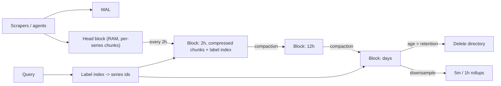

## In one minute
- A time series database (TSDB) stores streams of `(series id, timestamp, value)` points, where a series is identified by a metric name plus labels such as `host` and `region`.
- The workload is distinctive: very high append rates, almost no updates, queries over recent time ranges, aggregation across many series, and data that loses value with age.
- TSDBs exploit this with time-partitioned blocks, columnar compression (delta-of-delta timestamps, XOR floats) that reaches 1 to 2 bytes per point, and retention by dropping whole blocks.
- The hard scaling dimension is usually *cardinality*, the number of distinct series, not the number of points.
- Prometheus, InfluxDB, TimescaleDB, VictoriaMetrics, and M3 are common examples; Gorilla at Facebook set the compression baseline most of them use.

## How it works

### Data model
A series is a metric name plus a set of label pairs: `http_requests_total{service="cart", status="500", pod="cart-7f9"}`. Every unique label combination is a new series. Points within a series are ordered by time and usually arrive in order. Two kinds of index matter: an inverted index from label pairs to series ids (to answer "all series where `service=cart`"), and per-series storage of the points themselves.

Histograms are where cardinality hides. A classic Prometheus histogram is stored as a `_sum` series, a `_count` series and one `_bucket` series per boundary, so 12 buckets times every label combination is a lot of series. *Native histograms* store the whole distribution as one series with sparse exponential buckets. They became stable in Prometheus 3.8, though scraping them still has to be switched on with `scrape_native_histograms` ([Prometheus spec](https://prometheus.io/docs/specs/native_histograms/)). Prometheus 3.0 (November 2024), the first major release in seven years, also allowed UTF-8 metric and label names and added Remote Write 2.0 and a native OTLP receiver ([Prometheus blog](https://prometheus.io/blog/2024/11/14/prometheus-3-0/)).

### Write path
Incoming points land in an in-memory head block, grouped per series, backed by a WAL. Every couple of hours (two hours in Prometheus) the head is cut into an immutable block on disk containing compressed chunks per series and the label index for that window. Background compaction merges small blocks into larger ones, which reduces index overhead for long-range queries; Prometheus caps a compacted block at 10% of the retention time or 31 days, whichever is smaller ([Prometheus storage](https://prometheus.io/docs/prometheus/latest/storage/)).

### Compression
Gorilla-style encoding works on a single series at a time:
- **Timestamps**: store the first timestamp, then the delta, then the *delta of deltas*. A scrape every 15 seconds produces deltas of 15, 15, 15, so delta-of-delta is 0 and costs one bit.
- **Values**: XOR each float with the previous one. Slowly changing values share sign, exponent, and leading mantissa bits, so the XOR has long runs of zeros that are encoded compactly.

Together these get a 16-byte raw point down to about 1.4 bytes on typical monitoring data. Columnar TSDBs on top of general formats get similar results with dictionary, run-length, and delta encodings per column. TimescaleDB (whose company renamed itself Tiger Data in 2025) now calls this the columnstore: `convert_to_columnstore()` replaced `compress_chunk()` in version 2.18 ([Tiger Data docs](https://www.tigerdata.com/docs/api/latest/hypercore/convert_to_columnstore/)). InfluxDB 3 Core and Enterprise went GA in April 2025 on a Rust engine built on Apache Arrow, DataFusion and Parquet ([InfluxData](https://www.influxdata.com/blog/influxdata-announces-influxdb-3-oss-ga/)).

### Query path
A query like `sum by (status) (rate(http_requests_total{service="cart"}[5m]))` resolves label matchers to series ids via the inverted index, loads only the chunks overlapping the time range, decompresses, applies per-series functions (`rate`), then aggregates across series. Cost scales with the number of series touched times points per series, so a query that matches 2 million series is slow no matter how well data is compressed.

### Retention and downsampling
Because data is partitioned by time, deleting 30-day-old data means deleting whole block directories, which is instant compared with row deletes. Long-term storage usually keeps downsampled data: 5-minute and 1-hour aggregates (min, max, sum, count) that make year-long dashboards cheap.

## Down the stack

### Layer 1: The contract
Prometheus's TSDB stores samples of (millisecond timestamp, float64 value) per series. Appends within a series must be in time order; out-of-order samples are rejected unless `out_of_order_time_window` is raised from its default of `0s`, after which anything newer than the head's max time minus the window is accepted ([Prometheus configuration](https://prometheus.io/docs/prometheus/latest/configuration/configuration/)). A sample is queryable as soon as it is appended to the in-memory head. Durability is best effort: the WAL is not fsynced per sample, so a crash can lose the most recent samples, which is acceptable because metrics are periodically re-scraped and the system optimises for ingest throughput rather than per-sample guarantees. A single server is also not clustered or replicated, so the docs say plainly that it is not durable against drive or node loss; that is the job of remote storage. Queries are evaluated at fixed steps with a 5-minute lookback by default, so a series that stops reporting goes stale rather than disappearing instantly.

### Layer 2: The mechanism
In the head block, each series keeps its labels and an open chunk. A chunk is closed after about 120 samples (around 30 minutes at a 15-second interval) and then memory-mapped from disk, so the head does not hold every closed chunk in RAM. Every append is also written to the WAL, which is split into segment files of 128 MB. Every two hours the oldest head range is compacted into a block directory holding `chunks/` (segment files of concatenated chunks), an `index` file, `meta.json`, and `tombstones`. The index contains a symbol table (every label string stored once and referenced by number), series entries that list each series' labels and chunk references, and postings: for every label pair, the sorted list of series ids that carry it. A selector such as `{service="cart", status="500"}` is answered by intersecting two sorted postings lists, exactly as a search engine intersects terms. Each index section ends in a CRC32 checksum, and the file opens with the magic number `0xBAAAD700` ([Prometheus index format](https://github.com/prometheus/prometheus/blob/main/tsdb/docs/format/index.md)).

Inside a chunk, Gorilla encoding applies. The timestamp's delta-of-delta is written with a variable-length prefix code: a single `0` bit when it is zero, and progressively longer prefixes followed by wider fields for larger values. Prometheus uses wider buckets than the original Gorilla paper because its timestamps are in milliseconds. Each value is XORed with the previous one. If the XOR is zero the encoder writes one `0` bit. Otherwise it writes the meaningful bits between the leading and trailing zeros, reusing the previous window's position when the new bits fit inside it, and emitting the leading-zero count and length only when they do not.

### Layer 3: The machine
A raw sample is 16 bytes. Gorilla's paper reports about 1.37 bytes per sample on Facebook's monitoring data, a 12x reduction ([Pelkonen et al., VLDB 2015](https://www.vldb.org/pvldb/vol8/p1816-teller.pdf)), and Prometheus documents an average of 1 to 2 bytes per sample, a roughly tenfold saving in both memory and disk. The price is that decoding is strictly sequential and bit-aligned: to read sample 100 you decode samples 1 to 99, and the inner loop is branchy bit manipulation that cannot use SIMD well. Capping chunks at around 120 samples bounds that cost and lets queries skip whole chunks by their time range.

Blocks are read through `mmap`, so query performance depends on the page cache holding the index and recently used chunks. Memory pressure comes mostly from the head, where every active series costs label storage, an open chunk, and index entries, typically a few kilobytes per series. That is why cardinality, not sample rate, is what exhausts a Prometheus server. Retention is cheap because a block is a directory: expiring 15 days of data is one directory removal per block, with no compaction or rewrite.

### Why it's built this way
1. Metrics arrive as huge numbers of tiny, ordered points, so storage is organised per series where neighbouring values are similar and compress well.
2. Bit-level compression makes random access impossible, so chunks are kept small and indexed by time range.
3. Data is written once and only ever queried or expired by time, so it is cut into immutable time-partitioned blocks that can be deleted whole.
4. Queries select series by labels, so an inverted index of sorted postings resolves selectors by intersection.
5. Re-scraping makes small losses tolerable, so the WAL trades strict durability for ingest throughput.

## Diagram


## Worked example
A platform team monitors 4,000 Kubernetes pods. Each pod exposes about 500 series, so the system holds 2 million active series. With a 15-second scrape interval, ingestion is about 133,000 points per second.

At 1.5 bytes per point after compression, that is 200 KB/s, or 17 GB per day. Thirty days of local retention needs about 520 GB, which fits on one well-provisioned Prometheus server. Memory is the tighter constraint: each active series costs a few KB in the head block and index, so 2 million series need roughly 8 to 12 GB of RAM.

Then a developer adds a `user_id` label to a request counter on a service with 500,000 daily users. Each pod now produces hundreds of thousands of new series, and active series jump past 50 million within hours. Head-block memory blows up, the server OOMs, and restarts take minutes because WAL replay must rebuild all those series. The fix is not a bigger server: remove the label, enforce per-target series limits, and send per-user analytics to an event store or OLAP database built for high cardinality.

## In the wild
- **Facebook, 2013 to 2015: monitoring outgrows HBase, and Gorilla is born.** By early 2013 the p90 query time on Facebook's HBase-backed time series store had reached several seconds, blocking automation, and its 2 PB of data made replacing it impractical. The team put Gorilla in front as an in-memory write-through cache for the last 26 hours: 2 billion unique series, 700 million points a minute, 1.37 bytes per point after delta-of-delta and XOR encoding. Query latency fell 73x and throughput rose 14x ([Pelkonen et al., VLDB 2015](https://www.vldb.org/pvldb/vol8/p1816-teller.pdf)).
- **Cloudflare, 2023: guarding 916 Prometheus servers against cardinality explosions.** Cloudflare runs about 4.9 billion series across 916 Prometheus instances, the largest holding about 30 million series each. A single metric that suddenly gains a high-cardinality label can exhaust memory and crash the server, leaving the team without monitoring. They default `sample_limit` to 200 per scrape, patched Prometheus to drop only the excess new series instead of failing the whole scrape, added a hard cap on total head series as the last line of defence, and require a CI capacity check for any limit increase ([Cloudflare](https://blog.cloudflare.com/how-cloudflare-runs-prometheus-at-scale/)).

## Trade-offs
| Option | Strengths | Weaknesses | Choose when |
|---|---|---|---|
| Prometheus (local TSDB) | Simple, fast, pull-based, PromQL | Single node, limited retention | Per-cluster monitoring |
| Prometheus plus remote storage (Thanos, Mimir, VictoriaMetrics) | Global view, long retention, object storage | More moving parts to run | Many clusters, months of history |
| TimescaleDB | Full SQL, joins with business tables | Higher write cost than purpose-built TSDBs | Metrics mixed with relational data |
| Columnar OLAP (ClickHouse, Druid) | Handles high-cardinality events well | Less natural for rate and counter math | Per-user or per-request analytics |
| Wide column store with time buckets | Massive scale, multi-region writes | You build compression, rollups, query layer | IoT at very large scale |

## Pitfalls in production
- **Cardinality explosions.** Labels with unbounded values (user ids, request ids, full URLs) multiply series. Enforce label allow-lists and per-tenant series limits at ingestion. Prometheus's own `sample_limit` defaults to 0 (no limit), so set it per scrape job; Cloudflare defaults it to 200 and also patched in a cap on total head series ([Cloudflare](https://blog.cloudflare.com/how-cloudflare-runs-prometheus-at-scale/)).
- **Out-of-order or late data.** Many TSDBs reject or penalize points older than the head block. Buffer and batch at the edge, and configure an out-of-order window if the engine supports it.
- **Counter resets misread.** Raw counters reset on process restart. Always query with `rate` or `increase`, which handle resets.
- **Dashboards that scan years of raw data.** Route long ranges to downsampled data and set query limits on series and samples.
- **Treating the TSDB as a log store.** Storing strings or per-event data defeats compression. Use a log system for logs.

## Leadership lens
- Make cardinality a reviewed budget per team, with dashboards showing who owns the most series.
- Decide retention per resolution (raw for 15 days, 5-minute rollups for 13 months) from actual query needs and cost.
- Separate monitoring (must stay up during incidents) from analytics (can be slower) so one cannot take down the other.
- Ask whether a metric should be a metric at all, or a trace attribute or log field.

## Check yourself
1. Why does delta-of-delta encoding work so well for scraped metrics?
   **Answer:** Scrapes arrive at near-constant intervals, so the delta barely changes and its delta is usually zero, which takes about one bit to store.
2. A TSDB has plenty of disk but keeps running out of memory. What is the likely cause?
   **Answer:** Too many active series; per-series index and head-block memory grow with cardinality regardless of point volume.
3. Why is retention cheap in a TSDB compared with a row store?
   **Answer:** Data is partitioned into time blocks, so expiring old data means deleting whole files rather than individual rows.
4. Why do long-range dashboards need downsampled data?
   **Answer:** A year of raw 15-second points is about 2 million points per series; hourly rollups cut that to under 9,000 with little loss for trend views.

## Practice
**Task:** Implement Gorilla-style timestamp compression and a downsampler. `encode(ts)` takes a list of increasing integer timestamps and returns `[first, first_delta, dod_1, dod_2, ...]`, where each `dod` is the change between consecutive deltas. `decode(enc)` reverses it. `downsample(points, bucket)` takes `(timestamp, value)` pairs and returns `(bucket_start, average)` pairs for non-empty buckets, where `bucket_start = ts - ts % bucket`, sorted by bucket start. Handle empty and single-point input.

```python starter
def encode(ts):
    raise NotImplementedError

def decode(enc):
    raise NotImplementedError

def downsample(points, bucket):
    raise NotImplementedError
```

```python tests
def test_regular_interval_gives_zeros():
    assert encode([100, 115, 130, 145]) == [100, 15, 0, 0]

def test_jitter_roundtrip():
    ts = [1000, 1015, 1031, 1045, 1060, 1200]
    enc = encode(ts)
    assert enc == [1000, 15, 1, -2, 1, 125]
    assert decode(enc) == ts

def test_empty_and_single():
    assert encode([]) == []
    assert decode([]) == []
    assert encode([7]) == [7]
    assert decode([7]) == [7]

def test_downsample_averages_per_bucket():
    pts = [(0, 1.0), (30, 3.0), (60, 10.0), (179, 20.0)]
    assert downsample(pts, 60) == [(0, 2.0), (60, 10.0), (120, 20.0)]

def test_downsample_unsorted_and_empty():
    assert downsample([], 60) == []
    assert downsample([(125, 4.0), (5, 2.0), (121, 2.0)], 60) == [(0, 2.0), (120, 3.0)]
```

```python solution
def encode(ts):
    if len(ts) < 2:
        return list(ts)
    out = [ts[0], ts[1] - ts[0]]
    prev = ts[1] - ts[0]
    for i in range(2, len(ts)):
        delta = ts[i] - ts[i - 1]
        out.append(delta - prev)
        prev = delta
    return out

def decode(enc):
    if len(enc) < 2:
        return list(enc)
    ts = [enc[0], enc[0] + enc[1]]
    delta = enc[1]
    for dod in enc[2:]:
        delta += dod
        ts.append(ts[-1] + delta)
    return ts

def downsample(points, bucket):
    sums, counts = {}, {}
    for t, v in points:
        b = t - t % bucket
        sums[b] = sums.get(b, 0.0) + v
        counts[b] = counts.get(b, 0) + 1
    return [(b, sums[b] / counts[b]) for b in sorted(sums)]
```

```typescript starter
export function encode(ts: number[]): number[] { throw new Error("TODO"); }
export function decode(enc: number[]): number[] { throw new Error("TODO"); }
export function downsample(points: [number, number][], bucket: number): [number, number][] {
  throw new Error("TODO");
}
```

```typescript tests
test("regular interval gives zeros", () => {
  assertEqual(encode([100, 115, 130, 145]), [100, 15, 0, 0]);
});
test("jitter roundtrip", () => {
  const ts = [1000, 1015, 1031, 1045, 1060, 1200];
  assertEqual(encode(ts), [1000, 15, 1, -2, 1, 125]);
  assertEqual(decode(encode(ts)), ts);
});
test("empty and single", () => {
  assertEqual(encode([]), []);
  assertEqual(decode([]), []);
  assertEqual(encode([7]), [7]);
  assertEqual(decode([7]), [7]);
});
test("downsample averages per bucket", () => {
  const pts: [number, number][] = [[0, 1], [30, 3], [60, 10], [179, 20]];
  assertEqual(downsample(pts, 60), [[0, 2], [60, 10], [120, 20]]);
});
test("downsample unsorted and empty", () => {
  assertEqual(downsample([], 60), []);
  assertEqual(downsample([[125, 4], [5, 2], [121, 2]], 60), [[0, 2], [120, 3]]);
});
```

```typescript solution
export function encode(ts: number[]): number[] {
  if (ts.length < 2) return [...ts];
  const out = [ts[0], ts[1] - ts[0]];
  let prev = ts[1] - ts[0];
  for (let i = 2; i < ts.length; i++) {
    const delta = ts[i] - ts[i - 1];
    out.push(delta - prev);
    prev = delta;
  }
  return out;
}

export function decode(enc: number[]): number[] {
  if (enc.length < 2) return [...enc];
  const ts = [enc[0], enc[0] + enc[1]];
  let delta = enc[1];
  for (const dod of enc.slice(2)) {
    delta += dod;
    ts.push(ts[ts.length - 1] + delta);
  }
  return ts;
}

export function downsample(points: [number, number][], bucket: number): [number, number][] {
  const acc = new Map<number, [number, number]>();
  for (const [t, v] of points) {
    const b = t - (t % bucket);
    const cur = acc.get(b) ?? [0, 0];
    acc.set(b, [cur[0] + v, cur[1] + 1]);
  }
  return [...acc.keys()].sort((a, b) => a - b).map((b) => [b, acc.get(b)![0] / acc.get(b)![1]]);
}
```

```go starter
package practice

type Point struct {
	T int64
	V float64
}

func Encode(ts []int64) []int64                    { panic("TODO") }
func Decode(enc []int64) []int64                   { panic("TODO") }
func Downsample(points []Point, bucket int64) []Point { panic("TODO") }
```

```go tests
package practice

import (
	"reflect"
	"testing"
)

func TestRegularIntervalGivesZeros(t *testing.T) {
	if got := Encode([]int64{100, 115, 130, 145}); !reflect.DeepEqual(got, []int64{100, 15, 0, 0}) {
		t.Fatalf("got %v", got)
	}
}

func TestJitterRoundtrip(t *testing.T) {
	ts := []int64{1000, 1015, 1031, 1045, 1060, 1200}
	enc := Encode(ts)
	if !reflect.DeepEqual(enc, []int64{1000, 15, 1, -2, 1, 125}) {
		t.Fatalf("encode %v", enc)
	}
	if got := Decode(enc); !reflect.DeepEqual(got, ts) {
		t.Fatalf("decode %v", got)
	}
}

func TestEmptyAndSingle(t *testing.T) {
	if len(Encode(nil)) != 0 || len(Decode(nil)) != 0 {
		t.Fatal("empty input should give empty output")
	}
	if !reflect.DeepEqual(Encode([]int64{7}), []int64{7}) || !reflect.DeepEqual(Decode([]int64{7}), []int64{7}) {
		t.Fatal("single point")
	}
}

func TestDownsampleAveragesPerBucket(t *testing.T) {
	got := Downsample([]Point{{0, 1}, {30, 3}, {60, 10}, {179, 20}}, 60)
	want := []Point{{0, 2}, {60, 10}, {120, 20}}
	if !reflect.DeepEqual(got, want) {
		t.Fatalf("got %v", got)
	}
}

func TestDownsampleUnsortedAndEmpty(t *testing.T) {
	if len(Downsample(nil, 60)) != 0 {
		t.Fatal("empty")
	}
	got := Downsample([]Point{{125, 4}, {5, 2}, {121, 2}}, 60)
	if !reflect.DeepEqual(got, []Point{{0, 2}, {120, 3}}) {
		t.Fatalf("got %v", got)
	}
}
```

```go solution
package practice

import "sort"

type Point struct {
	T int64
	V float64
}

func Encode(ts []int64) []int64 {
	if len(ts) < 2 {
		return append([]int64{}, ts...)
	}
	out := []int64{ts[0], ts[1] - ts[0]}
	prev := ts[1] - ts[0]
	for i := 2; i < len(ts); i++ {
		delta := ts[i] - ts[i-1]
		out = append(out, delta-prev)
		prev = delta
	}
	return out
}

func Decode(enc []int64) []int64 {
	if len(enc) < 2 {
		return append([]int64{}, enc...)
	}
	ts := []int64{enc[0], enc[0] + enc[1]}
	delta := enc[1]
	for _, dod := range enc[2:] {
		delta += dod
		ts = append(ts, ts[len(ts)-1]+delta)
	}
	return ts
}

func Downsample(points []Point, bucket int64) []Point {
	sums, counts := map[int64]float64{}, map[int64]int{}
	for _, p := range points {
		b := p.T - p.T%bucket
		sums[b] += p.V
		counts[b]++
	}
	var keys []int64
	for b := range sums {
		keys = append(keys, b)
	}
	sort.Slice(keys, func(i, j int) bool { return keys[i] < keys[j] })
	var out []Point
	for _, b := range keys {
		out = append(out, Point{b, sums[b] / float64(counts[b])})
	}
	return out
}
```

## Mock interview
**Prompt:** Design a metrics platform for 300 Kubernetes clusters, about 150 million active series in total, with 15-second resolution for 2 weeks and 1-year history for capacity planning.

- Follow-up: One team's deploy triples total series overnight. How do you detect and contain it?
- Follow-up: Where do you store the year of history, and at what resolution?
- Follow-up: The metrics platform must stay up during a region outage. What do you change?

**A strong answer covers:**
- Local collection per cluster, remote write to a horizontally scaled, sharded backend.
- Ingestion math: points per second, bytes per point, memory per active series.
- Cardinality limits per tenant, enforced at ingestion, with ownership dashboards.
- Blocks in object storage with downsampled rollups for long ranges.
- Query limits and separation of alerting paths from heavy ad hoc queries.

## Sources and further study
**Primary**
- [Prometheus TSDB index format](https://github.com/prometheus/prometheus/blob/main/tsdb/docs/format/index.md): the on-disk layout of symbols, series, postings and the table of contents.
- [Prometheus TSDB chunks format](https://github.com/prometheus/prometheus/blob/main/tsdb/docs/format/chunks.md): how chunk segment files and chunk encodings are laid out.
- [Prometheus native histograms specification](https://prometheus.io/docs/specs/native_histograms/): exponential bucket schemas and why one series replaces dozens.

**Systems docs**
- [Prometheus 3.0 release announcement](https://prometheus.io/blog/2024/11/14/prometheus-3-0/): UTF-8 names, Remote Write 2.0, OTLP ingestion and the new UI.
- [Tiger Data: convert_to_columnstore](https://www.tigerdata.com/docs/api/latest/hypercore/convert_to_columnstore/): TimescaleDB's renamed compression API and how chunks move between row and column storage.
- [InfluxDB 3 Core and Enterprise GA (InfluxData)](https://www.influxdata.com/blog/influxdata-announces-influxdb-3-oss-ga/): the rewritten engine on Arrow, DataFusion and Parquet.

**Books**
- *Site Reliability Engineering* (1st ed.), Beyer et al., chapter 10 "Practical Alerting from Time-Series Data" ([read free](https://sre.google/sre-book/practical-alerting/)): Borgmon, Google's monitoring system that Prometheus closely resembles, and its time series storage model.
- *The Site Reliability Workbook* (1st ed.), chapter 4 "Monitoring" ([read free](https://sre.google/workbook/monitoring/)): what metrics to keep, and how to manage a monitoring system.
- *Designing Data-Intensive Applications* (2nd ed.), Martin Kleppmann and Chris Riccomini, chapter 4 "Storage and Retrieval": column-oriented storage and compression for analytics.

**Other curricula**
- [Azure Architecture Center: Understand data models](https://learn.microsoft.com/en-us/azure/architecture/data-guide/technology-choices/understand-data-store-models): treats time series as its own model and lists tag cardinality, retention cost and downsampling as the main considerations.
- [donnemartin/system-design-primer](https://github.com/donnemartin/system-design-primer): has no section on time series databases or metrics storage, so this topic has to come from the sources above.

## Watch
- [PromCon 2017: Storing 16 Bytes at Scale (Fabian Reinartz)](https://www.youtube.com/watch?v=b_pEevMAC3I): the design of the Prometheus v2 storage engine.
- [Time Series Database Lectures #6: TimescaleDB (CMU Database Group)](https://www.youtube.com/watch?v=IaZ4hJ3G7wc): how a relational engine is adapted for time series.

## Free resources
- [Gorilla (VLDB 2015)](https://www.vldb.org/pvldb/vol8/p1816-teller.pdf): Facebook's in-memory TSDB and its timestamp and XOR compression.
- [Prometheus: Storage](https://prometheus.io/docs/prometheus/latest/storage/): blocks, WAL, compaction, and sizing guidance.
- [Timescale: Hypertables](https://docs.timescale.com/use-timescale/latest/hypertables/): time partitioning inside PostgreSQL.
- [Time-series compression algorithms explained (Timescale)](https://www.timescale.com/blog/time-series-compression-algorithms-explained/): delta, delta-of-delta, XOR, and run-length encodings side by side.
- [InfluxDB 3.0 system architecture](https://www.influxdata.com/blog/influxdb-3-0-system-architecture/): a columnar, object-storage-based TSDB design.
