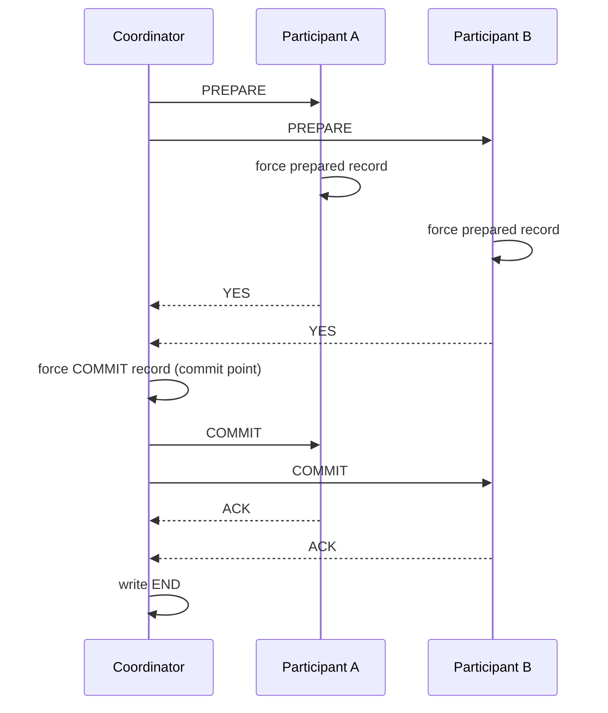

## In one minute
- Two-phase commit makes a transaction that spans several resource managers (databases, queues, shards) either commit everywhere or nowhere.
- Phase 1 asks every participant to *prepare* (make the change durable and promise it can commit). Phase 2 tells all of them the single decision.
- It is atomic but **blocking**: a participant that voted yes cannot decide alone, so if the coordinator dies at the wrong moment, locks stay held until it returns.
- It works well inside one system that replicates its coordinator (Spanner, CockroachDB, sharded databases). Across independent services it is usually the wrong tool.

## How it works

### The roles
A **coordinator** (often the transaction manager in the application server, or one of the shards) drives the protocol. **Participants** each own a piece of the transaction's data. Every party has a durable log, and the protocol's correctness depends on writing to it at the right moments.

### Phase 1: prepare
The coordinator sends `PREPARE` to every participant. Each participant checks it can commit (constraints, locks, disk), writes all the transaction's changes and a *prepared* record to its log, forces the log to disk, and replies `YES`. From this moment it has given up the right to abort on its own: it must keep the locks and wait. If anything is wrong, it replies `NO` and aborts locally. A participant that does not reply in time is treated as `NO`.

### Phase 2: commit or abort
If every vote is `YES`, the coordinator writes a *commit* record to its own log and forces it. **That write is the commit point.** It then sends `COMMIT` to everyone. If any vote is `NO`, it decides abort. Participants apply the decision, release locks, and acknowledge. Once all acknowledge, the coordinator writes an *end* record and can forget the transaction.

### Failure handling
- Participant crashes before voting: the coordinator times out and aborts.
- Participant crashes after voting `YES`: on restart it finds the prepared record and must ask the coordinator for the outcome before releasing locks.
- Coordinator crashes before the decision is logged: on recovery it finds no decision and aborts (*presumed abort*).
- Coordinator crashes after logging the decision: on recovery it re-sends the decision.

The bad case is the window between a participant voting `YES` and receiving the decision. If the coordinator is down then, the participant is **in doubt**. It cannot commit (another participant may have voted `NO`) and cannot abort (the coordinator may have logged commit). It blocks, holding row locks, until the coordinator recovers. Participants could ask each other, but if all of them voted `YES` and none heard the decision, they still cannot know.

### Cost
A commit needs two network round trips plus forced log writes at every participant and at the coordinator. Gray and Lamport count the normal case precisely: with N resource managers, participants learn the outcome after four message delays and 3N - 1 messages, and two stable-storage write delays if everyone prepares in parallel ([Gray and Lamport](https://www.microsoft.com/en-us/research/wp-content/uploads/2016/02/tr-2003-96.pdf)). Across availability zones that adds a few milliseconds; across regions, hundreds. Locks are held for the whole duration, so throughput on hot rows falls with latency. Participant count matters too: Google reports that 2PC in Spanner works well up to tens of participants, but abort rates and latency climb sharply with hundreds ([F1, VLDB 2013](https://www.vldb.org/pvldb/vol6/p1068-shute.pdf)).

## Down the stack

### Layer 1: The contract
2PC promises atomicity and durability of the outcome: every participant ends with the same decision, and once the decision is logged it survives any crash. It does not promise progress: a participant in the prepared state may wait indefinitely for the coordinator. Isolation comes from each participant's own concurrency control, and prepared transactions keep their locks until the decision arrives, even across a restart of the participant.

### Layer 2: The mechanism
In PostgreSQL, `PREPARE TRANSACTION 'gid'` detaches the transaction from the session, writes a prepare record to the WAL, and keeps its locks; state for long-lived prepared transactions is moved to files under `pg_twophase` at checkpoint, so it survives a restart. `COMMIT PREPARED 'gid'` or `ROLLBACK PREPARED 'gid'` finishes it, possibly from another session, and `pg_prepared_xacts` lists what is pending. A transaction that touched temporary tables, held a `WITH HOLD` cursor or ran `LISTEN`/`NOTIFY` cannot be prepared, and the docs say plainly that the command is for transaction managers, not applications ([Postgres docs](https://www.postgresql.org/docs/current/sql-prepare-transaction.html)). The feature is off by default (`max_prepared_transactions = 0`), and should stay off unless something will reliably close prepared transactions ([Postgres docs](https://www.postgresql.org/docs/current/runtime-config-resource.html)). The X/Open XA interface used by Java transaction managers names the same steps `xa_prepare`, `xa_commit`, `xa_rollback`, and `xa_recover`, which returns in-doubt transaction ids after a crash. Two standard optimizations: a participant that only read data votes read-only and skips phase 2, and *presumed abort* lets the coordinator skip logging aborts, since "no record" already means abort. Spanner runs the same protocol, but each participant's prepare record and the coordinator's commit record are written through Paxos groups; Google's F1 team measured that cross-group 2PC usually doubles commit latency compared with a single-group commit ([F1, VLDB 2013](https://www.vldb.org/pvldb/vol6/p1068-shute.pdf)). Gray and Lamport show this is no accident: classic 2PC is the special case of Paxos Commit with zero tolerated coordinator faults ([Gray and Lamport](https://www.microsoft.com/en-us/research/wp-content/uploads/2016/02/tr-2003-96.pdf)).

### Layer 3: The machine
The forced writes dominate. Each participant must `fsync` its prepare record before voting, and the coordinator must `fsync` its commit record before announcing it: two sequential durable writes on the critical path, each about 50 µs to 1 ms on SSDs and 5 to 10 ms on spinning disks, with group commit sharing one `fsync` across many transactions. The messages are four one-way trips per participant (prepare, vote, commit, acknowledge), so two round trips before locks are released. While a transaction is prepared, its locks sit in the shared lock table and its transaction id holds back the oldest visible snapshot, so vacuum cannot remove dead rows newer than it. A prepared transaction forgotten for days causes table bloat and, eventually, transaction id wraparound pressure.

### Why it's built this way
1. Each participant can fail independently, so no one can commit until everyone has promised that they can.
2. A promise must survive a crash, so the prepare vote is forced to disk before it is sent.
3. Someone must own the single outcome, so a coordinator decides and logs it durably before telling anyone.
4. Once a participant has promised, it cannot know the outcome without the coordinator, so it must block.
5. Blocking is unacceptable when the coordinator is a single machine, so production systems replicate the coordinator's log with consensus.

## Diagram


## Worked example
A sharded ledger moves money between accounts on different shards: debit shard 3, credit shard 8. Each shard is a Raft group of three replicas, so "forcing the log" means a majority write, about 2 ms in-region.

Latency per transfer: prepare round trip plus replicated log write on both shards (about 3 ms), the coordinator's replicated commit record (about 2 ms), then the commit message (about 1 ms before the client can be answered, if the coordinator replies once the decision is durable). Roughly 6 ms, against 2 ms for a single-shard transaction. At 5,000 cross-shard transfers per second, locks on each account are held for about 6 ms, so one hot account caps out near 160 transfers per second.

Because the coordinator's log is itself replicated by Raft, a coordinator node crash does not block: another replica takes over and finishes the protocol. This is how Spanner and CockroachDB make 2PC practical. CockroachDB goes one step further with parallel commits: the transaction record is written as `STAGING` in parallel with the data, the transaction counts as committed once every listed write has reached consensus, and the client waits for one consensus round instead of two, so this 6 ms transfer would lose one 2 ms consensus write and land near 4 ms ([Cockroach Labs](https://www.cockroachlabs.com/blog/parallel-commits/)). In contrast, an XA transaction across a Postgres database and a message broker, coordinated by one application server, blocks both if that server dies after prepare, and an operator may have to resolve in-doubt transactions by hand.

## In the wild
- **Cockroach Labs, 2019: halving the cost of 2PC over consensus.** CockroachDB's commit was 2PC on Raft: write intents, then mark the transaction record committed, two sequential consensus rounds. Parallel commits, shipped on by default in 19.2, writes a `STAGING` record listing the in-flight writes alongside them, so a transaction is committed as soon as all of them are replicated. Cross-range commit latency fell by about half, and if the coordinator dies, any reader can run status recovery to finish or abort the transaction ([Cockroach Labs](https://www.cockroachlabs.com/blog/parallel-commits/)).
- **Jepsen and YugabyteDB, 2019: serializable cycles when the masters were unhealthy.** YugabyteDB's Spanner-inspired transactions create a status record, write provisional records, then mark the status committed. Jepsen found dozens of G2-item anomalies (anti-dependency cycles) on plain primary-key reads and updates, tied to master crashes, restarts or pauses. The fix shipped in 1.3.1.2-b1, and both parties advised against relying on serializable SQL for safety-critical work at that stage ([Jepsen](https://jepsen.io/analyses/yugabyte-db-1.3.1)).

## Trade-offs
| Option | Strengths | Weaknesses | Choose when |
|---|---|---|---|
| 2PC with single coordinator | Atomic, simple model | Blocks on coordinator failure | All participants trusted, short outages tolerable |
| 2PC over replicated coordinator | Atomic and non-blocking in practice | Needs consensus underneath | Distributed databases, sharded stores |
| Saga | No cross-service locks, high availability | Only eventual consistency, compensations | Long-running, cross-service workflows |
| Outbox plus events | Simple, reliable local commit | Asynchronous, consumers must be idempotent | One service's change must reach others |
| Avoid distribution | No coordination at all | May constrain data model | Data that changes together can live together |

## Pitfalls in production
- **Orphaned prepared transactions.** A crashed coordinator leaves prepared transactions holding locks and blocking vacuum. Monitor prepared transactions by age and have a runbook to resolve them.
- **Timeouts that unilaterally commit or abort.** A participant "fixing" an in-doubt transaction by itself breaks atomicity. Only the coordinator's log decides.
- **Heterogeneous XA.** Drivers and brokers implement recovery inconsistently, and some cannot join at all: Kafka's proposal to act as a 2PC participant (KIP-939) is accepted but still unreleased ([KAFKA-15370](https://issues.apache.org/jira/browse/KAFKA-15370)). Test crash recovery for every resource you enlist, or avoid XA.
- **Latency stacking.** Adding a cross-region participant turns a 5 ms commit into 200 ms and collapses lock throughput. Keep participants co-located.
- **Using 2PC between microservices.** It couples availability: any service down blocks all. Prefer sagas or the outbox pattern.

## Leadership lens
- Ask whether the data really needs atomic multi-party commit, or whether it can be co-located so a local transaction suffices.
- If 2PC is needed, ask how the coordinator is made highly available and how in-doubt transactions are found and resolved.
- Put in-doubt transaction counts and age on dashboards and in on-call runbooks.
- Remember the organisational cost: 2PC across team boundaries means every team's outage becomes everyone's outage.

## Check yourself
1. Why can't a participant that voted `YES` simply abort after a long timeout?
   **Answer:** The coordinator may already have logged commit and told others to commit, so aborting would make the outcome differ across participants.
2. What exactly is the commit point in 2PC?
   **Answer:** The moment the coordinator's commit record is durable in its log; after that, the transaction is committed even if no participant has heard yet.
3. Why does running the coordinator on a consensus group reduce blocking?
   **Answer:** The decision is replicated, so if the coordinator node fails, another replica holds the log and can finish the protocol.

## Practice
**Task:** Simulate 2PC with a durable coordinator log. `Participant(name, vote_yes)` has `state` in `"init"`, `"prepared"`, `"committed"`, `"aborted"`; `prepare()` returns `"yes"` (moving to prepared) or `"no"` (moving to aborted); `commit()` and `abort()` set final states; `on_timeout()` aborts from `"init"`, returns `"blocked"` from `"prepared"`, and otherwise returns the state. `Coordinator(participants, log)` has `run(unreachable=(), crash_after_decision=False)`: unreachable participants count as a no vote; it appends `("decision", d)` to `log`, returns `None` if crashing, else sends the decision to reachable participants, appends `("end",)` and returns `d`. `recover()` finishes from the log: re-send a logged decision, or abort if none; do nothing if `end` is logged.

```python starter
class Participant:
    def __init__(self, name, vote_yes):
        self.name, self.vote_yes, self.state = name, vote_yes, "init"

    def prepare(self): raise NotImplementedError
    def commit(self): raise NotImplementedError
    def abort(self): raise NotImplementedError
    def on_timeout(self): raise NotImplementedError

class Coordinator:
    def __init__(self, participants, log):
        self.participants, self.log = participants, log

    def run(self, unreachable=(), crash_after_decision=False): raise NotImplementedError
    def recover(self): raise NotImplementedError
```

```python tests
def make(*votes):
    ps = [Participant("p%d" % i, v) for i, v in enumerate(votes)]
    return ps, Coordinator(ps, [])

def test_all_yes_commits():
    ps, c = make(True, True)
    assert c.run() == "commit"
    assert [p.state for p in ps] == ["committed", "committed"]
    assert c.log == [("decision", "commit"), ("end",)]

def test_one_no_aborts_everyone():
    ps, c = make(True, False)
    assert c.run() == "abort"
    assert [p.state for p in ps] == ["aborted", "aborted"]

def test_unreachable_counts_as_no():
    ps, c = make(True, True)
    assert c.run(unreachable=("p1",)) == "abort"
    assert ps[1].state == "init"
    assert ps[1].on_timeout() == "aborted"

def test_crash_leaves_prepared_blocked_until_recovery():
    ps, c = make(True, True)
    assert c.run(crash_after_decision=True) is None
    assert ps[0].on_timeout() == "blocked"
    assert c.recover() == "commit"
    assert [p.state for p in ps] == ["committed", "committed"]

def test_recover_with_empty_log_aborts():
    ps, c = make(True, True)
    for p in ps:
        p.prepare()
    assert c.recover() == "abort"
    assert [p.state for p in ps] == ["aborted", "aborted"]

def test_recover_after_end_is_noop():
    ps, c = make(True, True)
    c.run()
    assert c.recover() == "commit"
    assert len(c.log) == 2
```

```python solution
class Participant:
    def __init__(self, name, vote_yes):
        self.name, self.vote_yes, self.state = name, vote_yes, "init"

    def prepare(self):
        self.state = "prepared" if self.vote_yes else "aborted"
        return "yes" if self.vote_yes else "no"

    def commit(self):
        self.state = "committed"

    def abort(self):
        self.state = "aborted"

    def on_timeout(self):
        if self.state == "init":
            self.state = "aborted"
        return "blocked" if self.state == "prepared" else self.state

class Coordinator:
    def __init__(self, participants, log):
        self.participants, self.log = participants, log

    def _send(self, decision, targets):
        for p in targets:
            p.commit() if decision == "commit" else p.abort()

    def run(self, unreachable=(), crash_after_decision=False):
        reachable = [p for p in self.participants if p.name not in unreachable]
        votes = [p.prepare() for p in reachable]
        ok = len(reachable) == len(self.participants) and all(v == "yes" for v in votes)
        decision = "commit" if ok else "abort"
        self.log.append(("decision", decision))
        if crash_after_decision:
            return None
        self._send(decision, reachable)
        self.log.append(("end",))
        return decision

    def recover(self):
        decisions = [e[1] for e in self.log if e[0] == "decision"]
        decision = decisions[-1] if decisions else "abort"
        if ("end",) in self.log:
            return decision
        if not decisions:
            self.log.append(("decision", "abort"))
        self._send(decision, self.participants)
        self.log.append(("end",))
        return decision
```

```typescript starter
export type PState = "init" | "prepared" | "committed" | "aborted";
export type Decision = "commit" | "abort";
export type LogEntry = ["decision", Decision] | ["end"];
export class Participant {
  state: PState = "init";
  constructor(public name: string, public voteYes: boolean) {}
  prepare(): "yes" | "no" { throw new Error("TODO"); }
  commit(): void { throw new Error("TODO"); }
  abort(): void { throw new Error("TODO"); }
  onTimeout(): PState | "blocked" { throw new Error("TODO"); }
}
export class Coordinator {
  constructor(public participants: Participant[], public log: LogEntry[]) {}
  run(unreachable: string[] = [], crashAfterDecision = false): Decision | null { throw new Error("TODO"); }
  recover(): Decision { throw new Error("TODO"); }
}
```

```typescript tests
function make(...votes: boolean[]): [Participant[], Coordinator] {
  const ps = votes.map((v, i) => new Participant("p" + i, v));
  return [ps, new Coordinator(ps, [])];
}
test("all yes commits", () => {
  const [ps, c] = make(true, true);
  assertEqual(c.run(), "commit");
  assertEqual(ps.map(p => p.state), ["committed", "committed"]);
  assertEqual(c.log, [["decision", "commit"], ["end"]]);
});
test("one no aborts everyone", () => {
  const [ps, c] = make(true, false);
  assertEqual(c.run(), "abort");
  assertEqual(ps.map(p => p.state), ["aborted", "aborted"]);
});
test("unreachable counts as no", () => {
  const [ps, c] = make(true, true);
  assertEqual(c.run(["p1"]), "abort");
  assertEqual(ps[1].state, "init");
  assertEqual(ps[1].onTimeout(), "aborted");
});
test("crash leaves prepared blocked until recovery", () => {
  const [ps, c] = make(true, true);
  assertEqual(c.run([], true), null);
  assertEqual(ps[0].onTimeout(), "blocked");
  assertEqual(c.recover(), "commit");
  assertEqual(ps.map(p => p.state), ["committed", "committed"]);
});
test("recover with empty log aborts", () => {
  const [ps, c] = make(true, true);
  ps.forEach(p => p.prepare());
  assertEqual(c.recover(), "abort");
  assertEqual(ps.map(p => p.state), ["aborted", "aborted"]);
});
test("recover after end is a no-op", () => {
  const [, c] = make(true, true);
  c.run();
  assertEqual(c.recover(), "commit");
  assertEqual(c.log.length, 2);
});
```

```typescript solution
export type PState = "init" | "prepared" | "committed" | "aborted";
export type Decision = "commit" | "abort";
export type LogEntry = ["decision", Decision] | ["end"];
export class Participant {
  state: PState = "init";
  constructor(public name: string, public voteYes: boolean) {}
  prepare(): "yes" | "no" {
    this.state = this.voteYes ? "prepared" : "aborted";
    return this.voteYes ? "yes" : "no";
  }
  commit(): void { this.state = "committed"; }
  abort(): void { this.state = "aborted"; }
  onTimeout(): PState | "blocked" {
    if (this.state === "init") this.state = "aborted";
    return this.state === "prepared" ? "blocked" : this.state;
  }
}
export class Coordinator {
  constructor(public participants: Participant[], public log: LogEntry[]) {}
  private send(d: Decision, targets: Participant[]): void {
    for (const p of targets) d === "commit" ? p.commit() : p.abort();
  }
  run(unreachable: string[] = [], crashAfterDecision = false): Decision | null {
    const reachable = this.participants.filter(p => !unreachable.includes(p.name));
    const votes = reachable.map(p => p.prepare());
    const ok = reachable.length === this.participants.length && votes.every(v => v === "yes");
    const d: Decision = ok ? "commit" : "abort";
    this.log.push(["decision", d]);
    if (crashAfterDecision) return null;
    this.send(d, reachable);
    this.log.push(["end"]);
    return d;
  }
  recover(): Decision {
    let logged: Decision | null = null;
    let ended = false;
    for (const e of this.log) {
      if (e[0] === "decision") logged = e[1];
      else ended = true;
    }
    const d: Decision = logged ?? "abort";
    if (ended) return d;
    if (logged === null) this.log.push(["decision", "abort"]);
    this.send(d, this.participants);
    this.log.push(["end"]);
    return d;
  }
}
```

```go starter
package practice

type Participant struct {
	Name    string
	VoteYes bool
	State   string // "init", "prepared", "committed", "aborted"
}

func NewParticipant(name string, voteYes bool) *Participant {
	return &Participant{Name: name, VoteYes: voteYes, State: "init"}
}

func (p *Participant) Prepare() bool     { panic("TODO") }
func (p *Participant) Commit()           { panic("TODO") }
func (p *Participant) Abort()            { panic("TODO") }
func (p *Participant) OnTimeout() string { panic("TODO") }

// LogEntry is {"decision", "commit"|"abort"} or {"end", ""}.
type LogEntry struct{ Kind, Value string }

type Coordinator struct {
	Participants []*Participant
	Log          []LogEntry
}

// Run returns the decision, or "" if it crashed after logging it.
func (c *Coordinator) Run(unreachable map[string]bool, crashAfterDecision bool) string {
	panic("TODO")
}

func (c *Coordinator) Recover() string { panic("TODO") }
```

```go tests
package practice

import (
	"reflect"
	"testing"
)

func setup(votes ...bool) ([]*Participant, *Coordinator) {
	var ps []*Participant
	for i, v := range votes {
		ps = append(ps, NewParticipant(string(rune('a'+i)), v))
	}
	return ps, &Coordinator{Participants: ps}
}

func states(ps []*Participant) []string {
	var out []string
	for _, p := range ps {
		out = append(out, p.State)
	}
	return out
}

func TestAllYesCommits(t *testing.T) {
	ps, c := setup(true, true)
	if c.Run(nil, false) != "commit" || !reflect.DeepEqual(states(ps), []string{"committed", "committed"}) {
		t.Fatal("expected commit everywhere")
	}
	if !reflect.DeepEqual(c.Log, []LogEntry{{"decision", "commit"}, {"end", ""}}) {
		t.Fatalf("log %v", c.Log)
	}
}

func TestOneNoAbortsEveryone(t *testing.T) {
	ps, c := setup(true, false)
	if c.Run(nil, false) != "abort" || !reflect.DeepEqual(states(ps), []string{"aborted", "aborted"}) {
		t.Fatal("expected abort everywhere")
	}
}

func TestUnreachableCountsAsNo(t *testing.T) {
	ps, c := setup(true, true)
	if c.Run(map[string]bool{"b": true}, false) != "abort" || ps[1].State != "init" {
		t.Fatal("unreachable participant should force abort")
	}
	if ps[1].OnTimeout() != "aborted" {
		t.Fatal("init participant should abort on timeout")
	}
}

func TestCrashBlocksUntilRecovery(t *testing.T) {
	ps, c := setup(true, true)
	if c.Run(nil, true) != "" || ps[0].OnTimeout() != "blocked" {
		t.Fatal("prepared participant should block")
	}
	if c.Recover() != "commit" || !reflect.DeepEqual(states(ps), []string{"committed", "committed"}) {
		t.Fatal("recovery should commit")
	}
}

func TestRecoverEmptyLogAborts(t *testing.T) {
	ps, c := setup(true, true)
	for _, p := range ps {
		p.Prepare()
	}
	if c.Recover() != "abort" || !reflect.DeepEqual(states(ps), []string{"aborted", "aborted"}) {
		t.Fatal("presumed abort expected")
	}
}

func TestRecoverAfterEndIsNoop(t *testing.T) {
	_, c := setup(true, true)
	c.Run(nil, false)
	if c.Recover() != "commit" || len(c.Log) != 2 {
		t.Fatal("recover should not change a finished transaction")
	}
}
```

```go solution
package practice

type Participant struct {
	Name    string
	VoteYes bool
	State   string // "init", "prepared", "committed", "aborted"
}

func NewParticipant(name string, voteYes bool) *Participant {
	return &Participant{Name: name, VoteYes: voteYes, State: "init"}
}

func (p *Participant) Prepare() bool {
	if p.VoteYes {
		p.State = "prepared"
	} else {
		p.State = "aborted"
	}
	return p.VoteYes
}

func (p *Participant) Commit() { p.State = "committed" }
func (p *Participant) Abort()  { p.State = "aborted" }

func (p *Participant) OnTimeout() string {
	if p.State == "init" {
		p.State = "aborted"
	}
	if p.State == "prepared" {
		return "blocked"
	}
	return p.State
}

// LogEntry is {"decision", "commit"|"abort"} or {"end", ""}.
type LogEntry struct{ Kind, Value string }

type Coordinator struct {
	Participants []*Participant
	Log          []LogEntry
}

func send(decision string, targets []*Participant) {
	for _, p := range targets {
		if decision == "commit" {
			p.Commit()
		} else {
			p.Abort()
		}
	}
}

// Run returns the decision, or "" if it crashed after logging it.
func (c *Coordinator) Run(unreachable map[string]bool, crashAfterDecision bool) string {
	var reachable []*Participant
	ok := true
	for _, p := range c.Participants {
		if unreachable[p.Name] {
			ok = false
			continue
		}
		reachable = append(reachable, p)
		if !p.Prepare() {
			ok = false
		}
	}
	decision := "abort"
	if ok {
		decision = "commit"
	}
	c.Log = append(c.Log, LogEntry{"decision", decision})
	if crashAfterDecision {
		return ""
	}
	send(decision, reachable)
	c.Log = append(c.Log, LogEntry{"end", ""})
	return decision
}

func (c *Coordinator) Recover() string {
	logged, ended := "", false
	for _, e := range c.Log {
		if e.Kind == "decision" {
			logged = e.Value
		} else if e.Kind == "end" {
			ended = true
		}
	}
	decision := logged
	if decision == "" {
		decision = "abort"
	}
	if ended {
		return decision
	}
	if logged == "" {
		c.Log = append(c.Log, LogEntry{"decision", "abort"})
	}
	send(decision, c.Participants)
	c.Log = append(c.Log, LogEntry{"end", ""})
	return decision
}
```

## Mock interview
**Prompt:** You are sharding a payments database into 64 shards. About 15% of transactions touch two shards (for example, payer and payee on different shards), at a peak of 8,000 such transactions per second. Design cross-shard atomicity.

- Follow-up: The coordinator node crashes after writing its commit record but before sending it. What happens to locks on the shards, and how does the system recover?
- Follow-up: One merchant account receives 2,000 payments per second. What does 2PC do to that account, and how do you mitigate it?
- Follow-up: Product wants to include the external fraud service in the same transaction. Do you agree?

**A strong answer covers:**
- The prepare and commit phases, the durable logging at each step, and the commit point.
- The in-doubt window and why participants must block rather than decide alone.
- Making the coordinator highly available through replication or consensus, and presumed abort on recovery.
- Lock hold time and latency arithmetic for hot keys, with mitigations such as co-locating related data or splitting hot accounts.
- Refusing to enlist external services in 2PC, and using a saga or outbox for them instead.

## Sources and further study
**Primary**
- [Skeen, Nonblocking Commit Protocols (SIGMOD 1981)](https://www.cs.cornell.edu/courses/cs614/2004sp/papers/Ske81.pdf): proves why 2PC's prepared state must block and what a non-blocking protocol needs.
- [Shute et al., F1 (VLDB 2013)](https://www.vldb.org/pvldb/vol6/p1068-shute.pdf): 2PC over Paxos in production, with measured commit latencies.
- [Corbett et al., Spanner (OSDI 2012)](https://research.google/pubs/spanner-googles-globally-distributed-database-2/): the replicated-coordinator design most distributed SQL systems copy.

**Systems docs**
- [PostgreSQL: max_prepared_transactions](https://www.postgresql.org/docs/current/runtime-config-resource.html): why the participant feature is disabled by default.
- [Parallel Commits (Cockroach Labs)](https://www.cockroachlabs.com/blog/parallel-commits/): the `STAGING` record and implicit commit.
- [Jepsen: YugaByte DB 1.3.1](https://jepsen.io/analyses/yugabyte-db-1.3.1): what a distributed transaction protocol looks like under fault injection.

**Books**
- *Designing Data-Intensive Applications* (1st edition), Martin Kleppmann, chapter 9 "Consistency and Consensus", section "Distributed Transactions and Consensus": 2PC, coordinator failure and XA in practice.
- *Database Internals*, Alex Petrov, chapter 13 "Distributed Transactions": the 2PC state machine, its failure cases and Spanner's variant.

**Other curricula**
- [MIT 6.5840 lecture notes: Distributed Transactions](https://pdos.csail.mit.edu/6.824/notes/l-2pc.txt): teaches 2PC together with two-phase locking as the two halves of a distributed transaction.
- [Kleppmann, Cambridge Concurrent and Distributed Systems notes](https://www.cl.cam.ac.uk/teaching/2122/ConcDisSys/dist-sys-notes.pdf): introduces 2PC and then fault-tolerant 2PC built on total order broadcast.

## Watch
- [Distributed Systems 7.1: Two-phase commit (Martin Kleppmann)](https://www.youtube.com/watch?v=-_rdWB9hN1c): a short Cambridge lecture on atomic commitment and 2PC.
- [Lecture 12: Distributed Transactions (MIT 6.824)](https://www.youtube.com/watch?v=aDp99WDIM_4): Robert Morris on concurrency control and two-phase commit.

## Free resources
- [Wikipedia: Two-phase commit protocol](https://en.wikipedia.org/wiki/Two-phase_commit_protocol): the protocol, its logging, and the blocking problem.
- [PostgreSQL: PREPARE TRANSACTION](https://www.postgresql.org/docs/current/sql-prepare-transaction.html): a real participant-side implementation and its operational caveats.
- [Martin Fowler: Two-Phase Commit](https://martinfowler.com/articles/patterns-of-distributed-systems/two-phase-commit.html): the pattern with failure cases worked through.
- [Gray and Lamport: Consensus on Transaction Commit](https://www.microsoft.com/en-us/research/wp-content/uploads/2016/02/tr-2003-96.pdf): why 2PC blocks and how Paxos Commit removes it.
- [The Paper Trail: Two-Phase Commit](https://www.the-paper-trail.org/post/2008-11-27-consensus-protocols-two-phase-commit/): a clear walk through the protocol and its failure modes.
