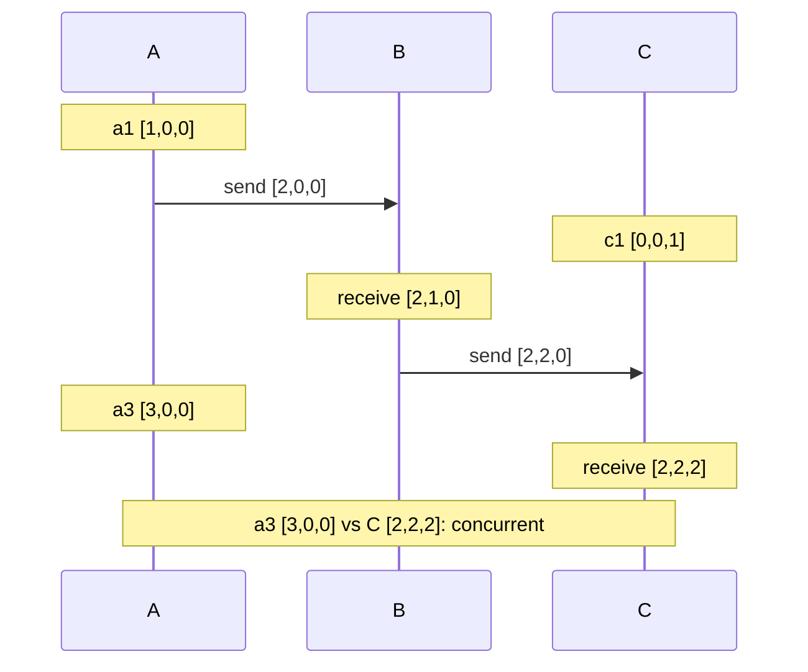

## In one minute
- A vector clock is a map from process ID to counter. Each process increments its own entry on every event and merges incoming vectors by taking the element-wise maximum.
- Comparing two vectors tells you exactly one of four things: equal, before, after, or concurrent. That makes vector clocks the standard tool for detecting conflicting updates.
- Lamport timestamps tell you only that causes have smaller numbers. Vector clocks tell you whether two events are causally related at all.
- The price is size: one entry per participant. Production systems bound it by tracking replicas instead of clients, pruning, or using dotted version vectors.

## How it works

### The rules
Every process `i` keeps a vector `V`, initially all zeros.

1. On a local event or before sending, set `V[i] += 1`.
2. Attach the full vector to each outgoing message.
3. On receiving vector `W`, set `V[k] = max(V[k], W[k])` for every k, then `V[i] += 1`.

`V[k]` on process i means "i has seen the first V[k] events of process k". The vector is a compact summary of an event's entire causal history. Fidge and Mattern each published this construction in 1988 ([Mattern](https://pages.cs.wisc.edu/~remzi/Classes/739/Fall2018/Papers/mattern89.pdf)).

### Comparing vectors
`V <= W` when every entry of V is less than or equal to the matching entry of W. `V < W` when also V is not equal to W; this means the event stamped V happened before the event stamped W. If neither `V <= W` nor `W <= V`, the events are concurrent: each has seen something the other has not. Missing entries count as zero.

Example: `{A:2, B:1}` versus `{A:2, B:3}` gives before. `{A:3, B:1}` versus `{A:2, B:2}` gives concurrent, because A is ahead in one and B in the other.

### Version vectors in data stores
In replicated databases the same structure is usually called a *version vector* and is attached to each stored value rather than to each event. A client reads a value with its vector, modifies it, and writes back with that vector as context. The replica compares: if the new write's context dominates the stored version, it replaces it. If they are concurrent, the replica keeps both as *siblings* and returns them on the next read for the application to merge. Amazon's Dynamo design used this to keep shopping carts writable during partitions, merging sibling carts by union. Conflicts were rare in practice: over 24 hours of cart traffic, 99.94% of requests saw exactly one version ([Dynamo paper](https://www.allthingsdistributed.com/files/amazon-dynamo-sosp2007.pdf)). Rare is not never, so the merge path still has to be correct.

### Keeping the size bounded
If the vector is keyed by client, and thousands of clients write a key, the vector grows without limit. Better options are to key by the replica that coordinated the write, which bounds entries to the replication factor, or to prune the oldest entries past a threshold, which risks false conflicts. *Dotted version vectors* fix a subtle problem with replica-keyed vectors, where concurrent writes through one replica were wrongly treated as ordered, without growing with client count.

## Down the stack

### Layer 1: The contract
A vector clock promises the *strong* clock condition: `V(a) < V(b)` if and only if `a -> b`. That turns comparison into a total answer: equal, before, after or concurrent, with no false negatives for concurrency. A version-vector store turns this into an API contract: a read returns one value or several siblings plus an opaque causal context, a write must send that context back, and the store guarantees it will never discard a value that the writer's context did not cover.

Riak is the clearest example. Over HTTP it returns the context in an `X-Riak-Vclock` header, answers with `300 Multiple Choices` when siblings exist (if the bucket allows them), and expects the vclock on the next write ([Riak docs](https://docs.riak.com/riak/kv/2.2.3/developing/usage/conflict-resolution/index.html)). Since Riak 2.0, `allow_mult` is on by default for new bucket types, so siblings are the normal case rather than an opt-in. It is worth knowing which stores do *not* make this promise. Cassandra timestamps every column of every mutation, from the client or the coordinator's clock, and keeps the latest per cell ([Cassandra docs](https://cassandra.apache.org/doc/latest/cassandra/architecture/dynamo.html)). DynamoDB global tables in their default eventual mode keep the write with the latest internal timestamp per item. Both are simpler and both can silently drop a concurrent write. DynamoDB now also offers a multi-Region strong consistency mode, which avoids the problem the other way: a write to an item already being modified in another Region fails with `ReplicatedWriteConflictException` and must be retried ([DynamoDB docs](https://docs.aws.amazon.com/amazondynamodb/latest/developerguide/V2globaltables_HowItWorks.html)).

### Layer 2: The mechanism
The Dynamo paper stored a clock as a list of `(node, counter)` pairs, and to bound size it kept a wall-clock timestamp per pair and truncated the oldest pair once the list passed a threshold (the paper mentions 10). Truncation can create false conflicts, which the paper accepted as rare ([Dynamo paper](https://www.allthingsdistributed.com/files/amazon-dynamo-sosp2007.pdf)).

Riak 2.0 added dotted version vectors, switched on per bucket type with `dvv_enabled`; without it, Riak falls back to plain vector clocks ([Riak docs](https://docs.riak.com/riak/kv/2.2.3/developing/usage/conflict-resolution/index.html)). Each stored sibling is tagged with a *dot*, the single `(replica, counter)` pair that identifies the write that created it, and the siblings share one causal context. When a coordinator receives a write with context `C`, it discards every sibling whose dot is covered by `C`, keeps the rest, and tags the new value with a fresh dot. This is what fixes the replica-keyed problem: two clients writing through the same replica with the same stale context get two distinct dots, so both survive as siblings instead of one overwriting the other.

Comparison and merge are linear if both vectors are kept sorted by replica ID: walk them like a merge-join, tracking whether either side was ever larger. With hash maps you take the union of keys, which is the same O(n) but with more constant overhead.

### Layer 3: The machine
Layout decides cost. A hash map per stored value carries pointers, bucket arrays and per-entry overhead, often several times the payload. A sorted array of `(uint32 replica, uint64 counter)` pairs is 12 bytes per entry and contiguous, so a 3-replica vector fits in one 64-byte cache line and compares in a few nanoseconds. On disk, encoding replica IDs as small integers and counters as varints shrinks a 3-entry vector to roughly 10 to 20 bytes, compared with the 48 bytes of the naive layout in the worked example below.

Metadata is written with every version, so it adds to write amplification in an LSM-tree store: each compaction rewrites the vector along with the value. Siblings cost more on the read path, because a read returns every sibling and the client downloads all of them. Riak exposes warning and hard limits on sibling count and object size for this reason: by default it logs a warning above 25 siblings or 5 MB and rejects writes above 100 siblings or 50 MB ([Riak config reference](https://docs.riak.com/riak/kv/2.2.3/configuring/reference/index.html)), since one key with hundreds of siblings can make every read of it slow and can stall the vnode serving it.

Concurrency detection also depends on clients behaving. A client that writes without first reading sends an empty context, which is concurrent with everything stored, so every such write adds a sibling. That is the mechanical cause of the sibling explosions Riak operators saw in practice.

### Why it's built this way
1. Without a shared clock, the only way to know whether one write saw another is to carry a summary of what each writer had seen.
2. A summary with one counter per participant is the smallest structure that can represent a partial order exactly, so size grows with participants.
3. Size is paid on every stored version and every message, so systems key by replica rather than client and pack entries tightly.
4. Replica-keyed vectors lose precision when several clients write through one replica, so dots were added to recover exact concurrency without bringing back per-client growth.

## Diagram


## Worked example
A shopping cart key is replicated on nodes X, Y and Z, with writes coordinated by whichever replica is reachable. The cart starts as `{milk}` with version `{X:1}`.

A network partition separates the user's phone and laptop onto different sides. The phone adds eggs through Y, using context `{X:1}`; Y stores `{milk, eggs}` with `{X:1, Y:1}`. The laptop adds bread through Z with the same context; Z stores `{milk, bread}` with `{X:1, Z:1}`.

After healing, a read collects both. Comparing `{X:1, Y:1}` and `{X:1, Z:1}`, neither dominates, so they are concurrent siblings. The application merges by union to `{milk, eggs, bread}` and writes back with the merged context `{X:1, Y:1, Z:1}`, which dominates both and replaces them. Last-writer-wins would have dropped one.

Size: with replica-keyed vectors and a replication factor of 3, each value carries 3 entries of an 8-byte ID plus an 8-byte counter, about 48 bytes. For 500 million keys, that is roughly 24 GB of metadata. Keyed by client with 50 writers per key on average, it would be about 400 GB.

The catch is deletion. Removing eggs by union-merge brings it back, a behaviour the Dynamo paper admits for its own cart ([Dynamo paper](https://www.allthingsdistributed.com/files/amazon-dynamo-sosp2007.pdf)). Merges that support removal need tombstones or a CRDT such as an observed-remove set.

## In the wild
- **Riak, 2013: last-write-wins throws away a partition's worth of writes.** Jepsen ran concurrent writers against Riak with `allow_mult=false`, so the store resolved conflicts by timestamp. During a partition it lost 1,815 of 1,985 acknowledged writes, and even on a healthy cluster it lost 1,434 of 2,000. With `allow_mult=true` and siblings merged by set union, no writes were lost. The lesson drawn: keep siblings and merge them with an associative, commutative, idempotent function ([Jepsen](https://aphyr.com/posts/285-call-me-maybe-riak)).
- **Cassandra, 2013: timestamps collide and cells lose writes.** Cassandra resolves every cell by timestamp, so concurrent updates to one cell lost 285 of 1,009 acknowledged writes, about 28%, even at QUORUM. A second test lost 58 of 9,899 acknowledged rows because somewhere in the client stack microsecond timestamps were really milliseconds with three zeros appended, making ties far likelier. No vector, so no way to see that the writes were concurrent ([Jepsen](https://aphyr.com/posts/294-call-me-maybe-cassandra)).

## Trade-offs
| Approach | Strengths | Weaknesses | Choose when |
|---|---|---|---|
| Vector clock per client | Precise causality | Unbounded growth | Few, long-lived writers |
| Version vector per replica | Bounded by replica count | Can misjudge concurrent writes via one replica | Leaderless key-value stores |
| Dotted version vectors | Correct and bounded | More complex to implement | Multi-writer stores needing accuracy |
| Lamport or HLC with LWW | Constant size, simple | Silently loses concurrent writes | Overwrites are acceptable |
| CRDTs | Automatic, deterministic merge | Limited data types, metadata overhead | Counters, sets, collaborative text |

## Pitfalls in production
- Applications that ignore siblings and pick the first one, reintroducing silent data loss. Fix: make sibling handling part of the client API contract and test it.
- Sibling explosion when many clients write without reading first. Fix: require a read-modify-write with context, and alarm on sibling counts above a small number.
- Pruning vector entries by age, then detecting false conflicts or, worse, missing true ones. Fix: key by replica and prefer dotted version vectors over pruning.
- Union merges resurrecting deleted items. Fix: use tombstones with garbage collection, or a CRDT with remove semantics.

## Leadership lens
- Decide whether the business can tolerate lost concurrent updates. If not, you need vector-style conflict detection or CRDTs, and someone must own the merge logic.
- Ask in review how many writers per key are expected and what the metadata budget is. Bytes per key times key count is a real storage cost.
- Many teams pick a leaderless store for availability, then turn on last-writer-wins to avoid siblings. Make that trade explicit; it gives up the reason to use version vectors.
- Merge functions are domain logic. Product and engineering should agree on them before launch, not after the first incident.

## Check yourself
1. Compare `{A:2, B:0, C:1}` with `{A:1, B:3, C:1}`. What is the relationship?
   **Answer:** Concurrent. A is larger in the first and B is larger in the second, so neither dominates.
2. Why does a receive increment the receiver's own entry after the merge?
   **Answer:** The receive is itself a new event on that process, and it must be ordered after both the receiver's previous events and the sender's send.
3. Why do stores key version vectors by replica rather than by client?
   **Answer:** The number of replicas is small and fixed, so the vector stays bounded. Client-keyed vectors grow with every distinct writer.

## Practice
**Task:** Implement `compare(a, b)` and `merge(a, b)` for vector clocks represented as dicts from process ID to counter, where a missing key means 0. `compare` returns one of "equal", "before" (a happened before b), "after", or "concurrent". `merge` returns a new dict with the element-wise maximum and must not modify its inputs. Treat entries that are 0 the same as missing ones.

```python starter
def compare(a, b):
    # TODO
    raise NotImplementedError

def merge(a, b):
    # TODO
    raise NotImplementedError
```

```python tests
def test_before_and_after():
    assert compare({"A": 2, "B": 1}, {"A": 2, "B": 3}) == "before"
    assert compare({"A": 2, "B": 3}, {"A": 2, "B": 1}) == "after"

def test_concurrent():
    assert compare({"A": 3, "B": 1}, {"A": 2, "B": 2}) == "concurrent"

def test_missing_keys_are_zero():
    assert compare({"A": 1}, {"A": 1, "B": 0}) == "equal"
    assert compare({}, {"C": 1}) == "before"

def test_disjoint_is_concurrent():
    assert compare({"X": 1}, {"Y": 1}) == "concurrent"

def test_merge_max():
    assert merge({"A": 2, "B": 1}, {"B": 4, "C": 1}) == {"A": 2, "B": 4, "C": 1}

def test_merge_does_not_mutate():
    a, b = {"A": 1}, {"A": 5}
    merge(a, b)
    assert a == {"A": 1} and b == {"A": 5}
```

```python solution
def compare(a, b):
    less = greater = False
    for k in set(a) | set(b):
        x, y = a.get(k, 0), b.get(k, 0)
        if x < y:
            less = True
        elif x > y:
            greater = True
    if less and greater:
        return "concurrent"
    if less:
        return "before"
    if greater:
        return "after"
    return "equal"

def merge(a, b):
    out = dict(a)
    for k, v in b.items():
        out[k] = max(out.get(k, 0), v)
    return out
```

```typescript starter
export type VClock = Record<string, number>;

export function compare(a: VClock, b: VClock): "equal" | "before" | "after" | "concurrent" {
  // TODO
  throw new Error("TODO");
}

export function merge(a: VClock, b: VClock): VClock {
  // TODO
  throw new Error("TODO");
}
```

```typescript tests
test("before and after", () => {
  assertEqual(compare({ A: 2, B: 1 }, { A: 2, B: 3 }), "before");
  assertEqual(compare({ A: 2, B: 3 }, { A: 2, B: 1 }), "after");
});

test("concurrent", () => {
  assertEqual(compare({ A: 3, B: 1 }, { A: 2, B: 2 }), "concurrent");
});

test("missing keys are zero", () => {
  assertEqual(compare({ A: 1 }, { A: 1, B: 0 }), "equal");
  assertEqual(compare({}, { C: 1 }), "before");
});

test("disjoint is concurrent", () => {
  assertEqual(compare({ X: 1 }, { Y: 1 }), "concurrent");
});

test("merge max", () => {
  assertEqual(merge({ A: 2, B: 1 }, { B: 4, C: 1 }), { A: 2, B: 4, C: 1 });
});

test("merge does not mutate", () => {
  const a: VClock = { A: 1 };
  const b: VClock = { A: 5 };
  merge(a, b);
  assertEqual(a, { A: 1 });
  assertEqual(b, { A: 5 });
});
```

```typescript solution
export type VClock = Record<string, number>;

export function compare(a: VClock, b: VClock): "equal" | "before" | "after" | "concurrent" {
  let less = false;
  let greater = false;
  const keys = new Set([...Object.keys(a), ...Object.keys(b)]);
  for (const k of keys) {
    const x = a[k] ?? 0;
    const y = b[k] ?? 0;
    if (x < y) less = true;
    else if (x > y) greater = true;
  }
  if (less && greater) return "concurrent";
  if (less) return "before";
  if (greater) return "after";
  return "equal";
}

export function merge(a: VClock, b: VClock): VClock {
  const out: VClock = { ...a };
  for (const k of Object.keys(b)) out[k] = Math.max(out[k] ?? 0, b[k]);
  return out;
}
```

```go starter
package practice

// Compare returns "equal", "before", "after" or "concurrent". Missing keys count as 0.
func Compare(a, b map[string]int) string {
	// TODO
	panic("TODO")
}

// Merge returns a new map holding the element-wise maximum of a and b.
func Merge(a, b map[string]int) map[string]int {
	// TODO
	panic("TODO")
}
```

```go tests
package practice

import (
	"reflect"
	"testing"
)

func TestBeforeAndAfter(t *testing.T) {
	if got := Compare(map[string]int{"A": 2, "B": 1}, map[string]int{"A": 2, "B": 3}); got != "before" {
		t.Fatalf("got %s", got)
	}
	if got := Compare(map[string]int{"A": 2, "B": 3}, map[string]int{"A": 2, "B": 1}); got != "after" {
		t.Fatalf("got %s", got)
	}
}

func TestConcurrent(t *testing.T) {
	if got := Compare(map[string]int{"A": 3, "B": 1}, map[string]int{"A": 2, "B": 2}); got != "concurrent" {
		t.Fatalf("got %s", got)
	}
}

func TestMissingKeysAreZero(t *testing.T) {
	if got := Compare(map[string]int{"A": 1}, map[string]int{"A": 1, "B": 0}); got != "equal" {
		t.Fatalf("got %s", got)
	}
	if got := Compare(map[string]int{}, map[string]int{"C": 1}); got != "before" {
		t.Fatalf("got %s", got)
	}
}

func TestDisjointIsConcurrent(t *testing.T) {
	if got := Compare(map[string]int{"X": 1}, map[string]int{"Y": 1}); got != "concurrent" {
		t.Fatalf("got %s", got)
	}
}

func TestMergeMax(t *testing.T) {
	got := Merge(map[string]int{"A": 2, "B": 1}, map[string]int{"B": 4, "C": 1})
	if !reflect.DeepEqual(got, map[string]int{"A": 2, "B": 4, "C": 1}) {
		t.Fatalf("got %v", got)
	}
}

func TestMergeDoesNotMutate(t *testing.T) {
	a, b := map[string]int{"A": 1}, map[string]int{"A": 5}
	Merge(a, b)
	if a["A"] != 1 || b["A"] != 5 || len(a) != 1 || len(b) != 1 {
		t.Fatalf("inputs changed: %v %v", a, b)
	}
}
```

```go solution
package practice

// Compare returns "equal", "before", "after" or "concurrent". Missing keys count as 0.
func Compare(a, b map[string]int) string {
	less, greater := false, false
	check := func(x, y int) {
		if x < y {
			less = true
		} else if x > y {
			greater = true
		}
	}
	for k, x := range a {
		check(x, b[k])
	}
	for k, y := range b {
		if _, seen := a[k]; !seen {
			check(0, y)
		}
	}
	switch {
	case less && greater:
		return "concurrent"
	case less:
		return "before"
	case greater:
		return "after"
	}
	return "equal"
}

// Merge returns a new map holding the element-wise maximum of a and b.
func Merge(a, b map[string]int) map[string]int {
	out := make(map[string]int, len(a)+len(b))
	for k, v := range a {
		out[k] = v
	}
	for k, v := range b {
		if cur, ok := out[k]; !ok || v > cur {
			out[k] = v
		}
	}
	return out
}
```

## Mock interview
**Prompt:** Design the conflict handling for a multi-region user-preferences store: 80 million users, writes from phones, tablets and web, and any region must accept writes during a cross-region partition.

- Follow-up: A user changes the theme on two devices during a partition. What does the next read return?
- Follow-up: How large does the per-key metadata get, and how do you bound it?
- Follow-up: When would you replace version vectors with CRDTs or with last-writer-wins?

**A strong answer covers:**
- Version vectors keyed by region or replica, with read-modify-write carrying context.
- Sibling detection on concurrent writes and an explicit per-field merge policy.
- Metadata sizing arithmetic and a bound on entries.
- Handling deletes with tombstones or remove-aware CRDTs.
- Choosing LWW only for fields where losing one concurrent update is acceptable.

## Sources and further study
**Primary**
- [Mattern, Virtual Time and Global States of Distributed Systems (1988)](https://pages.cs.wisc.edu/~remzi/Classes/739/Fall2018/Papers/mattern89.pdf): vector time and why it captures causality exactly.
- [Preguiça et al., Dotted Version Vectors (arXiv)](https://arxiv.org/abs/1011.5808): the dot construction that Riak adopted.
- [Jepsen: Call me maybe, Riak](https://aphyr.com/posts/285-call-me-maybe-riak): measured write loss with LWW versus siblings.

**Systems docs**
- [Riak KV: Conflict resolution](https://docs.riak.com/riak/kv/2.2.3/developing/usage/conflict-resolution/index.html): `allow_mult`, `dvv_enabled`, sibling explosion and the HTTP causal context.
- [Apache Cassandra: Dynamo architecture](https://cassandra.apache.org/doc/latest/cassandra/architecture/dynamo.html): why Cassandra chose per-column LWW over vector clocks.
- [DynamoDB: How global tables work](https://docs.aws.amazon.com/amazondynamodb/latest/developerguide/V2globaltables_HowItWorks.html): LWW in eventual mode and write conflicts in strong mode.

**Books**
- *Designing Data-Intensive Applications*, Martin Kleppmann, chapter 5 "Replication" (1st edition), section "Leaderless Replication": detecting concurrent writes, siblings and version vectors.
- *Database Internals*, Alex Petrov, chapter 12 "Anti-Entropy and Dissemination", section "Bitmap Version Vectors".

**Other curricula**
- [Kleppmann, Distributed Systems lecture notes (Cambridge)](https://www.cl.cam.ac.uk/teaching/2122/ConcDisSys/dist-sys-notes.pdf): section 4.1 builds vector clocks from happens-before and 4.2 uses them for causal broadcast.
- [donnemartin/system-design-primer](https://github.com/donnemartin/system-design-primer): mentions eventual consistency and multi-master conflicts but never shows how conflicts are detected, which is the gap vector clocks fill.

## Watch
- [Distributed Systems 4.1: Logical time (Martin Kleppmann)](https://www.youtube.com/watch?v=x-D8iFU1d-o): vector clocks derived and compared with Lamport clocks.
- [CSE138 L4: vector clocks, FIFO/causal/totally-ordered delivery (Lindsey Kuper)](https://www.youtube.com/watch?v=5BHizc7BPyE): vector clocks applied to causal message delivery.

## Free resources
- [Dynamo: Amazon's Highly Available Key-value Store](https://www.allthingsdistributed.com/files/amazon-dynamo-sosp2007.pdf): version vectors and sibling merging in a production design.
- [Version vectors are not vector clocks (HASLab)](https://haslab.wordpress.com/2011/07/08/version-vectors-are-not-vector-clocks/): the difference between the two and why it matters.
- [Vector Clocks Revisited (Riak)](https://riak.com/posts/technical/vector-clocks-revisited/index.html): sibling explosion and the move to dotted version vectors.
- [Version Vector (Patterns of Distributed Systems)](https://martinfowler.com/articles/patterns-of-distributed-systems/version-vector.html): a pattern write-up with code.
- [Vector clock (Wikipedia)](https://en.wikipedia.org/wiki/Vector_clock): formal definition and history.
