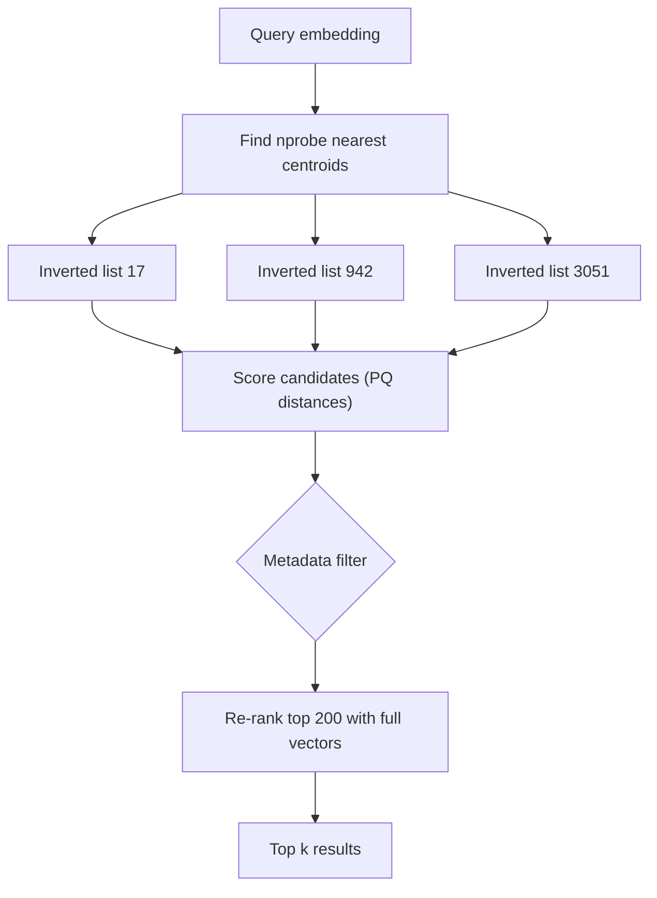

## In one minute
- A vector database stores embeddings (arrays of a few hundred to a few thousand floats) and answers "which stored vectors are closest to this one" by cosine, dot product, or Euclidean distance.
- Exact search compares the query with every vector, which is too slow at tens of millions of vectors, so systems use *approximate nearest neighbour* (ANN) indexes and trade a little recall for orders of magnitude in speed.
- The main index families are graph-based (HNSW), cluster-based (IVF), and compressed (product quantization), often combined. Each has a different memory, build-time, and update profile.
- Metadata filters ("only this tenant's documents"), hybrid keyword plus vector ranking, and freshness under updates are where most production difficulty lies.
- Options range from extensions (pgvector, OpenSearch k-NN) to libraries (FAISS) to dedicated services (Milvus, Qdrant, Weaviate, Pinecone).

## How it works

### Embeddings and distance
A model maps text, images, or users into a vector space where similar items land near each other. A 768-dimension float32 vector is 3 KB. For normalized vectors, cosine similarity equals dot product, and ranking by either is equivalent to ranking by Euclidean distance. The database does not understand meaning; quality depends entirely on the embedding model, and changing the model means re-embedding everything.

### Why exact search does not scale
Brute force over 10 million 768-dimension vectors is 7.7 billion multiply-adds per query, around 30 GB of memory traffic. Even with SIMD that is tens of milliseconds per query on one core, and it grows linearly. Classic spatial trees (k-d trees) do not help above roughly 20 dimensions because almost every branch must be visited.

### IVF: cluster then probe
Run k-means to pick, say, 4,096 centroids. Each vector is stored in the list of its nearest centroid. A query finds the `nprobe` nearest centroids and scans only those lists. With `nprobe = 32`, the query scans under 1% of the data. Recall falls when a true neighbour sits just across a cluster boundary, so `nprobe` is the recall versus latency dial. FAISS's guidance grows the list count with the data: 4√N to 16√N lists below a million vectors, 65,536 for 1 to 10 million and 262,144 for 10 to 100 million, each trained on 30 to 256 sample vectors per list, so 4,096 lists suit only a small collection ([FAISS wiki](https://github.com/facebookresearch/faiss/wiki/Guidelines-to-choose-an-index)). IVF builds fast and handles appends well, but centroids drift as the data distribution changes.

### HNSW: navigable graphs
Hierarchical Navigable Small World builds a multi-layer proximity graph ([Malkov and Yashunin](https://arxiv.org/abs/1603.09320)). Each vector connects to about `M` (often 16 to 32) near neighbours. Upper layers are sparse and allow long jumps; the bottom layer contains everything. A search starts at the top, greedily moves toward the query, drops a layer, and repeats, keeping a candidate list of size `ef_search`. HNSW gives excellent recall at low latency, but the graph links cost memory (roughly `M × 2 × 4` bytes per vector per layer), builds are slow, and deletes are awkward, usually handled with tombstones and periodic rebuilds.

### Product quantization: compress the vectors
PQ splits each vector into, for example, 96 subvectors of 8 dimensions and replaces each with the id of the nearest of 256 sub-centroids: 96 bytes instead of 3 KB, a 32x reduction. Distances are approximated with lookup tables ([Jégou et al., TPAMI 2011](https://inria.hal.science/inria-00514462v2/document)). IVF-PQ lets a billion vectors fit in RAM on one large machine; a re-ranking step with full vectors on the top few hundred candidates restores precision.

### Filtering and hybrid search
"Nearest vectors where `tenant_id = 7` and `lang = 'de'`" is hard. Post-filtering ANN results can return nothing if the filter is selective. pgvector applies `WHERE` after the index scan, so with the default `ef_search` of 40 a filter matching 10% of rows returns only about 4 rows. Since version 0.8.0 it can keep scanning (`hnsw.iterative_scan`) until enough rows pass or 20,000 tuples have been visited ([pgvector](https://github.com/pgvector/pgvector)). Pre-filtering to a candidate set and then brute forcing works for small sets. Modern engines integrate filters into graph traversal: Qdrant adds extra graph edges per indexed payload value and switches to a plain scan when its planner estimates few matches ([Qdrant docs](https://qdrant.tech/documentation/concepts/indexing/)), and ACORN traverses a predicate subgraph, reporting 2 to 1,000 times the throughput of earlier filtered methods at the same recall ([Patel et al., 2024](https://arxiv.org/abs/2403.04871)). Partitioning by tenant avoids the problem for the commonest filter. Hybrid search runs keyword (BM25) and vector retrieval in parallel and merges, often with reciprocal rank fusion.

## Down the stack

### Layer 1: The contract
A vector index promises approximate top-*k* nearest neighbours under a chosen metric (L2, inner product, or cosine), not exact results. The quality guarantee is statistical: recall@*k* measured on a sample of queries against brute-force ground truth, usually targeted at 0.9 to 0.99. Recall depends on tuning parameters (`ef_search`, `nprobe`), on the data distribution, and on filters, and it can drift as data is inserted and deleted. Results can shift after unrelated updates, and a restrictive filter can silently return fewer than *k* results.

### Layer 2: The mechanism
In HNSW (hnswlib, FAISS `IndexHNSWFlat`, pgvector), each inserted vector draws a top layer from an exponential distribution, so each layer holds roughly 1/M as many nodes as the one below. Insertion searches greedily down from the entry point, then on each layer at or below its top runs a beam search of width `ef_construction` and keeps up to `M` neighbours (2M on the bottom layer), chosen by a heuristic that prefers neighbours in different directions over a cluster of near-duplicates. pgvector stores the graph in ordinary 8 KB Postgres pages as element tuples (the vector plus metadata) and neighbour tuples, with defaults of `m = 16`, `ef_construction = 64`, and `hnsw.ef_search = 40`. Its IVFFlat index uses `lists` centroids and searches `ivfflat.probes` of them, 1 by default, which is why untuned IVFFlat recall is often poor. Its indexes take `vector` columns of up to 2,000 dimensions; larger embeddings need `halfvec` (16-bit floats, up to 4,000) or binary quantization ([pgvector](https://github.com/pgvector/pgvector)).

FAISS's `IndexIVFPQ` stores, in each inverted list, the PQ code of each vector's *residual* (the vector minus its centroid), which quantises far more accurately than coding raw vectors. At query time it builds a lookup table per probed list: for each of the *m* subspaces, the distance from the query's subvector to all 256 sub-centroids. The distance to a database vector is then *m* table lookups and additions, called asymmetric distance computation because the query stays exact while the database side is compressed.

### Layer 3: The machine
A 768-dimension float32 vector is 3,072 bytes, which is 48 cache lines. An AVX2 fused multiply-add handles 8 floats per instruction and AVX-512 handles 16, so the arithmetic is cheap; the real cost is pulling 3 KB from memory. HNSW visits a few hundred to a few thousand vectors per query, and each is a random access, so search is memory-latency bound and implementations prefetch the next neighbours while computing the current distance. The bottom-layer links add about `2M × 4` bytes per vector, 128 bytes at `M = 16`.

PQ changes the bottleneck. A 96-byte code fits in two cache lines, and FAISS's fast-scan variants use 4-bit codes so that a whole lookup table fits in SIMD registers and a single shuffle instruction (`pshufb` and its AVX2 form) performs 16 or 32 table lookups at once. When an index outgrows RAM, every HNSW hop becomes a random disk read. Disk-oriented designs such as DiskANN keep compressed codes in memory and lay out each node's full vector with its neighbour list in one 4 KiB sector, so each hop costs exactly one SSD read. The DiskANN paper served a billion-point dataset from one 64 GB workstation at over 5,000 queries per second, under 3 ms mean latency and above 95% recall@1 ([Subramanya et al., NeurIPS 2019](https://papers.nips.cc/paper/2019/hash/09853c7fb1d3f8ee67a61b6bf4a7f8e6-Abstract.html)). pgvector without enough memory degrades the same way, one random 8 KB page read per visited element.

### Why it's built this way
1. Exact search scans every vector and high dimensions defeat spatial trees, so indexes give up exactness for speed.
2. Search cost is dominated by memory traffic per vector, so graphs minimise how many vectors are touched and PQ shrinks each one.
3. Compression loses precision, so systems re-rank a short candidate list with full vectors.
4. Random hops are cheap in RAM and expensive on disk, so disk-based indexes pack each hop into one sector-sized read.
5. Quality is statistical, so recall must be measured continuously, not assumed.

## Diagram


## Worked example
A support-search product embeds 40 million help-centre chunks with a 1,024-dimension model. Raw float32 vectors are 4 KB each: 160 GB.

**HNSW, full precision**: 160 GB of vectors plus about 10 GB of graph links with `M = 32`. That needs several memory-optimized nodes per replica, and recall@10 of 0.98 at around 5 ms. Building the index takes hours, and with two replicas the RAM bill is the dominant cost.

**IVF-PQ with re-ranking**: 65,536 lists and 128-byte PQ codes give 5 GB of codes in RAM. Full vectors move to SSD for re-ranking the top 100 candidates per query, which costs 100 random 4 KB reads, about 1 ms on NVMe. Recall@10 lands around 0.95 at 8 ms, on one modest node per replica.

The team measures recall against exact search on a 10,000-query sample and finds that answer quality in the product does not change between 0.95 and 0.98. They pick IVF-PQ and spend the savings on a better embedding model, which moved quality far more than index tuning did.

## In the wild
- **Instacart, 2025: moving vector retrieval into Postgres to get filters right.** Instacart had run semantic search as a separate FAISS service with an HNSW index per retailer, hundreds in all. FAISS could not filter on document attributes during retrieval, so the service over-fetched and filtered afterwards, and keeping two systems in sync caused inconsistencies. Moving to pgvector next to the existing Postgres full-text search, with indexes grouped by retailer characteristics instead of one per retailer, cut zero-result searches by 6% in an A/B test ([Instacart](https://company.instacart.com/tech-innovation/how-instacart-built-a-modern-search-infrastructure-on-postgres)).
- **Spotify, 2023: replacing Annoy with an HNSW library.** Spotify had used Annoy, its own open-source nearest-neighbour library, in production, but it had fallen to the middle of public benchmarks. Its replacement, Voyager, is built on hnswlib and reports more than 10 times the speed at the same recall, up to 50% more accuracy at the same speed, and up to 4 times less memory by storing vectors as 8-bit floats (E4M3) ([Spotify](https://engineering.atspotify.com/2023/10/introducing-voyager-spotifys-new-nearest-neighbor-search-library)).

## Trade-offs
| Option | Strengths | Weaknesses | Choose when |
|---|---|---|---|
| Brute force (flat) | Exact, simple, easy updates | Linear cost per query | Under about 1 million vectors, or after a selective filter |
| HNSW | High recall, low latency | High memory, slow builds, awkward deletes | Latency-critical, data fits in RAM |
| IVF (flat or PQ) | Fast build, tunable, compact with PQ | Lower recall at the same latency, centroid drift | Very large collections, cost-sensitive |
| DiskANN-style SSD graph | Billions of vectors with little RAM | SSD latency, more complex | Huge corpora, moderate QPS |
| pgvector in an existing database | Transactions, joins, one system | Lower ceiling at scale | Small to medium corpora, strong filtering needs |

## Pitfalls in production
- **No recall measurement.** Teams tune for latency and silently lose relevance. Keep a labelled or exact-search baseline and track recall@k per release.
- **Mixing embedding models.** Vectors from different models or versions are not comparable. Version the model in metadata and re-embed in a new index, then switch with an alias.
- **Selective filters returning empty results.** Post-filtering top 100 for a tenant with 0.1% of data returns nothing. Use filter-aware search or per-tenant partitions.
- **Deletes and updates degrading HNSW.** Tombstones accumulate and the graph gets worse. Schedule rebuilds or compaction.
- **Unnormalized vectors with cosine.** Mixing normalized and raw vectors gives inconsistent rankings. Normalize at write time.

## Leadership lens
- Ask whether a dedicated vector database is needed at all; under a few million vectors, an extension in your existing database is often enough.
- Demand an evaluation harness before tuning: recall@k against exact search and an end-to-end quality metric.
- Plan re-embedding as a routine migration, with cost and time estimated per model change.
- Size by memory per vector (raw, compressed, graph links) times replicas; that drives the bill.

## Check yourself
1. Why does raising `nprobe` in IVF improve recall and cost latency?
   **Answer:** More clusters are scanned, so true neighbours just across a cluster boundary are found, but the query compares against more vectors.
2. Why can post-filtering ANN results return too few hits?
   **Answer:** The ANN step returns the top candidates regardless of the filter, and a selective filter may remove almost all of them.
3. What does product quantization trade for its 30x memory saving?
   **Answer:** Distance precision, because vectors are approximated by sub-centroid codes; re-ranking with full vectors recovers most of it.
4. Why is changing the embedding model a migration, not a config change?
   **Answer:** Vectors from different models live in different spaces, so every stored vector must be re-embedded and the index rebuilt.

## Practice
**Task:** Implement exact and IVF-style approximate nearest neighbour search with squared Euclidean distance. `exact_knn(vectors, query, k)` takes a dict of id to vector and returns the `k` closest ids, ordered by distance then id. `IVF(centroids)` assigns each added vector to its nearest centroid list; `search(query, k, nprobe)` scans only the `nprobe` lists whose centroids are closest to the query and returns ids ordered the same way. `recall(approx, exact)` returns the fraction of exact ids present in `approx`, or 1.0 if `exact` is empty.

```python starter
def exact_knn(vectors, query, k):
    raise NotImplementedError

class IVF:
    def __init__(self, centroids):
        self.centroids = centroids

    def add(self, vid, vec):
        raise NotImplementedError

    def search(self, query, k, nprobe):
        raise NotImplementedError

def recall(approx, exact):
    raise NotImplementedError
```

```python tests
VECS = {1: [0, 0], 2: [1, 0], 3: [0, 1], 4: [10, 10], 5: [11, 10], 6: [10, 11], 7: [5, 5]}

def build():
    ivf = IVF([[0, 0], [10, 10]])
    for vid, v in VECS.items():
        ivf.add(vid, v)
    return ivf

def test_exact_knn_orders_by_distance_then_id():
    assert exact_knn(VECS, [0, 0], 3) == [1, 2, 3]
    assert exact_knn(VECS, [10, 10], 1) == [4]

def test_ivf_single_probe_finds_local_neighbours():
    assert build().search([1, 1], 3, 1) == [2, 3, 1]

def test_ivf_misses_across_boundary_with_one_probe():
    ivf = build()
    got = ivf.search([6, 6], 2, 1)
    want = exact_knn(VECS, [6, 6], 2)
    assert want == [7, 4]
    assert recall(got, want) < 1.0

def test_more_probes_restore_recall():
    ivf = build()
    want = exact_knn(VECS, [6, 6], 2)
    assert ivf.search([6, 6], 2, 2) == want

def test_recall_edge_cases():
    assert recall([1, 2], []) == 1.0
    assert recall([1, 2, 3], [3, 4]) == 0.5
    assert exact_knn({}, [0, 0], 3) == []
```

```python solution
def _dist(a, b):
    return sum((x - y) ** 2 for x, y in zip(a, b))

def exact_knn(vectors, query, k):
    return sorted(vectors, key=lambda i: (_dist(vectors[i], query), i))[:k]

class IVF:
    def __init__(self, centroids):
        self.centroids = centroids
        self.lists = [dict() for _ in centroids]

    def _nearest(self, vec, n):
        order = sorted(range(len(self.centroids)), key=lambda c: (_dist(self.centroids[c], vec), c))
        return order[:n]

    def add(self, vid, vec):
        self.lists[self._nearest(vec, 1)[0]][vid] = vec

    def search(self, query, k, nprobe):
        cand = {}
        for c in self._nearest(query, nprobe):
            cand.update(self.lists[c])
        return exact_knn(cand, query, k)

def recall(approx, exact):
    if not exact:
        return 1.0
    return len(set(approx) & set(exact)) / len(exact)
```

```typescript starter
export function exactKnn(vectors: Map<number, number[]>, query: number[], k: number): number[] {
  throw new Error("TODO");
}

export class IVF {
  constructor(public centroids: number[][]) {}
  add(id: number, vec: number[]): void { throw new Error("TODO"); }
  search(query: number[], k: number, nprobe: number): number[] { throw new Error("TODO"); }
}

export function recall(approx: number[], exact: number[]): number { throw new Error("TODO"); }
```

```typescript tests
const VECS = new Map<number, number[]>([
  [1, [0, 0]], [2, [1, 0]], [3, [0, 1]], [4, [10, 10]], [5, [11, 10]], [6, [10, 11]], [7, [5, 5]],
]);
function build(): IVF {
  const ivf = new IVF([[0, 0], [10, 10]]);
  VECS.forEach((v, id) => ivf.add(id, v));
  return ivf;
}
test("exact knn orders by distance then id", () => {
  assertEqual(exactKnn(VECS, [0, 0], 3), [1, 2, 3]);
  assertEqual(exactKnn(VECS, [10, 10], 1), [4]);
});
test("ivf single probe finds local neighbours", () => {
  assertEqual(build().search([1, 1], 3, 1), [2, 3, 1]);
});
test("ivf misses across boundary with one probe", () => {
  const want = exactKnn(VECS, [6, 6], 2);
  assertEqual(want, [7, 4]);
  assert(recall(build().search([6, 6], 2, 1), want) < 1, "one probe should miss");
});
test("more probes restore recall", () => {
  assertEqual(build().search([6, 6], 2, 2), exactKnn(VECS, [6, 6], 2));
});
test("recall edge cases", () => {
  assertEqual(recall([1, 2], []), 1);
  assertEqual(recall([1, 2, 3], [3, 4]), 0.5);
  assertEqual(exactKnn(new Map(), [0, 0], 3), []);
});
```

```typescript solution
function dist(a: number[], b: number[]): number {
  let s = 0;
  for (let i = 0; i < a.length; i++) s += (a[i] - b[i]) ** 2;
  return s;
}

export function exactKnn(vectors: Map<number, number[]>, query: number[], k: number): number[] {
  const ids = [...vectors.keys()];
  ids.sort((a, b) => dist(vectors.get(a)!, query) - dist(vectors.get(b)!, query) || a - b);
  return ids.slice(0, k);
}

export class IVF {
  private lists: Map<number, number[]>[];
  constructor(public centroids: number[][]) {
    this.lists = centroids.map(() => new Map<number, number[]>());
  }
  private nearest(vec: number[], n: number): number[] {
    const order = this.centroids.map((_, i) => i);
    order.sort((a, b) => dist(this.centroids[a], vec) - dist(this.centroids[b], vec) || a - b);
    return order.slice(0, n);
  }
  add(id: number, vec: number[]): void {
    this.lists[this.nearest(vec, 1)[0]].set(id, vec);
  }
  search(query: number[], k: number, nprobe: number): number[] {
    const cand = new Map<number, number[]>();
    for (const c of this.nearest(query, nprobe)) this.lists[c].forEach((v, id) => cand.set(id, v));
    return exactKnn(cand, query, k);
  }
}

export function recall(approx: number[], exact: number[]): number {
  if (exact.length === 0) return 1;
  const s = new Set(approx);
  return exact.filter((id) => s.has(id)).length / exact.length;
}
```

```go starter
package practice

func ExactKNN(vectors map[int][]float64, query []float64, k int) []int { panic("TODO") }

type IVF struct {
	Centroids [][]float64
}

func NewIVF(centroids [][]float64) *IVF { return &IVF{Centroids: centroids} }

func (ivf *IVF) Add(id int, vec []float64)                       { panic("TODO") }
func (ivf *IVF) Search(query []float64, k, nprobe int) []int     { panic("TODO") }

func Recall(approx, exact []int) float64 { panic("TODO") }
```

```go tests
package practice

import (
	"reflect"
	"testing"
)

var vecs = map[int][]float64{1: {0, 0}, 2: {1, 0}, 3: {0, 1}, 4: {10, 10}, 5: {11, 10}, 6: {10, 11}, 7: {5, 5}}

func build() *IVF {
	ivf := NewIVF([][]float64{{0, 0}, {10, 10}})
	for id, v := range vecs {
		ivf.Add(id, v)
	}
	return ivf
}

func TestExactKNNOrdersByDistanceThenID(t *testing.T) {
	if got := ExactKNN(vecs, []float64{0, 0}, 3); !reflect.DeepEqual(got, []int{1, 2, 3}) {
		t.Fatalf("got %v", got)
	}
}

func TestIVFSingleProbeFindsLocalNeighbours(t *testing.T) {
	if got := build().Search([]float64{1, 1}, 3, 1); !reflect.DeepEqual(got, []int{2, 3, 1}) {
		t.Fatalf("got %v", got)
	}
}

func TestIVFMissesAcrossBoundaryWithOneProbe(t *testing.T) {
	want := ExactKNN(vecs, []float64{6, 6}, 2)
	if !reflect.DeepEqual(want, []int{7, 4}) {
		t.Fatalf("exact %v", want)
	}
	if r := Recall(build().Search([]float64{6, 6}, 2, 1), want); r >= 1 {
		t.Fatalf("recall %v, expected a miss", r)
	}
}

func TestMoreProbesRestoreRecall(t *testing.T) {
	want := ExactKNN(vecs, []float64{6, 6}, 2)
	if got := build().Search([]float64{6, 6}, 2, 2); !reflect.DeepEqual(got, want) {
		t.Fatalf("got %v", got)
	}
}

func TestRecallEdgeCases(t *testing.T) {
	if Recall([]int{1, 2}, nil) != 1 || Recall([]int{1, 2, 3}, []int{3, 4}) != 0.5 {
		t.Fatal("recall")
	}
	if len(ExactKNN(map[int][]float64{}, []float64{0, 0}, 3)) != 0 {
		t.Fatal("empty")
	}
}
```

```go solution
package practice

import "sort"

func dist(a, b []float64) float64 {
	s := 0.0
	for i := range a {
		d := a[i] - b[i]
		s += d * d
	}
	return s
}

func ExactKNN(vectors map[int][]float64, query []float64, k int) []int {
	ids := make([]int, 0, len(vectors))
	for id := range vectors {
		ids = append(ids, id)
	}
	sort.Slice(ids, func(i, j int) bool {
		di, dj := dist(vectors[ids[i]], query), dist(vectors[ids[j]], query)
		if di != dj {
			return di < dj
		}
		return ids[i] < ids[j]
	})
	if len(ids) > k {
		ids = ids[:k]
	}
	return ids
}

type IVF struct {
	Centroids [][]float64
	lists     []map[int][]float64
}

func NewIVF(centroids [][]float64) *IVF {
	ivf := &IVF{Centroids: centroids}
	for range centroids {
		ivf.lists = append(ivf.lists, map[int][]float64{})
	}
	return ivf
}

func (ivf *IVF) nearest(vec []float64, n int) []int {
	cs := map[int][]float64{}
	for i, c := range ivf.Centroids {
		cs[i] = c
	}
	return ExactKNN(cs, vec, n)
}

func (ivf *IVF) Add(id int, vec []float64) {
	ivf.lists[ivf.nearest(vec, 1)[0]][id] = vec
}

func (ivf *IVF) Search(query []float64, k, nprobe int) []int {
	cand := map[int][]float64{}
	for _, c := range ivf.nearest(query, nprobe) {
		for id, v := range ivf.lists[c] {
			cand[id] = v
		}
	}
	return ExactKNN(cand, query, k)
}

func Recall(approx, exact []int) float64 {
	if len(exact) == 0 {
		return 1
	}
	in := map[int]bool{}
	for _, id := range approx {
		in[id] = true
	}
	hits := 0
	for _, id := range exact {
		if in[id] {
			hits++
		}
	}
	return float64(hits) / float64(len(exact))
}
```

## Mock interview
**Prompt:** Design retrieval for a RAG assistant over 200 million document chunks from 5,000 enterprise tenants. Each query must only see its own tenant's data, and p95 retrieval latency must stay under 100 ms.

- Follow-up: How do you enforce tenant isolation without destroying recall?
- Follow-up: A tenant deletes a document. How quickly must it disappear, and how do you make that happen?
- Follow-up: How would you migrate to a new embedding model with no downtime?

**A strong answer covers:**
- Index choice from memory math: raw size, PQ codes, graph overhead, and replicas.
- Per-tenant partitioning or filter-aware ANN, with small tenants on brute force.
- Hybrid retrieval (BM25 plus vectors) and re-ranking of a small candidate set.
- Delete handling via tombstones checked at query time, plus periodic rebuilds.
- Recall measurement against exact search and versioned indexes for model migrations.

## Sources and further study
**Primary**
- [Jégou, Douze and Schmid, Product Quantization for Nearest Neighbor Search (TPAMI 2011)](https://inria.hal.science/inria-00514462v2/document): sub-vector codebooks, asymmetric distance and IVFADC.
- [Subramanya et al., DiskANN (NeurIPS 2019)](https://papers.nips.cc/paper/2019/hash/09853c7fb1d3f8ee67a61b6bf4a7f8e6-Abstract.html): a graph index laid out for SSDs that searches a billion points on one machine.
- [Patel et al., ACORN (2024)](https://arxiv.org/abs/2403.04871): filtered vector search that works for arbitrary predicates.
- [Cormack, Clarke and Büttcher, Reciprocal Rank Fusion (SIGIR 2009)](http://cormack.uwaterloo.ca/cormack/cormacksigir09-rrf.pdf): the merge rule most hybrid search uses.

**Systems docs**
- [pgvector](https://github.com/pgvector/pgvector): index options, defaults, iterative scans for filtered queries and the dimension limits.
- [Qdrant: indexing](https://qdrant.tech/documentation/concepts/indexing/): payload indexes, filterable HNSW and the full-scan threshold.
- [FAISS: guidelines to choose an index](https://github.com/facebookresearch/faiss/wiki/Guidelines-to-choose-an-index): picking Flat, HNSW, IVF and PQ by dataset size and memory budget.

**Books**
- *AI Engineering*, Chip Huyen, chapter 6 "RAG and Agents" (section "RAG"): retrieval as one stage of an application, including embedding-based and term-based retrievers.
- *Designing Data-Intensive Applications* (2nd ed.), Martin Kleppmann and Chris Riccomini, chapter 4 "Storage and Retrieval" (section "Multidimensional and Full-Text Indexes"): indexes beyond B-trees and LSM trees.

**Other curricula**
- [Azure Architecture Center: choose a vector search service](https://learn.microsoft.com/en-us/azure/architecture/guide/technology-choices/vector-search): starts from whether vectors change often and need near-real-time search, favours an existing database when it can do the job, and treats filtering and embedding refresh as design questions.

## Watch
- [Vector Database Search: HNSW Algorithm Explained (Redis)](https://www.youtube.com/watch?v=cZyTZ-EMskI): layer construction and greedy search in HNSW.
- [Qdrant: Open Source Vector Search Engine (CMU Database Group)](https://www.youtube.com/watch?v=bU38Ovdh3NY): a database-systems view of a production vector engine.

## Free resources
- [HNSW paper (Malkov and Yashunin)](https://arxiv.org/abs/1603.09320): the original description of hierarchical navigable small world graphs.
- [Billion-scale similarity search with GPUs (FAISS)](https://arxiv.org/abs/1702.08734): IVF and product quantization at very large scale.
- [FAISS documentation](https://faiss.ai/): the reference library for ANN index types and their trade-offs.
- [ANN Benchmarks](https://ann-benchmarks.com/): recall versus throughput curves for many algorithms on public datasets.
- [Pinecone: HNSW explained](https://www.pinecone.io/learn/series/faiss/hnsw/): a clear walkthrough with parameter guidance.
