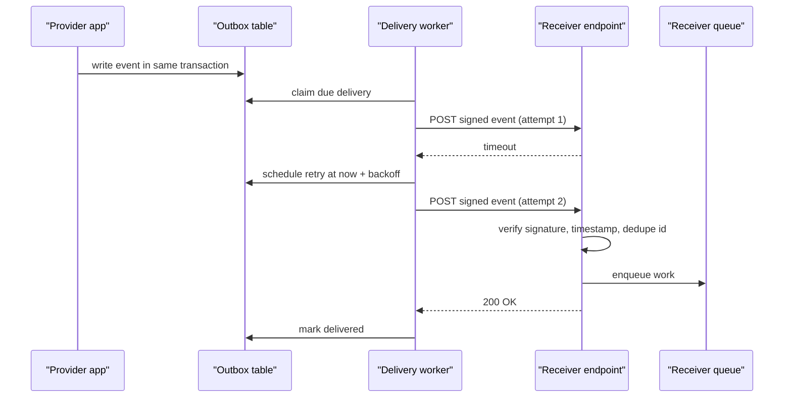

## In one minute
- A webhook is an HTTP POST that one system sends to a URL another system registered, to say "this happened". It turns polling into push between servers that do not trust each other.
- Delivery is at-least-once: the sender retries with backoff until it gets a 2xx, so receivers see duplicates and out-of-order events and must handle both.
- Trust is established per request: the sender signs the raw body and a timestamp with a shared secret, and the receiver verifies the signature and rejects stale timestamps to stop replays.
- A good receiver acknowledges in milliseconds and does the work later from a queue; a good sender isolates slow endpoints, caps retries, and dead-letters what it cannot deliver.
- Webhooks are a public API. Their payload, retry policy, signature scheme and failure behaviour are contracts that are very hard to change once customers depend on them.

## How it works

### The basic exchange
A customer registers `https://shop.example.com/hooks/payments` with a payment provider and receives a signing secret. When a charge succeeds, the provider sends:

```
POST /hooks/payments HTTP/1.1
Content-Type: application/json
webhook-id: evt_01J9ZQ4K7M
webhook-timestamp: 1760601600
webhook-signature: v1,K5oZfzN95Z9UVu1EsfQmfVNQhnkZ2pj9o9NDN/H/pI4=

{"type":"charge.succeeded","data":{"charge_id":"ch_88","amount":4200}}
```

The receiver checks the signature, records the event id, enqueues the work and returns `200` within a second or two. Anything other than a 2xx, or no answer before the sender's timeout, counts as a failure, and the sender will try again later. Timeouts are short: GitHub drops the connection after 10 seconds ([GitHub docs](https://docs.github.com/en/webhooks/using-webhooks/best-practices-for-using-webhooks)), and the Standard Webhooks spec suggests 15 to 30 ([spec](https://github.com/standard-webhooks/standard-webhooks/blob/main/spec/standard-webhooks.md)). A redirect is a failure too: senders do not follow a `302` to a new URL, so a moved endpoint must be re-registered ([Stripe docs](https://docs.stripe.com/webhooks)).

The header names above follow the Standard Webhooks convention. Providers differ in details (Stripe packs `t=` and `v1=` into one `Stripe-Signature` header and tells receivers to ignore every scheme except `v1` to block downgrade attacks; GitHub sends `X-Hub-Signature-256` over the body alone) but the ideas are the same. The spec also asks payloads to stay small, usually under 20 KB, with large data linked rather than embedded.

### Retries, and what they imply
Senders retry on a schedule that grows: seconds, then minutes, then hours. Stripe keeps trying for up to three days in live mode but only three times over a few hours in a sandbox ([Stripe docs](https://docs.stripe.com/webhooks)). Not every sender retries at all. GitHub does not redeliver failed deliveries automatically; the receiver has to list failures through the API and ask for redelivery ([GitHub docs](https://docs.github.com/en/webhooks/using-webhooks/handling-failed-webhook-deliveries)). Read each provider's policy before assuming one. Where retries exist, delivery is at-least-once, which brings two problem shapes with it.

Duplicates: a receiver that processed an event but timed out before replying will get it again. The fix is a unique constraint on the event id in the same transaction as the side effect, so the second delivery is a no-op. Dedupe on the id, never on the signature: Stripe signs each retry afresh with a new timestamp. Stripe also warns that it occasionally emits two separate events for one change, so for money movements key the check on the object id plus the event type as well.

Ordering: retries reorder events. `subscription.canceled` can arrive before the `subscription.updated` that preceded it. Receivers either compare a version or timestamp in the payload and ignore older ones, or treat the webhook as a hint and fetch the current state from the provider's API. The second style, often called a thin event, is more robust and is why many providers send only ids. Stripe's newer event destinations now recommend thin payloads for new integrations ([Stripe docs](https://docs.stripe.com/webhooks)), and the Standard Webhooks spec points out a one-way door: a thin payload can later grow into a full one without breaking anyone, but a full one can never shrink.

Email has worked this way for forty years. An SMTP server that cannot reach the destination queues the message and retries for days, then bounces it; the SMTP standard suggests waiting at least 30 minutes between tries and giving up after four to five days ([RFC 5321](https://www.rfc-editor.org/rfc/rfc5321#section-4.5.4.1)). Webhook delivery systems rediscover the same design: a durable queue, backoff, a give-up point and a report to the sender.

### The sender's side
A provider sending millions of webhooks a day is a fan-out and partial-failure system. Events are written to an outbox in the same transaction as the business change, so an event is never lost or invented. Delivery workers read the outbox, sign, POST, and record each attempt. Each endpoint gets its own queue or concurrency limit, so one customer whose server takes 30 seconds to respond does not delay everyone else's deliveries. Endpoints that fail for days are disabled with a notice (and at once if they answer `410 Gone`, per the Standard Webhooks spec), and every attempt is visible in a dashboard with a "redeliver" button, because customers will ask.

## Down the stack

### Layer 1: The contract
The sender promises: every event will be attempted until it is acknowledged with a 2xx or the retry budget runs out; each request carries a unique event id, a timestamp and a signature over both plus the raw body; and events are not guaranteed to arrive in order or only once. The receiver promises to answer quickly and to treat duplicates as no-ops.

The security contract is precise: a request is authentic if the HMAC-SHA256 of `id.timestamp.body` under the shared secret matches one of the signatures in the header, compared in constant time, and the timestamp is within a tolerance of the receiver's clock. Stripe's libraries default to five minutes, and a tolerance of 0 there switches the check off rather than making it strict ([Stripe docs](https://docs.stripe.com/webhooks)). The tolerance bounds how long a captured request can be replayed; the id lets the receiver reject replays inside that window.

### Layer 2: The mechanism
On the sender, a delivery is a small state machine: pending, in flight, delivered, or retry scheduled at a time, ending in delivered or dead. A scheduler keeps a priority queue (often a database index on `next_attempt_at`, or a Redis sorted set) and hands due deliveries to workers. After a failure, the next attempt time is `now + backoff(attempt)`, where backoff doubles from a base up to a cap and adds jitter so that a receiver recovering from an outage is not hit by every queued retry in the same second ([AWS Builders' Library](https://aws.amazon.com/builders-library/timeouts-retries-and-backoff-with-jitter/)).

Signing uses HMAC because both sides already share a secret and HMAC is cheap. Some providers (and the Standard Webhooks spec, under the `v1a` prefix) also allow asymmetric signatures with Ed25519, so receivers hold only a public key. Secret rotation works by sending several space-separated signatures during the overlap: `v1,OLD_SIG v1,NEW_SIG`. Receivers accept a match against any of them. Stripe, for example, keeps the old secret signing for up to 24 hours after a roll.

On the receiver, the critical detail is signing the raw bytes. A framework that parses JSON and re-serializes it changes whitespace or key order, and the signature no longer matches. Verification must run on the body exactly as it came off the socket, before any parsing.

### Layer 3: The machine
Each delivery to a new host costs a DNS lookup, a TCP handshake (one round trip), and a TLS 1.3 handshake (one more), so 2 to 3 round trips before the first byte of the POST. Across the internet that is 50 to 300 ms of setup per cold delivery. Senders keep per-host connection pools, but with thousands of distinct customer hosts most connections go cold between events.

Slow receivers are the expensive case. A worker holding a socket open for a 30-second timeout ties up a file descriptor, kernel buffers and a worker slot for the whole time. At 2,000 deliveries per second, if 5 percent of endpoints hang until timeout, that is 100 new hung requests per second, each held for 30 seconds: 3,000 concurrent sockets doing nothing. That is why timeouts are short and why per-endpoint concurrency is capped.

The signature itself is cheap. SHA-256 with CPU extensions runs at 1 to 2 GB/s per core, so an HMAC over a 2 KB payload takes one or two microseconds. Clocks matter more: receivers on hosts with drifting time and no NTP reject valid deliveries as stale, which looks like a provider bug.

Webhook URLs are attacker-supplied. A sender that POSTs to `http://169.254.169.254/` or `http://10.0.0.5:6379/` from inside its network is doing server-side request forgery for the attacker. Senders resolve the hostname, reject private, loopback and link-local addresses, connect to the IP they checked (to defeat DNS rebinding), and send through an egress proxy. The check must run at delivery time, not only when the URL is registered. Plane validated webhook IPs at creation, then let the delivery task resolve DNS again unchecked, and that gap earned a CVSS 7.6 advisory in 2026 ([CVE-2026-104973](https://app.opencve.io/cve/CVE-2026-104973)).

### Why it's built this way
1. The receiver is someone else's server, often down, slow or redeploying, so delivery must be asynchronous and retried rather than part of the sender's request path.
2. Retries after timeouts cannot know whether the first attempt succeeded, so duplicates are unavoidable and the protocol carries an id for receivers to deduplicate.
3. Anyone can POST to a public URL, so requests carry a signature; signatures can be replayed, so they cover a timestamp and the receiver enforces a tolerance.
4. Retry storms after an outage can knock a recovering receiver over again, so retries back off exponentially with jitter and give up eventually.
5. One bad endpoint must not stall everyone else, so delivery is isolated per endpoint and failed endpoints are disabled rather than retried forever.

## Diagram



## Worked example
A SaaS billing platform sends 40 million webhooks per day to 25,000 customer endpoints. That is about 460 per second on average and roughly 2,000 per second at the hourly invoice-run peak.

With a median delivery time of 150 ms, 2,000 per second needs about 300 concurrent requests. Plan for the bad case: if 2 percent of endpoints are down and time out at 10 seconds, those 40 requests per second hold 400 extra slots. A fleet with 2,000 slots and a per-endpoint cap of 20 concurrent deliveries keeps one broken customer from consuming more than 1 percent of capacity.

Retry volume: a 1 percent failure rate at the peak means 20 new retries per second, each retried up to 15 times over three days. With exponential backoff most attempts happen in the first hour, so retries add roughly 10 to 20 percent to delivery load, not 15 times. Storage for the attempt log at 300 bytes per attempt is about 13 GB per day, kept for 30 days for the customer dashboard.

The receiver side, in Python:

```python
def handle(req):
    body = req.raw_body                      # bytes, before JSON parsing
    if verify(req.headers, body, SECRET, now()) != "ok":
        return 401
    with db.transaction() as tx:
        if not tx.insert_ignore("seen_events", id=req.headers["webhook-id"]):
            return 200                       # duplicate, already handled
        tx.enqueue("billing-jobs", body)
    return 200                               # fast; real work happens later
```

## In the wild
- **GitHub, 2022: retries of impossible jobs stall every webhook.** On 5 October, automated accounts created and deleted repositories in a burst. Many of the resulting webhook jobs could not build a payload because the repository was already gone, so they failed and were retried, and those retries tied up the delivery workers. New events backed up for 31 minutes and GitHub Actions went red. GitHub disabled the accounts, then changed the workers to stop retrying jobs whose data no longer exists ([GitHub](https://github.blog/2022-11-02-github-availability-report-october-2022/)).
- **GitHub, 2024: a config change breaks the delivery pipeline.** On 5 July, a configuration change removed authentication from the background-job requests that webhooks depend on, so the job system rejected them and external deliveries failed from 16:31 to 18:08 UTC. Deliveries were delayed by 24 minutes on average and up to 71 minutes. GitHub added alerts and health checks and is working on better workload isolation ([GitHub](https://github.blog/news-insights/company-news/github-availability-report-july-2024/)).
- **Plane, 2026: SSRF protection checked at the wrong time.** An earlier fix validated a webhook's IP address when the webhook was created, but the delivery task resolved the hostname again on each send without checking the result. An attacker who controlled the DNS name could rebind the name to an internal address. Rated CVSS 7.6 and fixed in 1.4.0 ([CVE record](https://app.opencve.io/cve/CVE-2026-104973)).

## Trade-offs

| Option | Strengths | Weaknesses | Choose when |
|---|---|---|---|
| Webhooks | Near real-time, no polling cost, works across companies | Receiver must be public, at-least-once, ordering not guaranteed | Notifying external systems of state changes |
| Polling an events API | Receiver controls pace, works behind firewalls, easy to resume by cursor | Latency equals the poll interval, wasted calls | Receivers that cannot expose an endpoint, or as a backfill for missed webhooks |
| Fat events (full payload) | Receiver needs no extra call | Stale or out-of-order data can be applied, larger payloads | Immutable facts such as "invoice paid" |
| Thin events (ids only) | Receiver always fetches current state, ordering matters less | Extra API call per event, load on the provider's API | Mutable resources that change often |
| Managed event bus (EventBridge, Pub/Sub push) | Retries, DLQ and filtering built in | Vendor coupling, both sides on one platform | Internal or same-cloud integrations |

## Pitfalls in production
- Doing the work before replying. Long handlers hit the sender's timeout, get retried, and run twice. Verify, record, enqueue and return 2xx; process afterwards.
- Verifying against re-serialized JSON. The signature fails intermittently depending on key order or whitespace. Verify the raw body bytes.
- Comparing signatures with `==`. String comparison can leak timing. Use a constant-time comparison such as `hmac.compare_digest` or `crypto/subtle`.
- Retrying in lockstep. After a receiver outage, every queued retry fires at once and takes it down again. Add jitter and per-endpoint concurrency limits.
- Trusting the URL. Webhook targets that resolve to internal addresses turn the sender into an SSRF proxy. Validate resolved IPs, pin them for the connection, and route through an egress proxy.
- Retrying events that can never succeed. If the data behind an event has been deleted, every retry fails and holds a worker slot. Classify errors and drop permanent failures instead of rescheduling them (see GitHub 2022 above).
- Relying on webhooks alone. Some will be lost to bugs, outages or disabled endpoints. Offer, and as a receiver use, an events API or reconciliation job to fill gaps.

## Leadership lens
- Treat the webhook contract as a versioned public API: event types, payload schema, signature scheme, retry schedule and timeout. Publish it, and change it with the same care as REST endpoints.
- Fund the delivery dashboard and redeliver button early. Without them, every missed event becomes a support ticket that engineers answer by reading logs.
- Ask in design review what happens when one large customer's endpoint is down for a day: queue growth, storage, concurrency, and whether other customers notice.
- As a consumer, require idempotent handlers and a reconciliation path for every critical webhook (payments, subscriptions). The question is not whether an event will be missed but when.

## Check yourself
1. A receiver verifies signatures and deduplicates by event id. Why does it still need a timestamp tolerance?
   **Answer:** The dedupe table may be pruned or the attacker may replay to a different environment that never saw the id. The tolerance bounds the replay window so the id store only needs to remember a few minutes of ids.
2. Why do many providers send only ids and expect the receiver to call back for details?
   **Answer:** Retries reorder events, so applying full payloads can overwrite newer state with older data. Fetching current state makes every event a safe "go look" hint.
3. Your receiver returns 200 only after updating three downstream systems, and customers report double charges. What is happening?
   **Answer:** Slow processing exceeds the sender's timeout, the sender retries, and the second delivery runs the side effects again. Acknowledge quickly after durably recording the event, and make processing idempotent by event id.
4. Why sign `id.timestamp.body` rather than just the body?
   **Answer:** Signing only the body lets an attacker replay it later with a fresh timestamp or a different id. Binding all three means none can be changed without invalidating the signature.

## Practice
**Task:** Build the two halves of webhook delivery. First, a `DeliveryQueue(base_ms, cap_ms, max_attempts, rand)` with an injected random source returning values in [0, 1). `enqueue(id, now)` schedules a first attempt at `now`, and ignores ids it has seen before. `due(now)` returns the ids of pending deliveries whose attempt time is at or before `now`, ordered by attempt time then id, and marks them in flight so they are not returned again. `result(id, ok, now)` marks a success delivered; a failure counts an attempt, and either moves the delivery to dead (after `max_attempts` attempts, recorded in order by `dead()`) or reschedules it at `now + delay`, where `d = min(cap, base * 2^(failures - 1))` and `delay = d // 2 + floor(rand() * (d // 2))`. `status(id)` returns `"pending"`, `"inflight"`, `"delivered"` or `"dead"`. Second, `verify(msg_id, timestamp, body, signature_header, secret, now, tolerance, sign)`, where times are in seconds and `sign(secret, message)` is injected. Return `"malformed"` if the timestamp is not all digits, `"stale"` if it differs from `now` by more than `tolerance` in either direction, `"ok"` if any `v1,SIGNATURE` entry in the space-separated header equals `sign(secret, msg_id + "." + timestamp + "." + body)` under a constant-time comparison, and `"bad_signature"` otherwise.

```python starter
class DeliveryQueue:
    def __init__(self, base_ms, cap_ms, max_attempts, rand):
        self.base_ms = base_ms

    def enqueue(self, event_id, now):
        # TODO
        raise NotImplementedError

    def due(self, now):
        # TODO
        raise NotImplementedError

    def result(self, event_id, ok, now):
        # TODO
        raise NotImplementedError

    def dead(self):
        # TODO
        raise NotImplementedError

    def status(self, event_id):
        # TODO
        raise NotImplementedError


def verify(msg_id, timestamp, body, signature_header, secret, now, tolerance, sign):
    # TODO
    raise NotImplementedError
```

```python tests
def half():
    return 0.5

def fake_sign(secret, msg):
    return secret + "|" + msg

def test_first_attempt_is_due_once():
    q = DeliveryQueue(1000, 10000, 5, half)
    q.enqueue("e1", 100)
    assert q.due(99) == []
    assert q.due(100) == ["e1"]
    assert q.status("e1") == "inflight"
    assert q.due(5000) == [], "in-flight deliveries are not handed out twice"

def test_backoff_doubles_then_caps():
    q = DeliveryQueue(1000, 10000, 10, half)
    q.enqueue("e1", 0)
    assert q.due(0) == ["e1"]
    now = 0
    delays = []
    for _ in range(5):
        q.result("e1", False, now)
        before = now
        got = []
        while not got:
            now += 50
            got = q.due(now)
        assert got == ["e1"]
        delays.append(now - before)
    assert delays == [750, 1500, 3000, 6000, 7500]

def test_dead_after_max_attempts():
    q = DeliveryQueue(1000, 10000, 3, half)
    q.enqueue("e1", 0)
    t = 0
    for _ in range(3):
        assert q.due(t) == ["e1"]
        q.result("e1", False, t)
        t += 100000
    assert q.status("e1") == "dead"
    assert q.dead() == ["e1"]
    assert q.due(10 ** 9) == []

def test_success_and_duplicate_enqueue():
    q = DeliveryQueue(1000, 10000, 3, half)
    q.enqueue("e1", 0)
    q.enqueue("e1", 0)
    assert q.due(0) == ["e1"]
    q.result("e1", True, 10)
    assert q.status("e1") == "delivered"
    q.enqueue("e1", 20)
    assert q.due(10 ** 6) == []
    assert q.status("e1") == "delivered"

def test_due_order_by_time_then_id():
    q = DeliveryQueue(1000, 10000, 3, half)
    q.enqueue("b", 5)
    q.enqueue("a", 5)
    q.enqueue("c", 1)
    assert q.due(10) == ["c", "a", "b"]

def test_verify_ok_with_rotated_secret():
    header = "v1," + fake_sign("old", "m1.1000.{}") + " v1," + fake_sign("new", "m1.1000.{}")
    assert verify("m1", "1000", "{}", header, "new", 1100, 300, fake_sign) == "ok"
    assert verify("m1", "1000", "{}", "v2," + fake_sign("new", "m1.1000.{}"), "new", 1100, 300, fake_sign) == "bad_signature"

def test_verify_rejections():
    good = "v1," + fake_sign("s", "m1.1000.{}")
    assert verify("m1", "1000", "{}", good, "s", 1301, 300, fake_sign) == "stale"
    assert verify("m1", "1000", "{}", good, "s", 699, 300, fake_sign) == "stale", "future timestamps too"
    assert verify("m1", "1000", "{}", good, "s", 1300, 300, fake_sign) == "ok", "boundary is inclusive"
    assert verify("m1", "10x0", "{}", good, "s", 1000, 300, fake_sign) == "malformed"
    assert verify("m1", "1000", "{ }", good, "s", 1000, 300, fake_sign) == "bad_signature", "body changed"
    assert verify("m2", "1000", "{}", good, "s", 1000, 300, fake_sign) == "bad_signature", "id changed"
```

```python solution
class DeliveryQueue:
    def __init__(self, base_ms, cap_ms, max_attempts, rand):
        self.base_ms = base_ms
        self.cap_ms = cap_ms
        self.max_attempts = max_attempts
        self.rand = rand
        self.state = {}
        self.next_at = {}
        self.failures = {}
        self.dead_ids = []

    def enqueue(self, event_id, now):
        if event_id in self.state:
            return
        self.state[event_id] = "pending"
        self.next_at[event_id] = now
        self.failures[event_id] = 0

    def due(self, now):
        ready = [(t, i) for i, t in self.next_at.items()
                 if self.state[i] == "pending" and t <= now]
        ready.sort()
        out = []
        for _, i in ready:
            self.state[i] = "inflight"
            out.append(i)
        return out

    def result(self, event_id, ok, now):
        if ok:
            self.state[event_id] = "delivered"
            return
        self.failures[event_id] += 1
        n = self.failures[event_id]
        if n >= self.max_attempts:
            self.state[event_id] = "dead"
            self.dead_ids.append(event_id)
            return
        d = min(self.cap_ms, self.base_ms * 2 ** (n - 1))
        half = d // 2
        self.next_at[event_id] = now + half + int(self.rand() * half)
        self.state[event_id] = "pending"

    def dead(self):
        return list(self.dead_ids)

    def status(self, event_id):
        return self.state.get(event_id, "")


def _equal(a, b):
    if len(a) != len(b):
        return False
    diff = 0
    for x, y in zip(a, b):
        diff |= ord(x) ^ ord(y)
    return diff == 0


def verify(msg_id, timestamp, body, signature_header, secret, now, tolerance, sign):
    if timestamp == "" or not all(c in "0123456789" for c in timestamp):
        return "malformed"
    if abs(now - int(timestamp)) > tolerance:
        return "stale"
    expected = sign(secret, msg_id + "." + timestamp + "." + body)
    ok = False
    for part in signature_header.split(" "):
        if "," not in part:
            continue
        version, sig = part.split(",", 1)
        if version == "v1" and _equal(sig, expected):
            ok = True
    return "ok" if ok else "bad_signature"
```

```typescript starter
export class DeliveryQueue {
  constructor(baseMs: number, capMs: number, maxAttempts: number, rand: () => number) {}

  enqueue(id: string, now: number): void {
    throw new Error("TODO");
  }
  due(now: number): string[] {
    throw new Error("TODO");
  }
  result(id: string, ok: boolean, now: number): void {
    throw new Error("TODO");
  }
  dead(): string[] {
    throw new Error("TODO");
  }
  status(id: string): string {
    throw new Error("TODO");
  }
}

export function verify(
  msgId: string, timestamp: string, body: string, signatureHeader: string, secret: string,
  now: number, tolerance: number, sign: (secret: string, msg: string) => string,
): string {
  throw new Error("TODO");
}
```

```typescript tests
const half = () => 0.5;
const fakeSign = (secret: string, msg: string) => secret + "|" + msg;

test("first attempt is due once", () => {
  const q = new DeliveryQueue(1000, 10000, 5, half);
  q.enqueue("e1", 100);
  assertEqual(q.due(99), []);
  assertEqual(q.due(100), ["e1"]);
  assertEqual(q.status("e1"), "inflight");
  assertEqual(q.due(5000), [], "in-flight deliveries are not handed out twice");
});
test("backoff doubles then caps", () => {
  const q = new DeliveryQueue(1000, 10000, 10, half);
  q.enqueue("e1", 0);
  assertEqual(q.due(0), ["e1"]);
  let now = 0;
  const delays: number[] = [];
  for (let i = 0; i < 5; i++) {
    q.result("e1", false, now);
    const before = now;
    let got: string[] = [];
    while (got.length === 0) {
      now += 50;
      got = q.due(now);
    }
    assertEqual(got, ["e1"]);
    delays.push(now - before);
  }
  assertEqual(delays, [750, 1500, 3000, 6000, 7500]);
});
test("dead after max attempts", () => {
  const q = new DeliveryQueue(1000, 10000, 3, half);
  q.enqueue("e1", 0);
  let t = 0;
  for (let i = 0; i < 3; i++) {
    assertEqual(q.due(t), ["e1"]);
    q.result("e1", false, t);
    t += 100000;
  }
  assertEqual(q.status("e1"), "dead");
  assertEqual(q.dead(), ["e1"]);
  assertEqual(q.due(1e9), []);
});
test("success and duplicate enqueue", () => {
  const q = new DeliveryQueue(1000, 10000, 3, half);
  q.enqueue("e1", 0);
  q.enqueue("e1", 0);
  assertEqual(q.due(0), ["e1"]);
  q.result("e1", true, 10);
  assertEqual(q.status("e1"), "delivered");
  q.enqueue("e1", 20);
  assertEqual(q.due(1e6), []);
  assertEqual(q.status("e1"), "delivered");
});
test("due order by time then id", () => {
  const q = new DeliveryQueue(1000, 10000, 3, half);
  q.enqueue("b", 5);
  q.enqueue("a", 5);
  q.enqueue("c", 1);
  assertEqual(q.due(10), ["c", "a", "b"]);
});
test("verify ok with rotated secret", () => {
  const header = "v1," + fakeSign("old", "m1.1000.{}") + " v1," + fakeSign("new", "m1.1000.{}");
  assertEqual(verify("m1", "1000", "{}", header, "new", 1100, 300, fakeSign), "ok");
  assertEqual(verify("m1", "1000", "{}", "v2," + fakeSign("new", "m1.1000.{}"), "new", 1100, 300, fakeSign), "bad_signature");
});
test("verify rejections", () => {
  const good = "v1," + fakeSign("s", "m1.1000.{}");
  assertEqual(verify("m1", "1000", "{}", good, "s", 1301, 300, fakeSign), "stale");
  assertEqual(verify("m1", "1000", "{}", good, "s", 699, 300, fakeSign), "stale", "future timestamps too");
  assertEqual(verify("m1", "1000", "{}", good, "s", 1300, 300, fakeSign), "ok", "boundary is inclusive");
  assertEqual(verify("m1", "10x0", "{}", good, "s", 1000, 300, fakeSign), "malformed");
  assertEqual(verify("m1", "1000", "{ }", good, "s", 1000, 300, fakeSign), "bad_signature", "body changed");
  assertEqual(verify("m2", "1000", "{}", good, "s", 1000, 300, fakeSign), "bad_signature", "id changed");
});
```

```typescript solution
export class DeliveryQueue {
  private state = new Map<string, string>();
  private nextAt = new Map<string, number>();
  private failures = new Map<string, number>();
  private deadIds: string[] = [];

  constructor(
    private baseMs: number,
    private capMs: number,
    private maxAttempts: number,
    private rand: () => number,
  ) {}

  enqueue(id: string, now: number): void {
    if (this.state.has(id)) return;
    this.state.set(id, "pending");
    this.nextAt.set(id, now);
    this.failures.set(id, 0);
  }

  due(now: number): string[] {
    const ready: [number, string][] = [];
    for (const [id, t] of this.nextAt) {
      if (this.state.get(id) === "pending" && t <= now) ready.push([t, id]);
    }
    ready.sort((a, b) => (a[0] !== b[0] ? a[0] - b[0] : a[1] < b[1] ? -1 : a[1] > b[1] ? 1 : 0));
    for (const [, id] of ready) this.state.set(id, "inflight");
    return ready.map((r) => r[1]);
  }

  result(id: string, ok: boolean, now: number): void {
    if (ok) {
      this.state.set(id, "delivered");
      return;
    }
    const n = (this.failures.get(id) || 0) + 1;
    this.failures.set(id, n);
    if (n >= this.maxAttempts) {
      this.state.set(id, "dead");
      this.deadIds.push(id);
      return;
    }
    const d = Math.min(this.capMs, this.baseMs * Math.pow(2, n - 1));
    const half = Math.floor(d / 2);
    this.nextAt.set(id, now + half + Math.floor(this.rand() * half));
    this.state.set(id, "pending");
  }

  dead(): string[] {
    return this.deadIds.slice();
  }

  status(id: string): string {
    return this.state.get(id) || "";
  }
}

function constantTimeEqual(a: string, b: string): boolean {
  if (a.length !== b.length) return false;
  let diff = 0;
  for (let i = 0; i < a.length; i++) diff |= a.charCodeAt(i) ^ b.charCodeAt(i);
  return diff === 0;
}

export function verify(
  msgId: string, timestamp: string, body: string, signatureHeader: string, secret: string,
  now: number, tolerance: number, sign: (secret: string, msg: string) => string,
): string {
  if (!/^[0-9]+$/.test(timestamp)) return "malformed";
  if (Math.abs(now - parseInt(timestamp, 10)) > tolerance) return "stale";
  const expected = sign(secret, msgId + "." + timestamp + "." + body);
  let ok = false;
  for (const part of signatureHeader.split(" ")) {
    const comma = part.indexOf(",");
    if (comma < 0) continue;
    if (part.slice(0, comma) === "v1" && constantTimeEqual(part.slice(comma + 1), expected)) ok = true;
  }
  return ok ? "ok" : "bad_signature";
}
```

```go starter
package practice

type DeliveryQueue struct{}

func NewDeliveryQueue(baseMs, capMs int64, maxAttempts int, rand func() float64) *DeliveryQueue {
	return &DeliveryQueue{}
}

func (q *DeliveryQueue) Enqueue(id string, now int64)          { panic("TODO") }
func (q *DeliveryQueue) Due(now int64) []string                 { panic("TODO") }
func (q *DeliveryQueue) Result(id string, ok bool, now int64)  { panic("TODO") }
func (q *DeliveryQueue) Dead() []string                         { panic("TODO") }
func (q *DeliveryQueue) Status(id string) string                { panic("TODO") }

func Verify(msgID, timestamp, body, signatureHeader, secret string, now, tolerance int64,
	sign func(secret, msg string) string) string {
	panic("TODO")
}
```

```go tests
package practice

import (
	"reflect"
	"testing"
)

func half() float64 { return 0.5 }

func fakeSign(secret, msg string) string { return secret + "|" + msg }

func ids(t *testing.T, got []string, want ...string) {
	t.Helper()
	if len(got) == 0 && len(want) == 0 {
		return
	}
	if !reflect.DeepEqual(got, want) {
		t.Fatalf("got %v, want %v", got, want)
	}
}

func TestFirstAttemptIsDueOnce(t *testing.T) {
	q := NewDeliveryQueue(1000, 10000, 5, half)
	q.Enqueue("e1", 100)
	ids(t, q.Due(99))
	ids(t, q.Due(100), "e1")
	if q.Status("e1") != "inflight" {
		t.Fatalf("status %q", q.Status("e1"))
	}
	ids(t, q.Due(5000))
}

func TestBackoffDoublesThenCaps(t *testing.T) {
	q := NewDeliveryQueue(1000, 10000, 10, half)
	q.Enqueue("e1", 0)
	ids(t, q.Due(0), "e1")
	now := int64(0)
	delays := []int64{}
	for i := 0; i < 5; i++ {
		q.Result("e1", false, now)
		before := now
		var got []string
		for len(got) == 0 {
			now += 50
			got = q.Due(now)
		}
		ids(t, got, "e1")
		delays = append(delays, now-before)
	}
	if !reflect.DeepEqual(delays, []int64{750, 1500, 3000, 6000, 7500}) {
		t.Fatalf("delays %v", delays)
	}
}

func TestDeadAfterMaxAttempts(t *testing.T) {
	q := NewDeliveryQueue(1000, 10000, 3, half)
	q.Enqueue("e1", 0)
	tm := int64(0)
	for i := 0; i < 3; i++ {
		ids(t, q.Due(tm), "e1")
		q.Result("e1", false, tm)
		tm += 100000
	}
	if q.Status("e1") != "dead" {
		t.Fatalf("status %q", q.Status("e1"))
	}
	ids(t, q.Dead(), "e1")
	ids(t, q.Due(1_000_000_000))
}

func TestSuccessAndDuplicateEnqueue(t *testing.T) {
	q := NewDeliveryQueue(1000, 10000, 3, half)
	q.Enqueue("e1", 0)
	q.Enqueue("e1", 0)
	ids(t, q.Due(0), "e1")
	q.Result("e1", true, 10)
	q.Enqueue("e1", 20)
	ids(t, q.Due(1_000_000))
	if q.Status("e1") != "delivered" {
		t.Fatalf("status %q", q.Status("e1"))
	}
}

func TestDueOrderByTimeThenID(t *testing.T) {
	q := NewDeliveryQueue(1000, 10000, 3, half)
	q.Enqueue("b", 5)
	q.Enqueue("a", 5)
	q.Enqueue("c", 1)
	ids(t, q.Due(10), "c", "a", "b")
}

func TestVerifyOKWithRotatedSecret(t *testing.T) {
	header := "v1," + fakeSign("old", "m1.1000.{}") + " v1," + fakeSign("new", "m1.1000.{}")
	if got := Verify("m1", "1000", "{}", header, "new", 1100, 300, fakeSign); got != "ok" {
		t.Fatalf("got %q", got)
	}
	if got := Verify("m1", "1000", "{}", "v2,"+fakeSign("new", "m1.1000.{}"), "new", 1100, 300, fakeSign); got != "bad_signature" {
		t.Fatalf("v2 accepted: %q", got)
	}
}

func TestVerifyRejections(t *testing.T) {
	good := "v1," + fakeSign("s", "m1.1000.{}")
	cases := []struct {
		id, ts, body string
		now          int64
		want         string
	}{
		{"m1", "1000", "{}", 1301, "stale"},
		{"m1", "1000", "{}", 699, "stale"},
		{"m1", "1000", "{}", 1300, "ok"},
		{"m1", "10x0", "{}", 1000, "malformed"},
		{"m1", "1000", "{ }", 1000, "bad_signature"},
		{"m2", "1000", "{}", 1000, "bad_signature"},
	}
	for _, c := range cases {
		if got := Verify(c.id, c.ts, c.body, good, "s", c.now, 300, fakeSign); got != c.want {
			t.Fatalf("%+v: got %q", c, got)
		}
	}
}
```

```go solution
package practice

import (
	"crypto/subtle"
	"sort"
	"strconv"
	"strings"
	"sync"
)

type delivery struct {
	state    string
	nextAt   int64
	failures int
}

type DeliveryQueue struct {
	mu          sync.Mutex
	baseMs      int64
	capMs       int64
	maxAttempts int
	rand        func() float64
	items       map[string]*delivery
	dead        []string
}

func NewDeliveryQueue(baseMs, capMs int64, maxAttempts int, rand func() float64) *DeliveryQueue {
	return &DeliveryQueue{baseMs: baseMs, capMs: capMs, maxAttempts: maxAttempts, rand: rand,
		items: map[string]*delivery{}}
}

func (q *DeliveryQueue) Enqueue(id string, now int64) {
	q.mu.Lock()
	defer q.mu.Unlock()
	if _, seen := q.items[id]; seen {
		return
	}
	q.items[id] = &delivery{state: "pending", nextAt: now}
}

func (q *DeliveryQueue) Due(now int64) []string {
	q.mu.Lock()
	defer q.mu.Unlock()
	out := []string{}
	for id, d := range q.items {
		if d.state == "pending" && d.nextAt <= now {
			out = append(out, id)
		}
	}
	sort.Slice(out, func(i, j int) bool {
		a, b := q.items[out[i]], q.items[out[j]]
		if a.nextAt != b.nextAt {
			return a.nextAt < b.nextAt
		}
		return out[i] < out[j]
	})
	for _, id := range out {
		q.items[id].state = "inflight"
	}
	return out
}

func (q *DeliveryQueue) Result(id string, ok bool, now int64) {
	q.mu.Lock()
	defer q.mu.Unlock()
	d := q.items[id]
	if d == nil {
		return
	}
	if ok {
		d.state = "delivered"
		return
	}
	d.failures++
	if d.failures >= q.maxAttempts {
		d.state = "dead"
		q.dead = append(q.dead, id)
		return
	}
	delay := q.baseMs << uint(d.failures-1)
	if delay > q.capMs || delay <= 0 {
		delay = q.capMs
	}
	half := delay / 2
	d.nextAt = now + half + int64(q.rand()*float64(half))
	d.state = "pending"
}

func (q *DeliveryQueue) Dead() []string {
	q.mu.Lock()
	defer q.mu.Unlock()
	return append([]string{}, q.dead...)
}

func (q *DeliveryQueue) Status(id string) string {
	q.mu.Lock()
	defer q.mu.Unlock()
	if d := q.items[id]; d != nil {
		return d.state
	}
	return ""
}

func Verify(msgID, timestamp, body, signatureHeader, secret string, now, tolerance int64,
	sign func(secret, msg string) string) string {
	if timestamp == "" || strings.Trim(timestamp, "0123456789") != "" {
		return "malformed"
	}
	ts, err := strconv.ParseInt(timestamp, 10, 64)
	if err != nil {
		return "malformed"
	}
	diff := now - ts
	if diff < 0 {
		diff = -diff
	}
	if diff > tolerance {
		return "stale"
	}
	expected := []byte(sign(secret, msgID+"."+timestamp+"."+body))
	ok := false
	for _, part := range strings.Split(signatureHeader, " ") {
		version, sig, found := strings.Cut(part, ",")
		if found && version == "v1" && subtle.ConstantTimeCompare([]byte(sig), expected) == 1 {
			ok = true
		}
	}
	if ok {
		return "ok"
	}
	return "bad_signature"
}
```

## Mock interview
**Prompt:** Design the outbound webhook system for a payments platform that emits 50 million events per day to 40,000 merchant endpoints. Merchants need near real-time delivery, a way to see and replay failed deliveries, and protection against forged requests.

- Follow-up: One large merchant's endpoint returns 500 for six hours during their outage. What happens to their events and to everyone else's?
- Follow-up: A merchant claims they never received a `charge.refunded` event, and your logs say it was delivered. How do you investigate, and what would you change?
- Follow-up: Should events carry the full object or only its id? Argue both sides for this domain.

**A strong answer covers:**
- An outbox written in the business transaction, a scheduler over `next_attempt_at`, and stateless delivery workers with per-endpoint concurrency limits.
- Exponential backoff with jitter over a fixed horizon, then dead-lettering, endpoint auto-disable with notification, and a replay API and dashboard.
- HMAC signatures over id, timestamp and raw body, a replay tolerance, secret rotation with dual signatures, and optionally asymmetric signatures.
- SSRF defences: resolve and validate IPs, pin the connection to the checked address, egress proxy, no redirects to private ranges.
- Receiver guidance published as part of the contract: respond fast, dedupe by event id, handle reordering, reconcile through an events API.
- Capacity for slow endpoints in concurrent sockets and worker slots, with short timeouts and isolation so one merchant cannot starve others.

## Sources and further study
**Primary**
- [Standard Webhooks: webhook-id, timestamp and signature headers](https://github.com/standard-webhooks/standard-webhooks/blob/main/spec/standard-webhooks.md#signature-scheme): the signing scheme, `v1a` asymmetric keys and the status codes a sender should act on.
- [RFC 2104: HMAC](https://www.rfc-editor.org/rfc/rfc2104): the keyed-hash construction every webhook signature is built on.
- [RFC 5321, section 4.5.4.1: SMTP sending strategy](https://www.rfc-editor.org/rfc/rfc5321#section-4.5.4.1): the retry-and-give-up queue that webhook delivery reinvents.

**Systems docs**
- [GitHub: Handling failed webhook deliveries](https://docs.github.com/en/webhooks/using-webhooks/handling-failed-webhook-deliveries): why GitHub leaves redelivery to the receiver and how to script it.
- [Stripe: Event types and thin versus snapshot payloads](https://docs.stripe.com/events/how-events-work): the two payload styles side by side.
- [Shopify: Best practices for webhooks](https://shopify.dev/docs/apps/build/webhooks/best-practices): reconciliation jobs and duplicate handling from a high-volume sender.

**Books**
- *Designing Data-Intensive Applications* (1st ed.), Martin Kleppmann, chapter 11 "Stream Processing": transmitting event streams, delivery guarantees and idempotence.
- *Understanding Distributed Systems* (2nd ed.), Roberto Vitillo, chapter 13 "Asynchronous transactions": the outbox pattern behind reliable event emission.
- *Release It!* (2nd ed.), Michael Nygard, chapter 4 "Stability Antipatterns": integration points and blocked threads, the failure that slow receivers cause.

**Other curricula**
- [Azure Architecture Center: Asynchronous Request-Reply](https://learn.microsoft.com/en-us/azure/architecture/patterns/async-request-reply): treats webhooks as the callback alternative to polling a status endpoint with `202`, `Location` and `Retry-After`.
- [donnemartin/system-design-primer](https://github.com/donnemartin/system-design-primer#asynchronism): covers queues and back pressure under Asynchronism but has no section on webhooks, so pair it with this lesson.

## Watch
- [Webhooks for Beginners - Full Course (freeCodeCamp.org)](https://www.youtube.com/watch?v=41NOoEz3Tzc): building and consuming webhooks end to end, including verification.
- [What Are Webhooks? Get Real-Time Updates Without the Wait (Postman)](https://www.youtube.com/watch?v=K562xHxSqqY): a short comparison of webhooks and polling.

## Free resources
- [Standard Webhooks specification](https://github.com/standard-webhooks/standard-webhooks/blob/main/spec/standard-webhooks.md): an open, vendor-neutral spec for headers, signing, rotation and retries.
- [Receive Stripe events in your webhook endpoint (Stripe)](https://docs.stripe.com/webhooks): retries, ordering caveats and the receiver checklist from a large sender.
- [Verify webhook signatures (Stripe)](https://docs.stripe.com/webhooks/signature): timestamped signatures and replay tolerance in practice.
- [Best practices for using webhooks (GitHub)](https://docs.github.com/en/webhooks/using-webhooks/best-practices-for-using-webhooks): respond quickly, check event types, deduplicate by delivery id.
- [Timeouts, retries and backoff with jitter (AWS Builders' Library)](https://aws.amazon.com/builders-library/timeouts-retries-and-backoff-with-jitter/): why retries need caps and jitter.
- [Server Side Request Forgery (OWASP)](https://owasp.org/www-community/attacks/Server_Side_Request_Forgery): the attack every webhook sender must defend against.
