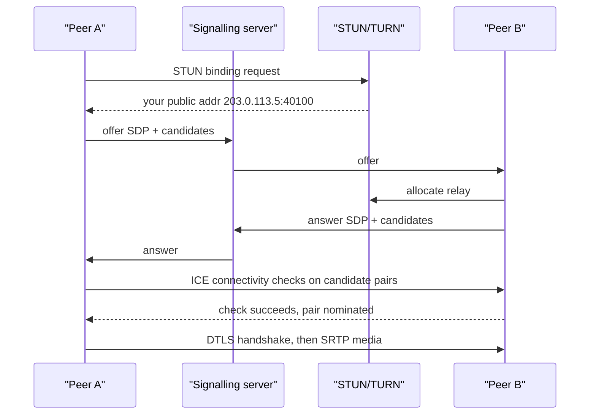

## In one minute
- WebRTC gives browsers and apps real-time audio, video and data channels, ideally peer-to-peer over UDP with mandatory encryption.
- It does not define signalling: you build your own channel (usually WebSocket) to exchange session descriptions and network candidates.
- ICE, with STUN and TURN, finds a working path through NATs and firewalls; a minority of sessions (10 to 20% is the figure usually quoted, far more on locked-down corporate networks) need a TURN relay.
- Media runs over SRTP with congestion control that adapts bitrate to the network, trading quality for latency.
- Beyond two or three participants, peer-to-peer meshes collapse and you need a media server, usually an SFU.

## How it works

### Signalling and SDP
Each peer creates an *offer* or *answer* in SDP format describing codecs, media tracks, encryption fingerprints and ICE credentials. Your application carries these between peers over any channel. WebRTC is agnostic here, which is why every product has its own signalling server handling rooms, auth and presence. The one place a standard now exists is broadcast ingest: WHIP (RFC 9725, March 2025) sends the SDP offer as an HTTP POST and gets the answer back in the response, so an encoder such as OBS can publish to any compliant media server ([RFC 9725](https://www.rfc-editor.org/rfc/rfc9725)).

The stack underneath is all standardised and was refreshed around 2018 to 2020, so older articles cite superseded numbers: ICE is RFC 8445 (replacing 5245), STUN is RFC 8489 (replacing 5389), and TURN is RFC 8656 (replacing 5766). The browser API itself is a W3C Recommendation, last revised in March 2025 ([W3C](https://www.w3.org/TR/webrtc/)).

### ICE, STUN and TURN
Most devices sit behind NAT, so a peer does not know its public address. ICE gathers *candidates*:

- **Host:** the device's local addresses. Since Chrome 76 (2019), browsers hide private IPs behind random `.local` mDNS names unless the page already has camera or microphone permission ([Chrome PSA](https://groups.google.com/g/discuss-webrtc/c/6stQXi72BEU/m/2FwZd24UAQAJ)).
- **Server reflexive:** the public IP and port as seen by a STUN server, learned by sending it a request.
- **Relay:** an address on a TURN server that forwards traffic for you.

Peers exchange candidates (trickle ICE sends them as they are found), pair them, sort pairs by priority, and run connectivity checks: STUN binding requests sent directly on each pair. The first successful high-priority pair is nominated. Host and reflexive pairs work across most home NATs. Symmetric NATs and strict corporate firewalls defeat hole punching, and then only the relay works, often over TCP or TLS on port 443.

### Media transport
Media is encrypted with SRTP using keys negotiated by DTLS over the same path. Audio is typically Opus at 20 to 40 kbps; video VP8, VP9, H.264 or AV1 at 0.3 to 2.5 Mbps. Congestion control estimates available bandwidth from packet delay trends and loss and adjusts the encoder bitrate every few hundred milliseconds. Loss is handled with NACK retransmissions for video, forward error correction for audio, and jitter buffers, all tuned to keep end-to-end delay below roughly 150 to 300 ms. Data channels run SCTP over DTLS and can be reliable or unreliable, ordered or unordered ([RFC 8831](https://www.rfc-editor.org/rfc/rfc8831)).

### Topologies for groups
In a *mesh*, each participant sends its stream to every other one: upload grows linearly with participants. An *SFU* (selective forwarding unit) receives one upload per participant and forwards streams to others without decoding, often choosing among *simulcast* layers (for example 180p, 360p, 720p) per receiver based on their bandwidth. An *MCU* decodes and mixes into one stream, which is cheap for clients but very CPU-heavy on the server.

## Down the stack

### Layer 1: The contract
The WebRTC API promises an encrypted connection between two endpoints that both consented to it, with media delivered in real time on a best-effort basis: late data is worth less than missing data, so the stack trades completeness for latency. Data channels let you choose per channel between reliable and unreliable, ordered and unordered delivery. Connection state is reported through events (`checking`, `connected`, `disconnected`, `failed`), and nothing guarantees a path exists at all; without TURN, some pairs of networks simply cannot connect.

### Layer 2: The mechanism
Candidates appear in SDP as lines like `a=candidate:1 1 udp 2130706431 192.168.1.20 54400 typ host`: foundation, component, transport, priority, address, port and type. Connectivity checks are STUN Binding requests carrying `USERNAME` (the two ICE ufrags joined), `MESSAGE-INTEGRITY` (HMAC-SHA1 keyed with the ICE password), `PRIORITY`, and `ICE-CONTROLLING` or `ICE-CONTROLLED` with a tie-breaker; the controlling side adds `USE-CANDIDATE` to nominate. Pairs move through Frozen, Waiting, In-Progress, Succeeded and Failed states ([RFC 8445](https://www.rfc-editor.org/rfc/rfc8445)), and consent checks repeat about every 5 seconds (randomised by plus or minus 20%) so a peer that stops answering loses consent, and the sender must stop, after 30 seconds ([RFC 7675](https://www.rfc-editor.org/rfc/rfc7675)). DTLS then runs over the nominated pair, each side verifying the certificate fingerprint from the SDP, and exports SRTP keys. Media rides RTP, with a 12-byte header holding sequence number, timestamp and SSRC. RTCP feedback carries NACKs, PLI keyframe requests and transport-wide congestion control reports that drive a delay-based bandwidth estimator. TURN relays use `Allocate`, `CreatePermission` and `ChannelBind`, after which data uses a 4-byte ChannelData header instead of a 36-byte Send indication ([RFC 8656](https://www.rfc-editor.org/rfc/rfc8656)).

### Layer 3: The machine
Packets are kept near 1,200 bytes to avoid IP fragmentation across unknown paths. An Opus frame of 20 ms is 50 to 100 bytes of payload, while RTP, the SRTP auth tag, UDP and IPv4 headers add about 50 bytes, so audio pays roughly 40% header overhead at 50 packets per second. Video at 1.2 Mbps is about 125 full packets per second, and a keyframe can be ten times a delta frame, producing bursts that congestion control must absorb. NATs expire idle UDP bindings in 30 to 120 seconds, which is why STUN keepalives flow every 15 to 25 seconds; ICE says agents should use 15 seconds and must not go lower ([RFC 8445](https://www.rfc-editor.org/rfc/rfc8445#section-11)). Jitter buffers hold 20 to 200 ms of audio, adapting to measured arrival variance. Encoding runs on hardware encoders where available, because a 720p software encode can take a full CPU core on a phone.

### Why it's built this way
1. Conversation tolerates about 150 ms of one-way delay but not stalls, so media uses UDP, limited retransmission and adaptive bitrate.
2. IPv4 scarcity put most devices behind NAT, so ICE probes many paths and keeps TURN as a last resort.
3. Browsers must not become tools for sending traffic to arbitrary hosts, so connectivity checks need credentials and encryption is mandatory.
4. Network quality varies wildly within one call, so congestion control adjusts every few hundred milliseconds and SFUs pick simulcast layers per receiver.
5. Upload bandwidth is scarcer than download, so group calls send one stream up to a server rather than one per peer.

## Diagram



## Worked example
A telehealth product runs 5,000 concurrent one-to-one video calls at 1.2 Mbps per direction, and plans group sessions of 8.

TURN sizing: if 15% of calls fall back to relay, that is 750 calls. A relayed call carries both directions in and out of the TURN server: 750 x 2 x 1.2 Mbps = 1.8 Gbps in and 1.8 Gbps out. At a typical cloud egress price of around $0.05 to $0.08 per GB, 1.8 Gbps for an 8-hour business day is about 6.5 TB per day, or roughly $330 to $520 daily, so TURN servers are placed in regions near users and on providers with cheaper bandwidth.

Group sessions: in a mesh of 8, each participant uploads 7 streams at 1.2 Mbps, 8.4 Mbps, which most home uplinks and phone batteries cannot sustain. With an SFU and simulcast, each participant uploads about 1.2 + 0.5 + 0.15 = 1.85 Mbps once, and downloads 7 streams chosen by layout, perhaps one 720p speaker at 1.2 Mbps and six 180p tiles at 0.15 Mbps, about 2.1 Mbps. At about 17 Mbps out per room, one 10 Gbps SFU node handles a few hundred rooms.

## In the wild
- **Discord, 2018: WebRTC with the peer-to-peer parts removed.** Discord served more than 2.6 million concurrent voice users from 850+ voice servers in 13 regions, with over 220 Gbps and 120 million packets per second of egress. Every client connects to a Discord relay, so native apps drop ICE, replace DTLS/SRTP with Salsa20 encryption and SDP with a join message of about 1,000 bytes; browsers still get standard WebRTC through synthesized SDP. Routing through a custom C++ SFU hides users' IPs from each other, a defence against DDoS ([Discord](https://discord.com/blog/how-discord-handles-two-and-half-million-concurrent-voice-users-using-webrtc)).
- **Chrome, 2019: private IPs disappear from host candidates.** Websites had been using WebRTC to harvest users' private IP addresses, likely for tracking. Chrome replaced them with random mDNS hostnames, rolling out to 50% of users and then fully with Chrome 76 in August 2019, exempting pages with camera or microphone permission. Google measured about 2% fewer successful Chrome-to-Chrome peer-to-peer connections, with larger effects on some third-party ICE stacks ([Chrome PSA](https://groups.google.com/g/discuss-webrtc/c/6stQXi72BEU/m/2FwZd24UAQAJ), [IETF draft](https://datatracker.ietf.org/doc/html/draft-ietf-mmusic-mdns-ice-candidates)).

## Trade-offs

| Option | Strengths | Weaknesses | Choose when |
| --- | --- | --- | --- |
| Peer-to-peer mesh | No media servers, lowest latency | Uplink grows with N, poor beyond 3 to 4 | One-to-one calls |
| SFU | Scales to dozens, simulcast per receiver | Server bandwidth, more downlink per client | Group video, webinars with interaction |
| MCU | One stream per client, easy recording | Heavy server CPU, added latency | Low-power clients, legacy endpoints |
| TURN always | Predictable connectivity, hides IPs | Bandwidth cost and added hop | Strict privacy or enterprise networks |

## Pitfalls in production
- **No TURN, or TURN only on UDP.** Calls fail on corporate networks. Deploy TURN over UDP, TCP and TLS on 443.
- **Static TURN credentials.** Leaked credentials turn your relay into a free bandwidth proxy, and an open relay can also reach your internal network: restrict which peer addresses a TURN server will relay to. Use short-lived, HMAC-derived credentials from your backend.
- **Parsing candidates as IP addresses.** mDNS host candidates arrive as `uuid.local` names, and some third-party ICE stacks lost direct connectivity when Chrome switched in 2019. Accept hostnames, or rely on server-reflexive and relay candidates.
- **Ignoring ICE restarts.** A phone switching from Wi-Fi to cellular drops the call. Detect connection state changes and trigger an ICE restart.
- **Mesh for groups.** Works in testing with 3 people, fails with 6. Move to an SFU before group sizes grow.
- **Measuring only setup success.** Calls connect but are unusable. Collect stats (round-trip time, jitter, packet loss, frames dropped) per call and alert on quality.

## Leadership lens
- Decide early whether to build on an open-source SFU, a managed provider, or plain peer-to-peer; the operational burden differs by an order of magnitude.
- TURN bandwidth is often the largest infrastructure cost; model it with your relay rate before launch.
- Ask in review: how does this behave on a lossy 3G link and behind a corporate proxy?
- Recording, compliance and moderation usually force media through a server, which affects the topology choice.

## Check yourself
1. Why can two peers both behind home NATs often connect without TURN?
   **Answer:** Each learns its public mapping via STUN, and simultaneous connectivity checks open NAT bindings in both directions, so packets get through.
2. Why does an SFU scale better than a mesh for the sender?
   **Answer:** The sender uploads one set of streams to the SFU instead of one copy per participant, so upload stays constant as the room grows.
3. What is signalling and why does WebRTC leave it to you?
   **Answer:** It is the exchange of SDP offers, answers and candidates. Apps already have their own identity, rooms and transport, so the standard avoids prescribing one.

## Practice
**Task:** Implement ICE candidate prioritisation from RFC 8445. `candidate_priority(kind, local_pref, component)` returns `2**24 * type_pref + 2**8 * local_pref + (256 - component)`, with type preferences host 126, prflx 110, srflx 100, relay 0. `pair_priority(g, d)` returns `2**32 * min(g, d) + 2 * max(g, d) + (1 if g > d else 0)`, where `g` is the controlling agent's candidate priority. `nominate(pairs, works)` takes `(g, d, name)` tuples and a set of names whose checks succeed, and returns the name of the highest-priority working pair, or `None`.

```python starter
def candidate_priority(kind, local_pref, component):
    raise NotImplementedError

def pair_priority(g, d):
    raise NotImplementedError

def nominate(pairs, works):
    raise NotImplementedError
```

```python tests
def test_host_beats_srflx_beats_relay():
    h = candidate_priority("host", 65535, 1)
    s = candidate_priority("srflx", 65535, 1)
    r = candidate_priority("relay", 65535, 1)
    assert h > s > r

def test_exact_value():
    assert candidate_priority("host", 65535, 1) == 2130706431

def test_component_two_lower():
    assert candidate_priority("host", 10, 1) - candidate_priority("host", 10, 2) == 1

def test_pair_formula_asymmetric():
    assert pair_priority(5, 3) == 2**32 * 3 + 10 + 1
    assert pair_priority(3, 5) == 2**32 * 3 + 10

def test_nominate_best_working():
    pairs = [(100, 100, "relay-relay"), (900, 800, "host-host"), (500, 400, "srflx-srflx")]
    assert nominate(pairs, {"relay-relay", "srflx-srflx"}) == "srflx-srflx"
    assert nominate(pairs, {"host-host", "relay-relay"}) == "host-host"
    assert nominate(pairs, set()) is None
```

```python solution
TYPE_PREF = {"host": 126, "prflx": 110, "srflx": 100, "relay": 0}

def candidate_priority(kind, local_pref, component):
    return 2**24 * TYPE_PREF[kind] + 2**8 * local_pref + (256 - component)

def pair_priority(g, d):
    return 2**32 * min(g, d) + 2 * max(g, d) + (1 if g > d else 0)

def nominate(pairs, works):
    ok = [(pair_priority(g, d), name) for g, d, name in pairs if name in works]
    if not ok:
        return None
    return max(ok)[1]
```

```typescript starter
// Pair priorities exceed 2^53, so they use bigint.
export function candidatePriority(kind: string, localPref: number, component: number): number {
  throw new Error("TODO");
}
export function pairPriority(g: number, d: number): bigint {
  throw new Error("TODO");
}
export function nominate(pairs: [number, number, string][], works: Set<string>): string | null {
  throw new Error("TODO");
}
```

```typescript tests
test("host beats srflx beats relay", () => {
  const h = candidatePriority("host", 65535, 1);
  const s = candidatePriority("srflx", 65535, 1);
  const r = candidatePriority("relay", 65535, 1);
  assert(h > s && s > r, "type preference order");
});
test("exact value", () => {
  assertEqual(candidatePriority("host", 65535, 1), 2130706431);
});
test("component two is one lower", () => {
  assertEqual(candidatePriority("host", 10, 1) - candidatePriority("host", 10, 2), 1);
});
test("pair formula asymmetric", () => {
  assert(pairPriority(5, 3) === 2n ** 32n * 3n + 10n + 1n, "g > d adds one");
  assert(pairPriority(3, 5) === 2n ** 32n * 3n + 10n, "g < d adds nothing");
});
test("nominate best working", () => {
  const pairs: [number, number, string][] = [[100, 100, "relay-relay"], [900, 800, "host-host"], [500, 400, "srflx-srflx"]];
  assertEqual(nominate(pairs, new Set(["relay-relay", "srflx-srflx"])), "srflx-srflx");
  assertEqual(nominate(pairs, new Set(["host-host", "relay-relay"])), "host-host");
  assertEqual(nominate(pairs, new Set()), null);
});
```

```typescript solution
// Pair priorities exceed 2^53, so they use bigint.
const TYPE_PREF: Record<string, number> = { host: 126, prflx: 110, srflx: 100, relay: 0 };

export function candidatePriority(kind: string, localPref: number, component: number): number {
  return 2 ** 24 * TYPE_PREF[kind] + 2 ** 8 * localPref + (256 - component);
}
export function pairPriority(g: number, d: number): bigint {
  const G = BigInt(g), D = BigInt(d);
  const lo = G < D ? G : D, hi = G < D ? D : G;
  return 2n ** 32n * lo + 2n * hi + (G > D ? 1n : 0n);
}
export function nominate(pairs: [number, number, string][], works: Set<string>): string | null {
  let best: string | null = null;
  let bestP = -1n;
  for (const [g, d, name] of pairs) {
    if (!works.has(name)) continue;
    const p = pairPriority(g, d);
    if (p > bestP) { bestP = p; best = name; }
  }
  return best;
}
```

```go starter
package practice

type Pair struct {
	G, D uint64
	Name string
}

func CandidatePriority(kind string, localPref, component uint64) uint64 { panic("TODO") }

func PairPriority(g, d uint64) uint64 { panic("TODO") }

// Nominate returns the best working pair's name, or "" if none works.
func Nominate(pairs []Pair, works map[string]bool) string { panic("TODO") }
```

```go tests
package practice

import "testing"

func TestTypeOrder(t *testing.T) {
	h := CandidatePriority("host", 65535, 1)
	s := CandidatePriority("srflx", 65535, 1)
	r := CandidatePriority("relay", 65535, 1)
	if !(h > s && s > r) {
		t.Fatal("wrong order")
	}
}

func TestExactValue(t *testing.T) {
	if got := CandidatePriority("host", 65535, 1); got != 2130706431 {
		t.Fatal(got)
	}
}

func TestComponent(t *testing.T) {
	if CandidatePriority("host", 10, 1)-CandidatePriority("host", 10, 2) != 1 {
		t.Fatal("component offset wrong")
	}
}

func TestPairFormula(t *testing.T) {
	if PairPriority(5, 3) != (1<<32)*3+10+1 || PairPriority(3, 5) != (1<<32)*3+10 {
		t.Fatal("pair formula wrong")
	}
}

func TestNominate(t *testing.T) {
	pairs := []Pair{{100, 100, "relay-relay"}, {900, 800, "host-host"}, {500, 400, "srflx-srflx"}}
	if got := Nominate(pairs, map[string]bool{"relay-relay": true, "srflx-srflx": true}); got != "srflx-srflx" {
		t.Fatal(got)
	}
	if got := Nominate(pairs, map[string]bool{"host-host": true, "relay-relay": true}); got != "host-host" {
		t.Fatal(got)
	}
	if got := Nominate(pairs, map[string]bool{}); got != "" {
		t.Fatal(got)
	}
}
```

```go solution
package practice

type Pair struct {
	G, D uint64
	Name string
}

var typePref = map[string]uint64{"host": 126, "prflx": 110, "srflx": 100, "relay": 0}

func CandidatePriority(kind string, localPref, component uint64) uint64 {
	return (1<<24)*typePref[kind] + (1<<8)*localPref + (256 - component)
}

func PairPriority(g, d uint64) uint64 {
	lo, hi := g, d
	if d < g {
		lo, hi = d, g
	}
	p := (1<<32)*lo + 2*hi
	if g > d {
		p++
	}
	return p
}

// Nominate returns the best working pair's name, or "" if none works.
func Nominate(pairs []Pair, works map[string]bool) string {
	best, bestP, found := "", uint64(0), false
	for _, p := range pairs {
		if !works[p.Name] {
			continue
		}
		if pr := PairPriority(p.G, p.D); !found || pr > bestP {
			best, bestP, found = p.Name, pr, true
		}
	}
	return best
}
```

## Mock interview
**Prompt:** Design a video calling product supporting 5,000 concurrent one-to-one calls today and group calls of up to 12 next quarter, for users on home, mobile and corporate networks.

- Follow-up: Walk through call setup from button press to first video frame.
- Follow-up: 20% of calls from one enterprise customer fail to connect. What do you check?
- Follow-up: Mesh, SFU or MCU for 12-person calls, and what does it cost in bandwidth?

**A strong answer covers:**
- A signalling service over WebSocket with auth, rooms and SDP and candidate relay.
- ICE with STUN and TURN over UDP, TCP and TLS 443, with short-lived credentials.
- TURN capacity and egress cost estimates based on relay rate.
- SFU with simulcast for groups, with per-receiver layer selection.
- Quality telemetry, ICE restarts on network changes, and congestion control behaviour.

## Sources and further study
**Primary**
- [W3C: WebRTC Recommendation](https://www.w3.org/TR/webrtc/): the browser API, connection states and statistics.
- [RFC 8489: STUN](https://www.rfc-editor.org/rfc/rfc8489): the binding request, attributes and message integrity used by ICE checks.
- [RFC 7675: STUN usage for consent freshness](https://www.rfc-editor.org/rfc/rfc7675): why media stops 30 seconds after a peer goes silent.
- [RFC 9725: WHIP](https://www.rfc-editor.org/rfc/rfc9725): standard HTTP signalling for publishing a WebRTC stream.

**Systems docs**
- [Chromium: Hiding local IPs with mDNS (PSA)](https://groups.google.com/g/discuss-webrtc/c/6stQXi72BEU/m/2FwZd24UAQAJ): what changed in host candidates and who is exempt.
- [Discord: WebRTC at 2.5 million concurrent voice users](https://discord.com/blog/how-discord-handles-two-and-half-million-concurrent-voice-users-using-webrtc): which parts of WebRTC a large SFU deployment keeps and replaces.

**Books**
- *High Performance Browser Networking*, Ilya Grigorik, chapter 3 "Building Blocks of UDP": UDP and NAT, and how STUN, TURN and ICE get packets through ([read free](https://hpbn.co/building-blocks-of-udp/)).
- *Computer Networking: A Top-Down Approach* (8th ed.), Kurose and Ross, chapter 4 "The Network Layer: Data Plane": NAT and middleboxes, the reason ICE exists.

**Other curricula**
- [roadmap.sh: Backend](https://roadmap.sh/backend): covers WebSockets, SSE and polling under "Real-Time Data" but not WebRTC, so peer media is left to specialist material.
- [donnemartin/system-design-primer](https://github.com/donnemartin/system-design-primer#user-datagram-protocol-udp): explains when to choose UDP for real-time media but stops before NAT traversal.

## Watch
- [WebRTC Crash Course (Hussein Nasser)](https://www.youtube.com/watch?v=FExZvpVvYxA): NAT, STUN, TURN, ICE and SDP explained with a demo.
- [WebRTC in 100 Seconds (Fireship)](https://www.youtube.com/watch?v=WmR9IMUD_CY): fast overview plus a minimal video chat build.

## Free resources
- [WebRTC for the Curious](https://webrtcforthecurious.com/): a free book on every protocol layer, written by implementers.
- [RFC 8445: ICE](https://www.rfc-editor.org/rfc/rfc8445): candidate gathering, priorities and connectivity checks.
- [RFC 8656: TURN](https://www.rfc-editor.org/rfc/rfc8656): how relays allocate and forward traffic.
- [MDN: WebRTC API](https://developer.mozilla.org/en-US/docs/Web/API/WebRTC_API): browser API reference and guides.
- [High Performance Browser Networking: WebRTC](https://hpbn.co/webrtc/): Ilya Grigorik's chapter on transport and performance.
