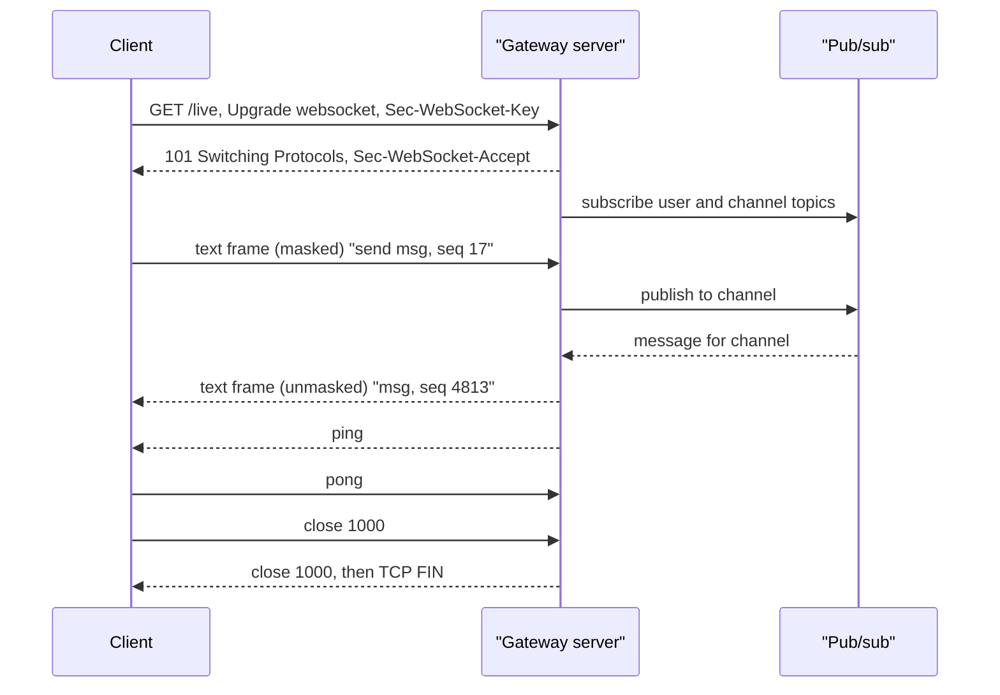

## In one minute
- A WebSocket is a long-lived, full-duplex message channel that starts life as an HTTP request and then switches protocols on the same TCP connection.
- After the handshake, both sides exchange small frames (2 to 14 bytes of header) carrying text, binary data or control messages, with no per-message request or response.
- The protocol gives you messages, ordering on one connection and a close handshake. It does not give you reconnection, resumption, acknowledgements or fan-out; those are yours to build.
- The hard part is not the protocol but the state: millions of open connections pinned to specific servers, which changes how you load balance, deploy, scale and recover.
- Choose WebSockets when the client sends often and latency matters both ways (chat, multiplayer, collaborative editing, trading). For one-way server push, SSE is simpler.

## How it works

### The upgrade handshake
The client opens a TCP (and usually TLS) connection and sends an ordinary HTTP/1.1 GET:

```
GET /live HTTP/1.1
Host: chat.example.com
Upgrade: websocket
Connection: Upgrade
Sec-WebSocket-Key: q4xkcO32u266gldTuKaSOw==
Sec-WebSocket-Version: 13
Origin: https://app.example.com
```

If the server agrees, it answers `101 Switching Protocols` with `Sec-WebSocket-Accept`, which is the base64 SHA-1 of the client's key concatenated with a fixed GUID from the RFC ([RFC 6455](https://www.rfc-editor.org/rfc/rfc6455#section-1.3)). That value proves the server really speaks WebSocket rather than being a confused HTTP cache echoing headers. From the next byte onward, the connection carries WebSocket frames, not HTTP.

Because it starts as HTTP, the handshake carries cookies, passes through port 443, and can be routed by path at a reverse proxy. Because it then stops being HTTP, everything after the handshake is invisible to HTTP-level tooling: no status codes per message, no access log line per message, no caching.

### Messages and frames
Applications see messages; the wire carries frames. A message is one frame, or several frames where the first has a text or binary opcode, the rest are continuation frames, and the last has the FIN bit set. Fragmentation lets a sender stream a large message without knowing its length up front. Control frames (close, ping, pong) may be interleaved between fragments, so a 50 MB upload does not block a heartbeat.

Ping and pong are the liveness mechanism: either side may send a ping and the other must reply with a pong carrying the same payload. The close handshake is a close frame with a two-byte status code (1000 normal, 1001 going away, 1008 policy violation, 1009 message too big, 1011 server error), answered by a close frame, after which the server closes TCP. IANA has since registered 1012 "Service Restart" and 1013 "Try Again Later", which tell a client the server is going away on purpose and that it should back off before reconnecting ([IANA registry](https://www.iana.org/assignments/websocket/websocket.xhtml)). Code 1006 is never sent; browsers report it when the connection died without a close frame, which is what most real disconnects look like.

### What you build on top
The protocol is deliberately thin. A production system adds a message envelope (type, id, sequence number), application-level acknowledgements where loss matters, a reconnect loop with jittered backoff, a resume protocol ("I last saw sequence 4,812 on channel 9"), authentication refresh for connections that outlive their token, and a routing layer that knows which server holds which user.

That routing layer is the fan-out problem shape again. When Alice posts to a channel with 3,000 members spread over 200 gateway servers, something must find those 200 servers and push to each. A phone network has the same shape: the switch that holds your call is not the one where the caller dialled, and a registry maps subscriber to switch. In WebSocket systems the registry is usually a pub/sub layer (Redis, NATS, Kafka) keyed by channel or user. Slack's version has stateful gateway servers holding the sockets and channel servers placed on a consistent-hash ring; each channel server host owns about 16 million channels at peak, and a message reaches clients worldwide in about 500 ms ([Slack Engineering](https://slack.engineering/real-time-messaging/)).

## Down the stack

### Layer 1: The contract
On one connection, messages arrive complete, in order and uncorrupted, or the connection fails. That is TCP's guarantee lifted to message boundaries. Nothing survives a disconnect: messages the sender wrote but the network did not deliver are gone, and the sender cannot tell which. So the end-to-end contract you can promise users is at-most-once, unless you add sequence numbers and acks to get at-least-once with deduplication. Text messages must be valid UTF-8, and receivers must fail the connection if they are not.

### Layer 2: The mechanism
RFC 6455 defines each frame as: one byte holding FIN, three reserved bits (RSV1 to RSV3) and a 4-bit opcode (0 continuation, 1 text, 2 binary, 8 close, 9 ping, 10 pong); one byte holding the MASK bit and a 7-bit length; then an extended length (16 bits if the 7-bit value is 126, 64 bits if it is 127); then a 4-byte masking key if MASK is set; then the payload.

Every frame from client to server must be masked: each payload byte is XORed with `key[i % 4]`, using a fresh random key per frame. Server frames must not be masked. Masking is not encryption; it exists because researchers showed, while the protocol was being designed, that attacker-controlled bytes on an upgraded connection could trick transparent proxies into caching forged HTTP responses ([RFC 6455, section 10.3](https://www.rfc-editor.org/rfc/rfc6455#section-10.3)). Random masking makes client bytes on the wire unpredictable to the page's script.

Control frames carry at most 125 bytes and cannot be fragmented, so they always fit in a small fixed buffer and can jump between data fragments. Reserved bits must be zero unless an extension claims them; `permessage-deflate` (RFC 7692) uses RSV1 to mark a compressed message, negotiated in `Sec-WebSocket-Extensions`. RFC 8441 carries WebSockets over HTTP/2 as one stream opened with an extended CONNECT, so many sockets can share one TCP connection ([RFC 8441](https://www.rfc-editor.org/rfc/rfc8441)). RFC 9220 (2022) applies the same extended CONNECT to HTTP/3, so a WebSocket can now ride a QUIC stream ([RFC 9220](https://www.rfc-editor.org/rfc/rfc9220)).

### Layer 3: The machine
A small server-to-client message of 20 bytes costs 2 bytes of frame header, 5 bytes of TLS record header plus a 16-byte AEAD tag, and 40 to 52 bytes of TCP/IP header, so about 85 bytes on the wire. A client message adds 4 bytes of mask key. Compare a minimal HTTP request with cookies at 500 to 1,500 bytes, and you see why chatty clients move to WebSockets.

Unmasking is a byte-wise XOR, which servers vectorize to 16 or 32 bytes per instruction; at memory bandwidth it costs well under a microsecond per kilobyte. The real costs are per connection. An idle connection holds a file descriptor watched by `epoll`, a few KB of kernel socket state, the TLS session (around 30 to 50 KB in some libraries unless buffers are released when idle), and the application's read buffer and per-connection object. Gateways tuned for idle connections land between 10 and 60 KB each, so one million connections need tens of GB of RAM. File descriptor limits (`ulimit -n`, `fs.file-max`) and, at proxies, ephemeral ports (about 28,000 to 64,000 per source IP to one backend address) become real ceilings.

Slow readers are the classic failure. If a client on a weak mobile link stops reading, the kernel send buffer fills, `write` returns `EAGAIN`, and the application's outbound queue grows. Without a cap per connection, one bad network region can take a gateway's memory down with it. Browsers expose the client side of this as `WebSocket.bufferedAmount`, and the classic `WebSocket` API has no backpressure at all on receive: messages are pushed to `onmessage` as fast as they arrive. `WebSocketStream` adds stream backpressure, but MDN still lists it as non-standard with limited browser support ([MDN](https://developer.mozilla.org/en-US/docs/Web/API/WebSocketStream)).

### Why it's built this way
1. The web's infrastructure only reliably passed HTTP on ports 80 and 443, so the protocol had to start as HTTP and upgrade in place.
2. Middleboxes that misread the upgraded bytes as HTTP were a security risk, so the handshake proves the server understands WebSocket and the client masks its frames.
3. Interactive traffic is many small messages, so the frame header is 2 bytes for anything up to 125 bytes and only grows for large payloads.
4. Long messages must not starve heartbeats or close requests, so data can be fragmented and small control frames can interleave.
5. Applications differ wildly in what "reliable" means, so the protocol stops at ordered messages and leaves acks, resumption and routing to the application.

## Diagram



## Worked example
A team chat product has 3 million concurrently connected clients at peak. Each client sends about one message a minute and receives about 20 (messages, typing indicators, presence).

Connections: at 40 KB per connection with TLS, 3 million connections is about 120 GB of RAM. With 64 GB gateways planned at 50 percent memory for connections, that is about 4 gateways' worth of memory but, with CPU for TLS and fan-out, a fleet of around 40 gateways at 75,000 connections each is a comfortable plan that survives losing a zone.

Traffic: 3 million x 20 / 60 is 1 million messages per second outbound at about 200 bytes each, 200 MB/s or 1.6 Gbit/s across the fleet. Inbound is 50,000 messages per second, which go through ordinary validation and persistence before fan-out.

Deploys: restarting one gateway drops 75,000 clients. If they all reconnect within one second, the remaining gateways absorb 75,000 TLS handshakes plus 75,000 resume requests at once. The client reconnect rule fixes that:

```python
def reconnect_delay_ms(attempt, rand):
    base = min(30_000, 500 * 2 ** attempt)   # cap at 30 s
    return rand() * base                      # full jitter
```

The gateway also sends close code 1012 (or 1001 for older clients) and drains over several minutes instead of dropping everyone at once, and the resume request carries the last sequence number per channel so the server returns only the gap.

## In the wild
- **Discord, 2017: a Redis failover ends in a full real-time restart.** A Google Cloud live migration knocked a Redis primary offline; the cluster failed over correctly, but API instances hit a bug handling the failover, and an edge-cache rule, a Cassandra failure, out-of-memory guild and session nodes and a misset reconnect setting piled on. After about 2 hours 51 minutes Discord restarted the whole real-time system and reconnected millions of WebSocket clients over about 20 minutes ([Discord status](https://discordstatus.com/incidents/qk9cdgnqnhcn)).
- **Discord, 2026: a scale-down turns into a reconnect storm.** A config change to make session pods larger halved their number in one zone, and pods were terminated before they could hand off, so 17% of sessions ended ungracefully. The reconnects passed a start-session rate limit that had not been re-tuned after a migration, and memory spiked on every WebSocket gateway node in the zone until they ran out; voice and video were mostly down from 12:13 to 15:30 PDT. Fixes included a Kubernetes admission webhook that blocks scale-down until a pod has handed off its sessions, plus partitioned supervisors and retuned rate limits in the voice tier ([Discord](https://discord.com/blog/behind-the-scenes-of-the-3-25-26-voice-outage)).

## Trade-offs

| Option | Strengths | Weaknesses | Choose when |
|---|---|---|---|
| WebSockets | Full duplex, tiny frames, binary support, low latency both ways | Stateful, no built-in resume, harder to load balance and deploy | Chat, games, collaborative editing, live trading |
| SSE | Plain HTTP, built-in reconnect and `Last-Event-ID` | One-way, text only | Feeds, notifications, LLM streaming |
| Long polling | Works through anything, stateless servers | Request per batch, higher latency and overhead | Fallback, low message rates |
| WebTransport (HTTP/3) | Multiple streams and unreliable datagrams, no head-of-line blocking | In all major browsers only since March 2026 ([MDN](https://developer.mozilla.org/en-US/docs/Web/API/WebTransport_API)); thinner proxy and library support | Media or games needing unreliable delivery |

## Pitfalls in production
- Cross-site WebSocket hijacking: browsers send cookies on the upgrade request from any origin, and there is no CORS preflight. Check the `Origin` header against an allow-list or authenticate with a token in the first message.
- Idle connections die silently behind NATs and load balancers (60 seconds by default on AWS ALB ([AWS docs](https://docs.aws.amazon.com/elasticloadbalancing/latest/application/edit-load-balancer-attributes.html#connection-idle-timeout)), 350 seconds on an AWS NAT gateway ([AWS docs](https://docs.aws.amazon.com/vpc/latest/userguide/nat-gateway-troubleshooting.html))). Send application pings every 20 to 30 seconds and treat a missing pong as a dead connection.
- Unbounded per-connection send queues let one slow client exhaust a gateway. Cap the queue in bytes, drop or coalesce low-value messages, and disconnect with 1008 or 1013 when the cap is hit.
- Tokens expire while connections live for days. Re-validate on a timer and close connections whose session was revoked, or the logout button does nothing.
- Deploys and failovers create reconnect storms. Use full-jitter backoff on clients, drain gateways gradually, and rate-limit handshakes per node.
- Message-size limits default high in many libraries. Set a maximum message size and a maximum fragment count, or a client can make the server buffer gigabytes.

## Leadership lens
- Ask what breaks if a connection drops mid-message. If the answer is "the user loses data", the design needs sequence numbers, acks and resume, and that is real engineering work to staff.
- Separate the connection gateway from business logic. Gateways that only hold sockets and route messages can be deployed rarely; services behind them deploy often without dropping connections.
- Budget by concurrent connections and fan-out bandwidth, not requests per second. Track connections per node, reconnect rate, send-queue depth and close codes on the main dashboard.
- Before approving WebSockets, ask whether SSE plus ordinary HTTP writes would do. The stateful tier is a permanent operational cost.

## Check yourself
1. Why must browsers mask client frames but servers not mask theirs?
   **Answer:** Masking stops a malicious page from choosing the exact bytes on the wire, which could fool intermediaries into treating them as HTTP and poisoning caches. The page's script controls client payloads, not server ones, so only client frames need it.
2. A user's laptop sleeps for an hour and wakes up. The client shows "connected", but no messages arrive. What happened and how do you detect it?
   **Answer:** The TCP connection was dropped by a NAT or balancer without either end being told. Application pings with a pong deadline detect the dead connection, and the client then reconnects and resumes from its last sequence number.
3. Why can a 125-byte limit on control frames matter for latency during large uploads?
   **Answer:** Because control frames are small and unfragmented, they can be interleaved between fragments of a large data message, so a ping or close never waits behind megabytes of data.
4. Your chat service uses least-connections balancing. After a deploy, the newest gateway is overloaded and the old ones are idle. Why?
   **Answer:** Reconnecting clients all pick the gateway with the fewest connections, which is the freshly started one, so it gets the whole storm. Use slow start, handshake rate limits per node or random choice of two to spread the load.

## Practice
**Task:** Implement the RFC 6455 frame layer. `encode_frame(opcode, payload, mask_key, fin)` returns the frame bytes, using the 7-bit, 16-bit or 64-bit length form as appropriate, and masks the payload when a 4-byte key is given. `decode_frame(buf)` parses one frame from the front of a byte buffer and returns the frame (FIN, opcode, whether it was masked, and the unmasked payload) together with the number of bytes consumed, or "incomplete" if the buffer does not yet hold a whole frame. Reject, as an error, a frame with any reserved bit set, an unknown opcode (valid: 0, 1, 2, 8, 9, 10), a control frame (opcode 8 or above) with FIN clear or a payload over 125 bytes, or a 64-bit length with its top bit set. In Python incomplete is `None` and errors raise `ValueError`; in TypeScript bytes are `number[]`, incomplete is `null` and errors throw; in Go incomplete is a consumed count of 0 with a nil error.

```python starter
def encode_frame(opcode, payload, mask_key=None, fin=True):
    # TODO
    raise NotImplementedError

def decode_frame(buf):
    # TODO: return ({"fin", "opcode", "masked", "payload"}, consumed) or None
    raise NotImplementedError
```

```python tests
def raises(fn):
    try:
        fn()
    except ValueError:
        return True
    return False

def test_unmasked_server_text():
    assert encode_frame(1, b"Hi") == bytes([0x81, 0x02, 0x48, 0x69])

def test_rfc_masked_hello():
    wire = bytes([0x81, 0x85, 0x37, 0xFA, 0x21, 0x3D, 0x7F, 0x9F, 0x4D, 0x51, 0x58])
    assert encode_frame(1, b"Hello", bytes([0x37, 0xFA, 0x21, 0x3D])) == wire
    frame, used = decode_frame(wire)
    assert used == 11
    assert frame == {"fin": True, "opcode": 1, "masked": True, "payload": b"Hello"}

def test_length_forms():
    assert encode_frame(2, bytes(125))[:2] == bytes([0x82, 125])
    assert encode_frame(2, bytes(126))[:4] == bytes([0x82, 126, 0x00, 0x7E])
    big = encode_frame(2, bytes(65536))
    assert big[:10] == bytes([0x82, 127, 0, 0, 0, 0, 0, 1, 0, 0])
    assert len(big) == 10 + 65536
    frame, used = decode_frame(big)
    assert used == len(big) and len(frame["payload"]) == 65536

def test_fragment_round_trip():
    key = bytes([1, 2, 3, 4])
    first = encode_frame(1, b"Hel", key, fin=False)
    rest = encode_frame(0, b"lo", key, fin=True)
    f1, n1 = decode_frame(first + rest)
    f2, n2 = decode_frame((first + rest)[n1:])
    assert (f1["fin"], f1["opcode"], f1["payload"]) == (False, 1, b"Hel")
    assert (f2["fin"], f2["opcode"], f2["payload"]) == (True, 0, b"lo")
    assert n1 + n2 == len(first + rest)

def test_incomplete_prefixes():
    wire = encode_frame(2, bytes(300), bytes([9, 8, 7, 6]))
    for cut in range(len(wire)):
        assert decode_frame(wire[:cut]) is None, "prefix of length %d" % cut
    frame, used = decode_frame(wire + b"\x81")
    assert used == len(wire)

def test_protocol_errors():
    assert raises(lambda: decode_frame(bytes([0x89, 126, 0, 126]) + bytes(126))), "ping over 125 bytes"
    assert raises(lambda: decode_frame(bytes([0x08, 0x00]))), "fragmented close"
    assert raises(lambda: decode_frame(bytes([0xC1, 0x00]))), "reserved bit set"
    assert raises(lambda: decode_frame(bytes([0x83, 0x00]))), "unknown opcode"
    assert raises(lambda: decode_frame(bytes([0x82, 127, 0x80, 0, 0, 0, 0, 0, 0, 1]))), "64-bit length top bit"

def test_control_frame_ok():
    frame, used = decode_frame(bytes([0x8A, 0x01, 0x41]))
    assert frame == {"fin": True, "opcode": 10, "masked": False, "payload": b"A"} and used == 3
```

```python solution
import struct

VALID_OPCODES = (0, 1, 2, 8, 9, 10)

def encode_frame(opcode, payload, mask_key=None, fin=True):
    out = bytearray()
    out.append((0x80 if fin else 0) | opcode)
    mask_bit = 0x80 if mask_key is not None else 0
    n = len(payload)
    if n < 126:
        out.append(mask_bit | n)
    elif n < 65536:
        out.append(mask_bit | 126)
        out += struct.pack(">H", n)
    else:
        out.append(mask_bit | 127)
        out += struct.pack(">Q", n)
    if mask_key is None:
        out += payload
    else:
        out += mask_key
        out += bytes(b ^ mask_key[i % 4] for i, b in enumerate(payload))
    return bytes(out)

def decode_frame(buf):
    if len(buf) < 2:
        return None
    b0, b1 = buf[0], buf[1]
    fin = bool(b0 & 0x80)
    if b0 & 0x70:
        raise ValueError("reserved bits set")
    opcode = b0 & 0x0F
    if opcode not in VALID_OPCODES:
        raise ValueError("unknown opcode")
    masked = bool(b1 & 0x80)
    n = b1 & 0x7F
    if opcode >= 8 and (not fin or n > 125):
        raise ValueError("bad control frame")
    pos = 2
    if n == 126:
        if len(buf) < 4:
            return None
        n = struct.unpack(">H", bytes(buf[2:4]))[0]
        pos = 4
    elif n == 127:
        if len(buf) < 10:
            return None
        n = struct.unpack(">Q", bytes(buf[2:10]))[0]
        if n >> 63:
            raise ValueError("64-bit length top bit set")
        pos = 10
    key = None
    if masked:
        if len(buf) < pos + 4:
            return None
        key = bytes(buf[pos:pos + 4])
        pos += 4
    if len(buf) < pos + n:
        return None
    data = bytes(buf[pos:pos + n])
    if key is not None:
        data = bytes(b ^ key[i % 4] for i, b in enumerate(data))
    return {"fin": fin, "opcode": opcode, "masked": masked, "payload": data}, pos + n
```

```typescript starter
export interface Frame {
  fin: boolean;
  opcode: number;
  masked: boolean;
  payload: number[];
}

export function encodeFrame(opcode: number, payload: number[], maskKey: number[] | null, fin: boolean): number[] {
  throw new Error("TODO");
}

export function decodeFrame(buf: number[]): { frame: Frame; consumed: number } | null {
  throw new Error("TODO");
}
```

```typescript tests
function bytes(s: string): number[] {
  const out: number[] = [];
  for (let i = 0; i < s.length; i++) out.push(s.charCodeAt(i));
  return out;
}
function zeros(n: number): number[] {
  return new Array(n).fill(0);
}
function throws(fn: () => void): boolean {
  try { fn(); } catch (e) { return true; }
  return false;
}

test("unmasked server text", () => {
  assertEqual(encodeFrame(1, bytes("Hi"), null, true), [0x81, 0x02, 0x48, 0x69]);
});
test("RFC masked Hello", () => {
  const wire = [0x81, 0x85, 0x37, 0xfa, 0x21, 0x3d, 0x7f, 0x9f, 0x4d, 0x51, 0x58];
  assertEqual(encodeFrame(1, bytes("Hello"), [0x37, 0xfa, 0x21, 0x3d], true), wire);
  assertEqual(decodeFrame(wire), { frame: { fin: true, opcode: 1, masked: true, payload: bytes("Hello") }, consumed: 11 });
});
test("length forms", () => {
  assertEqual(encodeFrame(2, zeros(125), null, true).slice(0, 2), [0x82, 125]);
  assertEqual(encodeFrame(2, zeros(126), null, true).slice(0, 4), [0x82, 126, 0x00, 0x7e]);
  const big = encodeFrame(2, zeros(65536), null, true);
  assertEqual(big.slice(0, 10), [0x82, 127, 0, 0, 0, 0, 0, 1, 0, 0]);
  assertEqual(big.length, 10 + 65536);
  const r = decodeFrame(big);
  assert(r !== null && r.consumed === big.length && r.frame.payload.length === 65536);
});
test("fragment round trip", () => {
  const key = [1, 2, 3, 4];
  const wire = encodeFrame(1, bytes("Hel"), key, false).concat(encodeFrame(0, bytes("lo"), key, true));
  const a = decodeFrame(wire);
  assert(a !== null);
  const b = decodeFrame(wire.slice(a!.consumed));
  assert(b !== null);
  assertEqual([a!.frame.fin, a!.frame.opcode, a!.frame.payload], [false, 1, bytes("Hel")]);
  assertEqual([b!.frame.fin, b!.frame.opcode, b!.frame.payload], [true, 0, bytes("lo")]);
  assertEqual(a!.consumed + b!.consumed, wire.length);
});
test("incomplete prefixes", () => {
  const wire = encodeFrame(2, zeros(300), [9, 8, 7, 6], true);
  for (let cut = 0; cut < wire.length; cut++) {
    assert(decodeFrame(wire.slice(0, cut)) === null, "prefix of length " + cut);
  }
  const r = decodeFrame(wire.concat([0x81]));
  assert(r !== null && r.consumed === wire.length);
});
test("protocol errors", () => {
  assert(throws(() => decodeFrame([0x89, 126, 0, 126].concat(zeros(126)))), "ping over 125 bytes");
  assert(throws(() => decodeFrame([0x08, 0x00])), "fragmented close");
  assert(throws(() => decodeFrame([0xc1, 0x00])), "reserved bit set");
  assert(throws(() => decodeFrame([0x83, 0x00])), "unknown opcode");
  assert(throws(() => decodeFrame([0x82, 127, 0x80, 0, 0, 0, 0, 0, 0, 1])), "64-bit length top bit");
});
test("control frame ok", () => {
  assertEqual(decodeFrame([0x8a, 0x01, 0x41]), { frame: { fin: true, opcode: 10, masked: false, payload: [0x41] }, consumed: 3 });
});
```

```typescript solution
export interface Frame {
  fin: boolean;
  opcode: number;
  masked: boolean;
  payload: number[];
}

const VALID = [0, 1, 2, 8, 9, 10];

export function encodeFrame(opcode: number, payload: number[], maskKey: number[] | null, fin: boolean): number[] {
  const out: number[] = [(fin ? 0x80 : 0) | opcode];
  const maskBit = maskKey ? 0x80 : 0;
  const n = payload.length;
  if (n < 126) {
    out.push(maskBit | n);
  } else if (n < 65536) {
    out.push(maskBit | 126, (n >> 8) & 0xff, n & 0xff);
  } else {
    out.push(maskBit | 127);
    const hi = Math.floor(n / 0x100000000);
    const lo = n >>> 0;
    for (const word of [hi, lo]) out.push((word >>> 24) & 0xff, (word >>> 16) & 0xff, (word >>> 8) & 0xff, word & 0xff);
  }
  if (!maskKey) return out.concat(payload);
  out.push(...maskKey);
  for (let i = 0; i < n; i++) out.push(payload[i] ^ maskKey[i % 4]);
  return out;
}

export function decodeFrame(buf: number[]): { frame: Frame; consumed: number } | null {
  if (buf.length < 2) return null;
  const b0 = buf[0];
  const b1 = buf[1];
  const fin = (b0 & 0x80) !== 0;
  if (b0 & 0x70) throw new Error("reserved bits set");
  const opcode = b0 & 0x0f;
  if (VALID.indexOf(opcode) < 0) throw new Error("unknown opcode");
  const masked = (b1 & 0x80) !== 0;
  let n = b1 & 0x7f;
  if (opcode >= 8 && (!fin || n > 125)) throw new Error("bad control frame");
  let pos = 2;
  if (n === 126) {
    if (buf.length < 4) return null;
    n = (buf[2] << 8) | buf[3];
    pos = 4;
  } else if (n === 127) {
    if (buf.length < 10) return null;
    if (buf[2] & 0x80) throw new Error("64-bit length top bit set");
    n = 0;
    for (let i = 2; i < 10; i++) n = n * 256 + buf[i];
    pos = 10;
  }
  let key: number[] | null = null;
  if (masked) {
    if (buf.length < pos + 4) return null;
    key = buf.slice(pos, pos + 4);
    pos += 4;
  }
  if (buf.length < pos + n) return null;
  const payload = buf.slice(pos, pos + n);
  if (key) for (let i = 0; i < n; i++) payload[i] ^= key[i % 4];
  return { frame: { fin, opcode, masked, payload }, consumed: pos + n };
}
```

```go starter
package practice

type Frame struct {
	Fin     bool
	Opcode  byte
	Masked  bool
	Payload []byte
}

// EncodeFrame builds one frame. maskKey is nil for unmasked frames, else 4 bytes.
func EncodeFrame(opcode byte, payload []byte, maskKey []byte, fin bool) []byte {
	panic("TODO")
}

// DecodeFrame parses one frame from buf. consumed == 0 with a nil error means incomplete.
func DecodeFrame(buf []byte) (Frame, int, error) {
	panic("TODO")
}
```

```go tests
package practice

import (
	"bytes"
	"testing"
)

func TestUnmaskedServerText(t *testing.T) {
	if got := EncodeFrame(1, []byte("Hi"), nil, true); !bytes.Equal(got, []byte{0x81, 0x02, 0x48, 0x69}) {
		t.Fatalf("got % x", got)
	}
}

func TestRFCMaskedHello(t *testing.T) {
	wire := []byte{0x81, 0x85, 0x37, 0xfa, 0x21, 0x3d, 0x7f, 0x9f, 0x4d, 0x51, 0x58}
	if got := EncodeFrame(1, []byte("Hello"), []byte{0x37, 0xfa, 0x21, 0x3d}, true); !bytes.Equal(got, wire) {
		t.Fatalf("encode got % x", got)
	}
	f, n, err := DecodeFrame(wire)
	if err != nil || n != 11 || !f.Fin || f.Opcode != 1 || !f.Masked || string(f.Payload) != "Hello" {
		t.Fatalf("decode got %+v %d %v", f, n, err)
	}
}

func TestLengthForms(t *testing.T) {
	if got := EncodeFrame(2, make([]byte, 125), nil, true)[:2]; !bytes.Equal(got, []byte{0x82, 125}) {
		t.Fatalf("125: % x", got)
	}
	if got := EncodeFrame(2, make([]byte, 126), nil, true)[:4]; !bytes.Equal(got, []byte{0x82, 126, 0x00, 0x7e}) {
		t.Fatalf("126: % x", got)
	}
	big := EncodeFrame(2, make([]byte, 65536), nil, true)
	if !bytes.Equal(big[:10], []byte{0x82, 127, 0, 0, 0, 0, 0, 1, 0, 0}) || len(big) != 10+65536 {
		t.Fatalf("65536: % x len %d", big[:10], len(big))
	}
	f, n, err := DecodeFrame(big)
	if err != nil || n != len(big) || len(f.Payload) != 65536 {
		t.Fatalf("decode big: %d %v", n, err)
	}
}

func TestFragmentRoundTrip(t *testing.T) {
	key := []byte{1, 2, 3, 4}
	wire := append(EncodeFrame(1, []byte("Hel"), key, false), EncodeFrame(0, []byte("lo"), key, true)...)
	a, n1, err := DecodeFrame(wire)
	if err != nil || n1 == 0 || a.Fin || a.Opcode != 1 || string(a.Payload) != "Hel" {
		t.Fatalf("first: %+v %d %v", a, n1, err)
	}
	b, n2, err := DecodeFrame(wire[n1:])
	if err != nil || !b.Fin || b.Opcode != 0 || string(b.Payload) != "lo" || n1+n2 != len(wire) {
		t.Fatalf("second: %+v %d %v", b, n2, err)
	}
}

func TestIncompletePrefixes(t *testing.T) {
	wire := EncodeFrame(2, make([]byte, 300), []byte{9, 8, 7, 6}, true)
	for cut := 0; cut < len(wire); cut++ {
		if _, n, err := DecodeFrame(wire[:cut]); n != 0 || err != nil {
			t.Fatalf("prefix %d: n=%d err=%v", cut, n, err)
		}
	}
	extra := append(append([]byte{}, wire...), 0x81)
	if _, n, err := DecodeFrame(extra); err != nil || n != len(wire) {
		t.Fatalf("with trailing byte: n=%d err=%v", n, err)
	}
}

func TestProtocolErrors(t *testing.T) {
	cases := map[string][]byte{
		"ping over 125 bytes":   append([]byte{0x89, 126, 0, 126}, make([]byte, 126)...),
		"fragmented close":      {0x08, 0x00},
		"reserved bit set":      {0xc1, 0x00},
		"unknown opcode":        {0x83, 0x00},
		"64-bit length top bit": {0x82, 127, 0x80, 0, 0, 0, 0, 0, 0, 1},
	}
	for name, buf := range cases {
		if _, _, err := DecodeFrame(buf); err == nil {
			t.Fatalf("%s: expected error", name)
		}
	}
}

func TestControlFrameOK(t *testing.T) {
	f, n, err := DecodeFrame([]byte{0x8a, 0x01, 0x41})
	if err != nil || n != 3 || !f.Fin || f.Opcode != 10 || f.Masked || string(f.Payload) != "A" {
		t.Fatalf("got %+v %d %v", f, n, err)
	}
}
```

```go solution
package practice

import (
	"encoding/binary"
	"errors"
)

type Frame struct {
	Fin     bool
	Opcode  byte
	Masked  bool
	Payload []byte
}

// EncodeFrame builds one frame. maskKey is nil for unmasked frames, else 4 bytes.
func EncodeFrame(opcode byte, payload []byte, maskKey []byte, fin bool) []byte {
	b0 := opcode
	if fin {
		b0 |= 0x80
	}
	var maskBit byte
	if maskKey != nil {
		maskBit = 0x80
	}
	out := []byte{b0}
	n := len(payload)
	switch {
	case n < 126:
		out = append(out, maskBit|byte(n))
	case n < 65536:
		out = append(out, maskBit|126)
		out = binary.BigEndian.AppendUint16(out, uint16(n))
	default:
		out = append(out, maskBit|127)
		out = binary.BigEndian.AppendUint64(out, uint64(n))
	}
	if maskKey == nil {
		return append(out, payload...)
	}
	out = append(out, maskKey...)
	for i, b := range payload {
		out = append(out, b^maskKey[i%4])
	}
	return out
}

// DecodeFrame parses one frame from buf. consumed == 0 with a nil error means incomplete.
func DecodeFrame(buf []byte) (Frame, int, error) {
	if len(buf) < 2 {
		return Frame{}, 0, nil
	}
	b0, b1 := buf[0], buf[1]
	if b0&0x70 != 0 {
		return Frame{}, 0, errors.New("reserved bits set")
	}
	f := Frame{Fin: b0&0x80 != 0, Opcode: b0 & 0x0f, Masked: b1&0x80 != 0}
	switch f.Opcode {
	case 0, 1, 2, 8, 9, 10:
	default:
		return Frame{}, 0, errors.New("unknown opcode")
	}
	n := uint64(b1 & 0x7f)
	if f.Opcode >= 8 && (!f.Fin || n > 125) {
		return Frame{}, 0, errors.New("bad control frame")
	}
	pos := 2
	switch n {
	case 126:
		if len(buf) < 4 {
			return Frame{}, 0, nil
		}
		n = uint64(binary.BigEndian.Uint16(buf[2:4]))
		pos = 4
	case 127:
		if len(buf) < 10 {
			return Frame{}, 0, nil
		}
		n = binary.BigEndian.Uint64(buf[2:10])
		if n>>63 != 0 {
			return Frame{}, 0, errors.New("64-bit length top bit set")
		}
		pos = 10
	}
	var key []byte
	if f.Masked {
		if len(buf) < pos+4 {
			return Frame{}, 0, nil
		}
		key = buf[pos : pos+4]
		pos += 4
	}
	if uint64(len(buf)-pos) < n {
		return Frame{}, 0, nil
	}
	end := pos + int(n)
	f.Payload = append([]byte{}, buf[pos:end]...)
	for i := range f.Payload {
		if key != nil {
			f.Payload[i] ^= key[i%4]
		}
	}
	return f, end, nil
}
```

## Mock interview
**Prompt:** Design the real-time layer for a multiplayer whiteboard used by 500,000 concurrent users in boards of 2 to 200 people. Cursor positions update 10 times a second per active user, and drawing operations must never be lost.

- Follow-up: How do you route a stroke from one user's gateway to the 150 other people on the same board, who are connected to different servers?
- Follow-up: A user on a train loses the connection for 40 seconds. What do they see when they come back, and what does the server send?
- Follow-up: Cursor traffic dominates your bandwidth bill. What would you change?

**A strong answer covers:**
- Thin gateways that hold sockets, with boards routed through pub/sub or to an owner node per board, and the trade-off between the two.
- Two classes of traffic: lossy, coalesced cursor updates that can be dropped under backpressure, and sequenced, acknowledged drawing operations that are persisted before fan-out.
- Resume by last-seen sequence number per board, with a snapshot fallback when the gap is too large.
- Connection-level hygiene: pings with deadlines, per-connection send-queue caps, maximum message size, `Origin` checks and token refresh.
- Capacity in memory per connection and fan-out bandwidth, plus deploy draining and jittered reconnects.
- Cursor savings: send at most every 50 to 100 ms, quantize coordinates, use binary frames, and consider `permessage-deflate` only after measuring its memory cost per connection.

## Sources and further study
**Primary**
- [RFC 9220: Bootstrapping WebSockets with HTTP/3](https://www.rfc-editor.org/rfc/rfc9220): extended CONNECT over QUIC streams.
- [IANA: WebSocket protocol registries](https://www.iana.org/assignments/websocket/websocket.xhtml): every registered close code, subprotocol and extension.
- [WHATWG WebSockets Standard](https://websockets.spec.whatwg.org/): the browser API, `bufferedAmount` and how close codes surface to scripts.

**Systems docs**
- [AWS: ALB connection idle timeout](https://docs.aws.amazon.com/elasticloadbalancing/latest/application/edit-load-balancer-attributes.html#connection-idle-timeout): the default that sets your ping interval.
- [nginx: WebSocket proxying](https://nginx.org/en/docs/http/websocket.html): the hop-by-hop `Upgrade` headers a reverse proxy must pass explicitly.

**Books**
- *High Performance Browser Networking*, Ilya Grigorik, chapter 17 "WebSocket": the API, framing, and a performance checklist ([read free](https://hpbn.co/websocket/)).
- *System Design Interview, Volume 1*, Alex Xu, chapter 12 "Design A Chat System": stateful chat servers, service discovery and presence.
- *Release It!* (2nd ed.), Michael Nygard, chapter 4 "Stability Antipatterns": chain reactions and cascading failures, the shape of a reconnect storm.

**Other curricula**
- [roadmap.sh: Backend](https://roadmap.sh/backend): places WebSockets in "Real-Time Data" next to SSE and long/short polling.
- [Azure Architecture Center: Asynchronous Request-Reply](https://learn.microsoft.com/en-us/azure/architecture/patterns/async-request-reply): says to prefer persistent connections such as WebSockets over polling when they are available.

## Watch
- [WebSockets Crash Course - Handshake, Use-cases, Pros and Cons and more (Hussein Nasser)](https://www.youtube.com/watch?v=2Nt-ZrNP22A): the handshake, a working server and when not to use WebSockets.
- [Load balancing WebSockets Streams efficiently (Hussein Nasser)](https://www.youtube.com/watch?v=ugAZsDdmwJQ): what changes when connections are long-lived and how proxies cope.

## Free resources
- [RFC 6455: The WebSocket Protocol](https://www.rfc-editor.org/rfc/rfc6455): the handshake, frame format, masking rationale and close codes.
- [Writing WebSocket servers (MDN)](https://developer.mozilla.org/en-US/docs/Web/API/WebSockets_API/Writing_WebSocket_servers): a byte-level walkthrough of decoding frames by hand.
- [RFC 7692: Compression Extensions for WebSocket](https://www.rfc-editor.org/rfc/rfc7692): how `permessage-deflate` uses RSV1 and what context takeover costs.
- [RFC 8441: Bootstrapping WebSockets with HTTP/2](https://www.rfc-editor.org/rfc/rfc8441): carrying WebSockets as HTTP/2 streams.
- [Real-time Messaging (Slack Engineering)](https://slack.engineering/real-time-messaging/): how Slack routes messages to millions of connected clients through gateway and channel servers.
