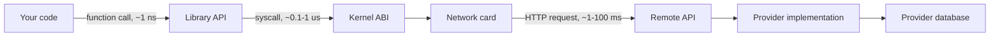

## In one minute
- An API (application programming interface) is a contract between two pieces of software: what the caller may ask for, in what shape, and what it gets back, including how failures look.
- The same idea appears at every layer: a function signature, a library's exported symbols, the kernel's system call table, and an HTTP endpoint on another continent. What changes is the cost of a call and the cost of changing the contract.
- An API's real contract is everything callers can observe, not only what the documentation promises (Hyrum's law). Treat observable behaviour as part of the surface.
- Once an API has callers you do not control, you can add to it but you cannot take away. Compatibility rules, versioning and deprecation are the core engineering work, not paperwork.
- A good API hides the implementation so the provider can change it freely, and exposes just enough for callers to do their job without guessing.

## How it works

### A contract, not a URL
People often say "API" when they mean "an HTTP endpoint that returns JSON". That is one kind. The general idea is older and broader: an API is the agreed boundary between code that provides a capability and code that uses it. `sort(list)` in a standard library, `write(fd, buf, n)` in the Linux kernel, and `POST /v1/payments` at a payment provider are all APIs. Each has inputs, outputs, error behaviour and promises about side effects.

For the caller the boundary is a promise; for the provider it is a wall behind which everything may change without asking anyone. A good API lets the provider change a lot behind the wall without breaking anyone in front of it.

### The parts of a contract
A complete contract says more than the request and response shapes. It also covers semantics (side effects, ordering, whether repeating a call is safe), errors (how failure is reported and which failures are worth retrying), limits (rate, page size, payload size, latency), identity and permissions, and lifecycle (how long it will be honoured and how retirement is announced). Leaving one out does not remove it from the contract. Callers will infer it from behaviour, and you will discover what they inferred when you change it.

### Local, system and remote APIs
A **local API** is a function or class in the same process. A call costs nanoseconds, failures are exceptions, and the compiler checks the types. A **system API** crosses a privilege boundary, such as a system call into the kernel: it costs hundreds of nanoseconds and its rules are fixed by a binary convention, not by a language. A **remote API** crosses a network: it costs milliseconds, it can fail halfway, and nothing checks types unless you add a schema.

That last jump changes design. A local API can be chatty because calls are free. A remote API must be coarse, returning what a screen needs in one round trip, because each call can time out with an unknown outcome. This is the partial-failure problem shape, and it looks the same when an AI agent's tool call that sends an email times out: did it send?

The audience matters as much as the distance. A private API serves one team, so caller and provider change together in one pull request. A public API serves callers you will never meet, so every change must be backward compatible or versioned. The audience sets how expensive change is, and therefore how much care the first design deserves.

### Hyrum's law
Hyrum Wright at Google observed that with enough users, every observable behaviour of an API will be depended on by somebody, whatever the documentation says ([hyrumslaw.com](https://www.hyrumslaw.com/)). Someone relies on the order your list happens to come back in, or parses your error text. So make undocumented behaviour unobservable where you can, document what you do promise, and assume any visible change breaks somebody. Go 1 did the first of these on purpose: it defined map iteration order as unpredictable, even across two runs of the same loop, so no program could come to rely on it ([Go 1 release notes](https://go.dev/doc/go1)).

## Down the stack

### Layer 1: The contract
State the contract precisely enough to test: input schemas with required fields, output schemas with which fields are always present, every error code and whether it is retryable, whether each operation is safe to repeat, read-after-write consistency, limits, and the compatibility policy. The usual policy for a stable API is that callers written against version N keep working against every later release of version N. The provider may add optional request fields, response fields, operations and error detail. It may not remove or rename fields, change types, make an optional input required, or stop returning a field promised to be present ([Google AIP-180](https://google.aip.dev/180)).

The policy also needs a time bound: how long an old version is honoured once a new one exists. Large public APIs now state it as a number. GitHub's REST API names versions by release date in an `X-GitHub-Api-Version` header, falls back to `2022-11-28` when the header is missing, keeps each superseded version for at least 24 months, and answers `410 Gone` after that ([GitHub docs](https://docs.github.com/en/rest/about-the-rest-api/api-versions)).

### Layer 2: The mechanism
Compatibility is enforced by how the contract is encoded. In Protocol Buffers each field has a number, and on the wire a field is tagged with `(field_number << 3) | wire_type`. Names never appear on the wire, so renaming a field is safe and reusing a number is catastrophic; the `reserved` keyword exists to stop a deleted number being reused ([proto3 guide](https://protobuf.dev/programming-guides/proto3/)). Parsers skip fields with numbers they do not know. Early proto3 dropped them; since release 3.5 in November 2017 most implementations keep them as unknown fields by default, so a middle service passes them through ([protobuf changelog](https://fuchsia.googlesource.com/third_party/protobuf/+/v3.5.2/CHANGES.txt)). Newer `.proto` files declare an edition (`edition = "2023"` or `"2024"`) instead of `syntax = "proto3"`; editions merge the proto2 and proto3 behaviours into per-field feature settings, and the wire rules above do not change ([Protobuf editions](https://protobuf.dev/editions/overview/)). JSON APIs reach a similar place by convention: clients ignore unknown fields (a tolerant reader), and an OpenAPI schema lets a CI job diff two versions and flag breaking changes before release. When a breaking change is unavoidable, a translation layer can hide it. Stripe pins each account to the version current at its first request, writes every response in the newest shape, then runs a chain of version-change modules that rewrite it backwards to the caller's version; by 2017 that had absorbed almost a hundred incompatible changes since 2011 without breaking an integration ([Stripe](https://stripe.com/blog/api-versioning)). Since `2024-09-30.acacia` Stripe ships a version every month with no breaking changes and batches breaking ones into two major releases a year ([Stripe docs](https://docs.stripe.com/api/versioning)). For libraries, the mechanism is the symbol table: glibc uses symbol versioning, so a program linked against `memcpy@GLIBC_2.2.5` keeps calling the old behaviour after `memcpy@@GLIBC_2.14` was introduced. For retirement, HTTP has the `Deprecation` header (RFC 9745, March 2025), a structured date such as `Deprecation: @1688169599`, and the older `Sunset` header (RFC 8594), an HTTP date that must not be earlier than the deprecation date ([RFC 9745](https://www.rfc-editor.org/rfc/rfc9745.html)). Together they let clients and monitoring see both dates in every response.

### Layer 3: The machine
The Linux system call interface is the clearest example of a contract at machine level. On x86-64 a program puts the call number in register `rax` (for example 1 for `write`, 0 for `read`), the arguments in `rdi`, `rsi`, `rdx`, `r10`, `r8` and `r9`, and executes the `syscall` instruction ([syscall(2)](https://man7.org/linux/man-pages/man2/syscall.2.html)). The kernel returns a result in `rax`, with values from -4095 to -1 meaning an error number. Those numbers have not changed in decades, because a binary compiled in 2008 must still run. The kernel's first rule, set by Linus Torvalds, is "we don't cause regressions": userland APIs may change only if no existing application breaks. The rule covers only what the kernel offers to user space; the in-kernel module API changes freely ([kernel docs](https://docs.kernel.org/admin-guide/reporting-regressions.html)). That split is the public versus private distinction again. A system call costs roughly 100 ns to 1 µs depending on CPU and mitigations, against about 1 ns for a local function call. A remote call adds more orders of magnitude: about 0.2 to 1 ms inside one data centre, and 60 to 150 ms across continents, plus the bytes. A small JSON request with headers is often 500 bytes to 2 KB; the same message in Protobuf may be a third of that, because field names are replaced by one-byte tags for field numbers 1 to 15.

### Why it's built this way
1. Teams and programs evolve at different speeds, so they need a boundary that lets one side change without the other.
2. Callers you do not control cannot be upgraded on your schedule, so the boundary must be stable and change only by addition.
3. Addition only works if old readers ignore what they do not understand, so encodings tag fields by number or name and parsers skip unknown ones.
4. Every boundary crossing has a cost (a mode switch, a network round trip), so the further away the provider is, the coarser and more failure-aware the API must be.
5. Removal is still sometimes necessary, so it is done slowly and visibly: deprecation headers, usage metrics per caller, and a sunset date.

## Diagram


## Worked example
A food delivery company has a public `GET /v1/restaurants/{id}` endpoint used by its own mobile apps and by 40 partner integrations. The response has `"price_level": 2` as an integer. The team wants to change it to a string, `"$$"`, to match a new design.

First, count the callers. App store data shows 18% of active users run an app version older than six months, and those versions parse `price_level` as an integer, so a type change would crash the restaurant screen for roughly one user in five. The partners deploy on their own schedules, some quarterly.

The compatible path is to add, not change: ship `"price_display": "$$"` alongside `price_level`. The team cannot see which fields a client reads, so it assumes every field is used. If `price_level` must eventually go, they send `Deprecation` and `Sunset` headers for six months, email the partners, and wait until traffic from old clients falls below an agreed threshold, say 0.5%, before removing it in `/v2`.

Keeping the extra field costs about 20 bytes per response: at 3,000 requests per second that is 60 KB/s, about 5 GB a day before compression. Breaking 18% of mobile users costs an incident. That asymmetry is why stable APIs grow by addition.

## In the wild
- **npm, 2016: one unpublished package breaks thousands of builds.** On 22 March an author unpublished `left-pad` and 272 other packages after a naming dispute. A look-alike `left-pad` 1.0.0 appeared within minutes, but dependency chains pinned to 0.0.3 kept failing until npm restored the original from backup; the breakage lasted about 2.5 hours across "many thousands of projects". npm then made it harder to unpublish versions that others depend on ([npm](https://blog.npmjs.org/post/141577284765/kik-left-pad-and-npm)). Removal is the one change an API with unknown callers cannot make quickly.
- **Google, 2018: an API exposed more than its contract promised.** A Google+ People API bug let apps read profile fields that users had shared with a friend but not made public, such as name, email, occupation, gender and age. Up to 500,000 accounts and up to 438 apps were in scope; logs kept for only two weeks meant Google could not tell who was affected. It patched the API in March 2018 and later shut down consumer Google+ ([Google](https://blog.google/technology/safety-security/project-strobe/)).
- **LinkedIn, 2023: changing the encoding without changing the contract.** LinkedIn swapped JSON for Protocol Buffers under its 50,000+ Rest.li endpoints, keeping the same data models, and rolled it out gradually through client configuration so it was almost transparent to application developers. Services with large payloads saw up to 60% lower latency, from smaller payloads and less serialization CPU ([LinkedIn](https://www.linkedin.com/blog/engineering/infrastructure/linkedin-integrates-protocol-buffers-with-rest-li-for-improved-m)). A clean contract is what made a fleet-wide change behind the wall possible.

## Trade-offs
| Option | Strengths | Weaknesses | Choose when |
|---|---|---|---|
| Change in place, no versioning | Simplest, one code path | Breaks unknown callers | Private APIs where you can update every caller in one change |
| Additive evolution only | No client migration, one version to run | Fields accumulate, naming gets messy | Most APIs, most of the time |
| Version in the path (`/v2`) | Clear, easy to route and measure | Two versions to run, big-bang migrations | Rare, deliberate breaking redesigns |
| Dated versions per caller (Stripe style) | Small breaking changes without forking the API | Needs a translation layer per version | Large public APIs with many slow-moving integrators |
| Release trains (Stripe since 2024) | Monthly additive releases, breaking changes batched twice a year | Integrators still face periodic migrations | Fast-moving APIs that want a predictable upgrade calendar |
| Schema-first with generated clients | Types checked at build time, breaking changes caught in CI | Tooling and code generation to maintain | Internal RPC and partner SDKs |

## Pitfalls in production
- **Leaking the database schema.** Returning table columns as the response ties every caller to your storage layout, so a migration becomes a breaking change. Define response types separately and map to them.
- **Error messages as the contract.** Clients that parse `"message": "card declined"` break when someone fixes a typo. Provide stable machine-readable codes (for example an RFC 9457 `type`) and treat message text as free to change.
- **Reusing field numbers or names.** A deleted Protobuf field number reused for a new field makes old clients read garbage. Mark deleted numbers and names `reserved`.
- **Strict parsing of responses.** A client that rejects unknown fields turns every additive change into an outage. Configure deserializers to ignore unknown fields in clients.
- **No per-caller visibility.** Without request logs keyed by API key and client version you cannot know who uses a deprecated field, so it is never removed. Tag every request with caller identity from the start.

## Leadership lens
- Ask in design review: who are the callers, can we update all of them ourselves, and what is our compatibility policy in one sentence? The answers decide how much design time the first version deserves.
- Make breaking-change detection automatic: a CI check that diffs the OpenAPI or Protobuf schema against the last release is cheaper than any review process.
- Budget for the long tail. Each public version you keep alive costs on-call attention, test matrix and security patches; put a sunset policy in writing before launch.
- Assign an owner for each public API surface. Without one, every team adds fields in its own style and the API becomes the org chart.

## Check yourself
1. You add a new optional field to a JSON response and a partner's integration breaks. What went wrong, and whose fix is it?
   **Answer:** The partner's client parses strictly and rejects unknown fields. Adding response fields is compatible under the usual contract, so the client should be tolerant, but you should have documented that rule explicitly and can roll back while they fix it.
2. Why is renaming a field safe in Protobuf but breaking in JSON?
   **Answer:** Protobuf puts field numbers, not names, on the wire, so a rename changes only generated code. JSON carries field names in every message, so old readers no longer find the field.
3. Why must a remote API be coarser than a local one?
   **Answer:** Each remote call costs a network round trip and can fail with an unknown outcome, so many small calls multiply latency and failure points. Returning what a use case needs in one call keeps both low.
4. What does Hyrum's law imply for a change that "only touches undocumented behaviour"?
   **Answer:** Some caller probably depends on it anyway, so it still needs the caution of a contract change: measure, announce, and roll out gradually.

## Practice
**Task:** Write a breaking-change detector for API schemas. A schema maps field names to a field description with `type` (a string such as `"string"`, `"int"` or `"enum"`), `required` (bool) and, for enums, `values` (a list of strings). `breaking_changes(old, new, direction)` compares two versions of one message, where `direction` is `"request"` (clients write it, the server reads it) or `"response"` (the server writes it, clients read it); any other direction is an error. For each field in `old`: missing from `new` gives `removed:<field>`; a different type gives `type:<field>` and no further checks for that field. For responses, a field that was required and is now optional gives `optional:<field>`, and an enum that gained values gives `enum_added:<field>`. For requests, a field that was optional and is now required gives `required:<field>`, an enum that lost values gives `enum_removed:<field>`, and a field new in `new` that is required also gives `required:<field>`. Return the findings sorted as strings.

```python starter
def breaking_changes(old, new, direction):
    # TODO
    raise NotImplementedError
```

```python tests
def f(t, required, values=None):
    d = {"type": t, "required": required}
    if values is not None:
        d["values"] = values
    return d

def test_identical_schema_has_no_findings():
    s = {"id": f("string", True), "note": f("string", False)}
    assert breaking_changes(s, s, "response") == []
    assert breaking_changes(s, s, "request") == []

def test_adding_optional_fields_is_safe():
    old = {"id": f("string", True)}
    new = {"id": f("string", True), "tag": f("string", False)}
    assert breaking_changes(old, new, "request") == []
    assert breaking_changes(old, new, "response") == []

def test_removed_and_type_changes():
    old = {"id": f("string", True), "price": f("int", True), "old": f("string", False)}
    new = {"id": f("string", True), "price": f("string", True)}
    assert breaking_changes(old, new, "response") == ["removed:old", "type:price"]

def test_response_required_to_optional():
    old = {"email": f("string", True)}
    new = {"email": f("string", False)}
    assert breaking_changes(old, new, "response") == ["optional:email"]
    assert breaking_changes(old, new, "request") == [], "loosening input is fine"

def test_request_new_required_and_tightened():
    old = {"amount": f("int", False)}
    new = {"amount": f("int", True), "currency": f("string", True)}
    assert breaking_changes(old, new, "request") == ["required:amount", "required:currency"]
    assert breaking_changes(old, new, "response") == []

def test_enum_direction_matters():
    old = {"status": f("enum", True, ["active", "closed"])}
    grown = {"status": f("enum", True, ["active", "closed", "paused"])}
    shrunk = {"status": f("enum", True, ["active"])}
    assert breaking_changes(old, grown, "response") == ["enum_added:status"]
    assert breaking_changes(old, grown, "request") == []
    assert breaking_changes(old, shrunk, "request") == ["enum_removed:status"]
    assert breaking_changes(old, shrunk, "response") == []

def test_type_change_skips_other_checks():
    old = {"status": f("enum", True, ["a"])}
    new = {"status": f("string", False)}
    assert breaking_changes(old, new, "response") == ["type:status"]

def test_bad_direction_raises():
    try:
        breaking_changes({}, {}, "both")
    except ValueError:
        return
    assert False, "expected ValueError"
```

```python solution
def breaking_changes(old, new, direction):
    if direction not in ("request", "response"):
        raise ValueError("direction must be request or response")
    out = []
    for name, of in old.items():
        nf = new.get(name)
        if nf is None:
            out.append("removed:" + name)
            continue
        if of["type"] != nf["type"]:
            out.append("type:" + name)
            continue
        old_vals = set(of.get("values") or [])
        new_vals = set(nf.get("values") or [])
        if direction == "response":
            if of["required"] and not nf["required"]:
                out.append("optional:" + name)
            if of["type"] == "enum" and new_vals - old_vals:
                out.append("enum_added:" + name)
        else:
            if not of["required"] and nf["required"]:
                out.append("required:" + name)
            if of["type"] == "enum" and old_vals - new_vals:
                out.append("enum_removed:" + name)
    if direction == "request":
        for name, nf in new.items():
            if name not in old and nf["required"]:
                out.append("required:" + name)
    return sorted(out)
```

```typescript starter
export interface Field {
  type: string;
  required: boolean;
  values?: string[];
}

export function breakingChanges(
  oldS: Record<string, Field>,
  newS: Record<string, Field>,
  direction: string,
): string[] {
  throw new Error("TODO");
}
```

```typescript tests
function f(type: string, required: boolean, values?: string[]): Field {
  return values ? { type, required, values } : { type, required };
}

test("identical schema has no findings", () => {
  const s = { id: f("string", true), note: f("string", false) };
  assertEqual(breakingChanges(s, s, "response"), []);
  assertEqual(breakingChanges(s, s, "request"), []);
});
test("adding optional fields is safe", () => {
  const oldS = { id: f("string", true) };
  const newS = { id: f("string", true), tag: f("string", false) };
  assertEqual(breakingChanges(oldS, newS, "request"), []);
  assertEqual(breakingChanges(oldS, newS, "response"), []);
});
test("removed and type changes", () => {
  const oldS = { id: f("string", true), price: f("int", true), old: f("string", false) };
  const newS = { id: f("string", true), price: f("string", true) };
  assertEqual(breakingChanges(oldS, newS, "response"), ["removed:old", "type:price"]);
});
test("response required to optional", () => {
  const oldS = { email: f("string", true) };
  const newS = { email: f("string", false) };
  assertEqual(breakingChanges(oldS, newS, "response"), ["optional:email"]);
  assertEqual(breakingChanges(oldS, newS, "request"), [], "loosening input is fine");
});
test("request new required and tightened", () => {
  const oldS = { amount: f("int", false) };
  const newS = { amount: f("int", true), currency: f("string", true) };
  assertEqual(breakingChanges(oldS, newS, "request"), ["required:amount", "required:currency"]);
  assertEqual(breakingChanges(oldS, newS, "response"), []);
});
test("enum direction matters", () => {
  const oldS = { status: f("enum", true, ["active", "closed"]) };
  const grown = { status: f("enum", true, ["active", "closed", "paused"]) };
  const shrunk = { status: f("enum", true, ["active"]) };
  assertEqual(breakingChanges(oldS, grown, "response"), ["enum_added:status"]);
  assertEqual(breakingChanges(oldS, grown, "request"), []);
  assertEqual(breakingChanges(oldS, shrunk, "request"), ["enum_removed:status"]);
  assertEqual(breakingChanges(oldS, shrunk, "response"), []);
});
test("type change skips other checks", () => {
  const oldS = { status: f("enum", true, ["a"]) };
  const newS = { status: f("string", false) };
  assertEqual(breakingChanges(oldS, newS, "response"), ["type:status"]);
});
test("bad direction throws", () => {
  let threw = false;
  try {
    breakingChanges({}, {}, "both");
  } catch (e) {
    threw = true;
  }
  assert(threw, "expected an error");
});
```

```typescript solution
export interface Field {
  type: string;
  required: boolean;
  values?: string[];
}

export function breakingChanges(
  oldS: Record<string, Field>,
  newS: Record<string, Field>,
  direction: string,
): string[] {
  if (direction !== "request" && direction !== "response") {
    throw new Error("direction must be request or response");
  }
  const out: string[] = [];
  for (const name of Object.keys(oldS)) {
    const of = oldS[name];
    const nf = newS[name];
    if (nf === undefined) {
      out.push("removed:" + name);
      continue;
    }
    if (of.type !== nf.type) {
      out.push("type:" + name);
      continue;
    }
    const oldVals = new Set(of.values ?? []);
    const newVals = new Set(nf.values ?? []);
    if (direction === "response") {
      if (of.required && !nf.required) out.push("optional:" + name);
      if (of.type === "enum" && [...newVals].some((v) => !oldVals.has(v))) {
        out.push("enum_added:" + name);
      }
    } else {
      if (!of.required && nf.required) out.push("required:" + name);
      if (of.type === "enum" && [...oldVals].some((v) => !newVals.has(v))) {
        out.push("enum_removed:" + name);
      }
    }
  }
  if (direction === "request") {
    for (const name of Object.keys(newS)) {
      if (!(name in oldS) && newS[name].required) out.push("required:" + name);
    }
  }
  return out.sort();
}
```

```go starter
package practice

type Field struct {
	Type     string
	Required bool
	Values   []string
}

func BreakingChanges(oldS, newS map[string]Field, direction string) ([]string, error) {
	panic("TODO")
}
```

```go tests
package practice

import (
	"reflect"
	"testing"
)

func f(t string, required bool, values ...string) Field {
	return Field{Type: t, Required: required, Values: values}
}

func check(t *testing.T, oldS, newS map[string]Field, dir string, want []string) {
	t.Helper()
	got, err := BreakingChanges(oldS, newS, dir)
	if err != nil {
		t.Fatalf("unexpected error %v", err)
	}
	if len(got) == 0 && len(want) == 0 {
		return
	}
	if !reflect.DeepEqual(got, want) {
		t.Fatalf("%s: got %v, want %v", dir, got, want)
	}
}

func TestIdenticalSchemaHasNoFindings(t *testing.T) {
	s := map[string]Field{"id": f("string", true), "note": f("string", false)}
	check(t, s, s, "response", nil)
	check(t, s, s, "request", nil)
}

func TestAddingOptionalFieldsIsSafe(t *testing.T) {
	oldS := map[string]Field{"id": f("string", true)}
	newS := map[string]Field{"id": f("string", true), "tag": f("string", false)}
	check(t, oldS, newS, "request", nil)
	check(t, oldS, newS, "response", nil)
}

func TestRemovedAndTypeChanges(t *testing.T) {
	oldS := map[string]Field{"id": f("string", true), "price": f("int", true), "old": f("string", false)}
	newS := map[string]Field{"id": f("string", true), "price": f("string", true)}
	check(t, oldS, newS, "response", []string{"removed:old", "type:price"})
}

func TestResponseRequiredToOptional(t *testing.T) {
	oldS := map[string]Field{"email": f("string", true)}
	newS := map[string]Field{"email": f("string", false)}
	check(t, oldS, newS, "response", []string{"optional:email"})
	check(t, oldS, newS, "request", nil)
}

func TestRequestNewRequiredAndTightened(t *testing.T) {
	oldS := map[string]Field{"amount": f("int", false)}
	newS := map[string]Field{"amount": f("int", true), "currency": f("string", true)}
	check(t, oldS, newS, "request", []string{"required:amount", "required:currency"})
	check(t, oldS, newS, "response", nil)
}

func TestEnumDirectionMatters(t *testing.T) {
	oldS := map[string]Field{"status": f("enum", true, "active", "closed")}
	grown := map[string]Field{"status": f("enum", true, "active", "closed", "paused")}
	shrunk := map[string]Field{"status": f("enum", true, "active")}
	check(t, oldS, grown, "response", []string{"enum_added:status"})
	check(t, oldS, grown, "request", nil)
	check(t, oldS, shrunk, "request", []string{"enum_removed:status"})
	check(t, oldS, shrunk, "response", nil)
}

func TestTypeChangeSkipsOtherChecks(t *testing.T) {
	oldS := map[string]Field{"status": f("enum", true, "a")}
	newS := map[string]Field{"status": f("string", false)}
	check(t, oldS, newS, "response", []string{"type:status"})
}

func TestBadDirectionErrors(t *testing.T) {
	if _, err := BreakingChanges(map[string]Field{}, map[string]Field{}, "both"); err == nil {
		t.Fatal("expected an error")
	}
}
```

```go solution
package practice

import (
	"errors"
	"sort"
)

type Field struct {
	Type     string
	Required bool
	Values   []string
}

var ErrDirection = errors.New("direction must be request or response")

// missing reports whether some value in a is absent from b.
func missing(a, b []string) bool {
	set := map[string]bool{}
	for _, v := range b {
		set[v] = true
	}
	for _, v := range a {
		if !set[v] {
			return true
		}
	}
	return false
}

func BreakingChanges(oldS, newS map[string]Field, direction string) ([]string, error) {
	if direction != "request" && direction != "response" {
		return nil, ErrDirection
	}
	out := []string{}
	for name, of := range oldS {
		nf, ok := newS[name]
		if !ok {
			out = append(out, "removed:"+name)
			continue
		}
		if of.Type != nf.Type {
			out = append(out, "type:"+name)
			continue
		}
		if direction == "response" {
			if of.Required && !nf.Required {
				out = append(out, "optional:"+name)
			}
			if of.Type == "enum" && missing(nf.Values, of.Values) {
				out = append(out, "enum_added:"+name)
			}
		} else {
			if !of.Required && nf.Required {
				out = append(out, "required:"+name)
			}
			if of.Type == "enum" && missing(of.Values, nf.Values) {
				out = append(out, "enum_removed:"+name)
			}
		}
	}
	if direction == "request" {
		for name, nf := range newS {
			if _, ok := oldS[name]; !ok && nf.Required {
				out = append(out, "required:"+name)
			}
		}
	}
	sort.Strings(out)
	return out, nil
}
```

## Mock interview
**Prompt:** You own the public REST API of a ride-hailing platform, used by your own apps and about 300 partner integrations, serving 20,000 requests per second. Product wants to restructure the trip response, which today returns fare as a float in dollars, into a structured money object with currency and minor units. Plan the change.

- Follow-up: How will you know which partners still read the old fare field, and when it is safe to remove it?
- Follow-up: A partner's integration crashed after you added a field to the response. What do you do in the next hour, and what do you change afterwards?
- Follow-up: Would you introduce `/v2`, dated versions, or keep evolving `/v1`? What would change your mind?

**A strong answer covers:**
- Additive change first: add a `fare` object (amount in minor units as an integer, currency code) beside the old float field, never change the old field's type.
- Per-caller telemetry by API key and client version, deprecation and sunset headers, direct partner communication, and a traffic threshold before removal.
- A written compatibility policy (clients must ignore unknown fields; the server never removes or retypes fields within a version) plus a CI schema diff that blocks breaking changes.
- Rollback for the incident, then fixing the policy or documentation gap that let it happen.
- A reasoned versioning choice: additive by default, a new major version or dated versions only when the accumulated debt justifies running two contracts.

## Sources and further study
**Primary**
- [RFC 9745: The Deprecation HTTP Response Header Field](https://www.rfc-editor.org/rfc/rfc9745.html): the structured deprecation date and how it pairs with `Sunset`.
- [Linux kernel: Reporting regressions](https://docs.kernel.org/admin-guide/reporting-regressions.html): the "no regressions" rule and exactly which interfaces it covers.
- [Go 1 release notes](https://go.dev/doc/go1): the compatibility promise and the deliberate unpredictability of map iteration.

**Systems docs**
- [Stripe: API versioning](https://docs.stripe.com/api/versioning): per-account pinned versions and the monthly and twice-yearly release trains.
- [GitHub: API versions](https://docs.github.com/en/rest/about-the-rest-api/api-versions): calendar versions in a header with a published 24-month support window.
- [Protobuf: Editions overview](https://protobuf.dev/editions/overview/): how editions replace the proto2 and proto3 labels with feature flags.

**Books**
- *Software Engineering at Google*, Winters, Manshreck and Wright (eds.), chapter 1 "What Is Software Engineering?" (Hyrum's law and time as the key dimension) and chapter 15 "Deprecation".
- *Designing Data-Intensive Applications* (2nd edition), Martin Kleppmann and Chris Riccomini, chapter 5 "Encoding and Evolution": forward and backward compatibility across JSON, Protobuf and Avro.
- *Release It!* (2nd edition), Michael T. Nygard, chapter 14 "Handling Versions": helping callers survive your changes and surviving theirs.

**Other curricula**
- [donnemartin/system-design-primer](https://github.com/donnemartin/system-design-primer): treats APIs as a choice between RPC and REST with a comparison table; it does not cover compatibility or deprecation.
- [roadmap.sh: API Design](https://roadmap.sh/api-design): a broad checklist of API types, standards and security topics, useful for spotting what you have not studied yet.

## Watch
- [How To Design A Good API and Why it Matters (Google TechTalks)](https://www.youtube.com/watch?v=aAb7hSCtvGw): Joshua Bloch on API design principles that hold for libraries and network APIs alike.
- [APIs Explained in 6 Minutes! (ByteByteGo)](https://www.youtube.com/watch?v=hltLrjabkiY): a quick visual tour of what APIs are and the common kinds.
- [What is an API? (MuleSoft Videos)](https://www.youtube.com/watch?v=s7wmiS2mSXY): a three-minute introduction for anyone new to the term.

## Free resources
- [Hyrum's Law](https://www.hyrumslaw.com/): the one-paragraph statement of why every observable behaviour becomes part of the contract.
- [Tolerant Reader (Martin Fowler)](https://martinfowler.com/bliki/TolerantReader.html): why clients should ignore what they do not understand.
- [AIP-180: Backwards compatibility (Google)](https://google.aip.dev/180): a precise list of which API changes are and are not compatible.
- [Protocol Buffers: proto3 language guide](https://protobuf.dev/programming-guides/proto3/): field numbers, reserved fields, unknown fields and the rules for updating a message.
- [Linux kernel ABI documentation](https://www.kernel.org/doc/html/latest/admin-guide/abi.html): how the kernel classifies its interfaces by stability.
- [RFC 8594: The Sunset HTTP Header Field](https://www.rfc-editor.org/rfc/rfc8594): a standard way to announce when an endpoint will stop working.
