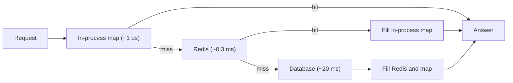

## In one minute
- A cache is a small, fast copy of data kept closer to whoever reads it, so most reads avoid a slower, more expensive trip to the source of truth.
- Caching only works because access is skewed and repetitive: a few keys get most of the reads (temporal locality), and nearby data tends to be read together (spatial locality).
- The number that matters is the miss ratio, not the hit ratio. Average latency is `hit_time + miss_ratio x miss_penalty`, so going from 98% to 99% hits halves the load on the source.
- Every cache trades freshness and memory for speed. Before adding one, decide how stale an answer may be, what the key must include, and what happens when the cache is empty.
- The same idea appears at every layer of a computer, from CPU cache lines to the OS page cache, database buffer pools, Redis, CDNs, DNS resolvers and the prompt cache in front of an LLM.

## How it works

### A copy, kept close
Every read has a source of truth: a row on disk, an object in a bucket, a response computed by a service. Reading it costs time (seeks, round trips, query planning, inference) and capacity (connections, CPU, IOPS). A cache keeps copies of recent answers in a faster medium, usually RAM closer to the reader, and answers repeat questions from them.

Being a copy explains everything else. It is smaller than the source, so something must decide what to keep (eviction). It can be out of date, so something must bound staleness (expiry and invalidation). And it can vanish at any moment, so the system must stay correct, just slower, when the cache is empty.

### Why it works at all: locality and skew
If every key were equally likely, a cache holding 10% of the data would answer 10% of reads. Real workloads are heavily skewed. Product views, profiles, video segments and DNS names often follow a Zipf-like curve, where the k-th most popular item is read in proportion to `1/k^s` with `s` near 1. Under that curve a cache holding 1% of 20 million keys serves roughly 70% of reads.

**Temporal locality** means something read now is likely to be read again soon. **Spatial locality** means data next to it is likely to be read next, which is why CPUs fetch 64-byte lines, the kernel reads ahead file pages and a CDN prefetches the next chunk of a stream. The set of items touched in a time window is the **working set**. If it fits, the hit ratio is high and stable; if it is slightly larger, the hit ratio can collapse, because a loop over N+1 items through an LRU cache of size N misses every time.

### The arithmetic of hits and misses
Average access time is `hit_time + miss_ratio x miss_penalty`. With a 0.5 ms Redis hit and a 20 ms query, 90% hits average 2.5 ms and 99% average 0.7 ms. For capacity, the load reaching the source is `reads x miss_ratio`: at 50,000 reads per second, 5,000 queries at 90% hits and 500 at 99%. Frame caching in misses, because each point near the top of the curve is worth far more than one near the bottom.

Caches stack: browser, CDN, in-process map, Redis, database buffer pool. Each layer sees only the misses of the layer above, a colder and flatter slice of traffic, so a lower hit ratio deeper down is expected rather than a tuning failure.

### Deciding what to cache
Good candidates are read far more than written, expensive to produce, tolerant of some staleness, and have a hot set that fits in memory: sessions, rendered pages, permission checks, feature flags, geocoding results. Poor candidates are values used to make irreversible decisions, such as a balance that authorises spending or stock counts that decide whether to sell.

The **cache key** must include every input that changes the answer. Forget the locale and a French user sees German prices; forget the tenant or auth scope and one customer sees another's data. HTTP encodes this as the `Vary` header, which lists the request headers a stored response depends on ([RFC 9111](https://www.rfc-editor.org/rfc/rfc9111#name-calculating-cache-keys-with)), and many real cache incidents are key bugs rather than staleness bugs.

### The same problem shape elsewhere
Caching is the "finding things fast" and "hot spots" shapes together. An AI platform meets it when it reuses the computed prefix of a long system prompt: provider prompt caches key on the exact prefix bytes, expire after a time to live and charge less for a hit, so the same questions apply. Anthropic's API, for example, needs a 100% identical prefix, keeps entries for 5 minutes by default (1 hour at extra cost) and bills a cache read at a fraction of the normal input price, typically a tenth ([Anthropic docs](https://platform.claude.com/docs/en/build-with-claude/prompt-caching)). What must the key include, how long is a hit valid, and what does a miss cost?

## Down the stack

### Layer 1: The contract
A cache promises less than people assume. A hit returns a value that was correct at some point within a staleness bound (a TTL, or the lag of an invalidation pipeline), and a lookup is much faster than the source. It does not promise that a key written a moment ago is still there: entries are evicted, expired, lost on restart or moved by resharding. It does not promise read-your-writes unless the write path touches the same cache the reader uses. A testable statement reads like: "p99 hit under 1 ms, staleness under 60 seconds, and the database survives 100% misses at 30% of peak."

### Layer 2: The mechanism
Every cache is a lookup structure plus per-entry metadata. A CPU cache is set-associative: an address splits into tag, set index and offset, and the hardware compares the tag against all 8 to 12 ways of one set in parallel. Linux keeps file pages in a per-file `xarray` at `address_space.i_pages`, so a `read()` of a cached page is a tree lookup and a copy. PostgreSQL's `shared_buffers` is an array of 8 KB buffers found through a hash table keyed on relation, fork and block number, each with a pin count and usage count. Redis stores a 24-bit access clock, or for LFU a 16-bit decay time plus an 8-bit logarithmic counter, in each object header ([Redis source](https://github.com/redis/redis/blob/unstable/src/evict.c)). It evicts without a separate list by sampling `maxmemory-samples` keys (5 by default) and evicting the best candidate ([Redis docs](https://redis.io/docs/latest/develop/reference/eviction/)). Caches differ far more in this metadata (recency, frequency, reference bits, expiry, dirty flags) than in their lookup structures. Which metadata pays off is an empirical question: a study of 153 production cache clusters at Twitter found many workloads more write-heavy than textbooks assume, TTLs that defined the working set, and FIFO doing as well as LRU on many of them ([Yang et al.](https://www.usenix.org/conference/osdi20/presentation/yang)).

Mattson's stack algorithm (1970) is the standard tool for reasoning about size. For each access it records the *stack distance*: one plus the number of distinct keys touched since the previous access to the same key. An LRU cache of capacity C hits exactly when that distance is at most C, so one pass over a trace yields the hit ratio for every size, the miss-ratio curve. Exact tracking is too heavy to run in production, but sampling a hashed subset of keys works: SHARDS builds curves in 1 MB of memory with average miss-ratio error under 0.01 ([Waldspurger et al.](https://www.usenix.org/conference/fast15/technical-sessions/presentation/waldspurger)).

### Layer 3: The machine
The latency gaps span six orders of magnitude. An L1 hit is about 1 ns, L2 about 4 ns, L3 10 to 20 ns, DRAM 80 to 100 ns, an NVMe random read 50 to 100 us, a same-datacenter round trip 0.2 to 0.5 ms, and a cross-continent one 70 to 150 ms. A Redis `GET` spends a few microseconds in the server; nearly all of its 0.3 ms is the network.

Granularity matters as much as speed. CPUs move 64-byte lines, so two threads writing different variables in one line bounce it between cores (false sharing), and a scattered linked list misses where an array streams. The kernel caches 4 KiB pages, so one cold byte costs a page read; a database caches 8 KB or 16 KB pages, so a row's neighbours come free. The transfer unit sets how much spatial locality a cache can exploit and how much memory it wastes when there is none.

### Why it's built this way
1. Fast storage is small and expensive per byte, slow storage large and cheap, so systems put a little fast memory in front of a lot of slow memory.
2. Access is skewed, so a small fast tier absorbs most reads.
3. The fast tier cannot hold everything, so it evicts, and it holds copies, so it needs a staleness bound.
4. Every copy can be rebuilt from the source, so caches may forget, which is what makes them cheap to run.

## Diagram


## Worked example
A catalogue service handles 40,000 reads per second at peak; the database sustains 3,000 queries per second. There are 20 million products averaging 3 KB.

The miss budget is 3,000 / 40,000, at most 7.5%, so with headroom we target 2%. Replaying a day of logs through the stack-distance algorithm gives the curve: 1 million products (3 GB) miss 6%, 2 million (6 GB) 2.5%, 4 million (12 GB) 1.8%, 8 million (24 GB) 1.5%. The curve flattens because the long tail is read too rarely for any cache to help, so we pick 4 million, about 15 GB with key and allocator overhead.

At 1.8% misses the database sees 720 queries per second and average latency is 0.3 + 0.018 x 20 = 0.66 ms. Add an in-process map of the top 20,000 products (60 MB per server, 5-second TTL) that catches 40% of reads at 1 us. Every request pays that lookup, and Redis now misses 3% of the colder traffic it sees (still 1.8% of all reads), so latency is `0.001 + 0.6 x (0.3 + 0.03 x 20)`, about 0.54 ms, and Redis load drops by 40%.

The empty-cache test: after a full flush the database would see 40,000 queries per second, thirteen times its capacity. Amazon calls a service in this state "addicted to its cache" and advises running load tests with caches disabled to prove the safeguards work ([AWS Builders' Library](https://aws.amazon.com/builders-library/caching-challenges-and-strategies/)). The design therefore also needs warming and a rate limit on the miss path, covered in the cache warming and stampede lessons.

## In the wild
- **Valve, 2015: a cache key without the user in it.** On 25 December, with Steam Store traffic 2,000% above a typical sale because of a DoS attack, Valve deployed a second caching configuration that wrongly cached pages for logged-in users. For about 90 minutes, store pages for some 34,000 users, including billing addresses and partial card numbers, could be served to other people. Valve shut the store, deployed a corrected configuration and purged edge caches before reopening ([Valve](https://store.steampowered.com/oldnews/19852)).
- **Facebook, 2013: leases against stale sets and thundering herds.** Facebook's memcached tier issues a lease token on a miss and refuses a later set if the key was deleted in between, which stops a slow reader from writing back stale data. The same leases limit each key to one refill every 10 seconds, so other readers wait briefly instead of all hitting the database; on herd-prone keys this cut peak database queries from 17,000 to 1,300 per second ([Nishtala et al.](https://www.usenix.org/conference/nsdi13/technical-sessions/presentation/nishtala)).
- **Slack, 2022: the cache was load-bearing.** A Consul agent rollout pulled memcached nodes out of service and replacements came up empty. Misses on group DM membership fanned out to every database shard, the database could not refill the cache, and retries kept it overloaded, so many users could not load Slack that morning. Slack moved the query to a channel-sharded table and audited other queries that only worked while the cache was warm ([Slack](https://slack.engineering/slacks-incident-on-2-22-22/)).

## Trade-offs
| Option | Strengths | Weaknesses | Choose when |
|---|---|---|---|
| In-process cache | Microsecond reads, no network | Copy per server, per-server staleness, app heap | Tiny hot sets, config |
| Shared remote cache (Redis, Memcached) | One copy per key, survives deploys, large | Network hop, another system to run | Shared data across a fleet |
| CDN or HTTP cache | Removes origin traffic, close to users | Public or carefully keyed content, purge delay | Static assets, public pages |
| Database buffer pool only | No extra system, always consistent | Still pays query parsing and connection cost | Working set fits in DB memory, modest QPS |
| No cache | Simplest, always fresh | Source carries full load | Write-heavy data, or staleness is harmful |

## Pitfalls in production
- **Keys missing an input.** A response cached without tenant, locale or permission scope leaks data. Build keys in one function that takes every input, and test that two users never share an entry.
- **Watching the wrong ratio.** 97% hits looks fine until you notice misses tripled from last week's 99%. Alert on miss rate and source load.
- **A working set slightly larger than the cache.** Hit ratio collapses instead of degrading gently. Size from the miss-ratio curve with margin and keep scans out of the cache.
- **Caching what is cheap.** A 0.2 ms primary-key lookup behind a 0.3 ms hop gets slower and gains a staleness bug. Cache expensive answers.
- **Treating the cache as storage.** Data written only to a cache disappears on eviction or restart. If it must survive, it belongs in a database.
- **A cache that refuses writes when full.** Redis's default `maxmemory-policy` is `noeviction`, which returns errors on writes at the memory limit instead of evicting ([redis.conf](https://raw.githubusercontent.com/redis/redis/unstable/redis.conf)). For a pure cache, set `maxmemory` and `allkeys-lru` or `allkeys-lfu` explicitly.

## Leadership lens
- Ask for the miss-ratio curve before approving cache memory; doubling a cache on the flat part of the curve buys nothing.
- Make the staleness budget an explicit product decision per data type.
- Require a tested answer to "what happens if this cache is empty at peak", because a cache the source cannot survive without is a hidden single point of failure. Marc Brooker calls this the cache's second mode: the system is stable at a high hit ratio and collapses at a low one ([Brooker](https://brooker.co.za/blog/2021/08/27/caches.html)).
- Treat caches as dependencies with owners, dashboards and on-call, not free performance.

## Check yourself
1. Your cache's hit ratio rises from 95% to 98%. By what factor does load on the database fall?
   **Answer:** Misses go from 5% to 2% of reads, so database load falls by a factor of 2.5.
2. Why can an LRU cache of 1,000 entries get no hits on a loop over 1,001 keys?
   **Answer:** Every key's stack distance is 1,001, one more than the capacity, so each key is evicted just before it is read again.
3. A deeper cache layer has a 60% hit ratio while the layer above has 95%. Is the deeper one badly tuned?
   **Answer:** Not necessarily. It only sees the 5% that missed above, the colder and flatter tail, so a lower hit ratio is expected.
4. Why do CPUs fetch 64 bytes when a program reads 4?
   **Answer:** Spatial locality: neighbouring bytes are likely to be read next, and a line costs about the same as a word because the trip to memory dominates.

## Practice
**Task:** Build a cache sizing tool on Mattson's stack algorithm. `stack_distances(trace)` takes a list of keys and returns each access's LRU stack distance: 1 plus the number of distinct other keys accessed since the previous access to the same key, or -1 for a first access. `lru_hits(trace, sizes)` returns, for each capacity in `sizes`, how many accesses hit in an LRU cache of that capacity (distance between 1 and the capacity; capacity 0 never hits). `effective_latency(levels, backend)` takes `(hit_ratio, latency)` levels from nearest to farthest and returns the expected latency: each request pays every level it reaches, and only requests that miss all levels pay the backend.

```python starter
def stack_distances(trace):
    # TODO
    raise NotImplementedError

def lru_hits(trace, sizes):
    # TODO
    raise NotImplementedError

def effective_latency(levels, backend):
    # TODO
    raise NotImplementedError
```

```python tests
def test_first_access_is_cold():
    assert stack_distances(["a", "b", "c"]) == [-1, -1, -1]

def test_repeat_is_distance_one():
    assert stack_distances(["a", "a", "a"]) == [-1, 1, 1]

def test_distances_count_distinct_keys():
    assert stack_distances(["a", "b", "b", "c", "a", "b"]) == [-1, -1, 1, -1, 3, 3]

def test_loop_one_larger_than_cache_never_hits():
    trace = ["a", "b", "c"] * 4
    assert lru_hits(trace, [2, 3]) == [0, 9]

def test_hits_grow_with_size():
    trace = ["a", "b", "a", "c", "b", "d", "a", "b"]
    assert lru_hits(trace, [0, 1, 2, 3, 4]) == [0, 0, 1, 3, 4]

def test_empty_trace():
    assert stack_distances([]) == []
    assert lru_hits([], [1, 2]) == [0, 0]

def test_effective_latency_two_levels():
    got = effective_latency([(0.4, 0.001), (0.97, 0.3)], 20.0)
    assert abs(got - (0.001 + 0.6 * (0.3 + 0.03 * 20.0))) < 1e-9

def test_effective_latency_no_levels_is_backend():
    assert abs(effective_latency([], 20.0) - 20.0) < 1e-12
```

```python solution
def stack_distances(trace):
    stack = []
    out = []
    for key in trace:
        if key in stack:
            i = stack.index(key)
            out.append(i + 1)
            stack.pop(i)
        else:
            out.append(-1)
        stack.insert(0, key)
    return out

def lru_hits(trace, sizes):
    dists = stack_distances(trace)
    result = []
    for size in sizes:
        result.append(sum(1 for d in dists if 1 <= d <= size))
    return result

def effective_latency(levels, backend):
    total = 0.0
    reach = 1.0
    for hit_ratio, latency in levels:
        total += reach * latency
        reach *= 1.0 - hit_ratio
    return total + reach * backend
```

```typescript starter
export function stackDistances(trace: string[]): number[] {
  throw new Error("TODO");
}

export function lruHits(trace: string[], sizes: number[]): number[] {
  throw new Error("TODO");
}

export function effectiveLatency(levels: [number, number][], backend: number): number {
  throw new Error("TODO");
}
```

```typescript tests
test("first access is cold", () => {
  assertEqual(stackDistances(["a", "b", "c"]), [-1, -1, -1]);
});
test("repeat is distance one", () => {
  assertEqual(stackDistances(["a", "a", "a"]), [-1, 1, 1]);
});
test("distances count distinct keys", () => {
  assertEqual(stackDistances(["a", "b", "b", "c", "a", "b"]), [-1, -1, 1, -1, 3, 3]);
});
test("loop one larger than cache never hits", () => {
  const trace = ["a", "b", "c", "a", "b", "c", "a", "b", "c", "a", "b", "c"];
  assertEqual(lruHits(trace, [2, 3]), [0, 9]);
});
test("hits grow with size", () => {
  const trace = ["a", "b", "a", "c", "b", "d", "a", "b"];
  assertEqual(lruHits(trace, [0, 1, 2, 3, 4]), [0, 0, 1, 3, 4]);
});
test("empty trace", () => {
  assertEqual(stackDistances([]), []);
  assertEqual(lruHits([], [1, 2]), [0, 0]);
});
test("effective latency two levels", () => {
  const got = effectiveLatency([[0.4, 0.001], [0.97, 0.3]], 20);
  assert(Math.abs(got - (0.001 + 0.6 * (0.3 + 0.03 * 20))) < 1e-9, "two-level latency");
});
test("effective latency no levels is backend", () => {
  assert(Math.abs(effectiveLatency([], 20) - 20) < 1e-12, "backend only");
});
```

```typescript solution
export function stackDistances(trace: string[]): number[] {
  const stack: string[] = [];
  const out: number[] = [];
  for (const key of trace) {
    const i = stack.indexOf(key);
    if (i >= 0) {
      out.push(i + 1);
      stack.splice(i, 1);
    } else {
      out.push(-1);
    }
    stack.unshift(key);
  }
  return out;
}

export function lruHits(trace: string[], sizes: number[]): number[] {
  const dists = stackDistances(trace);
  return sizes.map((size) => dists.filter((d) => d >= 1 && d <= size).length);
}

export function effectiveLatency(levels: [number, number][], backend: number): number {
  let total = 0;
  let reach = 1;
  for (const [hitRatio, latency] of levels) {
    total += reach * latency;
    reach *= 1 - hitRatio;
  }
  return total + reach * backend;
}
```

```go starter
package practice

type Level struct {
	HitRatio float64
	Latency  float64
}

func StackDistances(trace []string) []int                { panic("TODO") }
func LRUHits(trace []string, sizes []int) []int           { panic("TODO") }
func EffectiveLatency(levels []Level, backend float64) float64 { panic("TODO") }
```

```go tests
package practice

import (
	"math"
	"reflect"
	"testing"
)

func eqInts(t *testing.T, got, want []int) {
	t.Helper()
	if !reflect.DeepEqual(got, want) {
		t.Fatalf("got %v, want %v", got, want)
	}
}

func TestFirstAccessIsCold(t *testing.T) {
	eqInts(t, StackDistances([]string{"a", "b", "c"}), []int{-1, -1, -1})
}

func TestRepeatIsDistanceOne(t *testing.T) {
	eqInts(t, StackDistances([]string{"a", "a", "a"}), []int{-1, 1, 1})
}

func TestDistancesCountDistinctKeys(t *testing.T) {
	eqInts(t, StackDistances([]string{"a", "b", "b", "c", "a", "b"}), []int{-1, -1, 1, -1, 3, 3})
}

func TestLoopOneLargerThanCacheNeverHits(t *testing.T) {
	trace := []string{}
	for i := 0; i < 4; i++ {
		trace = append(trace, "a", "b", "c")
	}
	eqInts(t, LRUHits(trace, []int{2, 3}), []int{0, 9})
}

func TestHitsGrowWithSize(t *testing.T) {
	trace := []string{"a", "b", "a", "c", "b", "d", "a", "b"}
	eqInts(t, LRUHits(trace, []int{0, 1, 2, 3, 4}), []int{0, 0, 1, 3, 4})
}

func TestEmptyTrace(t *testing.T) {
	eqInts(t, StackDistances([]string{}), []int{})
	eqInts(t, LRUHits([]string{}, []int{1, 2}), []int{0, 0})
}

func TestEffectiveLatencyTwoLevels(t *testing.T) {
	got := EffectiveLatency([]Level{{0.4, 0.001}, {0.97, 0.3}}, 20)
	want := 0.001 + 0.6*(0.3+0.03*20)
	if math.Abs(got-want) > 1e-9 {
		t.Fatalf("got %v, want %v", got, want)
	}
}

func TestEffectiveLatencyNoLevelsIsBackend(t *testing.T) {
	if math.Abs(EffectiveLatency(nil, 20)-20) > 1e-12 {
		t.Fatal("expected backend latency")
	}
}
```

```go solution
package practice

type Level struct {
	HitRatio float64
	Latency  float64
}

func StackDistances(trace []string) []int {
	stack := []string{}
	out := make([]int, 0, len(trace))
	for _, key := range trace {
		idx := -1
		for i, k := range stack {
			if k == key {
				idx = i
				break
			}
		}
		if idx >= 0 {
			out = append(out, idx+1)
			stack = append(stack[:idx], stack[idx+1:]...)
		} else {
			out = append(out, -1)
		}
		stack = append([]string{key}, stack...)
	}
	return out
}

func LRUHits(trace []string, sizes []int) []int {
	dists := StackDistances(trace)
	out := make([]int, len(sizes))
	for i, size := range sizes {
		for _, d := range dists {
			if d >= 1 && d <= size {
				out[i]++
			}
		}
	}
	return out
}

func EffectiveLatency(levels []Level, backend float64) float64 {
	total, reach := 0.0, 1.0
	for _, l := range levels {
		total += reach * l.Latency
		reach *= 1 - l.HitRatio
	}
	return total + reach*backend
}
```

## Mock interview
**Prompt:** A recommendations API serves 30,000 requests per second, each needing a feature vector that takes 15 ms to assemble from stores that together handle 4,000 lookups per second. Would you add a cache, where, and how would you size it?

- Follow-up: How would you decide the cache size without guessing? What data would you collect?
- Follow-up: The cache cluster restarts empty during peak. What happens, and how do you prevent an outage?
- Follow-up: Features update every few minutes. How stale can they be, and who decides?

**A strong answer covers:**
- The miss budget from the arithmetic: 4,000 / 30,000 means at most about 13% misses, and a safer design target of a few percent.
- Sizing from a replayed trace and a miss-ratio curve rather than a percentage of the dataset.
- Layer choice: a remote cache for the shared set, possibly a small in-process cache for the hottest users.
- A cache key that includes every input, such as the feature schema version, so a model rollout does not read old shapes.
- An explicit staleness budget and an empty-cache plan: warming, rate-limited misses and degraded fallbacks.

## Sources and further study
**Primary**
- [Nishtala et al., Scaling Memcache at Facebook (NSDI 2013)](https://www.usenix.org/conference/nsdi13/technical-sessions/presentation/nishtala): look-aside caching at billions of requests per second, leases, and invalidation from the commit log.
- [Yang, Yue and Rashmi, A large scale analysis of hundreds of in-memory cache clusters at Twitter (OSDI 2020)](https://www.usenix.org/conference/osdi20/presentation/yang): what real cache workloads look like, with traces released.
- [Waldspurger et al., Efficient MRC Construction with SHARDS (FAST 2015)](https://www.usenix.org/conference/fast15/technical-sessions/presentation/waldspurger): cheap miss-ratio curves by sampling.

**Systems docs**
- [Redis: Key eviction](https://redis.io/docs/latest/develop/reference/eviction/): the eviction policies, approximated LRU, LFU counters and the newer LRM policy.
- [Linux kernel: Memory management concepts](https://www.kernel.org/doc/html/latest/admin-guide/mm/concepts.html): the page cache and how file pages are cached and reclaimed.
- [Anthropic: Prompt caching](https://platform.claude.com/docs/en/build-with-claude/prompt-caching): prefix-keyed caching with TTLs and per-hit pricing, the same trade-offs in an LLM API.

**Books**
- *Understanding Distributed Systems*, Roberto Vitillo, chapters "HTTP caching" and "Caching": policies, local versus external caches, and the thundering-herd risk.
- *Systems Performance* (2nd edition), Brendan Gregg, chapters 6 "CPUs", 7 "Memory" and 8 "File Systems": CPU caches, the page cache and file system caching, with the tools to observe them.

**Other curricula**
- [Azure Architecture Center: Cache-Aside pattern](https://learn.microsoft.com/en-us/azure/architecture/patterns/cache-aside): frames caching as load-on-demand with explicit expiry and invalidation, and warns about consistency with the store.
- [donnemartin/system-design-primer](https://github.com/donnemartin/system-design-primer): walks through cache locations (client, CDN, web server, database, application) and update strategies at survey depth.

## Watch
- [Cache Systems Every Developer Should Know (ByteByteGo)](https://www.youtube.com/watch?v=dGAgxozNWFE): a tour of caches from CPU to CDN.
- [Basic Caching Techniques Explained (Hussein Nasser)](https://www.youtube.com/watch?v=ccemOqDrc2I): spatial and temporal locality and where they show up in backend systems.

## Free resources
- [What Every Programmer Should Know About Memory (Ulrich Drepper)](https://people.freebsd.org/~lstewart/articles/cpumemory.pdf): CPU caches, lines and associativity in depth.
- [Latency numbers every programmer should know](https://gist.github.com/jboner/2841832): the order-of-magnitude gaps that make caching worth doing.
- [Caching challenges and strategies (AWS Builders' Library)](https://aws.amazon.com/builders-library/caching-challenges-and-strategies/): how Amazon reasons about cache sizing, cold starts and dependence on caches.
- [Caches, modes, and unstable systems (Marc Brooker)](https://brooker.co.za/blog/2021/08/27/caches.html): why a system that relies on a cache's hit ratio has a dangerous second mode.
- [RFC 9111: HTTP Caching](https://www.rfc-editor.org/rfc/rfc9111): the precise rules for freshness, validation and cache keys on the web.
