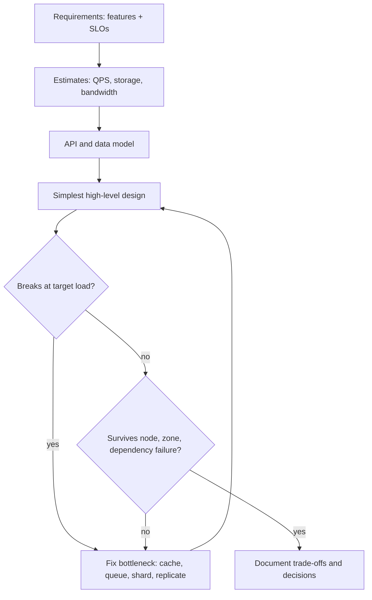

## In one minute
- System design is deciding how the parts of a software system are arranged, how they talk to each other, and where data lives, so that the whole meets its requirements under real load and real failures.
- The work starts from requirements, not technology: what users must be able to do, plus the numbers that matter (requests per second, data size, latency target, availability target, budget).
- Most designs are assembled from a small set of building blocks: load balancers, stateless services, caches, databases, queues, object storage and CDNs. The skill is knowing what each one costs and how each one fails.
- Every choice is a trade-off between latency, throughput, consistency, availability, cost and the effort to build and run it. A design is good when its trade-offs match the requirements and are written down.

## How it works

### Two halves: what and how much
A system has **functional requirements**, the things it does ("a user can upload a photo"), and **non-functional requirements**, the qualities it must have while doing them ("p99 upload under 2 seconds", "no acknowledged payment is ever lost"). Code mostly serves the first half. System design is mostly about the second.

The non-functional list is longer than speed and uptime. It also covers how easy the system is to operate and change, how secure it is, and what it costs to run. AWS's review checklist, for example, groups these into six pillars, including cost optimization and sustainability ([AWS Well-Architected](https://docs.aws.amazon.com/wellarchitected/latest/framework/the-pillars-of-the-framework.html)). Write down the constraints too: team size, deadline, compliance rules and the stack you already run. They rule out options as surely as a latency target does.

A photo app for a 40-person club runs on one server with a SQLite file. The same features for 50 million daily users need a CDN, object storage, sharded metadata, thumbnail workers and a plan for losing a data centre. Nothing in the feature list changed. The numbers did.

### The method
A repeatable way to work through any design. Most curricula teach a version of it; the System Design Primer, for one, uses four steps: use cases and constraints, high-level design, core components, then scaling ([System Design Primer](https://github.com/donnemartin/system-design-primer)).

1. **Clarify scope.** List the three to five features that matter and say out loud what is out of scope.
2. **Put numbers on it.** Estimate daily users, reads and writes per user, object sizes and retention. Turn those into peak QPS, storage and bandwidth. The Estimation Cheatsheet lesson collects the constants.
3. **Define the interface.** Write the main API calls and the data shape. This exposes access patterns, which decide indexes and stores.
4. **Draw the simplest design that could work.** Client, load balancer, stateless service, one database. Then ask where it breaks at the numbers from step 2.
5. **Fix the bottlenecks one at a time.** Add a cache where reads dominate, a queue where work can be deferred, partitioning where one machine cannot hold the data, replicas where one machine cannot be allowed to fail.
6. **Walk the failure modes.** What happens when a node dies, a zone goes away, a dependency gets slow, or a key gets hot? This often sends you back to step 4.

### The building blocks, and where each is covered
- **Spreading load.** What are Load Balancers?, Load Balancing Algorithms, DNS Load Balancing, Anycast Routing.
- **Making reads cheap.** What is Caching?, Caching Strategies, Distributed Cache Architecture, Content Delivery Network.
- **Storing data.** Common Database Types and SQL vs NoSQL to choose; Indexing, Database Replication and Sharding to scale.
- **Decoupling work.** Message Queues, Pub/Sub, Message Brokers, Delivery Semantics.
- **Surviving failure.** Availability, Single Point of Failure, Circuit Breaker Pattern, Bulkhead Pattern.
- **Agreeing on state.** CAP Theorem, Consistency Models, Consensus Algorithms, Raft Algorithm.

### The problem shapes underneath
Most design problems are a few recurring shapes: **overload**, **hot spots**, **partial failure**, **contention** (many writers, one record), **fan-out** (one event, many recipients), **duplicates**, **ordering** and **finding things fast**. A ticket sale and a viral post are both contention plus hot spots; a chat message and a push notification are both fan-out. Recognise the shape and you already know the shortlist of tools.

## Down the stack

### Layer 1: The contract
The contract of a system is its service level objectives, stated so they can be tested. Google's SRE book separates three terms: the indicator (SLI) is the measured quantity, the objective (SLO) is the target for it, and the agreement (SLA) adds consequences such as refunds when the target is missed ([SRE book, Ch 4](https://sre.google/sre-book/service-level-objectives/)). "Fast and reliable" is not a contract. "99% of `GET /feed` calls return in under 200 ms, measured at the load balancer over 28 days" is. So is "an acknowledged write survives the loss of any one availability zone."

Each clause constrains the design. Surviving a zone loss means synchronous cross-zone replication before acknowledging, a 1 to 2 ms round trip on every write. AWS places zones up to about 100 km apart, close enough for synchronous replication at single-digit millisecond latency ([AWS fault isolation whitepaper](https://docs.aws.amazon.com/whitepapers/latest/aws-fault-isolation-boundaries/availability-zones.html)). Writing the contract first lets you refuse complexity that no clause requires.

### Layer 2: The mechanism
Each building block delivers part of the contract through a concrete mechanism. A load balancer keeps a health-check state machine per backend. Redis keeps a hash table and, once you set `maxmemory` and an LRU policy, evicts by sampling a few keys (5 by default) and dropping the least recently used; on 64-bit builds there is no memory limit unless you set one ([Redis docs](https://redis.io/docs/latest/develop/reference/eviction/)). Postgres keeps a write-ahead log and B-trees, and replicates by shipping WAL records. Kafka keeps an append-only log per partition with consumer offsets. etcd runs Raft, committing an entry once a majority has it, so a 5-node cluster keeps working with 2 nodes down ([Raft](https://raft.github.io/)).

System design is choosing which mechanisms sit on each path. A feed read might go CDN, L7 proxy, service, Redis, and only on a miss a database partition chosen by consistent hashing. The write might go to the database leader, then through change data capture into Kafka, which fans out to caches and search.

### Layer 3: The machine
Everything above is bounded by physics. Rough numbers worth memorising (the classic table is [Latency numbers every programmer should know](https://gist.github.com/jboner/2841832); its SSD row of 150 us is from older drives):

- A main memory reference costs about 100 ns.
- An NVMe SSD random read is about 50 to 100 us; a durable `fsync` on a good SSD is roughly 0.1 to 1 ms, and on a spinning disk 5 to 10 ms.
- A round trip inside one data centre is about 0.2 to 0.5 ms. Across zones in a region it is 1 to 2 ms. Across a continent it is 30 to 70 ms, and across an ocean 70 to 150 ms.
- A 10 Gbit/s NIC moves at most about 1.2 GB/s. A 25 Gbit/s NIC moves about 3 GB/s.

These numbers explain most designs. Caches exist because memory is about 1,000 times faster than an SSD read. Batching exists because `fsync` and round trips have fixed costs worth amortising. Regions exist because the speed of light makes a 150 ms round trip unavoidable across an ocean.

### Why it's built this way
1. **One machine has hard limits** on cores, memory, disk throughput and NIC bandwidth, and it fails as a unit. So large systems spread work and data across many machines.
2. **Machines talk over a network** that is slow and can drop, delay or reorder messages, and a node cannot tell a crashed peer from a slow one ([Kleppmann's lecture notes](https://www.cl.cam.ac.uk/teaching/2122/ConcDisSys/dist-sys-notes.pdf)). So designs minimise round trips and plan for partial failure.
3. **Data that lives in several places can disagree.** So every design picks a consistency model per piece of data, and pays for stronger ones in latency or availability.
4. **Hardware and people cost money.** So the target is enough scale with headroom, and the simplest design that meets the contract wins.

## Diagram


## Worked example
A team is building a link-preview service: given a URL, return the title, description and image of the page. Product expects 5 million daily active users, each triggering about 20 previews a day.

**Numbers.** 100 million previews a day is about 1,160 per second on average; plan for 4 times that at peak, about 4,600 per second. A sample shows 85% of requests hit a URL already fetched in the last day.

**Simplest design.** A stateless service fetches the URL, parses the HTML and returns JSON. A fetch takes 300 ms to 3 seconds plus about 20 ms of CPU to parse. At 4,600 per second that is 92 cores of parsing, thousands of open outbound connections, and a service that hammers popular sites.

**Fix 1: cache.** Put a shared cache keyed by normalised URL, with a 24-hour TTL, in front. 85% of requests now return in about 1 ms from Redis. Only 690 per second go out to fetch, which needs about 14 cores of parsing at peak.

**Fix 2: decouple the slow work.** On a miss the service returns a placeholder and enqueues the URL; workers fetch, parse and fill the cache. Duplicate misses collapse into one job keyed by the URL hash.

**Fix 3: failure walk.** If Redis is lost, every request misses: the queue absorbs the burst and previews degrade to placeholders. If one target site gets slow, a per-host concurrency limit (a bulkhead) stops it tying up every worker.

**Fleet size.** With 8 ms of CPU per cache-hit request at 16 cores per machine and a 60% utilisation target, the front tier needs `ceil(4,600 × 8 / (16,000 × 0.6))`, which is 4 machines, plus 2 spares so it survives a machine failure during a deploy. The practice task below builds exactly this calculator, checking CPU, memory and network to find which one binds.

## In the wild
- **AWS, 2017: S3 outgrows its own recovery path.** On 28 February an engineer removing a few billing servers mistyped an input and removed capacity behind S3's index and placement subsystems in us-east-1. Both needed a full restart, which had not been done in the larger regions for many years while S3 grew a great deal, so recovery took from 9:37 to 13:54 PST. Even the status dashboard depended on S3. AWS made the tool remove capacity slowly, enforced minimum capacity, and sped up splitting the index into cells ([AWS](https://aws.amazon.com/message/41926/)).
- **Cloudflare, 2023: the failure walk that was never run.** Facility PDX-04 lost utility power and generators, and the batteries, rated for about 10 minutes, began failing after 4. The control plane was meant to survive losing one facility, but some services quietly depended on Kafka and ClickHouse that ran only there, and a whole-facility test had never been done. Control plane and analytics were impaired for about 40 hours. Cloudflare now requires generally available products to run on the high-availability cluster and tests removing whole facilities ([Cloudflare](https://blog.cloudflare.com/post-mortem-on-cloudflare-control-plane-and-analytics-outage/)).
- **Slack, 2021: the numbers changed overnight.** On the first working day of the year, cold client caches and a traffic surge overloaded an AWS Transit Gateway. Autoscaling tried to add about 1,200 servers, which mostly failed on open-file and quota limits, and dashboards sat behind the same gateway. Slack was down or degraded from about 7:00 to 10:40 PST. Slack planned to request gateway upscaling ahead of holidays and to load-test provisioning ([Slack](https://slack.engineering/slacks-outage-on-january-4th-2021/)).

## Trade-offs
| Option | Strengths | Weaknesses | Choose when |
|---|---|---|---|
| Single server with a local database | Cheapest, simplest to debug, no network failures between parts | One failure takes everything down; hard ceiling on scale | Prototypes, internal tools, low stakes |
| Stateless services behind a load balancer, one database | Easy horizontal scaling of compute, simple consistency | Database becomes the bottleneck and the single point of failure | Most products in their first years |
| Add caches and read replicas | Large read capacity, lower latency | Stale reads, invalidation bugs, cache stampedes | Read-heavy workloads with tolerable staleness |
| Partition data and add queues | Scales writes and storage, isolates slow work | Cross-partition queries and transactions get hard; more moving parts | Data or write rate exceeds one machine |

## Pitfalls in production
- **Designing for scale you will not have.** Ten microservices and a sharded cluster for 50 requests per second burns months. Start simple and know the next step.
- **No numbers.** "We need Kafka" versus "Postgres is fine" cannot be settled without a write rate. Put QPS, payload size and growth on the page first.
- **Ignoring the tail.** Average latency looks fine while p99 is 2 seconds, and a page making 30 backend calls hits that tail on about a quarter of loads (`1 - 0.99^30`). Set targets on percentiles; Google's SRE book makes the same case ([SRE book, Ch 4](https://sre.google/sre-book/service-level-objectives/)), and Dean and Barroso show how fan-out turns rare slowness into the common case ([The Tail at Scale](https://research.google/pubs/the-tail-at-scale/)).
- **Skipping the failure walk.** A design never asked "what if this box dies?" hides a single point of failure, usually the database or config store.
- **Undocumented trade-offs.** Months later someone "fixes" eventual consistency into a latency regression. Record each decision and the requirement it serves.

## Leadership lens
- Ask for requirements and numbers before boxes and arrows; a review that starts with a diagram ends in a debate about tools.
- Make every component justify itself by naming the requirement it serves; each one adds on-call load, upgrades, security patches and cost.
- Insist on a written failure walk for each critical path, with blast radius and detection time.
- Revisit the design when the numbers change by about 10 times. What was right at 1,000 QPS is rarely right at 100,000.

## Check yourself
1. Two products have identical features but one has 1,000 times the users. Which parts of the design change and why?
   **Answer:** The non-functional side: capacity, partitioning, caching, redundancy and failure handling. Features drive the API; the numbers decide machines, where state lives and what breaks.
2. Why do caches appear in almost every large design?
   **Answer:** Memory is around a thousand times faster than an SSD read, and real workloads repeat reads. Serving repeats from memory cuts latency and protects the slower store.
3. A requirement says "acknowledged writes survive the loss of a zone." What does that force on the write path?
   **Answer:** The write must be durable in at least two zones before the client gets an acknowledgement, which means synchronous cross-zone replication and a 1 to 2 ms round trip added to every write.
4. Why can the fleet size be bound by network or memory rather than CPU?
   **Answer:** Each resource is a separate limit. Large responses saturate the NIC before the CPU, and long-lived connections hold memory per request for the whole latency, so whichever resource runs out first sets the count.

## Practice
**Task:** Build a fleet sizer that finds which resource binds. `size_fleet(peak_qps, req, server, util_pct, spares)` takes a request profile (`cpu_ms`, `mem_kb` held while a request is in flight, `latency_ms`, `bytes_out`), a server (`cores`, `ram_mb`, `nic_mbps`), a target utilisation percentage and a number of spare machines. Using integer arithmetic, servers for CPU are `ceil(peak_qps × cpu_ms × 100 / (cores × 1000 × util_pct))`; for memory, in-flight requests follow Little's law, giving `ceil(peak_qps × latency_ms × mem_kb × 100 / (1000 × ram_mb × 1024 × util_pct))`; for network, `ceil(peak_qps × bytes_out × 8 × 100 / (nic_mbps × 1,000,000 × util_pct))`. Each count is at least 1. Return the three counts, the `binding` resource (the largest; ties go to cpu, then memory, then network) and `total` (largest count plus spares). Reject `util_pct` outside 1 to 100 or a negative `peak_qps`. Also write `worst_util_after_loss(peak_qps, req, server, servers, lost)`, returning the highest utilisation percentage (floored) across the three resources when only `servers - lost` machines remain; reject when none remain.

```python starter
def size_fleet(peak_qps, req, server, util_pct, spares):
    # TODO
    raise NotImplementedError

def worst_util_after_loss(peak_qps, req, server, servers, lost):
    # TODO
    raise NotImplementedError
```

```python tests
SERVER = {"cores": 16, "ram_mb": 32768, "nic_mbps": 10000}

def test_cpu_bound():
    req = {"cpu_ms": 8, "mem_kb": 256, "latency_ms": 50, "bytes_out": 20000}
    f = size_fleet(20000, req, SERVER, 60, 2)
    assert f == {"cpu": 17, "memory": 1, "network": 1, "binding": "cpu", "total": 19}

def test_network_bound():
    req = {"cpu_ms": 1, "mem_kb": 256, "latency_ms": 50, "bytes_out": 500000}
    f = size_fleet(20000, req, SERVER, 60, 0)
    assert f["cpu"] == 3 and f["network"] == 14
    assert f["binding"] == "network" and f["total"] == 14

def test_memory_bound_long_lived():
    req = {"cpu_ms": 1, "mem_kb": 2048, "latency_ms": 30000, "bytes_out": 100}
    f = size_fleet(20000, req, SERVER, 60, 1)
    assert f["memory"] == 62 and f["binding"] == "memory" and f["total"] == 63

def test_zero_load_still_needs_one_each():
    req = {"cpu_ms": 8, "mem_kb": 256, "latency_ms": 50, "bytes_out": 20000}
    f = size_fleet(0, req, SERVER, 60, 2)
    assert f == {"cpu": 1, "memory": 1, "network": 1, "binding": "cpu", "total": 3}

def test_rejects_bad_input():
    req = {"cpu_ms": 8, "mem_kb": 256, "latency_ms": 50, "bytes_out": 20000}
    for util in (0, 101):
        try:
            size_fleet(100, req, SERVER, util, 0)
            assert False, "should reject util %d" % util
        except ValueError:
            pass
    try:
        size_fleet(-1, req, SERVER, 50, 0)
        assert False, "should reject negative qps"
    except ValueError:
        pass

def test_util_after_loss():
    req = {"cpu_ms": 8, "mem_kb": 256, "latency_ms": 50, "bytes_out": 20000}
    assert worst_util_after_loss(20000, req, SERVER, 19, 2) == 58
    assert worst_util_after_loss(20000, req, SERVER, 19, 4) == 66
    assert worst_util_after_loss(20000, req, SERVER, 10, 0) == 100

def test_util_after_total_loss_rejected():
    req = {"cpu_ms": 8, "mem_kb": 256, "latency_ms": 50, "bytes_out": 20000}
    try:
        worst_util_after_loss(20000, req, SERVER, 3, 3)
        assert False, "no servers left"
    except ValueError:
        pass
```

```python solution
def _ceil_div(a, b):
    return -(-a // b)

def _demands(peak_qps, req, server):
    # (numerator, capacity per server at 100% utilisation), both scaled so num * 100 / cap = percent
    cpu = (peak_qps * req["cpu_ms"], server["cores"] * 1000)
    mem = (peak_qps * req["latency_ms"] * req["mem_kb"], 1000 * server["ram_mb"] * 1024)
    net = (peak_qps * req["bytes_out"] * 8, server["nic_mbps"] * 1000000)
    return [("cpu", cpu), ("memory", mem), ("network", net)]

def size_fleet(peak_qps, req, server, util_pct, spares):
    if util_pct < 1 or util_pct > 100:
        raise ValueError("util_pct must be 1..100")
    if peak_qps < 0:
        raise ValueError("peak_qps must be >= 0")
    out = {}
    binding, best = None, -1
    for name, (num, cap) in _demands(peak_qps, req, server):
        n = max(1, _ceil_div(num * 100, cap * util_pct))
        out[name] = n
        if n > best:
            binding, best = name, n
    out["binding"] = binding
    out["total"] = best + spares
    return out

def worst_util_after_loss(peak_qps, req, server, servers, lost):
    remaining = servers - lost
    if remaining <= 0:
        raise ValueError("no servers remain")
    return max((num * 100) // (cap * remaining) for _, (num, cap) in _demands(peak_qps, req, server))
```

```typescript starter
export interface Req { cpuMs: number; memKb: number; latencyMs: number; bytesOut: number; }
export interface Server { cores: number; ramMb: number; nicMbps: number; }
export interface Fleet { cpu: number; memory: number; network: number; binding: string; total: number; }

export function sizeFleet(peakQps: number, req: Req, server: Server, utilPct: number, spares: number): Fleet {
  throw new Error("TODO");
}

export function worstUtilAfterLoss(peakQps: number, req: Req, server: Server, servers: number, lost: number): number {
  throw new Error("TODO");
}
```

```typescript tests
const SRV: Server = { cores: 16, ramMb: 32768, nicMbps: 10000 };
const WEB: Req = { cpuMs: 8, memKb: 256, latencyMs: 50, bytesOut: 20000 };

function throwsErr(fn: () => unknown): boolean {
  try { fn(); return false; } catch (e) { return true; }
}

test("cpu bound", () => {
  assertEqual(sizeFleet(20000, WEB, SRV, 60, 2), { cpu: 17, memory: 1, network: 1, binding: "cpu", total: 19 });
});
test("network bound", () => {
  const f = sizeFleet(20000, { cpuMs: 1, memKb: 256, latencyMs: 50, bytesOut: 500000 }, SRV, 60, 0);
  assertEqual([f.cpu, f.network, f.binding, f.total], [3, 14, "network", 14]);
});
test("memory bound long lived", () => {
  const f = sizeFleet(20000, { cpuMs: 1, memKb: 2048, latencyMs: 30000, bytesOut: 100 }, SRV, 60, 1);
  assertEqual([f.memory, f.binding, f.total], [62, "memory", 63]);
});
test("zero load still needs one each", () => {
  assertEqual(sizeFleet(0, WEB, SRV, 60, 2), { cpu: 1, memory: 1, network: 1, binding: "cpu", total: 3 });
});
test("rejects bad input", () => {
  assert(throwsErr(() => sizeFleet(100, WEB, SRV, 0, 0)), "util 0");
  assert(throwsErr(() => sizeFleet(100, WEB, SRV, 101, 0)), "util 101");
  assert(throwsErr(() => sizeFleet(-1, WEB, SRV, 50, 0)), "negative qps");
});
test("util after loss", () => {
  assertEqual(worstUtilAfterLoss(20000, WEB, SRV, 19, 2), 58);
  assertEqual(worstUtilAfterLoss(20000, WEB, SRV, 19, 4), 66);
  assertEqual(worstUtilAfterLoss(20000, WEB, SRV, 10, 0), 100);
});
test("util after total loss rejected", () => {
  assert(throwsErr(() => worstUtilAfterLoss(20000, WEB, SRV, 3, 3)), "no servers left");
});
```

```typescript solution
export interface Req { cpuMs: number; memKb: number; latencyMs: number; bytesOut: number; }
export interface Server { cores: number; ramMb: number; nicMbps: number; }
export interface Fleet { cpu: number; memory: number; network: number; binding: string; total: number; }

function demands(peakQps: number, req: Req, server: Server): [string, number, number][] {
  return [
    ["cpu", peakQps * req.cpuMs, server.cores * 1000],
    ["memory", peakQps * req.latencyMs * req.memKb, 1000 * server.ramMb * 1024],
    ["network", peakQps * req.bytesOut * 8, server.nicMbps * 1000000],
  ];
}

export function sizeFleet(peakQps: number, req: Req, server: Server, utilPct: number, spares: number): Fleet {
  if (utilPct < 1 || utilPct > 100) throw new Error("utilPct must be 1..100");
  if (peakQps < 0) throw new Error("peakQps must be >= 0");
  const counts: Record<string, number> = {};
  let binding = "";
  let best = -1;
  for (const [name, num, cap] of demands(peakQps, req, server)) {
    const n = Math.max(1, Math.ceil((num * 100) / (cap * utilPct)));
    counts[name] = n;
    if (n > best) { best = n; binding = name; }
  }
  return { cpu: counts["cpu"], memory: counts["memory"], network: counts["network"], binding, total: best + spares };
}

export function worstUtilAfterLoss(peakQps: number, req: Req, server: Server, servers: number, lost: number): number {
  const remaining = servers - lost;
  if (remaining <= 0) throw new Error("no servers remain");
  let worst = 0;
  for (const [, num, cap] of demands(peakQps, req, server)) {
    worst = Math.max(worst, Math.floor((num * 100) / (cap * remaining)));
  }
  return worst;
}
```

```go starter
package practice

type Request struct {
	CPUMs, MemKB, LatencyMs, BytesOut int64
}

type Server struct {
	Cores, RAMMB, NICMbps int64
}

type Fleet struct {
	CPU, Memory, Network int64
	Binding              string
	Total                int64
}

func SizeFleet(peakQPS int64, r Request, s Server, utilPct, spares int64) (Fleet, error) {
	panic("TODO")
}

func WorstUtilAfterLoss(peakQPS int64, r Request, s Server, servers, lost int64) (int64, error) {
	panic("TODO")
}
```

```go tests
package practice

import "testing"

var srv = Server{Cores: 16, RAMMB: 32768, NICMbps: 10000}
var web = Request{CPUMs: 8, MemKB: 256, LatencyMs: 50, BytesOut: 20000}

func TestCPUBound(t *testing.T) {
	f, err := SizeFleet(20000, web, srv, 60, 2)
	want := Fleet{CPU: 17, Memory: 1, Network: 1, Binding: "cpu", Total: 19}
	if err != nil || f != want {
		t.Fatalf("got %+v %v, want %+v", f, err, want)
	}
}

func TestNetworkBound(t *testing.T) {
	f, _ := SizeFleet(20000, Request{CPUMs: 1, MemKB: 256, LatencyMs: 50, BytesOut: 500000}, srv, 60, 0)
	if f.CPU != 3 || f.Network != 14 || f.Binding != "network" || f.Total != 14 {
		t.Fatalf("got %+v", f)
	}
}

func TestMemoryBoundLongLived(t *testing.T) {
	f, _ := SizeFleet(20000, Request{CPUMs: 1, MemKB: 2048, LatencyMs: 30000, BytesOut: 100}, srv, 60, 1)
	if f.Memory != 62 || f.Binding != "memory" || f.Total != 63 {
		t.Fatalf("got %+v", f)
	}
}

func TestZeroLoad(t *testing.T) {
	f, _ := SizeFleet(0, web, srv, 60, 2)
	want := Fleet{CPU: 1, Memory: 1, Network: 1, Binding: "cpu", Total: 3}
	if f != want {
		t.Fatalf("got %+v", f)
	}
}

func TestRejectsBadInput(t *testing.T) {
	if _, err := SizeFleet(100, web, srv, 0, 0); err == nil {
		t.Fatal("util 0 accepted")
	}
	if _, err := SizeFleet(100, web, srv, 101, 0); err == nil {
		t.Fatal("util 101 accepted")
	}
	if _, err := SizeFleet(-1, web, srv, 50, 0); err == nil {
		t.Fatal("negative qps accepted")
	}
}

func TestUtilAfterLoss(t *testing.T) {
	cases := []struct{ servers, lost, want int64 }{{19, 2, 58}, {19, 4, 66}, {10, 0, 100}}
	for _, c := range cases {
		got, err := WorstUtilAfterLoss(20000, web, srv, c.servers, c.lost)
		if err != nil || got != c.want {
			t.Fatalf("servers=%d lost=%d: got %d %v, want %d", c.servers, c.lost, got, err, c.want)
		}
	}
}

func TestUtilAfterTotalLoss(t *testing.T) {
	if _, err := WorstUtilAfterLoss(20000, web, srv, 3, 3); err == nil {
		t.Fatal("expected error when no servers remain")
	}
}
```

```go solution
package practice

import "errors"

type Request struct {
	CPUMs, MemKB, LatencyMs, BytesOut int64
}

type Server struct {
	Cores, RAMMB, NICMbps int64
}

type Fleet struct {
	CPU, Memory, Network int64
	Binding              string
	Total                int64
}

type demand struct {
	name     string
	num, cap int64
}

func demands(peak int64, r Request, s Server) []demand {
	return []demand{
		{"cpu", peak * r.CPUMs, s.Cores * 1000},
		{"memory", peak * r.LatencyMs * r.MemKB, 1000 * s.RAMMB * 1024},
		{"network", peak * r.BytesOut * 8, s.NICMbps * 1000000},
	}
}

func SizeFleet(peakQPS int64, r Request, s Server, utilPct, spares int64) (Fleet, error) {
	if utilPct < 1 || utilPct > 100 {
		return Fleet{}, errors.New("utilPct must be 1..100")
	}
	if peakQPS < 0 {
		return Fleet{}, errors.New("peakQPS must be >= 0")
	}
	counts := map[string]int64{}
	binding, best := "", int64(-1)
	for _, d := range demands(peakQPS, r, s) {
		den := d.cap * utilPct
		n := (d.num*100 + den - 1) / den
		if n < 1 {
			n = 1
		}
		counts[d.name] = n
		if n > best {
			best, binding = n, d.name
		}
	}
	return Fleet{CPU: counts["cpu"], Memory: counts["memory"], Network: counts["network"], Binding: binding, Total: best + spares}, nil
}

func WorstUtilAfterLoss(peakQPS int64, r Request, s Server, servers, lost int64) (int64, error) {
	remaining := servers - lost
	if remaining <= 0 {
		return 0, errors.New("no servers remain")
	}
	var worst int64
	for _, d := range demands(peakQPS, r, s) {
		if u := d.num * 100 / (d.cap * remaining); u > worst {
			worst = u
		}
	}
	return worst, nil
}
```

## Mock interview
**Prompt:** You are asked to design a URL-preview service used by a chat app with 5 million daily users, each sharing about 20 links a day. Walk through how you would approach it, from requirements to a design you would defend in a review.

- Follow-up: Your estimate says 4,600 requests per second at peak. How many machines do you need, and which resource runs out first?
- Follow-up: The shared cache cluster fails for ten minutes. What happens to latency, to the fetch workers and to the sites you fetch from?
- Follow-up: Product wants previews refreshed within a minute of a page change. What does that cost?

**A strong answer covers:**
- Clarifying scope and stating the non-functional targets as numbers before drawing anything.
- A back-of-envelope estimate of peak QPS, cache hit ratio and outbound fetch rate, used to size the fleet.
- A simple first design, then targeted fixes: cache keyed by normalised URL, async fetching through a deduplicated queue.
- A failure walk: cache loss, slow target sites (per-host limits), worker crashes and retries.
- Explicit trade-offs, such as freshness versus fetch load, and what would change at 10 times the traffic.

## Sources and further study
**Primary**
- [Hamilton, On Designing and Deploying Internet-Scale Services (LISA 2007)](https://www.usenix.org/legacy/event/lisa07/tech/full_papers/hamilton/hamilton.pdf): a checklist of design and operations practices, from "expect failures" to "keep things simple", written from running large services.
- [Dean and Barroso, The Tail at Scale (CACM 2013)](https://research.google/pubs/the-tail-at-scale/): why percentiles, not averages, decide how a fan-out system feels.

**Systems docs**
- [AWS Fault Isolation Boundaries: Availability Zones](https://docs.aws.amazon.com/whitepapers/latest/aws-fault-isolation-boundaries/availability-zones.html): what a zone is, how far apart zones sit and why that permits synchronous replication.
- [Google SRE book, Ch 3: Embracing Risk](https://sre.google/sre-book/embracing-risk/): how a target is chosen and turned into an error budget.

**Books**
- *Designing Data-Intensive Applications* (2nd ed., 2026), Martin Kleppmann and Chris Riccomini, Ch 2 "Defining Nonfunctional Requirements": performance percentiles, reliability, scalability and maintainability, worked through a social-network timeline.
- *System Design Interview, Volume 1*, Alex Xu, Ch 3 "A Framework for System Design Interviews": a four-step method close to the one in this lesson.
- *Fundamentals of Software Architecture* (2nd ed., 2025), Mark Richards and Neal Ford, Ch 4 "Architectural Characteristics Defined": the non-functional "-ilities" and why every architecture is a least-worst trade-off.

**Other curricula**
- [Azure Architecture Center: Design principles](https://learn.microsoft.com/en-us/azure/architecture/guide/design-principles/): frames design as a short list of principles (self-healing, redundancy, minimal coordination, scale out, partition around limits) that start from business requirements.
- [roadmap.sh: System Design](https://roadmap.sh/system-design): frames system design as the blueprint of components, interfaces and data, then walks topic by topic through the building blocks.

## Watch
- [System Design Interview: Step By Step Guide (System Design Interview)](https://www.youtube.com/watch?v=bUHFg8CZFws): requirements, estimates and a high-level design, step by step.
- [Distributed Systems 1.1: Introduction (Martin Kleppmann)](https://www.youtube.com/watch?v=UEAMfLPZZhE): why systems are distributed and what that costs, from the Cambridge lecture series.
- [System Design for Beginners Course (freeCodeCamp.org)](https://www.youtube.com/watch?v=m8Icp_Cid5o): a long tour of the common building blocks.

## Free resources
- [The System Design Primer (Donne Martin)](https://github.com/donnemartin/system-design-primer): a community-maintained index of building blocks and worked designs.
- [Latency numbers every programmer should know](https://gist.github.com/jboner/2841832): the classic table of memory, disk and network costs behind every estimate.
- [Service Level Objectives (Google SRE Book)](https://sre.google/sre-book/service-level-objectives/): how to write the contract a design must meet.
- [AWS Well-Architected Framework](https://docs.aws.amazon.com/wellarchitected/latest/framework/welcome.html): a checklist of reliability, performance and cost questions to ask of any design.
- [Distributed Systems lecture notes (Martin Kleppmann)](https://www.cl.cam.ac.uk/teaching/2122/ConcDisSys/dist-sys-notes.pdf): the failure and consistency problems that shape large designs.
