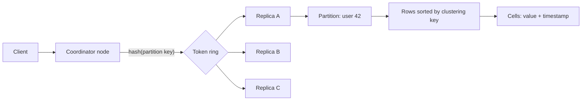

## In one minute
- A wide column database stores rows grouped into *partitions*. A partition key decides which nodes own the data; a clustering key sorts rows inside the partition on disk.
- The model is a sorted, distributed map: `(partition key, clustering key, column) -> (value, timestamp)`. Each row can have a different set of columns, and missing columns cost nothing.
- Bigtable and HBase are range-partitioned with a single writer per tablet; Cassandra and ScyllaDB hash-partition with leaderless replication and tunable consistency.
- You design tables from queries, not from entities. One query, one table, and denormalization is expected.
- The storage engine is an LSM tree, so writes are cheap and reads depend on compaction health.

## How it works

### Data model
Think of each table as a two-level map. The outer level is the partition key, hashed (Cassandra) or range-sorted (Bigtable, HBase) to place it on nodes. The inner level is a sorted map from clustering key to a set of cells. A query that names a partition and a clustering range reads one contiguous slice from one replica set, which is the fast path. A query that does not name the partition must ask every node.

Every cell carries a write timestamp. Concurrent writes to the same cell resolve by *last write wins* on that timestamp ([Cassandra docs](https://cassandra.apache.org/doc/latest/cassandra/architecture/dynamo.html)), and deletes write a tombstone with a timestamp that shadows older cells.

### Two architectures
**Bigtable and HBase.** The key space is split into contiguous ranges called tablets or regions, each served by exactly one server at a time. A master assigns tablets and splits them as they grow. Data and logs live in a distributed file system (Colossus or HDFS), so a server failure means another server reopens the tablet from shared storage; in Bigtable only metadata moves to the replacement node, which is why recovery is fast ([Google Cloud docs](https://docs.cloud.google.com/bigtable/docs/overview)). Bigtable now also accepts read-only GoogleSQL queries, but they run on the same nodes and should still filter on the row key ([Google Cloud docs](https://docs.cloud.google.com/bigtable/docs/googlesql-overview)). Consistency per row is strong because one server owns each row.

**Cassandra and ScyllaDB.** Nodes sit on a consistent-hash ring with virtual nodes. Each partition is replicated to N nodes (usually 3), and any node can coordinate a request. The client chooses consistency per query: `QUORUM` means a majority (n/2 + 1) of replicas, so `QUORUM` writes plus `QUORUM` reads overlap on at least one replica ([Cassandra docs](https://cassandra.apache.org/doc/latest/cassandra/architecture/dynamo.html)), so reads see the latest acknowledged write; `ONE` is faster and weaker. Hinted handoff, read repair, and periodic anti-entropy repair push replicas back into agreement.

### Write and read path
A write goes to a commit log and a memtable on each replica, then flushes to SSTables, exactly as in any LSM tree. A read gathers cells for the requested partition from the memtable and the SSTables that might hold it (Bloom filters prune the rest), merges by timestamp, and drops shadowed cells.

### Modelling rules
- Choose the partition key so that one query reads one partition, and partitions stay bounded, ideally under 100 MB and well under 100,000 rows.
- Use the clustering key for the sort you need, such as `ORDER BY created_at DESC`.
- Bucket unbounded series by time: `(sensor_id, day)` rather than `sensor_id`.
- Write the same data to several tables when you have several query shapes. Writes are cheap; scatter-gather reads are not.

## Down the stack

### Layer 1: The contract
Cassandra promises, per partition, a sorted set of rows by clustering key and per-cell last-write-wins by timestamp. A write at consistency level `QUORUM` returns success once a majority of the partition's replicas have appended it to their commit log and memtable; a `QUORUM` read then sees it, provided clocks that generate timestamps are sane. There is no isolation across partitions. A logged batch guarantees that all its mutations will eventually apply, not that readers never see a partial batch. Compare-and-set (`IF NOT EXISTS`) runs Paxos, costing several round trips. Bigtable and HBase instead promise strongly consistent single-row reads and writes, because exactly one server owns each row at a time.

### Layer 2: The mechanism
A Cassandra mutation is serialised and appended to the active commit log segment (32 MiB by default), then applied to the memtable for its table. The default `commitlog_sync: periodic` fsyncs the commit log every 10 seconds rather than per write ([Cassandra docs](https://cassandra.apache.org/doc/latest/cassandra/architecture/storage-engine.html)), so a single node's power loss can drop recent acknowledged writes. Cassandra accepts this because the write also exists on other replicas; `batch` and `group` modes fsync before acknowledging at a latency cost.

When a memtable flushes, it becomes an SSTable made of several component files: `Data.db` holds partitions in token order, compressed with LZ4 in chunks (16 KiB by default in recent versions, [Cassandra docs](https://cassandra.apache.org/doc/latest/cassandra/managing/operating/compression.html)); `CompressionInfo.db` maps uncompressed offsets to chunk positions; `Filter.db` is the partition Bloom filter; `Statistics.db` holds min and max timestamps and tombstone counts; and a partition index (`Index.db` plus `Summary.db` in the classic format, or a trie-based `Partitions.db` and `Rows.db` in the BTI format added in 5.0, which you opt into with `sstable.selected_format: bti`) maps partition keys to offsets in `Data.db` ([Cassandra docs](https://cassandra.apache.org/doc/latest/cassandra/architecture/storage-engine.html)). Compaction strategies decide what merges with what: size-tiered (still the table default), leveled, time-window for time series, and the unified strategy added in 5.0 ([Cassandra 5.0 features](https://cassandra.apache.org/doc/latest/cassandra/new/index.html)). Tombstones survive at least `gc_grace_seconds` (864,000 seconds, 10 days, by default, [Cassandra docs](https://cassandra.apache.org/doc/latest/cassandra/reference/cql-commands/create-table.html)) so that repair can propagate the delete before it is purged; otherwise a replica that missed the delete would resurrect the data.

### Layer 3: The machine
The write path is one sequential append plus an in-memory insert, which is why Cassandra sustains high write rates on modest hardware. The read path pays the costs. For each SSTable that might hold the partition, the node checks the in-memory Bloom filter, looks up the partition index, then reads and decompresses at least one whole compression chunk, even to return a 100-byte row. Small chunks reduce that read amplification; large chunks compress better. Partitions are placed by a 64-bit Murmur3 token, so related keys scatter across the ring by design.

The JVM is the other machine-level cost. Memtables, caches, and per-request objects generate garbage, and garbage collection pauses show up directly in p99 latency; Cassandra moved Bloom filters, compression metadata, and optionally memtables off-heap to reduce this. ScyllaDB rewrote the engine in C++ on Seastar, pinning one shard per CPU core with no shared memory between cores, and does its own caching with direct I/O instead of relying on the OS page cache.

### Why it's built this way
1. Writes must be cheap at very high rates, so each one is a sequential log append plus a memory insert, and on-disk files are immutable.
2. Immutable files mean updates and deletes are new versions, so every cell carries a timestamp and deletes are tombstones.
3. Any replica may miss a write, so tombstones must outlive repair windows or deleted data comes back.
4. Reads must avoid scanning every node and file, so the partition key routes a query to a few replicas and Bloom filters prune SSTables.
5. Per-write fsync on every node is expensive and replication already provides redundancy, so the default leans on replicas for durability.

## Diagram


## Worked example
A messaging app stores 2 billion messages per day, each about 300 bytes, and serves "last 50 messages in this conversation" at 150,000 reads per second.

The table is keyed `PRIMARY KEY ((conversation_id, month), sent_at DESC, message_id)`. A read names the partition and takes the first 50 clustering rows, so it touches one partition on 2 of 3 replicas at `LOCAL_QUORUM`. Monthly bucketing caps a busy group chat at a few hundred thousand rows. Without it, a five-year-old company channel would grow into a multi-gigabyte partition that is slow to read, repair, and compact.

Raw volume is 600 GB per day; with replication factor 3 and LSM overhead, roughly 2.2 TB per day of disk. At 4 TB usable per node and one year of retention, the cluster needs around 200 nodes before compression, closer to 100 with it. Writes at 23,000 per second average and 100,000 at peak are well within what 100 nodes absorb, since each Cassandra node handles tens of thousands of writes per second. The design constraint is disk and compaction, not CPU.

## In the wild
- **Monzo, 2019: new nodes own token ranges before they own data.** Monzo added 6 nodes to a 21-node Cassandra cluster with `auto_bootstrap=false`, expecting them to sit idle until data was streamed in. They took ownership of token ranges immediately and answered reads for that data with "not found", so balances and transactions looked wrong and payments failed; most customers recovered after about 2 hours, full recovery took far longer. A single-node test had not shown the quorum effect of six. Fixes included scale-up runbooks and alerts on spikes in missing rows ([Monzo](https://monzo.com/blog/2019/09/08/why-monzo-wasnt-working-on-july-29th)).
- **Discord, 2023: hot partitions and compaction on a 177-node cluster.** Discord's messages cluster, partitioned by channel, grew from 12 Cassandra nodes in 2017 to 177. A busy channel's partition slowed quorum reads cluster-wide, and GC pauses and compaction backlogs added latency. Rust data services in front coalesced concurrent reads of one row, and a move to 72 ScyllaDB nodes cut p99 historical-read latency from 40 to 125 ms down to 15 ms; the last ranges were held up by tombstones until compacted ([Discord](https://discord.com/blog/how-discord-stores-trillions-of-messages)).

## Trade-offs
| Option | Strengths | Weaknesses | Choose when |
|---|---|---|---|
| Cassandra or ScyllaDB | Multi-region active-active, no single leader, linear write scale | Query-driven modelling, no joins, LWW conflicts | High write volume, known access patterns, multi-region |
| Bigtable or HBase | Strong per-row consistency, range scans, autosplit | Single owner per tablet, region failover pause | Large sorted scans, analytics-adjacent serving |
| Relational database | Joins, transactions, flexible queries | Harder to scale writes horizontally | Data fits a few nodes or needs ad hoc queries |
| Document database | Flexible nested documents, secondary indexes | Weaker at huge sorted time ranges | Entity-centric access with varied shapes |

## Pitfalls in production
- **Large partitions.** One unbounded partition slows reads, repairs, and compaction on its replicas. Add a time or hash bucket to the partition key.
- **Tombstone-heavy reads.** Deleting many rows in a partition then scanning it forces reads over thousands of tombstones and can time out. Model queues differently and use TTL with time-window compaction.
- **Skipping repair.** Without regular anti-entropy repair, deleted data can reappear after `gc_grace_seconds`. Run repair on a schedule shorter than the grace period.
- **Clock skew with LWW.** A node with a fast clock makes its writes win. Run NTP carefully, and avoid read-modify-write patterns that rely on ordering.
- **Secondary index or `ALLOW FILTERING` in hot paths.** Both turn a single-partition read into a cluster-wide scan. Cassandra 5.0's storage-attached indexes (SAI) are cheaper to keep than the old indexes, but a query without the partition key still has the coordinator scan the token ring, and a high-cardinality column can mean a whole-cluster scan ([Cassandra docs](https://cassandra.apache.org/doc/latest/cassandra/developing/cql/indexing/sai/sai-faq.html)). For a hot path, create a second table instead.

## Leadership lens
- Require a query list before schema review. A wide column schema without stated access patterns is not reviewable.
- Budget operational work: repairs, compaction strategy, node replacement, and capacity planning are recurring, not one-off.
- Decide consistency level per query and write it down, so nobody silently drops to `ONE` under load.
- Plan for denormalization drift: when the same data lives in three tables, someone owns keeping them in sync.

## Check yourself
1. Why does a query without the partition key perform badly in Cassandra?
   **Answer:** The coordinator cannot tell which nodes hold matching rows, so it must ask all of them and merge the results.
2. How do `QUORUM` reads and writes give read-your-writes with replication factor 3?
   **Answer:** Each touches at least 2 of 3 replicas, so any read set overlaps any write set on at least one replica holding the newest timestamp.
3. Why add a month to a conversation's partition key?
   **Answer:** It caps partition size, keeping reads, compaction, and repair cheap even for very active conversations.
4. What makes deleted data reappear in a leaderless store?
   **Answer:** A replica missed the tombstone, the tombstone was purged after the grace period, and repair later copied the old value back from that replica.

## Practice
**Task:** Implement a single-node wide column table with last-write-wins cells. `put(pk, ck, column, value, ts)` writes one cell; a cell keeps the value with the highest timestamp. `delete_row(pk, ck, ts)` writes a row tombstone that hides every cell with timestamp `<= ts`. `get(pk, ck)` returns a dict of visible columns (empty if none). `slice(pk, lo, hi)` returns `(ck, columns)` pairs for clustering keys in `[lo, hi]`, sorted ascending, skipping rows with no visible cells.

```python starter
class WideTable:
    def put(self, pk, ck, column, value, ts):
        raise NotImplementedError

    def delete_row(self, pk, ck, ts):
        raise NotImplementedError

    def get(self, pk, ck):
        raise NotImplementedError

    def slice(self, pk, lo, hi):
        raise NotImplementedError
```

```python tests
def test_put_and_get():
    t = WideTable()
    t.put("u1", 10, "name", "ann", 1)
    t.put("u1", 10, "city", "oslo", 1)
    assert t.get("u1", 10) == {"name": "ann", "city": "oslo"}

def test_last_write_wins_regardless_of_order():
    t = WideTable()
    t.put("u1", 1, "x", "new", 5)
    t.put("u1", 1, "x", "old", 3)
    assert t.get("u1", 1) == {"x": "new"}

def test_row_tombstone_hides_older_cells():
    t = WideTable()
    t.put("u1", 1, "x", "a", 1)
    t.delete_row("u1", 1, 2)
    assert t.get("u1", 1) == {}
    t.put("u1", 1, "x", "b", 3)
    assert t.get("u1", 1) == {"x": "b"}

def test_slice_is_sorted_and_bounded():
    t = WideTable()
    for ck in [30, 10, 20, 40]:
        t.put("p", ck, "v", ck, 1)
    assert t.slice("p", 15, 35) == [(20, {"v": 20}), (30, {"v": 30})]

def test_slice_skips_deleted_rows_and_other_partitions():
    t = WideTable()
    t.put("p", 1, "v", 1, 1)
    t.put("p", 2, "v", 2, 1)
    t.put("q", 1, "v", 9, 1)
    t.delete_row("p", 2, 5)
    assert t.slice("p", 0, 10) == [(1, {"v": 1})]
    assert t.get("missing", 1) == {}
```

```python solution
class WideTable:
    def __init__(self):
        self.cells = {}       # (pk, ck) -> {column: (ts, value)}
        self.tombstones = {}  # (pk, ck) -> ts

    def put(self, pk, ck, column, value, ts):
        row = self.cells.setdefault((pk, ck), {})
        if column not in row or ts > row[column][0]:
            row[column] = (ts, value)

    def delete_row(self, pk, ck, ts):
        key = (pk, ck)
        self.tombstones[key] = max(ts, self.tombstones.get(key, ts))

    def get(self, pk, ck):
        dead = self.tombstones.get((pk, ck), -1)
        row = self.cells.get((pk, ck), {})
        return {c: v for c, (ts, v) in row.items() if ts > dead}

    def slice(self, pk, lo, hi):
        cks = sorted(ck for (p, ck) in self.cells if p == pk and lo <= ck <= hi)
        out = []
        for ck in cks:
            cols = self.get(pk, ck)
            if cols:
                out.append((ck, cols))
        return out
```

```typescript starter
export type Row = Record<string, string>;

export class WideTable {
  put(pk: string, ck: number, column: string, value: string, ts: number): void { throw new Error("TODO"); }
  deleteRow(pk: string, ck: number, ts: number): void { throw new Error("TODO"); }
  get(pk: string, ck: number): Row { throw new Error("TODO"); }
  slice(pk: string, lo: number, hi: number): [number, Row][] { throw new Error("TODO"); }
}
```

```typescript tests
test("put and get", () => {
  const t = new WideTable();
  t.put("u1", 10, "name", "ann", 1);
  t.put("u1", 10, "city", "oslo", 1);
  assertEqual(t.get("u1", 10), { name: "ann", city: "oslo" });
});
test("last write wins regardless of order", () => {
  const t = new WideTable();
  t.put("u1", 1, "x", "new", 5);
  t.put("u1", 1, "x", "old", 3);
  assertEqual(t.get("u1", 1), { x: "new" });
});
test("row tombstone hides older cells", () => {
  const t = new WideTable();
  t.put("u1", 1, "x", "a", 1);
  t.deleteRow("u1", 1, 2);
  assertEqual(t.get("u1", 1), {});
  t.put("u1", 1, "x", "b", 3);
  assertEqual(t.get("u1", 1), { x: "b" });
});
test("slice is sorted and bounded", () => {
  const t = new WideTable();
  for (const ck of [30, 10, 20, 40]) t.put("p", ck, "v", String(ck), 1);
  assertEqual(t.slice("p", 15, 35), [[20, { v: "20" }], [30, { v: "30" }]]);
});
test("slice skips deleted rows and other partitions", () => {
  const t = new WideTable();
  t.put("p", 1, "v", "1", 1);
  t.put("p", 2, "v", "2", 1);
  t.put("q", 1, "v", "9", 1);
  t.deleteRow("p", 2, 5);
  assertEqual(t.slice("p", 0, 10), [[1, { v: "1" }]]);
  assertEqual(t.get("missing", 1), {});
});
```

```typescript solution
export type Row = Record<string, string>;

export class WideTable {
  private cells = new Map<string, Map<number, Map<string, [number, string]>>>();
  private tombstones = new Map<string, number>();

  put(pk: string, ck: number, column: string, value: string, ts: number): void {
    if (!this.cells.has(pk)) this.cells.set(pk, new Map());
    const part = this.cells.get(pk)!;
    if (!part.has(ck)) part.set(ck, new Map());
    const row = part.get(ck)!;
    const cur = row.get(column);
    if (!cur || ts > cur[0]) row.set(column, [ts, value]);
  }

  deleteRow(pk: string, ck: number, ts: number): void {
    const key = pk + "\u0000" + ck;
    this.tombstones.set(key, Math.max(ts, this.tombstones.get(key) ?? ts));
  }

  get(pk: string, ck: number): Row {
    const dead = this.tombstones.get(pk + "\u0000" + ck) ?? -1;
    const out: Row = {};
    const row = this.cells.get(pk)?.get(ck);
    if (row) row.forEach(([ts, v], c) => { if (ts > dead) out[c] = v; });
    return out;
  }

  slice(pk: string, lo: number, hi: number): [number, Row][] {
    const part = this.cells.get(pk);
    if (!part) return [];
    const cks = [...part.keys()].filter((ck) => ck >= lo && ck <= hi).sort((a, b) => a - b);
    const out: [number, Row][] = [];
    for (const ck of cks) {
      const cols = this.get(pk, ck);
      if (Object.keys(cols).length > 0) out.push([ck, cols]);
    }
    return out;
  }
}
```

```go starter
package practice

type RowSlice struct {
	CK   int
	Cols map[string]string
}

type WideTable struct{}

func NewWideTable() *WideTable { return &WideTable{} }

func (t *WideTable) Put(pk string, ck int, column, value string, ts int64) { panic("TODO") }
func (t *WideTable) DeleteRow(pk string, ck int, ts int64)                { panic("TODO") }
func (t *WideTable) Get(pk string, ck int) map[string]string              { panic("TODO") }
func (t *WideTable) Slice(pk string, lo, hi int) []RowSlice               { panic("TODO") }
```

```go tests
package practice

import (
	"reflect"
	"testing"
)

func TestPutAndGet(t *testing.T) {
	w := NewWideTable()
	w.Put("u1", 10, "name", "ann", 1)
	w.Put("u1", 10, "city", "oslo", 1)
	if got := w.Get("u1", 10); !reflect.DeepEqual(got, map[string]string{"name": "ann", "city": "oslo"}) {
		t.Fatalf("got %v", got)
	}
}

func TestLastWriteWinsRegardlessOfOrder(t *testing.T) {
	w := NewWideTable()
	w.Put("u1", 1, "x", "new", 5)
	w.Put("u1", 1, "x", "old", 3)
	if got := w.Get("u1", 1)["x"]; got != "new" {
		t.Fatalf("got %q", got)
	}
}

func TestRowTombstoneHidesOlderCells(t *testing.T) {
	w := NewWideTable()
	w.Put("u1", 1, "x", "a", 1)
	w.DeleteRow("u1", 1, 2)
	if got := w.Get("u1", 1); len(got) != 0 {
		t.Fatalf("got %v", got)
	}
	w.Put("u1", 1, "x", "b", 3)
	if got := w.Get("u1", 1)["x"]; got != "b" {
		t.Fatalf("got %q", got)
	}
}

func TestSliceIsSortedAndBounded(t *testing.T) {
	w := NewWideTable()
	for _, ck := range []int{30, 10, 20, 40} {
		w.Put("p", ck, "v", "x", 1)
	}
	got := w.Slice("p", 15, 35)
	if len(got) != 2 || got[0].CK != 20 || got[1].CK != 30 {
		t.Fatalf("got %v", got)
	}
}

func TestSliceSkipsDeletedRowsAndOtherPartitions(t *testing.T) {
	w := NewWideTable()
	w.Put("p", 1, "v", "1", 1)
	w.Put("p", 2, "v", "2", 1)
	w.Put("q", 1, "v", "9", 1)
	w.DeleteRow("p", 2, 5)
	got := w.Slice("p", 0, 10)
	if len(got) != 1 || got[0].CK != 1 || got[0].Cols["v"] != "1" {
		t.Fatalf("got %v", got)
	}
	if len(w.Get("missing", 1)) != 0 {
		t.Fatal("missing partition should be empty")
	}
}
```

```go solution
package practice

import "sort"

type RowSlice struct {
	CK   int
	Cols map[string]string
}

type cell struct {
	ts    int64
	value string
}

type rowKey struct {
	pk string
	ck int
}

type WideTable struct {
	cells      map[rowKey]map[string]cell
	tombstones map[rowKey]int64
}

func NewWideTable() *WideTable {
	return &WideTable{cells: map[rowKey]map[string]cell{}, tombstones: map[rowKey]int64{}}
}

func (t *WideTable) Put(pk string, ck int, column, value string, ts int64) {
	k := rowKey{pk, ck}
	if t.cells[k] == nil {
		t.cells[k] = map[string]cell{}
	}
	if cur, ok := t.cells[k][column]; !ok || ts > cur.ts {
		t.cells[k][column] = cell{ts, value}
	}
}

func (t *WideTable) DeleteRow(pk string, ck int, ts int64) {
	k := rowKey{pk, ck}
	if cur, ok := t.tombstones[k]; !ok || ts > cur {
		t.tombstones[k] = ts
	}
}

func (t *WideTable) Get(pk string, ck int) map[string]string {
	k := rowKey{pk, ck}
	dead, hasTomb := t.tombstones[k]
	out := map[string]string{}
	for c, v := range t.cells[k] {
		if !hasTomb || v.ts > dead {
			out[c] = v.value
		}
	}
	return out
}

func (t *WideTable) Slice(pk string, lo, hi int) []RowSlice {
	var cks []int
	for k := range t.cells {
		if k.pk == pk && k.ck >= lo && k.ck <= hi {
			cks = append(cks, k.ck)
		}
	}
	sort.Ints(cks)
	var out []RowSlice
	for _, ck := range cks {
		if cols := t.Get(pk, ck); len(cols) > 0 {
			out = append(out, RowSlice{ck, cols})
		}
	}
	return out
}
```

## Mock interview
**Prompt:** Design the storage for a fleet telemetry product: 2 million vehicles each sending a 200-byte reading every 10 seconds, with queries for "last 24 hours of one vehicle" and 1-year retention, across two regions.

- Follow-up: What is your partition key and why not just `vehicle_id`?
- Follow-up: A region is cut off for 20 minutes. What happens to writes and to consistency afterwards?
- Follow-up: Product now wants "all vehicles in a geofence right now." How do you serve it?

**A strong answer covers:**
- Partition by vehicle plus time bucket, clustering by timestamp descending.
- Write volume (200,000 writes per second) and storage math with replication.
- `LOCAL_QUORUM` per region, hinted handoff, and repair after a partition heals.
- TTL with time-window compaction to expire data without tombstone storms.
- A separate table or system for the geofence query instead of a secondary index.

## Sources and further study
**Primary**
- [DeCandia et al., Dynamo: Amazon's Highly Available Key-value Store (SOSP 2007)](https://www.allthingsdistributed.com/files/amazon-dynamo-sosp2007.pdf): the source of Cassandra's ring, quorums, hinted handoff and Merkle-tree repair.
- [Jepsen: Cassandra (2013)](https://aphyr.com/posts/294-call-me-maybe-cassandra): an early test of last-write-wins and lightweight transactions that showed how timestamp conflict resolution loses writes; versions have moved on, the mechanism has not.

**Systems docs**
- [Cassandra: storage engine](https://cassandra.apache.org/doc/latest/cassandra/architecture/storage-engine.html): commit log settings, memtables and every SSTable component, including BTI.
- [Cassandra: SAI FAQ](https://cassandra.apache.org/doc/latest/cassandra/developing/cql/indexing/sai/sai-faq.html): how storage-attached index queries fan out when the partition key is missing.
- [Bigtable: overview](https://docs.cloud.google.com/bigtable/docs/overview): tablets on Colossus, nodes that hold only pointers, and fast failover.

**Books**
- *Designing Data-Intensive Applications* (2nd ed.), Martin Kleppmann and Chris Riccomini, Ch 6 "Replication" (leaderless replication) and Ch 7 "Sharding": quorums, sloppy quorums and key-range versus hash sharding.
- *Database Internals*, Alex Petrov, Ch 12 "Anti-Entropy and Dissemination": read repair, hinted handoff and Merkle trees in depth.

**Other curricula**
- [donnemartin/system-design-primer](https://github.com/donnemartin/system-design-primer): models a wide-column store as a nested map with timestamps and still mentions super column families, which CQL-era Cassandra no longer exposes.
- [Azure Architecture Center: Understand data models](https://learn.microsoft.com/en-us/azure/architecture/data-guide/technology-choices/understand-data-store-models): stresses up-front row key design and limited secondary indexes, and suggests a time-series database when time-window queries slow down.
- [roadmap.sh: System Design](https://roadmap.sh/system-design): its "Wide Column Store" node gives a one-paragraph definition naming Cassandra and HBase for write-heavy workloads.

## Watch
- [BigTable: One Database to Rule Them All? (Jordan has no life)](https://www.youtube.com/watch?v=x2MdvCTWh3o): a walk through the Bigtable paper's design.
- [How does Bigtable work? (Google Cloud Tech)](https://www.youtube.com/watch?v=EvoGRcMvVYw): a short overview of tablets, nodes, and storage separation.

## Free resources
- [Bigtable (OSDI 2006)](https://static.googleusercontent.com/media/research.google.com/en//archive/bigtable-osdi06.pdf): the paper that defined the model.
- [Cassandra (LADIS 2009)](https://www.cs.cornell.edu/projects/ladis2009/papers/lakshman-ladis2009.pdf): the original Cassandra design from Facebook.
- [Cassandra architecture overview](https://cassandra.apache.org/doc/latest/cassandra/architecture/overview.html): official docs on the ring, replication, and storage engine.
- [Bigtable schema design](https://cloud.google.com/bigtable/docs/schema-design): row key design advice that applies to any range-partitioned store.
- [Basic rules of Cassandra data modeling (DataStax)](https://www.datastax.com/blog/basic-rules-cassandra-data-modeling): the query-first approach explained with examples.
