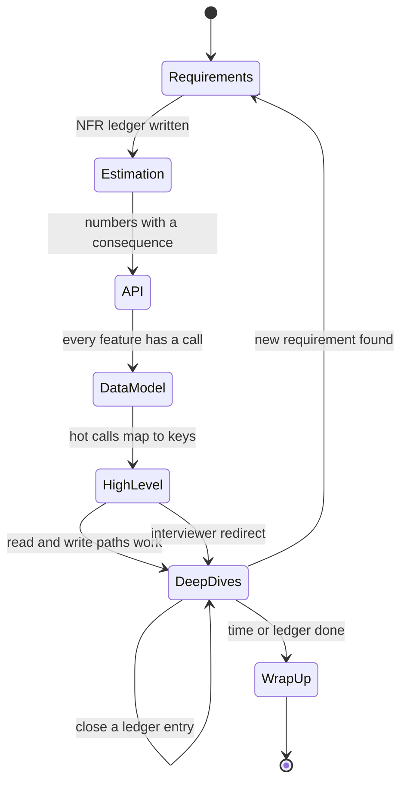

## In one minute
- A 45-minute design interview has about 40 minutes of real working time. Plan it like a budget: about 5 for requirements, 3 for estimation, 4 for the API, 4 for the data model, 8 for the high-level design, 15 for deep dives and 3 for wrap-up. Check the clock at each boundary.
- Every phase produces something visible that later phases use. If it produces nothing a later phase uses, it was too long.
- Keep a running list of non-functional requirements on the board and treat it as a ledger. A deep dive is finished when it closes an entry; the wrap-up reads the ledger back.
- The framework is a default order, not a script. When the interviewer steers, follow, park what you skipped, and come back if time allows.
- Staff-level answers spend little time on what everyone draws and most of it on what makes this problem hard.

## How it works

### Why a framework at all
Without one, candidates drift: ten minutes of requirements, a diagram that grows without a reason, and no time for the deep dive that would have shown depth. A framework turns 45 minutes into a sequence of short phases, each with an exit condition, so you always know what to do next and when you are behind. A predictable structure also makes your evidence easy to find for an interviewer filling in a rubric. What is System Design? introduces the general method; this is its timed, interview-room version, with Estimation Cheatsheet and Diagramming Tips covering two of the phases in depth.

Published frameworks agree on the order and differ on the minutes. Hello Interview budgets about 5 minutes for requirements, 2 for core entities, 5 for the API, 10 to 15 for the high-level design and about 10 for deep dives, and makes capacity estimation optional unless it changes the design ([Hello Interview](https://www.hellointerview.com/learn/system-design/in-a-hurry/delivery)). The System Design Primer uses four steps: use cases and constraints, high-level design, core components, then scaling ([system-design-primer](https://github.com/donnemartin/system-design-primer#how-to-approach-a-system-design-interview-question)). Google's non-abstract design method, which is how its SREs run real reviews, asks four questions in turn: is it possible, can we do better, is it feasible, is it resilient ([SRE Workbook, ch. 12](https://sre.google/workbook/non-abstract-design/)). The budget below is one reasonable split; what matters is that you choose one and check it.

### The phases and their exits
1. **Requirements (about 5 minutes).** List 3 to 5 functional requirements as user actions and say what is out of scope. Then list non-functional requirements as numbers or rules: scale, latency target, availability, consistency per operation, durability, and anything regulatory. Exit when the interviewer agrees with the list. Write the non-functional list where it will stay visible.
2. **Estimation (2 to 4 minutes).** Only the numbers that change the design: peak read and write QPS, storage growth, maybe bandwidth. Exit with one sentence of consequence: "about 12k writes per second at peak, so one primary is borderline and I'll plan to partition by user."
3. **API (3 to 5 minutes).** The four to six calls that serve the functional requirements, with key parameters and the response shape. Mark which calls are hot and which must be idempotent. Exit when every functional requirement maps to a call.
4. **Data model (3 to 5 minutes).** Entities (some frameworks list the core entities before the API, which also works), primary keys, the one or two indexes the hot queries need, and the partition key with its reason. Exit when every hot API call maps to a single-partition read or write, or you have said why it cannot.
5. **High-level design (about 8 minutes).** Draw the request path for the main write and the main read, left to right. Walk one request through it. Exit when the design satisfies every functional requirement, even if not yet at scale.
6. **Deep dives (about 15 minutes).** Pick two or three parts where the non-functional ledger is still open or where the problem is unusual. For each, name options, choose, give the cost and the failure mode. Exit each one by ticking a ledger entry.
7. **Wrap-up (about 3 minutes).** Read the ledger back, name the biggest remaining risk, and say what you would build first and what you would monitor.

### Steering and recovery
Interviewers interrupt on purpose. If they jump to a deep dive during the high-level design, go there, then say "I'll park the notification path and come back to it". Keep a short parked list next to the ledger. If you are behind at the 20-minute mark with no high-level diagram, compress: skip the remaining data-model detail, draw the simplest end-to-end path, and say what you skipped. A complete, simple design with one strong deep dive scores better than a beautiful API and no system.

### What changes with level
Mid-level candidates are expected to reach a working high-level design and handle one deep dive with prompting; failing to deliver a working system at all is the most common reason they fail, and it usually shows up as poor time management ([Hello Interview](https://www.hellointerview.com/learn/system-design/in-a-hurry/delivery)). Senior candidates drive the whole sequence, move through the basics quickly and pick the deep dives themselves ([Hello Interview course](https://www.hellointerview.com/learn/courses/system-design/lesson/orientation/introduction)). Staff candidates do that quickly, spend most of the time on the hard parts, tie each choice to a requirement and its cost, and talk about rollout, operations and how the design evolves.

### Common mistakes
- Asking requirement questions for ten minutes without writing anything down.
- Estimating everything and concluding nothing.
- Designing the API or schema in detail before knowing the access patterns.
- Spending the deep-dive time on generic components instead of what is hard here.
- Ending abruptly when time runs out, with no summary of risks.

## Down the stack

### Layer 1: The contract
The interview has an implicit contract with a rubric. Most large companies score a handful of dimensions. The names vary, but they cluster around problem navigation, solution design, technical excellence, and communication and collaboration ([Hello Interview course](https://www.hellointerview.com/learn/courses/system-design/lesson/orientation/introduction)). Each phase of the framework produces evidence for one or more of them: requirements and estimation show navigation, the high-level design shows solution design, deep dives show depth, and the ledger and wrap-up show communication and judgement. The contract you offer the interviewer is: "by the end, every requirement on this board will either be met by something on the diagram or named as a known gap". That sentence is testable, and an answer that keeps it reads as organised even when the design is imperfect.

### Layer 2: The mechanism
Run the interview as a small state machine. Each phase is a state with an entry action (say what you are about to do and roughly how long it takes) and an exit condition (the artifact exists and the interviewer has not objected). Transitions are forward by default, with two exceptions: an interviewer redirect pushes the current phase onto the parked list, and a new requirement discovered later sends you back to phase 1 briefly to add it to the ledger. Two data structures carry state across phases. The **ledger** is the list of non-functional requirements, each with a status: open, addressed by a named component, or accepted as a gap. The **parked list** holds topics you deferred. At each phase boundary, glance at the clock and the ledger: if open entries outnumber the deep-dive minutes you have left divided by five, pick the riskiest and say the rest will be named in the wrap-up.

### Layer 3: The machine
The hardware here is human. Conversational English runs at roughly 150 to 200 words per minute; a study of the Switchboard telephone corpus measured about 164 words per minute within a speaker's turns and 196 over elapsed time ([Language Log](https://languagelog.ldc.upenn.edu/~myl/languagelog/archives/003423.html)). Even at the low end, 40 working minutes is about 6,000 spoken words, roughly a short book chapter, and every minute of rambling is 150 or more words of evidence you did not produce. Working memory holds about four chunks at once ([Cowan, 2001](https://www.cambridge.org/core/journals/behavioral-and-brain-sciences/article/magical-number-4-in-shortterm-memory-a-reconsideration-of-mental-storage-capacity/44023F1147D4A1D44BDC0AD226838496)), for you and for the interviewer, which is why the ledger and parked list belong on the board rather than in your head, and why a diagram with eight boxes is easier to follow than one with twenty. Interviewers type notes while you talk, often a few seconds behind; pausing after a decision ("so the feed is fan-out on write, except for accounts over 100k followers") gives them time to record it. Remote whiteboards are slower to draw on than paper, so keep diagrams to labelled boxes and arrows and spend the saved time talking.

### Why it's built this way
Interviews are short and design space is large, so time is the binding constraint and needs an explicit budget. Later phases depend on earlier artifacts, so the order follows dependencies: numbers before stores, API before schema, a working path before optimisation. Depth is what separates levels, so the largest single block of time goes to deep dives. Humans forget, so the state lives on the board. And interviewers probe deliberately, so the framework has a defined way to be interrupted without losing its place.

## Diagram


## Worked example
The prompt is "Design a URL shortener". Here is a 45-minute run with clock checks.

1. **0:00 to 5:00, requirements.** Functional: create a short link, redirect, optional custom alias, optional expiry. Out of scope: analytics dashboards, user accounts. Ledger: 100 million new links a month; redirects p99 under 50 ms; redirects available even if link creation is down; a short code never maps to two URLs; links kept 5 years.
2. **5:00 to 8:00, estimation.** About 40 writes per second on average; at a 100 to 1 read ratio, about 4,000 redirects per second, perhaps 20,000 at peak. Six billion links over 5 years at about 500 bytes is 3 TB. Consequence: reads dominate and fit a cache; the data fits a few nodes, so partitioning is for availability more than size.
3. **8:00 to 12:00, API.** `POST /links {url, alias?, expires_at?} -> {code}` (idempotent by a client key), `GET /{code} -> 301 or 302`, `DELETE /links/{code}`.
4. **12:00 to 15:00, data model.** `links(code PK, url, created_at, expires_at)`, partitioned by `code`. Every redirect is a single-key read.
5. **15:00 to 23:00, high level.** Load balancer, stateless redirect service, Redis, key-value store, a separate write service with a code generator. Walk a create and a redirect.
6. **23:00 to 40:00, deep dives.** Collision-free codes (a counter range per writer, base 62) closes "never two URLs per code". Redirect availability (cache, replicas, isolated write path) closes the availability entry.
7. **40:00 to 43:00, wrap-up.** All entries closed except expiry cleanup, accepted as a background job. Biggest risk: malicious URLs, which need scanning before activation.

If at 23:00 the diagram is not done, the second deep dive shrinks to a sentence.

## In the wild
- **Cloudflare, 2023: a requirement that was never drilled.** The control plane was designed to survive losing any one of three Portland facilities. When PDX-04 lost utility power and its UPS batteries began failing after about 4 minutes, services in the high-availability cluster turned out to depend on Kafka and ClickHouse that ran only in that facility. Cloudflare had tested taking the other two facilities offline but never all of PDX-04. Full restoration took about 41 hours, and Cloudflare committed to require generally available products to use the high-availability cluster and adds full-facility removal tests ([Cloudflare](https://blog.cloudflare.com/post-mortem-on-cloudflare-control-plane-and-analytics-outage/)).
- **TSB, 2018: a big-bang cutover with its risks left open.** TSB moved its customers onto a new core banking platform in one cutover in April 2018. The data moved, but the platform failed at once and disrupted branch, phone, online and mobile banking for a significant share of its 5.2 million customers. In 2022 UK regulators fined TSB £48.65m for failing to organise and control the programme and its outsourcing risk. It is the design-review version of ending an interview without reading back the open risks ([FCA](https://www.fca.org.uk/news/press-releases/tsb-fined-ps4865m-operational-resilience-failings)).

## Trade-offs
| Approach | Strengths | Weaknesses | Choose when |
|---|---|---|---|
| Fixed phase order with timeboxes | Predictable, hard to get lost, easy to grade | Can feel mechanical; may spend time on phases the interviewer does not care about | Default for most interviews |
| Requirements then straight to high level, API and schema inline | Faster to a working design | Access patterns can be missed; schema decided implicitly | Problems where the API is obvious (URL shortener, rate limiter) |
| Interviewer-led | Matches their interests exactly | Cedes control; passive candidates score lower on navigation | When the interviewer clearly drives; still state your plan |

## Pitfalls in production
The same framework runs design reviews at work, with the same failure modes.

- **Design docs without non-functional requirements.** A review approves boxes and arrows, and latency or durability targets surface in production. Require a requirements table with numbers at the top of every design doc.
- **Estimates that are never revisited.** The launch traffic was 10x the doc's number and nothing was sized for it. Put the estimate's assumptions in the doc and alert when real traffic crosses them.
- **Reviews that only cover the happy path.** The doc shows the request path but not partial failure. Make a failure-mode section mandatory, mirroring the deep-dive phase: walk each critical flow, list its dependencies, and rate each failure mode by likelihood and blast radius ([Azure Well-Architected](https://learn.microsoft.com/en-us/azure/well-architected/reliability/failure-mode-analysis)).
- **Requirements claimed but never tested.** A doc says "survives the loss of one data center", and nobody ever turns one off. Every ledger entry marked as met needs a test or drill that proves it, or it is really an accepted gap.
- **Parked questions that disappear.** "We'll handle that later" never becomes a ticket. Keep the parked list in the doc and convert it to tracked work before approval, and record each significant choice with its context and consequences as a decision record ([ADR](https://adr.github.io/)).

## Leadership lens
- Use the same phases for internal design reviews: requirements with numbers, estimates, interfaces, data, architecture, deep dives on risk, and a closing list of accepted gaps.
- When interviewing, tell candidates the time budget up front and steer early if they drift; you get better signal from a candidate who reaches the hard part.
- Calibrate interviewers on the ledger idea: score whether each stated requirement was met or explicitly accepted as a gap, not whether the design matches yours.
- Track parked items and accepted gaps from reviews as real backlog with owners; they are where incidents come from.

## Check yourself
1. At minute 22 you have requirements, estimates, a detailed API and schema, and no diagram. What do you do?
   **Answer:** Say you are moving on, draw the simplest end-to-end path for the main read and write in a few minutes, and pick a single deep dive. A complete simple design beats a detailed fragment.
2. Why keep non-functional requirements visible as a ledger rather than just mention them at the start?
   **Answer:** Deep dives need a target. The ledger tells you which ones to pick, gives each a clear finish, and lets the wrap-up show which requirements are met and which are accepted gaps.
3. The interviewer interrupts the high-level design to ask how you prevent double booking. What happens to your plan?
   **Answer:** Go to that deep dive now, park the unfinished part of the diagram, and return to it afterwards if time allows. The redirect is a signal of what they want to score.

## Practice
**Task:** Build a design-review checklist runner. The canonical phases, in order, are `requirements`, `estimation`, `api`, `data-model`, `high-level`, `deep-dives` and `wrap-up`, with minute caps 6, 4, 5, 5, 10, 18 and 4. `review(phases, nfrs, addressed, budget)` takes the answer's phases as an ordered list of `(name, minutes)`, the declared non-functional requirements, a map from component name to the NFRs it addresses, and the time budget. Return `missing` (canonical phases absent, in canonical order), `out_of_order` (phases, in answer order, that come after some phase with a later canonical position), `over_cap` (phases, in answer order, whose minutes exceed their cap), `overtime` (total minutes minus budget, at least 0), `unaddressed` (declared NFRs no component addresses, in declared order) and `score` = 100 − 15 per missing − 5 per out-of-order − 3 per over-cap − 2 per overtime minute − 10 per unaddressed, floored at 0. Reject an unknown or repeated phase, negative minutes or a budget below 1.

```python starter
PHASES = ["requirements", "estimation", "api", "data-model", "high-level", "deep-dives", "wrap-up"]
CAPS = {"requirements": 6, "estimation": 4, "api": 5, "data-model": 5,
        "high-level": 10, "deep-dives": 18, "wrap-up": 4}

def review(phases, nfrs, addressed, budget):
    # TODO: return {"missing", "out_of_order", "over_cap", "overtime", "unaddressed", "score"}
    raise NotImplementedError
```

```python tests
GOOD = [("requirements", 5), ("estimation", 3), ("api", 4), ("data-model", 4),
        ("high-level", 8), ("deep-dives", 15), ("wrap-up", 3)]

def test_clean_answer_scores_100():
    r = review(GOOD, ["latency", "availability"], {"cache": ["latency"], "replicas": ["availability"]}, 45)
    assert r == {"missing": [], "out_of_order": [], "over_cap": [], "overtime": 0,
                 "unaddressed": [], "score": 100}

def test_missing_phases_in_canonical_order():
    r = review([("requirements", 5), ("high-level", 10), ("deep-dives", 15)], [], {}, 45)
    assert r["missing"] == ["estimation", "api", "data-model", "wrap-up"]
    assert r["score"] == 40

def test_out_of_order():
    phases = [("requirements", 5), ("high-level", 8), ("api", 4), ("data-model", 4),
              ("estimation", 3), ("deep-dives", 15), ("wrap-up", 3)]
    r = review(phases, [], {}, 45)
    assert r["out_of_order"] == ["api", "data-model", "estimation"]
    assert r["score"] == 85

def test_over_cap_and_overtime():
    phases = [("requirements", 12), ("estimation", 3), ("api", 4), ("data-model", 4),
              ("high-level", 8), ("deep-dives", 15), ("wrap-up", 3)]
    r = review(phases, [], {}, 45)
    assert r["over_cap"] == ["requirements"]
    assert r["overtime"] == 4
    assert r["score"] == 100 - 3 - 8

def test_unaddressed_nfrs_in_declared_order():
    r = review(GOOD, ["durability", "latency", "privacy"], {"cache": ["latency"], "wal": []}, 45)
    assert r["unaddressed"] == ["durability", "privacy"]
    assert r["score"] == 80

def test_score_floors_at_zero():
    r = review([("deep-dives", 60)], ["a", "b", "c"], {}, 45)
    assert r["score"] == 0

def test_rejects_bad_input():
    bad = (([("lunch", 5)], 45), ([("api", 3), ("api", 2)], 45), ([("api", -1)], 45), (GOOD, 0))
    for phases, budget in bad:
        try:
            review(phases, [], {}, budget)
            assert False, "expected ValueError"
        except ValueError:
            pass
```

```python solution
PHASES = ["requirements", "estimation", "api", "data-model", "high-level", "deep-dives", "wrap-up"]
CAPS = {"requirements": 6, "estimation": 4, "api": 5, "data-model": 5,
        "high-level": 10, "deep-dives": 18, "wrap-up": 4}

def review(phases, nfrs, addressed, budget):
    if budget < 1:
        raise ValueError("budget must be at least 1")
    seen = set()
    for name, minutes in phases:
        if name not in CAPS or name in seen or minutes < 0:
            raise ValueError("bad phase " + str(name))
        seen.add(name)
    missing = [p for p in PHASES if p not in seen]
    out_of_order, over_cap = [], []
    highest = -1
    for name, minutes in phases:
        idx = PHASES.index(name)
        if idx < highest:
            out_of_order.append(name)
        highest = max(highest, idx)
        if minutes > CAPS[name]:
            over_cap.append(name)
    overtime = max(0, sum(m for _, m in phases) - budget)
    covered = set()
    for items in addressed.values():
        covered.update(items)
    unaddressed = [n for n in nfrs if n not in covered]
    score = (100 - 15 * len(missing) - 5 * len(out_of_order) - 3 * len(over_cap)
             - 2 * overtime - 10 * len(unaddressed))
    return {"missing": missing, "out_of_order": out_of_order, "over_cap": over_cap,
            "overtime": overtime, "unaddressed": unaddressed, "score": max(0, score)}
```

```typescript starter
export const PHASES = ["requirements", "estimation", "api", "data-model", "high-level", "deep-dives", "wrap-up"];
export const CAPS: Record<string, number> = { requirements: 6, estimation: 4, api: 5, "data-model": 5,
  "high-level": 10, "deep-dives": 18, "wrap-up": 4 };

export interface Report {
  missing: string[]; outOfOrder: string[]; overCap: string[];
  overtime: number; unaddressed: string[]; score: number;
}

export function review(phases: Array<[string, number]>, nfrs: string[],
  addressed: Record<string, string[]>, budget: number): Report {
  throw new Error("TODO");
}
```

```typescript tests
const GOOD_RUN: Array<[string, number]> = [["requirements", 5], ["estimation", 3], ["api", 4], ["data-model", 4],
  ["high-level", 8], ["deep-dives", 15], ["wrap-up", 3]];

test("clean answer scores 100", () => {
  assertEqual(review(GOOD_RUN, ["latency", "availability"], { cache: ["latency"], replicas: ["availability"] }, 45),
    { missing: [], outOfOrder: [], overCap: [], overtime: 0, unaddressed: [], score: 100 });
});
test("missing phases in canonical order", () => {
  const r = review([["requirements", 5], ["high-level", 10], ["deep-dives", 15]], [], {}, 45);
  assertEqual(r.missing, ["estimation", "api", "data-model", "wrap-up"]);
  assertEqual(r.score, 40);
});
test("out of order", () => {
  const r = review([["requirements", 5], ["high-level", 8], ["api", 4], ["data-model", 4],
    ["estimation", 3], ["deep-dives", 15], ["wrap-up", 3]], [], {}, 45);
  assertEqual(r.outOfOrder, ["api", "data-model", "estimation"]);
  assertEqual(r.score, 85);
});
test("over cap and overtime", () => {
  const r = review([["requirements", 12], ["estimation", 3], ["api", 4], ["data-model", 4],
    ["high-level", 8], ["deep-dives", 15], ["wrap-up", 3]], [], {}, 45);
  assertEqual(r.overCap, ["requirements"]);
  assertEqual(r.overtime, 4);
  assertEqual(r.score, 89);
});
test("unaddressed nfrs in declared order", () => {
  const r = review(GOOD_RUN, ["durability", "latency", "privacy"], { cache: ["latency"], wal: [] }, 45);
  assertEqual(r.unaddressed, ["durability", "privacy"]);
  assertEqual(r.score, 80);
});
test("score floors at zero", () => {
  assertEqual(review([["deep-dives", 60]], ["a", "b", "c"], {}, 45).score, 0);
});
test("rejects bad input", () => {
  const bad: Array<[Array<[string, number]>, number]> = [
    [[["lunch", 5]], 45], [[["api", 3], ["api", 2]], 45], [[["api", -1]], 45], [GOOD_RUN, 0]];
  for (const [phases, budget] of bad) {
    let threw = false;
    try { review(phases, [], {}, budget); } catch (e) { threw = true; }
    assert(threw, "expected error");
  }
});
```

```typescript solution
export const PHASES = ["requirements", "estimation", "api", "data-model", "high-level", "deep-dives", "wrap-up"];
export const CAPS: Record<string, number> = { requirements: 6, estimation: 4, api: 5, "data-model": 5,
  "high-level": 10, "deep-dives": 18, "wrap-up": 4 };

export interface Report {
  missing: string[]; outOfOrder: string[]; overCap: string[];
  overtime: number; unaddressed: string[]; score: number;
}

export function review(phases: Array<[string, number]>, nfrs: string[],
  addressed: Record<string, string[]>, budget: number): Report {
  if (budget < 1) throw new Error("budget must be at least 1");
  const seen = new Set<string>();
  for (const [name, minutes] of phases) {
    if (PHASES.indexOf(name) < 0 || seen.has(name) || minutes < 0) throw new Error("bad phase " + name);
    seen.add(name);
  }
  const missing = PHASES.filter((p) => !seen.has(p));
  const outOfOrder: string[] = [];
  const overCap: string[] = [];
  let highest = -1;
  let total = 0;
  for (const [name, minutes] of phases) {
    const idx = PHASES.indexOf(name);
    if (idx < highest) outOfOrder.push(name);
    highest = Math.max(highest, idx);
    if (minutes > CAPS[name]) overCap.push(name);
    total += minutes;
  }
  const overtime = Math.max(0, total - budget);
  const covered = new Set<string>();
  for (const k of Object.keys(addressed)) for (const n of addressed[k]) covered.add(n);
  const unaddressed = nfrs.filter((n) => !covered.has(n));
  const score = 100 - 15 * missing.length - 5 * outOfOrder.length - 3 * overCap.length
    - 2 * overtime - 10 * unaddressed.length;
  return { missing, outOfOrder, overCap, overtime, unaddressed, score: Math.max(0, score) };
}
```

```go starter
package practice

// Phases lists the canonical interview phases in order.
var Phases = []string{"requirements", "estimation", "api", "data-model", "high-level", "deep-dives", "wrap-up"}

// Caps is the maximum minutes per phase.
var Caps = map[string]int{"requirements": 6, "estimation": 4, "api": 5, "data-model": 5,
	"high-level": 10, "deep-dives": 18, "wrap-up": 4}

// PhaseTime is one phase of an answer and the minutes it took.
type PhaseTime struct {
	Name    string
	Minutes int
}

// Report is the result of reviewing a design answer.
type Report struct {
	Missing, OutOfOrder, OverCap, Unaddressed []string
	Overtime, Score                           int
}

func Review(phases []PhaseTime, nfrs []string, addressed map[string][]string, budget int) (Report, error) {
	panic("TODO")
}
```

```go tests
package practice

import (
	"reflect"
	"testing"
)

func goodRun() []PhaseTime {
	return []PhaseTime{{"requirements", 5}, {"estimation", 3}, {"api", 4}, {"data-model", 4},
		{"high-level", 8}, {"deep-dives", 15}, {"wrap-up", 3}}
}

func mustReview(t *testing.T, p []PhaseTime, nfrs []string, a map[string][]string, budget int) Report {
	t.Helper()
	r, err := Review(p, nfrs, a, budget)
	if err != nil {
		t.Fatalf("unexpected error %v", err)
	}
	return r
}

func TestCleanAnswer(t *testing.T) {
	r := mustReview(t, goodRun(), []string{"latency", "availability"},
		map[string][]string{"cache": {"latency"}, "replicas": {"availability"}}, 45)
	if len(r.Missing)+len(r.OutOfOrder)+len(r.OverCap)+len(r.Unaddressed) != 0 || r.Overtime != 0 || r.Score != 100 {
		t.Fatalf("got %+v", r)
	}
}

func TestMissingPhases(t *testing.T) {
	r := mustReview(t, []PhaseTime{{"requirements", 5}, {"high-level", 10}, {"deep-dives", 15}}, nil, nil, 45)
	if !reflect.DeepEqual(r.Missing, []string{"estimation", "api", "data-model", "wrap-up"}) || r.Score != 40 {
		t.Fatalf("got %+v", r)
	}
}

func TestOutOfOrder(t *testing.T) {
	p := []PhaseTime{{"requirements", 5}, {"high-level", 8}, {"api", 4}, {"data-model", 4},
		{"estimation", 3}, {"deep-dives", 15}, {"wrap-up", 3}}
	r := mustReview(t, p, nil, nil, 45)
	if !reflect.DeepEqual(r.OutOfOrder, []string{"api", "data-model", "estimation"}) || r.Score != 85 {
		t.Fatalf("got %+v", r)
	}
}

func TestOverCapAndOvertime(t *testing.T) {
	p := goodRun()
	p[0].Minutes = 12
	r := mustReview(t, p, nil, nil, 45)
	if !reflect.DeepEqual(r.OverCap, []string{"requirements"}) || r.Overtime != 4 || r.Score != 89 {
		t.Fatalf("got %+v", r)
	}
}

func TestUnaddressed(t *testing.T) {
	r := mustReview(t, goodRun(), []string{"durability", "latency", "privacy"},
		map[string][]string{"cache": {"latency"}, "wal": {}}, 45)
	if !reflect.DeepEqual(r.Unaddressed, []string{"durability", "privacy"}) || r.Score != 80 {
		t.Fatalf("got %+v", r)
	}
}

func TestScoreFloor(t *testing.T) {
	r := mustReview(t, []PhaseTime{{"deep-dives", 60}}, []string{"a", "b", "c"}, nil, 45)
	if r.Score != 0 {
		t.Fatalf("got %+v", r)
	}
}

func TestRejectsBadInput(t *testing.T) {
	cases := []struct {
		p      []PhaseTime
		budget int
	}{
		{[]PhaseTime{{"lunch", 5}}, 45},
		{[]PhaseTime{{"api", 3}, {"api", 2}}, 45},
		{[]PhaseTime{{"api", -1}}, 45},
		{goodRun(), 0},
	}
	for i, c := range cases {
		if _, err := Review(c.p, nil, nil, c.budget); err == nil {
			t.Fatalf("case %d: expected error", i)
		}
	}
}
```

```go solution
package practice

import "errors"

// Phases lists the canonical interview phases in order.
var Phases = []string{"requirements", "estimation", "api", "data-model", "high-level", "deep-dives", "wrap-up"}

// Caps is the maximum minutes per phase.
var Caps = map[string]int{"requirements": 6, "estimation": 4, "api": 5, "data-model": 5,
	"high-level": 10, "deep-dives": 18, "wrap-up": 4}

// PhaseTime is one phase of an answer and the minutes it took.
type PhaseTime struct {
	Name    string
	Minutes int
}

// Report is the result of reviewing a design answer.
type Report struct {
	Missing, OutOfOrder, OverCap, Unaddressed []string
	Overtime, Score                           int
}

func phaseIndex(name string) int {
	for i, p := range Phases {
		if p == name {
			return i
		}
	}
	return -1
}

func Review(phases []PhaseTime, nfrs []string, addressed map[string][]string, budget int) (Report, error) {
	if budget < 1 {
		return Report{}, errors.New("budget must be at least 1")
	}
	seen := map[string]bool{}
	for _, p := range phases {
		if phaseIndex(p.Name) < 0 || seen[p.Name] || p.Minutes < 0 {
			return Report{}, errors.New("bad phase " + p.Name)
		}
		seen[p.Name] = true
	}
	r := Report{Missing: []string{}, OutOfOrder: []string{}, OverCap: []string{}, Unaddressed: []string{}}
	for _, p := range Phases {
		if !seen[p] {
			r.Missing = append(r.Missing, p)
		}
	}
	highest, total := -1, 0
	for _, p := range phases {
		idx := phaseIndex(p.Name)
		if idx < highest {
			r.OutOfOrder = append(r.OutOfOrder, p.Name)
		}
		if idx > highest {
			highest = idx
		}
		if p.Minutes > Caps[p.Name] {
			r.OverCap = append(r.OverCap, p.Name)
		}
		total += p.Minutes
	}
	if total > budget {
		r.Overtime = total - budget
	}
	covered := map[string]bool{}
	for _, items := range addressed {
		for _, n := range items {
			covered[n] = true
		}
	}
	for _, n := range nfrs {
		if !covered[n] {
			r.Unaddressed = append(r.Unaddressed, n)
		}
	}
	score := 100 - 15*len(r.Missing) - 5*len(r.OutOfOrder) - 3*len(r.OverCap) - 2*r.Overtime - 10*len(r.Unaddressed)
	if score < 0 {
		score = 0
	}
	r.Score = score
	return r, nil
}
```

## Mock interview
**Prompt:** Design a notification service that sends push, email and SMS for a company with 80 million users, about 300 million notifications a day, and marketing campaigns that send 20 million messages within an hour. Run the full interview: I will mostly listen, and I will interrupt once.

- Follow-up (at minute 12, during your API): "Let's skip ahead. How do you make sure nobody gets the same SMS twice?" Show how you handle the redirect and return.
- Follow-up: You have 6 minutes left and two open entries on your ledger, per-user rate limits and provider failover. Which do you cover, and how do you treat the other?
- Follow-up: In your wrap-up, what would you build in the first month and what would you monitor from day one?

**A strong answer covers:**
- Written requirements with numbers: about 3,500 notifications per second on average plus about 5,500 per second during a campaign hour, per-channel latency targets, de-duplication, preferences and quiet hours.
- A visible plan with timeboxes, and an explicit "I'll park the template service and come back" when interrupted.
- The duplicate-SMS deep dive: an idempotency key per (user, notification), recorded before the provider call, with provider-side idempotency where available and a reconciliation for the window between send and record.
- A deliberate choice under time pressure, such as provider failover because it threatens availability, with rate limits named as an accepted gap.
- A wrap-up that reads back the ledger, names the riskiest remaining part, and lists first-month scope and day-one metrics (send rate, provider error rate, queue lag, duplicate rate).

## Sources and further study
**Primary**
- [Cowan (2001), The magical number 4 in short-term memory](https://www.cambridge.org/core/journals/behavioral-and-brain-sciences/article/magical-number-4-in-shortterm-memory-a-reconsideration-of-mental-storage-capacity/44023F1147D4A1D44BDC0AD226838496): the evidence for a working-memory limit of about four chunks, which is why the ledger lives on the board.

**Systems docs**
- [Azure Well-Architected: failure mode analysis](https://learn.microsoft.com/en-us/azure/well-architected/reliability/failure-mode-analysis): the deep-dive phase as a production practice, flow by flow, with likelihood and blast radius.
- [Google SRE book: Service Level Objectives](https://sre.google/sre-book/service-level-objectives/): how to turn "fast and available" into numbers that belong on the ledger.

**Books**
- *System Design Interview, Volume 1*, Alex Xu, chapter 3 "A Framework For System Design Interviews": a four-step version of the same method with interview-level examples.
- *Fundamentals of Software Architecture* (2nd ed.), Richards and Ford, chapter 5 "Identifying Architectural Characteristics" and chapter 21 "Architectural Decisions": extracting non-functional requirements from the domain and recording decisions.

**Other curricula**
- [Hello Interview: system design course orientation](https://www.hellointerview.com/learn/courses/system-design/lesson/orientation/introduction): frames the interview around four rubric themes and what each level is expected to show.
- [roadmap.sh: System Design](https://roadmap.sh/system-design): frames system design as a map of components and trade-offs rather than a timed procedure, useful for filling gaps in breadth.

## Watch
- [System Design Interview: A Step-By-Step Guide (ByteByteGo)](https://www.youtube.com/watch?v=i7twT3x5yv8): a four-step version of the method with timing advice.
- [System Design Interview: Step By Step Guide (System Design Interview channel)](https://www.youtube.com/watch?v=bUHFg8CZFws): a full worked walk-through showing requirements, estimation and deep dives in sequence.

## Free resources
- [Hello Interview: Delivery Framework](https://www.hellointerview.com/learn/system-design/in-a-hurry/delivery): another timed framework for comparison; notice where it spends its minutes.
- [Non-Abstract Large System Design (Google SRE workbook)](https://sre.google/workbook/non-abstract-design/): how Google structures real design work from requirements to provisioned numbers.
- [The System Design Primer: How to approach a system design interview question](https://github.com/donnemartin/system-design-primer#how-to-approach-a-system-design-interview-question): a compact checklist of the same phases.
- [Architecture Decision Records](https://adr.github.io/): a format for the "decision, cost, revisit trigger" habit the framework builds.
