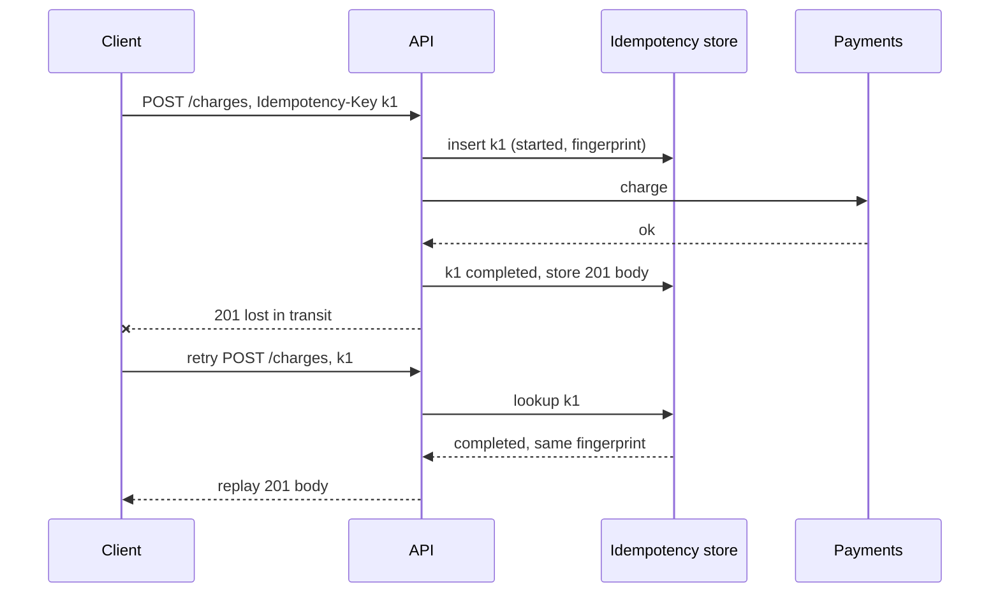

## In one minute
- In a design interview the API is the contract between your boxes and the outside world. Spend about five minutes on it, early, right after requirements: it pins down what the system actually does.
- Interviewers look for resource-oriented endpoints that match the use cases, correct use of HTTP semantics, cursor pagination, idempotency for anything that creates or charges, and a clear choice between request/response, streaming and push.
- Show the shapes, not just the paths: request fields, response fields, and the IDs the client must hold. Missing fields often reveal missing parts of the design.
- Staff-level signal: you think about evolution (versioning, backward-compatible changes), abuse (auth, rate limits, quotas) and failure (retries, timeouts, partial results) as part of the API.

## How it works

### Choosing the style
- **REST over HTTP/JSON.** Default for public and web or mobile APIs. Resources as nouns (`/videos/{id}`), methods as verbs, standard caching and tooling.
- **gRPC.** Default for internal service-to-service calls. Protobuf schemas, generated clients, HTTP/2 multiplexing, deadlines and streaming built in. Harder to call from browsers without a proxy.
- **GraphQL.** When many clients need different shapes of a connected data graph and you want one round trip per screen. Costs: query cost control, caching is harder, N+1 resolvers.
- **Push channels.** WebSockets for bidirectional low-latency traffic (chat, collaborative editing), Server-Sent Events for one-way server updates, long polling as a fallback, webhooks for server-to-server notification.

### The checklist interviewers listen for
- **Resources and methods.** `POST /orders` creates, `GET /orders/{id}` reads, `PATCH` updates part, `DELETE` removes. Actions that do not map cleanly become sub-resources or custom methods (`POST /orders/{id}:cancel`). Google's API guide treats custom methods as a last resort and requires `POST` for any that change state ([AIP-136](https://google.aip.dev/136)).
- **Identity.** Who is calling comes from an auth token (OAuth 2.0 bearer or a signed session), never from a `user_id` field the client can set. Then check that this caller may touch this object on every call that takes an ID: broken object-level authorization is first on the OWASP API Security Top 10 ([OWASP](https://api-security.owasp.org/editions/2023/en/0x11-t10)).
- **Pagination.** Cursor-based (`?limit=50&cursor=...`) for feeds and large lists: stable under inserts and cheap for the database because it seeks with `WHERE (created_at, id) < (?, ?)`. Offset pagination degrades as the offset grows because the database must skip rows.
- **Idempotency.** `POST` endpoints that create or charge accept an `Idempotency-Key` header. A retried request with the same key returns the original result instead of creating a duplicate. The header is widely used but not yet a standard: the IETF draft, last revised as -07 in October 2025, has expired without becoming an RFC. It suggests 400 for a missing key, 422 for a reused key with a different body, and 409 while the first request is still running ([IETF draft](https://www.ietf.org/archive/id/draft-ietf-httpapi-idempotency-key-header-07.html)).
- **Errors.** Consistent status codes and a machine-readable body (RFC 9457 problem details, which replaced RFC 7807 in 2023): 400 for invalid input, 401 and 403 for auth, 404, 409 for conflicts, 429 for rate limits with `Retry-After`, 5xx for server faults.
- **Concurrency control.** `ETag` on reads and `If-Match` on writes give optimistic locking: a stale update gets 412 Precondition Failed instead of silently overwriting ([RFC 9110](https://www.rfc-editor.org/rfc/rfc9110.html#name-if-match)).
- **Long-running work.** An operation that takes seconds or minutes returns `202 Accepted` with a status endpoint the client polls, or a webhook when it finishes, rather than holding the request open ([Azure Architecture Center](https://learn.microsoft.com/en-us/azure/architecture/best-practices/api-design)).
- **Versioning and evolution.** Add optional fields freely, never change their meaning, never remove without a deprecation window. Some changes look additive but break clients: a new required request field, a changed default value, or a changed type even when the wire format still parses; new enum values in responses also need care, because old clients may not handle them ([AIP-180](https://google.aip.dev/180)). Version in the path (`/v2/`) or header when a breaking change is unavoidable.
- **Limits.** Rate limits per token, maximum page size, request size caps, timeouts.

### A repeatable approach
1. List the three to five core use cases from the requirements.
2. Write one endpoint per use case with request and response shapes.
3. Mark which are read-heavy (cacheable, paginated) and which mutate (idempotent, authorised).
4. Decide where the client needs push rather than poll.
5. Mention errors, rate limits and versioning in one sentence each.

### Common mistakes
- Verb-shaped URLs everywhere (`/createOrder`, `/getUserFeed`) and ignoring HTTP method semantics.
- Offset pagination on an infinite feed.
- No idempotency on payments or order creation, then claiming "exactly once".
- Putting the user ID in the body and trusting it.
- Designing the API last, after the boxes, so it contradicts the data model.

## Down the stack

### Layer 1: The contract
RFC 9110 defines `GET`, `HEAD`, `OPTIONS` and `TRACE` as safe, and those plus `PUT` and `DELETE` as idempotent: sending the same request twice has the same intended effect as once ([RFC 9110, section 9.2](https://www.rfc-editor.org/rfc/rfc9110.html#name-common-method-properties)). `POST` and `PATCH` are neither by default, which is why they need idempotency keys to be safely retried. A well-designed idempotent create promises: for the key's lifetime (often 24 hours), the same key and the same request body yield the same response; the same key with a different body is rejected; and concurrent duplicates do not both execute. Pagination contracts should say whether items inserted during a scan may appear, and that a cursor is opaque and may expire.

### Layer 2: The mechanism
An idempotency layer stores a record keyed by `(client_id, idempotency_key)` with a fingerprint of the request (a hash of method, path and body), a state (`started` or `completed`), and the stored response. On a new request it inserts the record with a unique constraint; if the insert conflicts, it either replays the completed response, returns 409 while the first attempt is still running, or rejects a mismatched fingerprint with 422. Stripe's public write-up describes this pattern with recovery points so a request that crashed midway can resume. Implementations differ on failures. Stripe's v1 API saves the status and body of the first request once the endpoint starts executing, including 500 errors, saves nothing when validation fails or a concurrent request holds the key, and lets keys be pruned after 24 hours; its v2 API instead retries failed work to completion where it can ([Stripe docs](https://docs.stripe.com/api/idempotent_requests)). Many in-house layers store only completed results, so a retry after a 5xx runs again; that is safe only if the failed attempt left no side effect behind. Cursors are commonly an encoded and signed tuple of the last sort key, such as base64 of `{"created_at": ..., "id": ...}`, mapped to a keyset query on a composite index. Optimistic concurrency uses a row version: the `ETag` is the version, and the update runs `UPDATE ... SET ..., version = version + 1 WHERE id = ? AND version = ?`, returning 412 when zero rows change. gRPC maps each call to an HTTP/2 stream, frames messages with a 5-byte prefix (a 1-byte compression flag and a 4-byte big-endian length), and propagates deadlines through the `grpc-timeout` header, such as `200m` for 200 milliseconds ([gRPC protocol](https://github.com/grpc/grpc/blob/master/doc/PROTOCOL-HTTP2.md)).

### Layer 3: The machine
A new HTTPS connection costs a TCP handshake (one round trip) plus a TLS 1.3 handshake (one more round trip, [RFC 8446](https://www.rfc-editor.org/rfc/rfc8446)), so 50 to 300 ms on a mobile network before the first byte of the request. That is why APIs reuse connections, HTTP/2 multiplexes many streams over one TCP connection, and HTTP/3 over QUIC removes TCP head-of-line blocking when packets are lost. Payload size matters on mobile: JSON is usually noticeably larger than the equivalent protobuf before compression, and parsing it costs CPU on both sides. A page of 50 feed items at 2 KB each is 100 KB, about 70 TCP segments at a typical 1,460-byte MSS, which takes several round trips while the congestion window grows from its initial 10 segments ([RFC 6928](https://www.rfc-editor.org/rfc/rfc6928)). Small, paginated responses with compression keep this within one or two round trips.

### Why it's built this way
Networks drop and duplicate messages, so clients must retry, and retries of non-idempotent operations duplicate side effects; hence idempotency keys. Databases skip rows slowly and lists change while being read, so pagination uses keyset cursors. Many clients update the same resource without coordination, so writes carry a version for optimistic locking. Connections are expensive to set up, so protocols multiplex. And APIs outlive the code behind them, so they are designed to evolve by addition.

## Diagram


## Worked example
Design the API for a photo-sharing app's core flows: upload a photo, view a user's photos, view a home feed, like a photo.

```
POST /v1/uploads                       -> 201 {upload_id, upload_url, expires_at}
PUT  {upload_url}  (direct to object storage, up to 20 MB)
POST /v1/photos  Idempotency-Key: k    {upload_id, caption}  -> 201 {photo_id, created_at}
GET  /v1/users/{id}/photos?limit=30&cursor=c   -> {items: [...], next_cursor}
GET  /v1/feed?limit=20&cursor=c                -> {items: [...], next_cursor}
PUT  /v1/photos/{id}/likes/me                  -> 204   (idempotent like)
DELETE /v1/photos/{id}/likes/me                -> 204
```

Notes to say aloud: uploads go straight to object storage with a pre-signed URL, so 20 MB bodies never pass through the API tier. Photo creation is idempotent because mobile clients retry on flaky networks. A like is modelled as a `PUT` on a sub-resource, so double taps and retries are naturally idempotent, and the count is eventually consistent. Feeds use opaque cursors. At 30 items of about 1 KB of metadata each, a page is about 30 KB before compression, with image bytes served by the CDN.

## In the wild
- **Stripe, 2017: idempotency keys for a payments API.** A charge request can fail before it arrives, halfway through, or after it succeeded with the response lost. Stripe has clients send a unique `Idempotency-Key` with each `POST`; the server replays the stored result or resumes the work, and its client libraries retry with exponential backoff and jitter so a recovering server is not hit by a thundering herd ([Stripe](https://stripe.com/blog/idempotency)).
- **USPS, 2018: identity checked, objects not.** An API behind usps.com let any logged-in user read, and request changes to, other users' account details, about 60 million users, and many calls accepted wildcard parameters that returned whole data sets. The report went unanswered for over a year; USPS fixed the API after a journalist contacted it ([KrebsOnSecurity](https://krebsonsecurity.com/2018/11/usps-site-exposed-data-on-60-million-users/)).
- **LinkedIn, 2023: changing the encoding, not the API.** LinkedIn kept its Rest.li resource models and switched the wire format under more than 50,000 endpoints from JSON to Protocol Buffers by configuration. Services with large payloads saw up to 60 percent lower latency ([LinkedIn Engineering](https://www.linkedin.com/blog/engineering/infrastructure/linkedin-integrates-protocol-buffers-with-rest-li-for-improved-m)).

## Trade-offs
| Option | Strengths | Weaknesses | Choose when |
|---|---|---|---|
| REST/JSON | Universal, cacheable, easy to debug | Over- or under-fetching, verbose | Public and mobile APIs |
| gRPC | Typed contracts, fast, streaming, deadlines | Browser support needs a proxy, binary | Internal service calls |
| GraphQL | Client-shaped queries, one round trip | Cost control, harder caching | Many clients over a rich graph |
| Cursor pagination | Stable, constant cost per page | No jump to page N | Feeds, large or changing lists |
| Offset pagination | Simple, random page access | Slow deep pages, duplicates on insert | Small admin lists |
| WebSocket | Bidirectional, low latency | Stateful connections, harder to scale | Chat, live collaboration |

## Pitfalls in production
- **Retries without idempotency.** Mobile clients retry a timed-out `POST /orders` and create two orders. Require idempotency keys on create endpoints and enforce them in the database with a unique constraint.
- **Breaking changes shipped as minor ones.** Renaming a field or changing an enum breaks old app versions that live for years. Add new fields, keep old ones, and test against recorded traffic from older clients.
- **Unbounded responses.** An endpoint returning all of a user's items works until a power user has 200,000. Enforce maximum page sizes from day one.
- **Leaky errors.** Returning stack traces or database messages leaks internals. Map errors to a stable problem-details schema with a correlation ID.
- **Chatty clients.** A screen that needs 12 calls becomes slow on mobile. Add a composite endpoint or a backend-for-frontend.

## Leadership lens
- Treat the API as a product with an owner, a changelog and a deprecation policy; once external clients exist, it is very expensive to change.
- In review ask: what does a client do on timeout for each mutating call, and what prevents duplicates?
- Generate clients and docs from one schema (OpenAPI or protobuf) and lint it for breaking changes in CI.
- Decide rate-limit and quota policy with the business early; it shapes pricing, abuse handling and capacity planning.

## Check yourself
1. Why is `PUT /photos/{id}/likes/me` a better "like" endpoint than `POST /photos/{id}/like`?
   **Answer:** `PUT` on a per-user sub-resource is idempotent by definition, so retries and double taps set the same state instead of adding two likes.
2. Why does offset pagination get slower for deep pages?
   **Answer:** The database must find and skip all the earlier rows before returning the page, so cost grows with the offset, while a keyset cursor seeks directly in the index.
3. A client retries a payment with the same idempotency key but a different amount. What should the server do?
   **Answer:** Reject it, typically with 422, because the key is bound to the original request fingerprint and replaying the old response would hide a client bug.
4. Why do many idempotency layers avoid storing 5xx responses against a key, and when is storing them the safer choice?
   **Answer:** A 5xx is often transient, and storing it makes every retry return the same failure instead of letting the operation succeed. If the failed attempt may already have caused a side effect, as with a payment, replaying the stored result (Stripe's v1 behaviour) prevents a retry from repeating it.

## Practice
**Task:** Implement an idempotency store for `POST` handlers. `IdempotencyStore(ttl)` exposes `execute(key, fingerprint, now, handler)`, where `handler()` returns `(status, body)`. With an empty key, always run the handler. If a stored record for the key exists and has not expired (`now < created + ttl`): return status 422 with body `"key reused"` when the fingerprint differs, otherwise replay the stored status and body without calling the handler. Otherwise run the handler and store the result only if the status is below 500. Return `(status, body, replayed)`.

```python starter
class IdempotencyStore:
    def __init__(self, ttl):
        # TODO
        raise NotImplementedError

    def execute(self, key, fingerprint, now, handler):
        # TODO: return (status, body, replayed)
        raise NotImplementedError
```

```python tests
def counter_handler(status, body):
    calls = []
    def h():
        calls.append(1)
        return (status, body)
    return h, calls

def test_first_call_runs_handler():
    s = IdempotencyStore(100)
    h, calls = counter_handler(201, "order-1")
    assert s.execute("k1", "fp", 0, h) == (201, "order-1", False)
    assert len(calls) == 1

def test_retry_replays_without_running():
    s = IdempotencyStore(100)
    h, calls = counter_handler(201, "order-1")
    s.execute("k1", "fp", 0, h)
    assert s.execute("k1", "fp", 50, h) == (201, "order-1", True)
    assert len(calls) == 1

def test_mismatched_fingerprint_rejected():
    s = IdempotencyStore(100)
    h, calls = counter_handler(201, "order-1")
    s.execute("k1", "fp-a", 0, h)
    assert s.execute("k1", "fp-b", 1, h) == (422, "key reused", False)
    assert len(calls) == 1

def test_expired_key_runs_again():
    s = IdempotencyStore(100)
    h, calls = counter_handler(201, "x")
    s.execute("k1", "fp", 0, h)
    assert s.execute("k1", "fp", 100, h) == (201, "x", False)
    assert len(calls) == 2

def test_server_errors_not_stored():
    s = IdempotencyStore(100)
    bad, bad_calls = counter_handler(503, "busy")
    good, good_calls = counter_handler(201, "ok")
    assert s.execute("k1", "fp", 0, bad) == (503, "busy", False)
    assert s.execute("k1", "fp", 1, good) == (201, "ok", False)
    assert s.execute("k1", "fp", 2, good) == (201, "ok", True)
    assert len(good_calls) == 1

def test_client_errors_are_stored():
    s = IdempotencyStore(100)
    h, calls = counter_handler(400, "bad input")
    s.execute("k1", "fp", 0, h)
    assert s.execute("k1", "fp", 1, h) == (400, "bad input", True)

def test_empty_key_always_runs():
    s = IdempotencyStore(100)
    h, calls = counter_handler(201, "x")
    s.execute("", "fp", 0, h)
    s.execute("", "fp", 0, h)
    assert len(calls) == 2
```

```python solution
class IdempotencyStore:
    def __init__(self, ttl):
        self.ttl = ttl
        self.records = {}

    def execute(self, key, fingerprint, now, handler):
        if not key:
            status, body = handler()
            return (status, body, False)
        rec = self.records.get(key)
        if rec is not None and now < rec["created"] + self.ttl:
            if rec["fingerprint"] != fingerprint:
                return (422, "key reused", False)
            return (rec["status"], rec["body"], True)
        status, body = handler()
        if status < 500:
            self.records[key] = {"fingerprint": fingerprint, "created": now,
                                 "status": status, "body": body}
        else:
            self.records.pop(key, None)
        return (status, body, False)
```

```typescript starter
export type Handler = () => [number, string];

export class IdempotencyStore {
  constructor(ttl: number) {}
  execute(key: string, fingerprint: string, now: number, handler: Handler): [number, string, boolean] {
    throw new Error("TODO");
  }
}
```

```typescript tests
function counterHandler(status: number, body: string): [Handler, number[]] {
  const calls: number[] = [];
  return [() => { calls.push(1); return [status, body]; }, calls];
}
test("first call runs handler", () => {
  const s = new IdempotencyStore(100);
  const [h, calls] = counterHandler(201, "order-1");
  assertEqual(s.execute("k1", "fp", 0, h), [201, "order-1", false]);
  assertEqual(calls.length, 1);
});
test("retry replays without running", () => {
  const s = new IdempotencyStore(100);
  const [h, calls] = counterHandler(201, "order-1");
  s.execute("k1", "fp", 0, h);
  assertEqual(s.execute("k1", "fp", 50, h), [201, "order-1", true]);
  assertEqual(calls.length, 1);
});
test("mismatched fingerprint rejected", () => {
  const s = new IdempotencyStore(100);
  const [h, calls] = counterHandler(201, "order-1");
  s.execute("k1", "fp-a", 0, h);
  assertEqual(s.execute("k1", "fp-b", 1, h), [422, "key reused", false]);
  assertEqual(calls.length, 1);
});
test("expired key runs again", () => {
  const s = new IdempotencyStore(100);
  const [h, calls] = counterHandler(201, "x");
  s.execute("k1", "fp", 0, h);
  assertEqual(s.execute("k1", "fp", 100, h), [201, "x", false]);
  assertEqual(calls.length, 2);
});
test("server errors not stored", () => {
  const s = new IdempotencyStore(100);
  const [bad] = counterHandler(503, "busy");
  const [good, goodCalls] = counterHandler(201, "ok");
  assertEqual(s.execute("k1", "fp", 0, bad), [503, "busy", false]);
  assertEqual(s.execute("k1", "fp", 1, good), [201, "ok", false]);
  assertEqual(s.execute("k1", "fp", 2, good), [201, "ok", true]);
  assertEqual(goodCalls.length, 1);
});
test("client errors are stored", () => {
  const s = new IdempotencyStore(100);
  const [h] = counterHandler(400, "bad input");
  s.execute("k1", "fp", 0, h);
  assertEqual(s.execute("k1", "fp", 1, h), [400, "bad input", true]);
});
test("empty key always runs", () => {
  const s = new IdempotencyStore(100);
  const [h, calls] = counterHandler(201, "x");
  s.execute("", "fp", 0, h);
  s.execute("", "fp", 0, h);
  assertEqual(calls.length, 2);
});
```

```typescript solution
export type Handler = () => [number, string];

interface StoredRecord {
  fingerprint: string;
  created: number;
  status: number;
  body: string;
}

export class IdempotencyStore {
  private records = new Map<string, StoredRecord>();
  constructor(private ttl: number) {}

  execute(key: string, fingerprint: string, now: number, handler: Handler): [number, string, boolean] {
    if (!key) {
      const [status, body] = handler();
      return [status, body, false];
    }
    const rec = this.records.get(key);
    if (rec && now < rec.created + this.ttl) {
      if (rec.fingerprint !== fingerprint) return [422, "key reused", false];
      return [rec.status, rec.body, true];
    }
    const [status, body] = handler();
    if (status < 500) this.records.set(key, { fingerprint, created: now, status, body });
    else this.records.delete(key);
    return [status, body, false];
  }
}
```

```go starter
package practice

import "sync"

// Result is what Execute returns to the caller.
type Result struct {
	Status   int
	Body     string
	Replayed bool
}

// IdempotencyStore replays responses for repeated idempotency keys. Safe for concurrent use.
type IdempotencyStore struct {
	mu sync.Mutex
}

func NewIdempotencyStore(ttl int) *IdempotencyStore { return &IdempotencyStore{} }

func (s *IdempotencyStore) Execute(key, fingerprint string, now int, handler func() (int, string)) Result {
	panic("TODO")
}
```

```go tests
package practice

import "testing"

func counterHandler(status int, body string) (func() (int, string), *int) {
	n := 0
	return func() (int, string) { n++; return status, body }, &n
}

func TestFirstCallRuns(t *testing.T) {
	s := NewIdempotencyStore(100)
	h, n := counterHandler(201, "order-1")
	if r := s.Execute("k1", "fp", 0, h); r != (Result{201, "order-1", false}) || *n != 1 {
		t.Fatalf("got %+v calls=%d", r, *n)
	}
}

func TestRetryReplays(t *testing.T) {
	s := NewIdempotencyStore(100)
	h, n := counterHandler(201, "order-1")
	s.Execute("k1", "fp", 0, h)
	if r := s.Execute("k1", "fp", 50, h); r != (Result{201, "order-1", true}) || *n != 1 {
		t.Fatalf("got %+v calls=%d", r, *n)
	}
}

func TestMismatchedFingerprint(t *testing.T) {
	s := NewIdempotencyStore(100)
	h, n := counterHandler(201, "order-1")
	s.Execute("k1", "fp-a", 0, h)
	if r := s.Execute("k1", "fp-b", 1, h); r != (Result{422, "key reused", false}) || *n != 1 {
		t.Fatalf("got %+v calls=%d", r, *n)
	}
}

func TestExpiredKeyRunsAgain(t *testing.T) {
	s := NewIdempotencyStore(100)
	h, n := counterHandler(201, "x")
	s.Execute("k1", "fp", 0, h)
	if r := s.Execute("k1", "fp", 100, h); r != (Result{201, "x", false}) || *n != 2 {
		t.Fatalf("got %+v calls=%d", r, *n)
	}
}

func TestServerErrorsNotStored(t *testing.T) {
	s := NewIdempotencyStore(100)
	bad, _ := counterHandler(503, "busy")
	good, n := counterHandler(201, "ok")
	if r := s.Execute("k1", "fp", 0, bad); r != (Result{503, "busy", false}) {
		t.Fatalf("got %+v", r)
	}
	if r := s.Execute("k1", "fp", 1, good); r != (Result{201, "ok", false}) {
		t.Fatalf("got %+v", r)
	}
	if r := s.Execute("k1", "fp", 2, good); r != (Result{201, "ok", true}) || *n != 1 {
		t.Fatalf("got %+v calls=%d", r, *n)
	}
}

func TestClientErrorsStored(t *testing.T) {
	s := NewIdempotencyStore(100)
	h, _ := counterHandler(400, "bad input")
	s.Execute("k1", "fp", 0, h)
	if r := s.Execute("k1", "fp", 1, h); r != (Result{400, "bad input", true}) {
		t.Fatalf("got %+v", r)
	}
}

func TestEmptyKeyAlwaysRuns(t *testing.T) {
	s := NewIdempotencyStore(100)
	h, n := counterHandler(201, "x")
	s.Execute("", "fp", 0, h)
	s.Execute("", "fp", 0, h)
	if *n != 2 {
		t.Fatalf("calls=%d", *n)
	}
}
```

```go solution
package practice

import "sync"

// Result is what Execute returns to the caller.
type Result struct {
	Status   int
	Body     string
	Replayed bool
}

type record struct {
	fingerprint string
	created     int
	status      int
	body        string
}

// IdempotencyStore replays responses for repeated idempotency keys. Safe for concurrent use.
type IdempotencyStore struct {
	mu      sync.Mutex
	ttl     int
	records map[string]record
}

func NewIdempotencyStore(ttl int) *IdempotencyStore {
	return &IdempotencyStore{ttl: ttl, records: map[string]record{}}
}

func (s *IdempotencyStore) Execute(key, fingerprint string, now int, handler func() (int, string)) Result {
	if key == "" {
		st, b := handler()
		return Result{st, b, false}
	}
	s.mu.Lock()
	defer s.mu.Unlock()
	if rec, ok := s.records[key]; ok && now < rec.created+s.ttl {
		if rec.fingerprint != fingerprint {
			return Result{422, "key reused", false}
		}
		return Result{rec.status, rec.body, true}
	}
	st, b := handler()
	if st < 500 {
		s.records[key] = record{fingerprint, now, st, b}
	} else {
		delete(s.records, key)
	}
	return Result{st, b, false}
}
```

## Mock interview
**Prompt:** Design the public API for a ride-hailing app: riders request rides, see driver location live, and pay at the end. Expect 20 million rides per day and mobile clients on unreliable networks.

- Follow-up: The rider's "request ride" call times out and the app retries. How do you guarantee one ride, not two?
- Follow-up: How does the rider app receive driver location every 2 seconds, and what happens when the app goes to the background?
- Follow-up: You need to add a mandatory field to ride requests next quarter. How do you roll that out without breaking old app versions?

**A strong answer covers:**
- Resource-oriented endpoints (`POST /rides`, `GET /rides/{id}`, `POST /rides/{id}:cancel`) with request and response shapes and auth from the token.
- Idempotency keys generated on the client per user action, enforced with a unique constraint, with replay and fingerprint checks.
- A push channel (WebSocket or SSE) for live location with reconnect and resume-from-sequence, falling back to polling and push notifications when backgrounded.
- Backward-compatible evolution: server-side defaults for old clients, minimum supported version enforcement, and a deprecation timeline.
- Rate limits, consistent error bodies, and timeouts that tell clients when retrying is safe.

## Sources and further study
**Primary**
- [IETF draft: The Idempotency-Key HTTP Header Field (-07)](https://www.ietf.org/archive/id/draft-ietf-httpapi-idempotency-key-header-07.html): the proposed semantics, fingerprints and error codes; an expired draft, not an RFC.
- [RFC 6585](https://www.rfc-editor.org/rfc/rfc6585): adds `428 Precondition Required` and `429 Too Many Requests`.

**Systems docs**
- [Stripe API: Idempotent requests](https://docs.stripe.com/api/idempotent_requests): exact rules for what is saved, for how long, and how v2 differs.
- [gRPC over HTTP/2 protocol](https://github.com/grpc/grpc/blob/master/doc/PROTOCOL-HTTP2.md): message framing, status trailers and deadline propagation.
- [AIP-180: Backwards compatibility](https://google.aip.dev/180): a precise list of which changes break clients.

**Books**
- *Designing Data-Intensive Applications* (1st ed.), Martin Kleppmann, chapter 4 "Encoding and Evolution": forward and backward compatibility for JSON, Protobuf, Thrift and Avro, and dataflow through REST and RPC.
- *Building Microservices* (2nd ed.), Sam Newman, chapter 5 "Implementing Microservice Communication": technology choices, serialization formats, schemas and handling change between services.
- *Understanding Distributed Systems* (2nd ed.), Roberto Vitillo, the "APIs" chapter: HTTP, REST and idempotency from the service owner's side.

**Other curricula**
- [Azure Architecture Center: Web API design best practices](https://learn.microsoft.com/en-us/azure/architecture/best-practices/api-design): frames API design around resources, JSON merge patch, 202 Accepted for async work and four versioning schemes; it shows limit/offset paging where this lesson prefers cursors.
- [OWASP API Security Top 10 (2023)](https://api-security.owasp.org/editions/2023/en/0x11-t10): frames the same API from the attacker's side, led by object-level authorization and unrestricted resource consumption.

## Watch
- [How To Design A Good API and Why it Matters (Google TechTalks)](https://www.youtube.com/watch?v=aAb7hSCtvGw): Joshua Bloch's classic on API design principles that apply beyond Java.
- [Top 6 Most Popular API Architecture Styles (ByteByteGo)](https://www.youtube.com/watch?v=4vLxWqE94l4): REST, GraphQL, gRPC, WebSocket, webhooks and SOAP compared.

## Free resources
- [Making retries safe with idempotent APIs (AWS Builders' Library)](https://aws.amazon.com/builders-library/making-retries-safe-with-idempotent-APIs/): how Amazon designs idempotent create calls.
- [Designing robust and predictable APIs with idempotency (Stripe)](https://stripe.com/blog/idempotency): idempotency keys and recovery points in a payments API.
- [API design guide (Google Cloud)](https://cloud.google.com/apis/design): resource-oriented design, standard and custom methods, naming.
- [RFC 9110: HTTP Semantics](https://www.rfc-editor.org/rfc/rfc9110): the authoritative definitions of safe and idempotent methods and status codes.
- [RFC 9457: Problem Details for HTTP APIs](https://www.rfc-editor.org/rfc/rfc9457): a standard error body format.
- [AIP-158: Pagination](https://google.aip.dev/158): page tokens, page sizes and their guarantees.
