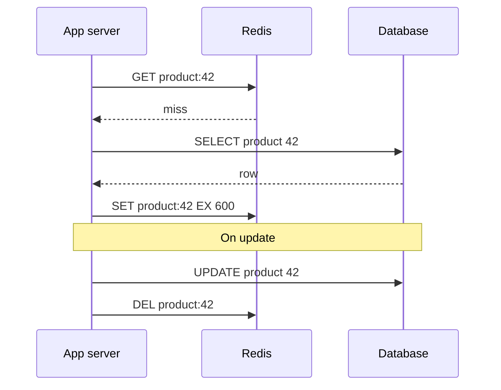

## In one minute
- Caching shows up in almost every design interview. The question is never "should we cache" but where, with which pattern, how stale it may be, and what happens when it is wrong or empty.
- The layers, from the user inward: browser, CDN, API gateway, in-process (L1) cache, distributed cache (Redis or Memcached), and the database's own buffer pool. Each removes load from everything behind it.
- Cache-aside with TTL plus delete-on-write is the default answer. Name it, give the TTL, and say how a write invalidates.
- The hard parts that interviewers probe: invalidation races, stampedes on expiry, hot keys, cold starts after a cache flush, and what consistency the user sees.
- Do the arithmetic: hit ratio determines database load. At 100k reads per second, moving from 90 to 99 percent hits cuts database reads from 10k to 1k per second.

## How it works

### Where to cache
- **Client and CDN.** Static assets and public, cacheable API responses. Controlled with `Cache-Control`, `ETag` and `s-maxage`, now specified in RFC 9111 (2022), which replaced RFC 7234; `s-maxage` applies only to shared caches such as CDNs and overrides `max-age` there ([RFC 9111](https://datatracker.ietf.org/doc/rfc9111/)). `stale-while-revalidate` lets a cache answer from a stale copy while it refetches in the background ([RFC 5861](https://www.rfc-editor.org/rfc/rfc5861)). A CDN hit never touches your origin, so this is the cheapest layer per request.
- **In-process L1.** A small map with a short TTL inside each app server. Microsecond reads, no network hop, but every server has its own copy and its own staleness. Great for configuration, feature flags and hot keys.
- **Distributed cache.** Redis, Valkey or Memcached shared by the fleet. Sub-millisecond reads within a datacenter, one copy per key, survives app deploys. Valkey is the BSD-licensed fork of Redis 7.2.4 that the Linux Foundation started in March 2024 after Redis left the BSD licence ([Linux Foundation](https://www.linuxfoundation.org/press/linux-foundation-launches-open-source-valkey-community)); Redis 8 then added AGPLv3 as an option in May 2025 ([Redis](https://redis.io/blog/agplv3/)). The protocol and commands are the same, so the design answer does not change.
- **Database-side.** The buffer pool, read replicas and materialised views; worth mentioning when the working set fits in memory anyway.

### Patterns
- **Cache-aside (lazy loading).** The app reads the cache; on a miss it reads the database and populates the cache. Writes go to the database and then delete the cache key. Simple, only caches what is read, and the cache can fail without losing data.
- **Read-through.** Same as cache-aside but the cache library or service loads from the database itself. Cleaner app code, same semantics.
- **Write-through.** Writes go to the cache and the database synchronously. Reads are always warm, but every write pays two writes and you cache data nobody reads.
- **Write-behind (write-back).** Writes go to the cache and are flushed to the database asynchronously. Very fast writes, but a cache failure loses data. Use only for data you can afford to lose or rebuild, such as counters.
- **Write-around.** Writes skip the cache entirely; reads populate it. Good when written data is rarely read soon after.
- **Refresh-ahead.** The cache reloads popular entries shortly before they expire, so hot keys rarely miss. It pays off only when you can predict what will be read; refreshing cold keys wastes database work.

### Invalidation
Options, roughly in order of preference: a TTL as a safety net on everything; delete the key after a successful database write; drive deletes from change data capture (Debezium reading the Postgres WAL, or DynamoDB Streams), which catches writes from every service; or use versioned keys such as `user:42:v17`, where a write bumps the version so old entries are simply never read again. Prefer delete over update on write: two concurrent writers that each set the cache can leave the older value in place, while a delete at worst causes one extra miss. Facebook chose delete for the same reason: deletes are idempotent, so retrying one is always safe ([Nishtala et al., NSDI 2013](https://www.usenix.org/system/files/conference/nsdi13/nsdi13-final170_update.pdf)). Order matters too: update the database first, then delete. Deleting first leaves a window in which a reader misses, reads the old row and puts it back ([Azure Architecture Center](https://learn.microsoft.com/en-us/azure/architecture/patterns/cache-aside)).

### What interviewers look for
They want a specific placement ("an L1 for the top 1,000 products with a 5-second TTL, Redis for product pages with a 10-minute TTL"), a named pattern, a staleness budget agreed with the requirements, a plan for misses at scale, and an estimate of memory. Staff candidates also say what is not cached and why, such as account balances or inventory counts used for decisions.

### A repeatable approach
1. Find the read-heavy paths and the hot data (often a few percent of keys get most reads).
2. Choose the layer: CDN for public content, distributed cache for shared data, L1 for very hot or tiny data.
3. Pick the pattern and the invalidation: cache-aside, TTL, delete on write.
4. Size it: working set times value size times overhead.
5. Cover failure: stampede protection, hot keys, cache outage behaviour.

### Common mistakes
- Caching without saying how it is invalidated.
- Updating the cache on write instead of deleting, which opens a race.
- Assuming the cache is always there. If Redis restarts empty, can the database survive 100 percent misses for a few minutes?

## Down the stack

### Layer 1: The contract
A cache-aside entry with TTL `T` and delete-on-write promises that a read returns either the current value or a value at most `T` old, and usually much fresher. It does not promise read-your-writes across servers with L1 caches. A cache promises nothing about durability: any key may vanish at any moment through eviction, failover or restart, so correctness must never depend on a key being present. Latency is the real contract: a distributed cache hit should be around 0.2 to 1 ms at p99 within a datacenter; anything slower erases the point of caching.

### Layer 2: The mechanism
Redis evicts according to `maxmemory-policy`, but out of the box it does not evict at all: `maxmemory` is 0 (unlimited) on 64-bit builds and the default policy is `noeviction`, which makes writes fail once memory runs out ([Redis docs](https://redis.io/docs/latest/develop/reference/eviction/)). Set both before calling it a cache. Its LRU is approximate: on each eviction it samples `maxmemory-samples` keys (default 5) and evicts the best candidate from a small pool, which avoids keeping a full linked list. `allkeys-lfu` uses a logarithmic counter per key (0 to 255, saturating around a million hits and decaying once a minute by default), which better protects steadily popular keys from a burst of one-off reads. Memcached stores items in slab classes of fixed chunk sizes and keeps a [segmented LRU](https://github.com/memcached/memcached/blob/master/doc/new_lru.txt) (hot, warm, cold) per class, so a one-off scan flows through cold and out without evicting active items, so a workload change in value sizes can leave memory stuck in the wrong slab class until the slab rebalancer moves pages. For stampedes, Facebook's Memcache paper describes leases: on a miss the server issues a 64-bit token to one client, at most once every 10 seconds per key, and others are told to wait briefly and retry, while a delete invalidates outstanding tokens so a stale `set` is rejected. On keys prone to herds, leases cut the peak database query rate from 17K/s to 1.3K/s ([NSDI 2013](https://www.usenix.org/system/files/conference/nsdi13/nsdi13-final170_update.pdf)). The XFetch approach refreshes probabilistically before expiry, with probability rising as the TTL nears zero. Redis client-side caching (`CLIENT TRACKING`, added in Redis 6) pushes invalidation messages to clients that read a key, letting an L1 hold data without a short TTL; if the invalidation connection drops, the client must flush its whole local cache ([Redis docs](https://redis.io/docs/latest/develop/reference/client-side-caching/)). Real workloads are less read-heavy than textbooks assume: a study of 153 Twitter cache clusters found many far more write-heavy or skewed than expected, and TTLs often decided the working set more than eviction did ([Yang et al., OSDI 2020](https://www.usenix.org/conference/osdi20/presentation/yang)).

### Layer 3: The machine
A Redis `GET` of a small value spends a few microseconds in the server; the rest of the 200 to 500 microsecond round trip is the network stack and the hop. Redis runs commands on one main thread, so one instance tops out somewhere around 100k to a few hundred thousand simple operations per second, depending on pipelining, value size and I/O threads. Large values hurt twice: a 1 MB value takes about 0.8 ms just to serialise onto a 10 Gbit link (8 megabits at 10 gigabits per second), and it blocks the event loop for every other client meanwhile. Memory overhead per key is real: a small Redis string key costs perhaps 50 to 100 bytes beyond the payload because of the dict entry, object header and allocator rounding in jemalloc size classes. RDB snapshots fork the process, and copy-on-write can briefly double memory on a write-heavy node.

### Why it's built this way
Memory is 10 to 100 times faster than SSD and the network hop is faster than a database query, so keeping hot data in RAM near the app pays. RAM is expensive, so caches hold only the working set and must evict. Exact LRU needs per-access bookkeeping across millions of keys, so production caches approximate it. A cache is a copy, and copies go stale, so every design needs a staleness bound (TTL) and an invalidation path. Because a miss for a hot key multiplies across all clients, systems add leases, coalescing or early refresh to protect the database.

## Diagram


## Worked example
An e-commerce product page service gets 120k reads per second at peak and 300 product updates per second. There are 50 million products, but about 2 million get 95 percent of views.

Memory: an average cached product is about 4 KB serialised. 2 million times 4 KB is 8 GB; add around 30 percent for key overhead and fragmentation, so about 10.5 GB. Three Redis primaries with about 4 GB of data each, plus a replica each, gives headroom and survives a node loss.

Load: at a 95 percent hit ratio, the database sees 6k reads per second; at 99 percent, 1.2k. A read replica pair handles either, but the difference matters for cost. Each Redis primary sees about 40k operations per second, comfortably within one instance.

Staleness: price changes must appear within a minute. Use cache-aside with a 10-minute TTL as a safety net, and a CDC consumer on the products table that deletes the key within about a second of commit. The CDC path also catches updates from the pricing service, which never calls the product service.

Hot keys: a flash sale product might get 30k reads per second. Add an L1 cache with a 2-second TTL for keys flagged hot, so each of 200 app servers refreshes it at most once per 2 seconds.

## In the wild
- **Facebook, 2010: a cache-correcting system takes the site down.** A system replaced cached configuration values that looked invalid with the value from the database. On 23 September an invalid value was written to the database itself, so every client tried to "fix" its cache from one database cluster, at hundreds of thousands of queries per second. Clients also deleted the cache key when the database errored, so failures caused more misses. Engineers had to stop all traffic to the cluster, taking the site down for about 2.5 hours, and the correction system was turned off ([Facebook Engineering](https://engineering.fb.com/2010/09/23/uncategorized/more-details-on-today-s-outage/)).
- **Slack, 2022: an emptied cache turns lookups into scatter queries.** A Consul agent rollout removed memcached nodes from the catalogue, and Slack's cache control plane replaced them with empty ones. Group DM membership was cached by channel ID, but the Vitess database was sharded by user, so every miss became a query across all shards. The database could not refill the cache, client retries added load, and many users could not start Slack that morning. The fix moved the query to a channel-sharded table and audited other cache-fronted scatter queries ([Slack Engineering](https://slack.engineering/slacks-incident-on-2-22-22/)).
- **Canva, 2024: request coalescing holds a herd, then releases it.** After a deploy, one JavaScript chunk stalled on a lossy CDN path. The CDN's request coalescing held about 270,000 users on that one fetch without erroring. When it finished, every waiting client hit the API at once, about 1.5 million requests per second or three times peak, and canva.com was down for about 52 minutes. Canva added load shedding and asset fetch timeouts, and let traffic back in gradually, starting with Australian users under strict rate limits ([Canva Engineering](https://www.canva.dev/blog/engineering/canva-incident-report-api-gateway-outage/)).

## Trade-offs
| Option | Strengths | Weaknesses | Choose when |
|---|---|---|---|
| Cache-aside + delete on write | Simple, cache failure is safe | First read after write misses, small race window | Default for read-heavy data |
| Write-through | Always warm, fresh reads | Every write pays twice, caches unread data | Read-soon-after-write data |
| Write-behind | Fastest writes | Data loss if the cache dies | Counters, metrics, rebuildable state |
| L1 in-process | Microsecond reads, absorbs hot keys | Per-server staleness, memory per instance | Config, hot keys, tiny reference data |
| CDN | Offloads origin entirely | Public content only, purge latency | Static assets, public pages |

## Pitfalls in production
- **Stampede on a hot key expiry.** Thousands of servers miss at once and hammer the database. Use request coalescing (single-flight per key), leases, or probabilistic early refresh, and add jitter to TTLs.
- **Cold cache after a flush or failover.** The database receives the full read load. Warm critical keys before cutover, shift traffic gradually, and rate-limit database reads on miss paths.
- **Set-after-delete race.** Reader A misses and reads the old row; writer B updates and deletes; A then writes the old value to the cache. Use leases or versioned values, and keep TTLs as the backstop.
- **Caching errors and empty results forever.** A transient database error gets cached as "not found". Never store an error as if it were data. Cache "not found" and, deliberately, errors only under their own short TTL, which stops a failing dependency from being hammered by every request. Keep a soft TTL that triggers refresh and a hard TTL up to which you may serve stale data while the database is down ([AWS Builders' Library](https://aws.amazon.com/builders-library/caching-challenges-and-strategies/)).

## Leadership lens
- Make the staleness budget a product decision written in the design doc, per data type.
- Require every cache to have a documented answer to "what happens if it is empty" and test it with a game-day flush.
- Be wary of caches that quietly become the source of truth. If anything writes only to the cache, it is a database and needs persistence, backups and an owner.

## Check yourself
1. Why delete the cache entry on write instead of updating it?
   **Answer:** Two concurrent writers updating the cache can apply in the opposite order to the database, leaving a stale value until TTL; a delete just forces one fresh read.
2. Your hit ratio drops from 98 to 92 percent. By how much does database load grow?
   **Answer:** Misses go from 2 to 8 percent of reads, so database reads quadruple.
3. When is write-behind acceptable?
   **Answer:** When losing the most recent writes on a cache failure is tolerable or recoverable, such as view counters or metrics.
4. Why does an L1 cache solve a hot key that adding Redis replicas solves less well?
   **Answer:** L1 removes the network hop and spreads the key across every app server's memory, so the shard sees at most one refresh per server per TTL.

## Practice
**Task:** Build an LRU cache with per-entry TTL and an injected clock. `TTLCache(capacity)` supports `put(key, value, now, ttl)`, which stores a value that expires at `now + ttl`, and `get(key, now)`, which returns the value or nothing; an entry is expired when `now >= expires_at` and is removed on access. Both a hit and a put make the key most recently used; inserting a new key at capacity evicts the least recently used key. `get_or_load(key, now, ttl, loader)` implements cache-aside: on a miss it calls `loader(key)`, stores and returns the result. `stats()` returns `(hits, misses)` counted by `get` and `get_or_load`.

```python starter
class TTLCache:
    def __init__(self, capacity):
        # TODO
        raise NotImplementedError

    def put(self, key, value, now, ttl):
        raise NotImplementedError

    def get(self, key, now):
        raise NotImplementedError

    def get_or_load(self, key, now, ttl, loader):
        raise NotImplementedError

    def stats(self):
        raise NotImplementedError
```

```python tests
def test_hit_and_miss():
    c = TTLCache(2)
    c.put("a", "1", 0, 10)
    assert c.get("a", 1) == "1"
    assert c.get("b", 1) is None
    assert c.stats() == (1, 1)

def test_ttl_expiry_boundary():
    c = TTLCache(2)
    c.put("a", "1", 0, 10)
    assert c.get("a", 9) == "1"
    assert c.get("a", 10) is None, "expired at now >= expires_at"

def test_lru_eviction_respects_recent_get():
    c = TTLCache(2)
    c.put("a", "1", 0, 100)
    c.put("b", "2", 0, 100)
    c.get("a", 1)
    c.put("c", "3", 2, 100)
    assert c.get("b", 3) is None
    assert c.get("a", 3) == "1" and c.get("c", 3) == "3"

def test_update_existing_does_not_evict():
    c = TTLCache(2)
    c.put("a", "1", 0, 100)
    c.put("b", "2", 0, 100)
    c.put("a", "9", 1, 100)
    assert c.get("a", 2) == "9" and c.get("b", 2) == "2"

def test_get_or_load_calls_loader_once():
    calls = []
    def loader(k):
        calls.append(k)
        return "v-" + k
    c = TTLCache(4)
    assert c.get_or_load("x", 0, 5, loader) == "v-x"
    assert c.get_or_load("x", 4, 5, loader) == "v-x"
    assert calls == ["x"]
    assert c.get_or_load("x", 5, 5, loader) == "v-x"
    assert calls == ["x", "x"], "reload after expiry"
    assert c.stats() == (1, 2)

def test_put_refreshes_ttl():
    c = TTLCache(1)
    c.put("a", "1", 0, 5)
    c.put("a", "2", 4, 5)
    assert c.get("a", 8) == "2"
```

```python solution
from collections import OrderedDict

class TTLCache:
    def __init__(self, capacity):
        self.capacity = capacity
        self.items = OrderedDict()
        self.hits = 0
        self.misses = 0

    def put(self, key, value, now, ttl):
        if key in self.items:
            self.items.move_to_end(key)
        elif len(self.items) >= self.capacity:
            self.items.popitem(last=False)
        self.items[key] = (value, now + ttl)

    def _lookup(self, key, now):
        entry = self.items.get(key)
        if entry is None:
            return None
        if now >= entry[1]:
            del self.items[key]
            return None
        self.items.move_to_end(key)
        return entry[0]

    def get(self, key, now):
        v = self._lookup(key, now)
        if v is None:
            self.misses += 1
        else:
            self.hits += 1
        return v

    def get_or_load(self, key, now, ttl, loader):
        v = self.get(key, now)
        if v is None:
            v = loader(key)
            self.put(key, v, now, ttl)
        return v

    def stats(self):
        return (self.hits, self.misses)
```

```typescript starter
export class TTLCache {
  constructor(capacity: number) {}
  put(key: string, value: string, now: number, ttl: number): void {
    throw new Error("TODO");
  }
  get(key: string, now: number): string | null {
    throw new Error("TODO");
  }
  getOrLoad(key: string, now: number, ttl: number, loader: (k: string) => string): string {
    throw new Error("TODO");
  }
  stats(): [number, number] {
    throw new Error("TODO");
  }
}
```

```typescript tests
test("hit and miss", () => {
  const c = new TTLCache(2);
  c.put("a", "1", 0, 10);
  assertEqual(c.get("a", 1), "1");
  assertEqual(c.get("b", 1), null);
  assertEqual(c.stats(), [1, 1]);
});
test("ttl expiry boundary", () => {
  const c = new TTLCache(2);
  c.put("a", "1", 0, 10);
  assertEqual(c.get("a", 9), "1");
  assertEqual(c.get("a", 10), null, "expired at now >= expiresAt");
});
test("lru eviction respects recent get", () => {
  const c = new TTLCache(2);
  c.put("a", "1", 0, 100);
  c.put("b", "2", 0, 100);
  c.get("a", 1);
  c.put("c", "3", 2, 100);
  assertEqual(c.get("b", 3), null);
  assertEqual([c.get("a", 3), c.get("c", 3)], ["1", "3"]);
});
test("update existing does not evict", () => {
  const c = new TTLCache(2);
  c.put("a", "1", 0, 100);
  c.put("b", "2", 0, 100);
  c.put("a", "9", 1, 100);
  assertEqual([c.get("a", 2), c.get("b", 2)], ["9", "2"]);
});
test("getOrLoad calls loader once", () => {
  const calls: string[] = [];
  const loader = (k: string) => { calls.push(k); return "v-" + k; };
  const c = new TTLCache(4);
  assertEqual(c.getOrLoad("x", 0, 5, loader), "v-x");
  assertEqual(c.getOrLoad("x", 4, 5, loader), "v-x");
  assertEqual(calls, ["x"]);
  assertEqual(c.getOrLoad("x", 5, 5, loader), "v-x");
  assertEqual(calls, ["x", "x"], "reload after expiry");
  assertEqual(c.stats(), [1, 2]);
});
test("put refreshes ttl", () => {
  const c = new TTLCache(1);
  c.put("a", "1", 0, 5);
  c.put("a", "2", 4, 5);
  assertEqual(c.get("a", 8), "2");
});
```

```typescript solution
export class TTLCache {
  private items = new Map<string, { value: string; expiresAt: number }>();
  private hits = 0;
  private misses = 0;
  constructor(private capacity: number) {}

  put(key: string, value: string, now: number, ttl: number): void {
    if (this.items.has(key)) {
      this.items.delete(key);
    } else if (this.items.size >= this.capacity) {
      const oldest = this.items.keys().next().value as string;
      this.items.delete(oldest);
    }
    this.items.set(key, { value, expiresAt: now + ttl });
  }

  private lookup(key: string, now: number): string | null {
    const e = this.items.get(key);
    if (!e) return null;
    this.items.delete(key);
    if (now >= e.expiresAt) return null;
    this.items.set(key, e);
    return e.value;
  }

  get(key: string, now: number): string | null {
    const v = this.lookup(key, now);
    if (v === null) this.misses++; else this.hits++;
    return v;
  }

  getOrLoad(key: string, now: number, ttl: number, loader: (k: string) => string): string {
    let v = this.get(key, now);
    if (v === null) {
      v = loader(key);
      this.put(key, v, now, ttl);
    }
    return v;
  }

  stats(): [number, number] {
    return [this.hits, this.misses];
  }
}
```

```go starter
package practice

import "sync"

// TTLCache is an LRU cache with per-entry TTL. Safe for concurrent use.
type TTLCache struct {
	mu sync.Mutex
}

func NewTTLCache(capacity int) *TTLCache { return &TTLCache{} }

func (c *TTLCache) Put(key, value string, now, ttl int) { panic("TODO") }

func (c *TTLCache) Get(key string, now int) (string, bool) { panic("TODO") }

func (c *TTLCache) GetOrLoad(key string, now, ttl int, loader func(string) string) string {
	panic("TODO")
}

func (c *TTLCache) Stats() (hits, misses int) { panic("TODO") }
```

```go tests
package practice

import (
	"reflect"
	"testing"
)

func TestHitAndMiss(t *testing.T) {
	c := NewTTLCache(2)
	c.Put("a", "1", 0, 10)
	if v, ok := c.Get("a", 1); !ok || v != "1" {
		t.Fatal("expected hit")
	}
	if _, ok := c.Get("b", 1); ok {
		t.Fatal("expected miss")
	}
	if h, m := c.Stats(); h != 1 || m != 1 {
		t.Fatalf("stats %d %d", h, m)
	}
}

func TestTTLBoundary(t *testing.T) {
	c := NewTTLCache(2)
	c.Put("a", "1", 0, 10)
	if _, ok := c.Get("a", 9); !ok {
		t.Fatal("still valid at 9")
	}
	if _, ok := c.Get("a", 10); ok {
		t.Fatal("expired at 10")
	}
}

func TestLRUEviction(t *testing.T) {
	c := NewTTLCache(2)
	c.Put("a", "1", 0, 100)
	c.Put("b", "2", 0, 100)
	c.Get("a", 1)
	c.Put("c", "3", 2, 100)
	if _, ok := c.Get("b", 3); ok {
		t.Fatal("b should be evicted")
	}
	va, _ := c.Get("a", 3)
	vc, _ := c.Get("c", 3)
	if va != "1" || vc != "3" {
		t.Fatal("a and c should remain")
	}
}

func TestUpdateDoesNotEvict(t *testing.T) {
	c := NewTTLCache(2)
	c.Put("a", "1", 0, 100)
	c.Put("b", "2", 0, 100)
	c.Put("a", "9", 1, 100)
	va, _ := c.Get("a", 2)
	vb, okb := c.Get("b", 2)
	if va != "9" || !okb || vb != "2" {
		t.Fatal("update must not evict")
	}
}

func TestGetOrLoad(t *testing.T) {
	var calls []string
	loader := func(k string) string { calls = append(calls, k); return "v-" + k }
	c := NewTTLCache(4)
	if c.GetOrLoad("x", 0, 5, loader) != "v-x" || c.GetOrLoad("x", 4, 5, loader) != "v-x" {
		t.Fatal("wrong value")
	}
	if !reflect.DeepEqual(calls, []string{"x"}) {
		t.Fatalf("calls %v", calls)
	}
	c.GetOrLoad("x", 5, 5, loader)
	if len(calls) != 2 {
		t.Fatal("reload after expiry")
	}
	if h, m := c.Stats(); h != 1 || m != 2 {
		t.Fatalf("stats %d %d", h, m)
	}
}

func TestPutRefreshesTTL(t *testing.T) {
	c := NewTTLCache(1)
	c.Put("a", "1", 0, 5)
	c.Put("a", "2", 4, 5)
	if v, ok := c.Get("a", 8); !ok || v != "2" {
		t.Fatal("ttl should be refreshed")
	}
}
```

```go solution
package practice

import (
	"container/list"
	"sync"
)

type entry struct {
	key       string
	value     string
	expiresAt int
}

// TTLCache is an LRU cache with per-entry TTL. Safe for concurrent use.
type TTLCache struct {
	mu           sync.Mutex
	capacity     int
	order        *list.List
	items        map[string]*list.Element
	hits, misses int
}

func NewTTLCache(capacity int) *TTLCache {
	return &TTLCache{capacity: capacity, order: list.New(), items: map[string]*list.Element{}}
}

func (c *TTLCache) Put(key, value string, now, ttl int) {
	c.mu.Lock()
	defer c.mu.Unlock()
	c.put(key, value, now, ttl)
}

func (c *TTLCache) put(key, value string, now, ttl int) {
	if el, ok := c.items[key]; ok {
		el.Value = &entry{key, value, now + ttl}
		c.order.MoveToFront(el)
		return
	}
	if c.order.Len() >= c.capacity {
		last := c.order.Back()
		c.order.Remove(last)
		delete(c.items, last.Value.(*entry).key)
	}
	c.items[key] = c.order.PushFront(&entry{key, value, now + ttl})
}

func (c *TTLCache) get(key string, now int) (string, bool) {
	el, ok := c.items[key]
	if ok && now >= el.Value.(*entry).expiresAt {
		c.order.Remove(el)
		delete(c.items, key)
		ok = false
	}
	if !ok {
		c.misses++
		return "", false
	}
	c.order.MoveToFront(el)
	c.hits++
	return el.Value.(*entry).value, true
}

func (c *TTLCache) Get(key string, now int) (string, bool) {
	c.mu.Lock()
	defer c.mu.Unlock()
	return c.get(key, now)
}

func (c *TTLCache) GetOrLoad(key string, now, ttl int, loader func(string) string) string {
	c.mu.Lock()
	defer c.mu.Unlock()
	if v, ok := c.get(key, now); ok {
		return v
	}
	v := loader(key)
	c.put(key, v, now, ttl)
	return v
}

func (c *TTLCache) Stats() (hits, misses int) {
	c.mu.Lock()
	defer c.mu.Unlock()
	return c.hits, c.misses
}
```

## Mock interview
**Prompt:** Design the caching layer for a news site's article API: 40 million daily readers, 150k article reads per second at peak during breaking news, 2,000 editor updates per hour, and articles must show corrections within 30 seconds.

- Follow-up: A breaking story gets 60 percent of all traffic within two minutes of publishing. What happens to your cache and database?
- Follow-up: The Redis cluster restarts empty during the peak. Walk me through the next five minutes.
- Follow-up: Logged-in users see a personalised "recommended" sidebar. How does that change what you cache and where?

**A strong answer covers:**
- CDN for the public article body with a short `s-maxage` plus purge-on-update, and a distributed cache behind it for the API.
- Cache-aside with TTL and delete-on-publish, with the 30-second correction budget mapped to TTLs and purge latency.
- Hot-key handling for the breaking story: CDN absorbs most of it, request coalescing at origin, L1 for the hottest keys.
- A cold-start plan: warm top articles, coalesce misses, shed or rate-limit database reads, serve stale if possible.
- Splitting the page into a cacheable public part and a small personalised fragment fetched separately.

## Sources and further study
**Primary**
- [RFC 9111: HTTP Caching](https://datatracker.ietf.org/doc/rfc9111/): freshness, `s-maxage`, validators and what shared caches may store.
- [RFC 5861: stale-while-revalidate and stale-if-error](https://www.rfc-editor.org/rfc/rfc5861): serving stale content to hide latency and errors.
- [Yang, Yue and Rashmi, A large scale analysis of hundreds of in-memory cache clusters at Twitter (OSDI 2020)](https://www.usenix.org/conference/osdi20/presentation/yang): real cache workloads, TTLs and eviction.

**Systems docs**
- [Redis: Client-side caching reference](https://redis.io/docs/latest/develop/reference/client-side-caching/): tracking, broadcast mode and the invalidation races to avoid.
- [Memcached: the segmented LRU](https://github.com/memcached/memcached/blob/master/doc/new_lru.txt): hot, warm and cold queues and the background maintainer.

**Books**
- *Understanding Distributed Systems* (2nd ed.), Roberto Vitillo, chapters "HTTP caching", "Content delivery networks" and "Caching".
- *System Design Interview, Volume 1*, Alex Xu, chapter 1 "Scale From Zero To Millions Of Users": where a cache and CDN first appear as a system grows.

**Other curricula**
- [Azure Architecture Center: Cache-Aside pattern](https://learn.microsoft.com/en-us/azure/architecture/patterns/cache-aside): the pattern, write ordering, local-cache drift and when not to cache.
- [donnemartin/system-design-primer](https://github.com/donnemartin/system-design-primer): lists cache locations and four update patterns, including refresh-ahead; little on stampedes or failure modes.

## Watch
- [Cache Systems Every Developer Should Know (ByteByteGo)](https://www.youtube.com/watch?v=dGAgxozNWFE): the cache layers from browser to database.
- [Caching Pitfalls Every Developer Should Know (ByteByteGo)](https://www.youtube.com/watch?v=wh98s0XhMmQ): stampede, penetration, avalanche and their fixes.
- [Scaling Memcache at Facebook (NSDI talk)](https://www.youtube.com/watch?v=6phA3IAcEJ8): leases, regional pools and invalidation at very large scale.

## Free resources
- [Caching challenges and strategies (AWS Builders' Library)](https://aws.amazon.com/builders-library/caching-challenges-and-strategies/): cold starts, cache sizing and failure modes from Amazon's experience.
- [Scaling Memcache at Facebook (USENIX NSDI 2013)](https://www.usenix.org/system/files/conference/nsdi13/nsdi13-final170_update.pdf): leases, gutter pools and cross-region invalidation.
- [Key eviction (Redis docs)](https://redis.io/docs/latest/develop/reference/eviction/): eviction policies and the approximate LRU and LFU algorithms.
- [Optimal Probabilistic Cache Stampede Prevention (Vattani et al.)](https://cseweb.ucsd.edu/~avattani/papers/cache_stampede.pdf): the early-refresh technique behind XFetch.
- [HTTP caching (MDN)](https://developer.mozilla.org/en-US/docs/Web/HTTP/Caching): `Cache-Control`, validators and shared caches.
