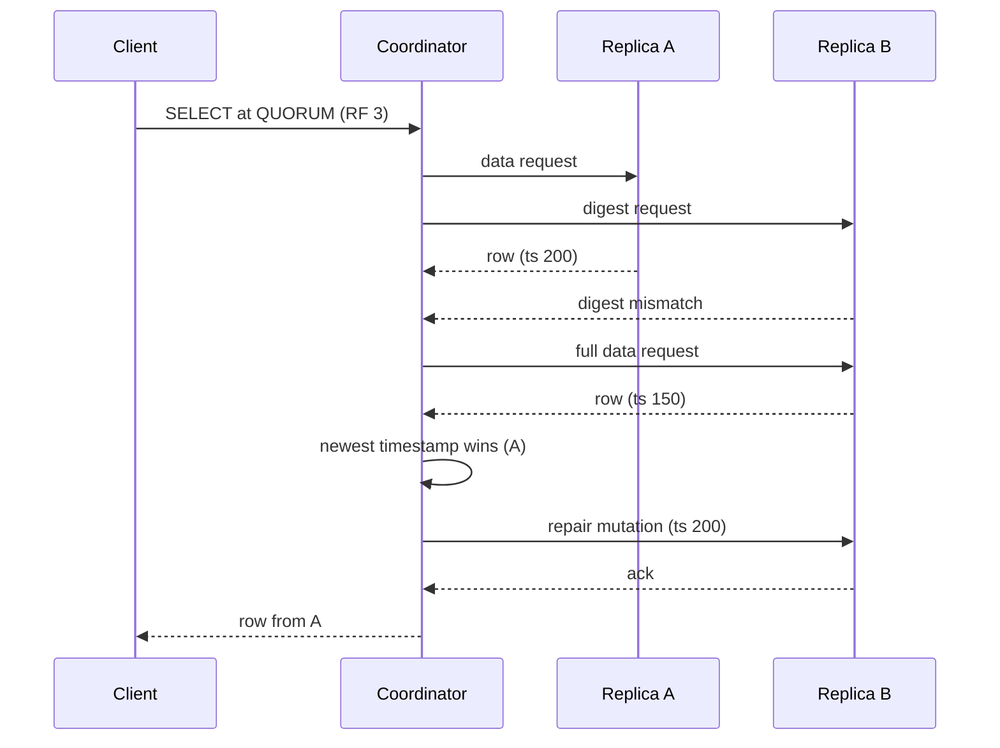

## In one minute
- Cassandra is a leaderless, wide-column database: every node can coordinate any request, data is placed on a hash ring, and each row lives on `RF` replicas, typically 3 per data centre.
- Writes are cheap appends: a commit log entry plus an in-memory memtable, later flushed to immutable SSTables and merged by compaction. It sustains very high write throughput on commodity disks.
- Consistency is chosen per request. With RF 3, `QUORUM` writes and `QUORUM` reads overlap on at least one replica, so reads see the latest acknowledged write; `ONE` is faster but may be stale.
- Divergent replicas converge through hinted handoff, read repair and scheduled Merkle-tree repair, with last-write-wins by timestamp.
- Choose it for write-heavy, multi-region, always-on workloads with known query patterns (time series, messaging, IoT, feeds). Avoid it for ad hoc queries, joins, frequent deletes, or read-modify-write transactions.

## How it works

### Data model
A table has a partition key and optional clustering columns. The partition key decides which nodes hold the data; clustering columns sort rows inside the partition on disk. `PRIMARY KEY ((sensor_id, day), ts)` puts each sensor-day in one partition sorted by time, so "sensor 42 on 1 March after 10:00" is one sequential read. With no joins, you design one table per query and denormalise.

### Placement and requests
The Murmur3 partitioner hashes the partition key to a 64-bit token. Nodes own several token ranges (vnodes, `num_tokens`, 16 by default in current releases, down from the 256 that 2.x's random allocation needed), and `NetworkTopologyStrategy` picks replicas on distinct racks in each data centre. A token-aware driver sends each request to a coordinator, which forwards to all replicas and waits for as many as the consistency level demands: `ONE`, `LOCAL_QUORUM`, `QUORUM`, `EACH_QUORUM` or `ALL`. Every replica still receives the write; the level only sets how many must answer first.

### Convergence
If a replica is down during a write, the coordinator stores a *hint* and replays it when the node returns, within `max_hint_window` (3 hours by default) ([cassandra.yaml reference](https://cassandra.apache.org/doc/latest/cassandra/managing/configuration/cass_yaml_file.html)). Reads that see disagreeing replicas trigger read repair. Older divergence needs `nodetool repair`, which compares Merkle trees of token ranges and streams differences.

## Down the stack

### Layer 1: The contract
With `W + R > RF`, a successful read returns the latest successfully acknowledged write, provided clocks are sane, because the write set and read set share a replica. A write that fails to reach its consistency level returns a timeout or `UnavailableException`, but may still have been applied on some replicas; it is neither committed nor rolled back, so clients must retry idempotently. Conflicts resolve per cell by write timestamp, with deletions winning ties. Lightweight transactions (`IF NOT EXISTS`, `IF col = x`) use Paxos for linearizable compare-and-set on one partition. The default `paxos_variant: v1` costs four round trips per write and three per read; the newer `v2`, which the config reference recommends, needs two for a write and one or two for a read ([cassandra.yaml reference](https://cassandra.apache.org/doc/latest/cassandra/managing/configuration/cass_yaml_file.html)). Typical latency is 1 to 5 ms at p99 for single-partition `LOCAL_QUORUM` operations on a healthy cluster (hedge: heavily depends on partition size and GC).

### Layer 2: The mechanism
**Write path.** The replica appends the mutation to the commit log, inserts it into the memtable (a sorted in-memory structure per table) and acknowledges. When a memtable fills, or the commit log nears its size limit, it is flushed to a new SSTable and the commit log segments it covered are recycled ([Cassandra docs](https://cassandra.apache.org/doc/latest/cassandra/architecture/storage-engine.html)). `commitlog_sync: periodic` (default, `fsync` every 10 seconds via `commitlog_sync_period`) acknowledges before the data is on disk, relying on replication for durability; `batch` or `group` modes wait for the `fsync`. If every replica loses power inside the same window, acknowledged writes from that window are gone.

**SSTable layout.** Each SSTable is a set of immutable files: `Data.db` (partitions in token order, rows in clustering order, compressed in chunks, 16 KB by default), `Index.db` and `Summary.db` (partition key to offset, with an in-memory summary sampling every 128th index entry) in the classic `big` format (still the default), or trie-based partition and row indexes (`Partitions.db`, `Rows.db`) in the `bti` format added in 5.0 and enabled with `sstable: selected_format: bti` ([Cassandra docs](https://cassandra.apache.org/doc/latest/cassandra/architecture/storage-engine.html)), `Filter.db` (a Bloom filter over partition keys), `CompressionInfo.db` (chunk offsets), `Statistics.db` (min and max timestamps, tombstone counts) and `TOC.txt`.

**Read path.** For each SSTable, the Bloom filter says "definitely not here" or "maybe". For maybes, the key cache or partition index gives an offset, `CompressionInfo` maps it to a compressed chunk, and the chunk is read and decompressed. Results from the memtable and every relevant SSTable are merged, newest timestamp per cell winning, and tombstones suppress older data.

**Coordinator read and read repair.** At `QUORUM` with RF 3, the coordinator sends a full data request to the closest replica and *digest* requests (a hash of the result) to one other. If the digests match, it returns. If not, it requests full data from those replicas, resolves per cell by timestamp, returns the winner, and sends repair mutations to the stale replicas, blocking until they acknowledge so that a later quorum read cannot go backwards. Since 4.0 this is the per-table `read_repair = 'BLOCKING'` default; `NONE` keeps partition-level write atomicity but gives up monotonic quorum reads, and the old background `read_repair_chance` is gone ([Cassandra docs](https://cassandra.apache.org/doc/latest/cassandra/managing/operating/read_repair.html)).

**Compaction.** Compaction merges SSTables, dropping overwritten cells and tombstones older than `gc_grace_seconds` (10 days by default). Size-tiered (STCS) is write-friendly; leveled (LCS) keeps a partition in about one SSTable per level for reads at more write amplification; time-window (TWCS) buckets by time so TTL'd data drops as whole files; unified (UCS, 5.0) spans these. Cassandra 5.0, the current release line, also added trie memtables, Storage Attached Indexes (SAI) and a vector type ([Cassandra 5.0: what's new](https://cassandra.apache.org/doc/latest/cassandra/new/index.html)).

**Gossip and failure detection.** Every second each node bumps its heartbeat and gossips with one random live peer, sometimes with an unreachable one, and with a seed if the random pick was not a seed, exchanging heartbeat generations and versions ([Cassandra docs](https://cassandra.apache.org/doc/latest/cassandra/architecture/dynamo.html)). A phi accrual failure detector turns heartbeat inter-arrival times into a suspicion level and marks a peer down above a threshold, which makes coordinators stop sending it requests and start writing hints.

### Layer 3: The machine
A write is one sequential append to the commit log on disk and a memory insert; no random I/O happens on the write path, which is why one node can absorb tens of thousands of writes per second (hedge: roughly 5,000 to 15,000 per core for small rows). Reads are where I/O goes: with leveled compaction a point read touches about one SSTable, so one or two 4 KB to 16 KB reads on SSD at 100 us each; with size-tiered compaction on a partition updated for months it might touch ten.

Cassandra runs on the JVM, with requests flowing through per-stage thread pools (native transport, mutation, read) and Netty handling sockets. Garbage collection is the main tail-latency risk: large partitions or wide `IN` queries churn objects, and a long pause makes the node look dead to gossip. Teams use G1 or ZGC with 8 to 31 GB heaps (staying under 32 GB keeps compressed object pointers), and leave the rest of RAM to the page cache, which is what actually serves hot SSTable chunks. Compaction needs free disk: size-tiered can temporarily need as much free space as the SSTables being merged, which is why operators keep disks under about 50 percent full.

### Why it's built this way
1. Random disk writes are slow and sequential ones are fast, so writes go to an append-only log and sorted immutable files, an LSM tree.
2. Immutable files accumulate and slow reads, so compaction merges them in the background, and Bloom filters skip files that cannot contain a key.
3. Availability across data centres mattered more than single-copy consistency, so there is no leader; any replica accepts writes and timestamps decide conflicts.
4. Leaderless replicas diverge, so hints, read repair and Merkle-tree repair converge them at increasing cost and coverage.
5. Deletes in an append-only system must be written as tombstones, and tombstones must outlive the longest repair interval, hence `gc_grace_seconds`.

## Diagram


## Worked example
A fleet of 2 million IoT devices sends a 200-byte reading every 10 seconds: 200,000 writes per second, about 40 MB/s of raw data, 3.5 TB per day before replication.

The table is `PRIMARY KEY ((device_id, day), ts)` with TWCS using one-day windows and a 30-day TTL. Partitions hold one device-day, 8,640 rows of about 200 bytes, so under 2 MB, comfortably below the 100 MB guideline. With RF 3, the cluster absorbs 600,000 replica writes per second. At a conservative 20,000 writes per second per node, that is 30 nodes for throughput.

Storage: 3.5 TB per day times 30 days times RF 3 is 315 TB raw, perhaps 100 TB after LZ4 (hedge: ratios vary). TWCS expires whole files, so nodes can run 60 percent full; at 4 TB disks that is about 45 nodes, so storage, not writes, sets the size. "Last hour for device X" at `LOCAL_QUORUM` reads one partition from a few SSTables, around 2 to 5 ms.

## In the wild
- **Discord, 2017: tombstones make one channel take 20 seconds to load.** A user deleted millions of messages through the API, leaving one live message in a channel. Reading it meant scanning millions of tombstones, and nodes hit constant 10-second stop-the-world GC pauses. Discord cut `gc_grace_seconds` from 10 days to 2, which its nightly repairs made safe, and changed the read code to remember and skip empty buckets ([Discord](https://discord.com/blog/how-discord-stores-billions-of-messages)).
- **Monzo, 2019: a scale-up makes data look missing.** Monzo added 6 nodes to a 21-node cluster with `auto_bootstrap: false`, expecting them to sit idle until data was streamed. They took ownership of token ranges at once and answered quorum reads with "not found", so balances looked wrong and payments failed for about two hours; full reconciliation took until 23:00. A single-node test had not shown the quorum effect. Monzo expanded its runbooks and planned alerting on row-not-found spikes ([Monzo](https://monzo.com/blog/2019/09/08/why-monzo-wasnt-working-on-july-29th)).
- **Discord, 2023: 177 Cassandra nodes to 72 ScyllaDB nodes.** Hot partitions from busy channels slowed quorum reads cluster-wide, and GC pauses and compaction backlogs piled on. Discord put Rust data services in front that coalesce concurrent reads of the same row, migrated at up to 3.2 million messages per second, and saw p99 historical-read latency fall from 40 to 125 ms to 15 ms ([Discord](https://discord.com/blog/how-discord-stores-trillions-of-messages)).

## Trade-offs
| Option | Strengths | Weaknesses | Choose when |
|---|---|---|---|
| Cassandra or ScyllaDB | Linear write scaling, multi-DC active-active, no single leader | Query-first modelling, tombstone and repair operations, no joins | Write-heavy, multi-region, known access patterns |
| DynamoDB | Fully managed, predictable latency | AWS-only, per-partition throughput ceilings, cost at very high steady load | Same shape of workload, team without database ops |
| Postgres | SQL, transactions, flexible queries | Single-writer node, harder to go multi-region | Relational data at moderate write rates |
| HBase or Bigtable | Strong per-row consistency, range scans | Single region-server per range, HDFS or managed only | Ordered scans over huge tables |

## Pitfalls in production
- **Unbounded partitions.** Keyed only by `user_id`, a partition grows for years and hurts reads, compaction and GC. Add a time bucket.
- **Tombstone storms.** Queue-like tables scan thousands of tombstones and hit `tombstone_failure_threshold`. Use TTLs with TWCS, or another store for queues.
- **Skipping repair.** If repair does not run within `gc_grace_seconds`, deleted data can return. Schedule repair more often than that.
- **Clock skew.** Last-write-wins trusts timestamps; a node 5 seconds ahead silently wins. Enforce NTP and alert on skew.
- **`ALLOW FILTERING` and secondary indexes.** Legacy 2i and filtered queries fan out to every node. SAI in 5.0 uses a fraction of the disk and indexes memtables and SSTables as they are written, but a read without the partition key is still a distributed range read across token ranges ([Cassandra docs](https://cassandra.apache.org/doc/latest/cassandra/developing/cql/indexing/sai/sai-concepts.html)); add a query table for hot paths.

## Leadership lens
- Start design review from the query list; each query is a table, and a missing one later means a backfill.
- Repair, compaction tuning and upgrades are continuous work; budget an owner or choose a managed offering (Astra, Keyspaces, Instaclustr) or ScyllaDB.
- Decide consistency levels per operation and write them down: `LOCAL_QUORUM` for most, `ONE` for analytics reads, LWT only where needed.
- Capacity plans should be driven by storage and compaction headroom as often as by throughput.

## Check yourself
1. With RF 3, why do `QUORUM` writes plus `QUORUM` reads give read-your-writes, but `ONE` plus `ONE` does not?
   **Answer:** Two out of three plus two out of three must share a replica, so the read sees the newest write; one plus one can hit different replicas.
2. A deleted row reappears weeks later. What happened?
   **Answer:** A replica missed the tombstone, the others purged it after `gc_grace_seconds`, and later repair or reads propagated the old live data back.
3. Why does a read at `QUORUM` block on read repair?
   **Answer:** So that once a quorum has returned a value, any later quorum read sees it too; otherwise successive reads could return new then old.
4. Why use TWCS for TTL'd time series?
   **Answer:** Each SSTable holds one time window, so once all data in it expires, the whole file is dropped without merging or scanning tombstones.

## Practice
**Task:** Implement a Cassandra-style coordinator over `n` in-memory replicas with last-write-wins cells. A cell is (timestamp, value) or a tombstone; the newer timestamp wins, a tombstone wins a tie, otherwise the larger value wins. `write(key, value, ts, cl)` and `delete(key, ts, cl)` apply to every up replica, store a hint for each down replica, and return whether at least `cl` replicas acknowledged. `read(key, cl)` contacts the first `cl` up replicas in index order, raises an error if fewer are up, returns the winning value (`None`/`null` for missing or deleted), and repairs every contacted replica that was stale. `set_down(i)` marks a replica down; `recover(i)` marks it up and replays its hints. `replica_put` and `replica_get` access one replica directly for tests.

```python starter
class Coordinator:
    def __init__(self, n):
        # TODO
        pass

    def set_down(self, i):
        raise NotImplementedError

    def recover(self, i):
        raise NotImplementedError

    def replica_put(self, i, key, value, ts):
        raise NotImplementedError

    def replica_get(self, i, key):
        """(value, ts) with value None for a tombstone, or None if absent."""
        raise NotImplementedError

    def write(self, key, value, ts, cl):
        raise NotImplementedError

    def delete(self, key, ts, cl):
        raise NotImplementedError

    def read(self, key, cl):
        raise NotImplementedError
```

```python tests
def test_quorum_write_then_read():
    c = Coordinator(3)
    assert c.write("k", "v1", 1, 2) is True
    assert c.read("k", 2) == "v1"

def test_read_repair_fixes_contacted_stale_replica():
    c = Coordinator(3)
    c.replica_put(0, "k", "old", 1)
    c.replica_put(1, "k", "new", 2)
    assert c.read("k", 2) == "new"
    assert c.replica_get(0, "k") == ("new", 2)
    assert c.replica_get(2, "k") is None

def test_read_one_can_be_stale():
    c = Coordinator(3)
    c.replica_put(0, "k", "old", 1)
    c.replica_put(1, "k", "new", 2)
    assert c.read("k", 1) == "old"

def test_down_replica_gets_hint_on_recover():
    c = Coordinator(3)
    c.set_down(2)
    assert c.write("k", "v", 5, 3) is False
    assert c.write("j", "w", 5, 2) is True
    assert c.replica_get(2, "k") is None
    c.recover(2)
    assert c.replica_get(2, "k") == ("v", 5) and c.replica_get(2, "j") == ("w", 5)

def test_tombstone_wins_and_repairs():
    c = Coordinator(3)
    c.write("k", "v", 1, 3)
    c.set_down(0)
    c.delete("k", 2, 2)
    c.recover(0)
    c.replica_put(1, "k", "zombie", 1)
    assert c.read("k", 3) is None
    assert c.replica_get(1, "k") == (None, 2)

def test_unavailable():
    c = Coordinator(3)
    c.set_down(0); c.set_down(1)
    assert c.write("k", "v", 1, 2) is False
    try:
        c.read("k", 2)
        assert False, "expected error"
    except Exception as e:
        assert "unavailable" in str(e)

def test_read_skips_down_replicas_and_tie_break():
    c = Coordinator(3)
    c.replica_put(1, "k", "apple", 7)
    c.replica_put(2, "k", "banana", 7)
    c.set_down(0)
    assert c.read("k", 2) == "banana"
    assert c.replica_get(1, "k") == ("banana", 7)
```

```python solution
class Coordinator:
    def __init__(self, n):
        self.replicas = [dict() for _ in range(n)]
        self.down = set()
        self.hints = [[] for _ in range(n)]

    @staticmethod
    def _cell(value, ts):
        # Tuples compare as LWW: newer ts, then tombstone, then larger value.
        return (ts, 1, "") if value is None else (ts, 0, value)

    def _apply(self, i, key, cell):
        cur = self.replicas[i].get(key)
        if cur is None or cell > cur:
            self.replicas[i][key] = cell

    def set_down(self, i):
        self.down.add(i)

    def recover(self, i):
        self.down.discard(i)
        for key, cell in self.hints[i]:
            self._apply(i, key, cell)
        self.hints[i] = []

    def replica_put(self, i, key, value, ts):
        self._apply(i, key, self._cell(value, ts))

    def replica_get(self, i, key):
        cell = self.replicas[i].get(key)
        if cell is None:
            return None
        ts, tomb, value = cell
        return (None if tomb else value, ts)

    def _mutate(self, key, cell, cl):
        acks = 0
        for i in range(len(self.replicas)):
            if i in self.down:
                self.hints[i].append((key, cell))
            else:
                self._apply(i, key, cell)
                acks += 1
        return acks >= cl

    def write(self, key, value, ts, cl):
        return self._mutate(key, self._cell(value, ts), cl)

    def delete(self, key, ts, cl):
        return self._mutate(key, self._cell(None, ts), cl)

    def read(self, key, cl):
        up = [i for i in range(len(self.replicas)) if i not in self.down]
        if len(up) < cl:
            raise RuntimeError("unavailable")
        contacted = up[:cl]
        cells = [self.replicas[i].get(key) for i in contacted]
        present = [c for c in cells if c is not None]
        if not present:
            return None
        winner = max(present)
        for i, cell in zip(contacted, cells):
            if cell != winner:
                self.replicas[i][key] = winner
        return None if winner[1] else winner[2]
```

```typescript starter
export class Coordinator {
  constructor(n: number) {}
  setDown(i: number): void {
    throw new Error("TODO");
  }
  recover(i: number): void {
    throw new Error("TODO");
  }
  replicaPut(i: number, key: string, value: string | null, ts: number): void {
    throw new Error("TODO");
  }
  // [value, ts] with value null for a tombstone, or null if absent.
  replicaGet(i: number, key: string): [string | null, number] | null {
    throw new Error("TODO");
  }
  write(key: string, value: string, ts: number, cl: number): boolean {
    throw new Error("TODO");
  }
  delete(key: string, ts: number, cl: number): boolean {
    throw new Error("TODO");
  }
  read(key: string, cl: number): string | null {
    throw new Error("TODO");
  }
}
```

```typescript tests
test("quorum write then read", () => {
  const c = new Coordinator(3);
  assertEqual(c.write("k", "v1", 1, 2), true);
  assertEqual(c.read("k", 2), "v1");
});
test("read repair fixes contacted stale replica", () => {
  const c = new Coordinator(3);
  c.replicaPut(0, "k", "old", 1);
  c.replicaPut(1, "k", "new", 2);
  assertEqual(c.read("k", 2), "new");
  assertEqual(c.replicaGet(0, "k"), ["new", 2]);
  assertEqual(c.replicaGet(2, "k"), null);
});
test("read ONE can be stale", () => {
  const c = new Coordinator(3);
  c.replicaPut(0, "k", "old", 1);
  c.replicaPut(1, "k", "new", 2);
  assertEqual(c.read("k", 1), "old");
});
test("down replica gets hint on recover", () => {
  const c = new Coordinator(3);
  c.setDown(2);
  assertEqual(c.write("k", "v", 5, 3), false);
  assertEqual(c.write("j", "w", 5, 2), true);
  assertEqual(c.replicaGet(2, "k"), null);
  c.recover(2);
  assertEqual([c.replicaGet(2, "k"), c.replicaGet(2, "j")], [["v", 5], ["w", 5]]);
});
test("tombstone wins and repairs", () => {
  const c = new Coordinator(3);
  c.write("k", "v", 1, 3);
  c.setDown(0);
  c.delete("k", 2, 2);
  c.recover(0);
  c.replicaPut(1, "k", "zombie", 1);
  assertEqual(c.read("k", 3), null);
  assertEqual(c.replicaGet(1, "k"), [null, 2]);
});
test("unavailable", () => {
  const c = new Coordinator(3);
  c.setDown(0);
  c.setDown(1);
  assertEqual(c.write("k", "v", 1, 2), false);
  let msg = "";
  try { c.read("k", 2); } catch (e) { msg = String((e as Error).message); }
  assert(msg.indexOf("unavailable") >= 0, "expected unavailable error");
});
test("read skips down replicas and tie break", () => {
  const c = new Coordinator(3);
  c.replicaPut(1, "k", "apple", 7);
  c.replicaPut(2, "k", "banana", 7);
  c.setDown(0);
  assertEqual(c.read("k", 2), "banana");
  assertEqual(c.replicaGet(1, "k"), ["banana", 7]);
});
```

```typescript solution
type Cell = { ts: number; tomb: boolean; value: string };

function newer(a: Cell, b: Cell): boolean {
  if (a.ts !== b.ts) return a.ts > b.ts;
  if (a.tomb !== b.tomb) return a.tomb;
  return a.value > b.value;
}

export class Coordinator {
  private replicas: Map<string, Cell>[] = [];
  private down = new Set<number>();
  private hints: [string, Cell][][] = [];

  constructor(n: number) {
    for (let i = 0; i < n; i++) {
      this.replicas.push(new Map());
      this.hints.push([]);
    }
  }
  private cell(value: string | null, ts: number): Cell {
    return value === null ? { ts, tomb: true, value: "" } : { ts, tomb: false, value };
  }
  private apply(i: number, key: string, c: Cell): void {
    const cur = this.replicas[i].get(key);
    if (!cur || newer(c, cur)) this.replicas[i].set(key, c);
  }
  setDown(i: number): void {
    this.down.add(i);
  }
  recover(i: number): void {
    this.down.delete(i);
    for (const [key, c] of this.hints[i]) this.apply(i, key, c);
    this.hints[i] = [];
  }
  replicaPut(i: number, key: string, value: string | null, ts: number): void {
    this.apply(i, key, this.cell(value, ts));
  }
  replicaGet(i: number, key: string): [string | null, number] | null {
    const c = this.replicas[i].get(key);
    if (!c) return null;
    return [c.tomb ? null : c.value, c.ts];
  }
  private mutate(key: string, c: Cell, cl: number): boolean {
    let acks = 0;
    this.replicas.forEach((_, i) => {
      if (this.down.has(i)) this.hints[i].push([key, c]);
      else {
        this.apply(i, key, c);
        acks++;
      }
    });
    return acks >= cl;
  }
  write(key: string, value: string, ts: number, cl: number): boolean {
    return this.mutate(key, this.cell(value, ts), cl);
  }
  delete(key: string, ts: number, cl: number): boolean {
    return this.mutate(key, this.cell(null, ts), cl);
  }
  read(key: string, cl: number): string | null {
    const up = this.replicas.map((_, i) => i).filter((i) => !this.down.has(i));
    if (up.length < cl) throw new Error("unavailable");
    const contacted = up.slice(0, cl);
    let winner: Cell | null = null;
    for (const i of contacted) {
      const c = this.replicas[i].get(key);
      if (c && (!winner || newer(c, winner))) winner = c;
    }
    if (!winner) return null;
    for (const i of contacted) {
      const c = this.replicas[i].get(key);
      if (!c || newer(winner, c)) this.replicas[i].set(key, winner);
    }
    return winner.tomb ? null : winner.value;
  }
}
```

```go starter
package practice

// Cell is one last-write-wins value; Tombstone marks a delete.
type Cell struct {
	Value     string
	TS        int64
	Tombstone bool
}

type Coordinator struct{}

func NewCoordinator(n int) *Coordinator { return &Coordinator{} }

func (c *Coordinator) SetDown(i int) { panic("TODO") }

func (c *Coordinator) Recover(i int) { panic("TODO") }

func (c *Coordinator) ReplicaPut(i int, key, value string, ts int64) { panic("TODO") }

func (c *Coordinator) ReplicaGet(i int, key string) (Cell, bool) { panic("TODO") }

func (c *Coordinator) Write(key, value string, ts int64, cl int) bool { panic("TODO") }

func (c *Coordinator) Delete(key string, ts int64, cl int) bool { panic("TODO") }

// Read returns the value, whether a live value exists, and an error if unavailable.
func (c *Coordinator) Read(key string, cl int) (string, bool, error) { panic("TODO") }
```

```go tests
package practice

import "testing"

func TestQuorumWriteThenRead(t *testing.T) {
	c := NewCoordinator(3)
	if !c.Write("k", "v1", 1, 2) {
		t.Fatal("write failed")
	}
	if v, ok, err := c.Read("k", 2); err != nil || !ok || v != "v1" {
		t.Fatalf("got %q %v %v", v, ok, err)
	}
}

func TestReadRepair(t *testing.T) {
	c := NewCoordinator(3)
	c.ReplicaPut(0, "k", "old", 1)
	c.ReplicaPut(1, "k", "new", 2)
	if v, _, _ := c.Read("k", 2); v != "new" {
		t.Fatalf("got %q", v)
	}
	if cell, _ := c.ReplicaGet(0, "k"); cell.Value != "new" || cell.TS != 2 {
		t.Fatal("replica 0 not repaired")
	}
	if _, ok := c.ReplicaGet(2, "k"); ok {
		t.Fatal("replica 2 was not contacted")
	}
}

func TestReadOneCanBeStale(t *testing.T) {
	c := NewCoordinator(3)
	c.ReplicaPut(0, "k", "old", 1)
	c.ReplicaPut(1, "k", "new", 2)
	if v, _, _ := c.Read("k", 1); v != "old" {
		t.Fatalf("got %q", v)
	}
}

func TestHintsOnRecover(t *testing.T) {
	c := NewCoordinator(3)
	c.SetDown(2)
	if c.Write("k", "v", 5, 3) || !c.Write("j", "w", 5, 2) {
		t.Fatal("wrong ack results")
	}
	if _, ok := c.ReplicaGet(2, "k"); ok {
		t.Fatal("down replica should not have data")
	}
	c.Recover(2)
	if cell, ok := c.ReplicaGet(2, "k"); !ok || cell.Value != "v" || cell.TS != 5 {
		t.Fatal("hint not replayed")
	}
}

func TestTombstoneWinsAndRepairs(t *testing.T) {
	c := NewCoordinator(3)
	c.Write("k", "v", 1, 3)
	c.SetDown(0)
	c.Delete("k", 2, 2)
	c.Recover(0)
	c.ReplicaPut(1, "k", "zombie", 1)
	if _, ok, err := c.Read("k", 3); ok || err != nil {
		t.Fatal("expected deleted")
	}
	if cell, _ := c.ReplicaGet(1, "k"); !cell.Tombstone || cell.TS != 2 {
		t.Fatal("replica 1 not repaired to tombstone")
	}
}

func TestUnavailable(t *testing.T) {
	c := NewCoordinator(3)
	c.SetDown(0)
	c.SetDown(1)
	if c.Write("k", "v", 1, 2) {
		t.Fatal("write should fail")
	}
	if _, _, err := c.Read("k", 2); err == nil {
		t.Fatal("expected unavailable")
	}
}

func TestSkipDownAndTieBreak(t *testing.T) {
	c := NewCoordinator(3)
	c.ReplicaPut(1, "k", "apple", 7)
	c.ReplicaPut(2, "k", "banana", 7)
	c.SetDown(0)
	if v, _, _ := c.Read("k", 2); v != "banana" {
		t.Fatalf("got %q", v)
	}
	if cell, _ := c.ReplicaGet(1, "k"); cell.Value != "banana" {
		t.Fatal("tie not repaired")
	}
}
```

```go solution
package practice

import "errors"

// Cell is one last-write-wins value; Tombstone marks a delete.
type Cell struct {
	Value     string
	TS        int64
	Tombstone bool
}

func newer(a, b Cell) bool {
	if a.TS != b.TS {
		return a.TS > b.TS
	}
	if a.Tombstone != b.Tombstone {
		return a.Tombstone
	}
	return a.Value > b.Value
}

type hint struct {
	key  string
	cell Cell
}

type Coordinator struct {
	replicas []map[string]Cell
	down     map[int]bool
	hints    [][]hint
}

func NewCoordinator(n int) *Coordinator {
	c := &Coordinator{down: map[int]bool{}, hints: make([][]hint, n)}
	for i := 0; i < n; i++ {
		c.replicas = append(c.replicas, map[string]Cell{})
	}
	return c
}

func (c *Coordinator) apply(i int, key string, cell Cell) {
	if cur, ok := c.replicas[i][key]; !ok || newer(cell, cur) {
		c.replicas[i][key] = cell
	}
}

func (c *Coordinator) SetDown(i int) { c.down[i] = true }

func (c *Coordinator) Recover(i int) {
	delete(c.down, i)
	for _, h := range c.hints[i] {
		c.apply(i, h.key, h.cell)
	}
	c.hints[i] = nil
}

func (c *Coordinator) ReplicaPut(i int, key, value string, ts int64) {
	c.apply(i, key, Cell{Value: value, TS: ts})
}

func (c *Coordinator) ReplicaGet(i int, key string) (Cell, bool) {
	cell, ok := c.replicas[i][key]
	return cell, ok
}

func (c *Coordinator) mutate(key string, cell Cell, cl int) bool {
	acks := 0
	for i := range c.replicas {
		if c.down[i] {
			c.hints[i] = append(c.hints[i], hint{key, cell})
			continue
		}
		c.apply(i, key, cell)
		acks++
	}
	return acks >= cl
}

func (c *Coordinator) Write(key, value string, ts int64, cl int) bool {
	return c.mutate(key, Cell{Value: value, TS: ts}, cl)
}

func (c *Coordinator) Delete(key string, ts int64, cl int) bool {
	return c.mutate(key, Cell{TS: ts, Tombstone: true}, cl)
}

// Read returns the value, whether a live value exists, and an error if unavailable.
func (c *Coordinator) Read(key string, cl int) (string, bool, error) {
	var contacted []int
	for i := range c.replicas {
		if !c.down[i] && len(contacted) < cl {
			contacted = append(contacted, i)
		}
	}
	if len(contacted) < cl {
		return "", false, errors.New("unavailable")
	}
	var winner Cell
	found := false
	for _, i := range contacted {
		if cell, ok := c.replicas[i][key]; ok && (!found || newer(cell, winner)) {
			winner, found = cell, true
		}
	}
	if !found {
		return "", false, nil
	}
	for _, i := range contacted {
		if cur, ok := c.replicas[i][key]; !ok || newer(winner, cur) {
			c.replicas[i][key] = winner
		}
	}
	if winner.Tombstone {
		return "", false, nil
	}
	return winner.Value, true, nil
}
```

## Mock interview
**Prompt:** Design the message store for a chat app with 50 million daily users sending 2 billion messages a day across three regions. Users load the latest 50 messages in a conversation, then scroll back.

- Follow-up: what is the partition key, and what happens to a 100,000-member group active for five years?
- Follow-up: a region is cut off for 20 minutes. What do users see, and how does data converge?
- Follow-up: product wants "delete for everyone". What does that do to the storage engine?

**A strong answer covers:**
- About 23,000 writes per second average, perhaps 100,000 at peak, times RF 3 per region: a few dozen nodes per region.
- Key `(conversation_id, time_bucket)` clustered by time descending, so a page is one slice and partitions stay bounded.
- `LOCAL_QUORUM` everywhere so each region keeps working during a partition, with hints and repair converging afterwards.
- Deletes as tombstones, with repair cadence inside `gc_grace_seconds`.
- Timeuuid message IDs for ordering and idempotent retries, and awareness of clock skew.
- Postgres struggles with write volume and multi-region writes; DynamoDB fits too, at the price of lock-in and steady-load cost.

## Sources and further study
**Primary**
- [DeCandia et al., Dynamo: Amazon's Highly Available Key-value Store (SOSP 2007)](https://www.allthingsdistributed.com/files/amazon-dynamo-sosp2007.pdf): the source of the ring, sloppy quorums, hinted handoff and Merkle-tree anti-entropy.
- [Cassandra 5.0: what's new](https://cassandra.apache.org/doc/latest/cassandra/new/index.html): SAI, trie memtables and SSTables, UCS and the vector type.

**Systems docs**
- [cassandra.yaml reference](https://cassandra.apache.org/doc/latest/cassandra/managing/configuration/cass_yaml_file.html): commit log sync, hint window, token count and the Paxos variants with their round trips.
- [Storage Attached Indexing concepts](https://cassandra.apache.org/doc/latest/cassandra/developing/cql/indexing/sai/sai-concepts.html): how SAI indexes memtables and SSTables and runs distributed range reads.

**Books**
- *Designing Data-Intensive Applications* (1st edition), Martin Kleppmann, chapter 5 "Replication" (leaderless replication) and chapter 3 "Storage and Retrieval" (SSTables and LSM trees).
- *Database Internals*, Alex Petrov, chapter 7 "Log-Structured Storage" and chapter 12 "Anti-Entropy and Dissemination": compaction, read repair, hinted handoff and Merkle trees.

**Other curricula**
- [donnemartin/system-design-primer](https://github.com/donnemartin/system-design-primer): groups Cassandra with Bigtable and HBase as wide-column stores and stops at the data model.
- [Azure Architecture Center: Understand data models](https://learn.microsoft.com/en-us/azure/architecture/data-guide/technology-choices/understand-data-store-models): frames column-family stores as high-write, up-front row-key design with limited secondary indexing.

## Watch
- [Cassandra Internals: The Read Path (Tyler Hobbs, Cassandra Summit 2016)](https://www.youtube.com/watch?v=HuDJBTPdaOA): a committer's walk through memtables, SSTables, Bloom filters and coordinator reads.
- [C* Summit 2013: Cassandra Internals (PlanetCassandra)](https://www.youtube.com/watch?v=W6e8_IcgJM4): the node-level storage engine and request paths.

## Free resources
- [Cassandra: Dynamo architecture](https://cassandra.apache.org/doc/latest/cassandra/architecture/dynamo.html): official docs on the ring, replication strategies, consistency levels and gossip.
- [Cassandra storage engine](https://cassandra.apache.org/doc/latest/cassandra/architecture/storage-engine.html): commit log, memtables and SSTable components.
- [Read repair](https://cassandra.apache.org/doc/latest/cassandra/managing/operating/read_repair.html): blocking read repair and its guarantees in current versions.
- [Cassandra: A Decentralized Structured Storage System (LADIS 2009)](https://www.cs.cornell.edu/projects/ladis2009/papers/lakshman-ladis2009.pdf): the original paper from Facebook.
- [Jepsen: Cassandra (Kyle Kingsbury)](https://aphyr.com/posts/294-call-me-maybe-cassandra): what last-write-wins and early LWTs did under partitions.
