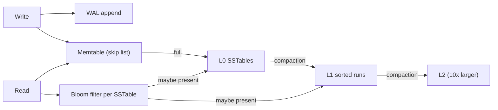

## In one minute
- A handful of data structures carry most system design answers: consistent-hash rings for placement, LSM trees and B+ trees for storage, skip lists for ordered in-memory sets, Bloom filters for "definitely not here", HyperLogLog for counting distinct things, geohashes for "near me", tries for prefixes, and heaps for top-K.
- Interviewers do not want a lecture. They want you to reach for the right structure at the right moment, say what it costs in one sentence, and know where it breaks.
- Each structure is a trade between memory, accuracy, write cost and read cost. Bloom filters and HyperLogLog give up exactness for tiny memory; LSM trees give up read cost for write throughput; B+ trees do the reverse.
- Staff-level signal: you know what the real systems use (Cassandra and RocksDB use LSM trees, Postgres and InnoDB use B+ trees, Redis sorted sets use skip lists) and can explain why.

## How it works

### When each one shows up
- **Consistent-hash ring.** Sharding a cache or key-value store whose nodes come and go. A key belongs to the next node clockwise on a hash circle, so adding a node moves only about `1/N` of keys. Virtual nodes smooth the load.
- **LSM tree.** Write-heavy stores: time series, messaging, activity logs, wide-column databases. Writes go to memory and an append-only log, then flush as sorted immutable files that are merged in the background.
- **B+ tree.** Read-heavy transactional databases and any range query on an index. Data lives in fixed-size pages; a lookup touches about three or four pages even for billions of rows.
- **Skip list.** Ordered in-memory structures that need concurrent inserts and range scans: Redis sorted sets for leaderboards, and the memtable in LevelDB and RocksDB. Small Redis sorted sets (by default up to 128 members of up to 64 bytes) are stored as a compact listpack and only convert to a skip list when they grow past that ([redis.conf](https://github.com/redis/redis/blob/unstable/redis.conf)).
- **Bloom filter.** "Have I seen this before?" with no false negatives: skip disk reads for absent keys in LSM stores, avoid re-crawling URLs, check weak passwords, filter one-hit wonders before caching.
- **HyperLogLog.** Distinct counts at scale: unique visitors, unique searches, cardinality per day. A Redis HLL uses at most 12 KB per counter (far less while it has seen few elements, thanks to a sparse encoding) with a standard error of 0.81 percent ([Redis docs](https://redis.io/docs/latest/develop/data-types/probabilistic/hyperloglogs/)).
- **Geohash (and its cousins quadtree, S2, H3).** Proximity search: nearby drivers, restaurants, friends. A geohash interleaves latitude and longitude bits into a string, so nearby points usually share a prefix and a prefix range scan finds candidates.
- **Trie.** Autocomplete and prefix routing. Each node is a character; precomputing the top suggestions at each node turns a query into a walk of a few nodes.
- **Heap.** Top-K: trending hashtags, most played songs, heavy hitters. A min-heap of size K keeps the K largest seen so far in `O(log K)` per item.

### What interviewers look for
They look for the structure appearing naturally in the design, not as a detour. "For the URL crawler I'd keep a Bloom filter of visited URLs, roughly 10 bits per URL for about 1 percent false positives, so 5 billion URLs fit in about 6 GB" (the same 10-bits-for-1-percent rule RocksDB recommends, [RocksDB tuning guide](https://github.com/facebook/rocksdb/wiki/Setup-Options-and-Basic-Tuning)) is ideal: it names the structure, gives the parameter, sizes it, and accepts the cost (1 percent of new URLs are wrongly skipped, which is fine for a crawler).

### A repeatable approach
1. Identify the access pattern: point lookup, range scan, prefix, proximity, membership, cardinality, ranking.
2. Map it to a structure family using the list above.
3. Size it with one multiplication.
4. Name its failure mode and the mitigation.

### Common mistakes
- Saying "use a Bloom filter" where a false positive is unacceptable, for example deciding whether a username is taken without a confirming lookup.
- Treating geohash as perfect: points on either side of a cell boundary can be metres apart with no common prefix, so you must also search the eight neighbouring cells.
- Using modulo hashing (`hash(key) % N`) and then adding a node, which remaps almost every key.

## Down the stack

### Layer 1: The contract
A Bloom filter promises no false negatives and a false-positive rate of about `(1 - e^(-kn/m))^k` for `m` bits, `n` items and `k` hash functions; at 10 bits per item and 7 hashes that is about 1 percent. HyperLogLog promises a relative standard error of about `1.04 / sqrt(m)` with `m` registers. A consistent-hash ring promises that adding a node moves only the keys in the arc it takes over. A B+ tree promises `O(log_B N)` page reads for a lookup and ordered iteration through linked leaves. An LSM tree promises cheap sequential writes but reads that may consult several files, bounded by its compaction strategy.

### Layer 2: The mechanism
In RocksDB a write appends to the WAL and inserts into a skip-list memtable (`write_buffer_size` defaults to 64 MB, [RocksDB tuning guide](https://github.com/facebook/rocksdb/wiki/Setup-Options-and-Basic-Tuning)). When full, the memtable becomes immutable and is flushed to an SSTable in level 0. Each SSTable holds sorted data blocks (historically 4 KB; RocksDB now suggests 16 KB for new projects), an index block, and a filter block, which since RocksDB 6.15 can be a Ribbon filter that saves about 30 percent of Bloom filter memory for 3 to 4 times the CPU ([RocksDB wiki](https://github.com/facebook/rocksdb/wiki/RocksDB-Bloom-Filter)); leveled compaction merges files so that each level beyond L0 has non-overlapping key ranges and is about 10 times larger than the one above. Postgres B-tree indexes use 8 KB pages; a page split moves part of the entries to a new page and inserts a downlink into the parent, which can cascade up to a root split. Modern Postgres also merges duplicate keys into posting lists and deletes obsolete row versions bottom-up to avoid splits caused by update churn ([Postgres docs](https://www.postgresql.org/docs/current/btree.html)). Redis sorted sets pair a skip list (for rank and range) with a hash table (for score by member), promoting each node to a higher level with probability 1/4 and capping levels at 32 ([Redis source](https://github.com/redis/redis/blob/unstable/src/server.h)). Redis HLL uses 16,384 six-bit registers: it hashes the element to 64 bits, uses 14 bits to pick a register, and stores the longest run of leading zeros seen in the rest. A geohash alternates longitude and latitude bits, halving the interval each time, and packs every five bits into one base-32 character.

### Layer 3: The machine
These structures exist because of hardware ratios. A random 4 KB read on an NVMe SSD costs on the order of 50 to 100 microseconds, while a main-memory access is around 100 ns and an L1 cache hit around 1 ns. Sequential disk writes are far faster than random ones, especially on HDDs and still meaningfully on SSDs because of erase-block management, which is why LSM trees batch writes into large sorted files. B+ tree nodes match the page size (Postgres 8 KB, InnoDB 16 KB) so that one I/O fetches a node with hundreds of keys, giving a fan-out of a few hundred and a height of three or four for a billion rows. Skip lists chase pointers and pay cache misses, but allow fine-grained concurrent inserts. A Bloom filter check is `k` random bit reads, far cheaper than the disk read it saves.

### Why it's built this way
Random I/O is expensive relative to sequential I/O, so write-optimised stores append and sort later (LSM). Reads then hit many files, so each file carries a Bloom filter and an index. Merging files costs I/O, so compaction is throttled and tuned per workload. Read-optimised stores instead keep data sorted in place in page-sized nodes (B+ tree) because one page read is the unit of cost. Exact answers need memory proportional to the data, so when the data is huge and an approximate answer is acceptable, probabilistic structures trade a known error for fixed memory.

## Diagram


## Worked example
A ride-hailing interview: 5 million active drivers send a location every 4 seconds, and riders ask for the nearest drivers.

Writes: 5 million / 4 is 1.25 million updates per second. Each update stores `driver_id -> (lat, lon, geohash6)`. A precision-6 geohash cell is roughly 1.2 km by 0.6 km near the equator ([Wikipedia](https://en.wikipedia.org/wiki/Geohash)), which is a good size for a city search. Keep an in-memory index `geohash6 -> set of driver_ids`, sharded by geohash prefix across nodes. An update moves a driver between sets only when they cross a cell boundary, which most updates do not.

Reads: the rider's location maps to a cell; query that cell and its eight neighbours, which avoids the boundary problem, then compute exact distances for the candidates and keep the nearest 10 with a max-heap of size 10. If a dense downtown cell holds 2,000 drivers, nine cells is about 18,000 distance computations, well under a millisecond of CPU.

Hot spots: an airport cell is far busier than a rural one, so shard by a hash of the cell or split hot cells to precision 7.

## In the wild
- **Discord, 2017: millions of tombstones behind one message.** A user deleted millions of messages from a channel through the API, leaving one. Loading that channel meant scanning millions of Cassandra tombstones, which took about 20 seconds and drove repeated 10-second stop-the-world GC pauses. Discord cut tombstone lifetime from 10 days to 2, which nightly repairs made safe, and changed queries to skip empty buckets ([Discord](https://discord.com/blog/how-discord-stores-billions-of-messages)).
- **Redis, 2022: geo search misses a member inside the radius.** Near 85 degrees north, a radius query of 4,891.94 m missed a member that `GEODIST` placed at 4,891.938 m, because the neighbouring geohash cells searched did not fully cover the bounding box. The fix was merged in February 2022 ([Redis PR 10018](https://github.com/redis/redis/pull/10018)).
- **Akamai, 2015: Bloom filters keep one-hit wonders out of the CDN cache.** About 74 percent of roughly 400 million cached objects on a typical cluster were requested only once in two days. Caching an object only on its second request, tracked with two rotating Bloom filters, raised the byte hit rate from about 74 to 83 percent and cut disk writes by 44 percent ([Maggs and Sitaraman](https://people.cs.umass.edu/~ramesh/Site/HOME_files/CCRpaper_1.pdf)).

## Trade-offs
| Option | Strengths | Weaknesses | Choose when |
|---|---|---|---|
| LSM tree | High write throughput, good compression | Read and space amplification, compaction spikes | Write-heavy, time-ordered data |
| B+ tree | Predictable reads and range scans | Random writes, page splits, write amplification on SSD | OLTP, read-heavy, secondary indexes |
| Bloom filter | Tiny memory, no false negatives | False positives, no deletes (use counting or cuckoo filter) | Skip expensive lookups for absent keys |
| HyperLogLog | 12 KB for billions of items, mergeable | About 1 percent error, no membership | Unique counts per day or per segment |
| Geohash | Simple string prefix, works in any KV store | Boundary effects, uneven cells | Proximity search in a general store |
| Trie with cached top-K | Very fast prefix lookups | Memory heavy, rebuilds for updates | Autocomplete |

## Pitfalls in production
- **Bloom filter sized for yesterday.** False positives grow sharply once a filter holds more items than planned. Rebuild or use scalable filters that add layers as they fill.
- **Wrong number of virtual nodes.** With one random point per node, the largest node can own several times its fair share of the ring. Dynamo-era advice was many points per node, but more tokens also means each node shares data with more peers, which lowers availability and makes repair heavier. Cassandra now defaults to 16 tokens with a token allocation algorithm that balances load deliberately, and says 16 is not recommended above about 50 nodes ([Cassandra docs](https://cassandra.apache.org/doc/latest/cassandra/getting-started/production.html)). Weight by capacity either way.
- **Compaction debt.** An LSM store that cannot compact as fast as it ingests accumulates L0 files, and RocksDB will slow down or stop writes for the whole database once L0 file count or pending compaction bytes cross their triggers ([RocksDB wiki](https://github.com/facebook/rocksdb/wiki/Write-Stalls)). Monitor pending compaction bytes and provision I/O headroom.
- **Merging top-K incorrectly.** A global top 10 built from each shard's top 10 can miss an item ranked 11th everywhere. Take a larger K per shard or use exact counts for the candidates.

## Leadership lens
- Ask in review which access pattern each structure serves and what happens when its error or amplification hits the worst case.
- Prefer the structure inside a proven system (Redis sorted sets, Postgres GiST, RocksDB) over a hand-rolled one; the bugs are in concurrency and persistence, not the textbook algorithm.

## Check yourself
1. Why do LSM stores attach a Bloom filter to every SSTable?
   **Answer:** A read for a missing key would otherwise check every file that could contain it; the filter rules most files out with a few memory reads instead of a disk read.
2. Why does a B+ tree stay only three or four levels deep for a billion rows?
   **Answer:** Each node is a disk page holding hundreds of keys, so the fan-out is in the hundreds and the height grows with the logarithm in that base.
3. A geohash search for drivers near a rider returns nobody, although a driver is 50 metres away. Why?
   **Answer:** The two points are in adjacent cells with different prefixes; the search must include the neighbouring cells.
4. Why can HyperLogLog sketches from different servers be combined, and what operation merges them?
   **Answer:** Each register stores a maximum, so taking the register-wise maximum of two sketches gives the sketch of the union.

## Practice
**Task:** Implement geohash encoding. `encode(lat, lon, precision)` returns a base-32 string of `precision` characters using the alphabet `0123456789bcdefghjkmnpqrstuvwxyz`. Bits alternate, starting with longitude; for each bit, if the value is greater than or equal to the midpoint of the current interval, emit 1 and keep the upper half, otherwise emit 0 and keep the lower half. `decode_bbox(hash)` returns the cell as `(lat_min, lat_max, lon_min, lon_max)` and fails on characters outside the alphabet. `shared_prefix_len(a, b)` returns the length of the common prefix of two hashes.

```python starter
BASE32 = "0123456789bcdefghjkmnpqrstuvwxyz"

def encode(lat, lon, precision):
    # TODO
    raise NotImplementedError

def decode_bbox(h):
    # TODO: return (lat_min, lat_max, lon_min, lon_max); raise ValueError on bad chars
    raise NotImplementedError

def shared_prefix_len(a, b):
    # TODO
    raise NotImplementedError
```

```python tests
def test_known_value():
    assert encode(57.64911, 10.40744, 11) == "u4pruydqqvj"

def test_origin_and_corner():
    assert encode(0.0, 0.0, 5) == "s0000"
    assert encode(-90.0, -180.0, 3) == "000"
    assert encode(10.0, 10.0, 0) == ""

def test_decode_single_char():
    assert decode_bbox("s") == (0.0, 45.0, 0.0, 45.0)

def test_round_trip_center():
    h = encode(37.7749, -122.4194, 7)
    a, b, c, d = decode_bbox(h)
    assert a <= 37.7749 <= b and c <= -122.4194 <= d
    assert encode((a + b) / 2, (c + d) / 2, 7) == h

def test_decode_rejects_bad_char():
    try:
        decode_bbox("u4a")
        assert False, "'a' is not in the alphabet"
    except ValueError:
        pass

def test_nearby_points_share_prefix():
    a = encode(37.7749, -122.4194, 8)
    b = encode(37.7750, -122.4195, 8)
    assert shared_prefix_len(a, b) >= 6
    assert shared_prefix_len("abc", "abd") == 2
    assert shared_prefix_len("", "x") == 0
```

```python solution
BASE32 = "0123456789bcdefghjkmnpqrstuvwxyz"

def encode(lat, lon, precision):
    lat_lo, lat_hi = -90.0, 90.0
    lon_lo, lon_hi = -180.0, 180.0
    out, bits, nbits, even = [], 0, 0, True
    while len(out) < precision:
        if even:
            mid = (lon_lo + lon_hi) / 2
            if lon >= mid:
                bits, lon_lo = bits * 2 + 1, mid
            else:
                bits, lon_hi = bits * 2, mid
        else:
            mid = (lat_lo + lat_hi) / 2
            if lat >= mid:
                bits, lat_lo = bits * 2 + 1, mid
            else:
                bits, lat_hi = bits * 2, mid
        even = not even
        nbits += 1
        if nbits == 5:
            out.append(BASE32[bits])
            bits, nbits = 0, 0
    return "".join(out)

def decode_bbox(h):
    lat_lo, lat_hi = -90.0, 90.0
    lon_lo, lon_hi = -180.0, 180.0
    even = True
    for ch in h:
        v = BASE32.find(ch)
        if v < 0:
            raise ValueError("bad geohash char: " + ch)
        for shift in (4, 3, 2, 1, 0):
            bit = (v >> shift) & 1
            if even:
                mid = (lon_lo + lon_hi) / 2
                if bit:
                    lon_lo = mid
                else:
                    lon_hi = mid
            else:
                mid = (lat_lo + lat_hi) / 2
                if bit:
                    lat_lo = mid
                else:
                    lat_hi = mid
            even = not even
    return (lat_lo, lat_hi, lon_lo, lon_hi)

def shared_prefix_len(a, b):
    n = 0
    while n < len(a) and n < len(b) and a[n] == b[n]:
        n += 1
    return n
```

```typescript starter
export const BASE32 = "0123456789bcdefghjkmnpqrstuvwxyz";

export function encode(lat: number, lon: number, precision: number): string {
  throw new Error("TODO");
}

export function decodeBBox(h: string): [number, number, number, number] {
  throw new Error("TODO");
}

export function sharedPrefixLen(a: string, b: string): number {
  throw new Error("TODO");
}
```

```typescript tests
test("known value", () => {
  assertEqual(encode(57.64911, 10.40744, 11), "u4pruydqqvj");
});
test("origin and corner", () => {
  assertEqual(encode(0, 0, 5), "s0000");
  assertEqual(encode(-90, -180, 3), "000");
  assertEqual(encode(10, 10, 0), "");
});
test("decode single char", () => {
  assertEqual(decodeBBox("s"), [0, 45, 0, 45]);
});
test("round trip center", () => {
  const h = encode(37.7749, -122.4194, 7);
  const [a, b, c, d] = decodeBBox(h);
  assert(a <= 37.7749 && 37.7749 <= b && c <= -122.4194 && -122.4194 <= d, "point inside its cell");
  assertEqual(encode((a + b) / 2, (c + d) / 2, 7), h);
});
test("decode rejects bad char", () => {
  let threw = false;
  try { decodeBBox("u4a"); } catch (e) { threw = true; }
  assert(threw, "'a' is not in the alphabet");
});
test("nearby points share prefix", () => {
  assert(sharedPrefixLen(encode(37.7749, -122.4194, 8), encode(37.775, -122.4195, 8)) >= 6, "nearby");
  assertEqual(sharedPrefixLen("abc", "abd"), 2);
  assertEqual(sharedPrefixLen("", "x"), 0);
});
```

```typescript solution
export const BASE32 = "0123456789bcdefghjkmnpqrstuvwxyz";

export function encode(lat: number, lon: number, precision: number): string {
  let latLo = -90, latHi = 90, lonLo = -180, lonHi = 180;
  let out = "", bits = 0, nbits = 0, even = true;
  while (out.length < precision) {
    if (even) {
      const mid = (lonLo + lonHi) / 2;
      if (lon >= mid) { bits = bits * 2 + 1; lonLo = mid; } else { bits = bits * 2; lonHi = mid; }
    } else {
      const mid = (latLo + latHi) / 2;
      if (lat >= mid) { bits = bits * 2 + 1; latLo = mid; } else { bits = bits * 2; latHi = mid; }
    }
    even = !even;
    if (++nbits === 5) { out += BASE32[bits]; bits = 0; nbits = 0; }
  }
  return out;
}

export function decodeBBox(h: string): [number, number, number, number] {
  let latLo = -90, latHi = 90, lonLo = -180, lonHi = 180;
  let even = true;
  for (const ch of h) {
    const v = BASE32.indexOf(ch);
    if (v < 0) throw new Error("bad geohash char: " + ch);
    for (let shift = 4; shift >= 0; shift--) {
      const bit = (v >> shift) & 1;
      if (even) {
        const mid = (lonLo + lonHi) / 2;
        if (bit) lonLo = mid; else lonHi = mid;
      } else {
        const mid = (latLo + latHi) / 2;
        if (bit) latLo = mid; else latHi = mid;
      }
      even = !even;
    }
  }
  return [latLo, latHi, lonLo, lonHi];
}

export function sharedPrefixLen(a: string, b: string): number {
  let n = 0;
  while (n < a.length && n < b.length && a[n] === b[n]) n++;
  return n;
}
```

```go starter
package practice

const Base32 = "0123456789bcdefghjkmnpqrstuvwxyz"

func Encode(lat, lon float64, precision int) string { panic("TODO") }

// DecodeBBox returns [latMin, latMax, lonMin, lonMax].
func DecodeBBox(h string) ([4]float64, error) { panic("TODO") }

func SharedPrefixLen(a, b string) int { panic("TODO") }
```

```go tests
package practice

import "testing"

func TestKnownValue(t *testing.T) {
	if got := Encode(57.64911, 10.40744, 11); got != "u4pruydqqvj" {
		t.Fatalf("got %q", got)
	}
}

func TestOriginAndCorner(t *testing.T) {
	if Encode(0, 0, 5) != "s0000" || Encode(-90, -180, 3) != "000" || Encode(10, 10, 0) != "" {
		t.Fatal("wrong encoding")
	}
}

func TestDecodeSingleChar(t *testing.T) {
	b, err := DecodeBBox("s")
	if err != nil || b != [4]float64{0, 45, 0, 45} {
		t.Fatalf("got %v %v", b, err)
	}
}

func TestRoundTripCenter(t *testing.T) {
	h := Encode(37.7749, -122.4194, 7)
	b, err := DecodeBBox(h)
	if err != nil || !(b[0] <= 37.7749 && 37.7749 <= b[1] && b[2] <= -122.4194 && -122.4194 <= b[3]) {
		t.Fatalf("point not in cell %v", b)
	}
	if Encode((b[0]+b[1])/2, (b[2]+b[3])/2, 7) != h {
		t.Fatal("center does not round trip")
	}
}

func TestDecodeRejectsBadChar(t *testing.T) {
	if _, err := DecodeBBox("u4a"); err == nil {
		t.Fatal("expected error")
	}
}

func TestNearbySharePrefix(t *testing.T) {
	if SharedPrefixLen(Encode(37.7749, -122.4194, 8), Encode(37.775, -122.4195, 8)) < 6 {
		t.Fatal("nearby points should share a prefix")
	}
	if SharedPrefixLen("abc", "abd") != 2 || SharedPrefixLen("", "x") != 0 {
		t.Fatal("wrong prefix length")
	}
}
```

```go solution
package practice

import (
	"errors"
	"strings"
)

const Base32 = "0123456789bcdefghjkmnpqrstuvwxyz"

func Encode(lat, lon float64, precision int) string {
	latLo, latHi, lonLo, lonHi := -90.0, 90.0, -180.0, 180.0
	var sb strings.Builder
	bits, nbits, even := 0, 0, true
	for sb.Len() < precision {
		if even {
			mid := (lonLo + lonHi) / 2
			if lon >= mid {
				bits, lonLo = bits*2+1, mid
			} else {
				bits, lonHi = bits*2, mid
			}
		} else {
			mid := (latLo + latHi) / 2
			if lat >= mid {
				bits, latLo = bits*2+1, mid
			} else {
				bits, latHi = bits*2, mid
			}
		}
		even = !even
		nbits++
		if nbits == 5 {
			sb.WriteByte(Base32[bits])
			bits, nbits = 0, 0
		}
	}
	return sb.String()
}

// DecodeBBox returns [latMin, latMax, lonMin, lonMax].
func DecodeBBox(h string) ([4]float64, error) {
	latLo, latHi, lonLo, lonHi := -90.0, 90.0, -180.0, 180.0
	even := true
	for _, ch := range h {
		v := strings.IndexRune(Base32, ch)
		if v < 0 {
			return [4]float64{}, errors.New("bad geohash char")
		}
		for shift := 4; shift >= 0; shift-- {
			bit := (v >> shift) & 1
			if even {
				mid := (lonLo + lonHi) / 2
				if bit == 1 {
					lonLo = mid
				} else {
					lonHi = mid
				}
			} else {
				mid := (latLo + latHi) / 2
				if bit == 1 {
					latLo = mid
				} else {
					latHi = mid
				}
			}
			even = !even
		}
	}
	return [4]float64{latLo, latHi, lonLo, lonHi}, nil
}

func SharedPrefixLen(a, b string) int {
	n := 0
	for n < len(a) && n < len(b) && a[n] == b[n] {
		n++
	}
	return n
}
```

## Mock interview
**Prompt:** Design the "people you may know near you" feature for a social app with 300 million monthly users, about 20 million of whom share location at any moment, updating every 30 seconds. A user should see up to 20 nearby friends-of-friends within 2 km.

- Follow-up: Which spatial index do you use, and how do you handle users near cell boundaries?
- Follow-up: Downtown Tokyo has 100 times the density of the average cell. What breaks?
- Follow-up: You also need "how many distinct users visited this venue today". How do you store that cheaply for a million venues?

**A strong answer covers:**
- Write load arithmetic (20 million / 30 s is about 670k updates per second) and an in-memory spatial index sharded by cell.
- Geohash or S2 or H3 cells sized near the 2 km radius, querying the cell plus neighbours and filtering by exact distance.
- Handling dense cells by adaptive precision or splitting, and sharding by hashed cell ID to avoid hot shards.
- Intersecting candidates with the friend graph and keeping the top 20 with a bounded heap.
- HyperLogLog per venue per day (about 12 KB each, so roughly 12 GB for a million venues) and its error bound.

## Sources and further study
**Primary**
- [Redis source: `server.h`](https://github.com/redis/redis/blob/unstable/src/server.h) and [`redis.conf`](https://github.com/redis/redis/blob/unstable/redis.conf): the skip list constants and the listpack thresholds for small sorted sets.

**Systems docs**
- [RocksDB: Setup Options and Basic Tuning](https://github.com/facebook/rocksdb/wiki/Setup-Options-and-Basic-Tuning): memtable size, block size and Bloom bits per key.
- [RocksDB: Bloom Filter](https://github.com/facebook/rocksdb/wiki/RocksDB-Bloom-Filter): filter formats, false-positive rates and the Ribbon alternative.
- [RocksDB: Write Stalls](https://github.com/facebook/rocksdb/wiki/Write-Stalls): what makes an LSM store slow down or stop writes.
- [PostgreSQL: B-Tree implementation](https://www.postgresql.org/docs/current/btree.html): page splits, deduplication and bottom-up deletion.
- [Apache Cassandra: Production recommendations](https://cassandra.apache.org/doc/latest/cassandra/getting-started/production.html): how token count trades balance against availability.

**Books**
- *Designing Data-Intensive Applications* (1st ed.), Martin Kleppmann, chapter 3 "Storage and Retrieval": hash indexes, SSTables, LSM trees and B-trees compared.
- *Database Internals* (1st ed.), Alex Petrov, chapters 4 "Implementing B-Trees" and 7 "Log-Structured Storage": splits, merges and read, write and space amplification.
- *System Design Interview, Volume 2*, Alex Xu and Sahn Lam, chapter 1 "Proximity Service": geohash, quadtree and S2 compared for "near me" queries.

**Other curricula**
- [donnemartin/system-design-primer](https://github.com/donnemartin/system-design-primer): frames storage as SQL versus NoSQL families and caching; it does not cover Bloom filters, LSM trees, HyperLogLog or geohashes.
- [Azure Architecture Center: Understand data models](https://learn.microsoft.com/en-us/azure/architecture/guide/technology-choices/data-store-overview): starts from access patterns (point reads, scans, full text, time windows) and maps each to a storage model, the same first step as this lesson.

## Watch
- [The Secret Sauce Behind NoSQL: LSM Tree (ByteByteGo)](https://www.youtube.com/watch?v=I6jB0nM9SKU): memtables, SSTables, compaction and Bloom filters in a few minutes.
- [Consistent Hashing | Algorithms You Should Know #1 (ByteByteGo)](https://www.youtube.com/watch?v=UF9Iqmg94tk): the ring, virtual nodes and rebalancing.
- [Database Indexing Explained (with PostgreSQL) (Hussein Nasser)](https://www.youtube.com/watch?v=-qNSXK7s7_w): B-tree indexes in practice with query plans.

## Free resources
- [The Log-Structured Merge-Tree (O'Neil et al.)](https://www.cs.umb.edu/~poneil/lsmtree.pdf): the original LSM paper and its cost model.
- [Bigtable: A Distributed Storage System for Structured Data (Google)](https://static.googleusercontent.com/media/research.google.com/en//archive/bigtable-osdi06.pdf): memtables, SSTables and Bloom filters in a production system.
- [Dynamo: Amazon's Highly Available Key-value Store](https://www.allthingsdistributed.com/files/amazon-dynamo-sosp2007.pdf): consistent hashing with virtual nodes and preference lists.
- [HyperLogLog paper (Flajolet et al.)](https://algo.inria.fr/flajolet/Publications/FlFuGaMe07.pdf): the algorithm and its error analysis.
- [Redis new data structure: the HyperLogLog (antirez)](http://antirez.com/news/75): how Redis implements HLL in 12 KB.
- [Geohash (Wikipedia)](https://en.wikipedia.org/wiki/Geohash): encoding details, cell sizes per precision and edge cases.
