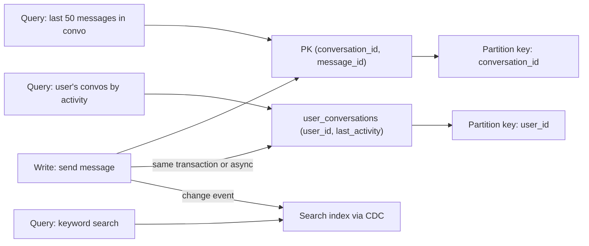

## In one minute
- In an interview, design the data model from the access patterns, not from the nouns. List the queries first, then shape tables, keys and indexes so each important query is one indexed lookup or one range scan.
- Name three things for every core table: the primary key, the secondary indexes and what query each serves, and the partition (shard) key with why it spreads load.
- The partition key is the decision that is hardest to undo. It decides which queries are single-shard, where hot spots appear, and what transactions are possible.
- Denormalise deliberately: duplicate data to make a hot read cheap, and say how the copies stay in sync.
- Staff-level signal: you reason about write amplification from indexes, growth over five years, and how the schema will migrate without downtime.

## How it works

### Start from access patterns
Write the queries as sentences with their rates before drawing tables. For a messaging app: "fetch the latest 50 messages in a conversation, 200k per second"; "append a message, 50k per second"; "list a user's conversations ordered by last activity, 30k per second"; "search messages by keyword, rare". Each sentence suggests a key. The first wants `(conversation_id, message_id)` with messages sorted by time inside the conversation. The third wants a per-user table ordered by `last_activity`. The fourth does not belong in the primary store at all; it goes to a search index fed by change events.

### Schema, keys and constraints
In a relational design, normalise first so each fact lives in one place, then denormalise the specific paths that are hot. Use surrogate keys (64-bit IDs) for rows and enforce natural uniqueness with unique constraints (`UNIQUE (email)`). Time-ordered IDs such as Snowflake-style IDs or UUIDv7 keep inserts at the right edge of the B-tree, which keeps the hot pages in memory; random UUIDv4 keys scatter inserts across the whole index. UUIDv7 is now standard: RFC 9562 (2024) replaced RFC 4122 and tells implementations to prefer it over the older time-based versions ([RFC 9562](https://www.rfc-editor.org/rfc/rfc9562)), and PostgreSQL 18 (September 2025) added a built-in `uuidv7()` function ([PostgreSQL 18 release notes](https://www.postgresql.org/docs/release/18.0/)).

### Indexes
An index serves a query when the query's equality columns form a prefix of the index, optionally followed by one range column. The same prefix rule decides whether `ORDER BY` can be read in index order without a sort. So for "latest orders for a user", the index is `(user_id, created_at DESC)`, not two separate indexes. The rule has softened slightly: PostgreSQL 18 and MySQL 8.0.13 and later can use a skip scan, probing each distinct value of a leading column the query does not filter on. That helps when the leading column has few distinct values, such as `(status, created_at)`, but it is a fallback, not a reason to design indexes in the wrong order ([PostgreSQL 18 release notes](https://www.postgresql.org/docs/release/18.0/), [MySQL 8.0.13 release notes](https://dev.mysql.com/doc/relnotes/mysql/8.0/en/news-8-0-13.html)). A covering index includes the selected columns (`INCLUDE` in Postgres) so the query never touches the table. Every index costs space and a write on every insert and on updates to indexed columns, so a write-heavy table with eight indexes pays roughly eight extra page modifications per insert.

### Partition keys
When one node is not enough, pick a partition key so that the most frequent queries hit one partition and the load spreads evenly. `user_id` is common for user-centric apps; `conversation_id` for messaging; `tenant_id` for SaaS (with large tenants split further). Avoid keys with low cardinality or temporal skew, such as `country` or `date`, which put all of today's writes on one shard. Cross-partition queries become scatter-gather or need a secondary store. Each partition also has a throughput ceiling: a DynamoDB partition delivers at most 3,000 read units and 1,000 write units per second ([AWS docs](https://docs.aws.amazon.com/amazondynamodb/latest/developerguide/bp-partition-key-design.html)). Size is bounded too, though less strictly than people assume: DynamoDB caps an item collection at 10 GB only on tables with local secondary indexes ([AWS docs](https://docs.aws.amazon.com/amazondynamodb/latest/developerguide/LSI.html)), while in Cassandra very large partitions slow reads, repairs and compaction. So a key that grows without limit (all events for a popular device forever) needs a bucket such as `(device_id, day)`. Discord did exactly this for messages, keying them by `((channel_id, bucket), message_id)` with about 10 days per bucket to keep partitions under 100 MB ([Discord](https://discord.com/blog/how-discord-stores-billions-of-messages)).

### What interviewers look for, and a repeatable approach
1. List the top queries and writes with rough QPS.
2. Choose the store family (relational unless something rules it out).
3. Sketch tables with primary keys, then add one index per important query.
4. Pick the partition key and check it against hot spots and the top queries.
5. Mention denormalised copies and how they are maintained, and how data grows.

### Common mistakes
- Drawing an entity-relationship diagram with no queries attached.
- Adding an index per column instead of composite indexes that match queries.
- Choosing a partition key that does not appear in the most common query, so every read is scatter-gather.
- Ignoring growth: a table that gains 1 billion rows a year needs a retention, archive or partitioning plan.

## Down the stack

### Layer 1: The contract
A database design promises: uniqueness where constraints exist; atomicity within a transaction (single-partition in most distributed stores, multi-row in a single relational node or in systems such as Spanner or CockroachDB); an isolation level (Postgres defaults to Read Committed, [Postgres docs](https://www.postgresql.org/docs/current/transaction-iso.html); MySQL InnoDB to Repeatable Read, [MySQL docs](https://dev.mysql.com/doc/refman/8.4/en/innodb-transaction-isolation-levels.html)); and bounded query cost for the listed access patterns, for example "any conversation page in one index range scan of at most 50 rows". Writing these down shows which invariants the schema enforces and which the application must enforce.

### Layer 2: The mechanism
In Postgres, a table is a heap of 8 KB pages and each B-tree index maps keys to tuple IDs `(block, offset)`. Updates use MVCC: an update writes a new tuple version with new `xmin`, marks the old one's `xmax`, and normally inserts new entries in every index. A heap-only tuple (HOT) update avoids new index entries when no indexed column changes and the new version fits on the same page; since PostgreSQL 16 a change to a column covered only by a summarizing (BRIN) index no longer blocks HOT ([Postgres docs](https://www.postgresql.org/docs/current/storage-hot.html)). That is one reason to keep frequently updated columns out of indexes and to leave free space with `fillfactor`. Declarative partitioning splits a table by range, list or hash into child tables, so dropping a month of data is a cheap `DETACH` and `DROP` rather than a huge `DELETE`. In DynamoDB, the partition key is hashed to choose a storage partition and the sort key orders items within it; a `Query` reads one partition key's items in sort order, and a global secondary index is an asynchronously maintained copy with its own keys. Cassandra uses the same idea with partition keys and clustering columns stored sorted in SSTables.

### Layer 3: The machine
An index lookup in a B-tree of a billion rows touches about four pages; the upper levels are almost always in the buffer pool, so the cost is one or two page reads from disk if cold, roughly 0.1 ms each on NVMe and 5 to 10 ms on a spinning disk. A range scan of 50 adjacent rows in the same index costs one or two leaf pages, while fetching those 50 rows from a heap ordered differently can cost 50 random page reads, which is why clustering and covering indexes matter. Each insert writes the heap page, every index page touched, and WAL records for all of them; WAL is flushed with `fsync` at commit unless commit batching or `synchronous_commit = off` relaxes it. Random UUID keys cause each insert to dirty a different leaf page, multiplying page writes and cache misses compared to monotonically increasing keys.

### Why it's built this way
Disks and SSDs move data in pages, so storage engines lay out data in pages and design indexes to minimise page touches. Different queries need different orders, so you add indexes, and each copy costs writes. One machine eventually runs out of disk, IOPS or CPU, so data is partitioned, and because cross-partition coordination costs round trips, transactions and queries are kept inside a partition where possible. That is why the partition key ends up mirroring the dominant access pattern.

## Diagram


## Worked example
Design the order store for a marketplace with 5 million orders per day, 100k order reads per second at peak, and a five-year retention requirement.

Volume: 5 million a day is about 58 writes per second on average; assume 10 times that at peak, about 600 per second, comfortable for one Postgres primary. Over five years that is about 9 billion orders. At roughly 500 bytes per order plus about 300 bytes for indexes, that is around 7 TB, too large to keep comfortably on one node with headroom, so plan partitioning now.

Tables: `orders(order_id PK, buyer_id, seller_id, status, total_cents, created_at, ...)`, `order_items(order_id, line_no, sku, qty, price_cents, PRIMARY KEY (order_id, line_no))`. Queries and indexes: buyer order history uses `(buyer_id, created_at DESC)`; the seller dashboard uses `(seller_id, status, created_at DESC)`; order detail is the primary key.

Partitioning: shard by `buyer_id` hash, because buyer history and checkout are the hottest paths and order items live with their order. Seller queries become cross-shard, so maintain a seller-side copy (`seller_orders` partitioned by `seller_id`) through an outbox and CDC, accepting a second or two of lag on the seller dashboard. Use monthly range partitions inside each shard so data older than 18 months can move to cheaper storage.

## In the wild
- **Shopify, 2022: time-ordered keys halve insert time.** In its write-up on resilient payment systems, Shopify reports a 50 percent drop in `INSERT` statement duration after switching idempotency keys from random UUIDv4 to time-ordered ULIDs, which Shopify attributes to ULIDs sorting well in the B-tree indexes databases use ([Shopify Engineering](https://shopify.engineering/building-resilient-payment-systems)).
- **Discord, 2017: a bucketed partition still needs care with deletes.** One channel was left with a single message after a user deleted millions through the API. Reading it meant scanning millions of Cassandra tombstones, and the cluster ran 10-second stop-the-world GC pauses. Discord cut tombstone lifetime from 10 days to 2, which its nightly repairs made safe, and changed queries to record and skip empty buckets per channel ([Discord](https://discord.com/blog/how-discord-stores-billions-of-messages)).
- **Atlassian Statuspage, 2019: a column drop at the wrong moment.** An ad-hoc migration dropping legacy attributes ran while worker jobs were unusually busy. Their locks queued the migration, the migration then blocked later calls to those tables, and requests timed out across services for about 7 minutes ([Statuspage](https://metastatuspage.com/incidents/c666y50f1xr9)).

## Trade-offs
| Option | Strengths | Weaknesses | Choose when |
|---|---|---|---|
| Normalised schema | One source of truth, easy writes | Joins on hot reads | Transactional core data |
| Denormalised copies | One-lookup reads | Sync logic, write amplification | Hot read paths with known shape |
| Composite index | Serves filter and sort together | Only for queries matching the prefix | Each top query |
| Hash partition key | Even spread | Range queries go scatter-gather | Point lookups by entity ID |
| Range partition key | Efficient range scans, easy archiving | Hot latest range | Time series with bucketing |
| Global secondary index | Alternate access path at scale | Asynchronous, extra cost | Second query pattern in a KV store |

## Pitfalls in production
- **Index bloat on write-heavy tables.** Every unused index slows inserts. Audit with `pg_stat_user_indexes` and drop indexes with zero scans.
- **Hot partition from a skewed key.** One giant tenant or a `status = 'pending'` index concentrates load. Split large tenants with a suffix and avoid low-cardinality leading index columns.
- **Long migrations locking tables.** Adding a column with a volatile default rewrites the whole table and its indexes, while a constant default since Postgres 11 is a metadata-only change ([Postgres docs](https://www.postgresql.org/docs/current/sql-altertable.html)); building an index without `CONCURRENTLY` blocks writes. Even a fast `ALTER` can cause an outage: it queues for its exclusive lock behind a long-running read, and every later query on the table queues behind it. Set `lock_timeout` in migrations and retry ([GoCardless](https://gocardless.com/blog/zero-downtime-postgres-migrations-the-hard-parts/)). Use expand-and-contract migrations and online index builds.
- **Unbounded partitions.** A DynamoDB partition key per device that never rolls over grows forever and becomes hot. Add a time bucket to the key.
- **Denormalised copies drifting.** Dual writes from application code miss failures. Use an outbox or CDC so the copy follows the committed log.

## Leadership lens
- Require every new table in a design doc to list its queries, rates, keys and expected size at one and five years.
- Choose the partition key in review with the people who own the top queries; changing it later is a migration measured in months.
- Decide retention and deletion (including privacy deletion requests) up front, since it shapes partitioning.

## Check yourself
1. A query filters `WHERE user_id = ? AND created_at > ? ORDER BY created_at`. Why does an index on `(created_at, user_id)` serve it poorly?
   **Answer:** The equality column is not the index prefix, so the database must scan all recent rows for every user and filter, instead of seeking straight to one user's range.
2. Why do random UUIDv4 primary keys hurt insert throughput in a B-tree?
   **Answer:** Each insert lands on a random leaf page, so the working set of dirty pages is the whole index, causing cache misses, more page writes and more splits.
3. Why might you shard orders by buyer and still keep a seller-partitioned copy?
   **Answer:** Each access pattern wants its own partition key; one copy keeps buyer reads single-shard and the other keeps seller reads single-shard, at the cost of asynchronous sync.
4. What is a HOT update in Postgres and how does schema design enable it?
   **Answer:** An update that writes a new tuple on the same page without touching indexes; it requires that no indexed column changes and that the page has free space, so keep frequently updated columns unindexed and set a lower fillfactor.

## Practice
**Task:** Write a tiny index planner. `plan(index, eq_cols, range_col, order_by)` takes an index as an ordered list of columns, the set of equality-filtered columns, an optional range column and an optional order-by column. Walk the index from the left consuming columns that are in `eq_cols`; then, if the next column is `range_col`, consume it too. Return `prefix_len` (columns used), `covers_filter` (all equality columns and the range column were consumed) and `avoids_sort` (no order-by, or the column right after the equality prefix is the order-by column). `best_index(indexes, eq_cols, range_col, order_by)` returns the name of the index with the best `(covers_filter, prefix_len, avoids_sort)`, preferring fewer columns and then the alphabetically first name on ties, or nothing if no index has `prefix_len > 0`.

```python starter
def plan(index, eq_cols, range_col, order_by):
    # TODO: return {"prefix_len": int, "covers_filter": bool, "avoids_sort": bool}
    raise NotImplementedError

def best_index(indexes, eq_cols, range_col, order_by):
    # TODO: indexes is a dict name -> list of columns
    raise NotImplementedError
```

```python tests
def test_perfect_composite():
    p = plan(["user_id", "created_at"], {"user_id"}, "created_at", "created_at")
    assert p == {"prefix_len": 2, "covers_filter": True, "avoids_sort": True}

def test_wrong_column_order():
    p = plan(["created_at", "user_id"], {"user_id"}, "created_at", None)
    assert p["prefix_len"] == 1 and p["covers_filter"] is False, "range scan only, user filtered after"
    assert plan(["created_at", "user_id"], {"user_id"}, None, None)["prefix_len"] == 0

def test_gap_in_prefix():
    p = plan(["a", "b", "c"], {"a", "c"}, None, None)
    assert p == {"prefix_len": 1, "covers_filter": False, "avoids_sort": True}

def test_sort_blocked_by_middle_column():
    p = plan(["user_id", "status", "created_at"], {"user_id"}, None, "created_at")
    assert p["avoids_sort"] is False
    p2 = plan(["user_id", "status", "created_at"], {"user_id", "status"}, None, "created_at")
    assert p2["avoids_sort"] is True and p2["prefix_len"] == 2

def test_best_index_picks_composite():
    idx = {"by_time": ["created_at"], "by_user": ["user_id"], "by_user_time": ["user_id", "created_at"]}
    assert best_index(idx, {"user_id"}, None, "created_at") == "by_user_time"

def test_best_index_none_usable():
    assert best_index({"by_time": ["created_at"]}, {"user_id"}, None, None) is None

def test_best_index_ties():
    idx = {"wide": ["user_id", "x"], "b": ["user_id"], "a": ["user_id"]}
    assert best_index(idx, {"user_id"}, None, None) == "a"
```

```python solution
def plan(index, eq_cols, range_col, order_by):
    m = 0
    while m < len(index) and index[m] in eq_cols:
        m += 1
    used = m
    range_used = range_col is not None and used < len(index) and index[used] == range_col
    if range_used:
        used += 1
    covers = m == len(set(eq_cols)) and (range_col is None or range_used)
    avoids = order_by is None or (m < len(index) and index[m] == order_by)
    return {"prefix_len": used, "covers_filter": covers, "avoids_sort": avoids}

def best_index(indexes, eq_cols, range_col, order_by):
    best, best_score = None, None
    for name in sorted(indexes):
        cols = indexes[name]
        p = plan(cols, eq_cols, range_col, order_by)
        if p["prefix_len"] == 0:
            continue
        score = (p["covers_filter"], p["prefix_len"], p["avoids_sort"], -len(cols))
        if best_score is None or score > best_score:
            best, best_score = name, score
    return best
```

```typescript starter
export interface Plan {
  prefixLen: number;
  coversFilter: boolean;
  avoidsSort: boolean;
}

export function plan(index: string[], eqCols: string[], rangeCol: string | null, orderBy: string | null): Plan {
  throw new Error("TODO");
}

export function bestIndex(indexes: Record<string, string[]>, eqCols: string[], rangeCol: string | null, orderBy: string | null): string | null {
  throw new Error("TODO");
}
```

```typescript tests
test("perfect composite", () => {
  assertEqual(plan(["user_id", "created_at"], ["user_id"], "created_at", "created_at"), { prefixLen: 2, coversFilter: true, avoidsSort: true });
});
test("wrong column order", () => {
  const p = plan(["created_at", "user_id"], ["user_id"], "created_at", null);
  assert(p.prefixLen === 1 && !p.coversFilter, "range scan only, user filtered after");
  assertEqual(plan(["created_at", "user_id"], ["user_id"], null, null).prefixLen, 0);
});
test("gap in prefix", () => {
  assertEqual(plan(["a", "b", "c"], ["a", "c"], null, null), { prefixLen: 1, coversFilter: false, avoidsSort: true });
});
test("sort blocked by middle column", () => {
  assertEqual(plan(["user_id", "status", "created_at"], ["user_id"], null, "created_at").avoidsSort, false);
  const p2 = plan(["user_id", "status", "created_at"], ["user_id", "status"], null, "created_at");
  assert(p2.avoidsSort && p2.prefixLen === 2, "status pinned by equality");
});
test("best index picks composite", () => {
  const idx = { by_time: ["created_at"], by_user: ["user_id"], by_user_time: ["user_id", "created_at"] };
  assertEqual(bestIndex(idx, ["user_id"], null, "created_at"), "by_user_time");
});
test("best index none usable", () => {
  assertEqual(bestIndex({ by_time: ["created_at"] }, ["user_id"], null, null), null);
});
test("best index ties", () => {
  assertEqual(bestIndex({ wide: ["user_id", "x"], b: ["user_id"], a: ["user_id"] }, ["user_id"], null, null), "a");
});
```

```typescript solution
export interface Plan {
  prefixLen: number;
  coversFilter: boolean;
  avoidsSort: boolean;
}

export function plan(index: string[], eqCols: string[], rangeCol: string | null, orderBy: string | null): Plan {
  const eq = new Set(eqCols);
  let m = 0;
  while (m < index.length && eq.has(index[m])) m++;
  let used = m;
  const rangeUsed = rangeCol !== null && used < index.length && index[used] === rangeCol;
  if (rangeUsed) used++;
  const coversFilter = m === eq.size && (rangeCol === null || rangeUsed);
  const avoidsSort = orderBy === null || (m < index.length && index[m] === orderBy);
  return { prefixLen: used, coversFilter, avoidsSort };
}

export function bestIndex(indexes: Record<string, string[]>, eqCols: string[], rangeCol: string | null, orderBy: string | null): string | null {
  let best: string | null = null;
  let bestScore: number[] = [];
  for (const name of Object.keys(indexes).sort()) {
    const cols = indexes[name];
    const p = plan(cols, eqCols, rangeCol, orderBy);
    if (p.prefixLen === 0) continue;
    const score = [p.coversFilter ? 1 : 0, p.prefixLen, p.avoidsSort ? 1 : 0, -cols.length];
    let better = best === null;
    for (let i = 0; !better && i < score.length; i++) {
      if (score[i] !== bestScore[i]) { better = score[i] > bestScore[i]; break; }
    }
    if (better) { best = name; bestScore = score; }
  }
  return best;
}
```

```go starter
package practice

// Plan describes how much of an index a query can use.
type Plan struct {
	PrefixLen    int
	CoversFilter bool
	AvoidsSort   bool
}

// PlanQuery uses "" for no range column or no order-by column.
func PlanQuery(index, eqCols []string, rangeCol, orderBy string) Plan { panic("TODO") }

func BestIndex(indexes map[string][]string, eqCols []string, rangeCol, orderBy string) (string, bool) {
	panic("TODO")
}
```

```go tests
package practice

import "testing"

func TestPerfectComposite(t *testing.T) {
	p := PlanQuery([]string{"user_id", "created_at"}, []string{"user_id"}, "created_at", "created_at")
	if p != (Plan{2, true, true}) {
		t.Fatalf("got %+v", p)
	}
}

func TestWrongColumnOrder(t *testing.T) {
	p := PlanQuery([]string{"created_at", "user_id"}, []string{"user_id"}, "created_at", "")
	if p.PrefixLen != 1 || p.CoversFilter {
		t.Fatalf("got %+v", p)
	}
	if PlanQuery([]string{"created_at", "user_id"}, []string{"user_id"}, "", "").PrefixLen != 0 {
		t.Fatal("equality column must lead")
	}
}

func TestGapInPrefix(t *testing.T) {
	p := PlanQuery([]string{"a", "b", "c"}, []string{"a", "c"}, "", "")
	if p != (Plan{1, false, true}) {
		t.Fatalf("got %+v", p)
	}
}

func TestSortBlocked(t *testing.T) {
	idx := []string{"user_id", "status", "created_at"}
	if PlanQuery(idx, []string{"user_id"}, "", "created_at").AvoidsSort {
		t.Fatal("status sits between prefix and sort column")
	}
	p := PlanQuery(idx, []string{"user_id", "status"}, "", "created_at")
	if !p.AvoidsSort || p.PrefixLen != 2 {
		t.Fatalf("got %+v", p)
	}
}

func TestBestIndexComposite(t *testing.T) {
	idx := map[string][]string{"by_time": {"created_at"}, "by_user": {"user_id"}, "by_user_time": {"user_id", "created_at"}}
	if name, ok := BestIndex(idx, []string{"user_id"}, "", "created_at"); !ok || name != "by_user_time" {
		t.Fatalf("got %q %v", name, ok)
	}
}

func TestBestIndexNone(t *testing.T) {
	if _, ok := BestIndex(map[string][]string{"by_time": {"created_at"}}, []string{"user_id"}, "", ""); ok {
		t.Fatal("no usable index")
	}
}

func TestBestIndexTies(t *testing.T) {
	idx := map[string][]string{"wide": {"user_id", "x"}, "b": {"user_id"}, "a": {"user_id"}}
	if name, _ := BestIndex(idx, []string{"user_id"}, "", ""); name != "a" {
		t.Fatalf("got %q", name)
	}
}
```

```go solution
package practice

import "sort"

// Plan describes how much of an index a query can use.
type Plan struct {
	PrefixLen    int
	CoversFilter bool
	AvoidsSort   bool
}

// PlanQuery uses "" for no range column or no order-by column.
func PlanQuery(index, eqCols []string, rangeCol, orderBy string) Plan {
	eq := map[string]bool{}
	for _, c := range eqCols {
		eq[c] = true
	}
	m := 0
	for m < len(index) && eq[index[m]] {
		m++
	}
	used := m
	rangeUsed := rangeCol != "" && used < len(index) && index[used] == rangeCol
	if rangeUsed {
		used++
	}
	covers := m == len(eq) && (rangeCol == "" || rangeUsed)
	avoids := orderBy == "" || (m < len(index) && index[m] == orderBy)
	return Plan{used, covers, avoids}
}

func b2i(b bool) int {
	if b {
		return 1
	}
	return 0
}

func BestIndex(indexes map[string][]string, eqCols []string, rangeCol, orderBy string) (string, bool) {
	names := make([]string, 0, len(indexes))
	for n := range indexes {
		names = append(names, n)
	}
	sort.Strings(names)
	best, found := "", false
	var bestScore [4]int
	for _, n := range names {
		p := PlanQuery(indexes[n], eqCols, rangeCol, orderBy)
		if p.PrefixLen == 0 {
			continue
		}
		score := [4]int{b2i(p.CoversFilter), p.PrefixLen, b2i(p.AvoidsSort), -len(indexes[n])}
		better := !found
		for i := 0; !better && i < 4; i++ {
			if score[i] != bestScore[i] {
				better = score[i] > bestScore[i]
				break
			}
		}
		if better {
			best, bestScore, found = n, score, true
		}
	}
	return best, found
}
```

## Mock interview
**Prompt:** Design the data model for a Slack-like workspace chat: 10 million daily users across 500k workspaces, 2 billion messages per day, channels, threads, reactions and unread counts.

- Follow-up: What is the partition key for messages, and what happens with one workspace of 200,000 employees in a single #general channel?
- Follow-up: How do you compute unread counts per channel for each user without scanning messages?
- Follow-up: Legal requires deleting all of one user's messages across every workspace within 30 days. How does your schema support that?

**A strong answer covers:**
- Access patterns with rates first: channel history pages, post message, thread replies, unread counts, search.
- Messages keyed by `(channel_id, message_ts)` with time-ordered IDs, partitioned by channel (bucketed by time for very busy channels), with threads as a separate keyed table or a parent pointer.
- Per-user read cursors (`user_id, channel_id -> last_read_ts`) and channel head pointers, so unread counts are derived or maintained incrementally rather than scanned.
- Search, analytics and compliance exports fed by CDC into separate stores.
- A secondary index or log by author to support deletion, with tombstones and asynchronous purge, and retention-driven partitioning.

## Sources and further study
**Primary**
- [RFC 9562: Universally Unique IDentifiers](https://www.rfc-editor.org/rfc/rfc9562): defines UUIDv7's layout of a 48-bit Unix millisecond timestamp followed by random bits, and why it sorts well in indexes.

**Systems docs**
- [PostgreSQL: Heap-Only Tuples](https://www.postgresql.org/docs/current/storage-hot.html): the exact conditions for HOT updates and the role of fillfactor.
- [PostgreSQL: Multicolumn indexes](https://www.postgresql.org/docs/current/indexes-multicolumn.html): which conditions a composite B-tree index can use, and when leading columns matter.
- [DynamoDB: designing partition keys](https://docs.aws.amazon.com/amazondynamodb/latest/developerguide/bp-partition-key-design.html): per-partition throughput limits and write sharding.
- [DynamoDB: local secondary indexes](https://docs.aws.amazon.com/amazondynamodb/latest/developerguide/LSI.html): item collections and the 10 GB limit that applies only with LSIs.

**Books**
- *Designing Data-Intensive Applications* (1st ed.), Martin Kleppmann, chapter 3 "Storage and Retrieval" and chapter 6 "Partitioning": B-trees versus LSM trees, and partitioning by key range, by hash, and with secondary indexes.
- *Database Internals*, Alex Petrov, chapter 2 "B-Tree Basics" and chapter 4 "Implementing B-Trees": page layout, splits and right-only appends, the mechanism behind time-ordered keys.

**Other curricula**
- [Azure Architecture Center: Sharding pattern](https://learn.microsoft.com/en-us/azure/architecture/patterns/sharding): frames sharding as a choice between lookup, range, hash and geographic strategies, warns against monotonically increasing and low-cardinality shard keys, and treats rebalancing and cross-shard queries as the main costs.
- [roadmap.sh: PostgreSQL DBA](https://roadmap.sh/postgresql-dba): frames database design as part of running a database, next to indexing, vacuum, replication and migrations.

## Watch
- [Amazon DynamoDB Deep Dive: Advanced Design Patterns (AWS re:Invent 2018)](https://www.youtube.com/watch?v=HaEPXoXVf2k): access-pattern-first modelling, partition keys and GSIs from Rick Houlihan.
- [Database Indexing Explained (with PostgreSQL) (Hussein Nasser)](https://www.youtube.com/watch?v=-qNSXK7s7_w): how indexes change query plans, with live examples.

## Free resources
- [Use The Index, Luke](https://use-the-index-luke.com/): the best free guide to composite indexes, the prefix rule and index-only scans.
- [Indexes (PostgreSQL docs)](https://www.postgresql.org/docs/current/indexes.html): index types, multicolumn indexes, partial and covering indexes.
- [Table partitioning (PostgreSQL docs)](https://www.postgresql.org/docs/current/ddl-partitioning.html): range, list and hash partitioning and partition pruning.
- [Best practices for DynamoDB (AWS docs)](https://docs.aws.amazon.com/amazondynamodb/latest/developerguide/best-practices.html): partition key design, sort keys and secondary indexes.
- [The What, Why, and When of Single-Table Design with DynamoDB (Alex DeBrie)](https://www.alexdebrie.com/posts/dynamodb-single-table/): modelling multiple entities by access pattern.
