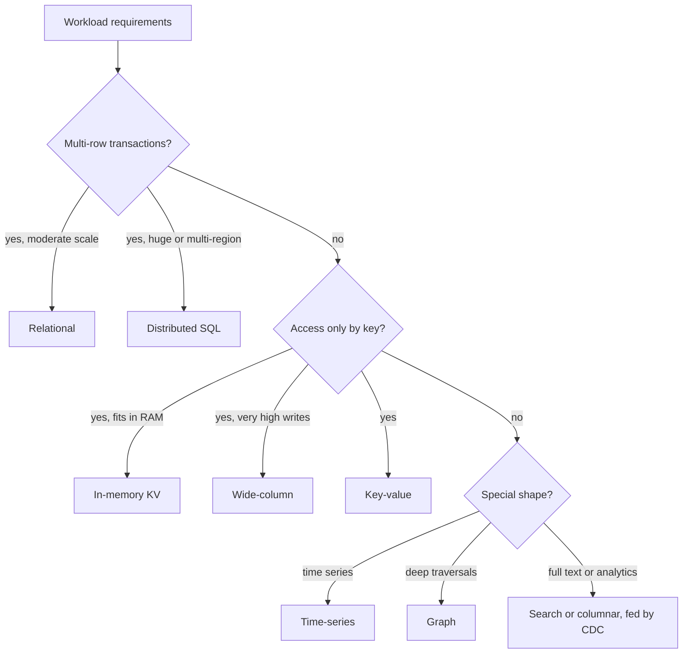

## In one minute
- Interviewers rarely care which brand you pick. They care that the choice follows from the access patterns, consistency needs, scale and team constraints you stated, and that you know what the choice costs.
- Default to a relational database (Postgres or MySQL) for the system of record. Move away from it only when a specific requirement rules it out: write volume beyond what sharding comfortably handles, a query shape it serves badly, or a data type it stores poorly.
- Most real designs are polyglot: a relational or key-value system of record, plus specialised stores fed from it (search index, cache, analytics warehouse, object storage). Name the source of truth and how the others are fed.
- A repeatable framework: data shape, access pattern, consistency, scale, latency, operations. Walk it in that order and the choice usually falls out.
- Staff-level signal: you explain why the storage engine underneath (B-tree, LSM, columnar, inverted index) fits the workload, and what operational burden the team takes on.

## How it works

### The families and when they win
- **Relational (Postgres, MySQL).** Structured data with relationships, multi-row transactions, constraints, ad-hoc queries. A single well-tuned node handles a lot; read replicas and partitioning extend it.
- **Distributed SQL or NewSQL (Spanner, CockroachDB, YugabyteDB, TiDB).** Relational semantics with horizontal scale and multi-region consistency, paid for in write latency (consensus round trips) and cost. Spanner was the first system to offer externally consistent transactions at global scale, using a clock API that exposes its own uncertainty ([OSDI 2012](https://research.google/pubs/spanner-googles-globally-distributed-database-2/)).
- **Key-value (DynamoDB, Redis, etcd for small metadata).** Access by key with predictable latency at any scale. In-memory stores for sub-millisecond access to data that fits in RAM.
- **Wide-column (Cassandra, ScyllaDB, Bigtable, HBase).** Very high write throughput, partition key plus sorted clustering key, multi-datacenter replication. Queries must mostly follow the key design; Cassandra 5.0 (September 2024) added storage-attached indexes on non-key columns and vector search, which loosen this but do not make ad-hoc queries cheap ([Apache Cassandra](https://cassandra.apache.org/_/blog/Apache-Cassandra-5.0-Announcement.html)).
- **Document (MongoDB, Couchbase, Firestore).** Flexible, nested records read and written as a unit; good when the schema varies per record or evolves quickly. MongoDB has had multi-document transactions since 4.0 for replica sets and 4.2 for sharded clusters, but its own docs say they cost more than single-document writes and are no substitute for schema design ([MongoDB docs](https://www.mongodb.com/docs/manual/core/transactions/)).
- **Time-series (TimescaleDB, InfluxDB, Prometheus for metrics).** Append-mostly timestamped data with downsampling, retention and time-window aggregation.
- **Graph (Neo4j, Neptune).** Multi-hop traversals such as friends of friends of friends or fraud rings, where joins would explode.
- **Search (Elasticsearch, OpenSearch).** Full-text relevance, faceting, fuzzy matching. Almost never the system of record.
- **Vector (pgvector, OpenSearch, purpose-built vector stores).** Nearest-neighbour search over embeddings for semantic search and recommendations. Current guides treat it as its own model ([Azure Architecture Center](https://learn.microsoft.com/en-us/azure/architecture/data-guide/technology-choices/understand-data-store-models)), but it is usually an index added to a store you already run rather than a new system of record.
- **Columnar analytics (ClickHouse, BigQuery, Snowflake, Redshift).** Scans and aggregations over billions of rows for dashboards and reports.
- **Object storage (S3, GCS).** Large immutable blobs such as images, video and backups, at the lowest cost per GB, with metadata elsewhere.

### A decision framework
1. **Data shape.** Relational, nested documents, key to value, time series, graph, blobs?
2. **Access pattern.** Point lookups, range scans, ad-hoc joins, full-text, aggregations over many rows, traversals?
3. **Consistency.** Which operations need transactions or linearizable reads? Can others be eventually consistent?
4. **Scale.** Writes per second, data size in five years, read-to-write ratio, number of regions.
5. **Latency.** p99 budgets for the hot paths; sub-millisecond suggests memory.
6. **Operations.** Managed or self-run, team expertise, backup and restore, cost.

Say the answer as a chain: "Orders need multi-row transactions and the volume is a few thousand writes per second, so Postgres, sharded by customer later if needed. Product search needs relevance ranking, so an OpenSearch index fed by CDC. Clickstream is 300k events per second of append-only data queried in aggregate, so Kafka into ClickHouse."

### What interviewers look for
A reason for each store tied to a stated requirement, awareness of what you give up (joins and ad-hoc queries in Cassandra, transactions across items in most key-value stores before recent additions, write latency in Spanner), a clear source of truth, and the pipeline that keeps derived stores in sync.

### Common mistakes
- Choosing NoSQL "because it scales" for a workload that one Postgres node handles easily.
- Using a search engine or cache as the source of truth.
- Picking Cassandra and then needing queries that do not match the partition key.
- Naming a database without saying how it is partitioned and replicated.
- Ignoring the team: a store nobody knows how to operate is a risk in itself.

## Down the stack

### Layer 1: The contract
Each family promises different things. A relational database promises ACID transactions with a defined isolation level, constraints, and arbitrary queries with an optimiser. Cassandra promises tunable consistency per request and high availability, but only single-partition atomicity (with lightweight transactions via Paxos at much higher cost). DynamoDB promises single-digit millisecond latency at any scale for key access, which it held at a Prime Day 2021 peak of 89.2 million requests per second ([USENIX ATC 2022](https://www.usenix.org/conference/atc22/presentation/elhemali)), with optional strongly consistent reads and limited multi-item transactions: up to 100 items and 4 MB in one Region, with every item read or written twice, once to prepare and once to commit ([DynamoDB docs](https://docs.aws.amazon.com/amazondynamodb/latest/developerguide/transaction-apis.html)). Elasticsearch promises near-real-time search, with documents typically visible after a refresh interval of one second by default, not immediately. A shard with no searches for 30 seconds stops refreshing in the background until a search arrives, so the first query after a quiet spell pays for the refresh ([Elastic docs](https://www.elastic.co/docs/reference/elasticsearch/index-settings/index-modules)). Object storage promises very high durability (S3 advertises eleven nines) and, on S3 since December 2020, strong read-after-write consistency for GET, PUT and LIST at no extra cost ([AWS](https://aws.amazon.com/blogs/aws/amazon-s3-update-strong-read-after-write-consistency/)), but per-request latency in the tens of milliseconds.

### Layer 2: The mechanism
The storage engine explains the promises. Postgres and InnoDB store rows in B-tree-organised pages with a WAL and MVCC, ideal for point reads and updates in place. Cassandra, ScyllaDB, HBase and RocksDB-based stores use LSM trees: memtable, commit log, immutable SSTables and compaction, giving cheap writes and costlier reads. Columnar stores such as ClickHouse write each column separately in compressed blocks (its MergeTree engine sorts by a primary key and keeps a sparse index of one entry per granule of [8,192 rows by default](https://clickhouse.com/docs/guides/best-practices/sparse-primary-indexes)), so a query reading 3 of 100 columns reads about 3 percent of the bytes, and vectorised execution processes column chunks in tight CPU loops. Search engines build inverted indexes (term to postings list) in immutable Lucene segments that are merged in the background. Graph databases store adjacency directly so a traversal follows pointers instead of joining tables. Object stores split data into chunks spread across many disks with replication or erasure coding, with a separate metadata index.

### Layer 3: The machine
Row stores read whole pages, [8 KB in Postgres](https://www.postgresql.org/docs/current/storage-page-layout.html) and 16 KB in InnoDB, so fetching one row is efficient but scanning one column of a billion rows reads every page. A column store compresses similar values together, often achieving 5 to 10 times compression or more on real data, and reads only the needed columns sequentially, so a scan runs at disk or memory bandwidth (GB/s) instead of IOPS. LSM stores turn random writes into sequential ones, which suits SSDs and HDDs alike, but compaction consumes background I/O and can double space temporarily. In-memory stores avoid disk on the read path entirely, so a lookup is a hash probe of about 100 ns plus the network hop, but RAM costs much more per GB than SSD, and object storage costs less still per GB, which is why blobs never belong in a database row.

### Why it's built this way
Different access patterns stress different hardware resources: point lookups stress random I/O, scans stress bandwidth, high write rates stress write amplification, and traversals stress pointer chasing. No single layout is optimal for all of them, so each family picks a layout for its target pattern. Distribution then adds the consistency cost, so systems that need scale relax either transactions or latency. That is why one design ends up with several stores, each a copy organised for one access pattern, connected by a change log.

## Diagram


## Worked example
Design the storage for a ride-hailing platform. Requirements: trips and payments must be correct; driver locations update 1.25 million times per second; riders search for places by name; the business wants dashboards over all trips.

Trips and payments: a few thousand trip state changes per second at peak, multi-row transactions (trip, payment, driver earnings). Relational, sharded by city or rider later; Postgres or a distributed SQL store if multi-region writes are required. This is the source of truth.

Driver locations: 1.25 million small writes per second, only the latest location matters, and it is read by geospatial cell. An in-memory key-value store (Redis with geo commands, sharded by cell), with a TTL so stale drivers disappear. History is appended to Kafka and archived to object storage in batches.

Place search: name and address search with typo tolerance across about 50 million places. An OpenSearch index built from the places table via CDC; a few seconds of staleness is fine.

Dashboards: all trips ever, aggregated by city, hour and product. A columnar warehouse fed from Kafka and CDC; queries scan billions of rows in seconds.

Each store has one job, one source, and a stated staleness. That last sentence is what interviewers want to hear.

## In the wild
- **Discord, 2023: Cassandra to ScyllaDB for trillions of messages.** The messages cluster grew from 12 Cassandra nodes in 2017 to 177 by 2022 and suffered hot partitions, garbage-collection pauses and compaction backlogs. Discord put Rust data services in front that coalesce concurrent reads of the same row, then migrated to 72 ScyllaDB nodes; p99 for historical reads fell from 40 to 125 ms to 15 ms. The data model and query shape stayed the same; the engine underneath changed ([Discord](https://discord.com/blog/how-discord-stores-trillions-of-messages)).
- **Uber, 2016: Postgres to MySQL.** Uber described how Postgres's design hurt its workload: every row update wrote new entries to every index, physical WAL replication shipped all of that across data centres, and replicas could not run a different major version, which made upgrades painful. A 9.2 replication bug also exposed duplicate row versions. Most databases moved to MySQL under Uber's own sharding layer. The lesson is that the storage engine's write path, not the brand, decided the fit ([Uber Engineering](https://www.uber.com/en-US/blog/postgres-to-mysql-migration/)).
- **Instacart, 2025: Elasticsearch and FAISS back into Postgres.** Denormalised search documents meant billions of partial writes for price and inventory changes, and a separate FAISS vector index could not filter by attributes. Moving to a normalised Postgres model cut write load 10x and made search about 2x faster; adding pgvector for semantic search cut zero-result searches by 6% in an A/B test. Fewer stores also meant fewer sync bugs ([Instacart](https://company.instacart.com/tech-innovation/how-instacart-built-a-modern-search-infrastructure-on-postgres)).

## Trade-offs
| Option | Strengths | Weaknesses | Choose when |
|---|---|---|---|
| Relational | Transactions, constraints, flexible queries | Write scale beyond one node needs sharding | System of record, most apps |
| Distributed SQL | SQL plus horizontal scale and multi-region | Higher write latency and cost | Global transactional data |
| Key-value | Predictable latency at any scale | Queries limited to keys | Sessions, carts, profiles, lookups |
| Wide-column | Massive writes, multi-DC | Query by key only, tuning burden | Messaging, feeds, IoT, event logs |
| Document | Flexible nested records | Cross-document joins and transactions limited | Catalogues, content, varied schemas |
| Columnar | Fast large scans and aggregates | Slow point updates | Analytics and reporting |
| Search | Relevance, fuzzy text, facets | Not a source of truth, eventual | Search boxes, log exploration |

## Pitfalls in production
- **Premature NoSQL.** Teams adopt a wide-column store and then rebuild joins and transactions in application code. Start relational unless a requirement rules it out.
- **Derived stores drifting.** Dual writes to the database and search index diverge on failures. Feed derived stores from CDC or an outbox, and add periodic reconciliation.
- **Analytics on the primary.** A heavy report locks or saturates the OLTP database at peak. Send analytics to replicas or a warehouse.
- **Underestimating operations.** Self-running Cassandra or Elasticsearch needs capacity planning, repairs, upgrades and expertise. Price that in, or use a managed service.
- **Blobs in the database.** Storing images in rows bloats backups and replication. Keep blobs in object storage and store the key.

## Leadership lens
- Make adding a new datastore a reviewed decision with an owner, an on-call plan, backup and restore tests, and an exit strategy.
- Keep one source of truth per entity and document every derived store's feed and staleness.
- Weigh team expertise heavily; a familiar store run well usually beats an ideal store run badly.
- Re-evaluate at scale milestones, not continuously; migrations between databases take quarters.

## Check yourself
1. Why is Elasticsearch a poor source of truth even though it stores the documents?
   **Answer:** It is near-real-time and eventually consistent, has weaker durability and transaction guarantees, and reindexing or mapping changes often require rebuilding from another source.
2. Why does a columnar store answer "revenue by city per day over a year" so much faster than a row store?
   **Answer:** It reads only the few needed columns, compressed and sequential, and processes them in vectorised batches, instead of reading every full row page.
3. When would you choose distributed SQL over sharded Postgres?
   **Answer:** When you need cross-shard or multi-region transactions with strong consistency and want the database, not the application, to handle resharding, and you accept higher write latency and cost.
4. What do you lose by choosing Cassandra for user messages?
   **Answer:** Multi-partition transactions and ad-hoc queries; every query must be designed around a partition key, and secondary access patterns need extra tables.

## Practice
**Task:** Write a rule-based database selector. Requirements have optional fields: `transactions`, `multi_region`, `key_value_only`, `in_memory`, `time_series`, `flexible_schema`, `full_text`, `olap` (booleans), `write_qps` and `graph_depth` (integers) and `blob_mb` (number). `candidates(req)` returns every matching family in this priority order: transactions gives `"newsql"` if `write_qps > 20000` or `multi_region`, else `"relational"`; `key_value_only` gives `"in-memory-kv"` if `in_memory`, else `"wide-column"` if `write_qps > 20000`, else `"key-value"`; then `"time-series"`, `"graph"` (when `graph_depth >= 3`), `"document"` (flexible schema), `"object"` (when `blob_mb >= 1`), `"search"` (full text), `"columnar"` (olap). If nothing matches, return `["relational"]`. Reject negative numbers. `select(req)` returns the first candidate, which is the system of record.

```python starter
def candidates(req):
    # TODO: req is a dict; missing keys mean False or 0
    raise NotImplementedError

def select(req):
    raise NotImplementedError
```

```python tests
def test_default_is_relational():
    assert candidates({}) == ["relational"]
    assert select({}) == "relational"

def test_transactions_scale_to_newsql():
    assert select({"transactions": True}) == "relational"
    assert select({"transactions": True, "write_qps": 50000}) == "newsql"
    assert select({"transactions": True, "multi_region": True}) == "newsql"
    assert select({"transactions": True, "write_qps": 20000}) == "relational", "threshold is strict"

def test_key_value_variants():
    assert select({"key_value_only": True}) == "key-value"
    assert select({"key_value_only": True, "in_memory": True, "write_qps": 90000}) == "in-memory-kv"
    assert select({"key_value_only": True, "write_qps": 90000}) == "wide-column"

def test_polyglot_order():
    req = {"transactions": True, "full_text": True, "olap": True}
    assert candidates(req) == ["relational", "search", "columnar"]
    assert candidates({"time_series": True, "olap": True}) == ["time-series", "columnar"]
    assert candidates({"blob_mb": 5, "flexible_schema": True}) == ["document", "object"]

def test_graph_threshold():
    assert select({"graph_depth": 2}) == "relational"
    assert select({"graph_depth": 3}) == "graph"

def test_rejects_negative():
    for req in ({"write_qps": -1}, {"blob_mb": -0.5}, {"graph_depth": -2}):
        try:
            candidates(req)
            assert False, "expected ValueError"
        except ValueError:
            pass
```

```python solution
def candidates(req):
    qps = req.get("write_qps", 0)
    depth = req.get("graph_depth", 0)
    blob = req.get("blob_mb", 0)
    if qps < 0 or depth < 0 or blob < 0:
        raise ValueError("negative requirement")
    out = []
    if req.get("transactions"):
        out.append("newsql" if qps > 20000 or req.get("multi_region") else "relational")
    if req.get("key_value_only"):
        if req.get("in_memory"):
            out.append("in-memory-kv")
        elif qps > 20000:
            out.append("wide-column")
        else:
            out.append("key-value")
    if req.get("time_series"):
        out.append("time-series")
    if depth >= 3:
        out.append("graph")
    if req.get("flexible_schema"):
        out.append("document")
    if blob >= 1:
        out.append("object")
    if req.get("full_text"):
        out.append("search")
    if req.get("olap"):
        out.append("columnar")
    return out or ["relational"]

def select(req):
    return candidates(req)[0]
```

```typescript starter
export interface Requirements {
  transactions?: boolean;
  multiRegion?: boolean;
  keyValueOnly?: boolean;
  inMemory?: boolean;
  timeSeries?: boolean;
  flexibleSchema?: boolean;
  fullText?: boolean;
  olap?: boolean;
  writeQps?: number;
  graphDepth?: number;
  blobMb?: number;
}

export function candidates(req: Requirements): string[] {
  throw new Error("TODO");
}

export function select(req: Requirements): string {
  throw new Error("TODO");
}
```

```typescript tests
test("default is relational", () => {
  assertEqual(candidates({}), ["relational"]);
  assertEqual(select({}), "relational");
});
test("transactions scale to newsql", () => {
  assertEqual(select({ transactions: true }), "relational");
  assertEqual(select({ transactions: true, writeQps: 50000 }), "newsql");
  assertEqual(select({ transactions: true, multiRegion: true }), "newsql");
  assertEqual(select({ transactions: true, writeQps: 20000 }), "relational", "threshold is strict");
});
test("key value variants", () => {
  assertEqual(select({ keyValueOnly: true }), "key-value");
  assertEqual(select({ keyValueOnly: true, inMemory: true, writeQps: 90000 }), "in-memory-kv");
  assertEqual(select({ keyValueOnly: true, writeQps: 90000 }), "wide-column");
});
test("polyglot order", () => {
  assertEqual(candidates({ transactions: true, fullText: true, olap: true }), ["relational", "search", "columnar"]);
  assertEqual(candidates({ timeSeries: true, olap: true }), ["time-series", "columnar"]);
  assertEqual(candidates({ blobMb: 5, flexibleSchema: true }), ["document", "object"]);
});
test("graph threshold", () => {
  assertEqual(select({ graphDepth: 2 }), "relational");
  assertEqual(select({ graphDepth: 3 }), "graph");
});
test("rejects negative", () => {
  for (const req of [{ writeQps: -1 }, { blobMb: -0.5 }, { graphDepth: -2 }]) {
    let threw = false;
    try { candidates(req); } catch (e) { threw = true; }
    assert(threw, "expected error for " + JSON.stringify(req));
  }
});
```

```typescript solution
export interface Requirements {
  transactions?: boolean;
  multiRegion?: boolean;
  keyValueOnly?: boolean;
  inMemory?: boolean;
  timeSeries?: boolean;
  flexibleSchema?: boolean;
  fullText?: boolean;
  olap?: boolean;
  writeQps?: number;
  graphDepth?: number;
  blobMb?: number;
}

export function candidates(req: Requirements): string[] {
  const qps = req.writeQps ?? 0;
  const depth = req.graphDepth ?? 0;
  const blob = req.blobMb ?? 0;
  if (qps < 0 || depth < 0 || blob < 0) throw new Error("negative requirement");
  const out: string[] = [];
  if (req.transactions) out.push(qps > 20000 || req.multiRegion ? "newsql" : "relational");
  if (req.keyValueOnly) out.push(req.inMemory ? "in-memory-kv" : qps > 20000 ? "wide-column" : "key-value");
  if (req.timeSeries) out.push("time-series");
  if (depth >= 3) out.push("graph");
  if (req.flexibleSchema) out.push("document");
  if (blob >= 1) out.push("object");
  if (req.fullText) out.push("search");
  if (req.olap) out.push("columnar");
  return out.length > 0 ? out : ["relational"];
}

export function select(req: Requirements): string {
  return candidates(req)[0];
}
```

```go starter
package practice

// Requirements describes a workload; zero values mean "not required".
type Requirements struct {
	Transactions, MultiRegion, KeyValueOnly, InMemory bool
	TimeSeries, FlexibleSchema, FullText, OLAP        bool
	WriteQPS, GraphDepth                              int
	BlobMB                                            float64
}

func Candidates(req Requirements) ([]string, error) { panic("TODO") }

func Select(req Requirements) (string, error) { panic("TODO") }
```

```go tests
package practice

import (
	"reflect"
	"testing"
)

func sel(t *testing.T, r Requirements) string {
	t.Helper()
	s, err := Select(r)
	if err != nil {
		t.Fatal(err)
	}
	return s
}

func TestDefaultRelational(t *testing.T) {
	c, err := Candidates(Requirements{})
	if err != nil || !reflect.DeepEqual(c, []string{"relational"}) {
		t.Fatalf("got %v %v", c, err)
	}
}

func TestTransactions(t *testing.T) {
	if sel(t, Requirements{Transactions: true}) != "relational" ||
		sel(t, Requirements{Transactions: true, WriteQPS: 50000}) != "newsql" ||
		sel(t, Requirements{Transactions: true, MultiRegion: true}) != "newsql" ||
		sel(t, Requirements{Transactions: true, WriteQPS: 20000}) != "relational" {
		t.Fatal("wrong transactional choice")
	}
}

func TestKeyValue(t *testing.T) {
	if sel(t, Requirements{KeyValueOnly: true}) != "key-value" ||
		sel(t, Requirements{KeyValueOnly: true, InMemory: true, WriteQPS: 90000}) != "in-memory-kv" ||
		sel(t, Requirements{KeyValueOnly: true, WriteQPS: 90000}) != "wide-column" {
		t.Fatal("wrong key-value choice")
	}
}

func TestPolyglotOrder(t *testing.T) {
	cases := []struct {
		r    Requirements
		want []string
	}{
		{Requirements{Transactions: true, FullText: true, OLAP: true}, []string{"relational", "search", "columnar"}},
		{Requirements{TimeSeries: true, OLAP: true}, []string{"time-series", "columnar"}},
		{Requirements{BlobMB: 5, FlexibleSchema: true}, []string{"document", "object"}},
	}
	for _, c := range cases {
		got, _ := Candidates(c.r)
		if !reflect.DeepEqual(got, c.want) {
			t.Fatalf("got %v want %v", got, c.want)
		}
	}
}

func TestGraphThreshold(t *testing.T) {
	if sel(t, Requirements{GraphDepth: 2}) != "relational" || sel(t, Requirements{GraphDepth: 3}) != "graph" {
		t.Fatal("wrong graph threshold")
	}
}

func TestRejectsNegative(t *testing.T) {
	for _, r := range []Requirements{{WriteQPS: -1}, {BlobMB: -0.5}, {GraphDepth: -2}} {
		if _, err := Candidates(r); err == nil {
			t.Fatalf("expected error for %+v", r)
		}
	}
}
```

```go solution
package practice

import "errors"

// Requirements describes a workload; zero values mean "not required".
type Requirements struct {
	Transactions, MultiRegion, KeyValueOnly, InMemory bool
	TimeSeries, FlexibleSchema, FullText, OLAP        bool
	WriteQPS, GraphDepth                              int
	BlobMB                                            float64
}

func Candidates(req Requirements) ([]string, error) {
	if req.WriteQPS < 0 || req.GraphDepth < 0 || req.BlobMB < 0 {
		return nil, errors.New("negative requirement")
	}
	var out []string
	if req.Transactions {
		if req.WriteQPS > 20000 || req.MultiRegion {
			out = append(out, "newsql")
		} else {
			out = append(out, "relational")
		}
	}
	if req.KeyValueOnly {
		switch {
		case req.InMemory:
			out = append(out, "in-memory-kv")
		case req.WriteQPS > 20000:
			out = append(out, "wide-column")
		default:
			out = append(out, "key-value")
		}
	}
	if req.TimeSeries {
		out = append(out, "time-series")
	}
	if req.GraphDepth >= 3 {
		out = append(out, "graph")
	}
	if req.FlexibleSchema {
		out = append(out, "document")
	}
	if req.BlobMB >= 1 {
		out = append(out, "object")
	}
	if req.FullText {
		out = append(out, "search")
	}
	if req.OLAP {
		out = append(out, "columnar")
	}
	if len(out) == 0 {
		out = []string{"relational"}
	}
	return out, nil
}

func Select(req Requirements) (string, error) {
	c, err := Candidates(req)
	if err != nil {
		return "", err
	}
	return c[0], nil
}
```

## Mock interview
**Prompt:** You are designing the backend for a fitness app with 30 million users. It records workouts with GPS traces (about 1 point per second during workouts), social features (follow, like, comment), a global leaderboard per route, and monthly progress reports. Which databases do you choose, and why?

- Follow-up: GPS ingest peaks at 400,000 points per second on Sunday mornings. Does your choice for workouts still hold?
- Follow-up: The leaderboard must update within seconds of a workout finishing. Where does it live, and what is its source of truth?
- Follow-up: The team has deep Postgres experience and nobody has run Cassandra. How does that change your answer?

**A strong answer covers:**
- Separating entities by access pattern: user and social data in relational, raw GPS points as append-only time-ordered data, summaries in the relational store.
- GPS ingest via a log (Kafka) into a time-series or wide-column store, or compressed chunks in object storage with summaries extracted, with arithmetic for the write rate.
- Leaderboards in an in-memory sorted structure (Redis sorted sets) rebuilt from the relational source of truth.
- Monthly reports from a columnar warehouse fed by CDC, not from the primary.
- Weighing operational expertise: managed services or Postgres-based options (partitioning, TimescaleDB) when the team lacks experience with a self-run distributed store.

## Sources and further study
**Primary**
- [Corbett et al., Spanner: Google's Globally-Distributed Database (OSDI 2012)](https://research.google/pubs/spanner-googles-globally-distributed-database-2/): the design that started distributed SQL.
- [Elhemali et al., Amazon DynamoDB (USENIX ATC 2022)](https://www.usenix.org/conference/atc22/presentation/elhemali): how a key-value service keeps latency predictable at scale.

**Systems docs**
- [DynamoDB: Transactions, how it works](https://docs.aws.amazon.com/amazondynamodb/latest/developerguide/transaction-apis.html): limits, isolation levels and the double capacity cost.
- [MongoDB: Transactions](https://www.mongodb.com/docs/manual/core/transactions/): when multi-document transactions are and are not needed.
- [ClickHouse: Sparse primary indexes guide](https://clickhouse.com/docs/guides/best-practices/sparse-primary-indexes): granules and the sparse index behind fast scans.

**Books**
- *Designing Data-Intensive Applications* (1st ed.), Martin Kleppmann, chapter 2 "Data Models and Query Languages" and chapter 3 "Storage and Retrieval": relational, document and graph models; B-trees, LSM trees and column stores.
- *Database Internals*, Alex Petrov, chapter 1 "Introduction and Overview" and chapter 7 "Log-Structured Storage": row versus column layouts and LSM amplification.

**Other curricula**
- [Hello Interview: Key technologies](https://www.hellointerview.com/learn/system-design/in-a-hurry/key-technologies): advises picking one core database and justifying it by its features, rather than reciting SQL versus NoSQL.
- [donnemartin/system-design-primer](https://github.com/donnemartin/system-design-primer): frames the choice as SQL or NoSQL with two short lists of reasons; it does not cover columnar, search or vector stores.

## Watch
- [How To Choose The Right Database? (ByteByteGo)](https://www.youtube.com/watch?v=kkeFE6iRfMM): a quick tour of database families and their sweet spots.
- [7 Database Paradigms (Fireship)](https://www.youtube.com/watch?v=W2Z7fbCLSTw): a fast survey of key-value, wide-column, document, relational, graph, search and multi-model stores.
- [Amazon DynamoDB Deep Dive: Advanced Design Patterns (AWS re:Invent 2018)](https://www.youtube.com/watch?v=HaEPXoXVf2k): what designing for a key-value store really requires.

## Free resources
- [Understand data store models (Azure Architecture Center)](https://learn.microsoft.com/en-us/azure/architecture/data-guide/technology-choices/understand-data-store-models): a vendor-neutral comparison of data store families and when to use each.
- [Non-relational data and NoSQL (Azure Architecture Center)](https://learn.microsoft.com/en-us/azure/architecture/data-guide/big-data/non-relational-data): document, columnar, key-value, graph and time-series stores explained.
- [Why is ClickHouse so fast? (ClickHouse docs)](https://clickhouse.com/docs/concepts/why-clickhouse-is-so-fast): columnar storage, sparse indexes and vectorised execution.
- [Cassandra architecture overview (Apache Cassandra docs)](https://cassandra.apache.org/doc/latest/cassandra/architecture/overview.html): the Dynamo-style design behind wide-column stores.
- [Data modeling introduction (MongoDB docs)](https://www.mongodb.com/docs/manual/core/data-modeling-introduction/): embedding versus referencing in a document store.
