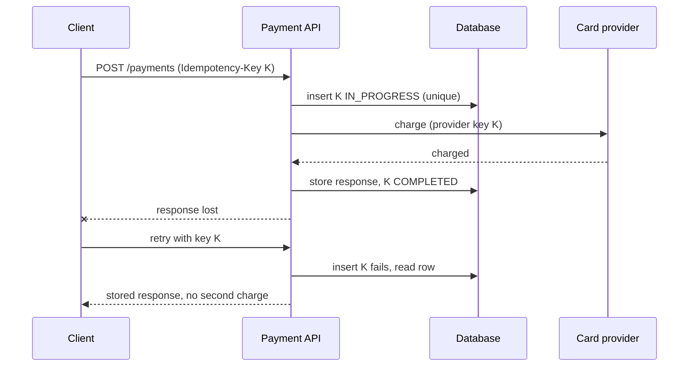

## In one minute
- Networks lose acknowledgements, so senders retry, and any system with retries delivers some messages more than once. "Exactly once" in practice means **at-least-once delivery plus idempotent processing**.
- The core tool is an **idempotency key**: a unique ID chosen by the originator and carried with the request or message. The receiver records which keys it has processed and returns the stored result for repeats instead of acting again.
- The record of "already processed" must be written **atomically with the side effect** (same database transaction), or a crash between the two reopens the gap.
- Other tools: natural idempotence (set, not increment), unique constraints, conditional writes with versions, broker-level deduplication (Kafka idempotent producer, SQS FIFO dedup IDs) and probabilistic filters for very large streams.
- Interviewers raise this for payments, orders, notifications, ride requests, event pipelines and anything with "user double-clicked" or "consumer crashed mid-batch".

## How it works

### Where duplicates come from
A client sends `POST /payments`, the server charges the card, and the response is lost on the way back. The client times out and retries. A message consumer processes a message, writes to the database, and crashes before committing its offset; on restart it reprocesses the message. A user taps "Order" twice. In every case the sender cannot distinguish "it never happened" from "it happened and I did not hear".

### Idempotency keys at the API
The client generates a UUID per logical operation (not per attempt) and sends it in a header such as `Idempotency-Key`. The server:

1. Inserts a row `(key, request_fingerprint, status=IN_PROGRESS)` with a unique constraint on the key. If the insert fails, the key exists.
2. If the existing row is `COMPLETED`, return the stored response. If it is `IN_PROGRESS`, return `409 Conflict` so the client retries later. If the fingerprint differs, reject with `422`: the client reused a key for a different request. These codes come from the IETF's `Idempotency-Key` header draft, which also suggests `400` when a required key is missing; the draft (version 07, October 2025) has expired without becoming an RFC, so treat it as convention, not standard ([IETF draft](https://www.ietf.org/archive/id/draft-ietf-httpapi-idempotency-key-header-07.html)).
3. Performs the operation and, in the same transaction where possible, stores the response and marks the row `COMPLETED`.
4. On a failure that is safe to retry, deletes or resets the row so the next attempt can proceed.

Keys expire after a window long enough to cover client retries (often a day or more), so the table does not grow forever.

Decide which outcomes you store. Stripe's v1 API saves the status and body once the endpoint starts executing, so a retry replays even a `500`; requests that fail validation or collide with a concurrent request are not saved and can be retried. Keys are at most 255 characters, are pruned after at least 24 hours, and a reused key with different parameters is an error ([Stripe API docs](https://docs.stripe.com/api/idempotent_requests)). Stripe's newer v2 API changes the rule: a retry finishes failed or partial work instead of replaying the failure. AWS goes further on retention: EC2 honours a `ClientToken` for the lifetime of the resource plus an interval, so a very late retry still gets an answer that means the same as the first one, not a confusing "already exists" ([AWS Builders' Library](https://aws.amazon.com/builders-library/making-retries-safe-with-idempotent-APIs/)).

### Idempotent consumers
For message processing, the consumer stores processed message IDs in a table inside the same transaction as its business writes ([microservices.io](https://microservices.io/patterns/communication-style/idempotent-consumer.html)): `INSERT INTO processed(message_id) ...; UPDATE accounts ...; COMMIT`. A redelivered message hits the unique constraint and is skipped. Two details are easy to miss. Key on an ID the producer chose, never on a delivery or receipt ID the broker regenerates on redelivery. And if several consumer groups share one dedup table, key it on `(consumer, message_id)`, or the first consumer to see a message suppresses it for all the others ([Azure Architecture Center](https://learn.microsoft.com/en-us/azure/architecture/patterns/idempotent-consumer)). Or make the write itself idempotent: an upsert keyed by the event's natural ID, or a conditional update on a version.

### When the side effect is external
If the side effect is an email or a call to a payment provider, you cannot put it in your database transaction. Pass your idempotency key downstream (most payment APIs accept one), or record intent first and have a separate worker perform the call idempotently, or accept a small duplicate risk where the impact is low (a duplicate push notification).

### Large-scale stream dedup
For billions of events (ad clicks, analytics), pipelines keep IDs only for a bounded time window, or use a Bloom filter that may wrongly flag a few new events as duplicates but never misses a real one. Stream processors with transactional sinks commit output and input offsets atomically.

### How it shows up in interviews
Triggers: design a payment system, an order service, Uber ride requests, a notification service ("don't send twice"), a job scheduler, an ad click counter, a webhook delivery system. A strong answer says delivery is at-least-once, places idempotency keys at each boundary, explains the atomic record-plus-effect write, handles concurrent duplicates (in-progress state), sets a retention window, and treats external side effects explicitly. Typical probes: two identical requests arrive at the same millisecond on different servers; the server crashes after charging but before recording; the client reuses a key with a different amount; how long do you keep keys and why.

## Down the stack

### Layer 1: The contract
An idempotent endpoint promises that any number of requests with the same key and the same payload, within the retention window, produce the effect of exactly one execution and return the same response. Concurrent duplicates must not both execute: one wins and the others see in-progress or the final result. A request with a reused key and a different payload is rejected, not silently replayed. A deduplicating consumer promises at most one application of each message ID's effect, even across crashes and rebalances.

### Layer 2: The mechanism
In SQL: `INSERT INTO idempotency_keys (key, fingerprint, status, created_at) VALUES ($1, $2, 'IN_PROGRESS', now()) ON CONFLICT (key) DO NOTHING RETURNING key`; no returned row means a duplicate, and you `SELECT` the existing row. The unique B-tree index on `key` is what serialises concurrent duplicates: the second inserter blocks on the first transaction and then sees the conflict. Kafka's idempotent producer gets a producer ID and epoch from the broker, attaches a per-partition sequence number to each batch, and the partition leader rejects batches whose sequence it has already appended; brokers track recent batch sequences per producer, which is why `max.in.flight.requests.per.connection` must be at most 5. Since Kafka 3.0 the producer defaults to `enable.idempotence=true` and `acks=all` ([KIP-679](https://cwiki.apache.org/confluence/display/KAFKA/KIP-679%3A+Producer+will+enable+the+strongest+delivery+guarantee+by+default)), but a validation bug left idempotence off unless set explicitly until 3.0.1, 3.1.1 and 3.2.0 ([KAFKA-13598](https://issues.apache.org/jira/browse/KAFKA-13598)), so older clients should set it by hand. Kafka transactions add a `transactional.id`, a coordinator writing to the internal `__transaction_state` topic, and commit markers in each partition, so a consumer reading with `isolation.level=read_committed` sees only committed output, and consumed offsets are committed in the same transaction. SQS FIFO queues drop messages with a repeated `MessageDeduplicationId` sent within a 5-minute interval; with content-based deduplication the ID is a SHA-256 of the message body only, so two messages that differ only in attributes count as duplicates ([AWS SQS docs](https://docs.aws.amazon.com/AWSSimpleQueueService/latest/SQSDeveloperGuide/FIFO-queues-exactly-once-processing.html)).

### Layer 3: The machine
The dedup record is only as durable as its commit: Postgres considers a transaction committed once its WAL record is flushed with `fsync` (or `fdatasync`) to stable storage, which costs from tens of microseconds on NVMe with power-loss protection to several milliseconds on cloud network disks. The unique index lookup is a B-tree descent of 3 to 4 pages, usually in the buffer cache, so the check costs microseconds; the expensive part is the write and its WAL. Random UUIDv4 keys scatter inserts across the index and cause page splits and cache misses at high rates; time-ordered IDs (UUIDv7, ULID) keep inserts on the right edge of the index. Shopify measured a 50 percent drop in INSERT duration after moving idempotency keys from UUIDv4 to ULID ([Shopify Engineering](https://shopify.engineering/building-resilient-payment-systems)). A Bloom filter for 1 billion IDs at a 1% false-positive rate needs roughly 1.2 GB (about 9.6 bits per element), small enough to hold in memory on one machine.

### Why it's built this way
Senders cannot tell a lost request from a lost reply, so retries and duplicates are unavoidable. Detecting duplicates requires remembering what has happened, so a durable record keyed by an ID chosen before the first attempt is needed. A crash can fall between any two writes, so the record and the effect must share one atomic commit. Memory and disk are finite, so records expire after a window that covers realistic retry horizons.

## Diagram


## Worked example
A food-delivery app processes 3,000 orders per second at dinner peak. Mobile networks are flaky: about 1% of requests time out on the client after the server has already succeeded, and the app retries up to 3 times over 30 seconds. Without dedup, roughly 30 duplicate orders per second would reach restaurants.

The app generates an idempotency key when the user taps "Place order" and reuses it for retries. The order service writes the key row and the order row in one Postgres transaction. Keys are kept for 48 hours: 3,000 per second at peak, perhaps 100 million per day, about 200 million rows, at roughly 200 bytes each including the stored response and index, around 40 GB. Expired keys are dropped by day partition rather than a giant `DELETE`.

The order service then emits an `OrderPlaced` event to Kafka with the order ID as message key. The restaurant-notification consumer keeps a `processed_events` table and inserts the event ID in the same transaction as it updates the restaurant's queue. When a consumer rebalance replays 2,000 events from the last committed offset, every replayed insert conflicts and is skipped; restaurants see each order once.

Payment uses the same order key as the provider's idempotency key, so even if the order service crashes after charging but before committing, the retry produces one charge.

## In the wild
- **Segment, 2017: dedup at the consumer, at scale.** About 0.6% of events Segment ingested over four weeks were duplicates, mostly clients on flaky networks resending. Kafka partitioned by message ID feeds workers that keep a RocksDB of seen IDs over a size-bounded four-week window; after three months it held about 60 billion keys and 1.5 TB on disk while processing about 200 billion messages ([Segment](https://www.twilio.com/en-us/blog/insights/exactly-once-delivery)).
- **Twilio, 2013: a read-only balance store recharges cards repeatedly.** On 18 July a Redis billing master restarted with a bad configuration came back read-only with balances at zero, so auto-recharge charged customers' cards but could not record the new balance, and tried again. About 1.4% of customers were affected; Twilio refunded them with a 10% credit, added fail-safes that block charges when a balance cannot be written, and planned validation against its double-entry ledger ([Twilio postmortem](https://www.twilio.com/en-us/blog/company/communications/billing-incident-post-mortem-breakdown-analysis-and-root-cause-html)).
- **Jepsen, 2022: broker idempotence that was off by default.** Jepsen found that with Redpanda 21.10.1's default settings any pause, crash or partition could duplicate writes: the Java client reported `enable.idempotence = true`, but the broker needed its own `enable_idempotence` flag, which was off. The lesson for designers is to check that deduplication is actually on at both ends rather than trusting a client log line; Redpanda planned to enable it by default in 22.1.1 ([Jepsen](https://jepsen.io/analyses/redpanda-21.10.1)).

## Trade-offs
| Option | Strengths | Weaknesses | Choose when |
|---|---|---|---|
| Idempotency key table | Exact, returns the original response | Storage, retention management | APIs with money or orders |
| Natural idempotence (upsert, set) | No extra state | Only for operations that can be restated | State updates, not increments |
| Unique constraint on business key | Simple, enforced by the database | Needs a natural unique key | One order per cart, one vote per user |
| Broker dedup (Kafka EOS, SQS FIFO) | Handles producer retries transparently | Limited windows and scopes | Pipelines on that broker |
| Bloom filter or TTL cache | Cheap at huge scale | False positives or bounded window | Analytics, clicks, telemetry |

## Pitfalls in production
- **Key generated per attempt.** If the client makes a new key on each retry, dedup never triggers. Generate it once per user action and persist it across app restarts.
- **Check, then act, non-atomically.** `SELECT` then `INSERT` lets two concurrent duplicates both pass. Use a unique constraint or conditional write.
- **Recording success in a separate transaction.** A crash between effect and record causes a duplicate on retry. Commit them together, or use the outbox pattern for external effects.
- **Retention shorter than retries.** Clients with offline queues may retry days later. Match retention to the real retry horizon.
- **Stuck in-progress rows.** A crash leaves a key in `IN_PROGRESS` forever. Add a lease timeout and recovery logic that checks whether the effect happened.

## Leadership lens
- Make idempotency keys part of the API standard for every state-changing endpoint, with shared middleware rather than per-team implementations.
- Ask in review: for each consumer, what happens if this message is delivered twice, or out of order?
- Budget storage and cleanup for dedup state; it grows with traffic and is easy to forget.

## Check yourself
1. Why can't a sender simply avoid retries to prevent duplicates?
   **Answer:** Without retries, lost requests are never completed; since the sender cannot tell lost requests from lost replies, it must retry and the receiver must dedupe.
2. Why must the dedup record and the business write commit together?
   **Answer:** If they commit separately, a crash between them either loses the record (allowing a duplicate) or loses the effect (marking undone work as done).
3. Two identical requests arrive concurrently on different servers. What stops both executing?
   **Answer:** A unique constraint or conditional write on the key; only one insert succeeds, and the other sees the in-progress row.
4. Why use time-ordered IDs for a high-volume dedup table?
   **Answer:** Sequential keys append to the right side of the B-tree index, avoiding random page splits and cache misses from random UUIDs.

## Practice
**Task:** Implement an idempotency store with expiry. `IdempotencyStore(ttl)` has `begin(key, request_hash, now)`, which returns a pair `(status, response)`: `("new", None)` if the key is unknown or expired (and records it as in progress), `("conflict", None)` if the key exists with a different request hash, `("in_progress", None)` if it exists unfinished, and `("replay", response)` if it was completed. `complete(key, response, now)` stores the response and marks it done; it raises an error if the key is not in progress. `fail(key)` forgets the key so a retry can start fresh. Entries expire `ttl` time units after their last `begin` or `complete`, meaning they are treated as absent when `now >= stored_time + ttl`.

```python starter
class IdempotencyStore:
    def __init__(self, ttl):
        # TODO
        raise NotImplementedError

    def begin(self, key, request_hash, now):
        raise NotImplementedError

    def complete(self, key, response, now):
        raise NotImplementedError

    def fail(self, key):
        raise NotImplementedError
```

```python tests
def test_first_request_is_new_then_replayed():
    s = IdempotencyStore(100)
    assert s.begin("k1", "h", 0) == ("new", None)
    s.complete("k1", "charged:42", 1)
    assert s.begin("k1", "h", 2) == ("replay", "charged:42")

def test_concurrent_duplicate_sees_in_progress():
    s = IdempotencyStore(100)
    s.begin("k1", "h", 0)
    assert s.begin("k1", "h", 0) == ("in_progress", None)

def test_payload_mismatch_is_conflict():
    s = IdempotencyStore(100)
    s.begin("k1", "amount=10", 0)
    s.complete("k1", "ok", 0)
    assert s.begin("k1", "amount=99", 1) == ("conflict", None)

def test_fail_allows_retry():
    s = IdempotencyStore(100)
    s.begin("k1", "h", 0)
    s.fail("k1")
    assert s.begin("k1", "h", 1) == ("new", None)

def test_expiry_treats_key_as_new():
    s = IdempotencyStore(10)
    s.begin("k1", "h", 0)
    s.complete("k1", "ok", 5)
    assert s.begin("k1", "h", 14) == ("replay", "ok")
    assert s.begin("k1", "h", 15) == ("new", None)

def test_complete_requires_in_progress():
    s = IdempotencyStore(10)
    try:
        s.complete("missing", "x", 0)
        assert False, "expected error"
    except KeyError:
        pass
    s.begin("k", "h", 0); s.complete("k", "x", 0)
    try:
        s.complete("k", "y", 0)
        assert False, "expected error on double complete"
    except KeyError:
        pass
```

```python solution
class IdempotencyStore:
    def __init__(self, ttl):
        self.ttl = ttl
        self.entries = {}  # key -> [hash, done, response, stamp]

    def _get(self, key, now):
        e = self.entries.get(key)
        if e is not None and now >= e[3] + self.ttl:
            del self.entries[key]
            return None
        return e

    def begin(self, key, request_hash, now):
        e = self._get(key, now)
        if e is None:
            self.entries[key] = [request_hash, False, None, now]
            return ("new", None)
        if e[0] != request_hash:
            return ("conflict", None)
        if not e[1]:
            return ("in_progress", None)
        return ("replay", e[2])

    def complete(self, key, response, now):
        e = self._get(key, now)
        if e is None or e[1]:
            raise KeyError("key not in progress")
        e[1] = True
        e[2] = response
        e[3] = now

    def fail(self, key):
        self.entries.pop(key, None)
```

```typescript starter
export type BeginResult = { status: "new" | "conflict" | "in_progress" | "replay"; response: string | null };

export class IdempotencyStore {
  constructor(ttl: number) {}
  begin(key: string, requestHash: string, now: number): BeginResult {
    throw new Error("TODO");
  }
  complete(key: string, response: string, now: number): void {
    throw new Error("TODO");
  }
  fail(key: string): void {
    throw new Error("TODO");
  }
}
```

```typescript tests
test("new then replay", () => {
  const s = new IdempotencyStore(100);
  assertEqual(s.begin("k1", "h", 0), { status: "new", response: null });
  s.complete("k1", "charged:42", 1);
  assertEqual(s.begin("k1", "h", 2), { status: "replay", response: "charged:42" });
});
test("concurrent duplicate in progress", () => {
  const s = new IdempotencyStore(100);
  s.begin("k1", "h", 0);
  assertEqual(s.begin("k1", "h", 0).status, "in_progress");
});
test("payload mismatch conflict", () => {
  const s = new IdempotencyStore(100);
  s.begin("k1", "amount=10", 0);
  s.complete("k1", "ok", 0);
  assertEqual(s.begin("k1", "amount=99", 1), { status: "conflict", response: null });
});
test("fail allows retry", () => {
  const s = new IdempotencyStore(100);
  s.begin("k1", "h", 0);
  s.fail("k1");
  assertEqual(s.begin("k1", "h", 1).status, "new");
});
test("expiry", () => {
  const s = new IdempotencyStore(10);
  s.begin("k1", "h", 0);
  s.complete("k1", "ok", 5);
  assertEqual(s.begin("k1", "h", 14), { status: "replay", response: "ok" });
  assertEqual(s.begin("k1", "h", 15).status, "new");
});
test("complete requires in progress", () => {
  const s = new IdempotencyStore(10);
  let threw = false;
  try { s.complete("missing", "x", 0); } catch (e) { threw = true; }
  assert(threw, "missing key");
  s.begin("k", "h", 0); s.complete("k", "x", 0);
  threw = false;
  try { s.complete("k", "y", 0); } catch (e) { threw = true; }
  assert(threw, "double complete");
});
```

```typescript solution
export type BeginResult = { status: "new" | "conflict" | "in_progress" | "replay"; response: string | null };

type Entry = { hash: string; done: boolean; response: string | null; stamp: number };

export class IdempotencyStore {
  private entries = new Map<string, Entry>();
  constructor(private ttl: number) {}
  private get(key: string, now: number): Entry | undefined {
    const e = this.entries.get(key);
    if (e && now >= e.stamp + this.ttl) {
      this.entries.delete(key);
      return undefined;
    }
    return e;
  }
  begin(key: string, requestHash: string, now: number): BeginResult {
    const e = this.get(key, now);
    if (!e) {
      this.entries.set(key, { hash: requestHash, done: false, response: null, stamp: now });
      return { status: "new", response: null };
    }
    if (e.hash !== requestHash) return { status: "conflict", response: null };
    if (!e.done) return { status: "in_progress", response: null };
    return { status: "replay", response: e.response };
  }
  complete(key: string, response: string, now: number): void {
    const e = this.get(key, now);
    if (!e || e.done) throw new Error("key not in progress");
    e.done = true;
    e.response = response;
    e.stamp = now;
  }
  fail(key: string): void {
    this.entries.delete(key);
  }
}
```

```go starter
package practice

import "sync"

// IdempotencyStore records request keys and their responses. Safe for concurrent use.
type IdempotencyStore struct {
	mu sync.Mutex
}

func NewIdempotencyStore(ttl int) *IdempotencyStore { return &IdempotencyStore{} }

// Begin returns a status ("new", "conflict", "in_progress", "replay") and the stored response.
func (s *IdempotencyStore) Begin(key, requestHash string, now int) (string, string) { panic("TODO") }

func (s *IdempotencyStore) Complete(key, response string, now int) error { panic("TODO") }

func (s *IdempotencyStore) Fail(key string) { panic("TODO") }
```

```go tests
package practice

import (
	"sync"
	"testing"
)

func TestNewThenReplay(t *testing.T) {
	s := NewIdempotencyStore(100)
	if st, _ := s.Begin("k1", "h", 0); st != "new" {
		t.Fatalf("got %s", st)
	}
	s.Complete("k1", "charged:42", 1)
	if st, r := s.Begin("k1", "h", 2); st != "replay" || r != "charged:42" {
		t.Fatalf("got %s %s", st, r)
	}
}

func TestConflict(t *testing.T) {
	s := NewIdempotencyStore(100)
	s.Begin("k1", "amount=10", 0)
	s.Complete("k1", "ok", 0)
	if st, _ := s.Begin("k1", "amount=99", 1); st != "conflict" {
		t.Fatalf("got %s", st)
	}
}

func TestFailAllowsRetry(t *testing.T) {
	s := NewIdempotencyStore(100)
	s.Begin("k1", "h", 0)
	s.Fail("k1")
	if st, _ := s.Begin("k1", "h", 1); st != "new" {
		t.Fatalf("got %s", st)
	}
}

func TestExpiry(t *testing.T) {
	s := NewIdempotencyStore(10)
	s.Begin("k1", "h", 0)
	s.Complete("k1", "ok", 5)
	if st, _ := s.Begin("k1", "h", 14); st != "replay" {
		t.Fatalf("got %s", st)
	}
	if st, _ := s.Begin("k1", "h", 15); st != "new" {
		t.Fatalf("got %s", st)
	}
}

func TestCompleteRequiresInProgress(t *testing.T) {
	s := NewIdempotencyStore(10)
	if s.Complete("missing", "x", 0) == nil {
		t.Fatal("expected error")
	}
	s.Begin("k", "h", 0)
	s.Complete("k", "x", 0)
	if s.Complete("k", "y", 0) == nil {
		t.Fatal("expected error on double complete")
	}
}

func TestConcurrentBeginExactlyOneNew(t *testing.T) {
	s := NewIdempotencyStore(100)
	var wg sync.WaitGroup
	var mu sync.Mutex
	news := 0
	for i := 0; i < 50; i++ {
		wg.Add(1)
		go func() {
			defer wg.Done()
			if st, _ := s.Begin("k", "h", 0); st == "new" {
				mu.Lock()
				news++
				mu.Unlock()
			}
		}()
	}
	wg.Wait()
	if news != 1 {
		t.Fatalf("expected exactly one new, got %d", news)
	}
}
```

```go solution
package practice

import (
	"errors"
	"sync"
)

type idemEntry struct {
	hash     string
	done     bool
	response string
	stamp    int
}

// IdempotencyStore records request keys and their responses. Safe for concurrent use.
type IdempotencyStore struct {
	mu      sync.Mutex
	ttl     int
	entries map[string]*idemEntry
}

func NewIdempotencyStore(ttl int) *IdempotencyStore {
	return &IdempotencyStore{ttl: ttl, entries: map[string]*idemEntry{}}
}

func (s *IdempotencyStore) get(key string, now int) *idemEntry {
	e := s.entries[key]
	if e != nil && now >= e.stamp+s.ttl {
		delete(s.entries, key)
		return nil
	}
	return e
}

// Begin returns a status ("new", "conflict", "in_progress", "replay") and the stored response.
func (s *IdempotencyStore) Begin(key, requestHash string, now int) (string, string) {
	s.mu.Lock()
	defer s.mu.Unlock()
	e := s.get(key, now)
	if e == nil {
		s.entries[key] = &idemEntry{hash: requestHash, stamp: now}
		return "new", ""
	}
	if e.hash != requestHash {
		return "conflict", ""
	}
	if !e.done {
		return "in_progress", ""
	}
	return "replay", e.response
}

func (s *IdempotencyStore) Complete(key, response string, now int) error {
	s.mu.Lock()
	defer s.mu.Unlock()
	e := s.get(key, now)
	if e == nil || e.done {
		return errors.New("key not in progress")
	}
	e.done = true
	e.response = response
	e.stamp = now
	return nil
}

func (s *IdempotencyStore) Fail(key string) {
	s.mu.Lock()
	defer s.mu.Unlock()
	delete(s.entries, key)
}
```

## Mock interview
**Prompt:** Design the payment-capture step for a ride-hailing app. When a trip ends, the trip service publishes a `TripCompleted` event; a payments consumer charges the rider through an external card processor. There are 40 million trips per day, consumers can crash at any point, and Kafka may redeliver events.

- Follow-up: The consumer charges the card, then crashes before committing its offset. Walk through what happens on restart.
- Follow-up: The card processor times out. You do not know whether the charge happened. What now?
- Follow-up: How long do you keep dedup records, and what bounds that choice?

**A strong answer covers:**
- At-least-once delivery as a given, with the trip ID (or a derived payment ID) as the idempotency key end to end.
- A payments table with a unique key, written before calling the processor (intent) and updated after, with the processor's own idempotency key set to the same ID.
- Handling unknown outcomes by retrying with the same key or querying the processor, never charging with a fresh key.
- Concurrency control so two consumers after a rebalance cannot both charge, using the unique constraint or a conditional state transition.
- Retention matched to redelivery and reconciliation horizons, plus a daily reconciliation job against the processor's records.

## Sources and further study
**Primary**
- [The Idempotency-Key HTTP header field (IETF draft 07)](https://www.ietf.org/archive/id/draft-ietf-httpapi-idempotency-key-header-07.html): header syntax, optional fingerprints, and the 400, 409 and 422 responses; expired, not an RFC.
- [KIP-679: producer enables the strongest delivery guarantee by default (Apache Kafka)](https://cwiki.apache.org/confluence/display/KAFKA/KIP-679%3A+Producer+will+enable+the+strongest+delivery+guarantee+by+default): why idempotence and `acks=all` became defaults in 3.0.

**Systems docs**
- [Stripe API: Idempotent requests](https://docs.stripe.com/api/idempotent_requests): what is saved, for how long, and how v2 differs from v1.
- [Confluent: Kafka message delivery semantics](https://docs.confluent.io/kafka/design/delivery-semantics.html): producer IDs, transactions and `read_committed` from the broker's point of view.

**Books**
- *Designing Data-Intensive Applications* (1st edition), Martin Kleppmann, chapter 11 "Stream Processing", section "Processing Streams" (fault tolerance and idempotence), and chapter 12 "The Future of Data Systems", section "Aiming for Correctness": end-to-end operation IDs and why duplicate suppression belongs at the ends.
- *System Design Interview, Volume 2*, Alex Xu and Sahn Lam, chapter 11 "Payment System": idempotency keys and exactly-once payment processing at interview depth.

**Other curricula**
- [Azure Architecture Center: Idempotent Consumer pattern](https://learn.microsoft.com/en-us/azure/architecture/patterns/idempotent-consumer): frames the goal as "effectively-once" processing (at-least-once delivery plus a consumer that ignores repeats) and calls the transactional dedup table an inbox.
- [Azure Architecture Center: Retry pattern](https://learn.microsoft.com/en-us/azure/architecture/patterns/retry): frames dedup from the caller's side, warning that a retry is only safe when the operation is idempotent.

## Watch
- [EoS in Kafka: Listen up, I will only say this once! (Strange Loop)](https://www.youtube.com/watch?v=WscozkoXLHM): how Kafka's idempotent producer and transactions work and where their guarantees end.
- [Introducing Exactly Once Semantics in Apache Kafka (Kafka Summit 2018)](https://www.youtube.com/watch?v=zm5A7z95pdE): design rationale for producer IDs, sequence numbers and transactional commits.

## Free resources
- [Designing robust and predictable APIs with idempotency (Stripe)](https://stripe.com/blog/idempotency): why idempotency keys exist and how clients should use them.
- [Implementing Stripe-like idempotency keys in Postgres (Brandur Leach)](https://brandur.org/idempotency-keys): a detailed implementation with recovery points and atomic phases.
- [Making retries safe with idempotent APIs (AWS Builders' Library)](https://aws.amazon.com/builders-library/making-retries-safe-with-idempotent-APIs/): client tokens, payload mismatch and semantic equivalence.
- [Exactly-once semantics in Apache Kafka (Confluent)](https://www.confluent.io/blog/exactly-once-semantics-are-possible-heres-how-apache-kafka-does-it/): the producer, broker and transaction mechanisms in detail.
- [Idempotent Consumer pattern (microservices.io)](https://microservices.io/patterns/communication-style/idempotent-consumer.html): recording processed message IDs alongside business writes.
- [Exactly-once processing in SQS FIFO queues (AWS docs)](https://docs.aws.amazon.com/AWSSimpleQueueService/latest/SQSDeveloperGuide/FIFO-queues-exactly-once-processing.html): deduplication IDs and the 5-minute window.
