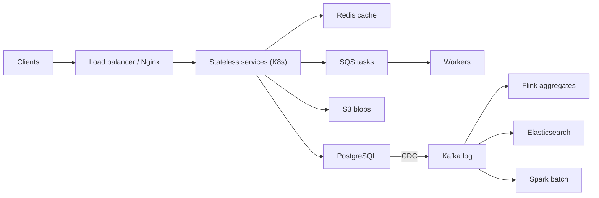

## In one minute
- A concept says what the design needs; a technology is the thing you would run. Interviewers want a named tool, the requirement that chose it, and the limit that would make you switch.
- Start from a small default stack: a relational database, Redis, object storage, a managed queue, a load balancer and containers. Deviate only when a requirement or a number forces it, and say which.
- Most hard choices are between neighbours: Kafka versus SQS versus RabbitMQ, Redis versus Memcached, Postgres versus DynamoDB versus Cassandra, Flink versus Spark, Lambda versus containers. Know the one property that separates each pair.
- Know each tool's contract: ordering, durability and consistency guarantees, and where it quietly loses data.
- Under time pressure, use one sentence per choice: "X because R; its limit L does not bite here because N."

## How it works

### The interview toolkit
Each technology below has a deep-dive lesson in this course.

| Role | Default | Switch to | When | Go deeper |
|---|---|---|---|---|
| System of record | PostgreSQL or MySQL | DynamoDB, Cassandra, MongoDB | Key access at very high write rates | PostgreSQL, MySQL, DynamoDB, Cassandra, MongoDB, Choosing the Right Database |
| Cache | Redis | Memcached | Plain strings, multithreaded nodes | Redis, Memcached |
| Blobs | S3 (object storage) | none at interview scale | Never blobs in database rows | S3 |
| Search | Elasticsearch | Postgres full-text for small corpora | Relevance ranking, fuzzy match, facets | Elasticsearch |
| Task queue | SQS | RabbitMQ | Routing rules, priorities | SQS, RabbitMQ |
| Event log | Kafka | SQS if no replay is needed | Per-key order, many consumers, replay | Kafka |
| Stream processing | Flink | Kafka Streams, Spark Structured Streaming | Stateful event-time windows | Flink |
| Batch processing | Spark | SQL on a warehouse | Large joins over history | Spark |
| Compute | Containers on Kubernetes | AWS Lambda | Spiky, short work under 15 minutes | Docker, Kubernetes, AWS Lambda |
| Edge and proxy | Nginx or a managed load balancer | Envoy | Mesh routing and telemetry | Nginx |
| Coordination | ZooKeeper or etcd | A conditional write in your database | Leader election, small critical metadata | Zookeeper |
| Metrics | Prometheus | Managed equivalents | Pull-based scraping, alerting | Prometheus |

Database choice has its own lesson, Choosing the Right Database; this chapter covers the rest of the stack and how the pieces fit together.

### The default stack
Most interview systems can be drawn with six pieces: a load balancer, stateless services in containers, PostgreSQL, Redis, S3 and a queue. Starting there has two benefits. It is honest, because many real companies run exactly this far past the scale people expect. And it makes every deviation visible: when you replace Postgres with Cassandra, the interviewer hears that something in the requirements forced it, and expects you to say what.

### Telling the neighbours apart
The hard choices are between tools that look similar. One property usually separates them.

- **Kafka versus SQS versus RabbitMQ.** Kafka is a log: messages stay after reading, consumers track their own offsets, and order holds per partition, so several consumers can replay a stream. SQS is a managed queue: a message is hidden while one consumer works on it and deleted when done, which fits independent tasks. RabbitMQ routes messages through exchanges and bindings by rules, with per-message acknowledgement. The lines have blurred: Kafka 4.2 (February 2026) made share groups, its queue-style consumption where several consumers split one partition's records, production-ready ([Kafka 4.2 release](https://kafka.apache.org/blog/2026/02/17/apache-kafka-4.2.0-release-announcement/)), and RabbitMQ 4.0 removed classic mirrored queues in favour of Raft-based quorum queues, with streams as its own replayable log ([RabbitMQ docs](https://www.rabbitmq.com/docs/3.13/ha)). Say which contract you need, not just which brand.
- **Redis versus Memcached.** Redis has data structures, persistence and replication, so it doubles as a leaderboard, rate limiter or lock store. Memcached is a multithreaded string cache and nothing else, which is sometimes exactly right. Know the licensing story too: Redis moved to source-available licences in March 2024, the Linux Foundation forked the last BSD-licensed release as Valkey ([Valkey](https://valkey.io/blog/hello-world/)), and Redis 8 added the open-source AGPLv3 as an option in May 2025 ([Redis](https://redis.io/blog/agplv3/)). Managed offerings now often say Valkey where they used to say Redis.
- **Flink versus Spark.** Flink processes each event as it arrives, with state and event-time windows, so it suits real-time aggregates. Spark processes bounded datasets in stages, so it suits nightly jobs and backfills.
- **Lambda versus containers.** Lambda scales to zero and bills per millisecond, but caps an ordinary invocation at 900 seconds (15 minutes) and adds cold starts ([Lambda docs](https://docs.aws.amazon.com/lambda/latest/dg/configuration-timeout.html)). Two newer options soften the cap: Lambda Managed Instances allow up to 90 minutes for asynchronous and event-source invocations, and durable functions checkpoint a multi-step workflow so it can span up to a year ([Lambda durable functions](https://docs.aws.amazon.com/lambda/latest/dg/durable-functions.html)). Containers cost money while idle but give steady latency and long-lived connections.
- **ZooKeeper versus your database.** A dedicated coordination service gives sessions, ephemeral nodes and watches. Often a conditional update in the database you already run is enough, and is one fewer system to operate.

### Choosing under time pressure
You will not have time to compare every option. Spend comparison time only where the choice is contested or load-bearing, and state everything else as a default in one sentence. Name the tool's sharpest limit in the same breath, because that is the follow-up you will get: "SQS for thumbnail jobs, because each job is independent and we want no brokers to run; it delivers at least once, so the worker writes thumbnails to a deterministic key and duplicates are harmless."

### Common mistakes
- Naming a technology without the requirement that chose it.
- Using Kafka as a task queue for a few hundred jobs per second, or SQS where consumers need to replay history.
- Treating Redis as a durable database without discussing persistence and failover loss.
- Picking a tool by brand rather than by contract, then being unable to answer "what happens when it fails?"

## Down the stack

### Layer 1: The contract
Each tool makes specific promises, and the interesting ones are the edges. Kafka guarantees order within a partition, not across partitions; with `acks=all` and `min.insync.replicas=2` on a replication factor of 3, an acknowledged write survives one broker loss. Since Kafka 3.0 the producer defaults to `acks=all` with idempotence on ([Apache Kafka 3.0 notes](https://blogsarchive.apache.org/kafka/entry/what-s-new-in-apache6)), but `min.insync.replicas` is still a topic setting you must raise yourself. SQS standard queues deliver at least once with best-effort ordering; a received message is invisible for the visibility timeout (30 seconds by default) and reappears if not deleted, and FIFO queues deduplicate within a 5-minute window and keep order per message group, at up to 300 operations per second per partition, or 3,000 messages with batching ([SQS docs](https://docs.aws.amazon.com/AWSSimpleQueueService/latest/SQSDeveloperGuide/high-throughput-fifo.html)). Messages can be up to 1 MiB since August 2025, up from 256 KiB ([AWS](https://aws.amazon.com/about-aws/whats-new/2025/08/amazon-sqs-max-payload-size-1mib/)). Redis replicates asynchronously, so a failover can lose writes the old primary already acknowledged; `WAIT` narrows but does not close that window. S3 has given strong read-after-write consistency for objects and listings since December 2020 ([AWS](https://aws.amazon.com/about-aws/whats-new/2020/12/amazon-s3-now-delivers-strong-read-after-write-consistency-automatically-for-all-applications/)). Elasticsearch is near real time: a document becomes searchable after the next refresh, every second by default, but a shard that has had no searches for 30 seconds skips background refreshes until the next search arrives, unless you set the interval explicitly ([Elasticsearch docs](https://www.elastic.co/docs/reference/elasticsearch/index-settings/index-modules)). ZooKeeper linearises writes but serves reads from the connected server, which may lag unless the client calls `sync` first ([ZooKeeper guide](https://zookeeper.apache.org/doc/current/zookeeperProgrammers.html)). Lambda runs at most 15 minutes per invocation.

### Layer 2: The mechanism
The contracts follow from the internals. Kafka stores each partition as append-only segment files with sparse offset indexes; followers fetch from the leader, and the in-sync replica set (ISR) decides which writes are committed. Since Kafka 4.0 (March 2025), the first release to run entirely without ZooKeeper, metadata lives in a Raft-based controller quorum (KRaft) ([Kafka 4.0 release](https://kafka.apache.org/blog/2025/03/18/apache-kafka-4.0.0-release-announcement/)). SQS hands each receive a receipt handle and a lease; the visibility timeout is that lease. Redis runs commands on one thread around an event loop, which makes every command atomic and makes a slow `KEYS *` block everyone; persistence uses RDB snapshots taken by a forked child and an append-only file (AOF) with a configurable `fsync` policy. Elasticsearch buffers writes in memory plus a translog, and a refresh turns the buffer into a new immutable Lucene segment. Flink snapshots operator state by injecting checkpoint barriers into the stream, a variant of the Chandy-Lamport algorithm, so recovery rewinds sources to the last consistent snapshot ([Flink docs](https://nightlies.apache.org/flink/flink-docs-stable/docs/concepts/stateful-stream-processing/)). Prometheus scrapes targets and writes samples to a WAL and an in-memory head block, cut into two-hour blocks on disk and compacted into larger ones, with 15 days of retention by default ([Prometheus docs](https://prometheus.io/docs/prometheus/latest/storage/)).

### Layer 3: The machine
Kafka is fast because it does what disks and kernels are good at: batched, compressed sequential appends into the page cache, and `sendfile` to move bytes from page cache to socket without a user-space copy (when TLS is off), so a broker sustains hundreds of MB/s on ordinary disks. Redis keeps everything in RAM, so a lookup is a hash probe of about 100 ns plus a network round trip of a few hundred microseconds; its weak spot is `fork` for snapshots, where copy-on-write can nearly double memory if the write rate is high during the snapshot. Lucene maps segments with `mmap`, so search speed depends on the page cache holding the hot index, which is why Elasticsearch caps the JVM heap at 50 percent of RAM and now sizes it automatically by default ([Elasticsearch docs](https://www.elastic.co/docs/reference/elasticsearch/jvm-settings)). Lambda runs each function in a Firecracker microVM; a cold start is typically hundreds of milliseconds to a few seconds depending on runtime and package size. Nginx runs one worker per core, each an `epoll` event loop, so tens of thousands of idle keep-alive connections cost memory, not threads.

### Why it's built this way
Disks are fast sequentially and slow randomly, so durable logs append and compact. Memory is fast but expensive and volatile, so caches are fast and either lose data or pay for snapshots. Coordination costs round trips, so systems push it into small dedicated services or a quorum used only for metadata. Operating a cluster is expensive in engineer time, so managed services win unless a contract they cannot meet forces you to self-host. That is why the default stack is boring and why each deviation needs a reason.

## Diagram


## Worked example
The prompt: a video-sharing service with 500,000 uploads a day averaging 200 MB, 50 million daily viewers, title search, and creator dashboards showing views per minute.

1. **Uploads.** 500,000 × 200 MB is 100 TB a day, straight to **S3** via presigned URLs; no service touches the bytes.
2. **Metadata.** About 6 new rows per second and perhaps 50,000 reads per second at peak: **PostgreSQL** with replicas and **Redis** in front. Nothing argues for a wide-column store.
3. **Transcoding.** One independent, minutes-long job per upload: **SQS** with workers on **Kubernetes**, since long videos exceed Lambda's 15-minute cap. Outputs go to deterministic keys, so at-least-once delivery is safe.
4. **View counts.** 500 million view events a day is about 6,000 per second on average and perhaps 30,000 at peak. Dashboards need per-minute counts and the same events feed recommendations and billing: several consumers and replay point to **Kafka**, per-minute windows to **Flink**.
5. **Search.** Typo-tolerant title search points to **Elasticsearch**, fed from Postgres through change data capture; a second of indexing delay is fine.

Each item is one sentence plus its limit. Expect the push on item 4 ("why not increment a counter in Redis?"); that is where the comparison time goes.

## In the wild
- **AWS, 2020: adding Kinesis capacity crosses the OS thread limit.** Every Kinesis front-end server kept a thread per peer, so adding servers pushed every server past the operating system's thread limit, and shard-map caches could not build. Kinesis was impaired for about 17 hours, taking Cognito, CloudWatch, Lambda, autoscaling and EventBridge with it. AWS moved to fewer, larger servers, added thread alarms and sped up cellularization ([AWS](https://aws.amazon.com/message/11201/)).
- **Roblox, 2021: one shared Consul cluster takes down everything.** Enabling Consul's new streaming feature caused contention on a single Go channel, while BoltDB freelist bloat (a 4.2 GB log with 489 MB live) slowed Raft writes and elections. Every backend service and the monitoring stack depended on that one cluster, so the platform was down for 73 hours. Roblox split Consul per critical service and removed monitoring's Consul dependency ([Roblox](https://about.roblox.com/newsroom/2022/01/roblox-return-to-service-10-28-10-31-2021)).
- **Discord, 2017: a correct Redis failover, an incorrect client.** A cloud live migration knocked a Redis primary offline and the cluster failed over correctly, but API servers hit a known bug in handling the failover. Cache, Cassandra, memory and reconnect failures piled on, and the outage lasted about 2 hours 51 minutes, ending in a full restart that reconnected millions of clients ([Discord status](https://discordstatus.com/incidents/qk9cdgnqnhcn)).

## Trade-offs
| Option | Strengths | Weaknesses | Choose when |
|---|---|---|---|
| Kafka | Replay, per-key order, many consumer groups, high throughput | Partitions to plan, cluster to run, consumer lag to watch | Event streams with several consumers or a need to reprocess |
| SQS | No servers, scales automatically, visibility-timeout retries | No replay, best-effort order (FIFO has throughput limits) | Independent background tasks |
| RabbitMQ | Flexible routing, per-message acks, low latency | Throughput per node lower than Kafka, queues degrade when deep | Routing rules, RPC-style work, priorities |

## Pitfalls in production
- **Kafka partitions sized for today.** The partition count caps consumer parallelism and changing it remaps keys. Size for two to three years of growth and choose keys that spread load.
- **Redis as the only copy.** A failover loses the last acknowledged writes, or eviction silently drops keys. Keep the source of truth elsewhere, or use persistence and `WAIT` knowingly.
- **Visibility timeout shorter than the work.** SQS redelivers a message still being processed, so two workers run it. Set the timeout above the p99 job time and extend it for long jobs.
- **Elasticsearch as system of record.** Mapping changes require reindexing and the cluster can lose writes on misconfiguration. Rebuild it from a durable source.
- **Lambda in front of a relational database.** Thousands of concurrent invocations open thousands of connections. Put a connection pooler or proxy between them and cap concurrency.

## Leadership lens
- Keep a short list of approved technologies per role with an owner for each. Every new entry costs on-call, upgrades and expertise for years.
- In design review, ask for each technology: which requirement chose it, what is its sharpest limit, and who operates it at 3 a.m.?
- Prefer managed services until the bill or a missing guarantee justifies running it yourselves, and write that threshold down.
- Watch for duplicated capabilities (two queues, two caches) that arrive through team-by-team choices; consolidation is cheaper early.

## Check yourself
1. A design uses SQS for order events consumed by billing, analytics and email. Analytics later needs to reprocess last week. What went wrong?
   **Answer:** SQS deletes messages after processing, so there is no history to replay. A log such as Kafka with retention lets each consumer group re-read from an earlier offset.
2. Why can a Redis primary failover lose writes that clients saw acknowledged?
   **Answer:** Replication is asynchronous: the primary acknowledges before replicas have the write, and a promoted replica that missed it becomes the new truth.
3. A job takes up to 40 minutes. Lambda or containers?
   **Answer:** Containers, or split the job into steps. Lambda caps an invocation at 15 minutes.

## Practice
**Task:** Build a technology selector that justifies each pick. `select_stack(req, max_components)` reads `transactions`, `key_value`, `staleness_ok`, `blobs`, `full_text`, `async_tasks`, `replay`, `stream_aggregates`, `batch_analytics`, `routing` (booleans), `write_qps` and `read_write_ratio` (numbers). It builds picks `(role, tech, why)` in this priority order: store (always): `transactions` gives `postgresql` / `"transactions required"`; otherwise `key_value` gives `cassandra` / `"key-value above 50k writes/s"` if `write_qps > 50000`, else `dynamodb` / `"managed key-value access"`; otherwise `postgresql` / `"default system of record"`. Then `blob`: `s3` / `"large binary objects"` if `blobs`. Then `messaging`: `kafka` / `"replayable ordered log"` if `replay` or `stream_aggregates`, else `rabbitmq` / `"rule-based routing"` if `routing`, else `sqs` / `"managed task queue"` if `async_tasks`. Then `cache`: `redis` / `"read-heavy, staleness tolerated"` if `read_write_ratio >= 10` and `staleness_ok`. Then `search`: `elasticsearch` / `"full-text search"`; `stream`: `flink` / `"windowed stream aggregates"`; `batch`: `spark` / `"batch analytics"`. Keep the first `max_components` picks and list the rest's tech names under `deferred`. Add warnings: `"postgresql write limit: plan sharding"` if `transactions` and `write_qps > 50000`, and `"key_value ignored: transactions win"` if both `transactions` and `key_value`. Reject `max_components < 1` or negative numbers.

```python starter
def select_stack(req, max_components):
    # TODO: return {"picks": [(role, tech, why), ...], "deferred": [...], "warnings": [...]}
    raise NotImplementedError
```

```python tests
FLAGS = ("transactions", "key_value", "staleness_ok", "blobs", "full_text", "async_tasks",
         "replay", "stream_aggregates", "batch_analytics", "routing")

def mk(**kw):
    req = {f: False for f in FLAGS}
    req["write_qps"] = 100
    req["read_write_ratio"] = 1
    req.update(kw)
    return req

def test_default_store_only():
    assert select_stack(mk(), 5) == {"picks": [("store", "postgresql", "default system of record")],
                                     "deferred": [], "warnings": []}

def test_key_value_store_by_write_rate():
    assert select_stack(mk(key_value=True, write_qps=80000), 3)["picks"][0] == ("store", "cassandra", "key-value above 50k writes/s")
    assert select_stack(mk(key_value=True), 3)["picks"][0] == ("store", "dynamodb", "managed key-value access")

def test_full_stack_in_priority_order():
    req = mk(transactions=True, blobs=True, replay=True, async_tasks=True, read_write_ratio=20,
             staleness_ok=True, full_text=True, stream_aggregates=True, batch_analytics=True)
    techs = [p[1] for p in select_stack(req, 10)["picks"]]
    assert techs == ["postgresql", "s3", "kafka", "redis", "elasticsearch", "flink", "spark"]

def test_messaging_precedence():
    assert select_stack(mk(routing=True, async_tasks=True), 5)["picks"][1] == ("messaging", "rabbitmq", "rule-based routing")
    assert select_stack(mk(async_tasks=True), 5)["picks"][1] == ("messaging", "sqs", "managed task queue")
    assert select_stack(mk(stream_aggregates=True, routing=True), 5)["picks"][1][1] == "kafka"

def test_cache_needs_ratio_and_staleness():
    assert len(select_stack(mk(read_write_ratio=50), 5)["picks"]) == 1
    assert select_stack(mk(read_write_ratio=10, staleness_ok=True), 5)["picks"][1][1] == "redis"

def test_budget_defers_lowest_priority():
    req = mk(blobs=True, full_text=True, batch_analytics=True, read_write_ratio=30, staleness_ok=True)
    out = select_stack(req, 2)
    assert [p[1] for p in out["picks"]] == ["postgresql", "s3"]
    assert out["deferred"] == ["redis", "elasticsearch", "spark"]

def test_warnings():
    out = select_stack(mk(transactions=True, key_value=True, write_qps=60000), 3)
    assert out["picks"][0] == ("store", "postgresql", "transactions required")
    assert out["warnings"] == ["postgresql write limit: plan sharding", "key_value ignored: transactions win"]

def test_rejects_bad_input():
    for req, n in ((mk(), 0), (mk(write_qps=-1), 3), (mk(read_write_ratio=-2), 3)):
        try:
            select_stack(req, n)
            assert False, "expected ValueError"
        except ValueError:
            pass
```

```python solution
def select_stack(req, max_components):
    if max_components < 1 or req["write_qps"] < 0 or req["read_write_ratio"] < 0:
        raise ValueError("invalid input")
    picks, warnings = [], []
    if req["transactions"]:
        picks.append(("store", "postgresql", "transactions required"))
        if req["write_qps"] > 50000:
            warnings.append("postgresql write limit: plan sharding")
        if req["key_value"]:
            warnings.append("key_value ignored: transactions win")
    elif req["key_value"]:
        if req["write_qps"] > 50000:
            picks.append(("store", "cassandra", "key-value above 50k writes/s"))
        else:
            picks.append(("store", "dynamodb", "managed key-value access"))
    else:
        picks.append(("store", "postgresql", "default system of record"))
    if req["blobs"]:
        picks.append(("blob", "s3", "large binary objects"))
    if req["replay"] or req["stream_aggregates"]:
        picks.append(("messaging", "kafka", "replayable ordered log"))
    elif req["routing"]:
        picks.append(("messaging", "rabbitmq", "rule-based routing"))
    elif req["async_tasks"]:
        picks.append(("messaging", "sqs", "managed task queue"))
    if req["read_write_ratio"] >= 10 and req["staleness_ok"]:
        picks.append(("cache", "redis", "read-heavy, staleness tolerated"))
    if req["full_text"]:
        picks.append(("search", "elasticsearch", "full-text search"))
    if req["stream_aggregates"]:
        picks.append(("stream", "flink", "windowed stream aggregates"))
    if req["batch_analytics"]:
        picks.append(("batch", "spark", "batch analytics"))
    return {"picks": picks[:max_components],
            "deferred": [p[1] for p in picks[max_components:]],
            "warnings": warnings}
```

```typescript starter
export interface StackReq {
  transactions: boolean; keyValue: boolean; stalenessOk: boolean; blobs: boolean; fullText: boolean;
  asyncTasks: boolean; replay: boolean; streamAggregates: boolean; batchAnalytics: boolean; routing: boolean;
  writeQps: number; readWriteRatio: number;
}

export interface Choice { role: string; tech: string; why: string; }

export interface Stack { picks: Choice[]; deferred: string[]; warnings: string[]; }

export function selectStack(req: StackReq, maxComponents: number): Stack {
  throw new Error("TODO");
}
```

```typescript tests
function mkStack(over: Partial<StackReq>): StackReq {
  const r: StackReq = { transactions: false, keyValue: false, stalenessOk: false, blobs: false, fullText: false,
    asyncTasks: false, replay: false, streamAggregates: false, batchAnalytics: false, routing: false,
    writeQps: 100, readWriteRatio: 1 };
  return Object.assign(r, over);
}
function techsOf(s: Stack): string[] { return s.picks.map((p) => p.tech); }

test("default store only", () => {
  assertEqual(selectStack(mkStack({}), 5), {
    picks: [{ role: "store", tech: "postgresql", why: "default system of record" }], deferred: [], warnings: [] });
});
test("key-value store by write rate", () => {
  assertEqual(selectStack(mkStack({ keyValue: true, writeQps: 80000 }), 3).picks[0],
    { role: "store", tech: "cassandra", why: "key-value above 50k writes/s" });
  assertEqual(selectStack(mkStack({ keyValue: true }), 3).picks[0],
    { role: "store", tech: "dynamodb", why: "managed key-value access" });
});
test("full stack in priority order", () => {
  const req = mkStack({ transactions: true, blobs: true, replay: true, asyncTasks: true, readWriteRatio: 20,
    stalenessOk: true, fullText: true, streamAggregates: true, batchAnalytics: true });
  assertEqual(techsOf(selectStack(req, 10)), ["postgresql", "s3", "kafka", "redis", "elasticsearch", "flink", "spark"]);
});
test("messaging precedence", () => {
  assertEqual(selectStack(mkStack({ routing: true, asyncTasks: true }), 5).picks[1],
    { role: "messaging", tech: "rabbitmq", why: "rule-based routing" });
  assertEqual(selectStack(mkStack({ asyncTasks: true }), 5).picks[1],
    { role: "messaging", tech: "sqs", why: "managed task queue" });
  assertEqual(selectStack(mkStack({ streamAggregates: true, routing: true }), 5).picks[1].tech, "kafka");
});
test("cache needs ratio and staleness", () => {
  assertEqual(selectStack(mkStack({ readWriteRatio: 50 }), 5).picks.length, 1);
  assertEqual(selectStack(mkStack({ readWriteRatio: 10, stalenessOk: true }), 5).picks[1].tech, "redis");
});
test("budget defers lowest priority", () => {
  const out = selectStack(mkStack({ blobs: true, fullText: true, batchAnalytics: true, readWriteRatio: 30, stalenessOk: true }), 2);
  assertEqual(techsOf(out), ["postgresql", "s3"]);
  assertEqual(out.deferred, ["redis", "elasticsearch", "spark"]);
});
test("warnings", () => {
  const out = selectStack(mkStack({ transactions: true, keyValue: true, writeQps: 60000 }), 3);
  assertEqual(out.picks[0], { role: "store", tech: "postgresql", why: "transactions required" });
  assertEqual(out.warnings, ["postgresql write limit: plan sharding", "key_value ignored: transactions win"]);
});
test("rejects bad input", () => {
  const cases: Array<[StackReq, number]> = [[mkStack({}), 0], [mkStack({ writeQps: -1 }), 3], [mkStack({ readWriteRatio: -2 }), 3]];
  for (const [req, n] of cases) {
    let threw = false;
    try { selectStack(req, n); } catch (e) { threw = true; }
    assert(threw, "expected error");
  }
});
```

```typescript solution
export interface StackReq {
  transactions: boolean; keyValue: boolean; stalenessOk: boolean; blobs: boolean; fullText: boolean;
  asyncTasks: boolean; replay: boolean; streamAggregates: boolean; batchAnalytics: boolean; routing: boolean;
  writeQps: number; readWriteRatio: number;
}

export interface Choice { role: string; tech: string; why: string; }

export interface Stack { picks: Choice[]; deferred: string[]; warnings: string[]; }

export function selectStack(req: StackReq, maxComponents: number): Stack {
  if (maxComponents < 1 || req.writeQps < 0 || req.readWriteRatio < 0) throw new Error("invalid input");
  const picks: Choice[] = [];
  const warnings: string[] = [];
  const add = (role: string, tech: string, why: string) => { picks.push({ role, tech, why }); };
  if (req.transactions) {
    add("store", "postgresql", "transactions required");
    if (req.writeQps > 50000) warnings.push("postgresql write limit: plan sharding");
    if (req.keyValue) warnings.push("key_value ignored: transactions win");
  } else if (req.keyValue) {
    if (req.writeQps > 50000) add("store", "cassandra", "key-value above 50k writes/s");
    else add("store", "dynamodb", "managed key-value access");
  } else {
    add("store", "postgresql", "default system of record");
  }
  if (req.blobs) add("blob", "s3", "large binary objects");
  if (req.replay || req.streamAggregates) add("messaging", "kafka", "replayable ordered log");
  else if (req.routing) add("messaging", "rabbitmq", "rule-based routing");
  else if (req.asyncTasks) add("messaging", "sqs", "managed task queue");
  if (req.readWriteRatio >= 10 && req.stalenessOk) add("cache", "redis", "read-heavy, staleness tolerated");
  if (req.fullText) add("search", "elasticsearch", "full-text search");
  if (req.streamAggregates) add("stream", "flink", "windowed stream aggregates");
  if (req.batchAnalytics) add("batch", "spark", "batch analytics");
  return {
    picks: picks.slice(0, maxComponents),
    deferred: picks.slice(maxComponents).map((p) => p.tech),
    warnings,
  };
}
```

```go starter
package practice

// StackReq holds the requirement flags gathered in an interview.
type StackReq struct {
	Transactions, KeyValue, StalenessOk, Blobs, FullText         bool
	AsyncTasks, Replay, StreamAggregates, BatchAnalytics, Routing bool
	WriteQPS, ReadWriteRatio                                     float64
}

// Pick is one technology choice with its justification.
type Pick struct{ Role, Tech, Why string }

// Stack is the selected technologies, the deferred ones and any warnings.
type Stack struct {
	Picks    []Pick
	Deferred []string
	Warnings []string
}

func SelectStack(req StackReq, maxComponents int) (Stack, error) { panic("TODO") }
```

```go tests
package practice

import (
	"reflect"
	"testing"
)

func mustSelect(t *testing.T, r StackReq, n int) Stack {
	t.Helper()
	s, err := SelectStack(r, n)
	if err != nil {
		t.Fatalf("unexpected error %v", err)
	}
	return s
}

func techs(s Stack) []string {
	out := []string{}
	for _, p := range s.Picks {
		out = append(out, p.Tech)
	}
	return out
}

func base() StackReq { return StackReq{WriteQPS: 100, ReadWriteRatio: 1} }

func TestDefaultStoreOnly(t *testing.T) {
	s := mustSelect(t, base(), 5)
	if !reflect.DeepEqual(s.Picks, []Pick{{"store", "postgresql", "default system of record"}}) ||
		len(s.Deferred) != 0 || len(s.Warnings) != 0 {
		t.Fatalf("got %+v", s)
	}
}

func TestKeyValueStore(t *testing.T) {
	r := base()
	r.KeyValue, r.WriteQPS = true, 80000
	if p := mustSelect(t, r, 3).Picks[0]; p != (Pick{"store", "cassandra", "key-value above 50k writes/s"}) {
		t.Fatalf("got %+v", p)
	}
	r.WriteQPS = 100
	if p := mustSelect(t, r, 3).Picks[0]; p != (Pick{"store", "dynamodb", "managed key-value access"}) {
		t.Fatalf("got %+v", p)
	}
}

func TestFullStackOrder(t *testing.T) {
	r := StackReq{Transactions: true, Blobs: true, Replay: true, AsyncTasks: true, ReadWriteRatio: 20,
		StalenessOk: true, FullText: true, StreamAggregates: true, BatchAnalytics: true, WriteQPS: 100}
	want := []string{"postgresql", "s3", "kafka", "redis", "elasticsearch", "flink", "spark"}
	if got := techs(mustSelect(t, r, 10)); !reflect.DeepEqual(got, want) {
		t.Fatalf("got %v", got)
	}
}

func TestMessagingPrecedence(t *testing.T) {
	r := base()
	r.Routing, r.AsyncTasks = true, true
	if p := mustSelect(t, r, 5).Picks[1]; p != (Pick{"messaging", "rabbitmq", "rule-based routing"}) {
		t.Fatalf("got %+v", p)
	}
	r.Routing = false
	if p := mustSelect(t, r, 5).Picks[1]; p != (Pick{"messaging", "sqs", "managed task queue"}) {
		t.Fatalf("got %+v", p)
	}
	r2 := base()
	r2.StreamAggregates, r2.Routing = true, true
	if p := mustSelect(t, r2, 5).Picks[1]; p.Tech != "kafka" {
		t.Fatalf("got %+v", p)
	}
}

func TestCacheRule(t *testing.T) {
	r := base()
	r.ReadWriteRatio = 50
	if n := len(mustSelect(t, r, 5).Picks); n != 1 {
		t.Fatalf("expected no cache without staleness, got %d picks", n)
	}
	r.ReadWriteRatio, r.StalenessOk = 10, true
	if p := mustSelect(t, r, 5).Picks[1]; p.Tech != "redis" {
		t.Fatalf("got %+v", p)
	}
}

func TestBudgetDefers(t *testing.T) {
	r := base()
	r.Blobs, r.FullText, r.BatchAnalytics, r.ReadWriteRatio, r.StalenessOk = true, true, true, 30, true
	s := mustSelect(t, r, 2)
	if !reflect.DeepEqual(techs(s), []string{"postgresql", "s3"}) ||
		!reflect.DeepEqual(s.Deferred, []string{"redis", "elasticsearch", "spark"}) {
		t.Fatalf("got %+v", s)
	}
}

func TestWarnings(t *testing.T) {
	r := base()
	r.Transactions, r.KeyValue, r.WriteQPS = true, true, 60000
	s := mustSelect(t, r, 3)
	want := []string{"postgresql write limit: plan sharding", "key_value ignored: transactions win"}
	if s.Picks[0] != (Pick{"store", "postgresql", "transactions required"}) || !reflect.DeepEqual(s.Warnings, want) {
		t.Fatalf("got %+v", s)
	}
}

func TestRejectsBadInput(t *testing.T) {
	neg := base()
	neg.WriteQPS = -1
	negR := base()
	negR.ReadWriteRatio = -2
	cases := []struct {
		r StackReq
		n int
	}{{base(), 0}, {neg, 3}, {negR, 3}}
	for i, c := range cases {
		if _, err := SelectStack(c.r, c.n); err == nil {
			t.Fatalf("case %d: expected error", i)
		}
	}
}
```

```go solution
package practice

import "errors"

// StackReq holds the requirement flags gathered in an interview.
type StackReq struct {
	Transactions, KeyValue, StalenessOk, Blobs, FullText         bool
	AsyncTasks, Replay, StreamAggregates, BatchAnalytics, Routing bool
	WriteQPS, ReadWriteRatio                                     float64
}

// Pick is one technology choice with its justification.
type Pick struct{ Role, Tech, Why string }

// Stack is the selected technologies, the deferred ones and any warnings.
type Stack struct {
	Picks    []Pick
	Deferred []string
	Warnings []string
}

func SelectStack(req StackReq, maxComponents int) (Stack, error) {
	if maxComponents < 1 || req.WriteQPS < 0 || req.ReadWriteRatio < 0 {
		return Stack{}, errors.New("invalid input")
	}
	picks := []Pick{}
	warnings := []string{}
	add := func(role, tech, why string) { picks = append(picks, Pick{role, tech, why}) }
	switch {
	case req.Transactions:
		add("store", "postgresql", "transactions required")
		if req.WriteQPS > 50000 {
			warnings = append(warnings, "postgresql write limit: plan sharding")
		}
		if req.KeyValue {
			warnings = append(warnings, "key_value ignored: transactions win")
		}
	case req.KeyValue && req.WriteQPS > 50000:
		add("store", "cassandra", "key-value above 50k writes/s")
	case req.KeyValue:
		add("store", "dynamodb", "managed key-value access")
	default:
		add("store", "postgresql", "default system of record")
	}
	if req.Blobs {
		add("blob", "s3", "large binary objects")
	}
	switch {
	case req.Replay || req.StreamAggregates:
		add("messaging", "kafka", "replayable ordered log")
	case req.Routing:
		add("messaging", "rabbitmq", "rule-based routing")
	case req.AsyncTasks:
		add("messaging", "sqs", "managed task queue")
	}
	if req.ReadWriteRatio >= 10 && req.StalenessOk {
		add("cache", "redis", "read-heavy, staleness tolerated")
	}
	if req.FullText {
		add("search", "elasticsearch", "full-text search")
	}
	if req.StreamAggregates {
		add("stream", "flink", "windowed stream aggregates")
	}
	if req.BatchAnalytics {
		add("batch", "spark", "batch analytics")
	}
	n := maxComponents
	if n > len(picks) {
		n = len(picks)
	}
	deferred := []string{}
	for _, p := range picks[n:] {
		deferred = append(deferred, p.Tech)
	}
	return Stack{Picks: picks[:n], Deferred: deferred, Warnings: warnings}, nil
}
```

## Mock interview
**Prompt:** Design the backend for a food-delivery app: 5 million orders a day, live courier locations every 4 seconds for 300,000 active couriers, restaurant search, and an order-history page. Name the technology for each part and defend each choice in one sentence.

- Follow-up: You chose Kafka for courier locations. Why not write them straight to Redis?
- Follow-up: The payment provider's webhook arrives twice for the same order. Which component deals with that, and how?
- Follow-up: Leadership wants to cut infrastructure cost by 30 percent. Which technology would you consolidate or replace first?

**A strong answer covers:**
- Arithmetic: 5 million orders a day is about 60 per second on average, so orders, payments and history fit PostgreSQL with replicas; 300,000 couriers every 4 seconds is 75,000 location updates per second, which is the real load.
- Latest courier position in Redis (geospatial index, overwritten in place), with Kafka only if location history feeds ETA models or analytics that need replay.
- Restaurant search in Elasticsearch fed by change data capture, with geo filters, accepting about a second of indexing delay.
- Payment webhooks handled with an idempotency key (the provider's event ID) and a unique constraint in Postgres.
- Cost: remove overlapping tools and right-size the location pipeline before touching the database.

## Sources and further study
**Primary**
- [Apache Kafka 4.0 release announcement](https://kafka.apache.org/blog/2025/03/18/apache-kafka-4.0.0-release-announcement/): the move to KRaft-only clusters and early access to queues.
- [Apache Kafka 4.2 release announcement](https://kafka.apache.org/blog/2026/02/17/apache-kafka-4.2.0-release-announcement/): share groups declared production-ready.

**Systems docs**
- [Elasticsearch: index settings](https://www.elastic.co/docs/reference/elasticsearch/index-settings/index-modules): refresh interval and search-idle shards.
- [RabbitMQ: classic queue mirroring](https://www.rabbitmq.com/docs/3.13/ha): why mirroring was removed and when to use quorum queues or streams.
- [AWS Lambda durable functions](https://docs.aws.amazon.com/lambda/latest/dg/durable-functions.html): checkpoint and replay for long-running workflows.
- [ZooKeeper Programmer's Guide](https://zookeeper.apache.org/doc/current/zookeeperProgrammers.html): sessions, watches and the exact consistency guarantees.

**Books**
- *Designing Data-Intensive Applications* (1st ed.), Martin Kleppmann, chapter 11 "Stream Processing": message brokers versus partitioned logs.
- *System Design Interview, Volume 2*, Alex Xu and Sahn Lam, chapter 4 "Distributed Message Queue": how a Kafka-like log is built and sized.

**Other curricula**
- [donnemartin/system-design-primer](https://github.com/donnemartin/system-design-primer): covers message queues, task queues and back pressure under "Asynchronism", and caches under application caching, without comparing specific products.
- [Azure Architecture Center: Understand data models](https://learn.microsoft.com/en-us/azure/architecture/guide/technology-choices/data-store-overview): maps access patterns to store types and warns against letting a search index become the primary store.

## Watch
- [Building Software Systems at Google and Lessons Learned (Jeff Dean, Stanford)](https://www.youtube.com/watch?v=modXC5IWTJI): how Google's storage, batch and serving technologies each answered a specific limit of the previous one.
- [Mastering Chaos: A Netflix Guide to Microservices (InfoQ)](https://www.youtube.com/watch?v=CZ3wIuvmHeM): technology choices in a real stack, including caches and the costs of running them.
- [What is Apache Kafka? (Confluent)](https://www.youtube.com/watch?v=06iRM1Ghr1k): the log model that separates Kafka from a queue.

## Free resources
- [Hello Interview: Key Technologies](https://www.hellointerview.com/learn/system-design/in-a-hurry/key-technologies): a short interview-focused tour of the usual stack.
- [Choose Boring Technology (Dan McKinley)](https://mcfunley.com/choose-boring-technology): why every new technology spends a limited budget of team attention.
- [Choose an Azure messaging service (Azure Architecture Center)](https://learn.microsoft.com/en-us/azure/architecture/guide/technology-choices/messaging): events versus messages, a clean framing for queue versus log.
- [Kafka documentation: Design](https://kafka.apache.org/documentation/#design): the log, page cache and zero-copy reasoning in the authors' words.
- [Amazon SQS visibility timeout](https://docs.aws.amazon.com/AWSSimpleQueueService/latest/SQSDeveloperGuide/sqs-visibility-timeout.html): the lease that makes at-least-once delivery work.
