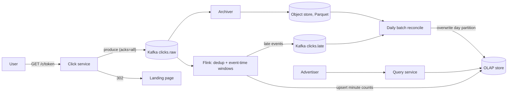

## In one minute
- **Count by event time, not arrival time.** A click that happened at 12:00:58 belongs to the 12:00 minute even if a phone on a train delivers it at 12:04. Windows close on a watermark, not on the wall clock.
- **Give every click an identity at the source.** The ad server signs an impression token, and the click service derives a click ID from it. Without it, "count each click once" is not even well defined.
- **Run two paths that agree eventually.** A streaming job produces minute counts within about a minute for dashboards and pacing. A daily batch job over the raw log recomputes the same numbers exactly, and the batch result is what advertisers are billed on.
- **Pre-aggregate before you shuffle.** Sending every click to one counter per ad creates hot keys. Combine locally, then merge.
- **Serve from a columnar OLAP store with rollups.** "Clicks per minute for my 40 ads this week" is a range scan over a small, sorted, pre-aggregated table.

## Requirements

**Functional**
- A user clicking an ad is redirected to the advertiser's landing page, and the click is recorded.
- Advertisers query click counts per ad (and per campaign) at minute granularity for recent data and hourly or daily granularity for older data.
- The same click recorded twice, from retries or double taps, counts once.
- Clicks that arrive late are still counted, either in the streaming result or in the reconciled result.

**Non-functional**
- Redirect latency under about 50 ms at p99, because users are waiting on it.
- Dashboard freshness within about 1 to 2 minutes.
- Billing numbers exact, reconciled within 24 hours.
- No click lost once acknowledged; the system survives the loss of a node or an availability zone without manual repair.

**Out of scope:** impression counting (same pipeline, larger volume), full click-fraud detection (I leave a hook for it), auctions and ad serving, and attribution of conversions.

## Back-of-envelope
- **Volume:** assume 1 billion clicks per day, a plausible order of magnitude for a large ad network. 1e9 / 86,400 ≈ 11,600 clicks/s on average. Ad traffic is peaky (evenings, holiday sales), so plan for 5× at peak, about 60k clicks/s, and test to 100k.
- **Raw storage:** IDs, timestamps, IP, user agent hash and flags come to about 200 B per click. 1e9 × 200 B = 200 GB/day raw. Five years is 200 GB × 1,825 ≈ 365 TB, perhaps 100 TB after columnar compression, before replication.
- **Ingest bandwidth:** 60k × 200 B = 12 MB/s at peak, trivial for Kafka. Partition count is chosen for consumer parallelism, not bandwidth.
- **Aggregates:** of 2 million active ads, assume about 300k get a click in a given minute. 300k × 1,440 ≈ 430M minute rows/day, about 17 GB/day at 40 B per row. Keep minutes for 30 days (about 0.5 TB), hours for 2 years, days forever.
- **Query load:** 50k advertisers refreshing dashboards each minute is a few hundred queries per second, each a range scan over pre-aggregated rows.
- **Dedup state:** a 10-minute horizon at peak holds 60k × 600 = 36M IDs. At about 50 B each with overhead, that is 1.8 GB across the stream job.

## API

```http
GET /c/{click_token}
  click_token = base64(impression_id, ad_id, campaign_id, served_at, landing_url_id) + HMAC
  -> 302 Found, Location: https://advertiser.example/landing?...

GET /v1/advertisers/{advertiser_id}/clicks
  ?ad_ids=a1,a2&from=2026-10-01T00:00Z&to=2026-10-08T00:00Z&granularity=hour
  -> 200 {
       "granularity": "hour",
       "series": [{"ad_id": "a1", "points": [["2026-10-01T00:00Z", 1834], ...]}],
       "freshness": {"final_through": "2026-10-07T00:00Z", "provisional_after": "2026-10-07T00:00Z"}
     }
```

The `freshness` block matters. It tells the dashboard which buckets are reconciled and which are provisional streaming numbers that may still move slightly.

## Data model

**Kafka topic `clicks.raw`**, partitioned by `click_id`. That spreads load evenly and sends all copies of one click to one partition, so dedup is local. Retention is 7 days for replays.

**Raw archive in object storage**, Parquet files under `dt=YYYY-MM-DD/hour=HH/`. This is the source of truth for the batch reconcile and for audits. The partition key is time because every batch job reads a time range.

**OLAP table `ad_clicks_minute`** (ClickHouse, Druid or Pinot):

| Column | Type | Note |
|---|---|---|
| advertiser_id | UInt64 | first sort key, so one advertiser's rows are contiguous |
| ad_id | UInt64 | second sort key |
| window_start | DateTime | time partition by day |
| clicks | UInt64 | summed |
| source | Enum(stream, batch) | batch rows replace stream rows |

The sort key `(advertiser_id, ad_id, window_start)` makes the common query a few contiguous range reads. Partitioning by day makes dropping old minute data a metadata operation. Hourly and daily tables are materialized from this one.

**Ad metadata** (`ad_id → advertiser_id, campaign_id, landing_url`) is small and cached in the click service and the stream job.

## High-level design



**Write path.** The user taps an ad. The click service verifies the HMAC on the token, which rejects forged or tampered clicks cheaply. It derives `click_id = hash(impression_id)`, so a double tap or a browser retry on the same impression gives the same ID. It produces the event to Kafka with `acks=all` and only then returns the 302. If Kafka is slow, it redirects anyway after a short timeout and spools the event to local disk for a sidecar to drain. A lost visitor is worse than a delayed count.

**Stream path.** Flink reads `clicks.raw`, drops events whose ID it has already seen within the dedup horizon, assigns each click to its one-minute event-time window, pre-aggregates per task, then re-keys by `ad_id` and sums. When the watermark passes a window's end, the window fires and Flink upserts `(ad_id, window_start, count)` into the OLAP store; each late click within the allowed lateness fires it again and the row is overwritten with the new total. Clicks that arrive after the lateness has expired go to a side output topic.

**Batch path.** Every night a Spark job reads the previous day's Parquet, dedups by click ID across the whole day, applies fraud filters with the full day's context, and writes exact counts that replace the day's streaming rows.

**Read path.** The query service checks ownership, picks the coarsest rollup table that satisfies the granularity, and caches results for 30 seconds.

## Deep dives

### 1. Counting each click exactly once
There are three places a click can be duplicated: the client retries, the producer retries after a timeout, and the stream job replays after a crash.

- **Client duplicates** are handled by the deterministic click ID. Without a source-assigned ID there is nothing to deduplicate on; two events with the same ad and the same second could be two real users.
- **Producer retries** are handled by Kafka's idempotent producer, which tags each batch with a producer ID and sequence number so the broker drops a resent batch. Since Kafka 3.0 it is on by default, together with `acks=all` ([KIP-679](https://cwiki.apache.org/confluence/display/KAFKA/KIP-679%3A+Producer+will+enable+the+strongest+delivery+guarantee+by+default)), but a conflicting setting such as `acks=1` quietly turns it off unless idempotence is set explicitly ([Kafka producer configs](https://kafka.apache.org/43/configuration/producer-configs/)). It protects only against the producer's own retries, not against a user tapping twice or a process resending after a restart, which is why the click ID still matters.
- **Replays** are handled by the stream job's checkpoints ([Carbone et al.](https://arxiv.org/abs/1506.08603)). Flink snapshots its state (dedup set, open window counts) together with the Kafka offsets. After a crash it restores both and resumes, so state and input position agree.

The output must also be exactly once. A two-phase-commit transactional sink works but ties output visibility to the checkpoint interval: Uber's ads pipeline commits its Kafka output on 2-minute checkpoints and names that interval as the main latency bottleneck ([Uber](https://www.uber.com/en-US/blog/real-time-exactly-once-ad-event-processing/)). **I chose an idempotent upsert**: each fired window writes its full count to the row keyed by `(ad_id, window_start)`, never an increment, so a replayed write is harmless. The dedup set is keyed state with a TTL of about 10 minutes plus the allowed lateness; older duplicates are rare and the batch path catches them.

"Upsert" means different things in different OLAP stores. Pinot's upsert tables return the latest row per primary key, but only if the input stream is partitioned by that key ([Pinot docs](https://docs.pinot.apache.org/manage-data/data-import/upsert-and-dedup/upsert)). ClickHouse's ReplacingMergeTree removes duplicate rows only during background merges at an unknown time, so a query needs `FINAL` (or an `argMax` per key) to avoid counting a window twice ([ClickHouse docs](https://clickhouse.com/docs/engines/table-engines/mergetree-family/replacingmergetree)). Pick the store with this in mind.

### 2. Event time, watermarks and late clicks
Processing-time windows are easy and wrong: a consumer lag spike shifts clicks into later minutes, drawing a fake dip then a fake spike. So windows use event time, stamped by the click service rather than the device, whose clock can be off by hours.

The watermark is Flink's estimate that "no more events older than T will arrive". I use a bounded-out-of-orderness watermark of about 30 seconds, plus an allowed lateness of 2 minutes during which a fired window can still be updated by re-upserting the row. The trade-off is direct: a larger bound means more complete numbers but staler dashboards and more open window state.

Later events go to `clicks.late`, which the nightly batch includes, so nothing is lost. One subtlety is idle partitions. A watermark is the minimum across input partitions, so one partition with no traffic stalls every window. Flink's idleness timeout (`withIdleness` on the watermark strategy) excludes a silent partition from the minimum after a configured period ([Flink docs](https://nightlies.apache.org/flink/flink-docs-stable/docs/dev/datastream/event-time/generating_watermarks/)).

### 3. Hot ads and the shuffle
A Super Bowl ad might get 20% of all clicks for a few minutes. If every click for that ad goes to one Flink subtask, that subtask falls behind, its watermark holds back the whole job and dashboards freeze.

The fix is two-stage aggregation. Stage one, keyed by click ID for dedup, keeps a map of `(ad_id, window) → count` per subtask and emits partial sums when the window fires. Stage two, keyed by `ad_id`, only adds partials. With 64 upstream subtasks, a hot ad generates at most 64 records per minute into stage two, whatever its click rate. Salting the key (`ad_id#0..7`) is the alternative if stage one cannot pre-aggregate, at the cost of a third merge step.

## Down the stack

### Layer 1: The contract
- For any `(ad_id, minute)` bucket, the streaming count never counts a click ID twice within the dedup horizon. A first value is visible about one watermark delay after the minute ends (roughly 30 to 40 seconds with the upsert sink), and it may be revised by late clicks until watermark delay + allowed lateness, about 2.5 minutes, after which it changes only when the batch reconcile replaces it.
- A click acknowledged with a redirect is in Kafka or in the click service's durable spool. Kafka with `replication.factor=3` and `min.insync.replicas=2` survives one broker loss without losing it.
- The batch count for a day is exact with respect to the archived log and replaces the streaming count. The difference between the two is reported as a metric, and a drift above about 0.5% pages someone.

### Layer 2: The mechanism
- **Checkpoints** use asynchronous barrier snapshotting, a variant of Chandy-Lamport. The job manager injects numbered barriers into each source. When an operator has received barrier n on all inputs, it snapshots its state and forwards the barrier. A checkpoint completes when every sink acknowledges it; its Kafka offsets become the restart point.
- **Keyed state** lives in RocksDB: a `ValueState` per click ID with state TTL for dedup, and a `ReducingState` per window holding one running count rather than a list of events.
- **Watermarks** flow as special records in the stream. Each operator's watermark is the minimum of its inputs' watermarks, which is why one slow or skewed input holds back everything downstream.
- **Window firing** is an event-time timer at the window's end. When the watermark passes it the window emits; a late click within the allowed lateness is added and fires the window again with the updated count, and the state is cleared only when the watermark passes `window_end + lateness`. The default lateness is zero, which drops late events silently unless they are sent to a side output with `sideOutputLateData` ([Flink docs](https://nightlies.apache.org/flink/flink-docs-stable/docs/dev/datastream/operators/windows/)).

### Layer 3: The machine
- **Kafka append path.** A produce request appends a batch to the active segment file of the partition with a `write` into the page cache. Followers fetch it, and the leader acknowledges once the in-sync replicas have it, typically in 2 to 10 ms in one region. Kafka does not `fsync` per message (`log.flush.interval.messages` defaults to the maximum long); it relies on replication for durability, because forcing an fsync on every write would cost two to three orders of magnitude in throughput ([Kafka design docs](https://kafka.apache.org/43/design/design/)). Consumers are served with `sendfile`, so bytes go from page cache to the socket without a copy into user space.
- **Batching.** `linger.ms=5` (the default since Kafka 4.0, up from 0 ([KIP-1030](https://cwiki.apache.org/confluence/display/KAFKA/KIP-1030%3A+Change+constraints+and+default+values+for+various+configurations))) and `batch.size` raised from its 16 KB default to 64 KB pack roughly 300 clicks per request, and LZ4 compresses repetitive click records perhaps 3 to 5×.
- **RocksDB on local NVMe.** A state update is a memtable insert, tens of microseconds at most. A dedup lookup that misses the block cache costs one SSD read of a 4 KB block, about 100 µs; Bloom filters on each SST file avoid most of those reads for IDs never seen. Incremental checkpoints upload only new SST files to object storage, so a checkpoint of a 2 GB state might send tens of megabytes.

### Why it's built this way
1. Advertisers pay per click, so overcounting is a billing error. That forces a stable click ID and deduplication on it.
2. Mobile networks deliver clicks out of order and late, so counting by arrival time gives wrong minutes. That forces event-time windows and watermarks.
3. Waiting forever for stragglers makes dashboards useless, so the stream closes windows on a bound and accepts small incompleteness. That forces a second, exact path for billing.
4. Network shuffles cost CPU and create hot spots, so partial aggregation happens before the shuffle.

## Failure modes
- **10× load** during a major event: Kafka absorbs it because ingest is only about 120 MB/s at 10×. Flink lag grows, and watermarks lag with it, so dashboards go stale rather than wrong. Mitigation: autoscale task managers on consumer lag, and keep the redirect path independent of the stream job's health.
- **Region outage:** each region runs its own click service, Kafka and Flink, and writes rows keyed `(ad_id, window_start, region)` that queries sum. A recovering region replays its backlog into its own rows without double counting.
- **Hot ad:** handled by two-stage aggregation; alert when one subtask's record rate exceeds about 3× the median.
- **Bad stream deploy:** restore a pre-deploy checkpoint and replay from Kafka's 7-day retention; the upsert sink overwrites the wrong rows.
- **Clock skew on click servers:** event time comes from the click service host. A host with a clock 10 minutes fast would push the watermark forward and make everyone else's clicks late. Mitigation: reject or clamp timestamps more than a few seconds ahead of the Kafka broker's append time, and alert on NTP offset.

## In the wild
- **Twitter, 2021: dropping the batch path for ad engagement counts.** Twitter processed about 400 billion events a day, and its interaction and engagement aggregates were the source of truth for ads revenue. The old Lambda design (Heron streaming plus hourly batch) lost events when backpressure forced container restarts. The replacement relays events at least once to Pub/Sub with a UUID, dedups and aggregates in Dataflow, and writes to Bigtable with latency up to about 10 seconds. Validation against the old batch counts showed more than 95% exact matches, and most of the gap was late events the batch pipeline had discarded ([Twitter Engineering](https://web.archive.org/web/20231209122441/https://blog.twitter.com/engineering/en_us/topics/infrastructure/2021/processing-billions-of-events-in-real-time-at-twitter-)).
- **Uber, 2021: exactly-once ad events for Uber Eats.** Flink dedups events with keyed state, counts clicks and impressions in one-minute tumbling windows, and commits results to Kafka with two-phase commit on 2-minute checkpoints; consumers read only committed records. Each aggregate carries a UUID used as an idempotency key downstream, Pinot upserts on it, and a union job merges two regions' output because Pinot does not replicate between regions ([Uber](https://www.uber.com/en-US/blog/real-time-exactly-once-ad-event-processing/)).
- **Cloudflare, 2023: the analytics pipeline that lived in one building.** A power failure at the PDX-04 data center showed that Kafka and ClickHouse clusters behind analytics ran only in that facility. Most control-plane services moved to the disaster-recovery site in about 6 hours, but analytics and logs took about 41 hours, and some logs were lost permanently ([Cloudflare](https://blog.cloudflare.com/post-mortem-on-cloudflare-control-plane-and-analytics-outage/)).

## Trade-offs

| Option | Strengths | Weaknesses | Choose when |
|---|---|---|---|
| Stream only | One codebase, fresh numbers | Late data and bugs permanently affect billing | Internal metrics, not money |
| Stream plus batch reconcile | Fresh and exact | Two code paths that must agree | Billing-grade counts |
| Idempotent upsert sink | Simple, replay-safe | Requires a store with keyed upserts | Aggregates with a natural key |
| Transactional (2PC) sink | True exactly-once to Kafka | Latency tied to checkpoints, more moving parts | Downstream is another Kafka consumer |
| Large allowed lateness | More complete stream numbers | More state, later finality | Mobile-heavy traffic |
| Salting hot keys | Works without pre-aggregation | Extra merge stage, harder queries | Aggregation cannot be combined locally |

## Leadership lens
- **Build first:** the click service with signed tokens and the raw archive. If those are right, every count can be recomputed later. Then the batch job, because billing depends on it. The stream path comes third.
- **Ownership:** ads serving owns token signing, the data platform team owns Kafka and Flink, reporting owns the OLAP schema and queries. The drift metric is their shared SLO.
- **Cost drivers:** OLAP storage and query CPU, which grow with the number of active ads times retained minutes. Rolling minutes up to hours after 30 days is the largest single saving.
- **Rollout:** run the new stream job in shadow for two weeks, writing to a separate table, and compare against batch per ad per day before any advertiser sees it.
- **Design-review questions:** Who stamps event time? What is the dedup horizon and what happens to a duplicate older than it? What number does the invoice use, and who signs off when stream and batch disagree?

## Check yourself
1. One click-service host's clock runs 10 minutes fast. What goes wrong in the stream job, and how does the design contain it?
   **Answer:** Its future event times push the watermark forward, so everyone else's clicks start looking late and fall out of their windows. The click service rejects or clamps timestamps more than a few seconds ahead of the Kafka broker's append time, and NTP offset is alerted on.
2. Why does the stream sink write each fired window as an idempotent upsert instead of using a two-phase-commit transactional sink?
   **Answer:** Writing the full count to the row keyed by `(ad_id, window_start)`, never an increment, makes a replayed write harmless, while a 2PC sink ties output visibility to the checkpoint interval and adds moving parts. The cost is that the store must support keyed upserts.
3. Estimate the dedup state for a 10-minute horizon at peak. Why is it acceptable that duplicates older than that horizon slip through the stream?
   **Answer:** About 60k clicks/s times 600 s is 36M IDs, roughly 1.8 GB at about 50 B each, which fits in keyed RocksDB state across the job. Older duplicates are rare, and the nightly batch dedups by click ID across the whole day before billing.
4. A Super Bowl ad gets 20% of all clicks. Why can that freeze every dashboard, and how does two-stage aggregation bound the damage?
   **Answer:** All its clicks land on one subtask, which falls behind, and because watermarks are a minimum over inputs it holds back the whole job. Stage one pre-aggregates `(ad_id, window)` counts per subtask, so with 64 upstream subtasks the hot ad sends at most 64 records per minute into stage two.

## Practice
**Task:** Build the core of the streaming counter. `ClickAggregator(window_ms, allowed_lateness_ms)` assigns each click to the tumbling window `[t - t % window_ms, that + window_ms)` by event time. The watermark is the largest event time seen minus `allowed_lateness_ms`, and never moves backward. `ingest(click_id, ad_id, event_time_ms)` returns `"late"` if the click's window end is at or before the current watermark (checked before the watermark is updated with this event), `"duplicate"` if the click ID was already counted in a window that has not yet been flushed, and `"counted"` otherwise. `flush()` closes every window whose end is at or before the watermark, returns its rows as `[window_start, ad_id, count]` sorted by window start then ad ID, and forgets the click IDs of those windows so memory stays bounded. Also expose `watermark()`, `late_count()` and `seen_size()`. Timestamps are non-negative integers.

```python starter
class ClickAggregator:
    def __init__(self, window_ms, allowed_lateness_ms):
        pass

    def watermark(self):
        raise NotImplementedError

    def ingest(self, click_id, ad_id, event_time_ms):
        # TODO: return "counted", "duplicate" or "late"
        raise NotImplementedError

    def flush(self):
        # TODO: return [[window_start, ad_id, count], ...] for closed windows
        raise NotImplementedError

    def late_count(self):
        raise NotImplementedError

    def seen_size(self):
        raise NotImplementedError
```

```python tests
def test_counts_one_window_after_watermark_passes():
    agg = ClickAggregator(60000, 0)
    assert agg.ingest("c1", "ad1", 1000) == "counted"
    assert agg.ingest("c2", "ad1", 2000) == "counted"
    assert agg.flush() == [], "window still open"
    agg.ingest("c3", "ad2", 60000)
    assert agg.flush() == [[0, "ad1", 2]]

def test_duplicate_click_counts_once():
    agg = ClickAggregator(60000, 0)
    assert agg.ingest("c1", "ad1", 1000) == "counted"
    assert agg.ingest("c1", "ad1", 1000) == "duplicate"
    agg.ingest("c9", "ad9", 120000)
    assert agg.flush() == [[0, "ad1", 1]]

def test_out_of_order_within_lateness_is_counted():
    agg = ClickAggregator(60000, 30000)
    agg.ingest("a", "ad1", 70000)
    assert agg.watermark() == 40000
    assert agg.ingest("b", "ad1", 50000) == "counted", "window [0,60000) not closed yet"
    agg.ingest("c", "ad1", 95000)
    assert agg.flush() == [[0, "ad1", 1]]

def test_late_event_goes_to_side_count():
    agg = ClickAggregator(60000, 0)
    agg.ingest("a", "ad1", 130000)
    assert agg.ingest("b", "ad1", 59999) == "late"
    assert agg.ingest("c", "ad1", 60000) == "late", "window ending at 120000 is closed"
    assert agg.late_count() == 2
    assert agg.flush() == []

def test_watermark_never_moves_backward():
    agg = ClickAggregator(1000, 100)
    agg.ingest("a", "x", 5000)
    agg.ingest("b", "x", 4950)
    assert agg.watermark() == 4900

def test_flush_is_once_and_forgets_ids():
    agg = ClickAggregator(1000, 0)
    agg.ingest("a", "x", 10)
    agg.ingest("b", "y", 20)
    agg.ingest("c", "x", 1500)
    assert agg.seen_size() == 3
    assert agg.flush() == [[0, "x", 1], [0, "y", 1]]
    assert agg.flush() == []
    assert agg.seen_size() == 1, "only the open window's ID remains"

def test_rows_sorted_by_window_then_ad():
    agg = ClickAggregator(100, 200)
    for i, (ad, t) in enumerate([("b", 150), ("a", 10), ("b", 20), ("a", 120), ("a", 30), ("z", 400)]):
        agg.ingest("id" + str(i), ad, t)
    assert agg.flush() == [[0, "a", 2], [0, "b", 1], [100, "a", 1], [100, "b", 1]]
```

```python solution
class ClickAggregator:
    def __init__(self, window_ms, allowed_lateness_ms):
        self.window = window_ms
        self.lateness = allowed_lateness_ms
        self.max_event = None
        self.counts = {}
        self.seen = {}
        self.late = 0

    def watermark(self):
        if self.max_event is None:
            return float("-inf")
        return self.max_event - self.lateness

    def ingest(self, click_id, ad_id, event_time_ms):
        start = event_time_ms - event_time_ms % self.window
        if start + self.window <= self.watermark():
            self.late += 1
            return "late"
        if self.max_event is None or event_time_ms > self.max_event:
            self.max_event = event_time_ms
        if click_id in self.seen:
            return "duplicate"
        self.seen[click_id] = start
        per_ad = self.counts.setdefault(start, {})
        per_ad[ad_id] = per_ad.get(ad_id, 0) + 1
        return "counted"

    def flush(self):
        wm = self.watermark()
        rows = []
        closed = [s for s in self.counts if s + self.window <= wm]
        for start in sorted(closed):
            for ad_id in sorted(self.counts[start]):
                rows.append([start, ad_id, self.counts[start][ad_id]])
            del self.counts[start]
        closed_set = set(closed)
        self.seen = {c: s for c, s in self.seen.items() if s not in closed_set}
        return rows

    def late_count(self):
        return self.late

    def seen_size(self):
        return len(self.seen)
```

```typescript starter
export type Row = [number, string, number];

export class ClickAggregator {
  constructor(windowMs: number, allowedLatenessMs: number) {}
  watermark(): number { throw new Error("TODO"); }
  ingest(clickId: string, adId: string, eventTimeMs: number): string { throw new Error("TODO"); }
  flush(): Row[] { throw new Error("TODO"); }
  lateCount(): number { throw new Error("TODO"); }
  seenSize(): number { throw new Error("TODO"); }
}
```

```typescript tests
test("counts one window after watermark passes", () => {
  const agg = new ClickAggregator(60000, 0);
  assertEqual(agg.ingest("c1", "ad1", 1000), "counted");
  assertEqual(agg.ingest("c2", "ad1", 2000), "counted");
  assertEqual(agg.flush(), [], "window still open");
  agg.ingest("c3", "ad2", 60000);
  assertEqual(agg.flush(), [[0, "ad1", 2]]);
});

test("duplicate click counts once", () => {
  const agg = new ClickAggregator(60000, 0);
  assertEqual(agg.ingest("c1", "ad1", 1000), "counted");
  assertEqual(agg.ingest("c1", "ad1", 1000), "duplicate");
  agg.ingest("c9", "ad9", 120000);
  assertEqual(agg.flush(), [[0, "ad1", 1]]);
});

test("out of order within lateness is counted", () => {
  const agg = new ClickAggregator(60000, 30000);
  agg.ingest("a", "ad1", 70000);
  assertEqual(agg.watermark(), 40000);
  assertEqual(agg.ingest("b", "ad1", 50000), "counted", "window not closed yet");
  agg.ingest("c", "ad1", 95000);
  assertEqual(agg.flush(), [[0, "ad1", 1]]);
});

test("late event goes to side count", () => {
  const agg = new ClickAggregator(60000, 0);
  agg.ingest("a", "ad1", 130000);
  assertEqual(agg.ingest("b", "ad1", 59999), "late");
  assertEqual(agg.ingest("c", "ad1", 60000), "late", "window ending at 120000 is closed");
  assertEqual(agg.lateCount(), 2);
  assertEqual(agg.flush(), []);
});

test("watermark never moves backward", () => {
  const agg = new ClickAggregator(1000, 100);
  agg.ingest("a", "x", 5000);
  agg.ingest("b", "x", 4950);
  assertEqual(agg.watermark(), 4900);
});

test("flush is once and forgets ids", () => {
  const agg = new ClickAggregator(1000, 0);
  agg.ingest("a", "x", 10);
  agg.ingest("b", "y", 20);
  agg.ingest("c", "x", 1500);
  assertEqual(agg.seenSize(), 3);
  assertEqual(agg.flush(), [[0, "x", 1], [0, "y", 1]]);
  assertEqual(agg.flush(), []);
  assertEqual(agg.seenSize(), 1, "only the open window's ID remains");
});

test("rows sorted by window then ad", () => {
  const agg = new ClickAggregator(100, 200);
  const evs: [string, number][] = [["b", 150], ["a", 10], ["b", 20], ["a", 120], ["a", 30], ["z", 400]];
  evs.forEach(([ad, t], i) => agg.ingest("id" + i, ad, t));
  assertEqual(agg.flush(), [[0, "a", 2], [0, "b", 1], [100, "a", 1], [100, "b", 1]]);
});
```

```typescript solution
export type Row = [number, string, number];

export class ClickAggregator {
  private maxEvent: number | null = null;
  private counts = new Map<number, Map<string, number>>();
  private seen = new Map<string, number>();
  private late = 0;

  constructor(private windowMs: number, private latenessMs: number) {}

  watermark(): number {
    return this.maxEvent === null ? -Infinity : this.maxEvent - this.latenessMs;
  }

  ingest(clickId: string, adId: string, eventTimeMs: number): string {
    const start = eventTimeMs - (eventTimeMs % this.windowMs);
    if (start + this.windowMs <= this.watermark()) {
      this.late++;
      return "late";
    }
    if (this.maxEvent === null || eventTimeMs > this.maxEvent) this.maxEvent = eventTimeMs;
    if (this.seen.has(clickId)) return "duplicate";
    this.seen.set(clickId, start);
    let perAd = this.counts.get(start);
    if (!perAd) {
      perAd = new Map();
      this.counts.set(start, perAd);
    }
    perAd.set(adId, (perAd.get(adId) ?? 0) + 1);
    return "counted";
  }

  flush(): Row[] {
    const wm = this.watermark();
    const closed = [...this.counts.keys()].filter((s) => s + this.windowMs <= wm).sort((a, b) => a - b);
    const rows: Row[] = [];
    for (const start of closed) {
      const perAd = this.counts.get(start)!;
      for (const ad of [...perAd.keys()].sort()) rows.push([start, ad, perAd.get(ad)!]);
      this.counts.delete(start);
    }
    const closedSet = new Set(closed);
    for (const [id, s] of [...this.seen]) if (closedSet.has(s)) this.seen.delete(id);
    return rows;
  }

  lateCount(): number { return this.late; }
  seenSize(): number { return this.seen.size; }
}
```

```go starter
package practice

type Row struct {
	WindowStart int64
	AdID        string
	Count       int
}

type ClickAggregator struct{}

func NewClickAggregator(windowMs, allowedLatenessMs int64) *ClickAggregator {
	return &ClickAggregator{}
}

func (a *ClickAggregator) Watermark() int64 { panic("TODO") }

func (a *ClickAggregator) Ingest(clickID, adID string, eventTimeMs int64) string { panic("TODO") }

func (a *ClickAggregator) Flush() []Row { panic("TODO") }

func (a *ClickAggregator) LateCount() int { panic("TODO") }

func (a *ClickAggregator) SeenSize() int { panic("TODO") }
```

```go tests
package practice

import (
	"reflect"
	"testing"
)

func eqRows(t *testing.T, got, want []Row, msg string) {
	t.Helper()
	if len(got) == 0 && len(want) == 0 {
		return
	}
	if !reflect.DeepEqual(got, want) {
		t.Fatalf("%s: got %v, want %v", msg, got, want)
	}
}

func TestCountsOneWindowAfterWatermarkPasses(t *testing.T) {
	a := NewClickAggregator(60000, 0)
	if a.Ingest("c1", "ad1", 1000) != "counted" || a.Ingest("c2", "ad1", 2000) != "counted" {
		t.Fatal("expected counted")
	}
	eqRows(t, a.Flush(), nil, "window still open")
	a.Ingest("c3", "ad2", 60000)
	eqRows(t, a.Flush(), []Row{{0, "ad1", 2}}, "closed window")
}

func TestDuplicateClickCountsOnce(t *testing.T) {
	a := NewClickAggregator(60000, 0)
	a.Ingest("c1", "ad1", 1000)
	if got := a.Ingest("c1", "ad1", 1000); got != "duplicate" {
		t.Fatalf("got %s", got)
	}
	a.Ingest("c9", "ad9", 120000)
	eqRows(t, a.Flush(), []Row{{0, "ad1", 1}}, "dedup")
}

func TestOutOfOrderWithinLatenessIsCounted(t *testing.T) {
	a := NewClickAggregator(60000, 30000)
	a.Ingest("a", "ad1", 70000)
	if a.Watermark() != 40000 {
		t.Fatalf("watermark %d", a.Watermark())
	}
	if got := a.Ingest("b", "ad1", 50000); got != "counted" {
		t.Fatalf("got %s", got)
	}
	a.Ingest("c", "ad1", 95000)
	eqRows(t, a.Flush(), []Row{{0, "ad1", 1}}, "late but allowed")
}

func TestLateEventGoesToSideCount(t *testing.T) {
	a := NewClickAggregator(60000, 0)
	a.Ingest("a", "ad1", 130000)
	if a.Ingest("b", "ad1", 59999) != "late" || a.Ingest("c", "ad1", 60000) != "late" {
		t.Fatal("expected late")
	}
	if a.LateCount() != 2 {
		t.Fatalf("late count %d", a.LateCount())
	}
	eqRows(t, a.Flush(), nil, "nothing counted")
}

func TestWatermarkNeverMovesBackward(t *testing.T) {
	a := NewClickAggregator(1000, 100)
	a.Ingest("a", "x", 5000)
	a.Ingest("b", "x", 4950)
	if a.Watermark() != 4900 {
		t.Fatalf("watermark %d", a.Watermark())
	}
}

func TestFlushIsOnceAndForgetsIDs(t *testing.T) {
	a := NewClickAggregator(1000, 0)
	a.Ingest("a", "x", 10)
	a.Ingest("b", "y", 20)
	a.Ingest("c", "x", 1500)
	if a.SeenSize() != 3 {
		t.Fatalf("seen %d", a.SeenSize())
	}
	eqRows(t, a.Flush(), []Row{{0, "x", 1}, {0, "y", 1}}, "first flush")
	eqRows(t, a.Flush(), nil, "second flush")
	if a.SeenSize() != 1 {
		t.Fatalf("seen after flush %d", a.SeenSize())
	}
}

func TestRowsSortedByWindowThenAd(t *testing.T) {
	a := NewClickAggregator(100, 200)
	ads := []string{"b", "a", "b", "a", "a", "z"}
	ts := []int64{150, 10, 20, 120, 30, 400}
	for i := range ads {
		a.Ingest("id"+string(rune('0'+i)), ads[i], ts[i])
	}
	eqRows(t, a.Flush(), []Row{{0, "a", 2}, {0, "b", 1}, {100, "a", 1}, {100, "b", 1}}, "order")
}
```

```go solution
package practice

import (
	"math"
	"sort"
)

type Row struct {
	WindowStart int64
	AdID        string
	Count       int
}

type ClickAggregator struct {
	window, lateness int64
	maxEvent         int64
	hasEvent         bool
	counts           map[int64]map[string]int
	seen             map[string]int64
	late             int
}

func NewClickAggregator(windowMs, allowedLatenessMs int64) *ClickAggregator {
	return &ClickAggregator{
		window:   windowMs,
		lateness: allowedLatenessMs,
		counts:   map[int64]map[string]int{},
		seen:     map[string]int64{},
	}
}

func (a *ClickAggregator) Watermark() int64 {
	if !a.hasEvent {
		return math.MinInt64
	}
	return a.maxEvent - a.lateness
}

func (a *ClickAggregator) Ingest(clickID, adID string, eventTimeMs int64) string {
	start := eventTimeMs - eventTimeMs%a.window
	if a.hasEvent && start+a.window <= a.Watermark() {
		a.late++
		return "late"
	}
	if !a.hasEvent || eventTimeMs > a.maxEvent {
		a.maxEvent, a.hasEvent = eventTimeMs, true
	}
	if _, ok := a.seen[clickID]; ok {
		return "duplicate"
	}
	a.seen[clickID] = start
	if a.counts[start] == nil {
		a.counts[start] = map[string]int{}
	}
	a.counts[start][adID]++
	return "counted"
}

func (a *ClickAggregator) Flush() []Row {
	if !a.hasEvent {
		return nil
	}
	wm := a.Watermark()
	var closed []int64
	for s := range a.counts {
		if s+a.window <= wm {
			closed = append(closed, s)
		}
	}
	sort.Slice(closed, func(i, j int) bool { return closed[i] < closed[j] })
	var rows []Row
	closedSet := map[int64]bool{}
	for _, s := range closed {
		closedSet[s] = true
		ads := make([]string, 0, len(a.counts[s]))
		for ad := range a.counts[s] {
			ads = append(ads, ad)
		}
		sort.Strings(ads)
		for _, ad := range ads {
			rows = append(rows, Row{s, ad, a.counts[s][ad]})
		}
		delete(a.counts, s)
	}
	for id, s := range a.seen {
		if closedSet[s] {
			delete(a.seen, id)
		}
	}
	return rows
}

func (a *ClickAggregator) LateCount() int { return a.late }

func (a *ClickAggregator) SeenSize() int { return len(a.seen) }
```

## Mock interview
**Prompt:** Design a system that counts ad clicks per ad per minute for an ad network handling about 1 billion clicks a day, with dashboards that are at most two minutes stale and invoices that must be exact.

- Follow-up: A user taps an ad twice and the phone also retries the request. Walk me through every place a duplicate could be counted and what stops each one.
- Follow-up: One Kafka partition stops receiving traffic for ten minutes. What happens to your dashboards, and why?
- Follow-up: Why not just make the stream job exactly-once and drop the batch path?

**A strong answer covers:**
- A click ID assigned at the source from a signed impression token, and dedup keyed on it with a bounded horizon.
- Event-time tumbling windows with a watermark and allowed lateness, a side output for late events, and the idle-partition problem.
- An idempotent upsert sink keyed by `(ad_id, window_start)`, or a clear explanation of transactional sinks and their cost.
- Two-stage aggregation for hot ads, with the arithmetic on how many records reach the second stage.
- A batch reconcile from the raw archive as the billing source of truth, with a drift metric between the two paths.
- Storage sizing for minute rows and rollups, and a query path that reads pre-aggregated, sorted data.

## Sources and further study
**Primary**
- [Photon: Fault-tolerant and Scalable Joining of Continuous Data Streams (Google, SIGMOD 2013)](https://research.google/pubs/photon-fault-tolerant-and-scalable-joining-of-continuous-data-streams/): Google's ads system joining queries and clicks across data centers, at-most-once at any moment and exactly-once eventually.
- [Lightweight Asynchronous Snapshots for Distributed Dataflows (Carbone et al., 2015)](https://arxiv.org/abs/1506.08603): the barrier snapshot algorithm behind Flink checkpoints.
- [KIP-1030: new default values](https://cwiki.apache.org/confluence/display/KAFKA/KIP-1030%3A+Change+constraints+and+default+values+for+various+configurations): the Kafka 4.0 change of `linger.ms` from 0 to 5.

**Systems docs**
- [Apache Flink: windows](https://nightlies.apache.org/flink/flink-docs-stable/docs/dev/datastream/operators/windows/): triggers, allowed lateness, late firings and side outputs.
- [Apache Pinot: upsert](https://docs.pinot.apache.org/manage-data/data-import/upsert-and-dedup/upsert): primary keys, comparison columns and the partitioning requirement.
- [ClickHouse: ReplacingMergeTree](https://clickhouse.com/docs/engines/table-engines/mergetree-family/replacingmergetree): merge-time deduplication and why queries need `FINAL`.

**Books**
- *System Design Interview, Volume 2*, Alex Xu and Sahn Lam, chapter 6 "Ad Click Event Aggregation": the interview-depth version with Lambda versus Kappa and reconciliation.
- *Designing Data-Intensive Applications*, 2nd edition, Kleppmann and Riccomini, chapter 12 "Stream Processing": event time versus processing time, windows, and exactly-once through idempotence.

**Other curricula**
- [Azure Architecture Center: Big data architectures](https://learn.microsoft.com/en-us/azure/architecture/databases/guide/big-data-architectures): frames this design as Lambda (hot and cold paths converging at the client) and names duplicated logic as the cost Kappa removes.
- [Azure Architecture Center: Materialized View pattern](https://learn.microsoft.com/en-us/azure/architecture/patterns/materialized-view): frames the minute and hourly rollups as projections whose staleness window must be chosen up front.

## Watch
- [Design an Ad Click Aggregator w/ a Ex-Meta Staff Engineer (Hello Interview)](https://www.youtube.com/watch?v=Zcv_899yqhI): an interview-paced walkthrough of this exact question, useful for comparing structure.
- [Introduction to Stateful Stream Processing with Apache Flink (Confluent Developer)](https://www.youtube.com/watch?v=Jj7l3j6knls): keyed state, event time and checkpoints, which are the mechanisms the stream path relies on.

## Free resources
- [Streaming 101 (Tyler Akidau, O'Reilly)](https://www.oreilly.com/radar/the-world-beyond-batch-streaming-101/): the clearest explanation of event time versus processing time and why windows need watermarks.
- [The Dataflow Model (Google Research)](https://research.google/pubs/the-dataflow-model-a-practical-approach-to-balancing-correctness-latency-and-cost-in-massive-scale-unbounded-out-of-order-data-processing/): the paper that formalised windows, triggers and late-data handling.
- [Timely stream processing (Apache Flink docs)](https://nightlies.apache.org/flink/flink-docs-stable/docs/concepts/time/): how Flink generates and propagates watermarks, including idle sources.
- [Exactly-once semantics in Apache Kafka (Confluent)](https://www.confluent.io/blog/exactly-once-semantics-are-possible-heres-how-apache-kafka-does-it/): idempotent producers and transactions, and where the guarantee stops.
- [Apache Druid design (Druid docs)](https://druid.apache.org/docs/latest/design/): how a real-time OLAP store ingests streams and serves pre-aggregated, time-partitioned data.
