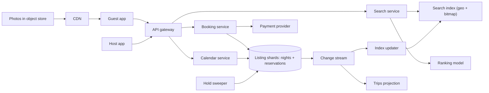

## In one minute
- The calendar is the money. A listing-night can be sold at most once, so the booking path needs one strongly consistent store, partitioned by listing, where a whole date range is claimed in a single-shard transaction.
- Separate "is it probably free?" from "is it actually free?". Search reads a denormalized, seconds-stale copy of availability; only the booking transaction reads the truth. Showing a listing that turns out to be taken is a UX cost; selling it twice is a trust and legal cost.
- Use a short-lived hold (about 10 minutes) between "Reserve" and "payment authorized", so a guest typing card details is not beaten by a second guest, and abandoned checkouts free the dates on their own.
- Model nights as half-open ranges `[check_in, check_out)` in the listing's local time zone. Checkout day is the next guest's check-in day, and nearly every off-by-one booking bug comes from getting this wrong.
- Search is a geo plus date plus price filter followed by ML ranking. Read traffic is roughly 1,000 times the booking write traffic, so the two paths scale and fail independently.

## Requirements
Functional:
- Hosts create listings with photos, house rules, nightly prices and a calendar of blocked dates.
- Guests search by location (a map viewport or a place), dates and guest count, and see available listings with a total price.
- Guests book a date range: instant book, or request-to-book where the host has up to 24 hours to accept.
- Both sides can cancel under a policy; the calendar and payment are updated accordingly.

Non-functional:
- No double booking, ever. This is the one hard invariant.
- Search p99 under about 500 ms; booking confirmation p99 under about 2 s, excluding the payment provider.
- Search may be a few seconds stale; the booking path must be linearizable per listing.
- 99.95% availability for search and booking, with graceful degradation (search without personalization is acceptable; booking without consistency is not).

Out of scope: reviews, messaging, pricing recommendations, fraud and identity verification, payouts to hosts, and experiences. I would mention payments only as an external dependency with an authorize-then-capture API.

## Back-of-envelope
These are planning numbers, not Airbnb's reported figures, though they are in the same order of magnitude as public statements: Airbnb reports more than 9 million active listings as of May 2026 ([Airbnb](https://news.airbnb.com/about-us/)), so the 8 million used below is slightly low.

Listings: about 8 million active. Bookings: assume 120 million reservations a year, which is about 330,000 per day, or roughly 4 per second on average. Seasonal and daily peaks (January planning, evenings) give perhaps 10x, so 40 bookings per second at peak. Each booking also creates and possibly releases a hold, so plan for about 100 calendar writes per second at peak, plus host calendar edits, which may be just as frequent.

Search: assume 25 million daily users doing 10 searches or map pans each, so 250 million queries per day, which is about 2,900 per second on average and perhaps 10,000 per second at peak. The read-to-booking ratio is around 1,000 to 1.

Calendar storage: a two-year booking window is 730 nights. 8 million listings x 730 nights is about 5.8 billion listing-night rows. At about 40 bytes each (listing ID, date, status, price, reservation ID) that is roughly 230 GB before indexes and replication, which is comfortable on a few dozen relational shards. Reservations: 330,000 per day x about 1 KB is 330 MB per day, about 600 GB over five years.

Photos dominate bytes: 8 million listings x 25 photos x 3 MB originals is about 600 TB, plus several resized derivatives. Over five years, with churn, think 1 to 2 PB in object storage behind a CDN.

Bandwidth: a search response of about 40 KB of JSON at 10,000 per second is 400 MB/s from the API tier. Images served from the CDN are an order of magnitude more, which is why they never touch the application servers.

## API
```
GET  /v1/search?bbox=lat1,lng1,lat2,lng2&check_in=2026-12-20&check_out=2026-12-27
         &guests=4&price_max=300&cursor=...
  -> { results: [ { listing_id, title, lat, lng, nightly_price, total_price, rating } ],
       next_cursor }

GET  /v1/listings/{id}/availability?from=2026-12-01&to=2027-02-28
  -> { nights: [ { date, available, price } ] }

POST /v1/reservations          Idempotency-Key: <uuid>
  body { listing_id, check_in, check_out, guests, payment_method_id }
  -> 201 { reservation_id, state: "HELD", hold_expires_at, total_price }
  -> 409 { error: "DATES_UNAVAILABLE" }

POST /v1/reservations/{id}/confirm   Idempotency-Key: <uuid>
  -> 200 { reservation_id, state: "CONFIRMED" | "PENDING_HOST" }

POST /v1/reservations/{id}/cancel
  -> 200 { state: "CANCELLED", refund_amount }

PUT  /v1/listings/{id}/calendar   body { ranges: [ { from, to, blocked, price } ] }
```

## Data model
**listings** (relational, partition key `listing_id`): host ID, title, location (lat, lng), time zone, capacity, base price, policy, status. Partitioned by listing because every booking-path query starts from one listing.

**listing_nights** (same shard as the listing): primary key `(listing_id, night)`, columns `status` (OPEN, BLOCKED, HELD, BOOKED), `price`, `reservation_id`, `hold_expires_at`, `version`. Clustering by `(listing_id, night)` puts a week's rows on one or two index pages. One row per night beats one row per range because prices and host blocks are per-night anyway.

**reservations** (same shard, partition key `listing_id`): `reservation_id` (embedding the shard ID), `guest_id`, `check_in`, `check_out`, `state`, `total_price`, `payment_auth_id`, `idempotency_key` (unique per guest). Co-locating with the calendar makes "claim nights plus insert reservation" one single-shard transaction.

**reservations_by_guest** (partition key `guest_id`): a projection written asynchronously from the change stream, for the "My trips" page. It may lag by seconds, which is fine.

**search index** (Elasticsearch or a custom inverted index, sharded by geo cell): one document per listing with a `geo_point`, amenities, capacity, price, quality signals, and a 730-bit availability bitmap (about 92 bytes) where bit *i* means night *i* from an epoch is open. A date filter becomes "bits check_in to check_out minus 1 all set", which can be precomputed as a mask and tested cheaply in a script or plugin. Note that an Elasticsearch write is not searchable until the next refresh, which runs every second by default ([Elasticsearch docs](https://www.elastic.co/docs/reference/elasticsearch/index-settings/index-modules)), so the index lags the calendar by at least that much even when the change stream is instant.

## High-level design


Write path (booking): the guest taps Reserve. The booking service routes on `listing_id` to its shard and runs one transaction that conditionally moves every night in `[check_in, check_out)` from OPEN (or HELD with an expired hold) to HELD, and inserts a HELD reservation with `hold_expires_at = now + 10 min`. If fewer rows changed than nights requested, it rolls back and returns 409. It then asks the payment provider to authorize (not capture) the total, keyed by the reservation ID. On success it runs a second transaction that flips the nights and the reservation to BOOKED or CONFIRMED, conditional on the hold still being ours and unexpired. The change stream carries those row changes to the index updater, which rewrites the listing's availability bitmap within a few seconds.

Read path (search): the search service turns the viewport and dates into a geo filter and a bitmap mask, asks the index for perhaps 2,000 candidates that pass the hard filters, computes total prices, and has the ranking model order the top few hundred. Results are cached briefly per (rounded viewport, dates, filters). The listing page reads availability from the shard or a near-current replica.

## Deep dives

### Claiming a date range without double booking
Options:
1. `SELECT ... FOR UPDATE` on the night rows, check them in application code, then update. Correct, but holds row locks across a network round trip to the app server.
2. A single conditional `UPDATE listing_nights SET status='HELD', reservation_id=$r, hold_expires_at=$t WHERE listing_id=$l AND night >= $in AND night < $out AND (status='OPEN' OR (status='HELD' AND hold_expires_at < now()))`, then compare the affected row count to the number of nights. It's one statement and one round trip, and the rows are locked only for the duration of the transaction.
3. A range table with an exclusion constraint, `EXCLUDE USING gist (listing_id WITH =, stay WITH &&)`, which makes the database reject overlapping ranges for the same listing. The `=` on a plain integer column inside a GiST constraint needs the `btree_gist` extension; without it the constraint cannot be created ([PostgreSQL docs](https://www.postgresql.org/docs/current/rangetypes.html)).
4. A distributed lock in Redis per listing. This adds a second system whose failure modes (lease expiry during a GC pause) can break the invariant unless the database also checks a fencing token.

I choose option 2. It keeps the invariant inside the database that owns the data, it costs one round trip, and per-night rows also carry per-night prices. Option 3 is fine in a Postgres shop, but host edits like "block every Tuesday" fragment ranges. What matters is that check and claim are atomic in one store.

Holds: a HELD night with an expired `hold_expires_at` is treated as OPEN by the claim predicate itself, so correctness never depends on the sweeper running on time. The sweeper only tidies rows and voids payment authorizations for abandoned checkouts.

### Search with dates at 10,000 queries per second
Calling the calendar service for each of 2,000 candidates would mean 20 million lookups per second. Instead the index carries the availability bitmap, so date filtering happens inside the index with the geo filter. The cost is staleness: an index updater lags the database by a few seconds, so a listing booked moments ago can still appear. The booking transaction catches that and the UI offers alternatives. The bitmap must be rebuilt on every calendar change. With about 100 calendar writes per second, that is about 100 small document updates per second, which is trivial for the index. Price changes from smart pricing tools can be far more frequent. Airbnb's own write-up on embedding-based retrieval says the volume of real-time price and availability updates made an HNSW vector index's memory footprint grow too large, which is one reason it chose an IVF index whose clusters work as an ordinary search filter ([Airbnb Engineering](https://airbnb.tech/ai-ml/embedding-based-retrieval-for-airbnb-search/)). Batch such updates per listing over a short window.

### Holds, payments and request-to-book
The reservation is a small state machine: HELD, then PENDING_HOST (request-to-book) or CONFIRMED, and CANCELLED or EXPIRED as terminal states. Each transition is a conditional update on `(reservation_id, state, version)`, so a late payment callback cannot confirm an expired hold. Payment is authorize-then-capture: authorize while HELD, capture on confirm (or at a policy-defined time), void on expiry. Every call to the provider carries an idempotency key derived from the reservation ID and the step, so a retry after a timeout replays the stored result instead of charging twice ([Stripe](https://stripe.com/blog/idempotency)). Request-to-book extends the hold to the host's response window (up to 24 hours) and sets the nights to HELD under that longer expiry. That still fits inside an online card authorisation, which usually stays valid for about 7 days ([Stripe docs](https://docs.stripe.com/payments/place-a-hold-on-a-payment-method)); capture-at-check-in for a booking months away does not, so long-lead bookings either capture at confirmation or re-authorise closer to the stay. Instant book skips that state.

If the second transaction finds the hold expired but the authorization succeeded, the booking service tries to reclaim the nights. If that fails because someone else got them, it voids the authorization and tells the guest. Money never moves without nights, and nights are never committed without a successful authorization.

## Down the stack

### Layer 1: The contract
For any listing and night, at most one reservation in state HELD (unexpired), PENDING_HOST or CONFIRMED references it. A successful `POST /reservations` guarantees the nights are held until `hold_expires_at` from the database's clock, not the client's. `confirm` with the same idempotency key returns the same result every time. Search results are eventually consistent with a target lag of under 10 seconds. A 409 is always safe to retry with different dates; a timeout on `POST` is safe to retry with the same idempotency key.

### Layer 2: The mechanism
On Postgres, the conditional `UPDATE` scans the primary-key B-tree over `(listing_id, night)`, takes a row-level lock on each matching tuple, and writes a new tuple version. If another transaction holds one of those rows, the second waits. Under READ COMMITTED, when the first commits, Postgres re-evaluates the `WHERE` clause against the newest row version (the EvalPlanQual recheck), so the loser sees `status='HELD'` with a future expiry and skips that row ([PostgreSQL docs](https://www.postgresql.org/docs/current/transaction-iso.html)). The row count comes back short, and the application rolls back. On MySQL InnoDB the same statement behaves differently in one important way. Under InnoDB's default REPEATABLE READ, an `UPDATE` with a range condition takes next-key locks (the record plus the gap before it) on every index record it scans, not just on the rows that match ([MySQL docs](https://dev.mysql.com/doc/refman/8.4/en/innodb-locks-set.html)). Two guests booking adjacent, non-overlapping stays on one listing can therefore block each other briefly, and a host inserting new night rows can wait on a guest's claim. Running the booking path at READ COMMITTED largely removes the gap locks. Both engines give the "claim all or nothing" behaviour with no explicit lock table. The idempotency key has a unique index `(guest_id, idempotency_key)`, so a duplicate insert fails, and the handler returns the stored response.

### Layer 3: The machine
A seven-night claim touches seven roughly 40-byte tuples that sit next to each other on one or two 8 KB heap pages, plus index pages that are hot in shared buffers. Commit appends a few hundred bytes of WAL and calls `fdatasync`; with many concurrent bookings, group commit lets one flush cover several transactions ([PostgreSQL docs](https://www.postgresql.org/docs/current/wal-configuration.html)). On a datacenter NVMe drive with power-loss protection that is roughly 20 to 100 microseconds. With one synchronous replica in another availability zone, add a network round trip of about 0.5 to 2 ms. So a booking transaction costs a few milliseconds end to end, and a shard could do thousands per second. The real limit is contention: two guests on the same listing serialize on the row locks, each waiting at most one transaction duration. The 730-bit bitmap in the search document is 92 bytes, so checking a mask is two or three 64-bit AND operations per candidate.

### Why it's built this way
1. Double booking is unacceptable, so the check and the claim must be one atomic operation in one store.
2. A single store cannot serve 10,000 searches per second over all listings with date filters, so search gets its own denormalized copy, which must then be allowed to lag.
3. Because the copy lags, the booking path re-checks the truth, and the UI must handle "just taken".
4. Payment providers take seconds and fail in odd ways, so a time-boxed hold, and not a long database lock, protects the dates while money moves.
5. Locks and transactions are cheap only on one shard, so everything a booking touches is partitioned by `listing_id`.

## Failure modes
- **10x search load** (a holiday promotion): serve cached results for popular viewports, drop to a cheaper ranking model, and shrink the candidate set. Booking runs on separate capacity so it is not starved.
- **Region outage**: each listing shard has a synchronous replica in a second availability zone and an asynchronous one in another region. A zone failure fails over with no data loss. A full region failure risks losing the last second of writes, so after cross-region failover the booking service should reconcile any HELD or CONFIRMED rows against payment provider records before reopening nights. Search can run read-only from any region.
- **Hot listing** (a viral or limited-edition stay opening its calendar): thousands of guests race for the same rows. Put a per-listing admission queue or lottery in front, so the database sees a handful of claims, not thousands of lock waits.
- **Payment provider slow or down**: holds expire on their own; extend the TTL by a bounded amount while the provider is degraded, and stop accepting new holds if confirmation success drops sharply.
- **Index updater lag**: alert on change-stream lag; the user-visible symptom is a rising 409 rate.

## In the wild
- **Airbnb, 2025: availability churn shapes the search index.** When Airbnb added embedding-based retrieval to search, the volume of real-time price and availability updates made an HNSW vector index's memory footprint grow too large, and running HNSW alongside the geographic filters most searches carry gave poor latency. Airbnb chose an IVF index instead, because its cluster assignments can be applied as just another search filter. The calendar's write rate, not query volume, decided the index design ([Airbnb Engineering](https://airbnb.tech/ai-ml/embedding-based-retrieval-for-airbnb-search/)).
- **Shopify, 2021: reads from replicas that disagree.** Replicas with different lag let related queries in one request see data that did not fit together, such as a row present in one table but missing from a related one. Shopify rejected waiting for every replica and GTID-based causal reads, and instead pinned a series of reads to one replica by hashing a `consistent_read_id` in its ProxySQL fork. The listing page that reads availability from "a near-current replica" needs the same care ([Shopify Engineering](https://shopify.engineering/read-consistency-database-replicas)).
- **GitHub, 2018: a 43-second partition and two primaries.** Network maintenance cut GitHub's US East hub off from its primary data centre for 43 seconds. Orchestrator promoted West Coast MySQL primaries, writes landed on both coasts, and a clean failback was impossible; service was degraded for 24 hours 11 minutes while data was restored and replayed, with 954 unreplicated writes on one cluster to reconcile by hand. GitHub stopped Orchestrator from promoting across regions. This is why the region-failover plan here reconciles HELD and CONFIRMED rows against payment records before reopening nights ([GitHub](https://github.blog/news-insights/company-news/oct21-post-incident-analysis/)).

## Trade-offs
| Option | Strengths | Weaknesses | Choose when |
| --- | --- | --- | --- |
| Per-night rows with conditional update | Simple atomic claim, carries per-night price | 730 rows per listing, more rows to update per stay | Nightly pricing and host blocks are common |
| Range rows with exclusion constraint | Compact, overlap check enforced by the database | Range splitting on edits, Postgres-specific | Mostly long stays, few per-night attributes |
| Distributed lock plus database write | Works across heterogeneous stores | Lease expiry can break the invariant without fencing | Legacy data split across systems |
| Availability bitmap in search index | Date filter in one query | Staleness, rebuild on every change | Search QPS far above booking QPS |
| Live calendar lookup per candidate | Always fresh | Fan-out of thousands of reads per query | Small inventories only |

## Leadership lens
- Build first: the listing shard schema, the claim transaction and the reservation state machine with tests that hammer one listing from many threads. Search can start as a naive geo query; the calendar cannot be redone later without migrating the money path.
- Ownership: a Calendar and Booking team owns the shards and the invariant; Search owns the index and ranking; Payments owns the provider integration and idempotency. The change stream is the contract between them, so version its schema.
- Rollout: shadow-write the new calendar alongside the old one, compare daily, then cut over listing by listing with a kill switch per market.
- Cost drivers: CDN egress for photos, the search cluster (memory for the index), and ranking inference. The relational shards are cheap by comparison.
- Review questions: what is the hold TTL and who chose it; what happens to an authorization when a hold expires; how do we prove no double booking in production (a nightly job that scans for overlapping CONFIRMED rows should always return zero).

## Check yourself
1. The hold sweeper stops running for an hour. Can a guest be blocked from dates whose hold expired, or can dates be double booked?
   **Answer:** Neither. The claim predicate itself treats a HELD night with an expired `hold_expires_at` as OPEN, so correctness never depends on the sweeper; it only tidies rows and voids payment authorizations for abandoned checkouts.
2. Why does the lesson choose a single conditional `UPDATE` with a row-count check over a Redis lock per listing?
   **Answer:** The conditional update keeps check and claim atomic inside the database that owns the data in one round trip. A Redis lock adds a second system whose lease can expire during a GC pause and break the invariant unless the database also checks a fencing token.
3. Why does the search index carry a 730-bit availability bitmap instead of calling the calendar service for each candidate?
   **Answer:** At 10,000 queries per second with about 2,000 candidates each, live lookups would be 20 million reads per second. The 92-byte bitmap lets the date filter run inside the index as a few 64-bit ANDs, at the cost of a few seconds of staleness that the booking transaction catches.
4. Payment authorization succeeds, but the second transaction finds the hold has expired. What does the booking service do?
   **Answer:** It tries to reclaim the nights; if someone else has taken them, it voids the authorization and tells the guest. Money never moves without nights, and nights are never committed without a successful authorization.

## Practice
**Task:** Implement `ListingCalendar`, the per-listing availability structure that sits behind the claim transaction. Days are integers and every stay is a half-open range `[start, end)`. `hold(id, start, end, now, ttl)` succeeds only if the range is valid, the ID is unused and the range overlaps no confirmed booking and no unexpired hold; a hold expires once `now >= created + ttl`. `confirm(id, now)` turns an unexpired hold into a permanent booking (it's idempotent), `release(id, now)` removes a hold or booking, `is_available(start, end, now)` checks a range, and `blocks(now)` returns the active ranges sorted by start as `(start, end, kind)` with kind `"held"` or `"booked"`. Keep the intervals in a sorted structure so each overlap check only inspects neighbours.

```python starter
class ListingCalendar:
    def __init__(self):
        pass

    def hold(self, hold_id, start, end, now, ttl):
        # TODO: reject invalid, duplicate or overlapping ranges
        raise NotImplementedError

    def confirm(self, hold_id, now):
        raise NotImplementedError

    def release(self, hold_id, now):
        raise NotImplementedError

    def is_available(self, start, end, now):
        raise NotImplementedError

    def blocks(self, now):
        raise NotImplementedError
```

```python tests
def test_overlap_rejected_and_adjacent_allowed():
    c = ListingCalendar()
    assert c.hold("h1", 10, 15, 0, 600)
    assert not c.hold("h2", 14, 16, 1, 600), "night 14 is held"
    assert not c.hold("h3", 8, 11, 1, 600), "night 10 is held"
    assert not c.hold("h4", 11, 12, 1, 600), "inside an existing hold"
    assert not c.hold("h5", 5, 20, 1, 600), "covers an existing hold"
    assert c.hold("h6", 15, 18, 1, 600), "checkout day is the next check-in"
    assert c.hold("h7", 7, 10, 1, 600)

def test_expired_hold_frees_dates():
    c = ListingCalendar()
    assert c.hold("h1", 10, 15, 0, 600)
    assert not c.is_available(12, 13, 599)
    assert c.is_available(12, 13, 600), "hold expires at created + ttl"
    assert c.hold("h2", 12, 13, 600, 600)

def test_confirm_makes_booking_permanent():
    c = ListingCalendar()
    assert c.hold("h1", 10, 15, 0, 600)
    assert c.confirm("h1", 300)
    assert c.confirm("h1", 301), "confirm is idempotent"
    assert not c.is_available(10, 15, 10 ** 9), "bookings never expire"
    assert c.blocks(10 ** 9) == [(10, 15, "booked")]

def test_confirm_after_expiry_fails():
    c = ListingCalendar()
    assert c.hold("h1", 10, 15, 0, 600)
    assert not c.confirm("h1", 600)
    assert c.blocks(600) == []

def test_release_frees_range():
    c = ListingCalendar()
    assert c.hold("h1", 1, 4, 0, 600)
    assert c.confirm("h1", 1)
    assert c.release("h1", 2)
    assert not c.release("h1", 3), "already released"
    assert not c.release("nope", 3)
    assert c.hold("h2", 2, 3, 3, 600)

def test_invalid_range_and_duplicate_id():
    c = ListingCalendar()
    assert not c.hold("x", 5, 5, 0, 600), "empty range"
    assert not c.hold("x", 6, 5, 0, 600), "reversed range"
    assert not c.is_available(3, 3, 0)
    assert c.hold("a", 1, 2, 0, 600)
    assert not c.hold("a", 5, 6, 0, 600), "duplicate id"

def test_blocks_sorted_with_kinds():
    c = ListingCalendar()
    assert c.hold("c", 20, 22, 0, 600)
    assert c.hold("a", 1, 3, 0, 600)
    assert c.hold("b", 5, 9, 0, 50)
    assert c.confirm("a", 10)
    assert c.blocks(10) == [(1, 3, "booked"), (5, 9, "held"), (20, 22, "held")]
    assert c.blocks(50) == [(1, 3, "booked"), (20, 22, "held")]
```

```python solution
import bisect


class ListingCalendar:
    def __init__(self):
        self._starts = []      # sorted start days of active intervals
        self._by_start = {}    # start -> [end, id, expires_at or None]
        self._by_id = {}       # id -> start

    def _remove(self, start):
        i = bisect.bisect_left(self._starts, start)
        self._starts.pop(i)
        entry = self._by_start.pop(start)
        del self._by_id[entry[1]]

    def _purge(self, now):
        dead = [s for s in self._starts
                if self._by_start[s][2] is not None and self._by_start[s][2] <= now]
        for s in dead:
            self._remove(s)

    def _conflicts(self, start, end):
        i = bisect.bisect_left(self._starts, start)
        if i > 0 and self._by_start[self._starts[i - 1]][0] > start:
            return True
        return i < len(self._starts) and self._starts[i] < end

    def hold(self, hold_id, start, end, now, ttl):
        if start >= end or ttl <= 0:
            return False
        self._purge(now)
        if hold_id in self._by_id or self._conflicts(start, end):
            return False
        bisect.insort(self._starts, start)
        self._by_start[start] = [end, hold_id, now + ttl]
        self._by_id[hold_id] = start
        return True

    def confirm(self, hold_id, now):
        self._purge(now)
        start = self._by_id.get(hold_id)
        if start is None:
            return False
        self._by_start[start][2] = None
        return True

    def release(self, hold_id, now):
        self._purge(now)
        start = self._by_id.get(hold_id)
        if start is None:
            return False
        self._remove(start)
        return True

    def is_available(self, start, end, now):
        if start >= end:
            return False
        self._purge(now)
        return not self._conflicts(start, end)

    def blocks(self, now):
        self._purge(now)
        out = []
        for s in self._starts:
            end, _, exp = self._by_start[s]
            out.append((s, end, "booked" if exp is None else "held"))
        return out
```

```typescript starter
export type Block = [number, number, string];

export class ListingCalendar {
  hold(id: string, start: number, end: number, now: number, ttl: number): boolean {
    throw new Error("TODO");
  }
  confirm(id: string, now: number): boolean {
    throw new Error("TODO");
  }
  release(id: string, now: number): boolean {
    throw new Error("TODO");
  }
  isAvailable(start: number, end: number, now: number): boolean {
    throw new Error("TODO");
  }
  blocks(now: number): Block[] {
    throw new Error("TODO");
  }
}
```

```typescript tests
test("overlap rejected and adjacent allowed", () => {
  const c = new ListingCalendar();
  assert(c.hold("h1", 10, 15, 0, 600), "first hold");
  assert(!c.hold("h2", 14, 16, 1, 600), "night 14 is held");
  assert(!c.hold("h3", 8, 11, 1, 600), "night 10 is held");
  assert(!c.hold("h4", 11, 12, 1, 600), "inside");
  assert(!c.hold("h5", 5, 20, 1, 600), "covers");
  assert(c.hold("h6", 15, 18, 1, 600), "checkout day is next check-in");
  assert(c.hold("h7", 7, 10, 1, 600), "ends at check-in");
});

test("expired hold frees dates", () => {
  const c = new ListingCalendar();
  assert(c.hold("h1", 10, 15, 0, 600), "hold");
  assert(!c.isAvailable(12, 13, 599), "still held");
  assert(c.isAvailable(12, 13, 600), "expired");
  assert(c.hold("h2", 12, 13, 600, 600), "reclaimed");
});

test("confirm makes booking permanent", () => {
  const c = new ListingCalendar();
  assert(c.hold("h1", 10, 15, 0, 600), "hold");
  assert(c.confirm("h1", 300), "confirm");
  assert(c.confirm("h1", 301), "idempotent");
  assert(!c.isAvailable(10, 15, 1e9), "never expires");
  assertEqual(c.blocks(1e9), [[10, 15, "booked"]], "blocks");
});

test("confirm after expiry fails", () => {
  const c = new ListingCalendar();
  assert(c.hold("h1", 10, 15, 0, 600), "hold");
  assert(!c.confirm("h1", 600), "too late");
  assertEqual(c.blocks(600), [], "empty");
});

test("release frees range", () => {
  const c = new ListingCalendar();
  assert(c.hold("h1", 1, 4, 0, 600), "hold");
  assert(c.confirm("h1", 1), "confirm");
  assert(c.release("h1", 2), "release");
  assert(!c.release("h1", 3), "already released");
  assert(!c.release("nope", 3), "unknown");
  assert(c.hold("h2", 2, 3, 3, 600), "free again");
});

test("invalid range and duplicate id", () => {
  const c = new ListingCalendar();
  assert(!c.hold("x", 5, 5, 0, 600), "empty");
  assert(!c.hold("x", 6, 5, 0, 600), "reversed");
  assert(!c.isAvailable(3, 3, 0), "empty query");
  assert(c.hold("a", 1, 2, 0, 600), "ok");
  assert(!c.hold("a", 5, 6, 0, 600), "duplicate id");
});

test("blocks sorted with kinds", () => {
  const c = new ListingCalendar();
  assert(c.hold("c", 20, 22, 0, 600), "c");
  assert(c.hold("a", 1, 3, 0, 600), "a");
  assert(c.hold("b", 5, 9, 0, 50), "b");
  assert(c.confirm("a", 10), "confirm a");
  assertEqual(c.blocks(10), [[1, 3, "booked"], [5, 9, "held"], [20, 22, "held"]], "at 10");
  assertEqual(c.blocks(50), [[1, 3, "booked"], [20, 22, "held"]], "at 50");
});
```

```typescript solution
export type Block = [number, number, string];

interface Entry { start: number; end: number; id: string; expires: number | null; }

export class ListingCalendar {
  private items: Entry[] = []; // sorted by start, non-overlapping
  private byId = new Map<string, Entry>();

  private lowerBound(start: number): number {
    let lo = 0, hi = this.items.length;
    while (lo < hi) {
      const mid = (lo + hi) >> 1;
      if (this.items[mid].start < start) lo = mid + 1; else hi = mid;
    }
    return lo;
  }

  private remove(e: Entry): void {
    this.items.splice(this.lowerBound(e.start), 1);
    this.byId.delete(e.id);
  }

  private purge(now: number): void {
    const dead = this.items.filter((e) => e.expires !== null && e.expires <= now);
    for (const e of dead) this.remove(e);
  }

  private conflicts(start: number, end: number): boolean {
    const i = this.lowerBound(start);
    if (i > 0 && this.items[i - 1].end > start) return true;
    return i < this.items.length && this.items[i].start < end;
  }

  hold(id: string, start: number, end: number, now: number, ttl: number): boolean {
    if (start >= end || ttl <= 0) return false;
    this.purge(now);
    if (this.byId.has(id) || this.conflicts(start, end)) return false;
    const e: Entry = { start, end, id, expires: now + ttl };
    this.items.splice(this.lowerBound(start), 0, e);
    this.byId.set(id, e);
    return true;
  }

  confirm(id: string, now: number): boolean {
    this.purge(now);
    const e = this.byId.get(id);
    if (!e) return false;
    e.expires = null;
    return true;
  }

  release(id: string, now: number): boolean {
    this.purge(now);
    const e = this.byId.get(id);
    if (!e) return false;
    this.remove(e);
    return true;
  }

  isAvailable(start: number, end: number, now: number): boolean {
    if (start >= end) return false;
    this.purge(now);
    return !this.conflicts(start, end);
  }

  blocks(now: number): Block[] {
    this.purge(now);
    return this.items.map((e): Block => [e.start, e.end, e.expires === null ? "booked" : "held"]);
  }
}
```

```go starter
package practice

type Block struct {
	Start, End int
	Kind       string
}

type ListingCalendar struct{}

func NewListingCalendar() *ListingCalendar { return &ListingCalendar{} }

func (c *ListingCalendar) Hold(id string, start, end, now, ttl int) bool { panic("TODO") }

func (c *ListingCalendar) Confirm(id string, now int) bool { panic("TODO") }

func (c *ListingCalendar) Release(id string, now int) bool { panic("TODO") }

func (c *ListingCalendar) IsAvailable(start, end, now int) bool { panic("TODO") }

func (c *ListingCalendar) Blocks(now int) []Block { panic("TODO") }
```

```go tests
package practice

import (
	"reflect"
	"testing"
)

func TestOverlapRejectedAdjacentAllowed(t *testing.T) {
	c := NewListingCalendar()
	if !c.Hold("h1", 10, 15, 0, 600) {
		t.Fatal("first hold should succeed")
	}
	if c.Hold("h2", 14, 16, 1, 600) || c.Hold("h3", 8, 11, 1, 600) ||
		c.Hold("h4", 11, 12, 1, 600) || c.Hold("h5", 5, 20, 1, 600) {
		t.Fatal("overlapping holds must fail")
	}
	if !c.Hold("h6", 15, 18, 1, 600) || !c.Hold("h7", 7, 10, 1, 600) {
		t.Fatal("adjacent holds must succeed")
	}
}

func TestExpiredHoldFreesDates(t *testing.T) {
	c := NewListingCalendar()
	c.Hold("h1", 10, 15, 0, 600)
	if c.IsAvailable(12, 13, 599) {
		t.Fatal("still held at 599")
	}
	if !c.IsAvailable(12, 13, 600) || !c.Hold("h2", 12, 13, 600, 600) {
		t.Fatal("hold should expire at 600")
	}
}

func TestConfirmMakesBookingPermanent(t *testing.T) {
	c := NewListingCalendar()
	c.Hold("h1", 10, 15, 0, 600)
	if !c.Confirm("h1", 300) || !c.Confirm("h1", 301) {
		t.Fatal("confirm should succeed and be idempotent")
	}
	if c.IsAvailable(10, 15, 1000000000) {
		t.Fatal("bookings never expire")
	}
	if got := c.Blocks(1000000000); !reflect.DeepEqual(got, []Block{{10, 15, "booked"}}) {
		t.Fatalf("blocks = %v", got)
	}
}

func TestConfirmAfterExpiryFails(t *testing.T) {
	c := NewListingCalendar()
	c.Hold("h1", 10, 15, 0, 600)
	if c.Confirm("h1", 600) {
		t.Fatal("confirm after expiry must fail")
	}
	if len(c.Blocks(600)) != 0 {
		t.Fatal("no blocks expected")
	}
}

func TestReleaseFreesRange(t *testing.T) {
	c := NewListingCalendar()
	c.Hold("h1", 1, 4, 0, 600)
	c.Confirm("h1", 1)
	if !c.Release("h1", 2) || c.Release("h1", 3) || c.Release("nope", 3) {
		t.Fatal("release semantics wrong")
	}
	if !c.Hold("h2", 2, 3, 3, 600) {
		t.Fatal("range should be free")
	}
}

func TestInvalidRangeAndDuplicateID(t *testing.T) {
	c := NewListingCalendar()
	if c.Hold("x", 5, 5, 0, 600) || c.Hold("x", 6, 5, 0, 600) || c.IsAvailable(3, 3, 0) {
		t.Fatal("empty or reversed ranges must be rejected")
	}
	if !c.Hold("a", 1, 2, 0, 600) || c.Hold("a", 5, 6, 0, 600) {
		t.Fatal("duplicate id must be rejected")
	}
}

func TestBlocksSortedWithKinds(t *testing.T) {
	c := NewListingCalendar()
	c.Hold("c", 20, 22, 0, 600)
	c.Hold("a", 1, 3, 0, 600)
	c.Hold("b", 5, 9, 0, 50)
	c.Confirm("a", 10)
	want := []Block{{1, 3, "booked"}, {5, 9, "held"}, {20, 22, "held"}}
	if got := c.Blocks(10); !reflect.DeepEqual(got, want) {
		t.Fatalf("at 10: %v", got)
	}
	want = []Block{{1, 3, "booked"}, {20, 22, "held"}}
	if got := c.Blocks(50); !reflect.DeepEqual(got, want) {
		t.Fatalf("at 50: %v", got)
	}
}
```

```go solution
package practice

import "sort"

type Block struct {
	Start, End int
	Kind       string
}

type entry struct {
	start, end int
	id         string
	expires    int
	booked     bool
}

type ListingCalendar struct {
	items []*entry // sorted by start, non-overlapping
	byID  map[string]*entry
}

func NewListingCalendar() *ListingCalendar {
	return &ListingCalendar{byID: map[string]*entry{}}
}

func (c *ListingCalendar) lowerBound(start int) int {
	return sort.Search(len(c.items), func(i int) bool { return c.items[i].start >= start })
}

func (c *ListingCalendar) remove(e *entry) {
	i := c.lowerBound(e.start)
	c.items = append(c.items[:i], c.items[i+1:]...)
	delete(c.byID, e.id)
}

func (c *ListingCalendar) purge(now int) {
	kept := c.items[:0]
	for _, e := range c.items {
		if !e.booked && e.expires <= now {
			delete(c.byID, e.id)
			continue
		}
		kept = append(kept, e)
	}
	c.items = kept
}

func (c *ListingCalendar) conflicts(start, end int) bool {
	i := c.lowerBound(start)
	if i > 0 && c.items[i-1].end > start {
		return true
	}
	return i < len(c.items) && c.items[i].start < end
}

func (c *ListingCalendar) Hold(id string, start, end, now, ttl int) bool {
	if start >= end || ttl <= 0 {
		return false
	}
	c.purge(now)
	if _, dup := c.byID[id]; dup || c.conflicts(start, end) {
		return false
	}
	e := &entry{start: start, end: end, id: id, expires: now + ttl}
	i := c.lowerBound(start)
	c.items = append(c.items, nil)
	copy(c.items[i+1:], c.items[i:])
	c.items[i] = e
	c.byID[id] = e
	return true
}

func (c *ListingCalendar) Confirm(id string, now int) bool {
	c.purge(now)
	e, ok := c.byID[id]
	if !ok {
		return false
	}
	e.booked = true
	return true
}

func (c *ListingCalendar) Release(id string, now int) bool {
	c.purge(now)
	e, ok := c.byID[id]
	if !ok {
		return false
	}
	c.remove(e)
	return true
}

func (c *ListingCalendar) IsAvailable(start, end, now int) bool {
	if start >= end {
		return false
	}
	c.purge(now)
	return !c.conflicts(start, end)
}

func (c *ListingCalendar) Blocks(now int) []Block {
	c.purge(now)
	out := []Block{}
	for _, e := range c.items {
		kind := "held"
		if e.booked {
			kind = "booked"
		}
		out = append(out, Block{e.start, e.end, kind})
	}
	return out
}
```

## Mock interview
**Prompt:** Design Airbnb's search and booking for about 8 million listings, 10,000 searches per second at peak and a few dozen bookings per second. The interviewer stresses that a night must never be sold twice.

- Follow-up: Walk me through exactly what happens in the database when two guests press Reserve on overlapping dates in the same millisecond.
- Follow-up: The payment provider times out after the hold is placed. What state is everything in, and how does it converge?
- Follow-up: Why not check availability live for every search result instead of keeping a copy in the index?

**A strong answer covers:**
- Arithmetic showing search outnumbers bookings by about 1,000 to 1, so the two paths get different stores and consistency levels.
- A single-shard atomic claim over a half-open date range, partitioned by listing, with the overlap check in the database and not in application code.
- Holds with database-clock expiry, treated as free by the claim predicate so correctness does not depend on a sweeper.
- An authorize-then-capture payment flow with idempotency keys and a reservation state machine with conditional transitions.
- An availability bitmap or similar denormalization in the search index, with an explicit staleness budget and a 409 path in the UI.
- Handling of hot listings, time zones, and region failover reconciliation.

## Sources and further study
**Primary**
- [A Critique of ANSI SQL Isolation Levels (Berenson, Bernstein, Gray et al., SIGMOD 1995)](https://arxiv.org/abs/cs/0701157): the anomalies, write skew in particular, that a date-range claim must exclude.
- [How to do distributed locking (Martin Kleppmann)](https://martin.kleppmann.com/2016/02/08/how-to-do-distributed-locking.html): why a lease-based lock needs a fencing token, the argument behind rejecting option 4.

**Systems docs**
- [InnoDB locks set by different SQL statements (MySQL docs)](https://dev.mysql.com/doc/refman/8.4/en/innodb-locks-set.html): next-key and gap locks on range updates under REPEATABLE READ.
- [Transaction isolation (PostgreSQL docs)](https://www.postgresql.org/docs/current/transaction-iso.html): the Read Committed recheck that makes the conditional claim safe.
- [Index modules: refresh interval (Elasticsearch docs)](https://www.elastic.co/docs/reference/elasticsearch/index-settings/index-modules): why an indexed availability change is not searchable for about a second.
- [Place a hold on a payment method (Stripe docs)](https://docs.stripe.com/payments/place-a-hold-on-a-payment-method): authorisation validity windows that bound how long a hold can wait for capture.

**Books**
- System Design Interview, Volume 2 (Xu and Lam, 2022), Ch 7 "Hotel Reservation": room-type inventory, double-booking prevention and idempotent reservations.
- Designing Data-Intensive Applications (Kleppmann, 1st ed., 2017), Ch 7 "Transactions": phantoms and write skew, the exact shape of an overlapping-stay bug.

**Other curricula**
- [CQRS pattern (Azure Architecture Center)](https://learn.microsoft.com/en-us/azure/architecture/patterns/cqrs): frames the search index as a read model that is eventually consistent with the booking write model, using a hotel-booking example.
- [Compensating Transaction pattern (Azure Architecture Center)](https://learn.microsoft.com/en-us/azure/architecture/patterns/compensating-transaction): frames voiding an authorisation after a lost hold as a compensating step that must itself be idempotent.

## Watch
- [Hotel Reservation: System Design Interview (TechPrep)](https://www.youtube.com/watch?v=m67Mjbx6DMY): a walkthrough of the reservation problem, focused on data modeling and double booking.
- [System Design: Airbnb, Booking.com online hotel reservation system (Reach Goals)](https://www.youtube.com/watch?v=iWEWPWM-NG8): covers search and ranking alongside the booking flow.

## Free resources
- [Embedding-Based Retrieval for Airbnb Search (Airbnb Engineering)](https://airbnb.tech/ai-ml/embedding-based-retrieval-for-airbnb-search/): how Airbnb's search retrieval works, and why frequent availability and price updates constrain the index.
- [How Airbnb evolved its data architecture for a multi-product world (Airbnb Engineering)](https://airbnb.tech/uncategorized/scaling-beyond-one-how-airbnb-evolved-its-data-architecture-for-a-multi-product-world/): how availability models differ for homes, experiences and services.
- [PostgreSQL range types and exclusion constraints](https://www.postgresql.org/docs/current/rangetypes.html): the `daterange` type and `EXCLUDE USING gist` for overlap-free reservations.
- [Implementing Stripe-like idempotency keys in Postgres (Brandur Leach)](https://brandur.org/idempotency-keys): a careful design for the idempotent booking and payment steps.
- [Interval tree (Wikipedia)](https://en.wikipedia.org/wiki/Interval_tree): background for the overlap queries in the practice task.
